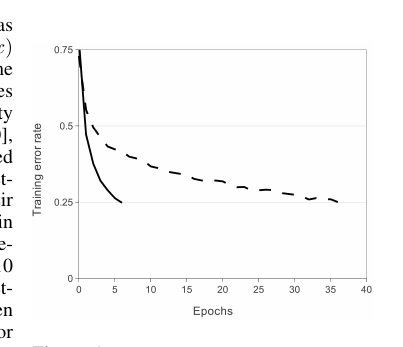
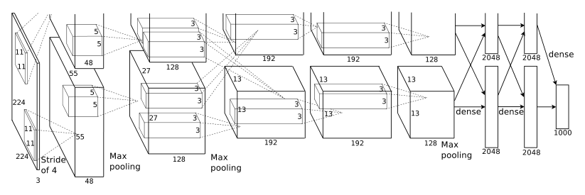
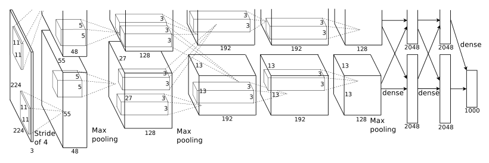
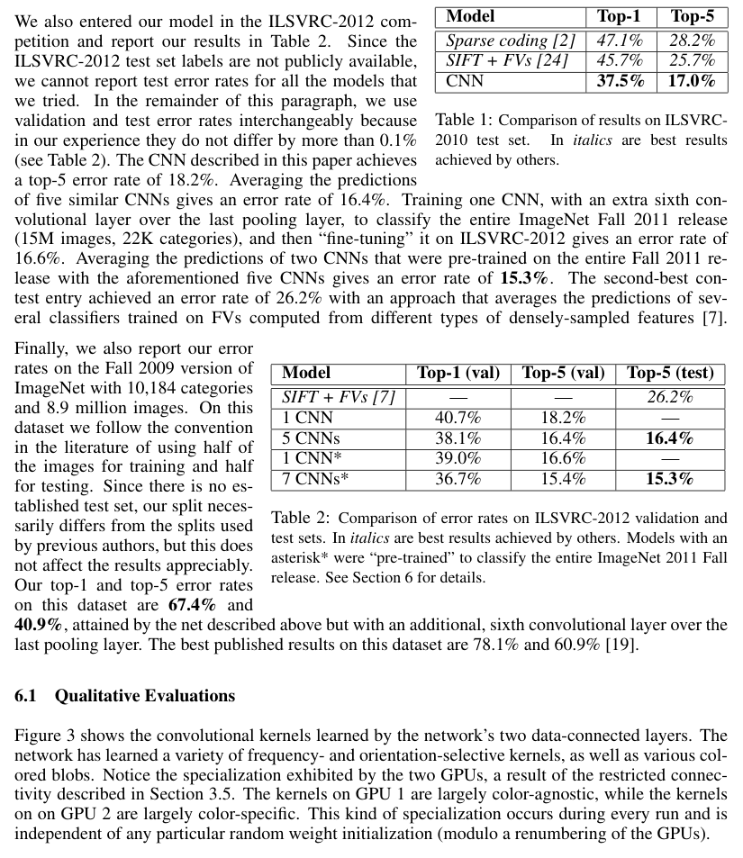
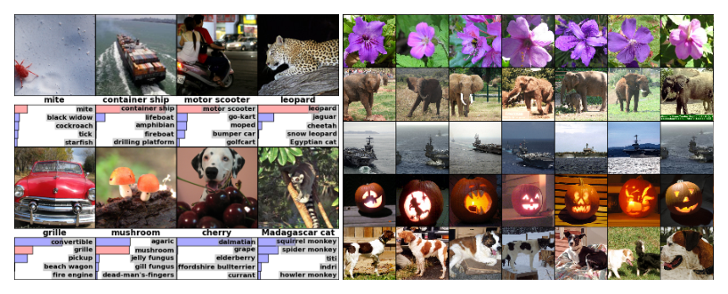

# ImageNet Classification with Deep Convolutional Neural Networks
# 基于深度卷积神经网络的 ImageNet 图像分类

**作者（Authors）**：Alex Krizhevsky (kriz@cs.utoronto.ca), Ilya Sutskever (ilya@cs.utoronto.ca), Geoffrey E. Hinton (hinton@cs.utoronto.ca) — University of Toronto（多伦多大学）

> **说明**：本文为 NeurIPS 2012（原 NIPS）论文，全文双语对照翻译。术语首次出现标注「中文译名（English Term）」，之后统一使用中文译名。公式原样保留。原图/原表页码标注于各图题/表题之后。

---

## Abstract（摘要）

**Original:** We trained a large, deep convolutional neural network to classify the 1.2 million high-resolution images in the ImageNet LSVRC-2010 contest into the 1000 different classes. On the test data, we achieved top-1 and top-5 error rates of 37.5% and 17.0% which is considerably better than the previous state-of-the-art. The neural network, which has 60 million parameters and 650,000 neurons, consists of five convolutional layers, some of which are followed by max-pooling layers, and three fully-connected layers with a final 1000-way softmax. To make training faster, we used non-saturating neurons and a very efficient GPU implementation of the convolution operation. To reduce overfitting in the fully-connected layers we employed a recently-developed regularization method called "dropout" that proved to be very effective. We also entered a variant of this model in the ILSVRC-2012 competition and achieved a winning top-5 test error rate of 15.3%, compared to 26.2% achieved by the second-best entry.

**中文:** 我们训练了一个大型的深度卷积神经网络（Convolutional Neural Network，CNN），把 ImageNet LSVRC-2010 竞赛中的 120 万张高分辨率图像分类到 1000 个不同类别。在测试数据上，我们取得了 37.5% 的 top-1 错误率和 17.0% 的 top-5 错误率，显著优于此前的最优结果（state-of-the-art）。该神经网络拥有 6000 万参数和 65 万神经元，由五个卷积层（其中部分后接最大池化层）和三个全连接层构成，最后一层为 1000 路的 Softmax。为了加快训练，我们使用了非饱和神经元和非常高效的卷积运算 GPU 实现。为了减少全连接层的过拟合，我们采用了一种近期提出的、被证明非常有效的正则化方法——随机失活（dropout）。我们还把该模型的一个变体提交到 ILSVRC-2012 竞赛，取得了 15.3% 的获胜 top-5 测试错误率，而第二名参赛者的成绩为 26.2%。

---

## 1 Introduction（引言）

**Original:** Current approaches to object recognition make essential use of machine learning methods. To improve their performance, we can collect larger datasets, learn more powerful models, and use better techniques for preventing overfitting. Until recently, datasets of labeled images were relatively small — on the order of tens of thousands of images (e.g., NORB [16], Caltech-101/256 [8, 9], and CIFAR-10/100 [12]). Simple recognition tasks can be solved quite well with datasets of this size, especially if they are augmented with label-preserving transformations. For example, the current-best error rate on the MNIST digit-recognition task (<0.3%) approaches human performance [4]. But objects in realistic settings exhibit considerable variability, so to learn to recognize them it is necessary to use much larger training sets. And indeed, the shortcomings of small image datasets have been widely recognized (e.g., Pinto et al. [21]), but it has only recently become possible to collect labeled datasets with millions of images. The new larger datasets include LabelMe [23], which consists of hundreds of thousands of fully-segmented images, and ImageNet [6], which consists of over 15 million labeled high-resolution images in over 22,000 categories.

**中文:** 当前的目标识别（object recognition）方法都大量依赖机器学习方法。要提高这些方法的性能，我们可以收集更大的数据集、学习更强的模型，并使用更好的技术来防止过拟合（overfitting）。直到最近，带标签的图像数据集规模还相对较小——只有数万张图像的量级（例如 NORB [16]、Caltech-101/256 [8, 9] 和 CIFAR-10/100 [12]）。这种规模的数据集已经可以很好地解决简单的识别任务，尤其是配合保持标签的变换（label-preserving transformations）进行扩充时。例如，MNIST 数字识别任务上当前最好的错误率（<0.3%）已接近人类水平 [4]。但现实场景中的物体表现出相当大的可变性，因此要学会识别它们，必须使用大得多的训练集。事实上，小规模图像数据集的缺陷早已被广泛认识到（例如 Pinto 等人 [21]），但直到最近才可能收集到包含数百万张图像的带标签数据集。这些新的大规模数据集包括 LabelMe [23]（包含数十万张完全分割的图像）和 ImageNet [6]（包含超过 1500 万张带标签的高分辨率图像，分属 22,000 多个类别）。

**Original:** To learn about thousands of objects from millions of images, we need a model with a large learning capacity. However, the immense complexity of the object recognition task means that this problem cannot be specified even by a dataset as large as ImageNet, so our model should also have lots of prior knowledge to compensate for all the data we don't have. Convolutional neural networks (CNNs) constitute one such class of models [16, 11, 13, 18, 15, 22, 26]. Their capacity can be controlled by varying their depth and breadth, and they also make strong and mostly correct assumptions about the nature of images (namely, stationarity of statistics and locality of pixel dependencies). Thus, compared to standard feedforward neural networks with similarly-sized layers, CNNs have much fewer connections and parameters and so they are easier to train, while their theoretically-best performance is likely to be only slightly worse.

**中文:** 要从数百万张图像中学习数千种物体，我们需要一个学习容量（learning capacity）很大的模型。然而，目标识别任务的复杂性极高，意味着即使像 ImageNet 这么大的数据集也无法完全刻画该问题，因此我们的模型还应当具备大量的先验知识，以弥补我们所缺失的数据。卷积神经网络（Convolutional Neural Network，CNN）就是这样一类模型 [16, 11, 13, 18, 15, 22, 26]。它们的容量可以通过改变深度和宽度来控制，并且它们对图像的本质（即统计平稳性和像素依赖的局部性）作出了强有力且大体正确的假设。因此，与层规模相近的标准前馈神经网络（feedforward neural network）相比，CNN 的连接和参数少得多，因而更容易训练，而其理论上的最优性能可能只会稍差一些。

**Original:** Despite the attractive qualities of CNNs, and despite the relative efficiency of their local architecture, they have still been prohibitively expensive to apply in large scale to high-resolution images. Luckily, current GPUs, paired with a highly-optimized implementation of 2D convolution, are powerful enough to facilitate the training of interestingly-large CNNs, and recent datasets such as ImageNet contain enough labeled examples to train such models without severe overfitting.

**中文:** 尽管 CNN 具有这些吸引人的优点，尽管其局部结构相对高效，但将其大规模应用于高分辨率图像的成本仍然高得令人望而却步。幸运的是，当前的 GPU 配上高度优化的 2D 卷积实现，已经强大到足以支撑训练规模可观的 CNN；而像 ImageNet 这样的新数据集也包含了足够的带标签样本，可以在不出现严重过拟合的情况下训练这类模型。

**Original:** The specific contributions of this paper are as follows: we trained one of the largest convolutional neural networks to date on the subsets of ImageNet used in the ILSVRC-2010 and ILSVRC-2012 competitions [2] and achieved by far the best results ever reported on these datasets. We wrote a highly-optimized GPU implementation of 2D convolution and all the other operations inherent in training convolutional neural networks, which we make available publicly^1. Our network contains a number of new and unusual features which improve its performance and reduce its training time, which are detailed in Section 3. The size of our network made overfitting a significant problem, even with 1.2 million labeled training examples, so we used several effective techniques for preventing overfitting, which are described in Section 4. Our final network contains five convolutional and three fully-connected layers, and this depth seems to be important: we found that removing any convolutional layer (each of which contains no more than 1% of the model's parameters) resulted in inferior performance.

**中文:** 本文的具体贡献如下：我们在 ILSVRC-2010 和 ILSVRC-2012 竞赛 [2] 所用的 ImageNet 子集上训练了迄今为止最大的卷积神经网络之一，并在这两个数据集上取得了远优于以往所有已报告结果的成绩。我们编写了 2D 卷积以及卷积神经网络训练中所有其他运算的高度优化的 GPU 实现，并将其公开¹。我们的网络包含若干新颖而不寻常的设计，这些设计提升了性能并缩短了训练时间，详见第 3 节。即使有 120 万带标签训练样本，我们网络的规模仍使过拟合成为一个严重问题，因此我们采用了几种有效的防过拟合技术，详见第 4 节。我们最终的网络包含五个卷积层和三个全连接层，这个深度似乎很重要：我们发现移除任意一个卷积层（每层参数不超过模型总参数的 1%）都会导致性能变差。

> **脚注 1**：¹http://code.google.com/p/cuda-convnet/ （原文为 URL，不译）

**Original:** In the end, the network's size is limited mainly by the amount of memory available on current GPUs and by the amount of training time that we are willing to tolerate. Our network takes between five and six days to train on two GTX 580 3GB GPUs. All of our experiments suggest that our results can be improved simply by waiting for faster GPUs and bigger datasets to become available.

**中文:** 归根结底，网络规模主要受限于当前 GPU 的可用显存，以及我们愿意承受的训练时长。我们的网络在两张 GTX 580 3GB GPU 上需要训练五到六天。我们所有的实验都表明，只要等待更快的 GPU 和更大的数据集出现，我们的结果就可以进一步提升。

---

## 2 The Dataset（数据集）

**Original:** ImageNet is a dataset of over 15 million labeled high-resolution images belonging to roughly 22,000 categories. The images were collected from the web and labeled by human labelers using Amazon's Mechanical Turk crowd-sourcing tool. Starting in 2010, as part of the Pascal Visual Object Challenge, an annual competition called the ImageNet Large-Scale Visual Recognition Challenge (ILSVRC) has been held. ILSVRC uses a subset of ImageNet with roughly 1000 images in each of 1000 categories. In all, there are roughly 1.2 million training images, 50,000 validation images, and 150,000 testing images.

**中文:** ImageNet 是一个包含超过 1500 万张带标签高分辨率图像的数据集，这些图像分属约 22,000 个类别。图像从网上收集，并由标注人员通过亚马逊 Mechanical Turk 众包工具进行标注。自 2010 年起，作为 Pascal 视觉目标挑战赛（Pascal Visual Object Challenge）的一部分，每年举办一届名为 ImageNet 大规模视觉识别挑战赛（ImageNet Large-Scale Visual Recognition Challenge，ILSVRC）的比赛。ILSVRC 使用 ImageNet 的一个子集，包含 1000 个类别，每类约 1000 张图像。总共有约 120 万张训练图像、5 万张验证图像和 15 万张测试图像。

**Original:** ILSVRC-2010 is the only version of ILSVRC for which the test set labels are available, so this is the version on which we performed most of our experiments. Since we also entered our model in the ILSVRC-2012 competition, in Section 6 we report our results on this version of the dataset as well, for which test set labels are unavailable. On ImageNet, it is customary to report two error rates: top-1 and top-5, where the top-5 error rate is the fraction of test images for which the correct label is not among the five labels considered most probable by the model.

**中文:** ILSVRC-2010 是唯一一版公开测试集标签的 ILSVRC，因此我们的大多数实验都在这个版本上进行。由于我们还参加了 ILSVRC-2012 竞赛，我们在第 6 节也报告了在该版本数据集上的结果，该版本的测试集标签不可得。在 ImageNet 上，惯例是报告两种错误率：top-1 和 top-5，其中 top-5 错误率指正确标签不在模型认为最可能的五个标签之中的测试图像所占的比例。

**Original:** ImageNet consists of variable-resolution images, while our system requires a constant input dimensionality. Therefore, we down-sampled the images to a fixed resolution of 256 × 256. Given a rectangular image, we first rescaled the image such that the shorter side was of length 256, and then cropped out the central 256×256 patch from the resulting image. We did not pre-process the images in any other way, except for subtracting the mean activity over the training set from each pixel. So we trained our network on the (centered) raw RGB values of the pixels.

**中文:** ImageNet 中的图像分辨率不一，而我们的系统要求固定的输入维度。因此，我们将图像下采样到 256 × 256 的固定分辨率。给定一张矩形图像，我们首先对图像进行缩放，使其短边长度为 256，然后从缩放后的图像中裁剪出中心 256×256 的图像块。除了从每个像素中减去训练集上的平均值之外，我们没有对图像做任何其他预处理。因此，我们是在像素的（中心化后的）原始 RGB 值上训练网络的。

---

## 3 The Architecture（网络结构）

**Original:** The architecture of our network is summarized in Figure 2. It contains eight learned layers — five convolutional and three fully-connected. Below, we describe some of the novel or unusual features of our network's architecture. Sections 3.1-3.4 are sorted according to our estimation of their importance, with the most important first.

**中文:** 我们网络的总体结构如图 2 所示。它包含八个需要学习的层——五个卷积层和三个全连接层。下面我们介绍网络结构中的一些新颖或不寻常之处。第 3.1–3.4 节按我们估计的重要性排序，最重要的排在最前。

### 3.1 ReLU Nonlinearity（ReLU 非线性）

> **图 1（译）**：使用 ReLU（实线）的四层卷积神经网络在 CIFAR-10 上达到 25% 训练错误率的速度，比使用 tanh 神经元的同等网络（虚线）快六倍。两个网络的学习率均独立选取，以使训练尽可能快。未采用任何形式的正则化。这里展示的效果大小随网络结构而异，但使用 ReLU 的网络始终比使用饱和神经元的同等网络快数倍。（原图见 paper.pdf 第 3 页，见下方图）

> **Figure 1（原文）**: A four-layer convolutional neural network with ReLUs (solid line) reaches a 25% training error rate on CIFAR-10 six times faster than an equivalent network with tanh neurons (dashed line). The learning rates for each network were chosen independently to make training as fast as possible. No regularization of any kind was employed. The magnitude of the effect demonstrated here varies with network architecture, but networks with ReLUs consistently learn several times faster than equivalents with saturating neurons.

**Original:** The standard way to model a neuron's output f as a function of its input x is with f(x) = tanh(x) or f(x) = (1 + e^(−x))^(−1). In terms of training time with gradient descent, these saturating nonlinearities are much slower than the non-saturating nonlinearity f(x) = max(0, x). Following Nair and Hinton [20], we refer to neurons with this nonlinearity as Rectified Linear Units (ReLUs). Deep convolutional neural networks with ReLUs train several times faster than their equivalents with tanh units. This is demonstrated in Figure 1, which shows the number of iterations required to reach 25% training error on the CIFAR-10 dataset for a particular four-layer convolutional network. This plot shows that we would not have been able to experiment with such large neural networks for this work if we had used traditional saturating neuron models.

**中文:** 将神经元输出 f 建模为其输入 x 的函数，标准做法是用 $f(x) = \tanh(x)$ 或 $f(x) = (1 + e^{-x})^{-1}$。就梯度下降（gradient descent）的训练时间而言，这些饱和非线性（saturating nonlinearity）远慢于非饱和非线性 $f(x) = \max(0, x)$。沿用 Nair 和 Hinton [20] 的叫法，我们将使用这种非线性的神经元称为修正线性单元（Rectified Linear Units，ReLU）。使用 ReLU 的深度卷积神经网络的训练速度，比使用 tanh 单元的同等网络快数倍。图 1 展示了这一点：它给出一个特定的四层卷积网络在 CIFAR-10 数据集上达到 25% 训练错误率所需的迭代次数。这张图表明，如果采用传统的饱和神经元模型，我们根本不可能在这项工作中对如此大规模的神经网络进行实验。

**Original:** We are not the first to consider alternatives to traditional neuron models in CNNs. For example, Jarrett et al. [11] claim that the nonlinearity f(x) = |tanh(x)| works particularly well with their type of contrast normalization followed by local average pooling on the Caltech-101 dataset. However, on this dataset the primary concern is preventing overfitting, so the effect they are observing is different from the accelerated ability to fit the training set which we report when using ReLUs. Faster learning has a great influence on the performance of large models trained on large datasets.

**中文:** 我们并不是第一个考虑在 CNN 中用其他方案替代传统神经元模型的人。例如，Jarrett 等人 [11] 声称，在他们的对比度归一化（contrast normalization）加局部平均池化的方法中，非线性 $f(x) = |\tanh(x)|$ 在 Caltech-101 数据集上效果特别好。然而，在该数据集上首要问题是防止过拟合，因此他们观察到的效果与我们报告的使用 ReLU 时拟合训练集能力的加速是不同的。更快的学习对在大数据集上训练的大模型的性能有很大影响。

### 3.2 Training on Multiple GPUs（多 GPU 训练）

**Original:** A single GTX 580 GPU has only 3GB of memory, which limits the maximum size of the networks that can be trained on it. It turns out that 1.2 million training examples are enough to train networks which are too big to fit on one GPU. Therefore we spread the net across two GPUs. Current GPUs are particularly well-suited to cross-GPU parallelization, as they are able to read from and write to one another's memory directly, without going through host machine memory. The parallelization scheme that we employ essentially puts half of the kernels (or neurons) on each GPU, with one additional trick: the GPUs communicate only in certain layers. This means that, for example, the kernels of layer 3 take input from all kernel maps in layer 2. However, kernels in layer 4 take input only from those kernel maps in layer 3 which reside on the same GPU. Choosing the pattern of connectivity is a problem for cross-validation, but this allows us to precisely tune the amount of communication until it is an acceptable fraction of the amount of computation.

**中文:** 单张 GTX 580 GPU 只有 3GB 显存，这限制了可在其上训练的网络的最大规模。事实证明，120 万训练样本足以训练出大到单张 GPU 放不下的网络。因此我们把网络分摊到两张 GPU 上。当前的 GPU 特别适合跨 GPU 并行，因为它们可以直接读写彼此的显存，无需经过主机内存。我们采用的并行方案本质上把一半卷积核（kernel，或神经元）放在每张 GPU 上，另加一个小技巧：GPU 只在特定层之间通信。这意味着，例如第 3 层的卷积核从第 2 层的所有卷积核映射（kernel map）接收输入；而第 4 层的卷积核只从第 3 层中位于同一 GPU 上的那些卷积核映射接收输入。连接模式的选择是一个交叉验证（cross-validation）问题，但这让我们能够精确调整通信量，直到它只占计算量的一个可接受的比例。

**Original:** The resultant architecture is somewhat similar to that of the "columnar" CNN employed by Cire¸san et al. [5], except that our columns are not independent (see Figure 2). This scheme reduces our top-1 and top-5 error rates by 1.7% and 1.2%, respectively, as compared with a net with half as many kernels in each convolutional layer trained on one GPU. The two-GPU net takes slightly less time to train than the one-GPU net^2.

**中文:** 最终得到的结构有点类似 Cire¸san 等人 [5] 所用的「柱状」（columnar）CNN，区别在于我们的柱之间不是相互独立的（见图 2）。与每层卷积核数量减半、在单 GPU 上训练的网络相比，该方案使我们的 top-1 和 top-5 错误率分别降低了 1.7% 和 1.2%。双 GPU 网络的训练时间比单 GPU 网络略短²。

> **脚注 2（译）**：单 GPU 网络在最后一个卷积层上实际拥有与双 GPU 网络相同数量的卷积核。这是因为网络的大部分参数都在第一个全连接层，而该层以最后一个卷积层的输出为输入。因此，为了让两个网络具有大致相同的参数量，我们没有将最后一个卷积层（以及其后的全连接层）减半。所以这一比较对单 GPU 网络有利，因为它比双 GPU 网络的「一半」要大。
> **脚注 2（原文）**: The one-GPU net actually has the same number of kernels as the two-GPU net in the final convolutional layer. This is because most of the net's parameters are in the first fully-connected layer, which takes the last convolutional layer as input. So to make the two nets have approximately the same number of parameters, we did not halve the size of the final convolutional layer (nor the fully-conneced layers which follow). Therefore this comparison is biased in favor of the one-GPU net, since it is bigger than "half the size" of the two-GPU net.
### 3.3 Local Response Normalization（局部响应归一化）

**Original:** ReLUs have the desirable property that they do not require input normalization to prevent them from saturating. If at least some training examples produce a positive input to a ReLU, learning will happen in that neuron. However, we still find that the following local normalization scheme aids generalization. Denoting by a^i_(x,y) the activity of a neuron computed by applying kernel i at position (x, y) and then applying the ReLU nonlinearity, the response-normalized activity b^i_(x,y) is given by the expression

$$b^i_{x,y} = a^i_{x,y}\Big/\left(k + \alpha \sum_{j=\max(0, i-n/2)}^{\min(N-1, i+n/2)} \left(a^j_{x,y}\right)^2\right)^\beta$$

where the sum runs over n "adjacent" kernel maps at the same spatial position, and N is the total number of kernels in the layer. The ordering of the kernel maps is of course arbitrary and determined before training begins. This sort of response normalization implements a form of lateral inhibition inspired by the type found in real neurons, creating competition for big activities amongst neuron outputs computed using different kernels. The constants k, n, α, and β are hyper-parameters whose values are determined using a validation set; we used k = 2, n = 5, α = 10^(−4), and β = 0.75. We applied this normalization after applying the ReLU nonlinearity in certain layers (see Section 3.5).

**中文:** ReLU 有一个理想的特性：不需要对输入做归一化来防止饱和。只要至少有一些训练样本对某个 ReLU 产生正输入，该神经元上就会发生学习。不过我们仍然发现，下面这种局部归一化方案有助于泛化（generalization）。记 $a^i_{x,y}$ 为在位置 $(x, y)$ 处用卷积核 $i$ 做卷积、再经 ReLU 非线性后得到的神经元激活值，则响应归一化后的激活值 $b^i_{x,y}$ 由下式给出：

$$b^i_{x,y} = a^i_{x,y}\Big/\left(k + \alpha \sum_{j=\max(0, i-n/2)}^{\min(N-1, i+n/2)} \left(a^j_{x,y}\right)^2\right)^\beta$$

其中求和在同空间位置上的 n 个「相邻」卷积核映射上进行，$N$ 是该层卷积核的总数。卷积核映射的排列顺序当然是任意的，且在训练开始前确定。这种响应归一化实现了一种受真实神经元启发的侧抑制（lateral inhibition），让用不同卷积核计算出的神经元输出之间竞争大激活值。常数 $k$、$n$、$\alpha$ 和 $\beta$ 是超参数（hyper-parameter），其值通过验证集确定；我们使用 $k = 2$、$n = 5$、$\alpha = 10^{-4}$、$\beta = 0.75$。我们在某些层的 ReLU 非线性之后应用了这种归一化（见第 3.5 节）。

**Original:** This scheme bears some resemblance to the local contrast normalization scheme of Jarrett et al. [11], but ours would be more correctly termed "brightness normalization", since we do not subtract the mean activity. Response normalization reduces our top-1 and top-5 error rates by 1.4% and 1.2%, respectively. We also verified the effectiveness of this scheme on the CIFAR-10 dataset: a four-layer CNN achieved a 13% test error rate without normalization and 11% with normalization^3.

**中文:** 该方案与 Jarrett 等人 [11] 的局部对比度归一化方案有些相似，但我们的方案更确切地应称为「亮度归一化」（brightness normalization），因为我们没有减去均值。响应归一化使我们的 top-1 和 top-5 错误率分别降低了 1.4% 和 1.2%。我们还在 CIFAR-10 数据集上验证了这一方案的有效性：一个四层 CNN 在无归一化时测试错误率为 13%，有归一化时为 11%³。

> **脚注 3（译）**：受篇幅所限，我们无法详细描述该网络，但它已由这里提供的代码和参数文件精确指定：http://code.google.com/p/cuda-convnet/。
> **脚注 3（原文）**: We cannot describe this network in detail due to space constraints, but it is specified precisely by the code and parameter files provided here: http://code.google.com/p/cuda-convnet/.

### 3.4 Overlapping Pooling（重叠池化）

**Original:** Pooling layers in CNNs summarize the outputs of neighboring groups of neurons in the same kernel map. Traditionally, the neighborhoods summarized by adjacent pooling units do not overlap (e.g., [17, 11, 4]). To be more precise, a pooling layer can be thought of as consisting of a grid of pooling units spaced s pixels apart, each summarizing a neighborhood of size z × z centered at the location of the pooling unit. If we set s = z, we obtain traditional local pooling as commonly employed in CNNs. If we set s < z, we obtain overlapping pooling. This is what we use throughout our network, with s = 2 and z = 3. This scheme reduces the top-1 and top-5 error rates by 0.4% and 0.3%, respectively, as compared with the non-overlapping scheme s = 2, z = 2, which produces output of equivalent dimensions. We generally observe during training that models with overlapping pooling find it slightly more difficult to overfit.

**中文:** CNN 中的池化层汇总同一卷积核映射中相邻神经元组的输出。传统上，相邻池化单元汇总的邻域互不重叠（例如 [17, 11, 4]）。更准确地说，池化层可以看作由间距为 s 像素的池化单元网格组成，每个单元汇总以该池化单元位置为中心、大小为 z × z 的邻域。若令 s = z，就得到 CNN 中常用的传统局部池化；若令 s < z，则得到重叠池化（overlapping pooling）。我们整个网络都使用重叠池化，取 s = 2 和 z = 3。与输出维度相同的非重叠方案 s = 2、z = 2 相比，该方案使 top-1 和 top-5 错误率分别降低了 0.4% 和 0.3%。我们在训练中普遍观察到，使用重叠池化的模型稍难出现过拟合。

### 3.5 Overall Architecture（总体结构）

**Original:** Now we are ready to describe the overall architecture of our CNN. As depicted in Figure 2, the net contains eight layers with weights; the first five are convolutional and the remaining three are fully-connected. The output of the last fully-connected layer is fed to a 1000-way softmax which produces a distribution over the 1000 class labels. Our network maximizes the multinomial logistic regression objective, which is equivalent to maximizing the average across training cases of the log-probability of the correct label under the prediction distribution.

**中文:** 现在我们可以描述 CNN 的总体结构了。如图 2 所示，网络包含八个带权重的层：前五个是卷积层，其余三个是全连接层。最后一个全连接层的输出被送入 1000 路的 Softmax，产生 1000 个类别标签上的分布。我们的网络最大化多项逻辑回归（multinomial logistic regression）目标函数，这等价于在训练样本上最大化预测分布下正确标签的对数概率（log-probability）的平均值。

**Original:** The kernels of the second, fourth, and fifth convolutional layers are connected only to those kernel maps in the previous layer which reside on the same GPU (see Figure 2). The kernels of the third convolutional layer are connected to all kernel maps in the second layer. The neurons in the fully-connected layers are connected to all neurons in the previous layer. Response-normalization layers follow the first and second convolutional layers. Max-pooling layers, of the kind described in Section 3.4, follow both response-normalization layers as well as the fifth convolutional layer. The ReLU non-linearity is applied to the output of every convolutional and fully-connected layer.

**中文:** 第二、第四和第五卷积层的卷积核只与前一层的、位于同一 GPU 上的卷积核映射相连（见图 2）。第三卷积层的卷积核与第二层的全部卷积核映射相连。全连接层中的神经元与前一层的所有神经元相连。响应归一化层跟在第一、第二卷积层之后。第 3.4 节所述的那种最大池化层跟在两个响应归一化层以及第五卷积层之后。每个卷积层和全连接层的输出上都应用 ReLU 非线性。

> **图 2（译）**：我们 CNN 的结构示意图，明确展示了两张 GPU 之间的职责划分。一张 GPU 运行图中顶部的层部分，另一张 GPU 运行底部的层部分。GPU 只在特定层之间通信。网络输入为 150,528 维，网络其余各层的神经元数量依次为 253,440–186,624–64,896–64,896–43,264–4096–4096–1000。（原图见 paper.pdf 第 5 页，见下方图）

> **Figure 2（原文）**: An illustration of the architecture of our CNN, explicitly showing the delineation of responsibilities between the two GPUs. One GPU runs the layer-parts at the top of the figure while the other runs the layer-parts at the bottom. The GPUs communicate only at certain layers. The network's input is 150,528-dimensional, and the number of neurons in the network's remaining layers is given by 253,440–186,624–64,896–64,896–43,264–4096–4096–1000.

**Original:** The first convolutional layer filters the 224×224×3 input image with 96 kernels of size 11×11×3 with a stride of 4 pixels (this is the distance between the receptive field centers of neighboring neurons in a kernel map). The second convolutional layer takes as input the (response-normalized and pooled) output of the first convolutional layer and filters it with 256 kernels of size 5 × 5 × 48. The third, fourth, and fifth convolutional layers are connected to one another without any intervening pooling or normalization layers. The third convolutional layer has 384 kernels of size 3 × 3 × 256 connected to the (normalized, pooled) outputs of the second convolutional layer. The fourth convolutional layer has 384 kernels of size 3 × 3 × 192, and the fifth convolutional layer has 256 kernels of size 3 × 3 × 192. The fully-connected layers have 4096 neurons each.

**中文:** 第一卷积层用 96 个大小为 11×11×3 的卷积核、以 4 像素的步长（stride）对 224×224×3 的输入图像做卷积（该步长即同一卷积核映射中相邻神经元感受野（receptive field）中心的距离）。第二卷积层以第一卷积层（响应归一化并池化后）的输出为输入，用 256 个大小为 5 × 5 × 48 的卷积核对其进行卷积。第三、第四和第五卷积层依次相连，中间没有任何池化层或归一化层。第三卷积层有 384 个大小为 3 × 3 × 256 的卷积核，与第二卷积层的（归一化、池化后的）输出相连。第四卷积层有 384 个大小为 3 × 3 × 192 的卷积核，第五卷积层有 256 个大小为 3 × 3 × 192 的卷积核。全连接层每层有 4096 个神经元。

---

## 4 Reducing Overfitting（减少过拟合）

**Original:** Our neural network architecture has 60 million parameters. Although the 1000 classes of ILSVRC make each training example impose 10 bits of constraint on the mapping from image to label, this turns out to be insufficient to learn so many parameters without considerable overfitting. Below, we describe the two primary ways in which we combat overfitting.

**中文:** 我们的神经网络结构有 6000 万参数。尽管 ILSVRC 的 1000 个类别使每个训练样本对「图像到标签」的映射施加 10 比特的约束，但事实证明这不足以在不出现严重过拟合的情况下学习如此多的参数。下面我们介绍对抗过拟合的两种主要方法。

### 4.1 Data Augmentation（数据增强）

**Original:** The easiest and most common method to reduce overfitting on image data is to artificially enlarge the dataset using label-preserving transformations (e.g., [25, 4, 5]). We employ two distinct forms of data augmentation, both of which allow transformed images to be produced from the original images with very little computation, so the transformed images do not need to be stored on disk. In our implementation, the transformed images are generated in Python code on the CPU while the GPU is training on the previous batch of images. So these data augmentation schemes are, in effect, computationally free.

**中文:** 在图像数据上减少过拟合最简单、最常用的方法，是使用保持标签的变换人为地扩大数据集（例如 [25, 4, 5]）。我们采用两种不同形式的数据增强（data augmentation），它们都能以极少的计算量从原始图像生成变换后的图像，因此变换后的图像无需存储在磁盘上。在我们的实现中，变换后的图像由 CPU 上的 Python 代码生成，与此同时 GPU 正在前一批图像上训练。因此这些数据增强方案实际上几乎不消耗计算资源。

**Original:** The first form of data augmentation consists of generating image translations and horizontal reflections. We do this by extracting random 224 × 224 patches (and their horizontal reflections) from the 256×256 images and training our network on these extracted patches^4. This increases the size of our training set by a factor of 2048, though the resulting training examples are, of course, highly interdependent. Without this scheme, our network suffers from substantial overfitting, which would have forced us to use much smaller networks. At test time, the network makes a prediction by extracting five 224 × 224 patches (the four corner patches and the center patch) as well as their horizontal reflections (hence ten patches in all), and averaging the predictions made by the network's softmax layer on the ten patches.

**中文:** 第一种数据增强包括生成图像的平移变换和水平翻转。具体做法是：从 256×256 的图像中随机提取 224 × 224 的图像块（及其水平翻转版本），并在这些提取出的图像块上训练网络⁴。这使训练集规模扩大了 2048 倍，不过由此产生的训练样本当然是高度相互依赖的。没有这个方案，我们的网络会严重过拟合，那将迫使我们使用小得多的网络。测试时，网络提取五个 224 × 224 图像块（四个角上的图像块和中心图像块）及其水平翻转版本（共十个图像块）来做预测，并对网络的 Softmax 层在这十个图像块上做出的预测取平均。

> **脚注 4（译）**：这就是图 2 中输入图像为 224 × 224 × 3 维的原因。
> **脚注 4（原文）**: This is the reason why the input images in Figure 2 are 224 × 224 × 3-dimensional.

**Original:** The second form of data augmentation consists of altering the intensities of the RGB channels in training images. Specifically, we perform PCA on the set of RGB pixel values throughout the ImageNet training set. To each training image, we add multiples of the found principal components, with magnitudes proportional to the corresponding eigenvalues times a random variable drawn from a Gaussian with mean zero and standard deviation 0.1. Therefore to each RGB image pixel I_xy = [I^R_xy, I^G_xy, I^B_xy]^T we add the following quantity:

$$[p_1, p_2, p_3][\alpha_1\lambda_1, \alpha_2\lambda_2, \alpha_3\lambda_3]^T$$

where p_i and λ_i are ith eigenvector and eigenvalue of the 3 × 3 covariance matrix of RGB pixel values, respectively, and α_i is the aforementioned random variable. Each α_i is drawn only once for all the pixels of a particular training image until that image is used for training again, at which point it is re-drawn. This scheme approximately captures an important property of natural images, namely, that object identity is invariant to changes in the intensity and color of the illumination. This scheme reduces the top-1 error rate by over 1%.

**中文:** 第二种数据增强是改变训练图像中 RGB 通道的强度。具体地，我们对整个 ImageNet 训练集的 RGB 像素值集合执行主成分分析（PCA）。对每张训练图像，我们加上找到的主成分的若干倍，倍数与相应的特征值成正比，再乘上一个从均值为 0、标准差为 0.1 的高斯（Gaussian）分布中抽取的随机变量。因此，对每个 RGB 图像像素 $I_{xy} = [I^R_{xy}, I^G_{xy}, I^B_{xy}]^T$，我们加上如下量：

$$[p_1, p_2, p_3][\alpha_1\lambda_1, \alpha_2\lambda_2, \alpha_3\lambda_3]^T$$

其中 $p_i$ 和 $\lambda_i$ 分别是 RGB 像素值的 3 × 3 协方差矩阵（covariance matrix）的第 $i$ 个特征向量和特征值，$\alpha_i$ 是前述随机变量。对某张特定训练图像的所有像素，每个 $\alpha_i$ 只抽取一次，直到该图像再次被用于训练时才重新抽取。该方案近似捕捉了自然图像的一个重要性质：物体身份对光照强度和颜色的变化保持不变。该方案使 top-1 错误率降低了超过 1%。
### 4.2 Dropout（随机失活）

**Original:** Combining the predictions of many different models is a very successful way to reduce test errors [1, 3], but it appears to be too expensive for big neural networks that already take several days to train. There is, however, a very efficient version of model combination that only costs about a factor of two during training. The recently-introduced technique, called "dropout" [10], consists of setting to zero the output of each hidden neuron with probability 0.5. The neurons which are "dropped out" in this way do not contribute to the forward pass and do not participate in backpropagation. So every time an input is presented, the neural network samples a different architecture, but all these architectures share weights. This technique reduces complex co-adaptations of neurons, since a neuron cannot rely on the presence of particular other neurons. It is, therefore, forced to learn more robust features that are useful in conjunction with many different random subsets of the other neurons. At test time, we use all the neurons but multiply their outputs by 0.5, which is a reasonable approximation to taking the geometric mean of the predictive distributions produced by the exponentially-many dropout networks.

**中文:** 组合许多不同模型的预测是降低测试错误率的一种非常成功的方法 [1, 3]，但对于已经需要几天时间训练的大型神经网络来说，这似乎代价太高。不过，存在一种非常高效的模型组合形式，训练成本只增加约一倍。这项近期提出的技术称为「随机失活」（dropout）[10]，其做法是以 0.5 的概率将每个隐藏神经元的输出置零。以这种方式「失活」的神经元既不参与前向传播，也不参与反向传播（backpropagation）。因此，每次输入呈现时，神经网络都在采样一个不同的结构，但所有这些结构共享权重。该技术减少了神经元之间复杂的协同适应（co-adaptation），因为一个神经元不能依赖其他特定神经元的存在。因此，它被迫学习更鲁棒的特征，这些特征在与许多不同的随机神经元子集结合时都有用。测试时，我们使用所有神经元，但将其输出乘以 0.5，这是对指数级数量的失活网络产生的预测分布取几何平均（geometric mean）的合理近似。

**Original:** We use dropout in the first two fully-connected layers of Figure 2. Without dropout, our network exhibits substantial overfitting. Dropout roughly doubles the number of iterations required to converge.

**中文:** 我们在图 2 的前两个全连接层中使用随机失活。不使用随机失活时，我们的网络会表现出严重的过拟合。随机失活使收敛所需的迭代次数大约翻倍。

> **图 3（译）**：第一卷积层在 224×224×3 输入图像上学到的 96 个大小为 11×11×3 的卷积核。上面 48 个卷积核在 GPU 1 上学得，下面 48 个在 GPU 2 上学得。详见第 6.1 节。（原图见 paper.pdf 第 6 页，见下方图）

> **Figure 3（原文）**: 96 convolutional kernels of size 11×11×3 learned by the first convolutional layer on the 224×224×3 input images. The top 48 kernels were learned on GPU 1 while the bottom 48 kernels were learned on GPU 2. See Section 6.1 for details.

---

## 5 Details of learning（学习细节）

**Original:** We trained our models using stochastic gradient descent with a batch size of 128 examples, momentum of 0.9, and weight decay of 0.0005. We found that this small amount of weight decay was important for the model to learn. In other words, weight decay here is not merely a regularizer: it reduces the model's training error. The update rule for weight w was

$$v_{i+1} := 0.9 \cdot v_i - 0.0005 \cdot \epsilon \cdot w_i - \epsilon \cdot \left\langle \frac{\partial L}{\partial w}\bigg|_{w_i}\right\rangle_{D_i}$$

$$w_{i+1} := w_i + v_{i+1}$$

where i is the iteration index, v is the momentum variable, ϵ is the learning rate, and ⟨∂L/∂w|_(w_i)⟩_(D_i) is the average over the ith batch D_i of the derivative of the objective with respect to w, evaluated at w_i.

**中文:** 我们使用随机梯度下降（Stochastic Gradient Descent，SGD）训练模型，批次大小（batch size）为 128 个样本，动量（momentum）为 0.9，权重衰减（weight decay）为 0.0005。我们发现这一小量权重衰减对模型的学习很重要。换句话说，这里的权重衰减不仅仅是一个正则化项：它降低了模型的训练误差。权重 w 的更新规则为

$$v_{i+1} := 0.9 \cdot v_i - 0.0005 \cdot \epsilon \cdot w_i - \epsilon \cdot \left\langle \frac{\partial L}{\partial w}\bigg|_{w_i}\right\rangle_{D_i}$$

$$w_{i+1} := w_i + v_{i+1}$$

其中 $i$ 是迭代序号，$v$ 是动量变量，$\epsilon$ 是学习率（learning rate），$\left\langle \frac{\partial L}{\partial w}\big|_{w_i}\right\rangle_{D_i}$ 是目标函数对 $w$ 的导数在第 $i$ 个批次 $D_i$ 上的平均值（在 $w_i$ 处取值）。

**Original:** We initialized the weights in each layer from a zero-mean Gaussian distribution with standard deviation 0.01. We initialized the neuron biases in the second, fourth, and fifth convolutional layers, as well as in the fully-connected hidden layers, with the constant 1. This initialization accelerates the early stages of learning by providing the ReLUs with positive inputs. We initialized the neuron biases in the remaining layers with the constant 0.

**中文:** 每层的权重都从均值为 0、标准差为 0.01 的高斯分布初始化。我们将第二、第四和第五卷积层以及全连接隐藏层中的神经元偏置（bias）初始化为常数 1。这种初始化通过为 ReLU 提供正输入来加速学习的早期阶段。其余层的神经元偏置初始化为常数 0。

**Original:** We used an equal learning rate for all layers, which we adjusted manually throughout training. The heuristic which we followed was to divide the learning rate by 10 when the validation error rate stopped improving with the current learning rate. The learning rate was initialized at 0.01 and reduced three times prior to termination. We trained the network for roughly 90 cycles through the training set of 1.2 million images, which took five to six days on two NVIDIA GTX 580 3GB GPUs.

**中文:** 我们对所有层使用相同的学习率，并在整个训练过程中手动调整。我们遵循的经验法则是：当验证错误率在当前学习率下不再改善时，就将学习率除以 10。学习率初始化为 0.01，在训练终止前共下调了三次。我们在 120 万张图像的训练集上训练了大约 90 个轮次（epoch），在两张 NVIDIA GTX 580 3GB GPU 上耗时五到六天。

---

## 6 Results（结果）

**Original:** Our results on ILSVRC-2010 are summarized in Table 1. Our network achieves top-1 and top-5 test set error rates of 37.5% and 17.0%^5. The best performance achieved during the ILSVRC-2010 competition was 47.1% and 28.2% with an approach that averages the predictions produced from six sparse-coding models trained on different features [2], and since then the best published results are 45.7% and 25.7% with an approach that averages the predictions of two classifiers trained on Fisher Vectors (FVs) computed from two types of densely-sampled features [24].

**中文:** 我们在 ILSVRC-2010 上的结果汇总于表 1。我们的网络取得了 37.5% 和 17.0% 的 top-1 与 top-5 测试集错误率⁵。ILSVRC-2010 竞赛期间的最好成绩是 47.1% 和 28.2%，该方法对六个在不同特征上训练的稀疏编码（sparse-coding）模型的预测取平均 [2]；此后已发表的最好结果是 45.7% 和 25.7%，该方法对两个分类器的预测取平均，这两个分类器在由两类稠密采样特征计算出的 Fisher 向量（Fisher Vector，FV）上训练 [24]。

> **表 1（译）**：ILSVRC-2010 测试集上的结果对比。斜体为其他方法取得的最好结果。（原表见 paper.pdf 第 7 页，见下方图）

> **Table 1（原文）**: Comparison of results on ILSVRC-2010 test set. In italics are best results achieved by others.

| 模型（Model） | Top-1 | Top-5 |
|---|---|---|
| Sparse coding [2] | 47.1% | 28.2% |
| SIFT + FVs [24] | 45.7% | 25.7% |
| CNN | 37.5% | 17.0% |

> **脚注 5（译）**：不按第 4.1 节所述对十个图像块的预测取平均时，错误率为 39.0% 和 18.3%。
> **脚注 5（原文）**: The error rates without averaging predictions over ten patches as described in Section 4.1 are 39.0% and 18.3%.

**Original:** We also entered our model in the ILSVRC-2012 competition and report our results in Table 2. Since the ILSVRC-2012 test set labels are not publicly available, we cannot report test error rates for all the models that we tried. In the remainder of this paragraph, we use validation and test error rates interchangeably because in our experience they do not differ by more than 0.1% (see Table 2). The CNN described in this paper achieves a top-5 error rate of 18.2%. Averaging the predictions of five similar CNNs gives an error rate of 16.4%. Training one CNN, with an extra sixth convolutional layer over the last pooling layer, to classify the entire ImageNet Fall 2011 release (15M images, 22K categories), and then "fine-tuning" it on ILSVRC-2012 gives an error rate of 16.6%. Averaging the predictions of two CNNs that were pre-trained on the entire Fall 2011 release with the aforementioned five CNNs gives an error rate of 15.3%. The second-best contest entry achieved an error rate of 26.2% with an approach that averages the predictions of several classifiers trained on FVs computed from different types of densely-sampled features [7].

**中文:** 我们还把模型提交到了 ILSVRC-2012 竞赛，结果报告在表 2 中。由于 ILSVRC-2012 测试集标签未公开，我们无法报告所有尝试过的模型的测试错误率。在本段其余部分，我们将验证错误率和测试错误率交替使用，因为根据我们的经验，二者差异不超过 0.1%（见表 2）。本文所述的 CNN 取得了 18.2% 的 top-5 错误率。对五个相似 CNN 的预测取平均，错误率为 16.4%。训练一个 CNN——它在最后一个池化层之上额外加了第六个卷积层——对整个 ImageNet 2011 秋季版（1500 万张图像，22,000 个类别）做分类，再在 ILSVRC-2012 上「微调」（fine-tuning），错误率为 16.6%。把两个在完整 2011 秋季版上预训练（pre-train）过的 CNN 与前述五个 CNN 的预测取平均，错误率为 15.3%。第二名的参赛作品取得了 26.2% 的错误率，该方法对若干分类器的预测取平均，这些分类器在由不同类型稠密采样特征计算出的 Fisher 向量上训练 [7]。

> **表 2（译）**：ILSVRC-2012 验证集与测试集上的错误率对比。斜体为其他方法取得的最好结果。带星号*的模型曾「预训练」以对整个 ImageNet 2011 秋季版做分类。详见第 6 节。（原表见 paper.pdf 第 7 页，[第 7 页图](assets/figures/tab-2.png)）
> **Table 2（原文）**: Comparison of error rates on ILSVRC-2012 validation and test sets. In italics are best results achieved by others. Models with an asterisk* were "pre-trained" to classify the entire ImageNet 2011 Fall release. See Section 6 for details.

| 模型（Model） | Top-1 (val) | Top-5 (val) | Top-5 (test) |
|---|---|---|---|
| SIFT + FVs [7] | — | — | 26.2% |
| 1 CNN | 40.7% | 18.2% | — |
| 5 CNNs | 38.1% | 16.4% | 16.4% |
| 1 CNN* | 39.0% | 16.6% | — |
| 7 CNNs* | 36.7% | 15.4% | 15.3% |

**Original:** Finally, we also report our error rates on the Fall 2009 version of ImageNet with 10,184 categories and 8.9 million images. On this dataset we follow the convention in the literature of using half of the images for training and half for testing. Since there is no established test set, our split necessarily differs from the splits used by previous authors, but this does not affect the results appreciably. Our top-1 and top-5 error rates on this dataset are 67.4% and 40.9%, attained by the net described above but with an additional, sixth convolutional layer over the last pooling layer. The best published results on this dataset are 78.1% and 60.9% [19].

**中文:** 最后，我们还报告了在 ImageNet 2009 秋季版上的错误率，该版本有 10,184 个类别和 890 万张图像。在该数据集上，我们遵循文献惯例，一半图像用于训练，一半用于测试。由于没有既定的测试集，我们的划分必然与先前作者使用的划分不同，但这并不会对结果产生明显影响。我们在这个数据集上的 top-1 和 top-5 错误率为 67.4% 和 40.9%，由上述网络加上最后一个池化层之上的额外第六卷积层取得。该数据集上已发表的最好结果是 78.1% 和 60.9% [19]。

### 6.1 Qualitative Evaluations（定性评估）

**Original:** Figure 3 shows the convolutional kernels learned by the network's two data-connected layers. The network has learned a variety of frequency- and orientation-selective kernels, as well as various colored blobs. Notice the specialization exhibited by the two GPUs, a result of the restricted connectivity described in Section 3.5. The kernels on GPU 1 are largely color-agnostic, while the kernels on on GPU 2 are largely color-specific. This kind of specialization occurs during every run and is independent of any particular random weight initialization (modulo a renumbering of the GPUs).

**中文:** 图 3 展示了网络两个直接与数据相连的层所学到的卷积核。网络学到了各种频率选择性和方向选择性的卷积核，以及各种彩色团块。注意两张 GPU 表现出的分工——这是第 3.5 节所述受限连接的结果。GPU 1 上的卷积核大多与颜色无关，而 GPU 2 上的卷积核大多与颜色相关 [译注：原文此处写作 "on on GPU 2"，系笔误]。这种分工在每次训练中都会出现，并且与任何特定的随机权重初始化无关（不考虑 GPU 编号交换）。

> **图 4（译）**：（左）八张 ILSVRC-2010 测试图像及模型认为最可能的五个标签。正确标签写在每张图像下方，正确标签对应的概率也用红条显示（若其恰好位于前五）。（右）第一列是五张 ILSVRC-2010 测试图像。其余各列展示六张训练图像，它们所产生的最后一个隐藏层的特征向量与测试图像的特征向量欧氏距离最小。（原图见 paper.pdf 第 8 页，见下方图）

> **Figure 4（原文）**: (Left) Eight ILSVRC-2010 test images and the five labels considered most probable by our model. The correct label is written under each image, and the probability assigned to the correct label is also shown with a red bar (if it happens to be in the top 5). (Right) Five ILSVRC-2010 test images in the first column. The remaining columns show the six training images that produce feature vectors in the last hidden layer with the smallest Euclidean distance from the feature vector for the test image.

**Original:** In the left panel of Figure 4 we qualitatively assess what the network has learned by computing its top-5 predictions on eight test images. Notice that even off-center objects, such as the mite in the top-left, can be recognized by the net. Most of the top-5 labels appear reasonable. For example, only other types of cat are considered plausible labels for the leopard. In some cases (grille, cherry) there is genuine ambiguity about the intended focus of the photograph.

**中文:** 在图 4 左面板中，我们通过计算网络对八张测试图像的 top-5 预测，定性地评估网络学到了什么。注意，即使是偏离中心的物体，例如左上角的螨虫，网络也能识别。大多数 top-5 标签看起来是合理的。例如，对豹子这张图，只有其他种类的猫科动物被网络认为是可信的标签。在某些情况下（格栅、樱桃），照片的拍摄重点确实存在真实的歧义。

**Original:** Another way to probe the network's visual knowledge is to consider the feature activations induced by an image at the last, 4096-dimensional hidden layer. If two images produce feature activation vectors with a small Euclidean separation, we can say that the higher levels of the neural network consider them to be similar. Figure 4 shows five images from the test set and the six images from the training set that are most similar to each of them according to this measure. Notice that at the pixel level, the retrieved training images are generally not close in L2 to the query images in the first column. For example, the retrieved dogs and elephants appear in a variety of poses. We present the results for many more test images in the supplementary material.

**中文:** 探测网络视觉知识的另一种方式是考察图像在最后一个 4096 维隐藏层上引发的特征激活（feature activation）。如果两张图像产生的特征激活向量欧氏距离（Euclidean separation）很小，就可以说神经网络的较高层认为它们相似。图 4 展示了五张测试图像，以及按此度量与每张测试图像最相似的六张训练图像。注意在像素层面，检索出的训练图像通常与第一列的查询图像在 L2 距离上并不接近。例如，检索出的狗和大象呈现出各种姿态。我们在补充材料中展示了更多测试图像的结果。

**Original:** Computing similarity by using Euclidean distance between two 4096-dimensional, real-valued vectors is inefficient, but it could be made efficient by training an auto-encoder to compress these vectors to short binary codes. This should produce a much better image retrieval method than applying auto-encoders to the raw pixels [14], which does not make use of image labels and hence has a tendency to retrieve images with similar patterns of edges, whether or not they are semantically similar.

**中文:** 用两个 4096 维实值向量之间的欧氏距离计算相似度是低效的，但可以通过训练自编码器（auto-encoder）把这些向量压缩成短二进制码来提高效率。相比把自编码器直接应用于原始像素 [14]——后者不利用图像标签，因而倾向于检索边缘模式相似的图像，无论其语义上是否相似——这应当能产生好得多的图像检索方法。

---

## 7 Discussion（讨论）

**Original:** Our results show that a large, deep convolutional neural network is capable of achieving record-breaking results on a highly challenging dataset using purely supervised learning. It is notable that our network's performance degrades if a single convolutional layer is removed. For example, removing any of the middle layers results in a loss of about 2% for the top-1 performance of the network. So the depth really is important for achieving our results.

**中文:** 我们的结果表明，一个大型深度卷积神经网络能够仅凭监督学习（supervised learning），在一个极具挑战性的数据集上取得破纪录的成绩。值得注意的是，只要移除一个卷积层，我们网络的性能就会下降。例如，移除任意一个中间层会使网络 top-1 性能损失约 2%。因此，深度对于取得我们的结果确实很重要。

**Original:** To simplify our experiments, we did not use any unsupervised pre-training even though we expect that it will help, especially if we obtain enough computational power to significantly increase the size of the network without obtaining a corresponding increase in the amount of labeled data. Thus far, our results have improved as we have made our network larger and trained it longer but we still have many orders of magnitude to go in order to match the infero-temporal pathway of the human visual system. Ultimately we would like to use very large and deep convolutional nets on video sequences where the temporal structure provides very helpful information that is missing or far less obvious in static images.

**中文:** 为简化实验，我们没有使用任何无监督预训练（unsupervised pre-training），尽管我们预计它会有所帮助，尤其是在我们获得足够的算力、能够显著增大网络规模而标注数据量却没有相应增加的情况下。到目前为止，随着网络变得更大、训练时间更长，我们的结果一直在提升，但要达到人类视觉系统的下颞通路（infero-temporal pathway）的水平，还有数量级的差距。最终，我们希望把非常大且深的卷积网络用于视频序列，视频中的时间结构提供了静态图像中缺失或远不明显的非常有用的信息。
---

## References（参考文献，整体保留原文不译）

[1] R.M. Bell and Y. Koren. Lessons from the netflix prize challenge. ACM SIGKDD Explorations Newsletter, 9(2):75–79, 2007.

[2] A. Berg, J. Deng, and L. Fei-Fei. Large scale visual recognition challenge 2010. www.image-net.org/challenges. 2010.

[3] L. Breiman. Random forests. Machine learning, 45(1):5–32, 2001.

[4] D. Cire¸san, U. Meier, and J. Schmidhuber. Multi-column deep neural networks for image classification. Arxiv preprint arXiv:1202.2745, 2012.

[5] D.C. Cire¸san, U. Meier, J. Masci, L.M. Gambardella, and J. Schmidhuber. High-performance neural networks for visual object classification. Arxiv preprint arXiv:1102.0183, 2011.

[6] J. Deng, W. Dong, R. Socher, L.-J. Li, K. Li, and L. Fei-Fei. ImageNet: A Large-Scale Hierarchical Image Database. In CVPR09, 2009.

[7] J. Deng, A. Berg, S. Satheesh, H. Su, A. Khosla, and L. Fei-Fei. ILSVRC-2012, 2012. URL http://www.image-net.org/challenges/LSVRC/2012/.

[8] L. Fei-Fei, R. Fergus, and P. Perona. Learning generative visual models from few training examples: An incremental bayesian approach tested on 101 object categories. Computer Vision and Image Understanding, 106(1):59–70, 2007.

[9] G. Griffin, A. Holub, and P. Perona. Caltech-256 object category dataset. Technical Report 7694, California Institute of Technology, 2007. URL http://authors.library.caltech.edu/7694.

[10] G.E. Hinton, N. Srivastava, A. Krizhevsky, I. Sutskever, and R.R. Salakhutdinov. Improving neural networks by preventing co-adaptation of feature detectors. arXiv preprint arXiv:1207.0580, 2012.

[11] K. Jarrett, K. Kavukcuoglu, M. A. Ranzato, and Y. LeCun. What is the best multi-stage architecture for object recognition? In International Conference on Computer Vision, pages 2146–2153. IEEE, 2009.

[12] A. Krizhevsky. Learning multiple layers of features from tiny images. Master's thesis, Department of Computer Science, University of Toronto, 2009.

[13] A. Krizhevsky. Convolutional deep belief networks on cifar-10. Unpublished manuscript, 2010.

[14] A. Krizhevsky and G.E. Hinton. Using very deep autoencoders for content-based image retrieval. In ESANN, 2011.

[15] Y. Le Cun, B. Boser, J.S. Denker, D. Henderson, R.E. Howard, W. Hubbard, L.D. Jackel, et al. Handwritten digit recognition with a back-propagation network. In Advances in neural information processing systems, 1990.

[16] Y. LeCun, F.J. Huang, and L. Bottou. Learning methods for generic object recognition with invariance to pose and lighting. In Computer Vision and Pattern Recognition, 2004. CVPR 2004. Proceedings of the 2004 IEEE Computer Society Conference on, volume 2, pages II–97. IEEE, 2004.

[17] Y. LeCun, K. Kavukcuoglu, and C. Farabet. Convolutional networks and applications in vision. In Circuits and Systems (ISCAS), Proceedings of 2010 IEEE International Symposium on, pages 253–256. IEEE, 2010.

[18] H. Lee, R. Grosse, R. Ranganath, and A.Y. Ng. Convolutional deep belief networks for scalable unsupervised learning of hierarchical representations. In Proceedings of the 26th Annual International Conference on Machine Learning, pages 609–616. ACM, 2009.

[19] T. Mensink, J. Verbeek, F. Perronnin, and G. Csurka. Metric Learning for Large Scale Image Classification: Generalizing to New Classes at Near-Zero Cost. In ECCV - European Conference on Computer Vision, Florence, Italy, October 2012.

[20] V. Nair and G. E. Hinton. Rectified linear units improve restricted boltzmann machines. In Proc. 27th International Conference on Machine Learning, 2010.

[21] N. Pinto, D.D. Cox, and J.J. DiCarlo. Why is real-world visual object recognition hard? PLoS computational biology, 4(1):e27, 2008.

[22] N. Pinto, D. Doukhan, J.J. DiCarlo, and D.D. Cox. A high-throughput screening approach to discovering good forms of biologically inspired visual representation. PLoS computational biology, 5(11):e1000579, 2009.

[23] B.C. Russell, A. Torralba, K.P. Murphy, and W.T. Freeman. Labelme: a database and web-based tool for image annotation. International journal of computer vision, 77(1):157–173, 2008.

[24] J. Sánchez and F. Perronnin. High-dimensional signature compression for large-scale image classification. In Computer Vision and Pattern Recognition (CVPR), 2011 IEEE Conference on, pages 1665–1672. IEEE, 2011.

[25] P.Y. Simard, D. Steinkraus, and J.C. Platt. Best practices for convolutional neural networks applied to visual document analysis. In Proceedings of the Seventh International Conference on Document Analysis and Recognition, volume 2, pages 958–962, 2003.

[26] S.C. Turaga, J.F. Murray, V. Jain, F. Roth, M. Helmstaedter, K. Briggman, W. Denk, and H.S. Seung. Convolutional networks can learn to generate affinity graphs for image segmentation. Neural Computation, 22(2):511–538, 2010.
