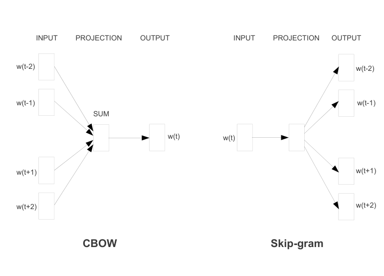
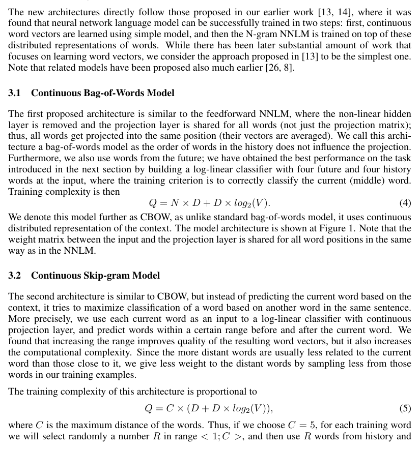
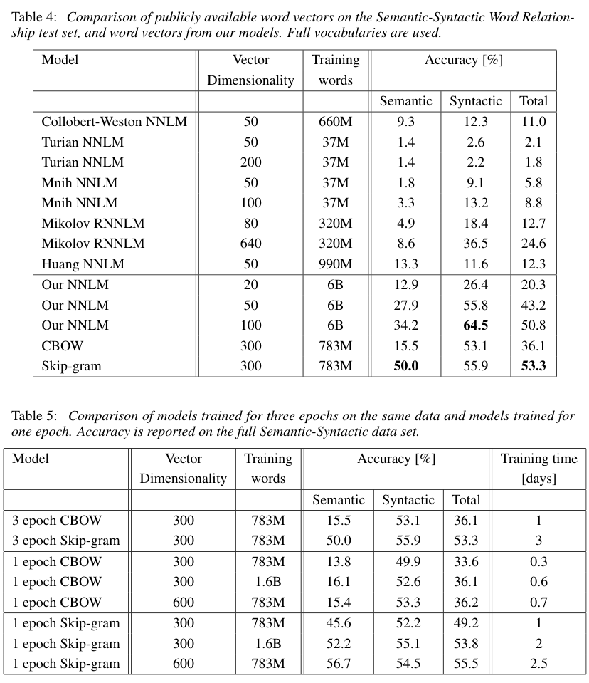
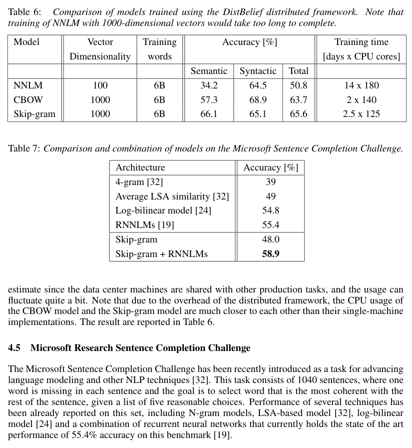

# 向量空间中词表示的有效估计（Efficient Estimation of Word Representations in Vector Space）

**Original:** Efficient Estimation of Word Representations in Vector Space

**中文:** 向量空间中词表示的有效估计

Tomas Mikolov, Kai Chen, Greg Corrado, Jeffrey Dean
Google Inc., Mountain View, CA
tmikolov@google.com, kaichen@google.com, gcorrado@google.com, jeff@google.com

arXiv:1301.3781v3 [cs.CL] 7 Sep 2013

## Abstract

**Original:** We propose two novel model architectures for computing continuous vector representations of words from very large data sets. The quality of these representations is measured in a word similarity task, and the results are compared to the previously best performing techniques based on different types of neural networks. We observe large improvements in accuracy at much lower computational cost, i.e. it takes less than a day to learn high quality word vectors from a 1.6 billion words data set. Furthermore, we show that these vectors provide state-of-the-art performance on our test set for measuring syntactic and semantic word similarities.

**中文:** 我们提出了两种新颖的模型架构，用于从非常大的数据集中计算词的连续向量表示（continuous vector representation）。这些表示的质量通过一个词相似度（word similarity）任务来衡量，并将结果与此前基于不同类型神经网络（neural network）的表现最佳的技术进行比较。我们观察到，在计算成本大幅降低的同时，准确率（accuracy）大幅提升——也就是说，从一个包含 16 亿词的数据集中学习高质量的词向量（word vector）只需不到一天的时间。此外，我们证明，这些向量在用于衡量句法（syntactic）和语义（semantic）词相似度的测试集上达到了当前最优（state-of-the-art）水平。

## 1 引言（Introduction）

**Original:** Many current NLP systems and techniques treat words as atomic units - there is no notion of similarity between words, as these are represented as indices in a vocabulary. This choice has several good reasons - simplicity, robustness and the observation that simple models trained on huge amounts of data outperform complex systems trained on less data. An example is the popular N-gram model used for statistical language modeling - today, it is possible to train N-grams on virtually all available data (trillions of words [3]).

**中文:** 当前许多自然语言处理（NLP）系统和技术把词当作原子单位（atomic unit）来处理——词与词之间不存在相似性的概念，因为词在词表（vocabulary）中只是以索引（index）的形式表示。这种选择有几个充分的理由：简单性、稳健性（robustness），以及这样一个观察到的现象——在海量数据上训练的简单模型优于在较少数据上训练的复杂系统。一个例子是用于统计语言建模（statistical language modeling）的流行 N-gram 模型——如今，几乎可以在所有可用数据（数万亿词 [3]）上训练 N-gram 模型。

**Original:** However, the simple techniques are at their limits in many tasks. For example, the amount of relevant in-domain data for automatic speech recognition is limited - the performance is usually dominated by the size of high quality transcribed speech data (often just millions of words). In machine translation, the existing corpora for many languages contain only a few billions of words or less. Thus, there are situations where simple scaling up of the basic techniques will not result in any significant progress, and we have to focus on more advanced techniques.

**中文:** 然而，简单的技术在许多任务中已经达到了它们的极限。例如，自动语音识别（automatic speech recognition）可用的相关领域内数据是有限的——其性能通常受限于高质量转写语音数据的规模（往往只有几百万词）。在机器翻译（machine translation）中，许多语言的现有语料（corpus）只有几十亿词甚至更少。因此，在某些情形下，简单地扩大基本技术的规模不会带来任何显著进展，我们必须转向更先进的技术。

**Original:** With progress of machine learning techniques in recent years, it has become possible to train more complex models on much larger data set, and they typically outperform the simple models. Probably the most successful concept is to use distributed representations of words [10]. For example, neural network based language models significantly outperform N-gram models [1, 27, 17].

**中文:** 随着近年来机器学习（machine learning）技术的进步，在更大规模的数据集上训练更复杂的模型已经成为可能，而这些模型通常优于简单的模型。其中最成功的概念或许是使用词的分布式表示（distributed representation）[10]。例如，基于神经网络的语言模型（language model）显著优于 N-gram 模型 [1, 27, 17]。

### 1.1 本文目标（Goals of the Paper）

**Original:** The main goal of this paper is to introduce techniques that can be used for learning high-quality word vectors from huge data sets with billions of words, and with millions of words in the vocabulary. As far as we know, none of the previously proposed architectures has been successfully trained on more than a few hundred of millions of words, with a modest dimensionality of the word vectors between 50 - 100.

**中文:** 本文的主要目标是介绍一些技术，这些技术可用于从包含数十亿词、词表规模达数百万词的大规模数据集中学习高质量的词向量。据我们所知，此前提出的架构中，没有任何一个能够在超过几亿词的规模上被成功训练（词向量的维度（dimensionality）仅为中等规模的 50-100 维）。

**Original:** We use recently proposed techniques for measuring the quality of the resulting vector representations, with the expectation that not only will similar words tend to be close to each other, but that words can have multiple degrees of similarity [20]. This has been observed earlier in the context of inflectional languages - for example, nouns can have multiple word endings, and if we search for similar words in a subspace of the original vector space, it is possible to find words that have similar endings [13, 14].

**中文:** 我们采用最近提出的技术来衡量所得向量表示的质量，期望相似的词不仅会彼此接近，而且词之间可以存在多种程度的相似性 [20]。这一现象在屈折语言（inflectional language）中早已被观察到——例如，名词可以有多种词尾，如果我们在原向量空间（vector space）的某个子空间（subspace）中搜索相似的词，就能找到词尾相似的词 [13, 14]。

**Original:** Somewhat surprisingly, it was found that similarity of word representations goes beyond simple syntactic regularities. Using a word offset technique where simple algebraic operations are performed on the word vectors, it was shown for example that vector("King") - vector("Man") + vector("Woman") results in a vector that is closest to the vector representation of the word Queen [20].

**中文:** 有些出人意料的是，人们发现词表示的相似性超越了简单的句法规律性（syntactic regularity）。利用一种词偏移（word offset）技术——对词向量执行简单的代数运算——例如可以证明，`vector("King")` − `vector("Man")` + `vector("Woman")` 所得的向量最接近词 Queen 的向量表示 [20]。

**Original:** In this paper, we try to maximize accuracy of these vector operations by developing new model architectures that preserve the linear regularities among words. We design a new comprehensive test set for measuring both syntactic and semantic regularities¹, and show that many such regularities can be learned with high accuracy. Moreover, we discuss how training time and accuracy depends on the dimensionality of the word vectors and on the amount of the training data.

**中文:** 在本文中，我们尝试通过开发能够保留词之间线性规律性（linear regularity）的新模型架构，来最大化这些向量运算的准确率。我们设计了一个新的综合测试集，用于同时衡量句法和语义规律性¹，并证明许多此类规律性都能以很高的准确率被习得。此外，我们还讨论了训练时间和准确率如何依赖于词向量的维度以及训练数据的规模。

> **原文脚注 1**：The test set is available at www.fit.vutbr.cz/~imikolov/rnnlm/word-test.v1.txt

### 1.2 相关工作（Previous Work）

**Original:** Representation of words as continuous vectors has a long history [10, 26, 8]. A very popular model architecture for estimating neural network language model (NNLM) was proposed in [1], where a feedforward neural network with a linear projection layer and a non-linear hidden layer was used to learn jointly the word vector representation and a statistical language model. This work has been followed by many others.

**中文:** 把词表示为连续向量有着悠久的历史 [10, 26, 8]。[1] 提出了一个非常流行的用于估计神经网络语言模型（NNLM）的模型架构，其中使用了一个带线性投影层（projection layer）和非线性隐藏层（hidden layer）的前馈神经网络（feedforward neural network），来联合学习词向量表示和统计语言模型。此后有大量工作延续了这一思路。

**Original:** Another interesting architecture of NNLM was presented in [13, 14], where the word vectors are first learned using neural network with a single hidden layer. The word vectors are then used to train the NNLM. Thus, the word vectors are learned even without constructing the full NNLM. In this work, we directly extend this architecture, and focus just on the first step where the word vectors are learned using a simple model.

**中文:** [13, 14] 提出了另一种有趣的 NNLM 架构：先用带单个隐藏层的神经网络学习词向量，再用这些词向量训练 NNLM。这样，即使不构建完整的 NNLM 也能学到词向量。在本文中，我们直接扩展这一架构，并且只关注第一步——用一个简单的模型学习词向量。

**Original:** It was later shown that the word vectors can be used to significantly improve and simplify many NLP applications [4, 5, 29]. Estimation of the word vectors itself was performed using different model architectures and trained on various corpora [4, 29, 23, 19, 9], and some of the resulting word vectors were made available for future research and comparison². However, as far as we know, these architectures were significantly more computationally expensive for training than the one proposed in [13], with the exception of certain version of log-bilinear model where diagonal weight matrices are used [23].

**中文:** 后来有工作证明，词向量可以显著改进并简化许多 NLP 应用 [4, 5, 29]。词向量的估计本身也采用了不同的模型架构，并在各种语料上进行了训练 [4, 29, 23, 19, 9]，其中部分所得词向量已公开供未来的研究和比较使用²。然而据我们所知，这些架构的训练计算开销都显著高于 [13] 中提出的架构，唯一的例外是某个使用对角权重矩阵（diagonal weight matrix）的对数双线性模型（log-bilinear model）版本 [23]。

> **原文脚注 2**：
> http://ronan.collobert.com/senna/
> http://metaoptimize.com/projects/wordreprs/
> http://www.fit.vutbr.cz/~imikolov/rnnlm/
> http://ai.stanford.edu/~ehhuang/

## 2 模型架构（Model Architectures）

**Original:** Many different types of models were proposed for estimating continuous representations of words, including the well-known Latent Semantic Analysis (LSA) and Latent Dirichlet Allocation (LDA). In this paper, we focus on distributed representations of words learned by neural networks, as it was previously shown that they perform significantly better than LSA for preserving linear regularities among words [20, 31]; LDA moreover becomes computationally very expensive on large data sets.

**中文:** 人们提出过许多不同类型的模型来估计词的连续表示，其中包括著名的潜在语义分析（Latent Semantic Analysis，LSA）和隐狄利克雷分配（Latent Dirichlet Allocation，LDA）。本文聚焦于由神经网络学习得到的词的分布式表示，因为此前的工作表明，它们在保留词之间线性规律性方面的表现显著优于 LSA [20, 31]；此外，LDA 在大数据集上的计算开销会变得非常昂贵。

**Original:** Similar to [18], to compare different model architectures we define first the computational complexity of a model as the number of parameters that need to be accessed to fully train the model. Next, we will try to maximize the accuracy, while minimizing the computational complexity.

**中文:** 与 [18] 类似，为了比较不同的模型架构，我们首先把模型的计算复杂度（computational complexity）定义为完整训练该模型所需访问的参数数量。接下来，我们将在最小化计算复杂度的同时，尽量最大化准确率。

**Original:** For all the following models, the training complexity is proportional to

**中文:** 对于下文的所有模型，训练复杂度正比于

$$O = E \times T \times Q \qquad (1)$$

**Original:** where E is number of the training epochs, T is the number of the words in the training set and Q is defined further for each model architecture. Common choice is E = 3 − 50 and T up to one billion. All models are trained using stochastic gradient descent and backpropagation [26].

**中文:** 其中 $E$ 是训练轮次（epoch）数，$T$ 是训练集中的词数，$Q$ 针对每种模型架构在下文中另行定义。常见的选择是 $E = 3$ 至 $50$，$T$ 最高可达十亿。所有模型均使用随机梯度下降（stochastic gradient descent，SGD）和反向传播（backpropagation）进行训练 [26]。

### 2.1 前馈神经网络语言模型（Feedforward Neural Net Language Model, NNLM）

**Original:** The probabilistic feedforward neural network language model has been proposed in [1]. It consists of input, projection, hidden and output layers. At the input layer, N previous words are encoded using 1-of-V coding, where V is size of the vocabulary. The input layer is then projected to a projection layer P that has dimensionality N × D, using a shared projection matrix. As only N inputs are active at any given time, composition of the projection layer is a relatively cheap operation.

**中文:** 概率型前馈神经网络语言模型由 [1] 提出。它由输入层、投影层、隐藏层和输出层组成。在输入层，前 $N$ 个词使用 1-of-V 编码（1-of-V coding，即词表大小 $V$ 上的独热式编码）表示，其中 $V$ 是词表的大小。输入层随后通过一个共享的投影矩阵（projection matrix）投影到维度为 $N \times D$ 的投影层 $P$。由于任一时刻只有 $N$ 个输入处于激活状态，投影层的合成是一步相对廉价的运算。

**Original:** The NNLM architecture becomes complex for computation between the projection and the hidden layer, as values in the projection layer are dense. For a common choice of N = 10, the size of the projection layer (P) might be 500 to 2000, while the hidden layer size H is typically 500 to 1000 units. Moreover, the hidden layer is used to compute probability distribution over all the words in the vocabulary, resulting in an output layer with dimensionality V. Thus, the computational complexity per each training example is

**中文:** NNLM 架构在投影层与隐藏层之间的计算会变得复杂，因为投影层中的值是稠密的。在常见的选择 $N = 10$ 下，投影层 $P$ 的大小可能是 500 到 2000，而隐藏层大小 $H$ 通常是 500 到 1000 个单元。此外，隐藏层被用来计算词表中所有词上的概率分布（probability distribution），这导致输出层的维度为 $V$。因此，每个训练样本的计算复杂度为

$$Q = N \times D + N \times D \times H + H \times V \qquad (2)$$

**Original:** where the dominating term is H × V. However, several practical solutions were proposed for avoiding it; either using hierarchical versions of the softmax [25, 23, 18], or avoiding normalized models completely by using models that are not normalized during training [4, 9]. With binary tree representations of the vocabulary, the number of output units that need to be evaluated can go down to around log2(V). Thus, most of the complexity is caused by the term N × D × H.

**中文:** 其中主导项是 $H \times V$。不过，此前已提出若干实用方案来规避这一开销：要么使用层级版本的 softmax（hierarchical softmax）[25, 23, 18]，要么完全避开归一化模型，使用训练期间不进行归一化的模型 [4, 9]。通过词表的二叉树表示，需要计算的输出单元数量可以降到约 $\log_2(V)$。因此，大部分复杂度来自 $N \times D \times H$ 这一项。

**Original:** In our models, we use hierarchical softmax where the vocabulary is represented as a Huffman binary tree. This follows previous observations that the frequency of words works well for obtaining classes in neural net language models [16]. Huffman trees assign short binary codes to frequent words, and this further reduces the number of output units that need to be evaluated: while balanced binary tree would require log2(V) outputs to be evaluated, the Huffman tree based hierarchical softmax requires only about log2(Unigram perplexity(V)). For example when the vocabulary size is one million words, this results in about two times speedup in evaluation. While this is not crucial speedup for neural network LMs as the computational bottleneck is in the N × D × H term, we will later propose architectures that do not have hidden layers and thus depend heavily on the efficiency of the softmax normalization.

**中文:** 在我们的模型中，我们使用层级 softmax，其中词表被表示为一棵哈夫曼二叉树（Huffman binary tree）。这沿用了此前的观察：词的频率对于在神经网络语言模型中划分词类非常有效 [16]。哈夫曼树为高频词分配较短的二进制编码，这进一步减少了需要计算的输出单元数量：平衡二叉树需要计算 $\log_2(V)$ 个输出，而基于哈夫曼树的层级 softmax 只需要大约 $\log_2(\text{Unigram perplexity}(V))$ 个。例如，当词表规模为 100 万词时，计算速度大约提升两倍。虽然这对神经网络语言模型（LM）而言并非关键加速——因为计算瓶颈在 $N \times D \times H$ 这一项——但我们稍后将提出不含隐藏层的架构，这些架构将在很大程度上依赖于 softmax 归一化的效率。

### 2.2 循环神经网络语言模型（Recurrent Neural Net Language Model, RNNLM）

**Original:** Recurrent neural network based language model has been proposed to overcome certain limitations of the feedforward NNLM, such as the need to specify the context length (the order of the model N), and because theoretically RNNs can efficiently represent more complex patterns than the shallow neural networks [15, 2]. The RNN model does not have a projection layer; only input, hidden and output layer. What is special for this type of model is the recurrent matrix that connects hidden layer to itself, using time-delayed connections. This allows the recurrent model to form some kind of short term memory, as information from the past can be represented by the hidden layer state that gets updated based on the current input and the state of the hidden layer in the previous time step.

**中文:** 基于循环神经网络（recurrent neural network，RNN）的语言模型被提出来，用以克服前馈 NNLM 的某些局限，例如必须指定上下文长度（模型的阶数 $N$），以及从理论上说 RNN 能够比浅层神经网络更有效地表示更复杂的模式 [15, 2]。RNN 模型没有投影层，只有输入层、隐藏层和输出层。这类模型的特殊之处在于循环矩阵（recurrent matrix）：它通过带时间延迟的连接（time-delayed connection）把隐藏层连接到其自身。这使得循环模型能够形成某种短期记忆（short term memory），因为来自过去的信息可以用隐藏层状态来表示——该状态根据当前输入和上一时间步的隐藏层状态进行更新。

**Original:** The complexity per training example of the RNN model is

**中文:** RNN 模型每个训练样本的复杂度为

$$Q = H \times H + H \times V \qquad (3)$$

**Original:** where the word representations D have the same dimensionality as the hidden layer H. Again, the term H × V can be efficiently reduced to H × log2(V) by using hierarchical softmax. Most of the complexity then comes from H × H.

**中文:** 其中词表示 $D$ 与隐藏层 $H$ 具有相同的维度。同样，通过使用层级 softmax，$H \times V$ 这一项可以有效地降为 $H \times \log_2(V)$。此时大部分复杂度来自 $H \times H$。

### 2.3 神经网络的并行训练（Parallel Training of Neural Networks）

**Original:** To train models on huge data sets, we have implemented several models on top of a large-scale distributed framework called DistBelief [6], including the feedforward NNLM and the new models proposed in this paper. The framework allows us to run multiple replicas of the same model in parallel, and each replica synchronizes its gradient updates through a centralized server that keeps all the parameters. For this parallel training, we use mini-batch asynchronous gradient descent with an adaptive learning rate procedure called Adagrad [7]. Under this framework, it is common to use one hundred or more model replicas, each using many CPU cores at different machines in a data center.

**中文:** 为了在大规模数据集上训练模型，我们基于一个名为 DistBelief [6] 的大规模分布式框架实现了若干模型，包括前馈 NNLM 和本文提出的新模型。该框架允许我们并行运行同一模型的多个副本（replica），每个副本通过一个保存所有参数的集中式服务器同步其梯度（gradient）更新。对于这种并行训练，我们使用小批量（mini-batch）异步梯度下降（gradient descent），并配合一种称为 Adagrad [7] 的自适应学习率（adaptive learning rate）方法。在该框架下，通常使用 100 个或更多的模型副本，每个副本占用数据中心（data center）内不同机器上的多个 CPU 核心。

## 3 新的对数线性模型（New Log-linear Models）

**Original:** In this section, we propose two new model architectures for learning distributed representations of words that try to minimize computational complexity. The main observation from the previous section was that most of the complexity is caused by the non-linear hidden layer in the model. While this is what makes neural networks so attractive, we decided to explore simpler models that might not be able to represent the data as precisely as neural networks, but can possibly be trained on much more data efficiently.

**中文:** 在本节中，我们提出两种新的模型架构，用于学习词的分布式表示，并致力于最小化计算复杂度。上一节的主要观察是：大部分复杂度来自模型中的非线性隐藏层。虽然非线性正是神经网络吸引力的来源，但我们决定探索更简单的模型——它们对数据的表示可能不如神经网络精确，但或许可以在多得多的数据上高效地训练。

**Original:** The new architectures directly follow those proposed in our earlier work [13, 14], where it was found that neural network language model can be successfully trained in two steps: first, continuous word vectors are learned using simple model, and then the N-gram NNLM is trained on top of these distributed representations of words. While there has been later substantial amount of work that focuses on learning word vectors, we consider the approach proposed in [13] to be the simplest one. Note that related models have been proposed also much earlier [26, 8].

**中文:** 新架构直接沿用了我们在早期工作 [13, 14] 中提出的架构：其中发现神经网络语言模型可以分两步成功训练——首先用简单的模型学习连续词向量，然后在这些词的分布式表示之上训练 N-gram NNLM。虽然后来出现了大量专注于学习词向量的工作，但我们认为 [13] 中提出的方法是最简单的。注意，相关的模型在更早之前就已被提出 [26, 8]。

### 3.1 连续词袋模型（Continuous Bag-of-Words Model）

**Original:** The first proposed architecture is similar to the feedforward NNLM, where the non-linear hidden layer is removed and the projection layer is shared for all words (not just the projection matrix); thus, all words get projected into the same position (their vectors are averaged). We call this architecture a bag-of-words model as the order of words in the history does not influence the projection.

**中文:** 第一种架构与前馈 NNLM 相似，但去掉了非线性隐藏层，并且投影层对所有词共享（不只是共享投影矩阵）；因此，所有词都被投影到同一个位置（它们的向量被取平均）。我们把这种架构称为词袋（bag-of-words）模型，因为历史中词的顺序不影响投影。

**Original:** Furthermore, we also use words from the future; we have obtained the best performance on the task introduced in the next section by building a log-linear classifier with four future and four history words at the input, where the training criterion is to correctly classify the current (middle) word. Training complexity is then

**中文:** 此外，我们还会用到来自未来的词；在下一节引入的任务上，我们通过构建一个对数线性分类器（log-linear classifier）——输入包含四个未来词和四个历史词，训练准则（training criterion）是正确分类当前（中间）词——取得了最佳性能。此时的训练复杂度为

$$Q = N \times D + D \times \log_2(V) \qquad (4)$$

**Original:** We denote this model further as CBOW, as unlike standard bag-of-words model, it uses continuous distributed representation of the context. The model architecture is shown at Figure 1. Note that the weight matrix between the input and the projection layer is shared for all word positions in the same way as in the NNLM.

**中文:** 我们把这个模型进一步记为 CBOW，因为与标准词袋模型不同，它使用上下文（context）的连续分布式表示。模型架构见图 1。注意，输入层与投影层之间的权重矩阵（weight matrix）对所有词位置共享，方式与 NNLM 相同。

> **图 1（译）**：新模型架构。CBOW 架构根据上下文预测当前词，Skip-gram 则根据当前词预测其周围的词。（原文：Figure 1: New model architectures. The CBOW architecture predicts the current word based on the context, and the Skip-gram predicts surrounding words given the current word.；原图见 paper.pdf 第 5 页，见下方图）

### 3.2 连续 Skip-gram 模型（Continuous Skip-gram Model）

**Original:** The second architecture is similar to CBOW, but instead of predicting the current word based on the context, it tries to maximize classification of a word based on another word in the same sentence. More precisely, we use each current word as an input to a log-linear classifier with continuous projection layer, and predict words within a certain range before and after the current word. We found that increasing the range improves quality of the resulting word vectors, but it also increases the computational complexity. Since the more distant words are usually less related to the current word than those close to it, we give less weight to the distant words by sampling less from those words in our training examples.

**中文:** 第二种架构与 CBOW 相似，但不是基于上下文预测当前词，而是试图根据同一句子（sentence）中的另一个词来最大化对某个词的分类正确性。更准确地说，我们把每个当前词作为一个带连续投影层的对数线性分类器的输入，并预测当前词前后一定范围内的词。我们发现，增大范围可以提高所得词向量的质量，但同时也会增加计算复杂度。由于较远的词通常与当前词的相关性弱于较近的词，我们在训练样本中对远距离词减少采样（sampling），从而给它们更小的权重。

**Original:** The training complexity of this architecture is proportional to

**中文:** 该架构的训练复杂度正比于

$$Q = C \times (D + D \times \log_2(V)) \qquad (5)$$

**Original:** where C is the maximum distance of the words. Thus, if we choose C = 5, for each training word we will select randomly a number R in range < 1; C >, and then use R words from history and R words from the future of the current word as correct labels. This will require us to do R × 2 word classifications, with the current word as input, and each of the R + R words as output. In the following experiments, we use C = 10.

**中文:** 其中 $C$ 是词的最大距离。因此，如果我们选择 $C = 5$，对于每个训练词，我们会随机选择一个范围在 < 1; C > 内的数 $R$，然后把当前词历史中的 $R$ 个词和未来中的 $R$ 个词作为正确标签。这要求我们做 $R \times 2$ 次词分类：当前词作为输入，$R + R$ 个词中的每一个作为输出。在后续实验中，我们使用 $C = 10$。

## 4 结果（Results）

**Original:** To compare the quality of different versions of word vectors, previous papers typically use a table showing example words and their most similar words, and understand them intuitively. Although it is easy to show that word France is similar to Italy and perhaps some other countries, it is much more challenging when subjecting those vectors in a more complex similarity task, as follows. We follow previous observation that there can be many different types of similarities between words, for example, word big is similar to bigger in the same sense that small is similar to smaller. Example of another type of relationship can be word pairs big - biggest and small - smallest [20]. We further denote two pairs of words with the same relationship as a question, as we can ask: "What is the word that is similar to small in the same sense as biggest is similar to big?"

**中文:** 为了比较不同版本词向量的质量，以往的论文通常使用一个表格，展示示例词及其最相似的词，并凭直觉加以理解。尽管很容易证明 France 与 Italy（或许还有其他国家）相似，但把这些向量投入如下更复杂的相似度任务时，挑战就大得多。我们沿用此前的观察：词与词之间可以存在多种不同类型的相似性。例如，big 与 bigger 相似，其意义如同 small 与 smaller 相似；另一种类型的关系可以是词对 big - biggest 与 small - smallest [20]。我们进一步把具有相同关系的两个词对记作一个问题（question），因为我们可以这样提问："与 biggest 之于 big 的意义相同，哪个词之于 small 类似？"（原文："What is the word that is similar to small in the same sense as biggest is similar to big?"）

**Original:** Somewhat surprisingly, these questions can be answered by performing simple algebraic operations with the vector representation of words. To find a word that is similar to small in the same sense as biggest is similar to big, we can simply compute vector X = vector("biggest") − vector("big") + vector("small"). Then, we search in the vector space for the word closest to X measured by cosine distance, and use it as the answer to the question (we discard the input question words during this search). When the word vectors are well trained, it is possible to find the correct answer (word smallest) using this method.

**中文:** 有些出人意料的是，这些问题可以通过对词的向量表示执行简单的代数运算来回答。为了找到与 biggest 之于 big 的意义相同的、与 small 相似的词，我们只需计算向量 `vector("biggest")` − `vector("big")` + `vector("small")`，得到向量 $X$。然后，在向量空间中按余弦距离（cosine distance）搜索与 $X$ 最接近的词，并把它作为问题的答案（搜索时我们丢弃问题中的输入词）。当词向量训练得足够好时，用这种方法就能找到正确答案（即词 smallest）。

**Original:** Finally, we found that when we train high dimensional word vectors on a large amount of data, the resulting vectors can be used to answer very subtle semantic relationships between words, such as a city and the country it belongs to, e.g. France is to Paris as Germany is to Berlin. Word vectors with such semantic relationships could be used to improve many existing NLP applications, such as machine translation, information retrieval and question answering systems, and may enable other future applications yet to be invented.

**中文:** 最后，我们发现，当在大量数据上训练高维词向量时，所得的向量可以用来回答词之间非常微妙的语义关系，例如城市与其所属国家的关系，如 France 之于 Paris，如同 Germany 之于 Berlin。具有这种语义关系的词向量可以用来改进许多现有的 NLP 应用，例如机器翻译、信息检索（information retrieval）和问答系统（question answering），还可能催生未来尚未发明的其他应用。

### 4.1 任务描述（Task Description）

**Original:** To measure quality of the word vectors, we define a comprehensive test set that contains five types of semantic questions, and nine types of syntactic questions. Two examples from each category are shown in Table 1. Overall, there are 8869 semantic and 10675 syntactic questions. The questions in each category were created in two steps: first, a list of similar word pairs was created manually. Then, a large list of questions is formed by connecting two word pairs. For example, we made a list of 68 large American cities and the states they belong to, and formed about 2.5K questions by picking two word pairs at random. We have included in our test set only single token words, thus multi-word entities are not present (such as New York).

**中文:** 为了衡量词向量的质量，我们定义了一个综合测试集，包含五类语义问题和九类句法问题。每个类别的两个示例见表 1。总共有 8869 个语义问题和 10675 个句法问题。每个类别中的问题分两步构造：首先，手工创建一组相似词对；然后，通过连接两个词对形成大量问题。例如，我们制作了一份包含 68 个美国大城市及其所属州的列表，通过随机选取两个词对，构造了约 2.5K 个问题。我们的测试集只包含由单个词元（token）构成的词，因此不包含多词实体（如 New York）。

> **表 1（译）**：语义-句法词关系测试集中五类语义问题和九类句法问题的示例。（原文：Table 1: Examples of five types of semantic and nine types of syntactic questions in the Semantic-Syntactic Word Relationship test set.；原图见 paper.pdf 第 6 页，见下方图）

| 关系类型（Type of relationship） | 词对 1（Word Pair 1） | 词对 2（Word Pair 2） |
|---|---|---|
| Common capital city | Athens / Greece | Oslo / Norway |
| All capital cities | Astana / Kazakhstan | Harare / Zimbabwe |
| Currency | Angola / kwanza | Iran / rial |
| City-in-state | Chicago / Illinois | Stockton / California |
| Man-Woman | brother / sister | grandson / granddaughter |
| Adjective to adverb | apparent / apparently | rapid / rapidly |
| Opposite | possibly / impossibly | ethical / unethical |
| Comparative | great / greater | tough / tougher |
| Superlative | easy / easiest | lucky / luckiest |
| Present Participle | think / thinking | read / reading |
| Nationality adjective | Switzerland / Swiss | Cambodia / Cambodian |
| Past tense | walking / walked | swimming / swam |
| Plural nouns | mouse / mice | dollar / dollars |
| Plural verbs | work / works | speak / speaks |

**Original:** We evaluate the overall accuracy for all question types, and for each question type separately (semantic, syntactic). Question is assumed to be correctly answered only if the closest word to the vector computed using the above method is exactly the same as the correct word in the question; synonyms are thus counted as mistakes. This also means that reaching 100% accuracy is likely to be impossible, as the current models do not have any input information about word morphology.

**中文:** 我们评估所有问题类型上的总体准确率，也分别评估每类问题（语义、句法）的准确率。只有当用上述方法算出的向量所对应的最近词与问题中的正确词完全一致时，问题才被视为回答正确；因此，同义词（synonym）也会被计为错误。这也意味着达到 100% 的准确率几乎是不可能的，因为现有模型没有任何关于词形态学（word morphology）的输入信息。

**Original:** However, we believe that usefulness of the word vectors for certain applications should be positively correlated with this accuracy metric. Further progress can be achieved by incorporating information about structure of words, especially for the syntactic questions.

**中文:** 不过，我们认为，词向量对某些应用的实用性应当与该准确率指标呈正相关。进一步的进展可以通过引入词的结构信息来实现，尤其是对句法问题而言。

### 4.2 准确率的最大化（Maximization of Accuracy）

**Original:** We have used a Google News corpus for training the word vectors. This corpus contains about 6B tokens. We have restricted the vocabulary size to 1 million most frequent words. Clearly, we are facing time constrained optimization problem, as it can be expected that both using more data and higher dimensional word vectors will improve the accuracy. To estimate the best choice of model architecture for obtaining as good as possible results quickly, we have first evaluated models trained on subsets of the training data, with vocabulary restricted to the most frequent 30k words. The results using the CBOW architecture with different choice of word vector dimensionality and increasing amount of the training data are shown in Table 2.

**中文:** 我们使用 Google News 语料库训练词向量。该语料包含约 6B（60 亿）个词元。我们把词表规模限制为 100 万个最高频的词。显然，我们面临的是一个受时间约束的优化问题，因为可以预期，使用更多数据和更高维的词向量都会提高准确率。为了估计能够快速取得尽可能好结果的模型架构最佳选择，我们首先评估了在训练数据子集上训练的模型（词表限制为最高频的 30k 个词）。表 2 展示了使用 CBOW 架构、选择不同词向量维度以及不断增加训练数据量所得到的结果。

> **表 2（译）**：使用词表受限的 CBOW 架构词向量，在语义-句法词关系测试集子集上的准确率。只使用包含最高频 30k 词的问题。（原文：Table 2: Accuracy on subset of the Semantic-Syntactic Word Relationship test set, using word vectors from the CBOW architecture with limited vocabulary. Only questions containing words from the most frequent 30k words are used.；原图见 paper.pdf 第 7 页，见下方图）

| 维度 / 训练词数（Dimensionality / Training words） | 24M | 49M | 98M | 196M | 391M | 783M |
|---|---|---|---|---|---|---|
| 50 | 13.4 | 15.7 | 18.6 | 19.1 | 22.5 | 23.2 |
| 100 | 19.4 | 23.1 | 27.8 | 28.7 | 33.4 | 32.2 |
| 300 | 23.2 | 29.2 | 35.3 | 38.6 | 43.7 | 45.9 |
| 600 | 24.0 | 30.1 | 36.5 | 40.8 | 46.6 | 50.4 |

**Original:** It can be seen that after some point, adding more dimensions or adding more training data provides diminishing improvements. So, we have to increase both vector dimensionality and the amount of the training data together. While this observation might seem trivial, it must be noted that it is currently popular to train word vectors on relatively large amounts of data, but with insufficient size (such as 50 - 100). Given Equation 4, increasing amount of training data twice results in about the same increase of computational complexity as increasing vector size twice.

**中文:** 可以看出，过了某个点之后，增加维度或增加训练数据所带来的提升会递减。因此，我们必须同时增加向量维度和训练数据量。虽然这一观察看起来微不足道，但必须指出，目前流行的做法是在相对大量的数据上训练词向量，但维度却不足（如 50-100 维）。根据公式 (4)，训练数据量翻倍所带来的计算复杂度增长，与向量大小翻倍大致相当。

**Original:** For the experiments reported in Tables 2 and 4, we used three training epochs with stochastic gradient descent and backpropagation. We chose starting learning rate 0.025 and decreased it linearly, so that it approaches zero at the end of the last training epoch.

**中文:** 对于表 2 和表 4 中报告的实验，我们使用随机梯度下降和反向传播进行了三个训练轮次的训练。我们选择初始学习率（learning rate）为 0.025，并对其线性衰减，使其在最后一个训练轮次结束时趋近于零。

### 4.3 模型架构的比较（Comparison of Model Architectures）

**Original:** First we compare different model architectures for deriving the word vectors using the same training data and using the same dimensionality of 640 of the word vectors. In the further experiments, we use full set of questions in the new Semantic-Syntactic Word Relationship test set, i.e. unrestricted to the 30k vocabulary. We also include results on a test set introduced in [20] that focuses on syntactic similarity between words³.

**中文:** 首先，我们使用相同的训练数据和相同的词向量维度 640，比较用于推导词向量的不同模型架构。在后续实验中，我们使用新的语义-句法词关系（Semantic-Syntactic Word Relationship）测试集中的全部问题，即不再限制于 30k 词表。我们还加入了 [20] 中引入的一个测试集上的结果，该测试集侧重于词之间的句法相似性³。

> **原文脚注 3**：We thank Geoff Zweig for providing us the test set.（译：我们感谢 Geoff Zweig 为我们提供该测试集。）

**Original:** The training data consists of several LDC corpora and is described in detail in [18] (320M words, 82K vocabulary). We used these data to provide a comparison to a previously trained recurrent neural network language model that took about 8 weeks to train on a single CPU. We trained a feed-forward NNLM with the same number of 640 hidden units using the DistBelief parallel training [6], using a history of 8 previous words (thus, the NNLM has more parameters than the RNNLM, as the projection layer has size 640 × 8).

**中文:** 训练数据由若干 LDC 语料组成，详见 [18]（320M 词，82K 词表）。我们使用这些数据与一个此前训练好的循环神经网络语言模型进行比较——该模型在单 CPU 上训练耗时约 8 周。我们使用 DistBelief 并行训练 [6] 训练了一个隐藏单元数同样为 640 的前馈 NNLM，使用前 8 个词作为历史（因此 NNLM 的参数比 RNNLM 多，因为投影层的大小为 $640 \times 8$）。

**Original:** In Table 3, it can be seen that the word vectors from the RNN (as used in [20]) perform well mostly on the syntactic questions. The NNLM vectors perform significantly better than the RNN - this is not surprising, as the word vectors in the RNNLM are directly connected to a non-linear hidden layer. The CBOW architecture works better than the NNLM on the syntactic tasks, and about the same on the semantic one. Finally, the Skip-gram architecture works slightly worse on the syntactic task than the CBOW model (but still better than the NNLM), and much better on the semantic part of the test than all the other models.

**中文:** 从表 3 可以看出，来自 RNN（如 [20] 中所用）的词向量主要在句法问题上表现良好。NNLM 的词向量表现显著优于 RNN——这并不意外，因为 RNNLM 中的词向量直接连接到一个非线性隐藏层。CBOW 架构在句法任务上优于 NNLM，在语义任务上则与 NNLM 大致相当。最后，Skip-gram 架构在句法任务上略逊于 CBOW 模型（但仍优于 NNLM），而在测试的语义部分上则远优于所有其他模型。

> **表 3（译）**：使用相同数据训练、640 维词向量的模型架构比较。准确率在本文的语义-句法词关系测试集和 [20] 的句法关系测试集上报告。（原文：Table 3: Comparison of architectures using models trained on the same data, with 640-dimensional word vectors. The accuracies are reported on our Semantic-Syntactic Word Relationship test set, and on the syntactic relationship test set of [20]；原图见 paper.pdf 第 7 页，[第 7 页图](assets/figures/tab-3.png)）

| 模型架构（Model Architecture） | 语义-句法词关系测试集：语义准确率 [%] | 语义-句法词关系测试集：句法准确率 [%] | MSR 词相关性测试集 [20] |
|---|---|---|---|
| RNNLM | 9 | 36 | 35 |
| NNLM | 23 | 53 | 47 |
| CBOW | 24 | 64 | 61 |
| Skip-gram | 55 | 59 | 56 |

**Original:** Next, we evaluated our models trained using one CPU only and compared the results against publicly available word vectors. The comparison is given in Table 4. The CBOW model was trained on subset of the Google News data in about a day, while training time for the Skip-gram model was about three days.

**中文:** 接下来，我们评估了仅使用单 CPU 训练的模型，并将结果与公开可用的词向量进行比较。比较结果见表 4。CBOW 模型在 Google News 数据子集上训练了大约一天，而 Skip-gram 模型的训练时间约为三天。

> **表 4（译）**：公开可用的词向量与本文模型词向量在语义-句法词关系测试集上的比较。使用完整词表。（原文：Table 4: Comparison of publicly available word vectors on the Semantic-Syntactic Word Relationship test set, and word vectors from our models. Full vocabularies are used.；原图见 paper.pdf 第 8 页，见下方图）

| 模型（Model） | 向量维度（Vector Dimensionality） | 训练词数（Training words） | 语义（Semantic） | 句法（Syntactic） | 总计（Total） |
|---|---|---|---|---|---|
| Collobert-Weston NNLM | 50 | 660M | 9.3 | 12.3 | 11.0 |
| Turian NNLM | 50 | 37M | 1.4 | 2.6 | 2.1 |
| Turian NNLM | 200 | 37M | 1.4 | 2.2 | 1.8 |
| Mnih NNLM | 50 | 37M | 1.8 | 9.1 | 5.8 |
| Mnih NNLM | 100 | 37M | 3.3 | 13.2 | 8.8 |
| Mikolov RNNLM | 80 | 320M | 4.9 | 18.4 | 12.7 |
| Mikolov RNNLM | 640 | 320M | 8.6 | 36.5 | 24.6 |
| Huang NNLM | 50 | 990M | 13.3 | 11.6 | 12.3 |
| Our NNLM | 20 | 6B | 12.9 | 26.4 | 20.3 |
| Our NNLM | 50 | 6B | 27.9 | 55.8 | 43.2 |
| Our NNLM | 100 | 6B | 34.2 | 64.5 | 50.8 |
| CBOW | 300 | 783M | 15.5 | 53.1 | 36.1 |
| Skip-gram | 300 | 783M | 50.0 | 55.9 | 53.3 |

**Original:** For experiments reported further, we used just one training epoch (again, we decrease the learning rate linearly so that it approaches zero at the end of training). Training a model on twice as much data using one epoch gives comparable or better results than iterating over the same data for three epochs, as is shown in Table 5, and provides additional small speedup.

**中文:** 对于下文报告的实验，我们只使用一个训练轮次（同样，我们线性衰减学习率，使其在训练结束时趋近于零）。如表 5 所示，用两倍的数据训练一个轮次，其结果与在同一数据上迭代三个轮次相当或更好，并且还能带来一点额外的加速。

> **表 5（译）**：相同数据上训练三个轮次的模型与训练一个轮次的模型的比较。准确率在完整语义-句法数据集上报告。（原文：Table 5: Comparison of models trained for three epochs on the same data and models trained for one epoch. Accuracy is reported on the full Semantic-Syntactic data set.；原图见 paper.pdf 第 8 页，[第 8 页图](assets/figures/tab-5.png)）

| 模型（Model） | 向量维度（Vector Dimensionality） | 训练词数（Training words） | 语义 [%]（Semantic） | 句法 [%]（Syntactic） | 总计 [%]（Total） | 训练时间 [天]（Training time [days]） |
|---|---|---|---|---|---|---|
| 3 epoch CBOW | 300 | 783M | 15.5 | 53.1 | 36.1 | 1 |
| 3 epoch Skip-gram | 300 | 783M | 50.0 | 55.9 | 53.3 | 3 |
| 1 epoch CBOW | 300 | 783M | 13.8 | 49.9 | 33.6 | 0.3 |
| 1 epoch CBOW | 300 | 1.6B | 16.1 | 52.6 | 36.1 | 0.6 |
| 1 epoch CBOW | 600 | 783M | 15.4 | 53.3 | 36.2 | 0.7 |
| 1 epoch Skip-gram | 300 | 783M | 45.6 | 52.2 | 49.2 | 1 |
| 1 epoch Skip-gram | 300 | 1.6B | 52.2 | 55.1 | 53.8 | 2 |
| 1 epoch Skip-gram | 600 | 783M | 56.7 | 54.5 | 55.5 | 2.5 |

### 4.4 模型的大规模并行训练（Large Scale Parallel Training of Models）

**Original:** As mentioned earlier, we have implemented various models in a distributed framework called DistBelief. Below we report the results of several models trained on the Google News 6B data set, with mini-batch asynchronous gradient descent and the adaptive learning rate procedure called Adagrad [7]. We used 50 to 100 model replicas during the training. The number of CPU cores is an estimate since the data center machines are shared with other production tasks, and the usage can fluctuate quite a bit. Note that due to the overhead of the distributed framework, the CPU usage of the CBOW model and the Skip-gram model are much closer to each other than their single-machine implementations. The result are reported in Table 6.

**中文:** 如前所述，我们在名为 DistBelief 的分布式框架中实现了多种模型。下面我们报告几个在 Google News 6B 数据集上训练的模型的结果，使用小批量异步梯度下降和称为 Adagrad [7] 的自适应学习率方法。训练期间我们使用了 50 到 100 个模型副本。CPU 核心数是估计值，因为数据中心的机器与其他生产任务共享，使用情况可能会有相当大的波动。注意，由于分布式框架的开销，CBOW 模型和 Skip-gram 模型的 CPU 占用比它们各自的单机实现更为接近。结果见表 6。

> **表 6（译）**：使用 DistBelief 分布式框架训练的模型比较。注意，训练 1000 维向量的 NNLM 耗时过长，无法完成。（原文：Table 6: Comparison of models trained using the DistBelief distributed framework. Note that training of NNLM with 1000-dimensional vectors would take too long to complete.；原图见 paper.pdf 第 9 页，见下方图）

| 模型（Model） | 向量维度（Vector Dimensionality） | 训练词数（Training words） | 语义 [%]（Semantic） | 句法 [%]（Syntactic） | 总计 [%]（Total） | 训练时间 [天 × CPU 核心数] |
|---|---|---|---|---|---|---|
| NNLM | 100 | 6B | 34.2 | 64.5 | 50.8 | 14 x 180 |
| CBOW | 1000 | 6B | 57.3 | 68.9 | 63.7 | 2 x 140 |
| Skip-gram | 1000 | 6B | 66.1 | 65.1 | 65.6 | 2.5 x 125 |

### 4.5 微软研究院句子补全挑战（Microsoft Research Sentence Completion Challenge）

**Original:** The Microsoft Sentence Completion Challenge has been recently introduced as a task for advancing language modeling and other NLP techniques [32]. This task consists of 1040 sentences, where one word is missing in each sentence and the goal is to select word that is the most coherent with the rest of the sentence, given a list of five reasonable choices. Performance of several techniques has been already reported on this set, including N-gram models, LSA-based model [32], log-bilinear model [24] and a combination of recurrent neural networks that currently holds the state of the art performance of 55.4% accuracy on this benchmark [19].

**中文:** 微软句子补全挑战（Microsoft Sentence Completion Challenge）是最近引入的一项任务，旨在推进语言建模及其他 NLP 技术的发展 [32]。该任务包含 1040 个句子，每个句子缺少一个词，目标是从五个合理候选中选出与句子其余部分最连贯的词。该测试集上已有多项技术的性能被报告，包括 N-gram 模型、基于 LSA 的模型 [32]、对数双线性模型 [24]，以及一个循环神经网络组合——后者目前在该基准（benchmark）上以 55.4% 的准确率保持当前最优水平 [19]。

**Original:** We have explored the performance of Skip-gram architecture on this task. First, we train the 640-dimensional model on 50M words provided in [32]. Then, we compute score of each sentence in the test set by using the unknown word at the input, and predict all surrounding words in a sentence. The final sentence score is then the sum of these individual predictions. Using the sentence scores, we choose the most likely sentence.

**中文:** 我们探索了 Skip-gram 架构在该任务上的表现。首先，我们在 [32] 提供的 50M 词上训练 640 维模型。然后，对于测试集中的每个句子，我们把未知词作为输入，预测句子中它周围的所有词，从而计算句子的得分。最终的句子得分是这些单个预测之和。利用句子得分，我们选出最可能的句子。

**Original:** A short summary of some previous results together with the new results is presented in Table 7. While the Skip-gram model itself does not perform on this task better than LSA similarity, the scores from this model are complementary to scores obtained with RNNLMs, and a weighted combination leads to a new state of the art result 58.9% accuracy (59.2% on the development part of the set and 58.7% on the test part of the set).

**中文:** 表 7 简要总结了一些此前的结果以及我们的新结果。虽然 Skip-gram 模型本身在该任务上的表现并不比 LSA 相似度更好，但该模型给出的得分与 RNNLM 得到的得分互补，加权组合后取得了新的当前最优结果——58.9% 的准确率（集合的开发部分为 59.2%，测试部分为 58.7%）。

> **表 7（译）**：各模型在微软句子补全挑战上的比较与组合。（原文：Table 7: Comparison and combination of models on the Microsoft Sentence Completion Challenge.；原图见 paper.pdf 第 9 页，[第 9 页图](assets/figures/tab-7.png)）

| 架构（Architecture） | 准确率 [%]（Accuracy [%]） |
|---|---|
| 4-gram [32] | 39 |
| Average LSA similarity [32] | 49 |
| Log-bilinear model [24] | 54.8 |
| RNNLMs [19] | 55.4 |
| Skip-gram | 48.0 |
| Skip-gram + RNNLMs | 58.9 |

## 5 学到的关系示例（Examples of the Learned Relationships）

**Original:** Table 8 shows words that follow various relationships. We follow the approach described above: the relationship is defined by subtracting two word vectors, and the result is added to another word. Thus for example, Paris - France + Italy = Rome. As it can be seen, accuracy is quite good, although there is clearly a lot of room for further improvements (note that using our accuracy metric that assumes exact match, the results in Table 8 would score only about 60%).

**中文:** 表 8 展示了符合各种关系的词。我们沿用上述方法：关系由两个词向量相减定义，结果再加到另一个词上。例如，Paris − France + Italy = Rome。可以看出，准确率相当不错，尽管显然还有很大的改进空间（注意，使用我们要求精确匹配的准确率指标，表 8 中的结果得分只有约 60%）。

> **表 8（译）**：词对关系示例，使用表 4 中最好的词向量（在 783M 词上训练、300 维的 Skip-gram 模型）。（原文：Table 8: Examples of the word pair relationships, using the best word vectors from Table 4 (Skip-gram model trained on 783M words with 300 dimensionality).；原图见 paper.pdf 第 10 页，见下方图）

| 关系（Relationship） | 示例 1（Example 1） | 示例 2（Example 2） | 示例 3（Example 3） |
|---|---|---|---|
| France - Paris | Italy: Rome | Japan: Tokyo | Florida: Tallahassee |
| big - bigger | small: larger | cold: colder | quick: quicker |
| Miami - Florida | Baltimore: Maryland | Dallas: Texas | Kona: Hawaii |
| Einstein - scientist | Messi: midfielder | Mozart: violinist | Picasso: painter |
| Sarkozy - France | Berlusconi: Italy | Merkel: Germany | Koizumi: Japan |
| copper - Cu | zinc: Zn | gold: Au | uranium: plutonium |
| Berlusconi - Silvio | Sarkozy: Nicolas | Putin: Medvedev | Obama: Barack |
| Microsoft - Windows | Google: Android | IBM: Linux | Apple: iPhone |
| Microsoft - Ballmer | Google: Yahoo | IBM: McNealy | Apple: Jobs |
| Japan - sushi | Germany: bratwurst | France: tapas | USA: pizza |

**Original:** We believe that word vectors trained on even larger data sets with larger dimensionality will perform significantly better, and will enable the development of new innovative applications. Another way to improve accuracy is to provide more than one example of the relationship. By using ten examples instead of one to form the relationship vector (we average the individual vectors together), we have observed improvement of accuracy of our best models by about 10% absolutely on the semantic-syntactic test.

**中文:** 我们相信，在更大规模的数据集上训练、维度更高的词向量将表现得显著更好，并推动新的创新应用的发展。另一种提高准确率的方法是为关系提供多个示例。用十个示例（我们把各个向量取平均）而不是一个来构造关系向量后，我们观察到最佳模型在语义-句法测试上的绝对准确率提高了约 10%。

**Original:** It is also possible to apply the vector operations to solve different tasks. For example, we have observed good accuracy for selecting out-of-the-list words, by computing average vector for a list of words, and finding the most distant word vector. This is a popular type of problems in certain human intelligence tests. Clearly, there is still a lot of discoveries to be made using these techniques.

**中文:** 这些向量运算还可以用于解决不同的任务。例如，我们观察到，通过计算一组词的平均向量并找出最远的词向量，可以以很高的准确率选出不属于该列表的词。这是某些人类智力测验中常见的一类问题。显然，利用这些技术还可以有许多新的发现。

## 6 结论（Conclusion）

**Original:** In this paper we studied the quality of vector representations of words derived by various models on a collection of syntactic and semantic language tasks. We observed that it is possible to train high quality word vectors using very simple model architectures, compared to the popular neural network models (both feedforward and recurrent). Because of the much lower computational complexity, it is possible to compute very accurate high dimensional word vectors from a much larger data set. Using the DistBelief distributed framework, it should be possible to train the CBOW and Skip-gram models even on corpora with one trillion words, for basically unlimited size of the vocabulary. That is several orders of magnitude larger than the best previously published results for similar models.

**中文:** 在本文中，我们研究了一系列句法和语义语言任务上，由各种模型推导出的词的向量表示的质量。我们观察到，与流行的神经网络模型（无论是前馈还是循环）相比，用非常简单的模型架构就能训练出高质量的词向量。由于计算复杂度低得多，可以从规模大得多的数据集中计算出非常准确的高维词向量。借助 DistBelief 分布式框架，甚至可以在包含一万亿词的语料上训练 CBOW 和 Skip-gram 模型，词表规模基本上不受限制。这比此前发表的同类模型最好结果大了几个数量级。

**Original:** An interesting task where the word vectors have recently been shown to significantly outperform the previous state of the art is the SemEval-2012 Task 2 [11]. The publicly available RNN vectors were used together with other techniques to achieve over 50% increase in Spearman's rank correlation over the previous best result [31]. The neural network based word vectors were previously applied to many other NLP tasks, for example sentiment analysis [12] and paraphrase detection [28]. It can be expected that these applications can benefit from the model architectures described in this paper.

**中文:** 最近词向量被证明显著超越此前当前最优水平的一个有趣任务是 SemEval-2012 Task 2 [11]。公开可用的 RNN 向量与其他技术结合使用，使斯皮尔曼秩相关（Spearman's rank correlation）比此前的最好结果提高了 50% 以上 [31]。基于神经网络的词向量此前已被应用于许多其他 NLP 任务，例如情感分析（sentiment analysis）[12] 和复述检测（paraphrase detection）[28]。可以预期，这些应用能够从本文描述的模型架构中获益。

**Original:** Our ongoing work shows that the word vectors can be successfully applied to automatic extension of facts in Knowledge Bases, and also for verification of correctness of existing facts. Results from machine translation experiments also look very promising. In the future, it would be also interesting to compare our techniques to Latent Relational Analysis [30] and others. We believe that our comprehensive test set will help the research community to improve the existing techniques for estimating the word vectors. We also expect that high quality word vectors will become an important building block for future NLP applications.

**中文:** 我们正在进行的工作表明，词向量可以成功应用于知识库（Knowledge Base）中事实的自动扩展，也可用于验证现有事实的正确性。机器翻译实验的结果看起来也非常有前景。未来，将我们的技术与潜在关系分析（Latent Relational Analysis）[30] 等方法进行比较也会很有意思。我们相信，我们的综合测试集将帮助研究界改进现有的词向量估计技术。我们还期望高质量的词向量将成为未来 NLP 应用的重要组成部分（building block）。

## 7 后续工作（Follow-Up Work）

**Original:** After the initial version of this paper was written, we published single-machine multi-threaded C++ code for computing the word vectors, using both the continuous bag-of-words and skip-gram architectures⁴. The training speed is significantly higher than reported earlier in this paper, i.e. it is in the order of billions of words per hour for typical hyperparameter choices. We also published more than 1.4 million vectors that represent named entities, trained on more than 100 billion words. Some of our follow-up work will be published in an upcoming NIPS 2013 paper [21].

**中文:** 在本文初版完成之后，我们发布了用于计算词向量的单机多线程 C++ 代码，同时支持连续词袋和 skip-gram 两种架构⁴。训练速度显著高于本文先前报告的水平——对于典型的超参数（hyperparameter）选择，可以达到每小时数十亿词的数量级。我们还公开了 140 多万个表示命名实体（named entity）的向量，这些向量在超过 1000 亿词上训练得到。我们的一部分后续工作将发表在即将出版的 NIPS 2013 论文中 [21]。

> **原文脚注 4**：The code is available at https://code.google.com/p/word2vec/（译：代码可在 https://code.google.com/p/word2vec/ 获取。）

## References

[1] Y. Bengio, R. Ducharme, P. Vincent. A neural probabilistic language model. Journal of Machine Learning Research, 3:1137-1155, 2003.

[2] Y. Bengio, Y. LeCun. Scaling learning algorithms towards AI. In: Large-Scale Kernel Machines, MIT Press, 2007.

[3] T. Brants, A. C. Popat, P. Xu, F. J. Och, and J. Dean. Large language models in machine translation. In Proceedings of the Joint Conference on Empirical Methods in Natural Language Processing and Computational Language Learning, 2007.

[4] R. Collobert and J. Weston. A Unified Architecture for Natural Language Processing: Deep Neural Networks with Multitask Learning. In International Conference on Machine Learning, ICML, 2008.

[5] R. Collobert, J. Weston, L. Bottou, M. Karlen, K. Kavukcuoglu and P. Kuksa. Natural Language Processing (Almost) from Scratch. Journal of Machine Learning Research, 12:2493-2537, 2011.

[6] J. Dean, G.S. Corrado, R. Monga, K. Chen, M. Devin, Q.V. Le, M.Z. Mao, M.A. Ranzato, A. Senior, P. Tucker, K. Yang, A. Y. Ng., Large Scale Distributed Deep Networks, NIPS, 2012.

[7] J.C. Duchi, E. Hazan, and Y. Singer. Adaptive subgradient methods for online learning and stochastic optimization. Journal of Machine Learning Research, 2011.

[8] J. Elman. Finding Structure in Time. Cognitive Science, 14, 179-211, 1990.

[9] Eric H. Huang, R. Socher, C. D. Manning and Andrew Y. Ng. Improving Word Representations via Global Context and Multiple Word Prototypes. In: Proc. Association for Computational Linguistics, 2012.

[10] G.E. Hinton, J.L. McClelland, D.E. Rumelhart. Distributed representations. In: Parallel distributed processing: Explorations in the microstructure of cognition. Volume 1: Foundations, MIT Press, 1986.

[11] D.A. Jurgens, S.M. Mohammad, P.D. Turney, K.J. Holyoak. Semeval-2012 task 2: Measuring degrees of relational similarity. In: Proceedings of the 6th International Workshop on Semantic Evaluation (SemEval 2012), 2012.

[12] A.L. Maas, R.E. Daly, P.T. Pham, D. Huang, A.Y. Ng, and C. Potts. Learning word vectors for sentiment analysis. In Proceedings of ACL, 2011.

[13] T. Mikolov. Language Modeling for Speech Recognition in Czech, Masters thesis, Brno University of Technology, 2007.

[14] T. Mikolov, J. Kopecký, L. Burget, O. Glembek and J. Černocký. Neural network based language models for higly inflective languages, In: Proc. ICASSP 2009.

[15] T. Mikolov, M. Karafiát, L. Burget, J. Černocký, S. Khudanpur. Recurrent neural network based language model, In: Proceedings of Interspeech, 2010.

[16] T. Mikolov, S. Kombrink, L. Burget, J. Černocký, S. Khudanpur. Extensions of recurrent neural network language model, In: Proceedings of ICASSP 2011.

[17] T. Mikolov, A. Deoras, S. Kombrink, L. Burget, J. Černocký. Empirical Evaluation and Combination of Advanced Language Modeling Techniques, In: Proceedings of Interspeech, 2011.

[18] T. Mikolov, A. Deoras, D. Povey, L. Burget, J. Černocký. Strategies for Training Large Scale Neural Network Language Models, In: Proc. Automatic Speech Recognition and Understanding, 2011.

[19] T. Mikolov. Statistical Language Models based on Neural Networks. PhD thesis, Brno University of Technology, 2012.

[20] T. Mikolov, W.T. Yih, G. Zweig. Linguistic Regularities in Continuous Space Word Representations. NAACL HLT 2013.

[21] T. Mikolov, I. Sutskever, K. Chen, G. Corrado, and J. Dean. Distributed Representations of Words and Phrases and their Compositionality. Accepted to NIPS 2013.

[22] A. Mnih, G. Hinton. Three new graphical models for statistical language modelling. ICML, 2007.

[23] A. Mnih, G. Hinton. A Scalable Hierarchical Distributed Language Model. Advances in Neural Information Processing Systems 21, MIT Press, 2009.

[24] A. Mnih, Y.W. Teh. A fast and simple algorithm for training neural probabilistic language models. ICML, 2012.

[25] F. Morin, Y. Bengio. Hierarchical Probabilistic Neural Network Language Model. AISTATS, 2005.

[26] D. E. Rumelhart, G. E. Hinton, R. J. Williams. Learning internal representations by back-propagating errors. Nature, 323:533.536, 1986.

[27] H. Schwenk. Continuous space language models. Computer Speech and Language, vol. 21, 2007.

[28] R. Socher, E.H. Huang, J. Pennington, A.Y. Ng, and C.D. Manning. Dynamic Pooling and Unfolding Recursive Autoencoders for Paraphrase Detection. In NIPS, 2011.

[29] J. Turian, L. Ratinov, Y. Bengio. Word Representations: A Simple and General Method for Semi-Supervised Learning. In: Proc. Association for Computational Linguistics, 2010.

[30] P. D. Turney. Measuring Semantic Similarity by Latent Relational Analysis. In: Proc. International Joint Conference on Artificial Intelligence, 2005.

[31] A. Zhila, W.T. Yih, C. Meek, G. Zweig, T. Mikolov. Combining Heterogeneous Models for Measuring Relational Similarity. NAACL HLT 2013.

[32] G. Zweig, C.J.C. Burges. The Microsoft Research Sentence Completion Challenge, Microsoft Research Technical Report MSR-TR-2011-129, 2011.

