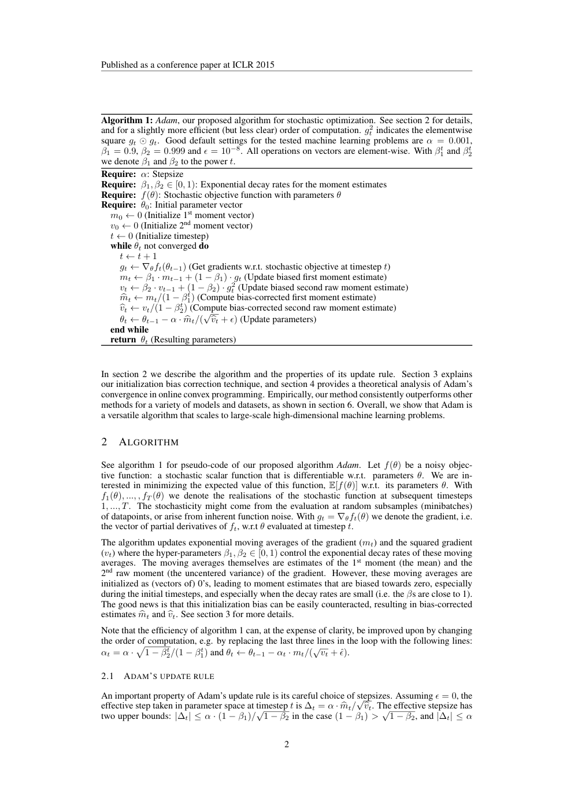
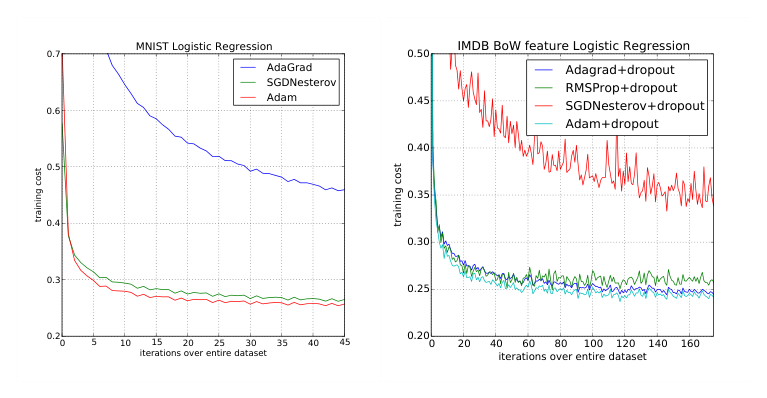
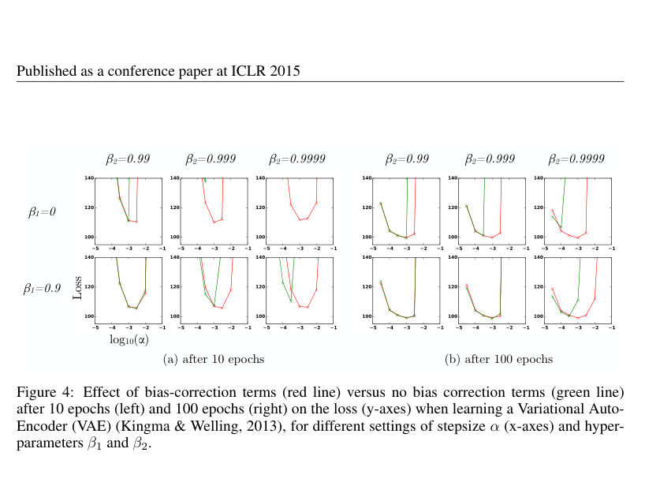
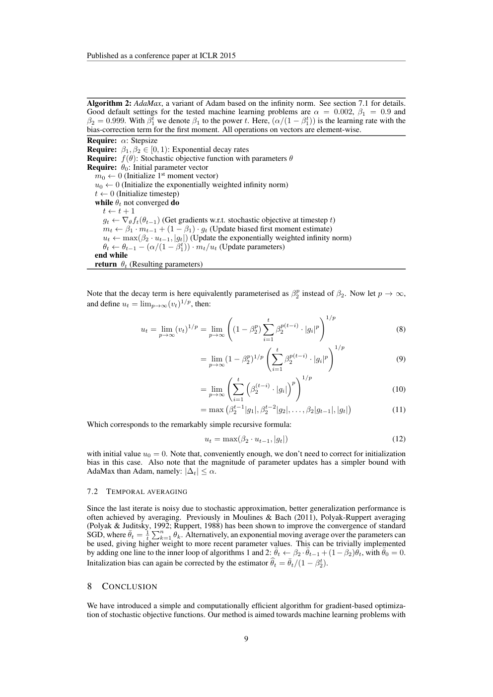

# ADAM: A METHOD FOR STOCHASTIC OPTIMIZATION（Adam：一种随机优化方法）

**Original:**

Published as a conference paper at ICLR 2015

Diederik P. Kingma* — University of Amsterdam, OpenAI — dpkingma@openai.com
Jimmy Lei Ba* — University of Toronto — jimmy@psi.utoronto.ca

\*Equal contribution. Author ordering determined by coin flip over a Google Hangout.

arXiv:1412.6980v9 [cs.LG] 30 Jan 2017

**中文:**

本文作为会议论文发表于 ICLR 2015。

作者：Diederik P. Kingma（阿姆斯特丹大学，OpenAI）、Jimmy Lei Ba（多伦多大学）。

\*两位作者贡献相同（Equal contribution）。作者排序由一次 Google Hangout 视频通话中的抛硬币决定。

arXiv 编号：arXiv:1412.6980v9 [cs.LG]，2017 年 1 月 30 日。

## Abstract（摘要）

**Original:**

We introduce Adam, an algorithm for first-order gradient-based optimization of stochastic objective functions, based on adaptive estimates of lower-order moments. The method is straightforward to implement, is computationally efficient, has little memory requirements, is invariant to diagonal rescaling of the gradients, and is well suited for problems that are large in terms of data and/or parameters. The method is also appropriate for non-stationary objectives and problems with very noisy and/or sparse gradients. The hyper-parameters have intuitive interpretations and typically require little tuning. Some connections to related algorithms, on which Adam was inspired, are discussed. We also analyze the theoretical convergence properties of the algorithm and provide a regret bound on the convergence rate that is comparable to the best known results under the online convex optimization framework. Empirical results demonstrate that Adam works well in practice and compares favorably to other stochastic optimization methods. Finally, we discuss AdaMax, a variant of Adam based on the infinity norm.

**中文:**

我们提出 Adam，一种基于低阶矩自适应估计的、针对随机目标函数（objective function）的一阶梯度优化算法。该方法实现简单、计算高效、内存需求小、对梯度的对角缩放（diagonal rescaling）具有不变性，并且非常适合数据量和/或参数量巨大的问题。该方法同样适用于目标函数非平稳（non-stationary）以及梯度噪声很大和/或稀疏的问题。其超参数（hyperparameter）具有直观的解释，通常几乎不需要调参。我们还讨论了 Adam 所借鉴的若干相关算法的联系。我们分析了该算法的理论收敛性质，并给出了一个在在线凸优化（online convex optimization）框架下与已知最好结果相当的收敛速率遗憾界（regret bound）。实验结果表明，Adam 在实际应用中表现良好，与其他随机优化方法相比具有优势。最后，我们讨论了 AdaMax——Adam 的一种基于无穷范数（infinity norm）的变体。

## 1 Introduction（引言）

**Original:**

Stochastic gradient-based optimization is of core practical importance in many fields of science and engineering. Many problems in these fields can be cast as the optimization of some scalar parameterized objective function requiring maximization or minimization with respect to its parameters. If the function is differentiable w.r.t. its parameters, gradient descent is a relatively efficient optimization method, since the computation of first-order partial derivatives w.r.t. all the parameters is of the same computational complexity as just evaluating the function. Often, objective functions are stochastic. For example, many objective functions are composed of a sum of subfunctions evaluated at different subsamples of data; in this case optimization can be made more efficient by taking gradient steps w.r.t. individual subfunctions, i.e. stochastic gradient descent (SGD) or ascent. SGD proved itself as an efficient and effective optimization method that was central in many machine learning success stories, such as recent advances in deep learning (Deng et al., 2013; Krizhevsky et al., 2012; Hinton & Salakhutdinov, 2006; Hinton et al., 2012a; Graves et al., 2013). Objectives may also have other sources of noise than data subsampling, such as dropout (Hinton et al., 2012b) regularization. For all such noisy objectives, efficient stochastic optimization techniques are required. The focus of this paper is on the optimization of stochastic objectives with high-dimensional parameters spaces. In these cases, higher-order optimization methods are ill-suited, and discussion in this paper will be restricted to first-order methods.

**中文:**

基于随机梯度的优化在众多科学与工程领域中具有核心的实践重要性。这些领域中的许多问题都可以归结为对某个含参数的标量目标函数的优化，即对其参数求最大化或最小化。如果该函数对其参数可微，那么梯度下降（gradient descent）是一种相对高效的优化方法，因为计算关于所有参数的一阶偏导数的计算复杂度与仅仅计算函数值相同。目标函数常常是随机的。例如，许多目标函数由在不同数据子样本上求值的若干子函数之和组成；在这种情况下，通过对各个子函数分别进行梯度步进（即随机梯度下降或随机梯度上升，stochastic gradient descent，SGD）可以使优化更加高效。SGD 已被证明是一种高效且有效的优化方法，是许多机器学习成功案例的核心，例如深度学习（deep learning）的近期进展（Deng et al., 2013; Krizhevsky et al., 2012; Hinton & Salakhutdinov, 2006; Hinton et al., 2012a; Graves et al., 2013）。目标函数还可能存在数据子采样之外的噪声来源，例如随机失活（dropout）正则化（Hinton et al., 2012b）。对于所有这些带噪声的目标函数，都需要高效的随机优化技术。本文关注的重点是对具有高维参数空间的随机目标函数进行优化。在这些情形下，高阶优化方法并不适用，因此本文的讨论仅限于一阶方法。

**Original:**

We propose Adam, a method for efficient stochastic optimization that only requires first-order gradients with little memory requirement. The method computes individual adaptive learning rates for different parameters from estimates of first and second moments of the gradients; the name Adam is derived from adaptive moment estimation. Our method is designed to combine the advantages of two recently popular methods: AdaGrad (Duchi et al., 2011), which works well with sparse gradients, and RMSProp (Tieleman & Hinton, 2012), which works well in on-line and non-stationary settings; important connections to these and other stochastic optimization methods are clarified in section 5. Some of Adam's advantages are that the magnitudes of parameter updates are invariant to rescaling of the gradient, its stepsizes are approximately bounded by the stepsize hyperparameter, it does not require a stationary objective, it works with sparse gradients, and it naturally performs a form of step size annealing.

**中文:**

我们提出 Adam，一种高效的随机优化方法，它只需要一阶梯度且内存需求很小。该方法根据梯度的一阶矩（first moment）与二阶矩（second moment）的估计，为不同参数计算各自的自适应学习率（learning rate）；Adam 这个名字来源于自适应矩估计（adaptive moment estimation）。我们的方法旨在结合两种近期流行方法的优点：擅长处理稀疏梯度（sparse gradient）的 AdaGrad（Duchi et al., 2011），以及擅长处理在线与非平稳情形的 RMSProp（Tieleman & Hinton, 2012）；第 5 节将阐明 Adam 与这些方法及其他随机优化方法的重要联系。Adam 的部分优点在于：参数更新量的大小对梯度缩放具有不变性；其步长（stepsize）近似以步长超参数为上界；不要求目标函数平稳（stationary）；适用于稀疏梯度；并且天然地执行一种步长退火（annealing）。

## 2 Algorithm（算法）

> **算法 1（译）**：Adam，我们提出的随机优化算法。详见第 2 节，以及一个计算顺序略微更高效（但不够清晰）的版本。$g_t^2$ 表示逐元素平方 $g_t \odot g_t$。在所测试的机器学习问题上的良好默认设置为 $\alpha = 0.001$、$\beta_1 = 0.9$、$\beta_2 = 0.999$ 与 $\epsilon = 10^{-8}$。对向量的所有操作均为逐元素操作。我们用 $\beta_1^t$ 和 $\beta_2^t$ 表示 $\beta_1$ 与 $\beta_2$ 的 $t$ 次幂。（原图见 paper.pdf 第 2 页，见下方图）



**Original:**

Algorithm 1: Adam, our proposed algorithm for stochastic optimization. See section 2 for details, and for a slightly more efficient (but less clear) order of computation. $g_t^2$ indicates the elementwise square $g_t \odot g_t$. Good default settings for the tested machine learning problems are $\alpha = 0.001$, $\beta_1 = 0.9$, $\beta_2 = 0.999$ and $\epsilon = 10^{-8}$. All operations on vectors are element-wise. With $\beta_1^t$ and $\beta_2^t$ we denote $\beta_1$ and $\beta_2$ to the power $t$.

```text
Require: α: Stepsize（步长）
Require: β1, β2 ∈ [0, 1): Exponential decay rates for the moment estimates（矩估计的指数衰减率）
Require: f(θ): Stochastic objective function with parameters θ（以 θ 为参数的随机目标函数）
Require: θ0: Initial parameter vector（初始参数向量）
m0 ← 0 (初始化一阶矩向量)
v0 ← 0 (初始化二阶矩向量)
t ← 0 (初始化时刻)
while θt not converged do（当 θt 未收敛时）
    t ← t + 1
    gt ← ∇θ ft(θt−1) (获取时刻 t 处随机目标函数的梯度)
    mt ← β1 · mt−1 + (1 − β1) · gt (更新有偏一阶矩估计)
    vt ← β2 · vt−1 + (1 − β2) · gt² (更新有偏二阶原点矩估计)
    m̂t ← mt/(1 − β1^t) (计算偏差修正后的一阶矩估计)
    v̂t ← vt/(1 − β2^t) (计算偏差修正后的二阶原点矩估计)
    θt ← θt−1 − α · m̂t/(√v̂t + ϵ) (更新参数)
end while
return θt (返回所得参数)
```

**中文:**

算法 1：Adam，我们提出的随机优化算法。详见第 2 节，以及一个计算顺序略微更高效（但不够清晰）的版本。$g_t^2$ 表示逐元素平方 $g_t \odot g_t$。在所测试的机器学习问题上的良好默认设置为 $\alpha = 0.001$、$\beta_1 = 0.9$、$\beta_2 = 0.999$ 与 $\epsilon = 10^{-8}$。对向量的所有操作均为逐元素操作。用 $\beta_1^t$ 和 $\beta_2^t$ 表示 $\beta_1$ 与 $\beta_2$ 的 $t$ 次幂。伪代码按公式/代码原样保留的规范不重复翻译，其逐行中文注释见上方引用块「算法 1（译）」。

**Original:**

In section 2 we describe the algorithm and the properties of its update rule. Section 3 explains our initialization bias correction technique, and section 4 provides a theoretical analysis of Adam's convergence in online convex programming. Empirically, our method consistently outperforms other methods for a variety of models and datasets, as shown in section 6. Overall, we show that Adam is a versatile algorithm that scales to large-scale high-dimensional machine learning problems.

**中文:**

第 2 节描述算法及其更新规则的性质。第 3 节解释我们的初始化偏差修正技术，第 4 节对 Adam 在在线凸规划中的收敛性给出理论分析。如第 6 节所示，在经验上我们的方法在多种模型和数据集上一致地优于其他方法。总之，我们表明 Adam 是一种可扩展至大规模高维机器学习问题的通用算法。

**Original:**

See algorithm 1 for pseudo-code of our proposed algorithm Adam. Let $f(\theta)$ be a noisy objective function: a stochastic scalar function that is differentiable w.r.t. parameters $\theta$. We are interested in minimizing the expected value of this function, $\mathbb{E}[f(\theta)]$ w.r.t. its parameters $\theta$. With $f_1(\theta), ..., , f_T(\theta)$ we denote the realisations of the stochastic function at subsequent timesteps $1, ..., T$. The stochasticity might come from the evaluation at random subsamples (minibatches) of datapoints, or arise from inherent function noise. With $g_t = \nabla_\theta f_t(\theta)$ we denote the gradient, i.e. the vector of partial derivatives of $f_t$, w.r.t $\theta$ evaluated at timestep $t$.

**中文:**

我们提出的算法 Adam 的伪代码见算法 1。设 $f(\theta)$ 为带噪声的目标函数：一个关于参数 $\theta$ 可微的随机标量函数。我们感兴趣的是关于参数 $\theta$ 最小化该函数的期望值 $\mathbb{E}[f(\theta)]$。用 $f_1(\theta), ..., f_T(\theta)$ 表示随机函数在相继时刻 $1, ..., T$ 的实现。随机性可能来自在数据点的随机子样本（小批量，minibatch）上求值，也可能源于函数本身的固有噪声。用 $g_t = \nabla_\theta f_t(\theta)$ 表示梯度，即在时刻 $t$ 求值的 $f_t$ 关于 $\theta$ 的偏导数向量。

**Original:**

The algorithm updates exponential moving averages of the gradient ($m_t$) and the squared gradient ($v_t$) where the hyper-parameters $\beta_1, \beta_2 \in [0, 1)$ control the exponential decay rates of these moving averages. The moving averages themselves are estimates of the 1st moment (the mean) and the 2nd raw moment (the uncentered variance) of the gradient. However, these moving averages are initialized as (vectors of) 0's, leading to moment estimates that are biased towards zero, especially during the initial timesteps, and especially when the decay rates are small (i.e. the $\beta$s are close to 1). The good news is that this initialization bias can be easily counteracted, resulting in bias-corrected estimates $\hat{m}_t$ and $\hat{v}_t$. See section 3 for more details.

**中文:**

该算法维护梯度（$m_t$）和平方梯度（$v_t$）的指数移动平均（exponential moving average），其中超参数 $\beta_1, \beta_2 \in [0, 1)$ 控制这些移动平均的指数衰减率（decay rate）。这些移动平均本身是对梯度的一阶矩（均值）和二阶原点矩（raw moment，非中心方差，uncentered variance）的估计。然而，这些移动平均被初始化为（全零向量），导致矩估计偏向零，尤其是在初始时刻，以及衰减率很小（即 $\beta$ 接近 1）的时候。好消息是这种初始化偏差很容易抵消，从而得到偏差修正后的估计 $\hat{m}_t$ 和 $\hat{v}_t$。详见第 3 节。

**Original:**

Note that the efficiency of algorithm 1 can, at the expense of clarity, be improved upon by changing the order of computation, e.g. by replacing the last three lines in the loop with the following lines: $\alpha_t = \alpha \cdot \sqrt{1 - \beta_2^t}/(1 - \beta_1^t)$ and $\theta_t \leftarrow \theta_{t-1} - \alpha_t \cdot m_t/(\sqrt{v_t} + \hat{\epsilon})$.

**中文:**

注意，算法 1 的效率可以（以牺牲清晰度为代价）通过改变计算顺序来提高，例如将循环中的最后三行替换为以下两行：$\alpha_t = \alpha \cdot \sqrt{1 - \beta_2^t}/(1 - \beta_1^t)$ 和 $\theta_t \leftarrow \theta_{t-1} - \alpha_t \cdot m_t/(\sqrt{v_t} + \hat{\epsilon})$。

### 2.1 Adam's Update Rule（Adam 的更新规则）

**Original:**

An important property of Adam's update rule is its careful choice of stepsizes. Assuming $\epsilon = 0$, the effective step taken in parameter space at timestep $t$ is $\Delta_t = \alpha \cdot \hat{m}_t/\sqrt{\hat{v}_t}$. The effective stepsize has two upper bounds: $|\Delta_t| \le \alpha \cdot (1-\beta_1)/\sqrt{1-\beta_2}$ in the case $(1-\beta_1) > \sqrt{1-\beta_2}$, and $|\Delta_t| \le \alpha$ otherwise. The first case only happens in the most severe case of sparsity: when a gradient has been zero at all timesteps except at the current timestep. For less sparse cases, the effective stepsize will be smaller. When $(1-\beta_1) = \sqrt{1-\beta_2}$ we have that $|\hat{m}_t/\sqrt{\hat{v}_t}| < 1$ therefore $|\Delta_t| < \alpha$. In more common scenarios, we will have that $\hat{m}_t/\sqrt{\hat{v}_t} \approx \pm 1$ since $|\mathbb{E}[g]/\sqrt{\mathbb{E}[g^2]}| \le 1$.

**中文:**

Adam 更新规则的一个重要性质是对步长的精心选择。假设 $\epsilon = 0$，时刻 $t$ 在参数空间中实际采取的步长为 $\Delta_t = \alpha \cdot \hat{m}_t/\sqrt{\hat{v}_t}$。有效步长有两个上界：在 $(1-\beta_1) > \sqrt{1-\beta_2}$ 的情形下 $|\Delta_t| \le \alpha \cdot (1-\beta_1)/\sqrt{1-\beta_2}$，其他情形下 $|\Delta_t| \le \alpha$。第一种情形只出现在最极端的稀疏情况下：即某个梯度在除当前时刻之外的所有时刻都为零。在稀疏程度较低的情形下，有效步长会更小。当 $(1-\beta_1) = \sqrt{1-\beta_2}$ 时，有 $|\hat{m}_t/\sqrt{\hat{v}_t}| < 1$，因此 $|\Delta_t| < \alpha$。在更常见的情形中，由于 $|\mathbb{E}[g]/\sqrt{\mathbb{E}[g^2]}| \le 1$，我们有 $\hat{m}_t/\sqrt{\hat{v}_t} \approx \pm 1$。

**Original:**

The effective magnitude of the steps taken in parameter space at each timestep are approximately bounded by the stepsize setting $\alpha$, i.e., $|\Delta_t| \lessapprox \alpha$. This can be understood as establishing a trust region around the current parameter value, beyond which the current gradient estimate does not provide sufficient information. This typically makes it relatively easy to know the right scale of $\alpha$ in advance. For many machine learning models, for instance, we often know in advance that good optima are with high probability within some set region in parameter space; it is not uncommon, for example, to have a prior distribution over the parameters. Since $\alpha$ sets (an upper bound of) the magnitude of steps in parameter space, we can often deduce the right order of magnitude of $\alpha$ such that optima can be reached from $\theta_0$ within some number of iterations.

**中文:**

每一时刻在参数空间中实际步进的大小近似以步长设置 $\alpha$ 为上界，即 $|\Delta_t| \lessapprox \alpha$。这可以理解为在当前参数值周围建立一个信任区域（trust region），超出该区域，当前梯度估计便不再提供充分的信息。这通常使人们能够相对容易地事先知道 $\alpha$ 的正确尺度。例如，对于许多机器学习模型，我们常常事先知道好的最优解大概率位于参数空间中的某个设定区域内；例如，对参数设定先验分布并不少见。由于 $\alpha$ 决定了参数空间中步长的大小（的上界），我们常常可以推出 $\alpha$ 的正确数量级，从而使得在若干次迭代内能够从 $\theta_0$ 到达最优解。

**Original:**

With a slight abuse of terminology, we will call the ratio $\hat{m}_t/\sqrt{\hat{v}_t}$ the signal-to-noise ratio (SNR). With a smaller SNR the effective stepsize $\Delta_t$ will be closer to zero. This is a desirable property, since a smaller SNR means that there is greater uncertainty about whether the direction of $\hat{m}_t$ corresponds to the direction of the true gradient. For example, the SNR value typically becomes closer to 0 towards an optimum, leading to smaller effective steps in parameter space: a form of automatic annealing. The effective stepsize $\Delta_t$ is also invariant to the scale of the gradients; rescaling the gradients $g$ with factor $c$ will scale $\hat{m}_t$ with a factor $c$ and $\hat{v}_t$ with a factor $c^2$, which cancel out: $(c \cdot \hat{m}_t)/(\sqrt{c^2 \cdot \hat{v}_t}) = \hat{m}_t/\sqrt{\hat{v}_t}$.

**中文:**

稍微借用术语，我们将比值 $\hat{m}_t/\sqrt{\hat{v}_t}$ 称为信噪比（signal-to-noise ratio，SNR）。SNR 越小，有效步长 $\Delta_t$ 越接近零。这是一个理想的性质，因为较小的 SNR 意味着对 $\hat{m}_t$ 的方向是否与真实梯度方向一致存在更大的不确定性。例如，在接近最优解时，SNR 值通常会趋近于 0，从而使参数空间中的有效步长变小：这是一种自动退火。有效步长 $\Delta_t$ 还对梯度的尺度具有不变性；用因子 $c$ 缩放梯度 $g$，会将 $\hat{m}_t$ 缩放 $c$ 倍、将 $\hat{v}_t$ 缩放 $c^2$ 倍，两者相互抵消：$(c \cdot \hat{m}_t)/(\sqrt{c^2 \cdot \hat{v}_t}) = \hat{m}_t/\sqrt{\hat{v}_t}$。

## 3 Initialization Bias Correction（初始化偏差修正）

**Original:**

As explained in section 2, Adam utilizes initialization bias correction terms. We will here derive the term for the second moment estimate; the derivation for the first moment estimate is completely analogous. Let $g$ be the gradient of the stochastic objective $f$, and we wish to estimate its second raw moment (uncentered variance) using an exponential moving average of the squared gradient, with decay rate $\beta_2$. Let $g_1, ..., g_T$ be the gradients at subsequent timesteps, each a draw from an underlying gradient distribution $g_t \sim p(g_t)$. Let us initialize the exponential moving average as $v_0 = 0$ (a vector of zeros). First note that the update at timestep $t$ of the exponential moving average $v_t = \beta_2 \cdot v_{t-1} + (1 - \beta_2) \cdot g_t^2$ (where $g_t^2$ indicates the elementwise square $g_t \odot g_t$) can be written as a function of the gradients at all previous timesteps:

$$v_t = (1 - \beta_2) \sum_{i=1}^{t} \beta_2^{t-i} \cdot g_i^2 \qquad (1)$$

We wish to know how $\mathbb{E}[v_t]$, the expected value of the exponential moving average at timestep $t$, relates to the true second moment $\mathbb{E}[g_t^2]$, so we can correct for the discrepancy between the two. Taking expectations of the left-hand and right-hand sides of eq. (1):

$$\mathbb{E}[v_t] = \mathbb{E}\left[(1 - \beta_2) \sum_{i=1}^{t} \beta_2^{t-i} \cdot g_i^2\right] \qquad (2)$$

$$= \mathbb{E}[g_t^2] \cdot (1 - \beta_2) \sum_{i=1}^{t} \beta_2^{t-i} + \zeta \qquad (3)$$

$$= \mathbb{E}[g_t^2] \cdot (1 - \beta_2^t) + \zeta \qquad (4)$$

where $\zeta = 0$ if the true second moment $\mathbb{E}[g_i^2]$ is stationary; otherwise $\zeta$ can be kept small since the exponential decay rate $\beta_1$ can (and should) be chosen such that the exponential moving average assigns small weights to gradients too far in the past. What is left is the term $(1 - \beta_2^t)$ which is caused by initializing the running average with zeros. In algorithm 1 we therefore divide by this term to correct the initialization bias.

**中文:**

如第 2 节所述，Adam 使用了初始化偏差修正项。我们在此推导二阶矩估计的修正项；一阶矩估计的推导完全类似。设 $g$ 为随机目标函数 $f$ 的梯度，我们希望用平方梯度的指数移动平均（衰减率为 $\beta_2$）来估计它的二阶原点矩（非中心方差）。设 $g_1, ..., g_T$ 为相继时刻的梯度，每个都从某个潜在的梯度分布 $g_t \sim p(g_t)$ 中抽取。将指数移动平均初始化为 $v_0 = 0$（零向量）。首先注意，时刻 $t$ 指数移动平均的更新 $v_t = \beta_2 \cdot v_{t-1} + (1 - \beta_2) \cdot g_t^2$（其中 $g_t^2$ 表示逐元素平方 $g_t \odot g_t$）可以写成所有先前时刻梯度的函数：

$$v_t = (1 - \beta_2) \sum_{i=1}^{t} \beta_2^{t-i} \cdot g_i^2 \qquad (1)$$

我们希望知道时刻 $t$ 指数移动平均的期望值 $\mathbb{E}[v_t]$ 与真实二阶矩 $\mathbb{E}[g_t^2]$ 之间的关系，以便修正两者之间的差异。对式 (1) 左右两边取期望：

$$\mathbb{E}[v_t] = \mathbb{E}\left[(1 - \beta_2) \sum_{i=1}^{t} \beta_2^{t-i} \cdot g_i^2\right] \qquad (2)$$

$$= \mathbb{E}[g_t^2] \cdot (1 - \beta_2) \sum_{i=1}^{t} \beta_2^{t-i} + \zeta \qquad (3)$$

$$= \mathbb{E}[g_t^2] \cdot (1 - \beta_2^t) + \zeta \qquad (4)$$

其中，如果真实二阶矩 $\mathbb{E}[g_i^2]$ 是平稳的，则 $\zeta = 0$；否则 $\zeta$ 也可以保持很小，因为指数衰减率 $\beta_1$ 可以（且应当）选择得使指数移动平均对过于久远的梯度赋予很小的权重。剩下的是由将滑动平均初始化为零引起的项 $(1 - \beta_2^t)$。因此，在算法 1 中我们除以该项以修正初始化偏差。

**Original:**

In case of sparse gradients, for a reliable estimate of the second moment one needs to average over many gradients by chosing a small value of $\beta_2$; however it is exactly this case of small $\beta_2$ where a lack of initialisation bias correction would lead to initial steps that are much larger.

**中文:**

在梯度稀疏的情况下，为了可靠地估计二阶矩，需要通过选择较小的 $\beta_2$ 值来对大量梯度求平均；然而恰恰是在这种 $\beta_2$ 较小的情形下，缺少初始化偏差修正会导致初始步长过大。

## 4 Convergence Analysis（收敛性分析）

**Original:**

We analyze the convergence of Adam using the online learning framework proposed in (Zinkevich, 2003). Given an arbitrary, unknown sequence of convex cost functions $f_1(\theta), f_2(\theta),..., f_T(\theta)$. At each time $t$, our goal is to predict the parameter $\theta_t$ and evaluate it on a previously unknown cost function $f_t$. Since the nature of the sequence is unknown in advance, we evaluate our algorithm using the regret, that is the sum of all the previous difference between the online prediction $f_t(\theta_t)$ and the best fixed point parameter $f_t(\theta^*)$ from a feasible set $\mathcal{X}$ for all the previous steps. Concretely, the regret is defined as:

$$R(T) = \sum_{t=1}^{T}\left[f_t(\theta_t)-f_t(\theta^*)\right] \qquad (5)$$

where $\theta^* = \arg\min_{\theta\in\mathcal{X}}\sum_{t=1}^{T} f_t(\theta)$. We show Adam has $O(\sqrt{T})$ regret bound and a proof is given in the appendix. Our result is comparable to the best known bound for this general convex online learning problem. We also use some definitions simplify our notation, where $g_t \triangleq \nabla f_t(\theta_t)$ and $g_{t,i}$ as the $i$th element. We define $g_{1:t,i} \in \mathbb{R}^t$ as a vector that contains the $i$th dimension of the gradients over all iterations till $t$, $g_{1:t,i} = [g_{1,i}, g_{2,i}, \cdots, g_{t,i}]$. Also, we define $\gamma \triangleq \frac{\beta_1^2}{\sqrt{\beta_2}}$. Our following theorem holds when the learning rate $\alpha_t$ is decaying at a rate of $t^{-\frac{1}{2}}$ and first moment running average coefficient $\beta_{1,t}$ decay exponentially with $\lambda$, that is typically close to 1, e.g. $1 - 10^{-8}$.

**中文:**

我们使用 (Zinkevich, 2003) 提出的在线学习框架分析 Adam 的收敛性。给定任意、未知的凸代价函数序列 $f_1(\theta), f_2(\theta),..., f_T(\theta)$。在每个时刻 $t$，我们的目标是预测参数 $\theta_t$ 并在一个事先未知的代价函数 $f_t$ 上对其进行评估。由于序列的性质事先未知，我们使用遗憾（regret）来评估算法，即所有先前步骤中在线预测 $f_t(\theta_t)$ 与可行集（feasible set）$\mathcal{X}$ 中最佳固定点参数 $f_t(\theta^*)$ 之差的累加和。具体地，遗憾定义为：

$$R(T) = \sum_{t=1}^{T}\left[f_t(\theta_t)-f_t(\theta^*)\right] \qquad (5)$$

其中 $\theta^* = \arg\min_{\theta\in\mathcal{X}}\sum_{t=1}^{T} f_t(\theta)$。我们证明 Adam 具有 $O(\sqrt{T})$ 的遗憾界，证明见附录。我们的结果与这一一般凸在线学习问题已知的最好界相当。我们还使用一些定义来简化记号，其中 $g_t \triangleq \nabla f_t(\theta_t)$，$g_{t,i}$ 为第 $i$ 个元素。我们定义 $g_{1:t,i} \in \mathbb{R}^t$ 为一个向量，包含直到 $t$ 为止所有迭代中梯度的第 $i$ 维，$g_{1:t,i} = [g_{1,i}, g_{2,i}, \cdots, g_{t,i}]$。此外，我们定义 $\gamma \triangleq \frac{\beta_1^2}{\sqrt{\beta_2}}$。当学习率 $\alpha_t$ 以 $t^{-\frac{1}{2}}$ 的速率衰减，且一阶矩滑动平均系数 $\beta_{1,t}$ 按 $\lambda$ 指数衰减（$\lambda$ 通常接近 1，例如 $1 - 10^{-8}$）时，下面的定理成立。

**Original:**

Theorem 4.1. Assume that the function $f_t$ has bounded gradients, $\|\nabla f_t(\theta)\|_2 \le G$, $\|\nabla f_t(\theta)\|_\infty \le G_\infty$ for all $\theta \in \mathbb{R}^d$ and distance between any $\theta_t$ generated by Adam is bounded, $\|\theta_n - \theta_m\|_2 \le D$, $\|\theta_m - \theta_n\|_\infty \le D_\infty$ for any $m, n \in \{1, ..., T\}$, and $\beta_1, \beta_2 \in [0, 1)$ satisfy $\frac{\beta_1^2}{\sqrt{\beta_2}} < 1$. Let $\alpha_t = \frac{\alpha}{\sqrt{t}}$ and $\beta_{1,t} = \beta_1 \lambda^{t-1}$, $\lambda \in (0, 1)$. Adam achieves the following guarantee, for all $T \ge 1$.

$$R(T) \le \frac{D^2}{2\alpha(1-\beta_1)}\sum_{i=1}^{d}\sqrt{T\hat{v}_{T,i}} + \frac{\alpha(1+\beta_1)G_\infty}{(1-\beta_1)\sqrt{1-\beta_2}(1-\gamma)^2}\sum_{i=1}^{d}\|g_{1:T,i}\|_2 + \sum_{i=1}^{d}\frac{D_\infty^2 G_\infty\sqrt{1-\beta_2}}{2\alpha(1-\beta_1)(1-\lambda)^2}$$

**中文:**

定理 4.1 假设函数 $f_t$ 具有有界梯度，对所有 $\theta \in \mathbb{R}^d$ 有 $\|\nabla f_t(\theta)\|_2 \le G$，$\|\nabla f_t(\theta)\|_\infty \le G_\infty$，且 Adam 生成的任意 $\theta_t$ 之间的距离有界，对任意 $m, n \in \{1, ..., T\}$ 有 $\|\theta_n - \theta_m\|_2 \le D$，$\|\theta_m - \theta_n\|_\infty \le D_\infty$，并且 $\beta_1, \beta_2 \in [0, 1)$ 满足 $\frac{\beta_1^2}{\sqrt{\beta_2}} < 1$。设 $\alpha_t = \frac{\alpha}{\sqrt{t}}$ 且 $\beta_{1,t} = \beta_1 \lambda^{t-1}$，$\lambda \in (0, 1)$。则对所有 $T \ge 1$，Adam 满足如下保证：

$$R(T) \le \frac{D^2}{2\alpha(1-\beta_1)}\sum_{i=1}^{d}\sqrt{T\hat{v}_{T,i}} + \frac{\alpha(1+\beta_1)G_\infty}{(1-\beta_1)\sqrt{1-\beta_2}(1-\gamma)^2}\sum_{i=1}^{d}\|g_{1:T,i}\|_2 + \sum_{i=1}^{d}\frac{D_\infty^2 G_\infty\sqrt{1-\beta_2}}{2\alpha(1-\beta_1)(1-\lambda)^2}$$

**Original:**

Our Theorem 4.1 implies when the data features are sparse and bounded gradients, the summation term can be much smaller than its upper bound $\sum_{i=1}^{d}\|g_{1:T,i}\|_2 \ll dG_\infty\sqrt{T}$ and $\sum_{i=1}^{d}\sqrt{T\hat{v}_{T,i}} \ll dG_\infty\sqrt{T}$, in particular if the class of function and data features are in the form of section 1.2 in (Duchi et al., 2011). Their results for the expected value $\mathbb{E}[\sum_{i=1}^{d}\|g_{1:T,i}\|_2]$ also apply to Adam. In particular, the adaptive method, such as Adam and Adagrad, can achieve $O(\log d\sqrt{T})$, an improvement over $O(\sqrt{dT})$ for the non-adaptive method. Decaying $\beta_{1,t}$ towards zero is important in our theoretical analysis and also matches previous empirical findings, e.g. (Sutskever et al., 2013) suggests reducing the momentum coefficient in the end of training can improve convergence.

**中文:**

我们的定理 4.1 意味着，当数据特征稀疏且梯度有界时，求和项可以远小于其上界 $\sum_{i=1}^{d}\|g_{1:T,i}\|_2 \ll dG_\infty\sqrt{T}$ 和 $\sum_{i=1}^{d}\sqrt{T\hat{v}_{T,i}} \ll dG_\infty\sqrt{T}$，特别是当函数类和数据特征具有 (Duchi et al., 2011) 第 1.2 节所述形式时。他们关于期望值 $\mathbb{E}[\sum_{i=1}^{d}\|g_{1:T,i}\|_2]$ 的结果同样适用于 Adam。特别是，自适应方法（如 Adam 和 Adagrad）可以达到 $O(\log d\sqrt{T})$，相比非自适应方法的 $O(\sqrt{dT})$ 有所改进。在我们的理论分析中，让 $\beta_{1,t}$ 向零衰减很重要，这也与先前的经验发现一致，例如 (Sutskever et al., 2013) 提出在训练末期减小动量系数可以改善收敛。

**Original:**

Finally, we can show the average regret of Adam converges,

Corollary 4.2. Assume that the function $f_t$ has bounded gradients, $\|\nabla f_t(\theta)\|_2 \le G$, $\|\nabla f_t(\theta)\|_\infty \le G_\infty$ for all $\theta \in \mathbb{R}^d$ and distance between any $\theta_t$ generated by Adam is bounded, $\|\theta_n - \theta_m\|_2 \le D$, $\|\theta_m - \theta_n\|_\infty \le D_\infty$ for any $m, n \in \{1, ..., T\}$. Adam achieves the following guarantee, for all $T \ge 1$.

$$\frac{R(T)}{T} = O(\frac{1}{\sqrt{T}})$$

This result can be obtained by using Theorem 4.1 and $\sum_{i=1}^{d}\|g_{1:T,i}\|_2 \le dG_\infty\sqrt{T}$.

Thus, $\lim_{T \to \infty}\frac{R(T)}{T} = 0$.

**中文:**

最后，我们可以证明 Adam 的平均遗憾收敛。

推论 4.2 假设函数 $f_t$ 具有有界梯度，对所有 $\theta \in \mathbb{R}^d$ 有 $\|\nabla f_t(\theta)\|_2 \le G$，$\|\nabla f_t(\theta)\|_\infty \le G_\infty$，且 Adam 生成的任意 $\theta_t$ 之间的距离有界，对任意 $m, n \in \{1, ..., T\}$ 有 $\|\theta_n - \theta_m\|_2 \le D$，$\|\theta_m - \theta_n\|_\infty \le D_\infty$。Adam 对所有 $T \ge 1$ 满足如下保证：

$$\frac{R(T)}{T} = O(\frac{1}{\sqrt{T}})$$

这一结果可以通过定理 4.1 以及 $\sum_{i=1}^{d}\|g_{1:T,i}\|_2 \le dG_\infty\sqrt{T}$ 得到。

因此，$\lim_{T \to \infty}\frac{R(T)}{T} = 0$。

## 5 Related Work（相关工作）

**Original:**

Optimization methods bearing a direct relation to Adam are RMSProp (Tieleman & Hinton, 2012; Graves, 2013) and AdaGrad (Duchi et al., 2011); these relationships are discussed below. Other stochastic optimization methods include vSGD (Schaul et al., 2012), AdaDelta (Zeiler, 2012) and the natural Newton method from Roux & Fitzgibbon (2010), all setting stepsizes by estimating curvature from first-order information. The Sum-of-Functions Optimizer (SFO) (Sohl-Dickstein et al., 2014) is a quasi-Newton method based on minibatches, but (unlike Adam) has memory requirements linear in the number of minibatch partitions of a dataset, which is often infeasible on memory-constrained systems such as a GPU. Like natural gradient descent (NGD) (Amari, 1998), Adam employs a preconditioner that adapts to the geometry of the data, since $\hat{v}_t$ is an approximation to the diagonal of the Fisher information matrix (Pascanu & Bengio, 2013); however, Adam's preconditioner (like AdaGrad's) is more conservative in its adaption than vanilla NGD by preconditioning with the square root of the inverse of the diagonal Fisher information matrix approximation.

**中文:**

与 Adam 有直接关系的优化方法有 RMSProp（Tieleman & Hinton, 2012; Graves, 2013）和 AdaGrad（Duchi et al., 2011）；下文讨论这些关系。其他随机优化方法包括 vSGD（Schaul et al., 2012）、AdaDelta（Zeiler, 2012）以及 Roux & Fitzgibbon (2010) 的自然 Newton 法，它们都通过一阶信息估计曲率来设定步长。函数求和优化器（Sum-of-Functions Optimizer，SFO）（Sohl-Dickstein et al., 2014）是一种基于小批量的拟牛顿（quasi-Newton）方法，但（与 Adam 不同）其内存需求与数据集的小批量划分数量成线性关系，这在 GPU 等内存受限的系统上往往不可行。与自然梯度下降（natural gradient descent，NGD）（Amari, 1998）一样，Adam 采用了一个适应数据几何的预条件子（preconditioner），因为 $\hat{v}_t$ 是对 Fisher 信息矩阵对角线的近似（Pascanu & Bengio, 2013）；然而，Adam 的预条件子（与 AdaGrad 的类似）在自适应上比普通 NGD 更保守，因为它使用对角 Fisher 信息矩阵近似的逆的平方根进行预条件。

**Original:**

RMSProp: An optimization method closely related to Adam is RMSProp (Tieleman & Hinton, 2012). A version with momentum has sometimes been used (Graves, 2013). There are a few important differences between RMSProp with momentum and Adam: RMSProp with momentum generates its parameter updates using a momentum on the rescaled gradient, whereas Adam updates are directly estimated using a running average of first and second moment of the gradient. RMSProp also lacks a bias-correction term; this matters most in case of a value of $\beta_2$ close to 1 (required in case of sparse gradients), since in that case not correcting the bias leads to very large stepsizes and often divergence, as we also empirically demonstrate in section 6.4.

**中文:**

RMSProp：与 Adam 密切相关的优化方法是 RMSProp（Tieleman & Hinton, 2012）。有时也会使用带动量（momentum）的版本（Graves, 2013）。带动量的 RMSProp 与 Adam 之间存在几个重要区别：带动量的 RMSProp 通过对缩放后的梯度施加动量来生成参数更新，而 Adam 的更新直接用梯度一阶矩与二阶矩的滑动平均来估计。RMSProp 还缺少偏差修正项；这在 $\beta_2$ 接近 1（稀疏梯度情形下需要如此）时影响最大，因为此时不做偏差修正会导致步长非常大并常常发散，我们在第 6.4 节也经验性地证明了这一点。

**Original:**

AdaGrad: An algorithm that works well for sparse gradients is AdaGrad (Duchi et al., 2011). Its basic version updates parameters as $\theta_{t+1} = \theta_t - \alpha \cdot g_t/\sqrt{\sum_{i=1}^{t} g_t^2}$. Note that if we choose $\beta_2$ to be infinitesimally close to 1 from below, then $\lim_{\beta_2\to 1}\hat{v}_t = t^{-1}\cdot\sum_{i=1}^{t} g_t^2$. AdaGrad corresponds to a version of Adam with $\beta_1 = 0$, infinitesimal $(1 - \beta_2)$ and a replacement of $\alpha$ by an annealed version $\alpha_t = \alpha \cdot t^{-1/2}$, namely $\theta_t - \alpha \cdot t^{-1/2} \cdot \hat{m}_t/\sqrt{\lim_{\beta_2\to 1}\hat{v}_t} = \theta_t - \alpha \cdot t^{-1/2} \cdot g_t/\sqrt{t^{-1} \cdot \sum_{i=1}^{t} g_t^2} = \theta_t - \alpha \cdot g_t/\sqrt{\sum_{i=1}^{t} g_t^2}$. Note that this direct correspondence between Adam and Adagrad does not hold when removing the bias-correction terms; without bias correction, like in RMSProp, a $\beta_2$ infinitesimally close to 1 would lead to infinitely large bias, and infinitely large parameter updates.

**中文:**

AdaGrad：一种在稀疏梯度上表现良好的算法是 AdaGrad（Duchi et al., 2011）。其基本版本按 $\theta_{t+1} = \theta_t - \alpha \cdot g_t/\sqrt{\sum_{i=1}^{t} g_t^2}$ 更新参数。注意，如果选择 $\beta_2$ 从下方无限接近 1，则 $\lim_{\beta_2\to 1}\hat{v}_t = t^{-1}\cdot\sum_{i=1}^{t} g_t^2$。AdaGrad 对应于 $\beta_1 = 0$、$(1 - \beta_2)$ 无穷小、并将 $\alpha$ 替换为退火版本 $\alpha_t = \alpha \cdot t^{-1/2}$ 的 Adam，即 $\theta_t - \alpha \cdot t^{-1/2} \cdot \hat{m}_t/\sqrt{\lim_{\beta_2\to 1}\hat{v}_t} = \theta_t - \alpha \cdot t^{-1/2} \cdot g_t/\sqrt{t^{-1} \cdot \sum_{i=1}^{t} g_t^2} = \theta_t - \alpha \cdot g_t/\sqrt{\sum_{i=1}^{t} g_t^2}$。注意，当去掉偏差修正项时，Adam 与 Adagrad 之间的这种直接对应关系不再成立；没有偏差修正（如 RMSProp），无限接近 1 的 $\beta_2$ 会导致无限大的偏差和无限大的参数更新。

## 6 Experiments（实验）

**Original:**

To empirically evaluate the proposed method, we investigated different popular machine learning models, including logistic regression, multilayer fully connected neural networks and deep convolutional neural networks. Using large models and datasets, we demonstrate Adam can efficiently solve practical deep learning problems.

**中文:**

为了经验性地评估所提出的方法，我们研究了多种流行的机器学习模型，包括逻辑回归（logistic regression）、多层全连接神经网络（neural network）和深度卷积神经网络。通过使用大型模型和数据集，我们证明 Adam 能够高效地解决实际深度学习问题。

**Original:**

We use the same parameter initialization when comparing different optimization algorithms. The hyper-parameters, such as learning rate and momentum, are searched over a dense grid and the results are reported using the best hyper-parameter setting.

**中文:**

在比较不同优化算法时，我们使用相同的参数初始化。超参数（如学习率和动量）在稠密网格上搜索，结果使用最佳超参数设置报告。

### 6.1 Experiment: Logistic Regression（实验：逻辑回归）

**Original:**

We evaluate our proposed method on L2-regularized multi-class logistic regression using the MNIST dataset. Logistic regression has a well-studied convex objective, making it suitable for comparison of different optimizers without worrying about local minimum issues. The stepsize $\alpha$ in our logistic regression experiments is adjusted by $1/\sqrt{t}$ decay, namely $\alpha_t = \frac{\alpha}{\sqrt{t}}$ that matches with our theoratical prediction from section 4. The logistic regression classifies the class label directly on the 784 dimension image vectors. We compare Adam to accelerated SGD with Nesterov momentum and Adagrad using minibatch size of 128. According to Figure 1, we found that the Adam yields similar convergence as SGD with momentum and both converge faster than Adagrad.

**中文:**

我们使用 MNIST 数据集在 L2 正则化的多类逻辑回归上评估所提出的方法。逻辑回归具有研究充分的凸目标函数，使其适合用于比较不同优化器而无需担心局部极小值问题。在我们的逻辑回归实验中，步长 $\alpha$ 按 $1/\sqrt{t}$ 衰减进行调整，即 $\alpha_t = \frac{\alpha}{\sqrt{t}}$，这与第 4 节的理论预测一致。逻辑回归直接在 784 维图像向量上对类别标签进行分类。我们使用小批量大小 128，将 Adam 与带 Nesterov 动量的加速 SGD 以及 Adagrad 进行比较。根据图 1，我们发现 Adam 的收敛性与带动量的 SGD 相似，且两者都比 Adagrad 收敛得更快。

**Original:**

As discussed in (Duchi et al., 2011), Adagrad can efficiently deal with sparse features and gradients as one of its main theoretical results whereas SGD is low at learning rare features. Adam with $1/\sqrt{t}$ decay on its stepsize should theoratically match the performance of Adagrad. We examine the sparse feature problem using IMDB movie review dataset from (Maas et al., 2011). We pre-process the IMDB movie reviews into bag-of-words (BoW) feature vectors including the first 10,000 most frequent words. The 10,000 dimension BoW feature vector for each review is highly sparse. As suggested in (Wang & Manning, 2013), 50% dropout noise can be applied to the BoW features during training to prevent over-fitting.

**中文:**

如 (Duchi et al., 2011) 所述，Adagrad 的主要理论成果之一就是能够高效处理稀疏特征和梯度，而 SGD 在学习罕见特征方面表现不佳。步长按 $1/\sqrt{t}$ 衰减的 Adam 在理论上应与 Adagrad 的性能相当。我们使用来自 (Maas et al., 2011) 的 IMDB 电影评论数据集来考察稀疏特征问题。我们将 IMDB 电影评论预处理为词袋（bag-of-words，BoW）特征向量，包含出现频率最高的前 10,000 个词。每条评论的 10,000 维 BoW 特征向量高度稀疏。如 (Wang & Manning, 2013) 所建议，可以在训练期间对 BoW 特征施加 50% 的随机失活噪声以防止过拟合（overfitting）。

> **图 1（译）**：在 MNIST 图像与使用 10,000 维词袋（BoW）特征向量的 IMDB 电影评论上，逻辑回归的训练负对数似然。（原图见 paper.pdf 第 6 页，见下方图）



**Original:**

In figure 1, Adagrad outperforms SGD with Nesterov momentum by a large margin both with and without dropout noise. Adam converges as fast as Adagrad. The empirical performance of Adam is consistent with our theoretical findings in sections 2 and 4. Similar to Adagrad, Adam can take advantage of sparse features and obtain faster convergence rate than normal SGD with momentum.

**中文:**

在图 1 中，无论有无随机失活噪声，Adagrad 都以较大优势优于带 Nesterov 动量的 SGD。Adam 的收敛速度与 Adagrad 一样快。Adam 的经验表现与我们在第 2 节和第 4 节的理论发现一致。与 Adagrad 类似，Adam 能够利用稀疏特征，获得比普通带动量 SGD 更快的收敛速度。

### 6.2 Experiment: Multi-layer Neural Networks（实验：多层神经网络）

**Original:**

Multi-layer neural network are powerful models with non-convex objective functions. Although our convergence analysis does not apply to non-convex problems, we empirically found that Adam often outperforms other methods in such cases. In our experiments, we made model choices that are consistent with previous publications in the area; a neural network model with two fully connected hidden layers with 1000 hidden units each and ReLU activation are used for this experiment with minibatch size of 128.

**中文:**

多层神经网络是目标函数非凸的强大模型。虽然我们的收敛性分析不适用于非凸问题，但我们经验性地发现，在此类情况下 Adam 通常优于其他方法。在我们的实验中，我们做出了与该领域先前发表工作一致的模型选择；本实验使用一个包含两个全连接隐藏层（各 1000 个隐单元，hidden unit）并使用 ReLU 激活的神经网络模型，小批量大小为 128。

**Original:**

First, we study different optimizers using the standard deterministic cross-entropy objective function with L2 weight decay on the parameters to prevent over-fitting. The sum-of-functions (SFO) method (Sohl-Dickstein et al., 2014) is a recently proposed quasi-Newton method that works with minibatches of data and has shown good performance on optimization of multi-layer neural networks. We used their implementation and compared with Adam to train such models. Figure 2 shows that Adam makes faster progress in terms of both the number of iterations and wall-clock time. Due to the cost of updating curvature information, SFO is 5-10x slower per iteration compared to Adam, and has a memory requirement that is linear in the number minibatches.

**中文:**

首先，我们使用标准的确定性交叉熵（cross-entropy）目标函数（并对参数施加 L2 权重衰减，weight decay，以防过拟合）研究不同优化器。函数求和（sum-of-functions，SFO）方法（Sohl-Dickstein et al., 2014）是最近提出的拟牛顿方法，适用于数据小批量，并在多层神经网络优化上表现出良好性能。我们使用他们的实现，并与 Adam 比较训练此类模型。图 2 显示，无论按迭代次数还是墙上时钟时间，Adam 的进展都更快。由于更新曲率信息的开销，SFO 每次迭代比 Adam 慢 5-10 倍，且其内存需求与小批量数量成线性关系。

**Original:**

Stochastic regularization methods, such as dropout, are an effective way to prevent over-fitting and often used in practice due to their simplicity. SFO assumes deterministic subfunctions, and indeed failed to converge on cost functions with stochastic regularization. We compare the effectiveness of Adam to other stochastic first order methods on multi-layer neural networks trained with dropout noise. Figure 2 shows our results; Adam shows better convergence than other methods.

**中文:**

随机正则化方法（如随机失活）是防止过拟合的有效手段，因其简单而在实践中常被使用。SFO 假设子函数是确定性的，因此在带有随机正则化的代价函数上确实无法收敛。我们比较了 Adam 与其他一阶随机方法在带随机失活噪声训练的多层神经网络上的有效性。图 2 显示了我们的结果；Adam 的收敛性优于其他方法。

> **图 2（译）**：在 MNIST 图像上训练多层神经网络。(a) 使用随机失活随机正则化的神经网络。(b) 使用确定性代价函数的神经网络。我们与函数求和（SFO）优化器进行比较。（原图见 paper.pdf 第 7 页，见下方图）



### 6.3 Experiment: Convolutional Neural Networks（实验：卷积神经网络）

**Original:**

Convolutional neural networks (CNNs) with several layers of convolution, pooling and non-linear units have shown considerable success in computer vision tasks. Unlike most fully connected neural nets, weight sharing in CNNs results in vastly different gradients in different layers. A smaller learning rate for the convolution layers is often used in practice when applying SGD. We show the effectiveness of Adam in deep CNNs. Our CNN architecture has three alternating stages of 5x5 convolution filters and 3x3 max pooling with stride of 2 that are followed by a fully connected layer of 1000 rectified linear hidden units (ReLU's). The input image are pre-processed by whitening, and dropout noise is applied to the input layer and fully connected layer. The minibatch size is also set to 128 similar to previous experiments.

**中文:**

由若干卷积（convolution）、池化（pooling）和非线性单元层组成的卷积神经网络（convolutional neural network，CNN）在计算机视觉任务中取得了相当大的成功。与大多数全连接神经网络不同，CNN 中的权重共享导致不同层的梯度差异巨大。在实践中应用 SGD 时，卷积层通常使用较小的学习率。我们展示 Adam 在深度 CNN 上的有效性。我们的 CNN 架构包含三个交替的 5x5 卷积滤波器与 3x3 最大池化（步幅，stride，为 2）阶段，其后接一个含 1000 个整流线性隐单元（ReLU）的全连接层。输入图像经过白化（whitening）预处理，输入层和全连接层施加随机失活噪声。小批量大小与前几个实验相同，设为 128。

> **图 3（译）**：卷积神经网络的训练损失。(左) 前三个轮次的训练损失。(右) 45 个轮次的训练损失。CIFAR-10，采用 c64-c64-c128-1000 架构。（原图见 paper.pdf 第 7 页，[第 7 页图](assets/figures/fig-3.png)）

**Original:**

Interestingly, although both Adam and Adagrad make rapid progress lowering the cost in the initial stage of the training, shown in Figure 3 (left), Adam and SGD eventually converge considerably faster than Adagrad for CNNs shown in Figure 3 (right). We notice the second moment estimate $\hat{v}_t$ vanishes to zeros after a few epochs and is dominated by the $\epsilon$ in algorithm 1. The second moment estimate is therefore a poor approximation to the geometry of the cost function in CNNs comparing to fully connected network from Section 6.2. Whereas, reducing the minibatch variance through the first moment is more important in CNNs and contributes to the speed-up. As a result, Adagrad converges much slower than others in this particular experiment. Though Adam shows marginal improvement over SGD with momentum, it adapts learning rate scale for different layers instead of hand picking manually as in SGD.

**中文:**

有趣的是，尽管 Adam 和 Adagrad 在训练初始阶段都快速降低了代价（如图 3（左）所示），但对于 CNN，Adam 和 SGD 最终明显比 Adagrad 收敛得更快（如图 3（右）所示）。我们注意到二阶矩估计 $\hat{v}_t$ 在几个轮次（epoch）后趋于零，并由算法 1 中的 $\epsilon$ 主导。因此，与第 6.2 节的全连接网络相比，二阶矩估计对 CNN 中代价函数几何的近似效果不佳。而在 CNN 中，通过一阶矩减小小批量方差更为重要，并有助于加速。因此，在这个特定实验中 Adagrad 的收敛速度远慢于其他方法。尽管 Adam 相比带动量的 SGD 只有微小的改进，但它能为不同层自适应地调整学习率尺度，而不必像 SGD 那样手动挑选。

### 6.4 Experiment: Bias-Correction Term（实验：偏差修正项）

**Original:**

We also empirically evaluate the effect of the bias correction terms explained in sections 2 and 3. Discussed in section 5, removal of the bias correction terms results in a version of RMSProp (Tieleman & Hinton, 2012) with momentum. We vary the $\beta_1$ and $\beta_2$ when training a variational auto-encoder (VAE) with the same architecture as in (Kingma & Welling, 2013) with a single hidden layer with 500 hidden units with softplus nonlinearities and a 50-dimensional spherical Gaussian latent variable. We iterated over a broad range of hyper-parameter choices, i.e. $\beta_1 \in [0, 0.9]$ and $\beta_2 \in [0.99, 0.999, 0.9999]$, and $\log_{10}(\alpha) \in [-5, ..., -1]$. Values of $\beta_2$ close to 1, required for robustness to sparse gradients, results in larger initialization bias; therefore we expect the bias correction term is important in such cases of slow decay, preventing an adverse effect on optimization.

**中文:**

我们还经验性地评估了第 2、3 节所述偏差修正项的效果。如第 5 节所讨论，去掉偏差修正项就得到带动量版本的 RMSProp（Tieleman & Hinton, 2012）。我们在训练变分自编码器（variational auto-encoder，VAE）时改变 $\beta_1$ 和 $\beta_2$，VAE 架构与 (Kingma & Welling, 2013) 相同：单个含 500 个隐单元的隐藏层，softplus 非线性，50 维球面高斯隐变量（latent variable）。我们遍历了广泛的超参数选择范围，即 $\beta_1 \in [0, 0.9]$、$\beta_2 \in [0.99, 0.999, 0.9999]$ 以及 $\log_{10}(\alpha) \in [-5, ..., -1]$。接近 1 的 $\beta_2$ 值（对稀疏梯度的鲁棒性所必需）会导致更大的初始化偏差；因此我们预期，在这种慢衰减情形下偏差修正项很重要，可以防止对优化产生不利影响。

> **图 4（译）**：在学习变分自编码器（VAE）（Kingma & Welling, 2013）时，对不同步长 $\alpha$（x 轴）与超参数 $\beta_1$、$\beta_2$ 设置，有偏差修正项（红线）与无偏差修正项（绿线）在 10 个轮次（左）和 100 个轮次（右）后对损失（y 轴）的影响。（原图见 paper.pdf 第 8 页，见下方图）


**Original:**

In Figure 4, values $\beta_2$ close to 1 indeed lead to instabilities in training when no bias correction term was present, especially at first few epochs of the training. The best results were achieved with small values of $(1-\beta_2)$ and bias correction; this was more apparent towards the end of optimization when gradients tends to become sparser as hidden units specialize to specific patterns. In summary, Adam performed equal or better than RMSProp, regardless of hyper-parameter setting.

**中文:**

在图 4 中，当没有偏差修正项时，接近 1 的 $\beta_2$ 值确实导致训练不稳定，尤其是在训练的最初几个轮次。最佳结果是在 $(1-\beta_2)$ 取值较小且使用偏差修正时取得的；这在优化接近尾声时更为明显，此时随着隐单元逐渐专门化于特定模式，梯度趋于更加稀疏。总之，无论超参数设置如何，Adam 的表现都与 RMSProp 相当或更好。

## 7 Extensions（扩展）

### 7.1 AdaMax

**Original:**

In Adam, the update rule for individual weights is to scale their gradients inversely proportional to a (scaled) $L^2$ norm of their individual current and past gradients. We can generalize the $L^2$ norm based update rule to a $L^p$ norm based update rule. Such variants become numerically unstable for large $p$. However, in the special case where we let $p \to \infty$, a surprisingly simple and stable algorithm emerges; see algorithm 2. We'll now derive the algorithm. Let, in case of the $L^p$ norm, the stepsize at time $t$ be inversely proportional to $v_t^{1/p}$, where:

$$v_t = \beta_2^p v_{t-1} + (1 - \beta_2^p)|g_t|^p \qquad (6)$$

$$= (1 - \beta_2^p) \sum_{i=1}^{t} \beta_2^{p(t-i)} \cdot |g_i|^p \qquad (7)$$

**中文:**

在 Adam 中，单个权重的更新规则是将其梯度按（缩放后的）其自身当前与历史梯度的 $L^2$ 范数成反比地缩放。我们可以将基于 $L^2$ 范数的更新规则推广为基于 $L^p$ 范数的更新规则。当 $p$ 较大时，这类变体在数值上会变得不稳定。然而，在令 $p \to \infty$ 的特殊情形下，会涌现出一个出人意料地简单且稳定的算法；见算法 2。现在我们来推导该算法。在 $L^p$ 范数情形下，设时刻 $t$ 的步长与 $v_t^{1/p}$ 成反比，其中：

$$v_t = \beta_2^p v_{t-1} + (1 - \beta_2^p)|g_t|^p \qquad (6)$$

$$= (1 - \beta_2^p) \sum_{i=1}^{t} \beta_2^{p(t-i)} \cdot |g_i|^p \qquad (7)$$

> **算法 2（译）**：AdaMax，Adam 的一种基于无穷范数的变体。详见第 7.1 节。在所测试的机器学习问题上的良好默认设置为 $\alpha = 0.002$、$\beta_1 = 0.9$ 和 $\beta_2 = 0.999$。我们用 $\beta_1^t$ 表示 $\beta_1$ 的 $t$ 次幂。这里，$(\alpha/(1 - \beta_1^t))$ 是带一阶矩偏差修正项的学习率。对向量的所有操作均为逐元素操作。（原图见 paper.pdf 第 9 页，见下方图）



**Original:**

Algorithm 2: AdaMax, a variant of Adam based on the infinity norm. See section 7.1 for details. Good default settings for the tested machine learning problems are $\alpha = 0.002$, $\beta_1 = 0.9$ and $\beta_2 = 0.999$. With $\beta_1^t$ we denote $\beta_1$ to the power $t$. Here, $(\alpha/(1 - \beta_1^t))$ is the learning rate with the bias-correction term for the first moment. All operations on vectors are element-wise.

```text
Require: α: Stepsize（步长）
Require: β1, β2 ∈ [0, 1): Exponential decay rates（指数衰减率）
Require: f(θ): Stochastic objective function with parameters θ（以 θ 为参数的随机目标函数）
Require: θ0: Initial parameter vector（初始参数向量）
m0 ← 0 (初始化一阶矩向量)
u0 ← 0 (初始化指数加权无穷范数)
t ← 0 (初始化时刻)
while θt not converged do（当 θt 未收敛时）
    t ← t + 1
    gt ← ∇θ ft(θt−1) (获取时刻 t 处随机目标函数的梯度)
    mt ← β1 · mt−1 + (1 − β1) · gt (更新有偏一阶矩估计)
    ut ← max(β2 · ut−1, |gt|) (更新指数加权无穷范数)
    θt ← θt−1 − (α/(1 − β1^t)) · mt/ut (更新参数)
end while
return θt (返回所得参数)
```

**中文:**

算法 2：AdaMax，Adam 的一种基于无穷范数的变体。详见第 7.1 节。在所测试的机器学习问题上的良好默认设置为 $\alpha = 0.002$、$\beta_1 = 0.9$ 和 $\beta_2 = 0.999$。用 $\beta_1^t$ 表示 $\beta_1$ 的 $t$ 次幂。这里，$(\alpha/(1 - \beta_1^t))$ 是带一阶矩偏差修正项的学习率。对向量的所有操作均为逐元素操作。伪代码按公式/代码原样保留的规范不重复翻译，其逐行中文注释见上方引用块「算法 2（译）」。

**Original:**

Note that the decay term is here equivalently parameterised as $\beta_2^p$ instead of $\beta_2$. Now let $p \to \infty$, and define $u_t = \lim_{p\to\infty}(v_t)^{1/p}$, then:

$$u_t = \lim_{p\to\infty}(v_t)^{1/p} = \lim_{p\to\infty}\left((1 - \beta_2^p) \sum_{i=1}^{t} \beta_2^{p(t-i)} \cdot |g_i|^p\right)^{1/p} \qquad (8)$$

$$= \lim_{p\to\infty}(1 - \beta_2^p)^{1/p}\left(\sum_{i=1}^{t} \beta_2^{p(t-i)} \cdot |g_i|^p\right)^{1/p} \qquad (9)$$

$$= \lim_{p\to\infty}\left(\sum_{i=1}^{t}\left(\beta_2^{(t-i)} \cdot |g_i|\right)^p\right)^{1/p} \qquad (10)$$

$$= \max\left(\beta_2^{t-1}|g_1|, \beta_2^{t-2}|g_2|, \ldots, \beta_2|g_{t-1}|, |g_t|\right) \qquad (11)$$

Which corresponds to the remarkably simple recursive formula:

$$u_t = \max(\beta_2 \cdot u_{t-1}, |g_t|) \qquad (12)$$

with initial value $u_0 = 0$. Note that, conveniently enough, we don't need to correct for initialization bias in this case. Also note that the magnitude of parameter updates has a simpler bound with AdaMax than Adam, namely: $|\Delta_t| \le \alpha$.

**中文:**

注意，这里的衰减项等价地参数化为 $\beta_2^p$ 而非 $\beta_2$。现在令 $p \to \infty$，并定义 $u_t = \lim_{p\to\infty}(v_t)^{1/p}$，则：

$$u_t = \lim_{p\to\infty}(v_t)^{1/p} = \lim_{p\to\infty}\left((1 - \beta_2^p) \sum_{i=1}^{t} \beta_2^{p(t-i)} \cdot |g_i|^p\right)^{1/p} \qquad (8)$$

$$= \lim_{p\to\infty}(1 - \beta_2^p)^{1/p}\left(\sum_{i=1}^{t} \beta_2^{p(t-i)} \cdot |g_i|^p\right)^{1/p} \qquad (9)$$

$$= \lim_{p\to\infty}\left(\sum_{i=1}^{t}\left(\beta_2^{(t-i)} \cdot |g_i|\right)^p\right)^{1/p} \qquad (10)$$

$$= \max\left(\beta_2^{t-1}|g_1|, \beta_2^{t-2}|g_2|, \ldots, \beta_2|g_{t-1}|, |g_t|\right) \qquad (11)$$

这对应于极其简单的递归公式：

$$u_t = \max(\beta_2 \cdot u_{t-1}, |g_t|) \qquad (12)$$

其初始值为 $u_0 = 0$。注意，方便的是，这种情形下我们无需修正初始化偏差。还要注意，AdaMax 的参数更新大小具有比 Adam 更简单的上界，即：$|\Delta_t| \le \alpha$。

### 7.2 Temporal Averaging（时间平均）

**Original:**

Since the last iterate is noisy due to stochastic approximation, better generalization performance is often achieved by averaging. Previously in Moulines & Bach (2011), Polyak-Ruppert averaging (Polyak & Juditsky, 1992; Ruppert, 1988) has been shown to improve the convergence of standard SGD, where $\bar{\theta}_t = \frac{1}{t}\sum_{k=1}^{t}\theta_k$. Alternatively, an exponential moving average over the parameters can be used, giving higher weight to more recent parameter values. This can be trivially implemented by adding one line to the inner loop of algorithms 1 and 2: $\bar{\theta}_t \leftarrow \beta_2 \cdot \bar{\theta}_{t-1} + (1-\beta_2)\theta_t$, with $\bar{\theta}_0 = 0$. Initalization bias can again be corrected by the estimator $\hat{\theta}_t = \bar{\theta}_t/(1 - \beta_2^t)$.

**中文:**

由于随机近似，最后一个迭代点噪声较大，因此通过平均通常可以获得更好的泛化性能。此前 Moulines & Bach (2011) 表明，Polyak-Ruppert 平均（Polyak & Juditsky, 1992; Ruppert, 1988）可以改进标准 SGD 的收敛性，其中 $\bar{\theta}_t = \frac{1}{t}\sum_{k=1}^{t}\theta_k$。或者，可以对参数使用指数移动平均，为较新的参数值赋予更高权重。这可以平凡地实现，只需在算法 1 和 2 的内循环中添加一行：$\bar{\theta}_t \leftarrow \beta_2 \cdot \bar{\theta}_{t-1} + (1-\beta_2)\theta_t$，其中 $\bar{\theta}_0 = 0$。初始化偏差同样可以通过估计量 $\hat{\theta}_t = \bar{\theta}_t/(1 - \beta_2^t)$ 来修正。

## 8 Conclusion（结论）

**Original:**

We have introduced a simple and computationally efficient algorithm for gradient-based optimization of stochastic objective functions. Our method is aimed towards machine learning problems with large datasets and/or high-dimensional parameter spaces. The method combines the advantages of two recently popular optimization methods: the ability of AdaGrad to deal with sparse gradients, and the ability of RMSProp to deal with non-stationary objectives. The method is straightforward to implement and requires little memory. The experiments confirm the analysis on the rate of convergence in convex problems. Overall, we found Adam to be robust and well-suited to a wide range of non-convex optimization problems in the field machine learning.

**中文:**

我们提出了一种简单且计算高效的算法，用于随机目标函数的基于梯度的优化。我们的方法面向具有大数据集和/或高维参数空间的机器学习问题。该方法结合了两种近期流行的优化方法的优点：AdaGrad 处理稀疏梯度的能力，以及 RMSProp 处理非平稳目标函数的能力。该方法实现直接、内存需求小。实验证实了凸问题收敛速率分析的结果。总体而言，我们发现 Adam 鲁棒，并且非常适合机器学习领域中广泛的非凸优化问题。

## 9 Acknowledgments（致谢）

**Original:**

This paper would probably not have existed without the support of Google Deepmind. We would like to give special thanks to Ivo Danihelka, and Tom Schaul for coining the name Adam. Thanks to Kai Fan from Duke University for spotting an error in the original AdaMax derivation. Experiments in this work were partly carried out on the Dutch national e-infrastructure with the support of SURF Foundation. Diederik Kingma is supported by the Google European Doctorate Fellowship in Deep Learning.

**中文:**

如果没有 Google Deepmind 的支持，这篇论文大概不会存在。我们特别感谢 Ivo Danihelka 和 Tom Schaul 为 Adam 命名。感谢杜克大学的 Kai Fan 发现原始 AdaMax 推导中的一个错误。本工作部分实验在荷兰国家电子基础设施上进行，得到 SURF 基金会的支持。Diederik Kingma 获得 Google 欧洲深度学习博士奖学金（Google European Doctorate Fellowship in Deep Learning）资助。

## References

Amari, Shun-Ichi. Natural gradient works efficiently in learning. Neural computation, 10(2):251–276, 1998.

Deng, Li, Li, Jinyu, Huang, Jui-Ting, Yao, Kaisheng, Yu, Dong, Seide, Frank, Seltzer, Michael, Zweig, Geoff, He, Xiaodong, Williams, Jason, et al. Recent advances in deep learning for speech research at microsoft. ICASSP 2013, 2013.

Duchi, John, Hazan, Elad, and Singer, Yoram. Adaptive subgradient methods for online learning and stochastic optimization. The Journal of Machine Learning Research, 12:2121–2159, 2011.

Graves, Alex. Generating sequences with recurrent neural networks. arXiv preprint arXiv:1308.0850, 2013.

Graves, Alex, Mohamed, Abdel-rahman, and Hinton, Geoffrey. Speech recognition with deep recurrent neural networks. In Acoustics, Speech and Signal Processing (ICASSP), 2013 IEEE International Conference on, pp. 6645–6649. IEEE, 2013.

Hinton, G.E. and Salakhutdinov, R.R. Reducing the dimensionality of data with neural networks. Science, 313(5786):504–507, 2006.

Hinton, Geoffrey, Deng, Li, Yu, Dong, Dahl, George E, Mohamed, Abdel-rahman, Jaitly, Navdeep, Senior, Andrew, Vanhoucke, Vincent, Nguyen, Patrick, Sainath, Tara N, et al. Deep neural networks for acoustic modeling in speech recognition: The shared views of four research groups. Signal Processing Magazine, IEEE, 29(6):82–97, 2012a.

Hinton, Geoffrey E, Srivastava, Nitish, Krizhevsky, Alex, Sutskever, Ilya, and Salakhutdinov, Ruslan R. Improving neural networks by preventing co-adaptation of feature detectors. arXiv preprint arXiv:1207.0580, 2012b.

Kingma, Diederik P and Welling, Max. Auto-Encoding Variational Bayes. In The 2nd International Conference on Learning Representations (ICLR), 2013.

Krizhevsky, Alex, Sutskever, Ilya, and Hinton, Geoffrey E. Imagenet classification with deep convolutional neural networks. In Advances in neural information processing systems, pp. 1097–1105, 2012.

Maas, Andrew L, Daly, Raymond E, Pham, Peter T, Huang, Dan, Ng, Andrew Y, and Potts, Christopher. Learning word vectors for sentiment analysis. In Proceedings of the 49th Annual Meeting of the Association for Computational Linguistics: Human Language Technologies-Volume 1, pp. 142–150. Association for Computational Linguistics, 2011.

Moulines, Eric and Bach, Francis R. Non-asymptotic analysis of stochastic approximation algorithms for machine learning. In Advances in Neural Information Processing Systems, pp. 451–459, 2011.

Pascanu, Razvan and Bengio, Yoshua. Revisiting natural gradient for deep networks. arXiv preprint arXiv:1301.3584, 2013.

Polyak, Boris T and Juditsky, Anatoli B. Acceleration of stochastic approximation by averaging. SIAM Journal on Control and Optimization, 30(4):838–855, 1992.

Roux, Nicolas L and Fitzgibbon, Andrew W. A fast natural newton method. In Proceedings of the 27th International Conference on Machine Learning (ICML-10), pp. 623–630, 2010.

Ruppert, David. Efficient estimations from a slowly convergent robbins-monro process. Technical report, Cornell University Operations Research and Industrial Engineering, 1988.

Schaul, Tom, Zhang, Sixin, and LeCun, Yann. No more pesky learning rates. arXiv preprint arXiv:1206.1106, 2012.

Sohl-Dickstein, Jascha, Poole, Ben, and Ganguli, Surya. Fast large-scale optimization by unifying stochastic gradient and quasi-newton methods. In Proceedings of the 31st International Conference on Machine Learning (ICML-14), pp. 604–612, 2014.

Sutskever, Ilya, Martens, James, Dahl, George, and Hinton, Geoffrey. On the importance of initialization and momentum in deep learning. In Proceedings of the 30th International Conference on Machine Learning (ICML-13), pp. 1139–1147, 2013.

Tieleman, T. and Hinton, G. Lecture 6.5 - RMSProp, COURSERA: Neural Networks for Machine Learning. Technical report, 2012.

Wang, Sida and Manning, Christopher. Fast dropout training. In Proceedings of the 30th International Conference on Machine Learning (ICML-13), pp. 118–126, 2013.

Zeiler, Matthew D. Adadelta: An adaptive learning rate method. arXiv preprint arXiv:1212.5701, 2012.

Zinkevich, Martin. Online convex programming and generalized infinitesimal gradient ascent. 2003.

## 10 Appendix（附录）

### 10.1 Convergence Proof（收敛性证明）

**Original:**

Definition 10.1. A function $f : \mathbb{R}^d \to \mathbb{R}$ is convex if for all $x, y \in \mathbb{R}^d$, for all $\lambda \in [0, 1]$,

$$\lambda f(x) + (1 - \lambda)f(y) \ge f(\lambda x + (1 - \lambda)y)$$

Also, notice that a convex function can be lower bounded by a hyperplane at its tangent.

**中文:**

定义 10.1 函数 $f : \mathbb{R}^d \to \mathbb{R}$ 是凸的，如果对所有 $x, y \in \mathbb{R}^d$、所有 $\lambda \in [0, 1]$，

$$\lambda f(x) + (1 - \lambda)f(y) \ge f(\lambda x + (1 - \lambda)y)$$

另外，注意凸函数可以在其切点处由一个超平面（hyperplane）从下方界定。

**Original:**

Lemma 10.2. If a function $f : \mathbb{R}^d \to \mathbb{R}$ is convex, then for all $x, y \in \mathbb{R}^d$,

$$f(y) \ge f(x) + \nabla f(x)^T (y - x)$$

The above lemma can be used to upper bound the regret and our proof for the main theorem is constructed by substituting the hyperplane with the Adam update rules.

**中文:**

引理 10.2 如果函数 $f : \mathbb{R}^d \to \mathbb{R}$ 是凸的，则对所有 $x, y \in \mathbb{R}^d$，

$$f(y) \ge f(x) + \nabla f(x)^T (y - x)$$

上述引理可用于界定遗憾的上界，我们对主定理的证明通过将超平面替换为 Adam 的更新规则来构造。

**Original:**

The following two lemmas are used to support our main theorem. We also use some definitions simplify our notation, where $g_t \triangleq \nabla f_t(\theta_t)$ and $g_{t,i}$ as the $i$th element. We define $g_{1:t,i} \in \mathbb{R}^t$ as a vector that contains the $i$th dimension of the gradients over all iterations till $t$, $g_{1:t,i} = [g_{1,i}, g_{2,i}, \cdots, g_{t,i}]$.

**中文:**

下面两个引理用于支撑我们的主定理。我们还使用一些定义来简化记号，其中 $g_t \triangleq \nabla f_t(\theta_t)$，$g_{t,i}$ 为第 $i$ 个元素。我们定义 $g_{1:t,i} \in \mathbb{R}^t$ 为一个向量，包含直到 $t$ 为止所有迭代中梯度的第 $i$ 维，$g_{1:t,i} = [g_{1,i}, g_{2,i}, \cdots, g_{t,i}]$。

**Original:**

Lemma 10.3. Let $g_t = \nabla f_t(\theta_t)$ and $g_{1:t}$ be defined as above and bounded, $\|g_t\|_2 \le G$, $\|g_t\|_\infty \le G_\infty$. Then,

$$\sum_{t=1}^{T}\sqrt{\frac{g_{t,i}^2}{t}} \le 2G_\infty\|g_{1:T,i}\|_2$$

Proof. We will prove the inequality using induction over $T$.

The base case for $T = 1$, we have $\sqrt{g_{1,i}^2} \le 2G_\infty\|g_{1,i}\|_2$.

**中文:**

引理 10.3 设 $g_t = \nabla f_t(\theta_t)$ 且 $g_{1:t}$ 如上定义并有界，$\|g_t\|_2 \le G$，$\|g_t\|_\infty \le G_\infty$。则

$$\sum_{t=1}^{T}\sqrt{\frac{g_{t,i}^2}{t}} \le 2G_\infty\|g_{1:T,i}\|_2$$

证明：我们通过对 $T$ 归纳（induction）证明该不等式。

基础情形 $T = 1$：我们有 $\sqrt{g_{1,i}^2} \le 2G_\infty\|g_{1,i}\|_2$。

**Original:**

For the inductive step,

$$\sum_{t=1}^{T}\sqrt{\frac{g_{t,i}^2}{t}} = \sum_{t=1}^{T-1}\sqrt{\frac{g_{t,i}^2}{t}} + \sqrt{\frac{g_{T,i}^2}{T}} \le 2G_\infty\|g_{1:T-1,i}\|_2 + \sqrt{\frac{g_{T,i}^2}{T}} = 2G_\infty\sqrt{\|g_{1:T,i}\|_2^2 - g_T^2} + \sqrt{\frac{g_{T,i}^2}{T}}$$

From, $\|g_{1:T,i}\|_2^2 - g_{T,i}^2 + \frac{g_{T,i}^4}{4\|g_{1:T,i}\|_2^2} \ge \|g_{1:T,i}\|_2^2 - g_{T,i}^2$, we can take square root of both side and have,

$$\sqrt{\|g_{1:T,i}\|_2^2 - g_{T,i}^2} \le \|g_{1:T,i}\|_2 - \frac{g_{T,i}^2}{2\|g_{1:T,i}\|_2} \le \|g_{1:T,i}\|_2 - \frac{g_{T,i}^2}{2\sqrt{T G_\infty^2}}$$

Rearrange the inequality and substitute the $\sqrt{\|g_{1:T,i}\|_2^2 - g_{T,i}^2}$ term,

$$G_\infty\sqrt{\|g_{1:T,i}\|_2^2 - g_T^2} + \sqrt{\frac{g_{T,i}^2}{T}} \le 2G_\infty\|g_{1:T,i}\|_2$$

**中文:**

归纳步骤：

$$\sum_{t=1}^{T}\sqrt{\frac{g_{t,i}^2}{t}} = \sum_{t=1}^{T-1}\sqrt{\frac{g_{t,i}^2}{t}} + \sqrt{\frac{g_{T,i}^2}{T}} \le 2G_\infty\|g_{1:T-1,i}\|_2 + \sqrt{\frac{g_{T,i}^2}{T}} = 2G_\infty\sqrt{\|g_{1:T,i}\|_2^2 - g_T^2} + \sqrt{\frac{g_{T,i}^2}{T}}$$

由 $\|g_{1:T,i}\|_2^2 - g_{T,i}^2 + \frac{g_{T,i}^4}{4\|g_{1:T,i}\|_2^2} \ge \|g_{1:T,i}\|_2^2 - g_{T,i}^2$，两边取平方根可得：

$$\sqrt{\|g_{1:T,i}\|_2^2 - g_{T,i}^2} \le \|g_{1:T,i}\|_2 - \frac{g_{T,i}^2}{2\|g_{1:T,i}\|_2} \le \|g_{1:T,i}\|_2 - \frac{g_{T,i}^2}{2\sqrt{T G_\infty^2}}$$

整理不等式并代入 $\sqrt{\|g_{1:T,i}\|_2^2 - g_{T,i}^2}$ 项：

$$G_\infty\sqrt{\|g_{1:T,i}\|_2^2 - g_T^2} + \sqrt{\frac{g_{T,i}^2}{T}} \le 2G_\infty\|g_{1:T,i}\|_2$$

**Original:**

Lemma 10.4. Let $\gamma \triangleq \frac{\beta_1^2}{\sqrt{\beta_2}}$. For $\beta_1, \beta_2 \in [0, 1)$ that satisfy $\frac{\beta_1^2}{\sqrt{\beta_2}} < 1$ and bounded $g_t$, $\|g_t\|_2 \le G$, $\|g_t\|_\infty \le G_\infty$, the following inequality holds

$$\sum_{t=1}^{T}\frac{\hat{m}_{t,i}^2}{\sqrt{t\hat{v}_{t,i}}} \le \frac{2}{1-\gamma}\frac{1}{\sqrt{1-\beta_2}}\|g_{1:T,i}\|_2$$

[译注：引理 10.4 的陈述与其证明末尾给出的界 $\frac{2G_\infty}{(1-\gamma)^2\sqrt{1-\beta_2}}\|g_{1:T,i}\|_2$ 不一致；ICLR 2015 正式版将引理 10.4 的界修正为 $\frac{2G_\infty}{(1-\gamma)^2\sqrt{1-\beta_2}}\|g_{1:T,i}\|_2$。]

**中文:**

引理 10.4 设 $\gamma \triangleq \frac{\beta_1^2}{\sqrt{\beta_2}}$。对于满足 $\frac{\beta_1^2}{\sqrt{\beta_2}} < 1$ 的 $\beta_1, \beta_2 \in [0, 1)$ 和有界的 $g_t$，$\|g_t\|_2 \le G$，$\|g_t\|_\infty \le G_\infty$，以下不等式成立

$$\sum_{t=1}^{T}\frac{\hat{m}_{t,i}^2}{\sqrt{t\hat{v}_{t,i}}} \le \frac{2}{1-\gamma}\frac{1}{\sqrt{1-\beta_2}}\|g_{1:T,i}\|_2$$

[译注：引理 10.4 的陈述与其证明末尾给出的界 $\frac{2G_\infty}{(1-\gamma)^2\sqrt{1-\beta_2}}\|g_{1:T,i}\|_2$ 不一致；ICLR 2015 正式版将引理 10.4 的界修正为 $\frac{2G_\infty}{(1-\gamma)^2\sqrt{1-\beta_2}}\|g_{1:T,i}\|_2$。]

**Original:**

Proof. Under the assumption, $\frac{\sqrt{1-\beta_2^t}}{(1-\beta_1^t)^2} \le \frac{1}{(1-\beta_1)^2}$. We can expand the last term in the summation using the update rules in Algorithm 1,

$$\sum_{t=1}^{T}\frac{\hat{m}_{t,i}^2}{\sqrt{t\hat{v}_{t,i}}} = \sum_{t=1}^{T-1}\frac{\hat{m}_{t,i}^2}{\sqrt{t\hat{v}_{t,i}}} + \frac{\sqrt{1-\beta_2^T}}{(1-\beta_1^T)^2}\frac{\left(\sum_{k=1}^{T}(1-\beta_1)\beta_1^{T-k}g_{k,i}\right)^2}{\sqrt{T\sum_{j=1}^{T}(1-\beta_2)\beta_2^{T-j}g_{j,i}^2}}$$

$$\le \sum_{t=1}^{T-1}\frac{\hat{m}_{t,i}^2}{\sqrt{t\hat{v}_{t,i}}} + \frac{\sqrt{1-\beta_2^T}}{(1-\beta_1^T)^2}\sum_{k=1}^{T}\frac{T\left((1-\beta_1)\beta_1^{T-k}g_{k,i}\right)^2}{\sqrt{T\sum_{j=1}^{T}(1-\beta_2)\beta_2^{T-j}g_{j,i}^2}}$$

$$\le \sum_{t=1}^{T-1}\frac{\hat{m}_{t,i}^2}{\sqrt{t\hat{v}_{t,i}}} + \frac{\sqrt{1-\beta_2^T}}{(1-\beta_1^T)^2}\sum_{k=1}^{T}\frac{T\left((1-\beta_1)\beta_1^{T-k}g_{k,i}\right)^2}{\sqrt{T(1-\beta_2)\beta_2^{T-k}g_{k,i}^2}}$$

$$\le \sum_{t=1}^{T-1}\frac{\hat{m}_{t,i}^2}{\sqrt{t\hat{v}_{t,i}}} + \frac{\sqrt{1-\beta_2^T}}{(1-\beta_1^T)^2}\frac{(1-\beta_1)^2}{\sqrt{T(1-\beta_2)}}\sum_{k=1}^{T}T\left(\frac{\beta_1^2}{\sqrt{\beta_2}}\right)^{T-k}\|g_{k,i}\|_2$$

$$\le \sum_{t=1}^{T-1}\frac{\hat{m}_{t,i}^2}{\sqrt{t\hat{v}_{t,i}}} + \frac{T}{\sqrt{T(1-\beta_2)}}\sum_{k=1}^{T}\gamma^{T-k}\|g_{k,i}\|_2$$

Similarly, we can upper bound the rest of the terms in the summation.

$$\sum_{t=1}^{T}\frac{\hat{m}_{t,i}^2}{\sqrt{t\hat{v}_{t,i}}} \le \sum_{t=1}^{T}\frac{\|g_{t,i}\|_2}{\sqrt{t(1-\beta_2)}}\sum_{j=0}^{T-t}t\gamma^j \le \sum_{t=1}^{T}\frac{\|g_{t,i}\|_2}{\sqrt{t(1-\beta_2)}}\sum_{j=0}^{T}t\gamma^j$$

For $\gamma < 1$, using the upper bound on the arithmetic-geometric series, $\sum_t t\gamma^t < \frac{1}{(1-\gamma)^2}$:

$$\sum_{t=1}^{T}\frac{\|g_{t,i}\|_2}{\sqrt{t(1-\beta_2)}}\sum_{j=0}^{T}t\gamma^j \le \frac{1}{(1-\gamma)^2\sqrt{1-\beta_2}}\sum_{t=1}^{T}\frac{\|g_{t,i}\|_2}{\sqrt{t}}$$

Apply Lemma 10.3,

$$\sum_{t=1}^{T}\frac{\hat{m}_{t,i}^2}{\sqrt{t\hat{v}_{t,i}}} \le \frac{2G_\infty}{(1-\gamma)^2\sqrt{1-\beta_2}}\|g_{1:T,i}\|_2$$

**中文:**

证明：在假设 $\frac{\sqrt{1-\beta_2^t}}{(1-\beta_1^t)^2} \le \frac{1}{(1-\beta_1)^2}$ 下。我们可以使用算法 1 的更新规则展开求和的最后一项，

$$\sum_{t=1}^{T}\frac{\hat{m}_{t,i}^2}{\sqrt{t\hat{v}_{t,i}}} = \sum_{t=1}^{T-1}\frac{\hat{m}_{t,i}^2}{\sqrt{t\hat{v}_{t,i}}} + \frac{\sqrt{1-\beta_2^T}}{(1-\beta_1^T)^2}\frac{\left(\sum_{k=1}^{T}(1-\beta_1)\beta_1^{T-k}g_{k,i}\right)^2}{\sqrt{T\sum_{j=1}^{T}(1-\beta_2)\beta_2^{T-j}g_{j,i}^2}}$$

$$\le \sum_{t=1}^{T-1}\frac{\hat{m}_{t,i}^2}{\sqrt{t\hat{v}_{t,i}}} + \frac{\sqrt{1-\beta_2^T}}{(1-\beta_1^T)^2}\sum_{k=1}^{T}\frac{T\left((1-\beta_1)\beta_1^{T-k}g_{k,i}\right)^2}{\sqrt{T\sum_{j=1}^{T}(1-\beta_2)\beta_2^{T-j}g_{j,i}^2}}$$

$$\le \sum_{t=1}^{T-1}\frac{\hat{m}_{t,i}^2}{\sqrt{t\hat{v}_{t,i}}} + \frac{\sqrt{1-\beta_2^T}}{(1-\beta_1^T)^2}\sum_{k=1}^{T}\frac{T\left((1-\beta_1)\beta_1^{T-k}g_{k,i}\right)^2}{\sqrt{T(1-\beta_2)\beta_2^{T-k}g_{k,i}^2}}$$

$$\le \sum_{t=1}^{T-1}\frac{\hat{m}_{t,i}^2}{\sqrt{t\hat{v}_{t,i}}} + \frac{\sqrt{1-\beta_2^T}}{(1-\beta_1^T)^2}\frac{(1-\beta_1)^2}{\sqrt{T(1-\beta_2)}}\sum_{k=1}^{T}T\left(\frac{\beta_1^2}{\sqrt{\beta_2}}\right)^{T-k}\|g_{k,i}\|_2$$

$$\le \sum_{t=1}^{T-1}\frac{\hat{m}_{t,i}^2}{\sqrt{t\hat{v}_{t,i}}} + \frac{T}{\sqrt{T(1-\beta_2)}}\sum_{k=1}^{T}\gamma^{T-k}\|g_{k,i}\|_2$$

类似地，我们可以对求和中的其余各项界定上界。

$$\sum_{t=1}^{T}\frac{\hat{m}_{t,i}^2}{\sqrt{t\hat{v}_{t,i}}} \le \sum_{t=1}^{T}\frac{\|g_{t,i}\|_2}{\sqrt{t(1-\beta_2)}}\sum_{j=0}^{T-t}t\gamma^j \le \sum_{t=1}^{T}\frac{\|g_{t,i}\|_2}{\sqrt{t(1-\beta_2)}}\sum_{j=0}^{T}t\gamma^j$$

对于 $\gamma < 1$，利用算术-几何级数（arithmetic-geometric series）的上界 $\sum_t t\gamma^t < \frac{1}{(1-\gamma)^2}$：

$$\sum_{t=1}^{T}\frac{\|g_{t,i}\|_2}{\sqrt{t(1-\beta_2)}}\sum_{j=0}^{T}t\gamma^j \le \frac{1}{(1-\gamma)^2\sqrt{1-\beta_2}}\sum_{t=1}^{T}\frac{\|g_{t,i}\|_2}{\sqrt{t}}$$

应用引理 10.3，

$$\sum_{t=1}^{T}\frac{\hat{m}_{t,i}^2}{\sqrt{t\hat{v}_{t,i}}} \le \frac{2G_\infty}{(1-\gamma)^2\sqrt{1-\beta_2}}\|g_{1:T,i}\|_2$$

**Original:**

To simplify the notation, we define $\gamma \triangleq \frac{\beta_1^2}{\sqrt{\beta_2}}$. Intuitively, our following theorem holds when the learning rate $\alpha_t$ is decaying at a rate of $t^{-\frac{1}{2}}$ and first moment running average coefficient $\beta_{1,t}$ decay exponentially with $\lambda$, that is typically close to 1, e.g. $1 - 10^{-8}$.

Theorem 10.5. Assume that the function $f_t$ has bounded gradients, $\|\nabla f_t(\theta)\|_2 \le G$, $\|\nabla f_t(\theta)\|_\infty \le G_\infty$ for all $\theta \in \mathbb{R}^d$ and distance between any $\theta_t$ generated by Adam is bounded, $\|\theta_n - \theta_m\|_2 \le D$, $\|\theta_m - \theta_n\|_\infty \le D_\infty$ for any $m, n \in \{1, ..., T\}$, and $\beta_1, \beta_2 \in [0, 1)$ satisfy $\frac{\beta_1^2}{\sqrt{\beta_2}} < 1$. Let $\alpha_t = \frac{\alpha}{\sqrt{t}}$ and $\beta_{1,t} = \beta_1 \lambda^{t-1}$, $\lambda \in (0, 1)$. Adam achieves the following guarantee, for all $T \ge 1$.

$$R(T) \le \frac{D^2}{2\alpha(1-\beta_1)}\sum_{i=1}^{d}\sqrt{T\hat{v}_{T,i}} + \frac{\alpha(\beta_1 + 1)G_\infty}{(1-\beta_1)\sqrt{1-\beta_2}(1-\gamma)^2}\sum_{i=1}^{d}\|g_{1:T,i}\|_2 + \sum_{i=1}^{d}\frac{D_\infty^2 G_\infty\sqrt{1-\beta_2}}{2\alpha(1-\beta_1)(1-\lambda)^2}$$

**中文:**

为简化记号，我们定义 $\gamma \triangleq \frac{\beta_1^2}{\sqrt{\beta_2}}$。直观上，当学习率 $\alpha_t$ 以 $t^{-\frac{1}{2}}$ 的速率衰减，且一阶矩滑动平均系数 $\beta_{1,t}$ 按 $\lambda$ 指数衰减（$\lambda$ 通常接近 1，例如 $1 - 10^{-8}$）时，下面的定理成立。

定理 10.5 假设函数 $f_t$ 具有有界梯度，对所有 $\theta \in \mathbb{R}^d$ 有 $\|\nabla f_t(\theta)\|_2 \le G$，$\|\nabla f_t(\theta)\|_\infty \le G_\infty$，且 Adam 生成的任意 $\theta_t$ 之间的距离有界，对任意 $m, n \in \{1, ..., T\}$ 有 $\|\theta_n - \theta_m\|_2 \le D$，$\|\theta_m - \theta_n\|_\infty \le D_\infty$，并且 $\beta_1, \beta_2 \in [0, 1)$ 满足 $\frac{\beta_1^2}{\sqrt{\beta_2}} < 1$。设 $\alpha_t = \frac{\alpha}{\sqrt{t}}$ 且 $\beta_{1,t} = \beta_1 \lambda^{t-1}$，$\lambda \in (0, 1)$。则对所有 $T \ge 1$，Adam 满足如下保证：

$$R(T) \le \frac{D^2}{2\alpha(1-\beta_1)}\sum_{i=1}^{d}\sqrt{T\hat{v}_{T,i}} + \frac{\alpha(\beta_1 + 1)G_\infty}{(1-\beta_1)\sqrt{1-\beta_2}(1-\gamma)^2}\sum_{i=1}^{d}\|g_{1:T,i}\|_2 + \sum_{i=1}^{d}\frac{D_\infty^2 G_\infty\sqrt{1-\beta_2}}{2\alpha(1-\beta_1)(1-\lambda)^2}$$

**Original:**

Proof. Using Lemma 10.2, we have,

$$f_t(\theta_t) - f_t(\theta^*) \le g_t^T(\theta_t - \theta^*) = \sum_{i=1}^{d} g_{t,i}(\theta_{t,i} - \theta_{,i}^*)$$

From the update rules presented in algorithm 1,

$$\theta_{t+1} = \theta_t - \alpha_t \hat{m}_t/\sqrt{\hat{v}_t} = \theta_t - \frac{\alpha_t}{1-\beta_1^t}\left(\frac{\beta_{1,t}}{\sqrt{\hat{v}_t}}m_{t-1} + \frac{(1-\beta_{1,t})}{\sqrt{\hat{v}_t}}g_t\right)$$

**中文:**

证明：使用引理 10.2，我们有，

$$f_t(\theta_t) - f_t(\theta^*) \le g_t^T(\theta_t - \theta^*) = \sum_{i=1}^{d} g_{t,i}(\theta_{t,i} - \theta_{,i}^*)$$

根据算法 1 的更新规则，

$$\theta_{t+1} = \theta_t - \alpha_t \hat{m}_t/\sqrt{\hat{v}_t} = \theta_t - \frac{\alpha_t}{1-\beta_1^t}\left(\frac{\beta_{1,t}}{\sqrt{\hat{v}_t}}m_{t-1} + \frac{(1-\beta_{1,t})}{\sqrt{\hat{v}_t}}g_t\right)$$

**Original:**

We focus on the $i$th dimension of the parameter vector $\theta_t \in \mathbb{R}^d$. Subtract the scalar $\theta_{,i}^*$ and square both sides of the above update rule, we have,

$$(\theta_{t+1,i} - \theta_{,i}^*)^2 = (\theta_{t,i} - \theta_{,i}^*)^2 - \frac{2\alpha_t}{1-\beta_1^t}\left(\frac{\beta_{1,t}}{\sqrt{\hat{v}_{t,i}}}m_{t-1,i} + \frac{(1-\beta_{1,t})}{\sqrt{\hat{v}_{t,i}}}g_{t,i}\right)(\theta_{t,i} - \theta_{,i}^*) + \alpha_t^2\left(\frac{\hat{m}_{t,i}}{\sqrt{\hat{v}_{t,i}}}\right)^2$$

We can rearrange the above equation and use Young's inequality, $ab \le a^2/2 + b^2/2$. Also, it can be shown that $\sqrt{\hat{v}_{t,i}} = \sqrt{\sum_{j=1}^{t}(1-\beta_2)\beta_2^{t-j}g_{j,i}^2}/\sqrt{1-\beta_2^t} \le \|g_{1:t,i}\|_2$ and $\beta_{1,t} \le \beta_1$. Then

$$g_{t,i}(\theta_{t,i} - \theta_{,i}^*) = \frac{(1-\beta_1^t)\sqrt{\hat{v}_{t,i}}}{2\alpha_t(1-\beta_{1,t})}\left((\theta_{t,i} - \theta_{,t}^*)^2 - (\theta_{t+1,i} - \theta_{,i}^*)^2\right) + \frac{\beta_{1,t}}{(1-\beta_{1,t})}\frac{\hat{v}_{t-1,i}^{1/4}}{\sqrt{\alpha_{t-1}}}(\theta_{,i}^* - \theta_{t,i})\sqrt{\alpha_{t-1}}\frac{m_{t-1,i}}{\hat{v}_{t-1,i}^{1/4}} + \frac{\alpha_t(1-\beta_1^t)\sqrt{\hat{v}_{t,i}}}{2(1-\beta_{1,t})}\left(\frac{\hat{m}_{t,i}}{\sqrt{\hat{v}_{t,i}}}\right)^2$$

$$\le \frac{1}{2\alpha_t(1-\beta_1)}\left((\theta_{t,i} - \theta_{,t}^*)^2 - (\theta_{t+1,i} - \theta_{,i}^*)^2\right)\sqrt{\hat{v}_{t,i}} + \frac{\beta_{1,t}}{2\alpha_{t-1}(1-\beta_{1,t})}(\theta_{,i}^* - \theta_{t,i})^2\sqrt{\hat{v}_{t-1,i}} + \frac{\beta_1\alpha_{t-1}}{2(1-\beta_1)}\frac{m_{t-1,i}^2}{\sqrt{\hat{v}_{t-1,i}}} + \frac{\alpha_t}{2(1-\beta_1)}\frac{\hat{m}_{t,i}^2}{\sqrt{\hat{v}_{t,i}}}$$

**中文:**

我们关注参数向量 $\theta_t \in \mathbb{R}^d$ 的第 $i$ 维。将上述更新规则两边减去标量 $\theta_{,i}^*$ 并平方，得到，

$$(\theta_{t+1,i} - \theta_{,i}^*)^2 = (\theta_{t,i} - \theta_{,i}^*)^2 - \frac{2\alpha_t}{1-\beta_1^t}\left(\frac{\beta_{1,t}}{\sqrt{\hat{v}_{t,i}}}m_{t-1,i} + \frac{(1-\beta_{1,t})}{\sqrt{\hat{v}_{t,i}}}g_{t,i}\right)(\theta_{t,i} - \theta_{,i}^*) + \alpha_t^2\left(\frac{\hat{m}_{t,i}}{\sqrt{\hat{v}_{t,i}}}\right)^2$$

我们可以整理上述等式并使用 Young 不等式 $ab \le a^2/2 + b^2/2$。另外，可以证明 $\sqrt{\hat{v}_{t,i}} = \sqrt{\sum_{j=1}^{t}(1-\beta_2)\beta_2^{t-j}g_{j,i}^2}/\sqrt{1-\beta_2^t} \le \|g_{1:t,i}\|_2$ 且 $\beta_{1,t} \le \beta_1$。于是

$$g_{t,i}(\theta_{t,i} - \theta_{,i}^*) = \frac{(1-\beta_1^t)\sqrt{\hat{v}_{t,i}}}{2\alpha_t(1-\beta_{1,t})}\left((\theta_{t,i} - \theta_{,t}^*)^2 - (\theta_{t+1,i} - \theta_{,i}^*)^2\right) + \frac{\beta_{1,t}}{(1-\beta_{1,t})}\frac{\hat{v}_{t-1,i}^{1/4}}{\sqrt{\alpha_{t-1}}}(\theta_{,i}^* - \theta_{t,i})\sqrt{\alpha_{t-1}}\frac{m_{t-1,i}}{\hat{v}_{t-1,i}^{1/4}} + \frac{\alpha_t(1-\beta_1^t)\sqrt{\hat{v}_{t,i}}}{2(1-\beta_{1,t})}\left(\frac{\hat{m}_{t,i}}{\sqrt{\hat{v}_{t,i}}}\right)^2$$

$$\le \frac{1}{2\alpha_t(1-\beta_1)}\left((\theta_{t,i} - \theta_{,t}^*)^2 - (\theta_{t+1,i} - \theta_{,i}^*)^2\right)\sqrt{\hat{v}_{t,i}} + \frac{\beta_{1,t}}{2\alpha_{t-1}(1-\beta_{1,t})}(\theta_{,i}^* - \theta_{t,i})^2\sqrt{\hat{v}_{t-1,i}} + \frac{\beta_1\alpha_{t-1}}{2(1-\beta_1)}\frac{m_{t-1,i}^2}{\sqrt{\hat{v}_{t-1,i}}} + \frac{\alpha_t}{2(1-\beta_1)}\frac{\hat{m}_{t,i}^2}{\sqrt{\hat{v}_{t,i}}}$$

**Original:**

We apply Lemma 10.4 to the above inequality and derive the regret bound by summing across all the dimensions for $i \in 1, ..., d$ in the upper bound of $f_t(\theta_t) - f_t(\theta^*)$ and the sequence of convex functions for $t \in 1, ..., T$:

$$R(T) \le \sum_{i=1}^{d}\frac{1}{2\alpha_1(1-\beta_1)}(\theta_{1,i} - \theta_{,i}^*)^2\sqrt{\hat{v}_{1,i}} + \sum_{i=1}^{d}\sum_{t=2}^{T}\frac{1}{2(1-\beta_1)}(\theta_{t,i} - \theta_{,i}^*)^2\left(\frac{\sqrt{\hat{v}_{t,i}}}{\alpha_t} - \frac{\sqrt{\hat{v}_{t-1,i}}}{\alpha_{t-1}}\right) + \frac{\beta_1\alpha G_\infty}{(1-\beta_1)\sqrt{1-\beta_2}(1-\gamma)^2}\sum_{i=1}^{d}\|g_{1:T,i}\|_2 + \frac{\alpha G_\infty}{(1-\beta_1)\sqrt{1-\beta_2}(1-\gamma)^2}\sum_{i=1}^{d}\|g_{1:T,i}\|_2 + \sum_{i=1}^{d}\sum_{t=1}^{T}\frac{\beta_{1,t}}{2\alpha_t(1-\beta_{1,t})}(\theta_{,i}^* - \theta_{t,i})^2\sqrt{\hat{v}_{t,i}}$$

**中文:**

我们将引理 10.4 应用于上述不等式，并对 $f_t(\theta_t) - f_t(\theta^*)$ 上界中所有维度 $i \in 1, ..., d$ 以及凸函数序列 $t \in 1, ..., T$ 求和，推导出遗憾界：

$$R(T) \le \sum_{i=1}^{d}\frac{1}{2\alpha_1(1-\beta_1)}(\theta_{1,i} - \theta_{,i}^*)^2\sqrt{\hat{v}_{1,i}} + \sum_{i=1}^{d}\sum_{t=2}^{T}\frac{1}{2(1-\beta_1)}(\theta_{t,i} - \theta_{,i}^*)^2\left(\frac{\sqrt{\hat{v}_{t,i}}}{\alpha_t} - \frac{\sqrt{\hat{v}_{t-1,i}}}{\alpha_{t-1}}\right) + \frac{\beta_1\alpha G_\infty}{(1-\beta_1)\sqrt{1-\beta_2}(1-\gamma)^2}\sum_{i=1}^{d}\|g_{1:T,i}\|_2 + \frac{\alpha G_\infty}{(1-\beta_1)\sqrt{1-\beta_2}(1-\gamma)^2}\sum_{i=1}^{d}\|g_{1:T,i}\|_2 + \sum_{i=1}^{d}\sum_{t=1}^{T}\frac{\beta_{1,t}}{2\alpha_t(1-\beta_{1,t})}(\theta_{,i}^* - \theta_{t,i})^2\sqrt{\hat{v}_{t,i}}$$

**Original:**

From the assumption, $\|\theta_t - \theta^*\|_2 \le D$, $\|\theta_m - \theta_n\|_\infty \le D_\infty$, we have:

$$R(T) \le \frac{D^2}{2\alpha(1-\beta_1)}\sum_{i=1}^{d}\sqrt{T\hat{v}_{T,i}} + \frac{\alpha(1+\beta_1)G_\infty}{(1-\beta_1)\sqrt{1-\beta_2}(1-\gamma)^2}\sum_{i=1}^{d}\|g_{1:T,i}\|_2 + \frac{D_\infty^2}{2\alpha}\sum_{i=1}^{d}\sum_{t=1}^{T}\frac{\beta_{1,t}}{(1-\beta_{1,t})}\sqrt{t\hat{v}_{t,i}}$$

$$\le \frac{D^2}{2\alpha(1-\beta_1)}\sum_{i=1}^{d}\sqrt{T\hat{v}_{T,i}} + \frac{\alpha(1+\beta_1)G_\infty}{(1-\beta_1)\sqrt{1-\beta_2}(1-\gamma)^2}\sum_{i=1}^{d}\|g_{1:T,i}\|_2 + \frac{D_\infty^2G_\infty\sqrt{1-\beta_2}}{2\alpha}\sum_{i=1}^{d}\sum_{t=1}^{T}\frac{\beta_{1,t}}{(1-\beta_{1,t})}\sqrt{t}$$

**中文:**

由假设 $\|\theta_t - \theta^*\|_2 \le D$，$\|\theta_m - \theta_n\|_\infty \le D_\infty$，我们有：

$$R(T) \le \frac{D^2}{2\alpha(1-\beta_1)}\sum_{i=1}^{d}\sqrt{T\hat{v}_{T,i}} + \frac{\alpha(1+\beta_1)G_\infty}{(1-\beta_1)\sqrt{1-\beta_2}(1-\gamma)^2}\sum_{i=1}^{d}\|g_{1:T,i}\|_2 + \frac{D_\infty^2}{2\alpha}\sum_{i=1}^{d}\sum_{t=1}^{T}\frac{\beta_{1,t}}{(1-\beta_{1,t})}\sqrt{t\hat{v}_{t,i}}$$

$$\le \frac{D^2}{2\alpha(1-\beta_1)}\sum_{i=1}^{d}\sqrt{T\hat{v}_{T,i}} + \frac{\alpha(1+\beta_1)G_\infty}{(1-\beta_1)\sqrt{1-\beta_2}(1-\gamma)^2}\sum_{i=1}^{d}\|g_{1:T,i}\|_2 + \frac{D_\infty^2G_\infty\sqrt{1-\beta_2}}{2\alpha}\sum_{i=1}^{d}\sum_{t=1}^{T}\frac{\beta_{1,t}}{(1-\beta_{1,t})}\sqrt{t}$$

**Original:**

We can use arithmetic geometric series upper bound for the last term:

$$\sum_{t=1}^{T}\frac{\beta_{1,t}}{(1-\beta_{1,t})}\sqrt{t} \le \sum_{t=1}^{T}\frac{1}{(1-\beta_1)\lambda^{t-1}}\sqrt{t} \le \sum_{t=1}^{T}\frac{1}{(1-\beta_1)\lambda^{t-1}}t \le \frac{1}{(1-\beta_1)(1-\lambda)^2}$$

**中文:**

对最后一项，我们可以使用算术-几何级数的上界：

$$\sum_{t=1}^{T}\frac{\beta_{1,t}}{(1-\beta_{1,t})}\sqrt{t} \le \sum_{t=1}^{T}\frac{1}{(1-\beta_1)\lambda^{t-1}}\sqrt{t} \le \sum_{t=1}^{T}\frac{1}{(1-\beta_1)\lambda^{t-1}}t \le \frac{1}{(1-\beta_1)(1-\lambda)^2}$$

**Original:**

Therefore, we have the following regret bound:

$$R(T) \le \frac{D^2}{2\alpha(1-\beta_1)}\sum_{i=1}^{d}\sqrt{T\hat{v}_{T,i}} + \frac{\alpha(1+\beta_1)G_\infty}{(1-\beta_1)\sqrt{1-\beta_2}(1-\gamma)^2}\sum_{i=1}^{d}\|g_{1:T,i}\|_2 + \sum_{i=1}^{d}\frac{D_\infty^2 G_\infty\sqrt{1-\beta_2}}{2\alpha\beta_1(1-\lambda)^2}$$

[译注：此处最后一项分母中的 $\beta_1$ 疑为 $(1-\beta_1)$ 之笔误，与定理 4.1/10.5 的陈述一致。]

**中文:**

因此，我们得到如下遗憾界：

$$R(T) \le \frac{D^2}{2\alpha(1-\beta_1)}\sum_{i=1}^{d}\sqrt{T\hat{v}_{T,i}} + \frac{\alpha(1+\beta_1)G_\infty}{(1-\beta_1)\sqrt{1-\beta_2}(1-\gamma)^2}\sum_{i=1}^{d}\|g_{1:T,i}\|_2 + \sum_{i=1}^{d}\frac{D_\infty^2 G_\infty\sqrt{1-\beta_2}}{2\alpha\beta_1(1-\lambda)^2}$$

[译注：此处最后一项分母中的 $\beta_1$ 疑为 $(1-\beta_1)$ 之笔误，与定理 4.1/10.5 的陈述一致。]
