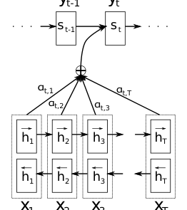
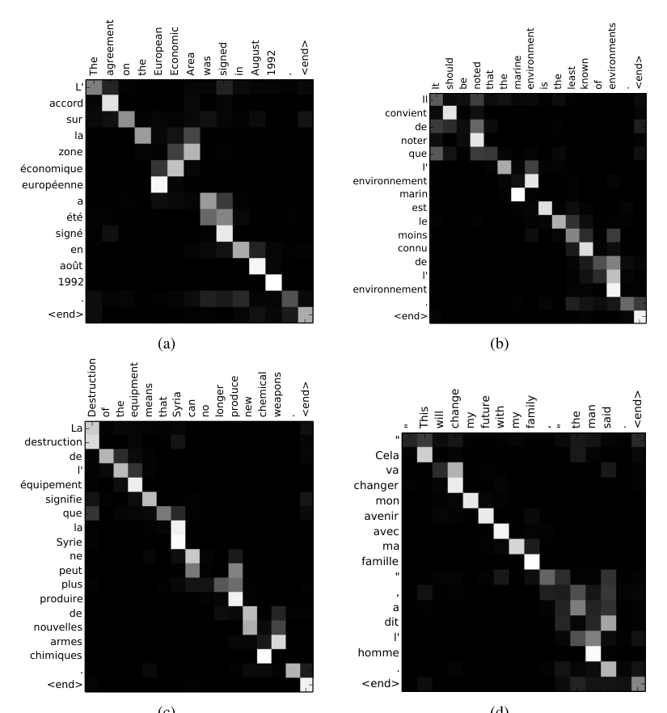
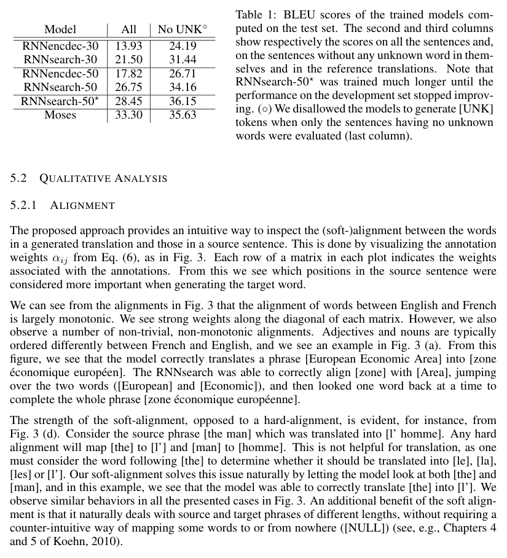
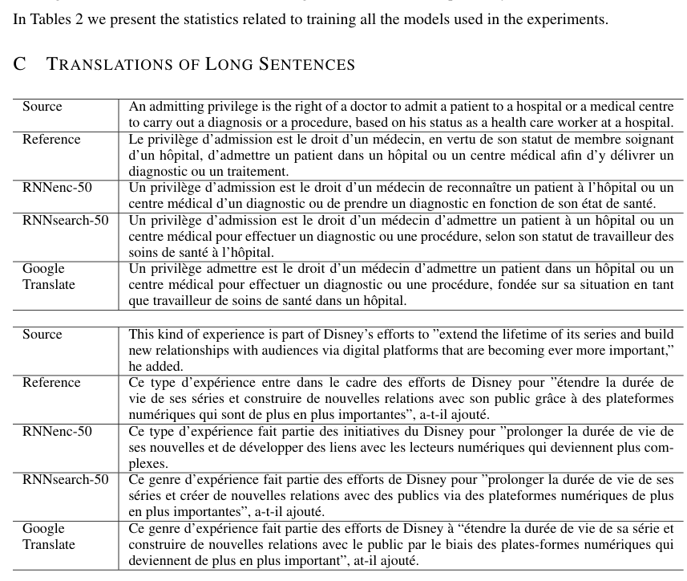
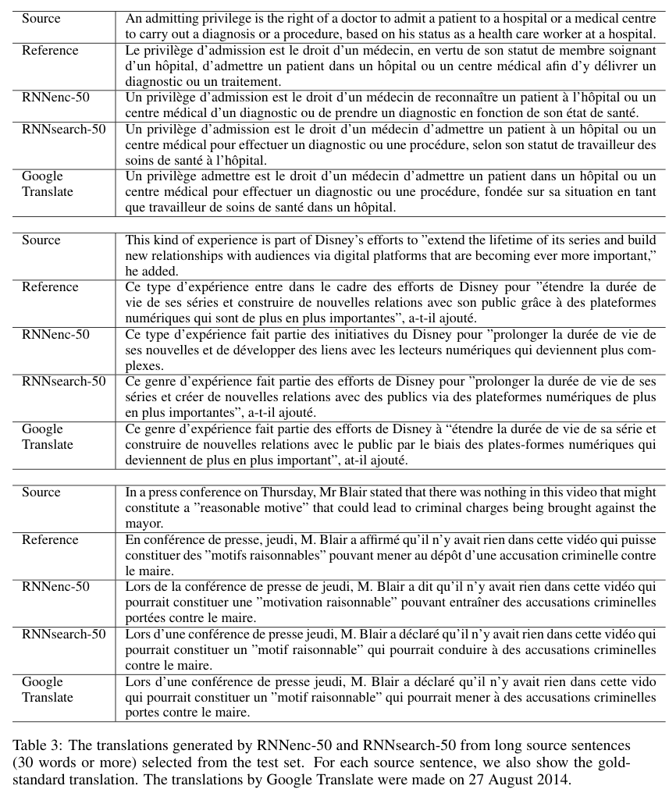

# 联合学习对齐与翻译的神经机器翻译（Neural Machine Translation by Jointly Learning to Align and Translate）

**Original:** Published as a conference paper at ICLR 2015

**中文:** 本文作为会议论文发表于 ICLR 2015

**Original:**

NEURAL MACHINE TRANSLATION
BY JOINTLY LEARNING TO ALIGN AND TRANSLATE

Dzmitry Bahdanau
Jacobs University Bremen, Germany

KyungHyun Cho
Yoshua Bengio*
Universit´e de Montr´eal

*CIFAR Senior Fellow

**中文:**

神经机器翻译：联合学习对齐与翻译

Dzmitry Bahdanau（德国不来梅雅各布大学）；KyungHyun Cho、Yoshua Bengio*（蒙特利尔大学）

*CIFAR Senior Fellow（CIFAR 资深会士）

## 摘要（Abstract）

**Original:** Neural machine translation is a recently proposed approach to machine translation. Unlike the traditional statistical machine translation, the neural machine translation aims at building a single neural network that can be jointly tuned to maximize the translation performance. The models proposed recently for neural machine translation often belong to a family of encoder–decoders and encode a source sentence into a fixed-length vector from which a decoder generates a translation. In this paper, we conjecture that the use of a fixed-length vector is a bottleneck in improving the performance of this basic encoder–decoder architecture, and propose to extend this by allowing a model to automatically (soft-)search for parts of a source sentence that are relevant to predicting a target word, without having to form these parts as a hard segment explicitly. With this new approach, we achieve a translation performance comparable to the existing state-of-the-art phrase-based system on the task of English-to-French translation. Furthermore, qualitative analysis reveals that the (soft-)alignments found by the model agree well with our intuition.

**中文:** 神经机器翻译（neural machine translation）是最近提出的一种机器翻译方法。与传统的统计机器翻译（statistical machine translation）不同，神经机器翻译旨在构建一个单一的神经网络，该网络可以被联合调优以最大化翻译性能。最近提出的神经机器翻译模型大多属于编码器–解码器（encoder–decoder）家族：它们把源句编码成一个固定长度（fixed-length）向量，解码器再由这个向量生成译文。在本文中，我们推测：固定长度向量的使用是提升这一基本编码器–解码器架构性能的瓶颈（bottleneck），并提出对其进行扩展——让模型自动地（软）搜索（(soft-)search）源句中与预测目标词相关的部分，而不必显式地把这些部分构造成一个硬分段（hard segment）。借助这一新方法，我们在英译法任务上取得了可与现有当前最优（state-of-the-art）的基于短语的系统（phrase-based system）相媲美的翻译性能。此外，定性分析表明，模型找到的（软）对齐（(soft-)alignment）与我们的直觉十分吻合。

## 1 引言（Introduction）

**Original:** Neural machine translation is a newly emerging approach to machine translation, recently proposed by Kalchbrenner and Blunsom (2013), Sutskever et al. (2014) and Cho et al. (2014b). Unlike the traditional phrase-based translation system (see, e.g., Koehn et al., 2003) which consists of many small sub-components that are tuned separately, neural machine translation attempts to build and train a single, large neural network that reads a sentence and outputs a correct translation.

**中文:** 神经机器翻译是一种新近兴起的机器翻译方法，由 Kalchbrenner and Blunsom (2013)、Sutskever et al. (2014) 和 Cho et al. (2014b) 在最近提出。传统的基于短语的翻译系统（参见 Koehn et al., 2003）由许多分别调优的小子组件组成；与之不同，神经机器翻译试图构建并训练一个单一的大型神经网络，让它读入一个句子并输出正确的译文。

**Original:** Most of the proposed neural machine translation models belong to a family of encoder–decoders (Sutskever et al., 2014; Cho et al., 2014a), with an encoder and a decoder for each language, or involve a language-specific encoder applied to each sentence whose outputs are then compared (Hermann and Blunsom, 2014). An encoder neural network reads and encodes a source sentence into a fixed-length vector. A decoder then outputs a translation from the encoded vector. The whole encoder–decoder system, which consists of the encoder and the decoder for a language pair, is jointly trained to maximize the probability of a correct translation given a source sentence.

**中文:** 大多数已提出的神经机器翻译模型都属于编码器–解码器家族（Sutskever et al., 2014; Cho et al., 2014a）：为每种语言各设一个编码器和一个解码器；或者对每个句子施加一个特定语言的编码器，再对其输出进行比较（Hermann and Blunsom, 2014）。编码器神经网络读入源句并将其编码成一个固定长度向量。解码器随后由该编码向量输出译文。整个编码器–解码器系统——由针对某个语言对的编码器和解码器构成——被联合训练，以最大化「给定源句时产生正确译文」的概率。

**Original:** A potential issue with this encoder–decoder approach is that a neural network needs to be able to compress all the necessary information of a source sentence into a fixed-length vector. This may make it difficult for the neural network to cope with long sentences, especially those that are longer than the sentences in the training corpus. Cho et al. (2014b) showed that indeed the performance of a basic encoder–decoder deteriorates rapidly as the length of an input sentence increases.

**中文:** 这种编码器–解码器方法的一个潜在问题是：神经网络必须能把源句的全部必要信息压缩进一个固定长度向量。这可能使神经网络难以处理长句，尤其是比训练语料（training corpus）中的句子更长的句子。Cho et al. (2014b) 表明，基本编码器–解码器的性能确实会随输入句子长度的增加而迅速恶化。

**Original:** In order to address this issue, we introduce an extension to the encoder–decoder model which learns to align and translate jointly. Each time the proposed model generates a word in a translation, it (soft-)searches for a set of positions in a source sentence where the most relevant information is concentrated. The model then predicts a target word based on the context vectors associated with these source positions and all the previous generated target words.

**中文:** 为了解决这一问题，我们对编码器–解码器模型引入一个扩展，让它联合地学习对齐与翻译。每次生成译文中的一个词时，所提模型都会（软）搜索源句中相关信息最集中的一组位置。然后，模型依据与这些源句位置相关联的上下文向量（context vector）以及所有此前已生成的目标词，来预测目标词。

**Original:** The most important distinguishing feature of this approach from the basic encoder–decoder is that it does not attempt to encode a whole input sentence into a single fixed-length vector. Instead, it encodes the input sentence into a sequence of vectors and chooses a subset of these vectors adaptively while decoding the translation. This frees a neural translation model from having to squash all the information of a source sentence, regardless of its length, into a fixed-length vector. We show this allows a model to cope better with long sentences.

**中文:** 该方法与基本编码器–解码器最重要的区别在于：它不再试图把整个输入句子编码成单一固定长度向量。取而代之的是，它把输入句子编码成一个向量序列，并在解码译文的过程中自适应地选取这些向量的一个子集。这使得神经翻译模型无需把源句的全部信息——无论句子多长——挤压进一个固定长度向量。我们将展示，这让模型能更好地处理长句。

**Original:** In this paper, we show that the proposed approach of jointly learning to align and translate achieves significantly improved translation performance over the basic encoder–decoder approach. The improvement is more apparent with longer sentences, but can be observed with sentences of any length. On the task of English-to-French translation, the proposed approach achieves, with a single model, a translation performance comparable, or close, to the conventional phrase-based system. Furthermore, qualitative analysis reveals that the proposed model finds a linguistically plausible (soft-)alignment between a source sentence and the corresponding target sentence.

**中文:** 在本文中，我们展示：联合学习对齐与翻译这一所提方法相比基本编码器–解码器方法取得了显著提升的翻译性能。提升在长句上更为明显，但在任何长度的句子上都能观察到。在英译法任务上，所提方法用单个模型即取得与常规基于短语的系统相当或接近的翻译性能。此外，定性分析表明，所提模型能在源句与相应目标句之间找到语言学上合理的（软）对齐。

## 2 背景：神经机器翻译（Background: Neural Machine Translation）

**Original:** From a probabilistic perspective, translation is equivalent to finding a target sentence y that maximizes the conditional probability of y given a source sentence x, i.e., arg max_y p(y | x). In neural machine translation, we fit a parameterized model to maximize the conditional probability of sentence pairs using a parallel training corpus. Once the conditional distribution is learned by a translation model, given a source sentence a corresponding translation can be generated by searching for the sentence that maximizes the conditional probability.

**中文:** 从概率的角度看，翻译等价于：给定源句 x，找到一个使 y 的条件概率（conditional probability）最大的目标句 y，即 $\arg\max_{\mathbf{y}} p(\mathbf{y} \mid \mathbf{x})$。在神经机器翻译中，我们用平行训练语料（parallel training corpus）拟合一个参数化模型，以最大化句对的条件概率。一旦翻译模型学到了这一条件分布，给定源句即可通过搜索使条件概率最大的句子来生成相应的译文。

**Original:** Recently, a number of papers have proposed the use of neural networks to directly learn this conditional distribution (see, e.g., Kalchbrenner and Blunsom, 2013; Cho et al., 2014a; Sutskever et al., 2014; Cho et al., 2014b; Forcada and ˜Neco, 1997). This neural machine translation approach typically consists of two components, the first of which encodes a source sentence x and the second decodes to a target sentence y. For instance, two recurrent neural networks (RNN) were used by (Cho et al., 2014a) and (Sutskever et al., 2014) to encode a variable-length source sentence into a fixed-length vector and to decode the vector into a variable-length target sentence.

**中文:** 最近，多篇论文提出用神经网络直接学习这一条件分布（参见 Kalchbrenner and Blunsom, 2013; Cho et al., 2014a; Sutskever et al., 2014; Cho et al., 2014b; Forcada and ˜Neco, 1997）。这种神经机器翻译方法通常由两个组件构成：第一个组件对源句 x 编码，第二个组件解码出目标句 y。例如，(Cho et al., 2014a) 和 (Sutskever et al., 2014) 使用两个循环神经网络（recurrent neural network，RNN），其一将变长源句编码为固定长度向量，另一个将该向量解码为变长目标句。

**Original:** Despite being a quite new approach, neural machine translation has already shown promising results. Sutskever et al. (2014) reported that the neural machine translation based on RNNs with long short-term memory (LSTM) units achieves close to the state-of-the-art performance of the conventional phrase-based machine translation system on an English-to-French translation task. [Footnote 1: We mean by the state-of-the-art performance, the performance of the conventional phrase-based system without using any neural network-based component.] Adding neural components to existing translation systems, for instance, to score the phrase pairs in the phrase table (Cho et al., 2014a) or to re-rank candidate translations (Sutskever et al., 2014), has allowed to surpass the previous state-of-the-art performance level.

**中文:** 尽管是一种相当新的方法，神经机器翻译已经展现出有前景的结果。Sutskever et al. (2014) 报告称，基于带长短期记忆网络（long short-term memory，LSTM）单元的 RNN 的神经机器翻译，在英译法任务上取得了接近常规基于短语的机器翻译系统的当前最优性能。[脚注 1：这里所说的当前最优性能，指不含任何基于神经网络的组件的常规基于短语系统的性能。] 向现有翻译系统添加神经组件——例如为短语表（phrase table）中的短语对打分（Cho et al., 2014a），或对候选译文重排序（Sutskever et al., 2014）——已经能够超越此前的当前最优性能水平。

### 2.1 RNN 编码器–解码器（RNN Encoder–Decoder）

**Original:** Here, we describe briefly the underlying framework, called RNN Encoder–Decoder, proposed by Cho et al. (2014a) and Sutskever et al. (2014) upon which we build a novel architecture that learns to align and translate simultaneously.

**中文:** 这里我们简要描述由 Cho et al. (2014a) 和 Sutskever et al. (2014) 提出的底层框架，即所谓的 RNN 编码器–解码器（RNN Encoder–Decoder）；我们在其基础上构建一个同时学习对齐与翻译的新架构。

**Original:** In the Encoder–Decoder framework, an encoder reads the input sentence, a sequence of vectors $\mathbf{x} = (x_1, \cdots, x_{T_x})$, into a vector $c$. [Footnote 2: Although most of the previous works (see, e.g., Cho et al., 2014a; Sutskever et al., 2014; Kalchbrenner and Blunsom, 2013) used to encode a variable-length input sentence into a fixed-length vector, it is not necessary, and even it may be beneficial to have a variable-length vector, as we will show later.] The most common approach is to use an RNN such that

$$h_t = f\left(x_t, h_{t-1}\right) \tag{1}$$

and

$$c = q\left(\{h_1, \cdots, h_{T_x}\}\right),$$

where $h_t \in \mathbb{R}^n$ is a hidden state at time $t$, and $c$ is a vector generated from the sequence of the hidden states. $f$ and $q$ are some nonlinear functions. Sutskever et al. (2014) used an LSTM as $f$ and $q\left(\{h_1, \cdots, h_T\}\right) = h_T$, for instance.

**中文:** 在编码器–解码器框架中，编码器读入输入句子——一个向量序列 $\mathbf{x} = (x_1, \cdots, x_{T_x})$——将其编码为向量 $c$。[脚注 2：尽管此前大多数工作（参见 Cho et al., 2014a; Sutskever et al., 2014; Kalchbrenner and Blunsom, 2013）习惯把变长输入句子编码为固定长度向量，但这并非必要，甚至变长向量可能更有益，稍后我们将展示这一点。] 最常见的做法是使用一个 RNN，使得

$$h_t = f\left(x_t, h_{t-1}\right) \tag{1}$$

且

$$c = q\left(\{h_1, \cdots, h_{T_x}\}\right),$$

其中 $h_t \in \mathbb{R}^n$ 是时刻 $t$ 的隐藏状态（hidden state），$c$ 是由隐藏状态序列生成的向量。$f$ 和 $q$ 是某些非线性函数。例如，Sutskever et al. (2014) 用 LSTM 作为 $f$，并取 $q\left(\{h_1, \cdots, h_T\}\right) = h_T$。

**Original:** The decoder is often trained to predict the next word $y_{t'}$ given the context vector $c$ and all the previously predicted words $\{y_1, \cdots, y_{t'-1}\}$. In other words, the decoder defines a probability over the translation $\mathbf{y}$ by decomposing the joint probability into the ordered conditionals:

$$p(\mathbf{y}) = \prod_{t=1}^{T} p\left(y_t \mid \{y_1, \cdots, y_{t-1}\}, c\right), \tag{2}$$

where $\mathbf{y} = \left(y_1, \cdots, y_{T_y}\right)$. With an RNN, each conditional probability is modeled as

$$p\left(y_t \mid \{y_1, \cdots, y_{t-1}\}, c\right) = g\left(y_{t-1}, s_t, c\right), \tag{3}$$

where $g$ is a nonlinear, potentially multi-layered, function that outputs the probability of $y_t$, and $s_t$ is the hidden state of the RNN. It should be noted that other architectures such as a hybrid of an RNN and a de-convolutional neural network can be used (Kalchbrenner and Blunsom, 2013).

**中文:** 解码器通常被训练为：给定上下文向量 $c$ 以及所有此前已预测的词 $\{y_1, \cdots, y_{t'-1}\}$，预测下一个词 $y_{t'}$。换言之，解码器把联合概率分解为有序条件概率之积，从而在译文 $\mathbf{y}$ 上定义一个概率：

$$p(\mathbf{y}) = \prod_{t=1}^{T} p\left(y_t \mid \{y_1, \cdots, y_{t-1}\}, c\right), \tag{2}$$

其中 $\mathbf{y} = \left(y_1, \cdots, y_{T_y}\right)$。使用 RNN 时，每个条件概率被建模为

$$p\left(y_t \mid \{y_1, \cdots, y_{t-1}\}, c\right) = g\left(y_{t-1}, s_t, c\right), \tag{3}$$

其中 $g$ 是一个非线性、可能多层的函数，输出 $y_t$ 的概率；$s_t$ 是 RNN 的隐藏状态。需要指出的是，其他架构（如 RNN 与去卷积神经网络的混合）也可以使用（Kalchbrenner and Blunsom, 2013）。

## 3 学习对齐与翻译（Learning to Align and Translate）

**Original:** In this section, we propose a novel architecture for neural machine translation. The new architecture consists of a bidirectional RNN as an encoder (Sec. 3.2) and a decoder that emulates searching through a source sentence during decoding a translation (Sec. 3.1).

**中文:** 在本节中，我们为神经机器翻译提出一个新架构。该新架构由一个充当编码器的双向 RNN（第 3.2 节）和一个解码器组成，解码器在解码译文的过程中模拟对源句的搜索（第 3.1 节）。

### 3.1 解码器：总体描述（Decoder: General Description）

**Original:**

x1 x2 x3 xT
+
αt,1 αt,2 αt,3 αt,T
yt-1 yt
h1 h2 h3 hT
h1 h2 h3 hT
s t-1 s t

Figure 1: The graphical illustration of the proposed model trying to generate the t-th target word $y_t$ given a source sentence $(x_1, x_2, . . . , x_T)$.

**中文:**

（图 1 为模型示意图，图中元素：源词 $x_1, x_2, x_3, x_T$；注解 $h_1, h_2, h_3, h_T$；权重 $\alpha_{t,1}, \alpha_{t,2}, \alpha_{t,3}, \alpha_{t,T}$；解码器隐藏状态 $s_{t-1}, s_t$；目标词 $y_{t-1}, y_t$）

> **图 1（译）**：所提模型的图示——给定源句 $(x_1, x_2, \ldots, x_T)$，生成第 $t$ 个目标词 $y_t$。（原图见 paper.pdf 第 3 页，见下方图）

**Original:** In a new model architecture, we define each conditional probability in Eq. (2) as:

$$p(y_i \mid y_1, \ldots, y_{i-1}, \mathbf{x}) = g\left(y_{i-1}, s_i, c_i\right), \tag{4}$$

where $s_i$ is an RNN hidden state for time $i$, computed by

$$s_i = f\left(s_{i-1}, y_{i-1}, c_i\right).$$

It should be noted that unlike the existing encoder–decoder approach (see Eq. (2)), here the probability is conditioned on a distinct context vector $c_i$ for each target word $y_i$.

**中文:** 在新的模型架构中，我们把式 (2) 中的每个条件概率定义为：

$$p(y_i \mid y_1, \ldots, y_{i-1}, \mathbf{x}) = g\left(y_{i-1}, s_i, c_i\right), \tag{4}$$

其中 $s_i$ 是时刻 $i$ 的 RNN 隐藏状态，按下式计算：

$$s_i = f\left(s_{i-1}, y_{i-1}, c_i\right).$$

需要指出的是，与现有的编码器–解码器方法（见式 (2)）不同，这里的概率对每个目标词 $y_i$ 都条件于一个不同的上下文向量 $c_i$。

**Original:** The context vector $c_i$ depends on a sequence of annotations $(h_1, \cdots, h_{T_x})$ to which an encoder maps the input sentence. Each annotation $h_i$ contains information about the whole input sequence with a strong focus on the parts surrounding the $i$-th word of the input sequence. We explain in detail how the annotations are computed in the next section.

**中文:** 上下文向量 $c_i$ 依赖于编码器将输入句子映射到的一个注解（annotation）序列 $(h_1, \cdots, h_{T_x})$。每个注解 $h_i$ 都包含关于整个输入序列的信息，并强烈聚焦于输入序列第 $i$ 个词周围的部分。我们将在下一节详细解释注解是如何计算的。

**Original:** The context vector $c_i$ is, then, computed as a weighted sum of these annotations $h_i$:

$$c_i = \sum_{j=1}^{T_x} \alpha_{ij} h_j. \tag{5}$$

**中文:** 然后，上下文向量 $c_i$ 被计算为这些注解 $h_i$ 的加权和：

$$c_i = \sum_{j=1}^{T_x} \alpha_{ij} h_j. \tag{5}$$

**Original:** The weight $\alpha_{ij}$ of each annotation $h_j$ is computed by

$$\alpha_{ij} = \frac{\exp\left(e_{ij}\right)}{\sum_{k=1}^{T_x} \exp\left(e_{ik}\right)}, \tag{6}$$

where

$$e_{ij} = a\left(s_{i-1}, h_j\right)$$

is an alignment model which scores how well the inputs around position $j$ and the output at position $i$ match. The score is based on the RNN hidden state $s_{i-1}$ (just before emitting $y_i$, Eq. (4)) and the $j$-th annotation $h_j$ of the input sentence.

**中文:** 每个注解 $h_j$ 的权重 $\alpha_{ij}$ 按下式计算：

$$\alpha_{ij} = \frac{\exp\left(e_{ij}\right)}{\sum_{k=1}^{T_x} \exp\left(e_{ik}\right)}, \tag{6}$$

其中

$$e_{ij} = a\left(s_{i-1}, h_j\right)$$

是一个对齐模型（alignment model），它为位置 $j$ 附近的输入与位置 $i$ 处的输出匹配得有多好打分。该分数基于 RNN 的隐藏状态 $s_{i-1}$（恰好在生成 $y_i$ 之前，式 (4)）与输入句子的第 $j$ 个注解 $h_j$。

**Original:** We parametrize the alignment model $a$ as a feedforward neural network which is jointly trained with all the other components of the proposed system. Note that unlike in traditional machine translation, the alignment is not considered to be a latent variable. Instead, the alignment model directly computes a soft alignment, which allows the gradient of the cost function to be backpropagated through. This gradient can be used to train the alignment model as well as the whole translation model jointly.

**中文:** 我们把对齐模型 $a$ 参数化为一个前馈神经网络（feedforward neural network），它与所提系统的所有其他组件联合训练。注意，与传统机器翻译不同，这里的对齐不被视为一个隐变量（latent variable）。取而代之的是，对齐模型直接计算一个软对齐（soft alignment），使代价函数（cost function）的梯度能够反向传播（backpropagate）通过它。该梯度可用于联合训练对齐模型以及整个翻译模型。

**Original:** We can understand the approach of taking a weighted sum of all the annotations as computing an expected annotation, where the expectation is over possible alignments. Let $\alpha_{ij}$ be a probability that the target word $y_i$ is aligned to, or translated from, a source word $x_j$. Then, the $i$-th context vector $c_i$ is the expected annotation over all the annotations with probabilities $\alpha_{ij}$.

**中文:** 我们可以把「对所有注解取加权和」这一做法理解为计算期望注解，其中的期望是在可能的对齐上取的。令 $\alpha_{ij}$ 表示目标词 $y_i$ 对齐到（或译自）源词 $x_j$ 的概率。那么，第 $i$ 个上下文向量 $c_i$ 就是在所有注解上、以概率 $\alpha_{ij}$ 取的期望注解。

**Original:** The probability $\alpha_{ij}$, or its associated energy $e_{ij}$, reflects the importance of the annotation $h_j$ with respect to the previous hidden state $s_{i-1}$ in deciding the next state $s_i$ and generating $y_i$. Intuitively, this implements a mechanism of attention in the decoder. The decoder decides parts of the source sentence to pay attention to. By letting the decoder have an attention mechanism, we relieve the encoder from the burden of having to encode all information in the source sentence into a fixed-length vector. With this new approach the information can be spread throughout the sequence of annotations, which can be selectively retrieved by the decoder accordingly.

**中文:** 概率 $\alpha_{ij}$（或其关联的能量 $e_{ij}$）反映了：在决定下一个状态 $s_i$ 并生成 $y_i$ 时，注解 $h_j$ 相对于先前隐藏状态 $s_{i-1}$ 的重要程度。直观地说，这在解码器中实现了一种注意力（attention）机制。解码器决定要关注源句的哪些部分。通过让解码器拥有注意力机制，我们使编码器摆脱了「必须把源句中的所有信息编码进一个固定长度向量」的负担。借助这一新方法，信息可以散布在整个注解序列之中，解码器可以相应地选择性地取用这些信息。

### 3.2 编码器：用于生成注解序列的双向 RNN（Encoder: Bidirectional RNN for Annotating Sequences）

**Original:** The usual RNN, described in Eq. (1), reads an input sequence $\mathbf{x}$ in order starting from the first symbol $x_1$ to the last one $x_{T_x}$. However, in the proposed scheme, we would like the annotation of each word to summarize not only the preceding words, but also the following words. Hence, we propose to use a bidirectional RNN (BiRNN, Schuster and Paliwal, 1997), which has been successfully used recently in speech recognition (see, e.g., Graves et al., 2013).

**中文:** 式 (1) 描述的普通 RNN 按顺序读入输入序列 $\mathbf{x}$，从第一个符号 $x_1$ 一直读到最后一个 $x_{T_x}$。然而在所提方案中，我们希望每个词的注解不仅能概括其前面的词，也能概括其后面的词。因此，我们提出使用双向循环神经网络（bidirectional RNN，BiRNN；Schuster and Paliwal, 1997），它最近已在语音识别中得到成功应用（参见 Graves et al., 2013）。

**Original:** A BiRNN consists of forward and backward RNN's. The forward RNN $\overrightarrow{f}$ reads the input sequence as it is ordered (from $x_1$ to $x_{T_x}$) and calculates a sequence of forward hidden states $(\overrightarrow{h}_1, \cdots, \overrightarrow{h}_{T_x})$. The backward RNN $\overleftarrow{f}$ reads the sequence in the reverse order (from $x_{T_x}$ to $x_1$), resulting in a sequence of backward hidden states $(\overleftarrow{h}_1, \cdots, \overleftarrow{h}_{T_x})$.

**中文:** BiRNN 由一个前向 RNN 和一个后向 RNN 组成。前向 RNN $\overrightarrow{f}$ 按输入序列本来的顺序（从 $x_1$ 到 $x_{T_x}$）读取，并计算前向隐藏状态序列 $(\overrightarrow{h}_1, \cdots, \overrightarrow{h}_{T_x})$。后向 RNN $\overleftarrow{f}$ 以相反的顺序读取序列（从 $x_{T_x}$ 到 $x_1$），得到后向隐藏状态序列 $(\overleftarrow{h}_1, \cdots, \overleftarrow{h}_{T_x})$。

**Original:** We obtain an annotation for each word $x_j$ by concatenating the forward hidden state $\overrightarrow{h}_j$ and the backward one $\overleftarrow{h}_j$, i.e., $h_j = \left[ \overrightarrow{h}_j^{\top}; \overleftarrow{h}_j^{\top} \right]^{\top}$. In this way, the annotation $h_j$ contains the summaries of both the preceding words and the following words. Due to the tendency of RNNs to better represent recent inputs, the annotation $h_j$ will be focused on the words around $x_j$. This sequence of annotations is used by the decoder and the alignment model later to compute the context vector (Eqs. (5)–(6)).

**中文:** 我们把前向隐藏状态 $\overrightarrow{h}_j$ 与后向隐藏状态 $\overleftarrow{h}_j$ 拼接起来，得到每个词 $x_j$ 的注解，即 $h_j = \left[ \overrightarrow{h}_j^{\top}; \overleftarrow{h}_j^{\top} \right]^{\top}$。这样，注解 $h_j$ 就同时包含其前面词和后面词的摘要。由于 RNN 倾向于更好地表示最近的输入，注解 $h_j$ 将聚焦于 $x_j$ 周围的词。此后，解码器和对齐模型使用这一注解序列来计算上下文向量（式 (5)–(6)）。

**Original:** See Fig. 1 for the graphical illustration of the proposed model.

**中文:** 所提模型的图示见图 1。

## 4 实验设置（Experiment Settings）

**Original:** We evaluate the proposed approach on the task of English-to-French translation. We use the bilingual, parallel corpora provided by ACL WMT '14. [Footnote 3: http://www.statmt.org/wmt14/translation-task.html] As a comparison, we also report the performance of an RNN Encoder–Decoder which was proposed recently by Cho et al. (2014a). We use the same training procedures and the same dataset for both models. [Footnote 4: Implementations are available at https://github.com/lisa-groundhog/GroundHog.]

**中文:** 我们在英译法任务上评估所提方法。我们使用 ACL WMT '14 提供的双语平行语料。[脚注 3：http://www.statmt.org/wmt14/translation-task.html] 作为对照，我们也报告 Cho et al. (2014a) 最近提出的 RNN 编码器–解码器的性能。两个模型使用相同的训练流程和相同的数据集。[脚注 4：实现代码见 https://github.com/lisa-groundhog/GroundHog。]

### 4.1 数据集（Dataset）

**Original:** WMT '14 contains the following English-French parallel corpora: Europarl (61M words), news commentary (5.5M), UN (421M) and two crawled corpora of 90M and 272.5M words respectively, totaling 850M words. Following the procedure described in Cho et al. (2014a), we reduce the size of the combined corpus to have 348M words using the data selection method by Axelrod et al. (2011). [Footnote 5: Available online at http://www-lium.univ-lemans.fr/~schwenk/cslm_joint_paper/.] We do not use any monolingual data other than the mentioned parallel corpora, although it may be possible to use a much larger monolingual corpus to pretrain an encoder. We concatenate news-test-2012 and news-test-2013 to make a development (validation) set, and evaluate the models on the test set (news-test-2014) from WMT '14, which consists of 3003 sentences not present in the training data.

**中文:** WMT '14 包含以下英法平行语料：Europarl（6100 万词）、news commentary（550 万词）、UN（4.21 亿词）以及两个规模分别为 9000 万词和 2.725 亿词的网络爬取语料，总计 8.5 亿词。按照 Cho et al. (2014a) 所述流程，我们使用 Axelrod et al. (2011) 的数据选择方法把合并语料缩减到 3.48 亿词。[脚注 5：可在 http://www-lium.univ-lemans.fr/~schwenk/cslm_joint_paper/ 在线获取。] 除了上述平行语料，我们不使用任何单语数据，尽管用大得多的单语语料来预训练（pretrain）编码器是可能的。我们把 news-test-2012 和 news-test-2013 拼接起来构成开发集（development set，即验证集），并在 WMT '14 的测试集（news-test-2014）上评估模型；该测试集由 3003 个不出现在训练数据中的句子组成。

**Original:** After a usual tokenization [Footnote 6: We used the tokenization script from the open-source machine translation package, Moses.], we use a shortlist of 30,000 most frequent words in each language to train our models. Any word not included in the shortlist is mapped to a special token ([UNK]). We do not apply any other special preprocessing, such as lowercasing or stemming, to the data.

**中文:** 经过常规的分词（tokenization）[脚注 6：我们使用了开源机器翻译工具包 Moses 的分词脚本。] 之后，我们使用每种语言中最常用的 30,000 个词构成的高频词表（shortlist）来训练模型。任何不在高频词表中的词都被映射到一个特殊 token（[UNK]）。我们不对数据施加任何其他特殊预处理，如小写化或词干提取。

### 4.2 模型（Models）

**Original:** We train two types of models. The first one is an RNN Encoder–Decoder (RNNencdec, Cho et al., 2014a), and the other is the proposed model, to which we refer as RNNsearch. We train each model twice: first with the sentences of length up to 30 words (RNNencdec-30, RNNsearch-30) and then with the sentences of length up to 50 word (RNNencdec-50, RNNsearch-50).

**中文:** 我们训练两类模型。第一类是 RNN 编码器–解码器（RNNencdec，Cho et al., 2014a），另一类是所提模型，我们称之为 RNNsearch。每类模型各训练两次：先用长度不超过 30 词的句子训练（RNNencdec-30、RNNsearch-30），再用长度不超过 50 词的句子训练（RNNencdec-50、RNNsearch-50）。

**Original:** The encoder and decoder of the RNNencdec have 1000 hidden units each. [Footnote 7: In this paper, by a 'hidden unit', we always mean the gated hidden unit (see Appendix A.1.1).] The encoder of the RNNsearch consists of forward and backward recurrent neural networks (RNN) each having 1000 hidden units. Its decoder has 1000 hidden units. In both cases, we use a multilayer network with a single maxout (Goodfellow et al., 2013) hidden layer to compute the conditional probability of each target word (Pascanu et al., 2014).

**中文:** RNNencdec 的编码器和解码器各有 1000 个隐藏单元（hidden unit）。[脚注 7：本文中「隐藏单元」一律指门控隐藏单元（gated hidden unit，见附录 A.1.1）。] RNNsearch 的编码器由前向和后向循环神经网络（RNN）组成，各含 1000 个隐藏单元。其解码器有 1000 个隐藏单元。两种情形下，我们都使用带单个 maxout（Goodfellow et al., 2013）隐藏层的多层网络来计算每个目标词的条件概率（Pascanu et al., 2014）。

**Original:** We use a minibatch stochastic gradient descent (SGD) algorithm together with Adadelta (Zeiler, 2012) to train each model. Each SGD update direction is computed using a minibatch of 80 sentences. We trained each model for approximately 5 days.

**中文:** 我们使用小批量随机梯度下降（minibatch stochastic gradient descent，SGD）算法配合 Adadelta（Zeiler, 2012）来训练每个模型。每个 SGD 更新方向用一个包含 80 个句子的小批量（minibatch）计算。每个模型训练了约 5 天。

**Original:** Once a model is trained, we use a beam search to find a translation that approximately maximizes the conditional probability (see, e.g., Graves, 2012; Boulanger-Lewandowski et al., 2013). Sutskever et al. (2014) used this approach to generate translations from their neural machine translation model.

**中文:** 模型训练完成后，我们使用束搜索（beam search）来寻找近似最大化条件概率的译文（参见 Graves, 2012; Boulanger-Lewandowski et al., 2013）。Sutskever et al. (2014) 曾用该方法从其神经机器翻译模型生成译文。

**Original:** For more details on the architectures of the models and training procedure used in the experiments, see Appendices A and B.

**中文:** 关于实验中使用的模型架构和训练流程的更多细节，见附录 A 和 B。

## 5 结果（Results）

### 5.1 定量结果（Quantitative Results）

**Original:** In Table 1, we list the translation performances measured in BLEU score. It is clear from the table that in all the cases, the proposed RNNsearch outperforms the conventional RNNencdec. More importantly, the performance of the RNNsearch is as high as that of the conventional phrase-based translation system (Moses), when only the sentences consisting of known words are considered. This is a significant achievement, considering that Moses uses a separate monolingual corpus (418M words) in addition to the parallel corpora we used to train the RNNsearch and RNNencdec.

**中文:** 表 1 列出了以 BLEU 分数（BLEU score）衡量的翻译性能。从表中可以清楚看到，在所有情形下，所提 RNNsearch 都优于常规的 RNNencdec。更重要的是，当只考虑由已知词组成的句子时，RNNsearch 的性能与常规基于短语的翻译系统（Moses）一样高。考虑到 Moses 除了我们用于训练 RNNsearch 和 RNNencdec 的平行语料之外，还使用了一个单独的单语语料（4.18 亿词），这是一个显著的成就。

**Original:** One of the motivations behind the proposed approach was the use of a fixed-length context vector in the basic encoder–decoder approach. We conjectured that this limitation may make the basic encoder–decoder approach to underperform with long sentences. In Fig. 2, we see that the performance of RNNencdec dramatically drops as the length of the sentences increases. On the other hand, both RNNsearch-30 and RNNsearch-50 are more robust to the length of the sentences. RNNsearch-50, especially, shows no performance deterioration even with sentences of length 50 or more. This superiority of the proposed model over the basic encoder–decoder is further confirmed by the fact that the RNNsearch-30 even outperforms RNNencdec-50 (see Table 1).

**中文:** 所提方法的动机之一，正是基本编码器–解码器方法中固定长度上下文向量的使用。我们曾推测，这一局限可能使基本编码器–解码器方法在长句上表现不佳。从图 2 中我们看到，RNNencdec 的性能随句子长度的增加而急剧下降。另一方面，RNNsearch-30 和 RNNsearch-50 都对句子长度更为稳健。尤其是 RNNsearch-50，即使句子长度达到 50 词或更长，性能也没有任何恶化。所提模型对基本编码器–解码器的这一优越性，还由以下事实进一步印证：RNNsearch-30 甚至优于 RNNencdec-50（见表 1）。

> **图 2（译）**：生成译文在测试集上的 BLEU 分数与句子长度的关系。结果为整个测试集上的结果，其中包括对模型而言含有未知词的句子。（原图见 paper.pdf 第 5 页，见下方图）

> **图 3（译）**：RNNsearch-50 找到的四个对齐样例。每幅图的 x 轴和 y 轴分别对应源句（英语）和生成译文（法语）中的词。每个像素以灰度显示第 $j$ 个源词之注解对第 $i$ 个目标词的权重 $\alpha_{ij}$（见式 (6)，0：黑，1：白）。(a) 任意句子。(b–d) 从测试集中不含任何未知词且长度在 10 到 20 词之间的句子中随机选取的三个样例。（原图见 paper.pdf 第 6 页，见下方图）

> **表 1（译）**：训练所得模型在测试集上计算的 BLEU 分数。第二、三列分别显示所有句子上的分数，以及自身和参考译文中均不含任何未知词的句子上的分数。注意 RNNsearch-50⋆ 训练了更久，直到开发集上的性能不再提升。(◦) 当仅评估不含未知词的句子时（最后一列），我们禁止模型生成 [UNK] token。（原图见 paper.pdf 第 7 页，见下方图）

### 5.2 定性分析（Qualitative Analysis）

#### 5.2.1 对齐（Alignment）

**Original:** The proposed approach provides an intuitive way to inspect the (soft-)alignment between the words in a generated translation and those in a source sentence. This is done by visualizing the annotation weights $\alpha_{ij}$ from Eq. (6), as in Fig. 3. Each row of a matrix in each plot indicates the weights associated with the annotations. From this we see which positions in the source sentence were considered more important when generating the target word.

**中文:** 所提方法提供了一种直观的方式来检视生成译文中的词与源句中的词之间的（软）对齐。做法是可视化式 (6) 中的注解权重 $\alpha_{ij}$，如图 3 所示。每幅图中矩阵的每一行表示与各注解相关联的权重。由此我们可以看出，生成目标词时源句中的哪些位置被认为更重要。

**Original:** We can see from the alignments in Fig. 3 that the alignment of words between English and French is largely monotonic. We see strong weights along the diagonal of each matrix. However, we also observe a number of non-trivial, non-monotonic alignments. Adjectives and nouns are typically ordered differently between French and English, and we see an example in Fig. 3 (a). From this figure, we see that the model correctly translates a phrase [European Economic Area] into [zone ´economique europ´een]. The RNNsearch was able to correctly align [zone] with [Area], jumping over the two words ([European] and [Economic]), and then looked one word back at a time to complete the whole phrase [zone ´economique europ´eenne].

**中文:** 从图 3 的对齐中可以看出，英语和法语之间的词对齐在很大程度上是单调的。我们看到每个矩阵对角线上都有很强的权重。不过，我们也观察到若干非平凡、非单调的对齐。法语和英语中形容词与名词的顺序通常不同，图 3 (a) 就是一个例子。从该图可以看出，模型正确地把短语 [European Economic Area] 翻译成 [zone ´economique europ´een]。RNNsearch 能够把 [zone] 正确地对齐到 [Area]，跳过中间的两个词（[European] 和 [Economic]），然后逐词回看，完成整个短语 [zone ´economique europ´eenne]。

**Original:** The strength of the soft-alignment, opposed to a hard-alignment, is evident, for instance, from Fig. 3 (d). Consider the source phrase [the man] which was translated into [l' homme]. Any hard alignment will map [the] to [l'] and [man] to [homme]. This is not helpful for translation, as one must consider the word following [the] to determine whether it should be translated into [le], [la], [les] or [l']. Our soft-alignment solves this issue naturally by letting the model look at both [the] and [man], and in this example, we see that the model was able to correctly translate [the] into [l']. We observe similar behaviors in all the presented cases in Fig. 3. An additional benefit of the soft alignment is that it naturally deals with source and target phrases of different lengths, without requiring a counter-intuitive way of mapping some words to or from nowhere ([NULL]) (see, e.g., Chapters 4 and 5 of Koehn, 2010).

**中文:** 软对齐相对于硬对齐（hard alignment）的优势，例如从图 3 (d) 中可以明显看出。考察被翻译成 [l' homme] 的源短语 [the man]。任何硬对齐都会把 [the] 映射到 [l']，把 [man] 映射到 [homme]。这对翻译并无帮助，因为必须考虑 [the] 后面的词，才能确定 [the] 应译为 [le]、[la]、[les] 还是 [l']。我们的软对齐让模型同时看到 [the] 和 [man]，从而自然地解决了这个问题；在这个例子中，我们看到模型能够把 [the] 正确地翻译成 [l']。我们在图 3 的所有样例中都观察到了类似行为。软对齐的另一个好处是，它自然地处理长度不同的源短语与目标短语，而不需要「把某些词映射到空（[NULL]）或从空映射出来」这种反直觉的做法（参见 Koehn, 2010 第 4、5 章）。

#### 5.2.2 长句（Long Sentences）

**Original:** As clearly visible from Fig. 2 the proposed model (RNNsearch) is much better than the conventional model (RNNencdec) at translating long sentences. This is likely due to the fact that the RNNsearch does not require encoding a long sentence into a fixed-length vector perfectly, but only accurately encoding the parts of the input sentence that surround a particular word.

**中文:** 从图 2 可以清楚看出，所提模型（RNNsearch）翻译长句的能力远优于常规模型（RNNencdec）。这可能是因为 RNNsearch 不需要把长句完美地编码进一个固定长度向量，而只需要准确地编码输入句子中围绕某个特定词的部分。

**Original:** As an example, consider this source sentence from the test set:

An admitting privilege is the right of a doctor to admit a patient to a hospital or a medical centre to carry out a diagnosis or a procedure, based on his status as a health care worker at a hospital.

**中文:** 作为例子，考察测试集中的这个源句：

An admitting privilege is the right of a doctor to admit a patient to a hospital or a medical centre to carry out a diagnosis or a procedure, based on his status as a health care worker at a hospital.

**Original:** The RNNencdec-50 translated this sentence into:

Un privil`ege d'admission est le droit d'un m´edecin de reconnaˆıtre un patient `a l'hˆopital ou un centre m´edical d'un diagnostic ou de prendre un diagnostic en fonction de son ´etat de sant´e.

**中文:** RNNencdec-50 把该句翻译成：

Un privil`ege d'admission est le droit d'un m´edecin de reconnaˆıtre un patient `a l'hˆopital ou un centre m´edical d'un diagnostic ou de prendre un diagnostic en fonction de son ´etat de sant´e.

（注：以上为模型的法语译文样例，原文照录。）

**Original:** The RNNencdec-50 correctly translated the source sentence until [a medical center]. However, from there on (underlined), it deviated from the original meaning of the source sentence. For instance, it replaced [based on his status as a health care worker at a hospital] in the source sentence with [en fonction de son ´etat de sant´e] ("based on his state of health").

**中文:** RNNencdec-50 直到 [a medical center] 为止都翻译正确。然而从此处往后（下划线部分），它偏离了源句的原意。例如，它把源句中的 [based on his status as a health care worker at a hospital] 替换成了 [en fonction de son ´etat de sant´e]（意为「根据他的健康状况」）。

**Original:** On the other hand, the RNNsearch-50 generated the following correct translation, preserving the whole meaning of the input sentence without omitting any details:

Un privil`ege d'admission est le droit d'un m´edecin d'admettre un patient `a un hˆopital ou un centre m´edical pour effectuer un diagnostic ou une proc´edure, selon son statut de travailleur des soins de sant´e `a l'hˆopital.

**中文:** 另一方面，RNNsearch-50 生成了如下正确的译文，完整保留了输入句子的含义且未遗漏任何细节：

Un privil`ege d'admission est le droit d'un m´edecin d'admettre un patient `a un hˆopital ou un centre m´edical pour effectuer un diagnostic ou une proc´edure, selon son statut de travailleur des soins de sant´e `a l'hˆopital.

（注：以上为模型的法语译文样例，原文照录。）

**Original:** Let us consider another sentence from the test set:

This kind of experience is part of Disney's efforts to "extend the lifetime of its series and build new relationships with audiences via digital platforms that are becoming ever more important," he added.

**中文:** 再看测试集中的另一个句子：

This kind of experience is part of Disney's efforts to "extend the lifetime of its series and build new relationships with audiences via digital platforms that are becoming ever more important," he added.

**Original:** The translation by the RNNencdec-50 is

Ce type d'exp´erience fait partie des initiatives du Disney pour "prolonger la dur´ee de vie de ses nouvelles et de d´evelopper des liens avec les lecteurs num´eriques qui deviennent plus complexes.

**中文:** RNNencdec-50 的译文是：

Ce type d'exp´erience fait partie des initiatives du Disney pour "prolonger la dur´ee de vie de ses nouvelles et de d´evelopper des liens avec les lecteurs num´eriques qui deviennent plus complexes.

（注：以上为模型的法语译文样例，原文照录。）

**Original:** As with the previous example, the RNNencdec began deviating from the actual meaning of the source sentence after generating approximately 30 words (see the underlined phrase). After that point, the quality of the translation deteriorates, with basic mistakes such as the lack of a closing quotation mark.

**中文:** 与前一个例子一样，RNNencdec 在生成大约 30 个词之后开始偏离源句的实际含义（见下划线短语）。此后，译文质量恶化，出现诸如缺少收尾引号之类的低级错误。

**Original:** Again, the RNNsearch-50 was able to translate this long sentence correctly:

Ce genre d'exp´erience fait partie des efforts de Disney pour "prolonger la dur´ee de vie de ses s´eries et cr´eer de nouvelles relations avec des publics via des plateformes num´eriques de plus en plus importantes", a-t-il ajout´e.

**中文:** 同样，RNNsearch-50 能够正确翻译这个长句：

Ce genre d'exp´erience fait partie des efforts de Disney pour "prolonger la dur´ee de vie de ses s´eries et cr´eer de nouvelles relations avec des publics via des plateformes num´eriques de plus en plus importantes", a-t-il ajout´e.

（注：以上为模型的法语译文样例，原文照录。）

**Original:** In conjunction with the quantitative results presented already, these qualitative observations confirm our hypotheses that the RNNsearch architecture enables far more reliable translation of long sentences than the standard RNNencdec model.

**中文:** 结合前面给出的定量结果，这些定性观察证实了我们的假设：RNNsearch 架构对长句的翻译远比标准 RNNencdec 模型可靠。

**Original:** In Appendix C, we provide a few more sample translations of long source sentences generated by the RNNencdec-50, RNNsearch-50 and Google Translate along with the reference translations.

**中文:** 在附录 C 中，我们给出更多由 RNNencdec-50、RNNsearch-50 和 Google Translate 生成的长源句译文样例，并附参考译文。

## 6 相关工作（Related Work）

### 6.1 学习对齐（Learning to Align）

**Original:** A similar approach of aligning an output symbol with an input symbol was proposed recently by Graves (2013) in the context of handwriting synthesis. Handwriting synthesis is a task where the model is asked to generate handwriting of a given sequence of characters. In his work, he used a mixture of Gaussian kernels to compute the weights of the annotations, where the location, width and mixture coefficient of each kernel was predicted from an alignment model. More specifically, his alignment was restricted to predict the location such that the location increases monotonically.

**中文:** Graves (2013) 最近在手写合成（handwriting synthesis）的背景下提出了类似的「把输出符号与输入符号对齐」的方法。手写合成是这样一项任务：给定一个字符序列，要求模型生成相应的手写体。在他的工作中，他用混合高斯核（mixture of Gaussian kernels）来计算注解的权重，其中每个核的位置、宽度和混合系数由对齐模型预测。更具体地说，他的对齐被限制为：预测的位置必须单调递增。

**Original:** The main difference from our approach is that, in (Graves, 2013), the modes of the weights of the annotations only move in one direction. In the context of machine translation, this is a severe limitation, as (long-distance) reordering is often needed to generate a grammatically correct translation (for instance, English-to-German).

**中文:** 与我们方法的主要区别在于：(Graves, 2013) 中注解权重的众数（mode）只能沿一个方向移动。在机器翻译的背景下，这是一个严重的局限，因为要生成语法正确的译文（例如英译德），常常需要（长距离的）词序重排。

**Original:** Our approach, on the other hand, requires computing the annotation weight of every word in the source sentence for each word in the translation. This drawback is not severe with the task of translation in which most of input and output sentences are only 15–40 words. However, this may limit the applicability of the proposed scheme to other tasks.

**中文:** 另一方面，我们的方法要求：对译文中的每个词，都要计算源句中每个词的注解权重。这一缺点在翻译任务中并不严重，因为大多数输入和输出句子只有 15–40 个词。不过，这可能限制所提方案对其他任务的适用性。

### 6.2 用于机器翻译的神经网络（Neural Networks for Machine Translation）

**Original:** Since Bengio et al. (2003) introduced a neural probabilistic language model which uses a neural network to model the conditional probability of a word given a fixed number of the preceding words, neural networks have widely been used in machine translation. However, the role of neural networks has been largely limited to simply providing a single feature to an existing statistical machine translation system or to re-rank a list of candidate translations provided by an existing system.

**中文:** 自从 Bengio et al. (2003) 提出神经概率语言模型（neural probabilistic language model）——它用神经网络对「给定固定数量的前文词时某个词的条件概率」建模——以来，神经网络已被广泛用于机器翻译。然而，神经网络的角色很大程度上仅限于：为现有统计机器翻译系统提供单一特征，或对现有系统给出的候选译文列表重排序。

**Original:** For instance, Schwenk (2012) proposed using a feedforward neural network to compute the score of a pair of source and target phrases and to use the score as an additional feature in the phrase-based statistical machine translation system. More recently, Kalchbrenner and Blunsom (2013) and Devlin et al. (2014) reported the successful use of the neural networks as a sub-component of the existing translation system. Traditionally, a neural network trained as a target-side language model has been used to rescore or rerank a list of candidate translations (see, e.g., Schwenk et al., 2006).

**中文:** 例如，Schwenk (2012) 提出用前馈神经网络计算一对源短语与目标短语的得分，并把该得分作为基于短语的统计机器翻译系统中的一个附加特征。更近一些，Kalchbrenner and Blunsom (2013) 和 Devlin et al. (2014) 报告了神经网络作为现有翻译系统子组件的成功应用。传统上，被训练成目标端语言模型的神经网络被用来对候选译文列表重新打分或重排序（参见 Schwenk et al., 2006）。

**Original:** Although the above approaches were shown to improve the translation performance over the state-of-the-art machine translation systems, we are more interested in a more ambitious objective of designing a completely new translation system based on neural networks. The neural machine translation approach we consider in this paper is therefore a radical departure from these earlier works. Rather than using a neural network as a part of the existing system, our model works on its own and generates a translation from a source sentence directly.

**中文:** 尽管上述方法已被证明能在当前最优机器翻译系统之上提升翻译性能，我们更感兴趣的却是一个更具雄心的目标：设计一个完全基于神经网络的全新翻译系统。因此，本文考虑的神经机器翻译方法与这些早期工作截然不同。我们的模型不是作为现有系统的一部分来使用神经网络，而是独立运作，直接从源句生成译文。

## 7 结论（Conclusion）

**Original:** The conventional approach to neural machine translation, called an encoder–decoder approach, encodes a whole input sentence into a fixed-length vector from which a translation will be decoded. We conjectured that the use of a fixed-length context vector is problematic for translating long sentences, based on a recent empirical study reported by Cho et al. (2014b) and Pouget-Abadie et al. (2014).

**中文:** 神经机器翻译的常规方法——即所谓的编码器–解码器方法——把整个输入句子编码成一个固定长度向量，译文再从这个向量解码出来。基于 Cho et al. (2014b) 和 Pouget-Abadie et al. (2014) 报告的近期实证研究，我们推测固定长度上下文向量的使用对长句翻译是有问题的。

**Original:** In this paper, we proposed a novel architecture that addresses this issue. We extended the basic encoder–decoder by letting a model (soft-)search for a set of input words, or their annotations computed by an encoder, when generating each target word. This frees the model from having to encode a whole source sentence into a fixed-length vector, and also lets the model focus only on information relevant to the generation of the next target word. This has a major positive impact on the ability of the neural machine translation system to yield good results on longer sentences. Unlike with the traditional machine translation systems, all of the pieces of the translation system, including the alignment mechanism, are jointly trained towards a better log-probability of producing correct translations.

**中文:** 在本文中，我们提出了一个解决该问题的新架构。我们扩展了基本编码器–解码器：在生成每个目标词时，让模型（软）搜索一组输入词（或由编码器计算出的它们的注解）。这使模型不必把整个源句编码进一个固定长度向量，同时也让模型只关注与生成下一个目标词相关的信息。这对神经机器翻译系统在较长句子上取得好结果的能力有重大的积极影响。与传统机器翻译系统不同，翻译系统的所有部分——包括对齐机制——都被联合训练，以取得更高的「生成正确译文」的对数概率（log-probability）。

**Original:** We tested the proposed model, called RNNsearch, on the task of English-to-French translation. The experiment revealed that the proposed RNNsearch outperforms the conventional encoder–decoder model (RNNencdec) significantly, regardless of the sentence length and that it is much more robust to the length of a source sentence. From the qualitative analysis where we investigated the (soft-)alignment generated by the RNNsearch, we were able to conclude that the model can correctly align each target word with the relevant words, or their annotations, in the source sentence as it generated a correct translation.

**中文:** 我们在英译法任务上测试了所提模型——称为 RNNsearch。实验表明，所提 RNNsearch 无论句子长度如何都显著优于常规的编码器–解码器模型（RNNencdec），并且它对源句长度稳健得多。通过考察 RNNsearch 生成的（软）对齐的定性分析，我们可以得出结论：模型在生成正确译文的同时，能够把每个目标词正确地对齐到源句中相关的词（或它们的注解）。

**Original:** Perhaps more importantly, the proposed approach achieved a translation performance comparable to the existing phrase-based statistical machine translation. It is a striking result, considering that the proposed architecture, or the whole family of neural machine translation, has only been proposed as recently as this year. We believe the architecture proposed here is a promising step toward better machine translation and a better understanding of natural languages in general.

**中文:** 也许更重要的是，所提方法取得了可与现有基于短语的统计机器翻译相媲美的翻译性能。考虑到所提架构——乃至整个神经机器翻译家族——直到今年才刚被提出，这是一个惊人的结果。我们相信，本文提出的架构是迈向更好的机器翻译、以及对自然语言更深入理解的有希望的一步。

**Original:** One of challenges left for the future is to better handle unknown, or rare words. This will be required for the model to be more widely used and to match the performance of current state-of-the-art machine translation systems in all contexts.

**中文:** 留给未来的挑战之一是更好地处理未知词或罕见词。若要让模型得到更广泛的应用，并在所有语境中都达到当前最优机器翻译系统的性能，就必须解决这一问题。

## 致谢（Acknowledgments）

**Original:** The authors would like to thank the developers of Theano (Bergstra et al., 2010; Bastien et al., 2012). We acknowledge the support of the following agencies for research funding and computing support: NSERC, Calcul Qu´ebec, Compute Canada, the Canada Research Chairs and CIFAR. Bahdanau thanks the support from Planet Intelligent Systems GmbH. We also thank Felix Hill, Bart van Merri´enboer, Jean Pouget-Abadie, Coline Devin and Tae-Ho Kim.

**中文:** 作者感谢 Theano 的开发者（Bergstra et al., 2010; Bastien et al., 2012）。我们感谢以下机构在研究经费和计算资源上的支持：NSERC、Calcul Qu´ebec、Compute Canada、the Canada Research Chairs 和 CIFAR。Bahdanau 感谢 Planet Intelligent Systems GmbH 的支持。我们也感谢 Felix Hill、Bart van Merri´enboer、Jean Pouget-Abadie、Coline Devin 和 Tae-Ho Kim。

## References（参考文献，原文保留不译）

**Original:**

Axelrod, A., He, X., and Gao, J. (2011). Domain adaptation via pseudo in-domain data selection. In Proceedings of the ACL Conference on Empirical Methods in Natural Language Processing (EMNLP), pages 355–362. Association for Computational Linguistics.

Bastien, F., Lamblin, P., Pascanu, R., Bergstra, J., Goodfellow, I. J., Bergeron, A., Bouchard, N., and Bengio, Y. (2012). Theano: new features and speed improvements. Deep Learning and Unsupervised Feature Learning NIPS 2012 Workshop.

Bengio, Y., Simard, P., and Frasconi, P. (1994). Learning long-term dependencies with gradient descent is difficult. IEEE Transactions on Neural Networks, 5(2), 157–166.

Bengio, Y., Ducharme, R., Vincent, P., and Janvin, C. (2003). A neural probabilistic language model. J. Mach. Learn. Res., 3, 1137–1155.

Bergstra, J., Breuleux, O., Bastien, F., Lamblin, P., Pascanu, R., Desjardins, G., Turian, J., Warde-Farley, D., and Bengio, Y. (2010). Theano: a CPU and GPU math expression compiler. In Proceedings of the Python for Scientific Computing Conference (SciPy). Oral Presentation.

Boulanger-Lewandowski, N., Bengio, Y., and Vincent, P. (2013). Audio chord recognition with recurrent neural networks. In ISMIR.

Cho, K., van Merrienboer, B., Gulcehre, C., Bougares, F., Schwenk, H., and Bengio, Y. (2014a). Learning phrase representations using RNN encoder-decoder for statistical machine translation. In Proceedings of the Empiricial Methods in Natural Language Processing (EMNLP 2014). to appear.

Cho, K., van Merri¨enboer, B., Bahdanau, D., and Bengio, Y. (2014b). On the properties of neural machine translation: Encoder–Decoder approaches. In Eighth Workshop on Syntax, Semantics and Structure in Statistical Translation. to appear.

Devlin, J., Zbib, R., Huang, Z., Lamar, T., Schwartz, R., and Makhoul, J. (2014). Fast and robust neural network joint models for statistical machine translation. In Association for Computational Linguistics.

Forcada, M. L. and ˜Neco, R. P. (1997). Recursive hetero-associative memories for translation. In J. Mira, R. Moreno-D´ıaz, and J. Cabestany, editors, Biological and Artificial Computation: From Neuroscience to Technology, volume 1240 of Lecture Notes in Computer Science, pages 453–462. Springer Berlin Heidelberg.

Goodfellow, I., Warde-Farley, D., Mirza, M., Courville, A., and Bengio, Y. (2013). Maxout networks. In Proceedings of The 30th International Conference on Machine Learning, pages 1319–1327.

Graves, A. (2012). Sequence transduction with recurrent neural networks. In Proceedings of the 29th International Conference on Machine Learning (ICML 2012).

Graves, A. (2013). Generating sequences with recurrent neural networks. arXiv:1308.0850 [cs.NE].

Graves, A., Jaitly, N., and Mohamed, A.-R. (2013). Hybrid speech recognition with deep bidirectional LSTM. In Automatic Speech Recognition and Understanding (ASRU), 2013 IEEE Workshop on, pages 273–278.

Hermann, K. and Blunsom, P. (2014). Multilingual distributed representations without word alignment. In Proceedings of the Second International Conference on Learning Representations (ICLR 2014).

Hochreiter, S. (1991). Untersuchungen zu dynamischen neuronalen Netzen. Diploma thesis, Institut f¨ur Informatik, Lehrstuhl Prof. Brauer, Technische Universit¨at M¨unchen.

Hochreiter, S. and Schmidhuber, J. (1997). Long short-term memory. Neural Computation, 9(8), 1735–1780.

Kalchbrenner, N. and Blunsom, P. (2013). Recurrent continuous translation models. In Proceedings of the ACL Conference on Empirical Methods in Natural Language Processing (EMNLP), pages 1700–1709. Association for Computational Linguistics.

Koehn, P. (2010). Statistical Machine Translation. Cambridge University Press, New York, NY, USA.

Koehn, P., Och, F. J., and Marcu, D. (2003). Statistical phrase-based translation. In Proceedings of the 2003 Conference of the North American Chapter of the Association for Computational Linguistics on Human Language Technology - Volume 1, NAACL '03, pages 48–54, Stroudsburg, PA, USA. Association for Computational Linguistics.

Pascanu, R., Mikolov, T., and Bengio, Y. (2013a). On the difficulty of training recurrent neural networks. In ICML'2013.

Pascanu, R., Mikolov, T., and Bengio, Y. (2013b). On the difficulty of training recurrent neural networks. In Proceedings of the 30th International Conference on Machine Learning (ICML 2013).

Pascanu, R., Gulcehre, C., Cho, K., and Bengio, Y. (2014). How to construct deep recurrent neural networks. In Proceedings of the Second International Conference on Learning Representations (ICLR 2014).

Pouget-Abadie, J., Bahdanau, D., van Merri¨enboer, B., Cho, K., and Bengio, Y. (2014). Overcoming the curse of sentence length for neural machine translation using automatic segmentation. In Eighth Workshop on Syntax, Semantics and Structure in Statistical Translation. to appear.

Schuster, M. and Paliwal, K. K. (1997). Bidirectional recurrent neural networks. Signal Processing, IEEE Transactions on, 45(11), 2673–2681.

Schwenk, H. (2012). Continuous space translation models for phrase-based statistical machine translation. In M. Kay and C. Boitet, editors, Proceedings of the 24th International Conference on Computational Linguistics (COLIN), pages 1071–1080. Indian Institute of Technology Bombay.

Schwenk, H., Dchelotte, D., and Gauvain, J.-L. (2006). Continuous space language models for statistical machine translation. In Proceedings of the COLING/ACL on Main conference poster sessions, pages 723–730. Association for Computational Linguistics.

Sutskever, I., Vinyals, O., and Le, Q. (2014). Sequence to sequence learning with neural networks. In Advances in Neural Information Processing Systems (NIPS 2014).

Zeiler, M. D. (2012). ADADELTA: An adaptive learning rate method. arXiv:1212.5701 [cs.LG].

**中文:** （参考文献按规范原文保留，不译，共 29 条。）

## 附录 A 模型架构（Appendix A: Model Architecture）

### A.1 架构选择（Architectural Choices）

**Original:** The proposed scheme in Section 3 is a general framework where one can freely define, for instance, the activation functions $f$ of recurrent neural networks (RNN) and the alignment model $a$. Here, we describe the choices we made for the experiments in this paper.

**中文:** 第 3 节所提方案是一个通用框架，其中可以自由定义例如循环神经网络（RNN）的激活函数 $f$ 和对齐模型 $a$ 等。这里我们描述本文实验中所做的选择。

#### A.1.1 循环神经网络（Recurrent Neural Network）

**Original:** For the activation function $f$ of an RNN, we use the gated hidden unit recently proposed by Cho et al. (2014a). The gated hidden unit is an alternative to the conventional simple units such as an element-wise tanh. This gated unit is similar to a long short-term memory (LSTM) unit proposed earlier by Hochreiter and Schmidhuber (1997), sharing with it the ability to better model and learn long-term dependencies. This is made possible by having computation paths in the unfolded RNN for which the product of derivatives is close to 1. These paths allow gradients to flow backward easily without suffering too much from the vanishing effect (Hochreiter, 1991; Bengio et al., 1994; Pascanu et al., 2013a). It is therefore possible to use LSTM units instead of the gated hidden unit described here, as was done in a similar context by Sutskever et al. (2014).

**中文:** 对于 RNN 的激活函数 $f$，我们使用 Cho et al. (2014a) 最近提出的门控隐藏单元（gated hidden unit）。门控隐藏单元是逐元素 tanh 之类常规简单单元的替代品。这种门控单元与 Hochreiter and Schmidhuber (1997) 早先提出的长短期记忆网络（LSTM）单元相似，与之共有「更好地建模和学习长程依赖」的能力。这一点之所以可能，是因为展开后的 RNN 中存在导数乘积接近 1 的计算路径。这些路径使梯度能够轻松地反向流动，而不会过多地遭受梯度消失效应（Hochreiter, 1991; Bengio et al., 1994; Pascanu et al., 2013a）。因此，可以用 LSTM 单元代替这里描述的门控隐藏单元，Sutskever et al. (2014) 就在类似背景下这样做过。

**Original:** The new state $s_i$ of the RNN employing $n$ gated hidden units [Footnote 8: Here, we show the formula of the decoder. The same formula can be used in the encoder by simply ignoring the context vector $c_i$ and the related terms.] is computed by

$$s_i = f\left(s_{i-1}, y_{i-1}, c_i\right) = (1 - z_i) \circ s_{i-1} + z_i \circ \tilde{s}_i,$$

where $\circ$ is an element-wise multiplication, and $z_i$ is the output of the update gates (see below). The proposed updated state $\tilde{s}_i$ is computed by

$$\tilde{s}_i = \tanh\left(W e\left(y_{i-1}\right) + U\left[r_i \circ s_{i-1}\right] + C c_i\right),$$

where $e(y_{i-1}) \in \mathbb{R}^m$ is an $m$-dimensional embedding of a word $y_{i-1}$, and $r_i$ is the output of the reset gates (see below). When $y_i$ is represented as a 1-of-K vector, $e(y_i)$ is simply a column of an embedding matrix $E \in \mathbb{R}^{m \times K}$. Whenever possible, we omit bias terms to make the equations less cluttered.

**中文:** 采用 $n$ 个门控隐藏单元的 RNN 的新状态 $s_i$ [脚注 8：这里我们展示的是解码器的公式。同一公式也可用于编码器，只需忽略上下文向量 $c_i$ 及相关项。] 按下式计算：

$$s_i = f\left(s_{i-1}, y_{i-1}, c_i\right) = (1 - z_i) \circ s_{i-1} + z_i \circ \tilde{s}_i,$$

其中 $\circ$ 是逐元素乘法（element-wise multiplication），$z_i$ 是更新门（update gate）的输出（见下文）。所提的候选更新状态 $\tilde{s}_i$ 按下式计算：

$$\tilde{s}_i = \tanh\left(W e\left(y_{i-1}\right) + U\left[r_i \circ s_{i-1}\right] + C c_i\right),$$

其中 $e(y_{i-1}) \in \mathbb{R}^m$ 是词 $y_{i-1}$ 的 $m$ 维嵌入（embedding），$r_i$ 是重置门（reset gate）的输出（见下文）。当 $y_i$ 表示为一个 1-of-K 向量（即独热向量）时，$e(y_i)$ 就是嵌入矩阵 $E \in \mathbb{R}^{m \times K}$ 的一列。只要可能，我们省略偏置项以使公式不那么杂乱。

**Original:** The update gates $z_i$ allow each hidden unit to maintain its previous activation, and the reset gates $r_i$ control how much and what information from the previous state should be reset. We compute them by

$$z_i = \sigma\left(W_z e\left(y_{i-1}\right) + U_z s_{i-1} + C_z c_i\right),$$

$$r_i = \sigma\left(W_r e\left(y_{i-1}\right) + U_r s_{i-1} + C_r c_i\right),$$

where $\sigma(\cdot)$ is a logistic sigmoid function.

**中文:** 更新门 $z_i$ 使每个隐藏单元能够保持其先前的激活值，重置门 $r_i$ 控制前一状态中「有多少信息、哪些信息」应被重置。它们按下式计算：

$$z_i = \sigma\left(W_z e\left(y_{i-1}\right) + U_z s_{i-1} + C_z c_i\right),$$

$$r_i = \sigma\left(W_r e\left(y_{i-1}\right) + U_r s_{i-1} + C_r c_i\right),$$

其中 $\sigma(\cdot)$ 是 logistic sigmoid 函数。

**Original:** At each step of the decoder, we compute the output probability (Eq. (4)) as a multi-layered function (Pascanu et al., 2014). We use a single hidden layer of maxout units (Goodfellow et al., 2013) and normalize the output probabilities (one for each word) with a softmax function (see Eq. (6)).

**中文:** 在解码器的每一步，我们把输出概率（式 (4)）计算为一个多层函数（Pascanu et al., 2014）。我们使用单个 maxout 单元隐藏层（Goodfellow et al., 2013），并用 softmax 函数对输出概率（每个词一个）归一化（见式 (6)）。

#### A.1.2 对齐模型（Alignment Model）

**Original:** The alignment model should be designed considering that the model needs to be evaluated $T_x \times T_y$ times for each sentence pair of lengths $T_x$ and $T_y$. In order to reduce computation, we use a single-layer multilayer perceptron such that

$$a\left(s_{i-1}, h_j\right) = v_a^{\top} \tanh\left(W_a s_{i-1} + U_a h_j\right),$$

where $W_a \in \mathbb{R}^{n \times n}$, $U_a \in \mathbb{R}^{n \times 2n}$ and $v_a \in \mathbb{R}^n$ are the weight matrices. Since $U_a h_j$ does not depend on $i$, we can pre-compute it in advance to minimize the computational cost.

**中文:** 设计对齐模型时应当考虑到：对长度分别为 $T_x$ 和 $T_y$ 的每个句对，该模型需要被求值 $T_x \times T_y$ 次。为了减少计算量，我们使用一个单层的多层感知机（multilayer perceptron），使得

$$a\left(s_{i-1}, h_j\right) = v_a^{\top} \tanh\left(W_a s_{i-1} + U_a h_j\right),$$

其中 $W_a \in \mathbb{R}^{n \times n}$、$U_a \in \mathbb{R}^{n \times 2n}$ 和 $v_a \in \mathbb{R}^n$ 是权重矩阵。由于 $U_a h_j$ 不依赖于 $i$，我们可以提前预计算它以最小化计算成本。

### A.2 模型详细描述（Detailed Description of the Model）

**Original:** In this section, we describe in detail the architecture of the proposed model (RNNsearch) used in the experiments (see Sec. 4–5). From here on, we omit all bias terms in order to increase readability.

**中文:** 在本节中，我们详细描述实验中使用的所提模型（RNNsearch）的架构（见第 4–5 节）。从这里开始，为增强可读性我们省略所有偏置项。

#### A.2.1 编码器（Encoder）

**Original:** The model takes a source sentence of 1-of-K coded word vectors as input

$$\mathbf{x} = (x_1, \ldots, x_{T_x}), \quad x_i \in \mathbb{R}^{K_x}$$

and outputs a translated sentence of 1-of-K coded word vectors

$$\mathbf{y} = (y_1, \ldots, y_{T_y}), \quad y_i \in \mathbb{R}^{K_y},$$

where $K_x$ and $K_y$ are the vocabulary sizes of source and target languages, respectively. $T_x$ and $T_y$ respectively denote the lengths of source and target sentences.

**中文:** 模型以 1-of-K 编码（即独热编码）词向量构成的源句作为输入

$$\mathbf{x} = (x_1, \ldots, x_{T_x}), \quad x_i \in \mathbb{R}^{K_x}$$

并输出由 1-of-K 编码词向量构成的译文句子

$$\mathbf{y} = (y_1, \ldots, y_{T_y}), \quad y_i \in \mathbb{R}^{K_y},$$

其中 $K_x$ 和 $K_y$ 分别是源语言和目标语言的词表大小。$T_x$ 和 $T_y$ 分别表示源句和目标句的长度。

**Original:** First, the forward states of the bidirectional recurrent neural network (BiRNN) are computed:

$$\overrightarrow{h}_i = \begin{cases} \left(1 - \overrightarrow{z}_i\right) \circ \overrightarrow{h}_{i-1} + \overrightarrow{z}_i \circ \overrightarrow{\tilde{h}}_i, & \text{if } i > 0 \\ 0, & \text{if } i = 0 \end{cases}$$

where

$$\overrightarrow{\tilde{h}}_i = \tanh\left(\overrightarrow{W} E x_i + \overrightarrow{U}\left[\overrightarrow{r}_i \circ \overrightarrow{h}_{i-1}\right]\right)$$

$$\overrightarrow{z}_i = \sigma\left(\overrightarrow{W}_z E x_i + \overrightarrow{U}_z \overrightarrow{h}_{i-1}\right)$$

$$\overrightarrow{r}_i = \sigma\left(\overrightarrow{W}_r E x_i + \overrightarrow{U}_r \overrightarrow{h}_{i-1}\right).$$

$E \in \mathbb{R}^{m \times K_x}$ is the word embedding matrix. $\overrightarrow{W}, \overrightarrow{W}_z, \overrightarrow{W}_r \in \mathbb{R}^{n \times m}$, $\overrightarrow{U}, \overrightarrow{U}_z, \overrightarrow{U}_r \in \mathbb{R}^{n \times n}$ are weight matrices. $m$ and $n$ are the word embedding dimensionality and the number of hidden units, respectively. $\sigma(\cdot)$ is as usual a logistic sigmoid function.

**中文:** 首先，计算双向循环神经网络（BiRNN）的前向状态：

$$\overrightarrow{h}_i = \begin{cases} \left(1 - \overrightarrow{z}_i\right) \circ \overrightarrow{h}_{i-1} + \overrightarrow{z}_i \circ \overrightarrow{\tilde{h}}_i, & \text{if } i > 0 \\ 0, & \text{if } i = 0 \end{cases}$$

其中

$$\overrightarrow{\tilde{h}}_i = \tanh\left(\overrightarrow{W} E x_i + \overrightarrow{U}\left[\overrightarrow{r}_i \circ \overrightarrow{h}_{i-1}\right]\right)$$

$$\overrightarrow{z}_i = \sigma\left(\overrightarrow{W}_z E x_i + \overrightarrow{U}_z \overrightarrow{h}_{i-1}\right)$$

$$\overrightarrow{r}_i = \sigma\left(\overrightarrow{W}_r E x_i + \overrightarrow{U}_r \overrightarrow{h}_{i-1}\right).$$

$E \in \mathbb{R}^{m \times K_x}$ 是词嵌入矩阵（word embedding matrix）。$\overrightarrow{W}, \overrightarrow{W}_z, \overrightarrow{W}_r \in \mathbb{R}^{n \times m}$、$\overrightarrow{U}, \overrightarrow{U}_z, \overrightarrow{U}_r \in \mathbb{R}^{n \times n}$ 是权重矩阵。$m$ 和 $n$ 分别是词嵌入维度和隐藏单元数。$\sigma(\cdot)$ 照例是 logistic sigmoid 函数。

**Original:** The backward states $(\overleftarrow{h}_1, \cdots, \overleftarrow{h}_{T_x})$ are computed similarly. We share the word embedding matrix $E$ between the forward and backward RNNs, unlike the weight matrices.

**中文:** 后向状态 $(\overleftarrow{h}_1, \cdots, \overleftarrow{h}_{T_x})$ 以类似方式计算。与权重矩阵不同，我们在前向和后向 RNN 之间共享词嵌入矩阵 $E$。

**Original:** We concatenate the forward and backward states to to obtain the annotations $(h_1, h_2, \cdots, h_{T_x})$, where

$$h_i = \begin{bmatrix} \overrightarrow{h}_i \\ \overleftarrow{h}_i \end{bmatrix} \tag{7}$$

**中文:** 我们把前向状态和后向状态拼接起来，得到注解 $(h_1, h_2, \cdots, h_{T_x})$，其中

$$h_i = \begin{bmatrix} \overrightarrow{h}_i \\ \overleftarrow{h}_i \end{bmatrix} \tag{7}$$

#### A.2.2 解码器（Decoder）

**Original:** The hidden state $s_i$ of the decoder given the annotations from the encoder is computed by

$$s_i = (1 - z_i) \circ s_{i-1} + z_i \circ \tilde{s}_i,$$

where

$$\tilde{s}_i = \tanh\left(W E y_{i-1} + U\left[r_i \circ s_{i-1}\right] + C c_i\right)$$

$$z_i = \sigma\left(W_z E y_{i-1} + U_z s_{i-1} + C_z c_i\right)$$

$$r_i = \sigma\left(W_r E y_{i-1} + U_r s_{i-1} + C_r c_i\right)$$

$E$ is the word embedding matrix for the target language. $W, W_z, W_r \in \mathbb{R}^{n \times m}$, $U, U_z, U_r \in \mathbb{R}^{n \times n}$, and $C, C_z, C_r \in \mathbb{R}^{n \times 2n}$ are weights. Again, $m$ and $n$ are the word embedding dimensionality and the number of hidden units, respectively. The initial hidden state $s_0$ is computed by $s_0 = \tanh\left(W_s \overleftarrow{h}_1\right)$, where $W_s \in \mathbb{R}^{n \times n}$.

**中文:** 给定编码器产生的注解，解码器的隐藏状态 $s_i$ 按下式计算：

$$s_i = (1 - z_i) \circ s_{i-1} + z_i \circ \tilde{s}_i,$$

其中

$$\tilde{s}_i = \tanh\left(W E y_{i-1} + U\left[r_i \circ s_{i-1}\right] + C c_i\right)$$

$$z_i = \sigma\left(W_z E y_{i-1} + U_z s_{i-1} + C_z c_i\right)$$

$$r_i = \sigma\left(W_r E y_{i-1} + U_r s_{i-1} + C_r c_i\right)$$

$E$ 是目标语言的词嵌入矩阵。$W, W_z, W_r \in \mathbb{R}^{n \times m}$、$U, U_z, U_r \in \mathbb{R}^{n \times n}$ 以及 $C, C_z, C_r \in \mathbb{R}^{n \times 2n}$ 是权重。同样，$m$ 和 $n$ 分别是词嵌入维度和隐藏单元数。初始隐藏状态 $s_0$ 由 $s_0 = \tanh\left(W_s \overleftarrow{h}_1\right)$ 计算，其中 $W_s \in \mathbb{R}^{n \times n}$。

**Original:** The context vector $c_i$ are recomputed at each step by the alignment model:

$$c_i = \sum_{j=1}^{T_x} \alpha_{ij} h_j,$$

where

$$\alpha_{ij} = \frac{\exp\left(e_{ij}\right)}{\sum_{k=1}^{T_x} \exp\left(e_{ik}\right)}$$

$$e_{ij} = v_a^{\top} \tanh\left(W_a s_{i-1} + U_a h_j\right),$$

and $h_j$ is the $j$-th annotation in the source sentence (see Eq. (7)). $v_a \in \mathbb{R}^{n'}$, $W_a \in \mathbb{R}^{n' \times n}$ and $U_a \in \mathbb{R}^{n' \times 2n}$ are weight matrices. Note that the model becomes RNN Encoder–Decoder (Cho et al., 2014a), if we fix $c_i$ to $\overrightarrow{h}_{T_x}$.

**中文:** 上下文向量 $c_i$ 在每一步由对齐模型重新计算：

$$c_i = \sum_{j=1}^{T_x} \alpha_{ij} h_j,$$

其中

$$\alpha_{ij} = \frac{\exp\left(e_{ij}\right)}{\sum_{k=1}^{T_x} \exp\left(e_{ik}\right)}$$

$$e_{ij} = v_a^{\top} \tanh\left(W_a s_{i-1} + U_a h_j\right),$$

而 $h_j$ 是源句中的第 $j$ 个注解（见式 (7)）。$v_a \in \mathbb{R}^{n'}$、$W_a \in \mathbb{R}^{n' \times n}$ 和 $U_a \in \mathbb{R}^{n' \times 2n}$ 是权重矩阵。注意，若把 $c_i$ 固定为 $\overrightarrow{h}_{T_x}$，该模型就退化为 RNN 编码器–解码器（Cho et al., 2014a）。

**Original:** With the decoder state $s_{i-1}$, the context $c_i$ and the last generated word $y_{i-1}$, we define the probability of a target word $y_i$ as

$$p\left(y_i \mid s_i, y_{i-1}, c_i\right) \propto \exp\left(y_i^{\top} W_o t_i\right),$$

where

$$t_i = \left[ \max\left\{\tilde{t}_{i,2j-1}, \tilde{t}_{i,2j}\right\} \right]_{j=1,\ldots,l}^{\top}$$

and $\tilde{t}_{i,k}$ is the $k$-th element of a vector $\tilde{t}_i$ which is computed by

$$\tilde{t}_i = U_o s_{i-1} + V_o E y_{i-1} + C_o c_i.$$

$W_o \in \mathbb{R}^{K_y \times l}$, $U_o \in \mathbb{R}^{2l \times n}$, $V_o \in \mathbb{R}^{2l \times m}$ and $C_o \in \mathbb{R}^{2l \times 2n}$ are weight matrices. This can be understood as having a deep output (Pascanu et al., 2014) with a single maxout hidden layer (Goodfellow et al., 2013).

**中文:** 借助解码器状态 $s_{i-1}$、上下文 $c_i$ 和上一个已生成的词 $y_{i-1}$，我们把目标词 $y_i$ 的概率定义为

$$p\left(y_i \mid s_i, y_{i-1}, c_i\right) \propto \exp\left(y_i^{\top} W_o t_i\right),$$

其中

$$t_i = \left[ \max\left\{\tilde{t}_{i,2j-1}, \tilde{t}_{i,2j}\right\} \right]_{j=1,\ldots,l}^{\top}$$

而 $\tilde{t}_{i,k}$ 是向量 $\tilde{t}_i$ 的第 $k$ 个元素，$\tilde{t}_i$ 按下式计算：

$$\tilde{t}_i = U_o s_{i-1} + V_o E y_{i-1} + C_o c_i.$$

$W_o \in \mathbb{R}^{K_y \times l}$、$U_o \in \mathbb{R}^{2l \times n}$、$V_o \in \mathbb{R}^{2l \times m}$ 和 $C_o \in \mathbb{R}^{2l \times 2n}$ 是权重矩阵。这可以理解为带单个 maxout 隐藏层的深度输出（deep output，Pascanu et al., 2014；Goodfellow et al., 2013）。

#### A.2.3 模型规模（Model Size）

**Original:** For all the models used in this paper, the size of a hidden layer $n$ is 1000, the word embedding dimensionality $m$ is 620 and the size of the maxout hidden layer in the deep output $l$ is 500. The number of hidden units in the alignment model $n'$ is 1000.

**中文:** 对本文使用的所有模型：隐藏层大小 $n$ 为 1000，词嵌入维度 $m$ 为 620，深度输出中 maxout 隐藏层的大小 $l$ 为 500。对齐模型中隐藏单元的数量 $n'$ 为 1000。

## 附录 B 训练过程（Appendix B: Training Procedure）

### B.1 参数初始化（Parameter Initialization）

**Original:** We initialized the recurrent weight matrices $U$, $U_z$, $U_r$, $\overleftarrow{U}$, $\overleftarrow{U}_z$, $\overleftarrow{U}_r$, $\overrightarrow{U}$, $\overrightarrow{U}_z$ and $\overrightarrow{U}_r$ as random orthogonal matrices. For $W_a$ and $U_a$, we initialized them by sampling each element from the Gaussian distribution of mean 0 and variance 0.001². All the elements of $V_a$ and all the bias vectors were initialized to zero. Any other weight matrix was initialized by sampling from the Gaussian distribution of mean 0 and variance 0.01².

**中文:** 我们把循环权重矩阵 $U$、$U_z$、$U_r$、$\overleftarrow{U}$、$\overleftarrow{U}_z$、$\overleftarrow{U}_r$、$\overrightarrow{U}$、$\overrightarrow{U}_z$ 和 $\overrightarrow{U}_r$ 初始化为随机正交矩阵。对于 $W_a$ 和 $U_a$，我们从均值为 0、方差为 0.001² 的高斯分布中采样每个元素来初始化它们。$V_a$ 的所有元素和所有偏置向量初始化为零。其他任何权重矩阵都从均值为 0、方差为 0.01² 的高斯分布中采样来初始化。

### B.2 训练（Training）

**Original:** We used the stochastic gradient descent (SGD) algorithm. Adadelta (Zeiler, 2012) was used to automatically adapt the learning rate of each parameter ($\epsilon = 10^{-6}$ and $\rho = 0.95$). We explicitly normalized the L2-norm of the gradient of the cost function each time to be at most a predefined threshold of 1, when the norm was larger than the threshold (Pascanu et al., 2013b). Each SGD update direction was computed with a minibatch of 80 sentences.

**中文:** 我们使用随机梯度下降（SGD）算法。用 Adadelta（Zeiler, 2012）自动调整每个参数的学习率（$\epsilon = 10^{-6}$，$\rho = 0.95$）。当范数超过阈值时，我们每次显式地把代价函数梯度的 L2 范数归一化到至多为预设阈值 1（Pascanu et al., 2013b）。每个 SGD 更新方向用一个包含 80 个句子的小批量计算。

**Original:** At each update our implementation requires time proportional to the length of the longest sentence in a minibatch. Hence, to minimize the waste of computation, before every 20-th update, we retrieved 1600 sentence pairs, sorted them according to the lengths and split them into 20 minibatches. The training data was shuffled once before training and was traversed sequentially in this manner.

**中文:** 在每次更新时，我们的实现所需时间与小批量中最长句子的长度成正比。因此，为了尽量减少计算浪费，在每第 20 次更新之前，我们取来 1600 个句对，按长度排序后分成 20 个小批量。训练数据在训练开始前打乱一次，此后按此方式顺序遍历。

**Original:** In Tables 2 we present the statistics related to training all the models used in the experiments.

**中文:** 表 2 给出了与实验中所有模型的训练相关的统计信息。

> **表 2（译）**：学习统计与相关信息。每次更新对应于用一个小批量更新一次参数。一个 epoch 是对训练集完整遍历一遍。NLL 是训练集或开发集中句子的平均条件对数概率。注意各句子长度不同。（原图见 paper.pdf 第 14 页，见下方图）

## 附录 C 长句翻译样例（Appendix C: Translations of Long Sentences）

**Original:** The translations generated by RNNenc-50 and RNNsearch-50 from long source sentences (30 words or more) selected from the test set. For each source sentence, we also show the gold-standard translation. The translations by Google Translate were made on 27 August 2014.

**中文:** 这是表 3 的说明：RNNenc-50 和 RNNsearch-50 对从测试集中选出的长源句（30 词或以上）生成的译文。对每个源句，我们还给出金标准译文。Google Translate 的译文生成于 2014 年 8 月 27 日。

> **表 3（译）**：RNNenc-50 与 RNNsearch-50 对从测试集中选出的长源句（30 词或以上）生成的译文。每个源句同时附上金标准译文。Google Translate 的译文生成于 2014 年 8 月 27 日。（原图见 paper.pdf 第 15 页，见下方图）

**Original:**

Source
An admitting privilege is the right of a doctor to admit a patient to a hospital or a medical centre to carry out a diagnosis or a procedure, based on his status as a health care worker at a hospital.

Reference
Le privil`ege d'admission est le droit d'un m´edecin, en vertu de son statut de membre soignant d'un hˆopital, d'admettre un patient dans un hˆopital ou un centre m´edical afin d'y d´elivrer un diagnostic ou un traitement.

RNNenc-50
Un privil`ege d'admission est le droit d'un m´edecin de reconnaˆıtre un patient `a l'hˆopital ou un centre m´edical d'un diagnostic ou de prendre un diagnostic en fonction de son ´etat de sant´e.

RNNsearch-50
Un privil`ege d'admission est le droit d'un m´edecin d'admettre un patient `a un hˆopital ou un centre m´edical pour effectuer un diagnostic ou une proc´edure, selon son statut de travailleur des soins de sant´e `a l'hˆopital.

Google Translate
Un privil`ege admettre est le droit d'un m´edecin d'admettre un patient dans un hˆopital ou un centre m´edical pour effectuer un diagnostic ou une proc´edure, fond´ee sur sa situation en tant que travailleur de soins de sant´e dans un hˆopital.

**中文:** 样例 1 说明：Source = 源句（英文）；Reference = 金标准参考译文；RNNenc-50 / RNNsearch-50 = 两个模型的输出；Google Translate = Google 翻译输出。各行为法语译文，原文照录，不另译。

**Original:**

Source
This kind of experience is part of Disney's efforts to "extend the lifetime of its series and build new relationships with audiences via digital platforms that are becoming ever more important," he added.

Reference
Ce type d'exp´erience entre dans le cadre des efforts de Disney pour "´etendre la dur´ee de vie de ses s´eries et construire de nouvelles relations avec son public grˆace `a des plateformes num´eriques qui sont de plus en plus importantes", a-t-il ajout´e.

RNNenc-50
Ce type d'exp´erience fait partie des initiatives du Disney pour "prolonger la dur´ee de vie de ses nouvelles et de d´evelopper des liens avec les lecteurs num´eriques qui deviennent plus complexes.

RNNsearch-50
Ce genre d'exp´erience fait partie des efforts de Disney pour "prolonger la dur´ee de vie de ses s´eries et cr´eer de nouvelles relations avec des publics via des plateformes num´eriques de plus en plus importantes", a-t-il ajout´e.

Google Translate
Ce genre d'exp´erience fait partie des efforts de Disney `a "´etendre la dur´ee de vie de sa s´erie et construire de nouvelles relations avec le public par le biais des plates-formes num´eriques qui deviennent de plus en plus important", at-il ajout´e.

**中文:** 样例 2 说明：同上，法语译文原文照录，不另译。

**Original:**

Source
In a press conference on Thursday, Mr Blair stated that there was nothing in this video that might constitute a "reasonable motive" that could lead to criminal charges being brought against the mayor.

Reference
En conf´erence de presse, jeudi, M. Blair a affirm´e qu'il n'y avait rien dans cette vid´eo qui puisse constituer des "motifs raisonnables" pouvant mener au d´epˆot d'une accusation criminelle contre le maire.

RNNenc-50
Lors de la conf´erence de presse de jeudi, M. Blair a dit qu'il n'y avait rien dans cette vid´eo qui pourrait constituer une "motivation raisonnable" pouvant entraˆıner des accusations criminelles port´ees contre le maire.

RNNsearch-50
Lors d'une conf´erence de presse jeudi, M. Blair a d´eclar´e qu'il n'y avait rien dans cette vid´eo qui pourrait constituer un "motif raisonnable" qui pourrait conduire `a des accusations criminelles contre le maire.

Google Translate
Lors d'une conf´erence de presse jeudi, M. Blair a d´eclar´e qu'il n'y avait rien dans cette vido qui pourrait constituer un "motif raisonnable" qui pourrait mener `a des accusations criminelles portes contre le maire.

**中文:** 样例 3 说明：同上，法语译文原文照录，不另译。
