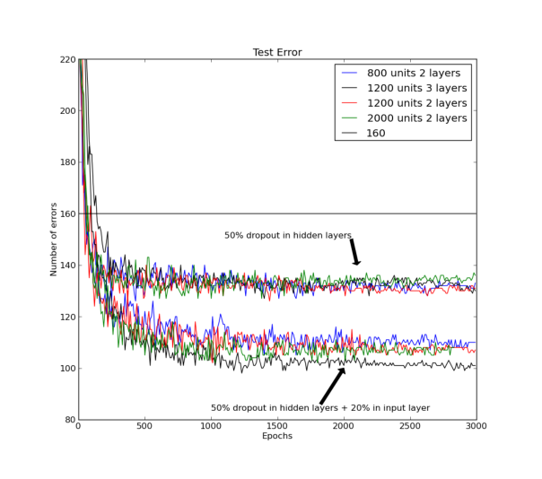
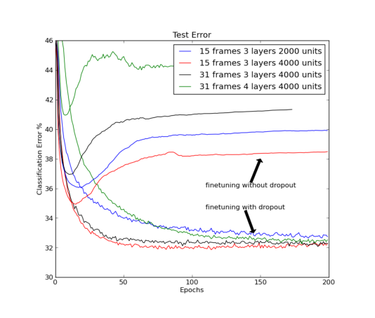
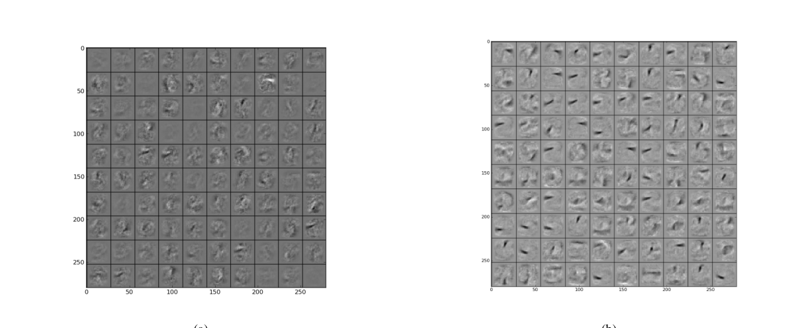
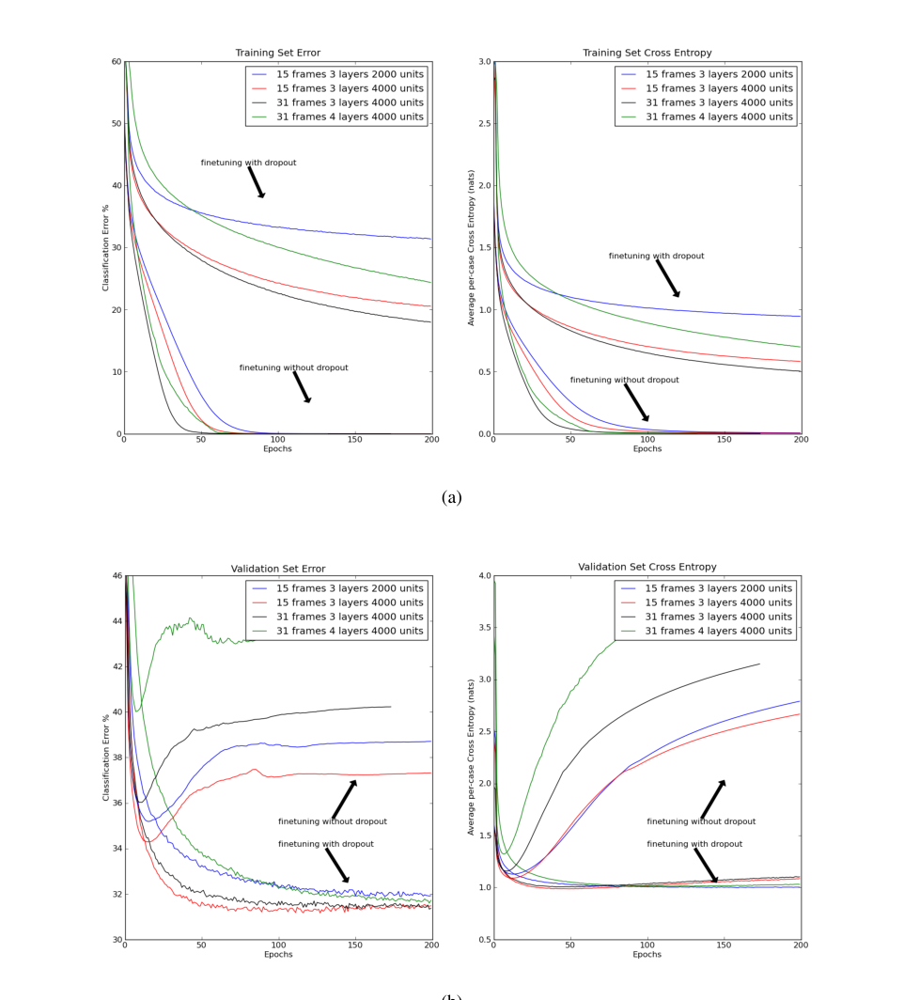
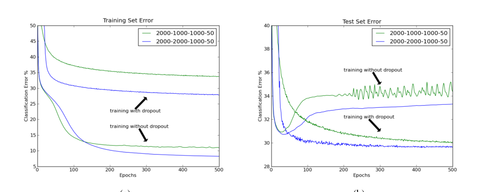

# Improving neural networks by preventing co-adaptation of feature detectors

> 通过防止特征检测器的协同适应来改进神经网络
>
> 译注：本文件依据 arXiv:1207.0580v1（2012-07-03）实际下载的 PDF 全文翻译。该版本是同一研究的早期投稿版（Science 风格短文）；任务指定的 2014 年 JMLR 版本标题为《Dropout: A Simple Way to Prevent Neural Networks from Overfitting》（Dropout：防止神经网络过拟合的简单方法），内容在本文基础上扩充，如需该版本可下载 arXiv:1207.0580v2 之后的版本。

## 标题与作者信息

**Original:**

Improving neural networks by preventing co-adaptation of feature detectors

G. E. Hinton, N. Srivastava, A. Krizhevsky, I. Sutskever and R. R. Salakhutdinov

Department of Computer Science, University of Toronto, 6 King's College Rd, Toronto, Ontario M5S 3G4, Canada

*To whom correspondence should be addressed; E-mail: hinton@cs.toronto.edu

**中文:**

通过防止特征检测器的协同适应来改进神经网络

G. E. Hinton、N. Srivastava、A. Krizhevsky、I. Sutskever 与 R. R. Salakhutdinov

多伦多大学计算机科学系，6 King's College Rd, Toronto, Ontario M5S 3G4, Canada

*通讯作者；E-mail: hinton@cs.toronto.edu

## 摘要

**Original:**

When a large feedforward neural network is trained on a small training set, it typically performs poorly on held-out test data. This "overfitting" is greatly reduced by randomly omitting half of the feature detectors on each training case. This prevents complex co-adaptations in which a feature detector is only helpful in the context of several other specific feature detectors. Instead, each neuron learns to detect a feature that is generally helpful for producing the correct answer given the combinatorially large variety of internal contexts in which it must operate. Random "dropout" gives big improvements on many benchmark tasks and sets new records for speech and object recognition.

**中文:**

当大型前馈神经网络（feedforward neural network）在小型训练集上训练时，它通常在留出的测试数据上表现不佳。通过在每一个训练样本上随机省略一半的特征检测器（feature detector），这种"过拟合"（overfitting）被大大减轻。这防止了复杂的协同适应（co-adaptation）——即某个特征检测器只有在其他若干特定特征检测器同时存在的语境中才有用。取而代之的是，每个神经元学会检测一个特征，该特征在神经元必须运作的、组合数量极其庞大的各种内部语境中，对产生正确答案普遍有帮助。随机"失活"（Dropout）在许多基准任务上带来了大幅改进，并在语音识别和物体识别上创下新纪录。

## 正文

### 第 1 段

**Original:**

A feedforward, artificial neural network uses layers of non-linear "hidden" units between its inputs and its outputs. By adapting the weights on the incoming connections of these hidden units it learns feature detectors that enable it to predict the correct output when given an input vector (1). If the relationship between the input and the correct output is complicated and the network has enough hidden units to model it accurately, there will typically be many different settings of the weights that can model the training set almost perfectly, especially if there is only a limited amount of labeled training data. Each of these weight vectors will make different predictions on held-out test data and almost all of them will do worse on the test data than on the training data because the feature detectors have been tuned to work well together on the training data but not on the test data.

**中文:**

前馈人工神经网络在其输入与输出之间使用若干层非线性"隐藏"单元。通过调整这些隐藏单元输入连接上的权重，网络学会了特征检测器，从而能在给定输入向量时预测正确的输出 (1)。如果输入与正确输出之间的关系很复杂，而网络拥有足够多的隐藏单元来精确建模这一关系，那么通常会存在许多不同的权重设置，几乎都能近乎完美地拟合训练集——尤其是在有标签训练数据数量有限的情况下。这些权重向量中的每一个都会对留出的测试数据做出不同的预测，而且几乎全部在测试数据上的表现都比在训练数据上差，因为特征检测器被调优为在训练数据上协同工作良好，而在测试数据上则不然。

### 第 2 段

**Original:**

Overfitting can be reduced by using "dropout" to prevent complex co-adaptations on the training data. On each presentation of each training case, each hidden unit is randomly omitted from the network with a probability of 0.5, so a hidden unit cannot rely on other hidden units being present. Another way to view the dropout procedure is as a very efficient way of performing model averaging with neural networks. A good way to reduce the error on the test set is to average the predictions produced by a very large number of different networks. The standard way to do this is to train many separate networks and then to apply each of these networks to the test data, but this is computationally expensive during both training and testing. Random dropout makes it possible to train a huge number of different networks in a reasonable time. There is almost certainly a different network for each presentation of each training case but all of these networks share the same weights for the hidden units that are present.

**中文:**

使用"随机失活（Dropout）"可以减轻过拟合：通过它防止训练数据上的复杂协同适应。在每一次呈现每一个训练样本时，每个隐藏单元以 0.5 的概率被随机地从网络中省略，因此一个隐藏单元不能依赖其他隐藏单元的存在。看待随机失活过程的另一种方式是：它是一种用神经网络进行模型平均（model averaging）的极高效方法。降低测试集错误的一个好办法是对大量不同网络的预测取平均。标准的做法是训练许多独立的网络，然后把每个网络都应用到测试数据上，但这样在训练和测试阶段计算开销都很大。随机失活使得在合理的时间内训练数量庞大的不同网络成为可能。几乎可以肯定，每一个训练样本的每一次呈现都对应一个不同的网络，但所有这些网络对"在场"的隐藏单元共享相同的权重。

### 第 3 段

**Original:**

We use the standard, stochastic gradient descent procedure for training the dropout neural networks on mini-batches of training cases, but we modify the penalty term that is normally used to prevent the weights from growing too large. Instead of penalizing the squared length (L2 norm) of the whole weight vector, we set an upper bound on the L2 norm of the incoming weight vector for each individual hidden unit. If a weight-update violates this constraint, we renormalize the weights of the hidden unit by division. Using a constraint rather than a penalty prevents weights from growing very large no matter how large the proposed weight-update is. This makes it possible to start with a very large learning rate which decays during learning, thus allowing a far more thorough search of the weight-space than methods that start with small weights and use a small learning rate.

**中文:**

我们使用标准的随机梯度下降（SGD）过程在小批量（mini-batch）训练样本上训练随机失活神经网络，但我们对通常用于防止权重增长过大的惩罚项做了修改。我们不再惩罚整个权重向量的平方长度（L2 范数），而是为每个隐藏单元的输入权重向量设置一个 L2 范数上界。如果一次权重更新违反了这个约束，我们就通过除法对该隐藏单元的权重重新归一化。使用约束而非惩罚，无论提议的权重更新有多大，都能防止权重变得过大。这使得我们可以从一个很大的学习率（learning rate）开始训练，并让学习率在学习过程中衰减，从而比"从小的权重开始并使用小学习率"的方法更彻底地搜索权重空间。

### 第 4 段

**Original:**

At test time, we use the "mean network" that contains all of the hidden units but with their outgoing weights halved to compensate for the fact that twice as many of them are active. In practice, this gives very similar performance to averaging over a large number of dropout networks. In networks with a single hidden layer of N units and a "softmax" output layer for computing the probabilities of the class labels, using the mean network is exactly equivalent to taking the geometric mean of the probability distributions over labels predicted by all 2^N possible networks. Assuming the dropout networks do not all make identical predictions, the prediction of the mean network is guaranteed to assign a higher log probability to the correct answer than the mean of the log probabilities assigned by the individual dropout networks (2). Similarly, for regression with linear output units, the squared error of the mean network is always better than the average of the squared errors of the dropout networks.

**中文:**

在测试时，我们使用"平均网络（mean network）"：它包含所有隐藏单元，但它们的输出权重减半，以补偿激活的隐藏单元多出一倍这一事实。在实践中，这与对大量随机失活网络取平均的性能非常接近。在具有单层 N 个隐藏单元和一个用于计算类别标签概率的 softmax 输出层的网络中，使用平均网络恰好等价于对所有 $2^N$ 个可能网络预测的标签概率分布取几何平均（geometric mean）。假设随机失活网络并非全都做出相同预测，那么平均网络的预测保证会给正确答案分配比各随机失活网络所分配对数概率的平均值更高的对数概率 (2)。类似地，对于使用线性输出单元的回归（regression），平均网络的平方误差总是优于随机失活网络平方误差的平均值。

### 第 5 段（MNIST）

**Original:**

We initially explored the effectiveness of dropout using MNIST, a widely used benchmark for machine learning algorithms. It contains 60,000 28x28 training images of individual hand written digits and 10,000 test images. Performance on the test set can be greatly improved by enhancing the training data with transformed images (3) or by wiring knowledge about spatial transformations into a convolutional neural network (4) or by using generative pre-training to extract useful features from the training images without using the labels (5). Without using any of these tricks, the best published result for a standard feedforward neural network is 160 errors on the test set. This can be reduced to about 130 errors by using 50% dropout with separate L2 constraints on the incoming weights of each hidden unit and further reduced to about 110 errors by also dropping out a random 20% of the pixels (see figure 1).

**中文:**

我们首先用 MNIST——一个被广泛使用的机器学习算法基准——来探索随机失活的有效性。它包含 60,000 张 28×28 的单个手写数字训练图像和 10,000 张测试图像。测试集上的性能可以通过以下方法大幅提升：用变换后的图像扩充训练数据 (3)；或把关于空间变换的知识"接线"进卷积神经网络 (4)；或使用生成式预训练（generative pre-training），在不用标签的情况下从训练图像中提取有用特征 (5)。不使用任何这些技巧时，标准前馈神经网络最好的已发表结果是测试集上 160 个错误。通过使用 50% 随机失活并对每个隐藏单元的输入权重施加独立的 L2 约束，错误数可降到约 130；再额外随机失活 20% 的像素，可进一步降到约 110（见图 1）。

> **图 1（译）**：使用反向传播训练、对所有隐藏层施加 50% 随机失活的多种神经网络架构在 MNIST 测试集上的错误率。下方一组曲线还对输入层使用了 20% 随机失活。该任务上此前不使用预训练、权重共享或训练集扩充的反向传播方法的最好已发表结果以水平线表示。（原图见 paper.pdf 第 3 页，见下方图）

### 第 6 段（预训练 + MNIST）

**Original:**

Dropout can also be combined with generative pre-training, but in this case we use a small learning rate and no weight constraints to avoid losing the feature detectors discovered by the pre-training. The publically available, pre-trained deep belief net described in (5) got 118 errors when it was fine-tuned using standard back-propagation and 92 errors when fine-tuned using 50% dropout of the hidden units. When the publically available code at URL was used to pre-train a deep Boltzmann machine five times, the unrolled network got 103, 97, 94, 93 and 88 errors when fine-tuned using standard backpropagation and 83, 79, 78, 78 and 77 errors when using 50% dropout of the hidden units. The mean of 79 errors is a record for methods that do not use prior knowledge or enhanced training sets (For details see Appendix A).

**中文:**

随机失活也可以与生成式预训练结合使用，但在这种情况下我们使用较小的学习率且不加权重约束，以避免丢失预训练所发现的特征检测器。(5) 中公开提供的预训练深度信念网络（Deep Belief Network，DBN），用标准反向传播微调时得到 118 个错误，用 50% 隐藏单元随机失活微调时得到 92 个错误。当使用公开代码五次预训练一个深度玻尔兹曼机（Deep Boltzmann Machine，DBM）时[译注：原文 "at URL" 为投稿时的链接占位，实际对应附录 A.2 脚注中的代码链接]，展开后的网络用标准反向传播微调分别得到 103、97、94、93 和 88 个错误，而用 50% 隐藏单元随机失活微调时分别得到 83、79、78、78 和 77 个错误。平均 79 个错误，这是在不使用先验知识或扩充训练集的方法中的纪录（详见附录 A）。

### 第 7 段（TIMIT 介绍）

**Original:**

We then applied dropout to TIMIT, a widely used benchmark for recognition of clean speech with a small vocabulary. Speech recognition systems use hidden Markov models (HMMs) to deal with temporal variability and they need an acoustic model that determines how well a frame of coefficients extracted from the acoustic input fits each possible state of each hidden Markov model. Recently, deep, pre-trained, feedforward neural networks that map a short sequence of frames into a probability distribution over HMM states have been shown to outperform traditional Gaussian mixture models on both TIMIT (6) and a variety of more realistic large vocabulary tasks (7,8).

**中文:**

随后我们把随机失活应用到 TIMIT——一个被广泛使用的小词汇量干净语音识别基准。语音识别系统使用隐马尔可夫模型（HMM）来处理时间上的变异性，它们需要一个声学模型来确定：从声学输入中提取的一帧系数与每个隐马尔可夫模型的每个可能状态匹配得有多好。最近，将短帧序列映射为 HMM 状态上概率分布的深度预训练前馈神经网络，已被证明在 TIMIT (6) 以及多种更现实的大词汇量任务 (7,8) 上优于传统的高斯混合模型（Gaussian mixture model）。

### 第 8 段（TIMIT 结果）

**Original:**

Figure 2 shows the frame classification error rate on the core test set of the TIMIT benchmark when the central frame of a window is classified as belonging to the HMM state that is given the highest probability by the neural net. The input to the net is 21 adjacent frames with an advance of 10ms per frame. The neural net has 4 fully-connected hidden layers of 4000 units per layer and 185 "softmax" output units that are subsequently merged into the 39 distinct classes used for the benchmark. Dropout of 50% of the hidden units significantly improves classification for a variety of different network architectures (see figure 2). To get the frame recognition rate, the class probabilities that the neural network outputs for each frame are given to a decoder which knows about transition probabilities between HMM states and runs the Viterbi algorithm to infer the single best sequence of HMM states. Without dropout, the recognition rate is 22.7% and with dropout this improves to 19.7%, which is a record for methods that do not use any information about speaker identity.

**中文:**

图 2 展示了在 TIMIT 基准的核心测试集上的帧分类错误率，其做法是：将窗口的中心帧归类为神经网络给出最高概率的那个 HMM 状态。网络的输入是 21 个相邻帧，每帧间隔 10ms。该神经网络有 4 个全连接隐藏层，每层 4000 个单元，以及 185 个 softmax 输出单元，这些输出单元随后被合并为该基准所使用的 39 个不同类别。50% 隐藏单元随机失活显著改善了多种不同网络架构下的分类表现（见图 2）。为得到帧识别率，神经网络为每一帧输出的类别概率被交给一个解码器，该解码器知道 HMM 状态之间的转移概率，并运行 Viterbi 算法推断单一的最佳 HMM 状态序列。不使用随机失活时识别率为 22.7%，使用后改善到 19.7%——这是不使用任何说话人身份信息的方法中的纪录。

> **图 2（译）**：TIMIT 基准核心测试集上的帧分类错误率。标准微调与随机失活微调在不同网络架构下的对比。对 50% 隐藏单元和 20% 输入单元使用随机失活改善了分类。（原图见 paper.pdf 第 4 页，见下方图）

### 第 9 段（CIFAR-10）

**Original:**

CIFAR-10 is a benchmark task for object recognition. It uses 32x32 downsampled color images of 10 different object classes that were found by searching the web for the names of the class (e.g. dog) or its subclasses (e.g. Golden Retriever). These images were labeled by hand to produce 50,000 training images and 10,000 test images in which there is a single dominant object that could plausibly be given the class name (9) (see figure 3). The best published error rate on the test set, without using transformed data, is 18.5% (10). We achieved an error rate of 16.6% by using a neural network with three convolutional hidden layers interleaved with three "max-pooling" layers that report the maximum activity in local pools of convolutional units. These six layers were followed by one locally-connected layer (For details see Appendix D). Using dropout in the last hidden layer gives an error rate of 15.6%.

**中文:**

CIFAR-10 是一个物体识别基准任务。它使用 32×32 的下采样彩色图像，包含 10 个不同的物体类别，这些图像是通过在网络上搜索类别名（如 dog）或其子类名（如 Golden Retriever）找到的。这些图像经人工标注，产生 50,000 张训练图像和 10,000 张测试图像；每张图像中有一个占主导地位的物体，可以合理地冠以类别名 (9)（见图 3）。不使用变换数据时，测试集上最好的已发表错误率是 18.5% (10)。我们使用一个含三个卷积隐藏层、并与三个"最大池化（max-pooling）"层交错（最大池化层报告卷积单元局部池中的最大激活）的神经网络，达到了 16.6% 的错误率。这六层之后接一个局部连接层（locally-connected layer，详见附录 D）。在最后一个隐藏层使用随机失活，错误率降至 15.6%。

> **图 3（译）**：CIFAR-10 测试集中"鸟"类的十个样本，展示了鸟的种类、视角、光照和背景的多样性。神经网络除最后两个样本外全部分类正确。（原图见 paper.pdf 第 5 页，见下方图）

### 第 10 段（ImageNet）

**Original:**

ImageNet is an extremely challenging object recognition dataset consisting of thousands of high-resolution images of thousands of classes of object (11). In 2010, a subset of 1000 classes with roughly 1000 examples per class was the basis of an object recognition competition in which the winning entry, which was actually an average of six separate models, achieved an error rate of 47.2% on the test set. The current state-of-the-art result on this dataset is 45.7% (12). We achieved comparable performance of 48.6% error using a single neural network with five convolutional hidden layers interleaved with "max-pooling" layer followed by two globally connected layers and a final 1000-way softmax layer. All layers had L2 weight constraints on the incoming weights of each hidden unit. Using 50% dropout in the sixth hidden layer reduces this to a record 42.4% (For details see Appendix E).

**中文:**

ImageNet 是一个极具挑战性的物体识别数据集，包含数千类物体的数千张高分辨率图像 (11)。2010 年，一个包含 1000 个类别、每类约 1000 个样本的子集成为一场物体识别竞赛的基础；该竞赛的获胜方案——实际上是六个独立模型的平均——在测试集上取得了 47.2% 的错误率。该数据集上当前的最高水平结果是 45.7% (12)。我们使用单个神经网络——五个卷积隐藏层与"最大池化"层交错，后接两个全局连接层和一个最终的 1000 路 softmax 层——取得了可比的 48.6% 错误率。所有层都对每个隐藏单元的输入权重施加了 L2 约束。在第六个隐藏层使用 50% 随机失活后，错误率降至创纪录的 42.4%（详见附录 E）。

> **图 4（译）**：一些 ImageNet 测试样本，下方给出了最可能的 5 个标签的概率。前 5 个标签中有许多都相当合理。（原图见 paper.pdf 第 5 页，[第 5 页图](assets/figures/fig-4.png)）

### 第 11 段（验证集选架构）

**Original:**

For the speech recognition dataset and both of the object recognition datasets it is necessary to make a large number of decisions in designing the architecture of the net. We made these decisions by holding out a separate validation set that was used to evaluate the performance of a large number of different architectures and we then used the architecture that performed best with dropout on the validation set to assess the performance of dropout on the real test set.

**中文:**

对于语音识别数据集和两个物体识别数据集，在设计网络架构时需要做大量决策。我们通过留出一个独立的验证集（validation set）来做这些决策：用它评估大量不同架构的性能，然后使用在验证集上配合随机失活表现最好的那个架构，在真实测试集上评估随机失活的性能。

### 第 12 段（Reuters）

**Original:**

The Reuters dataset contains documents that have been labeled with a hierarchy of classes. We created training and test sets each containing 201,369 documents from 50 mutually exclusive classes. Each document was represented by a vector of counts for 2000 common non-stop words, with each count C being transformed to log(1+C). A feedforward neural network with 2 fully connected layers of 2000 hidden units trained with backpropagation gets 31.05% error on the test set. This is reduced to 29.62% by using 50% dropout (Appendix C).

**中文:**

Reuters 数据集包含按类别层级标注的文档。我们创建了训练集和测试集，各含 201,369 篇文档，来自 50 个互斥类别。每篇文档用一个 2000 维的常见非停用词计数向量表示，每个计数 $C$ 被变换为 $\log(1+C)$。一个具有 2 个全连接层、每层 2000 个隐藏单元的前馈神经网络用反向传播训练后，在测试集上得到 31.05% 的错误率。使用 50% 随机失活后错误率降至 29.62%（附录 C）。

### 第 13 段（失活概率的讨论）

**Original:**

We have tried various dropout probabilities and almost all of them improve the generalization performance of the network. For fully connected layers, dropout in all hidden layers works better than dropout in only one hidden layer and more extreme probabilities tend to be worse, which is why we have used 0.5 throughout this paper. For the inputs, dropout can also help, though it it often better to retain more than 50% of the inputs. It is also possible to adapt the individual dropout probability of each hidden or input unit by comparing the average performance on a validation set with the average performance when the unit is present. This makes the method work slightly better. For datasets in which the required input-output mapping has a number of fairly different regimes, performance can probably be further improved by making the dropout probabilities be a learned function of the input, thus creating a statistically efficient "mixture of experts" (13) in which there are combinatorially many experts, but each parameter gets adapted on a large fraction of the training data.

**中文:**

我们尝试了各种失活概率，几乎全部都能改善网络的泛化性能。对于全连接层，在所有隐藏层使用随机失活比只在一个隐藏层使用更好，而更极端的概率往往更差——这就是全文统一使用 0.5 的原因。对于输入，随机失活也有帮助，但保留 50% 以上的输入往往更好。还可以通过比较验证集上的平均性能与"该单元在场"时的平均性能，来自适应地调整每个隐藏单元或输入单元的失活概率，这能让方法表现略好一些。对于那些所需输入-输出映射包含若干相当不同的"工作区段（regime）"的数据集，若让失活概率成为输入的学习函数，性能或许还能进一步提升——这样就形成了一个统计上高效的"专家混合（mixture of experts）"模型 (13)：专家的数量是组合级的，但每个参数都在训练数据的很大一部分上得到更新。

### 第 14 段（与贝叶斯模型平均对比）

**Original:**

Dropout is considerably simpler to implement than Bayesian model averaging which weights each model by its posterior probability given the training data. For complicated model classes, like feedforward neural networks, Bayesian methods typically use a Markov chain Monte Carlo method to sample models from the posterior distribution (14). By contrast, dropout with a probability of 0.5 assumes that all the models will eventually be given equal importance in the combination but the learning of the shared weights takes this into account. At test time, the fact that the dropout decisions are independent for each unit makes it very easy to approximate the combined opinions of exponentially many dropout nets by using a single pass through the mean net. This is far more efficient than averaging the predictions of many separate models.

**中文:**

与贝叶斯模型平均（Bayesian model averaging）相比，随机失活实现起来要简单得多——贝叶斯模型平均按每个模型在给定训练数据下的后验概率（posterior probability）为其加权。对于前馈神经网络这类复杂模型类，贝叶斯方法通常使用马尔可夫链蒙特卡洛（Markov chain Monte Carlo）方法从后验分布中采样模型 (14)。相比之下，概率为 0.5 的随机失活假设所有模型最终在组合中被赋予同等重要性，而共享权重的学习过程会将这一点纳入考虑。在测试时，每个单元的失活决策相互独立这一事实，使得通过平均网络的单次前向传播来近似指数级数量的失活网络的组合意见变得非常容易。这比平均许多独立模型的预测高效得多。

### 第 15 段（与 bagging 的关系）

**Original:**

A popular alternative to Bayesian model averaging is "bagging" in which different models are trained on different random selections of cases from the training set and all models are given equal weight in the combination (15). Bagging is most often used with models such as decision trees because these are very quick to fit to data and very quick at test time (16). Dropout allows a similar approach to be applied to feedforward neural networks which are much more powerful models. Dropout can be seen as an extreme form of bagging in which each model is trained on a single case and each parameter of the model is very strongly regularized by sharing it with the corresponding parameter in all the other models. This is a much better regularizer than the standard method of shrinking parameters towards zero.

**中文:**

贝叶斯模型平均的一个流行替代方案是 bagging：不同的模型在训练集的不同随机子集上训练，组合时所有模型被赋予同等权重 (15)。bagging 最常用于决策树这类模型，因为它们拟合数据非常快、测试时也非常快 (16)。随机失活使得类似的方法可以应用于前馈神经网络这种强大得多的模型。随机失活可以看作 bagging 的一种极端形式：每个模型只在一个样本上训练，模型的每个参数都因与其他所有模型中对应参数共享而受到极强的正则化。这是比"把参数收缩到零"的标准方法好得多的正则化手段。

### 第 16 段（朴素贝叶斯特例）

**Original:**

A familiar and extreme case of dropout is "naive bayes" in which each input feature is trained separately to predict the class label and then the predictive distributions of all the features are multiplied together at test time. When there is very little training data, this often works much better than logistic classification which trains each input feature to work well in the context of all the other features.

**中文:**

随机失活的一个为人熟知且极端的特例是"朴素贝叶斯（naive Bayes）"：每个输入特征被单独训练来预测类别标签，然后在测试时把所有特征的预测分布相乘。当训练数据非常少时，这通常比逻辑斯谛分类（logistic classification）效果好得多——后者训练每个输入特征在所有其他特征的语境下良好工作。

### 第 17 段（与进化理论的相似性）

**Original:**

Finally, there is an intriguing similarity between dropout and a recent theory of the role of sex in evolution (17). One possible interpretation of the theory of mixability articulated in (17) is that sex breaks up sets of co-adapted genes and this means that achieving a function by using a large set of co-adapted genes is not nearly as robust as achieving the same function, perhaps less than optimally, in multiple alternative ways, each of which only uses a small number of co-adapted genes. This allows evolution to avoid dead-ends in which improvements in fitness require co-ordinated changes to a large number of co-adapted genes. It also reduces the probability that small changes in the environment will cause large decreases in fitness, a phenomenon which is known as "overfitting" in the field of machine learning.

**中文:**

最后，随机失活与近期关于性在进化中的作用的某个理论 (17) 之间存在一个有趣的相似之处。(17) 中阐述的可混合性（mixability）理论的一种可能解释是：性打破了一组组协同适应的基因，这意味着通过一大组协同适应基因来实现某个功能，远不如以多种替代方式实现同一功能（哪怕次优）来得稳健——其中每种方式只使用少量协同适应的基因。这使得进化能够避免"死胡同"：在那些死胡同里，适应度的提升需要大量协同适应基因的协调变化。它还降低了环境的小变化导致适应度大幅下降的概率——这一现象在机器学习领域被称为"过拟合"。

## References and Notes

> 参考文献整体保留原文，不翻译。

1. D. E. Rumelhart, G. E. Hinton, R. J. Williams, Nature 323, 533 (1986).
2. G. E. Hinton, Neural Computation 14, 1771 (2002).
3. L. M. G. D. C. Ciresan, U. Meier, J. Schmidhuber, Neural Computation 22, 3207 (2010).
4. Y. B. Y. Lecun, L. Bottou, P. Haffner, Proceedings of the IEEE 86, 2278 (1998).
5. G. E. Hinton, R. Salakhutdinov, Science 313, 504 (2006).
6. A. Mohamed, G. Dahl, G. Hinton, IEEE Transactions on Audio, Speech, and Language Processing, 20, 14 (2012).
7. G. Dahl, D. Yu, L. Deng, A. Acero, IEEE Transactions on Audio, Speech, and Language Processing, 20, 30 (2012).
8. N. Jaitly, P. Nguyen, A. Senior, V. Vanhoucke, An Application OF Pretrained Deep Neural Networks To Large Vocabulary Conversational Speech Recognition, Tech. Rep. 001, Department of Computer Science, University of Toronto (2012).
9. A. Krizhevsky, Learning multiple layers of features from tiny images, Tech. Rep. 001, Department of Computer Science, University of Toronto (2009).
10. A. Coates, A. Y. Ng, ICML (2011), pp. 921–928.
11. J. Deng, et al., CVPR09 (2009).
12. J. Sanchez, F. Perronnin, CVPR11 (2011).
13. S. J. N. R. A. Jacobs, M. I. Jordan, G. E. Hinton, Neural Computation 3, 79 (1991).
14. R. M. Neal, Bayesian Learning for Neural Networks, Lecture Notes in Statistics No. 118 (Springer-Verlag, New York, 1996).
15. L. Breiman, Machine Learning 24, 123 (1996).
16. L. Breiman, Machine Learning 45, 5 (2001).
17. J. D. A. Livnat, C. Papadimitriou, M. W. Feldman, PNAS 105, 19803 (2008).
18. R. R. Salakhutdinov, G. E. Hinton, Artificial Intelligence and Statistics (2009).
19. D. D. Lewis, T. G. R. Y. Yang, Journal of Machine Learning 5, 361 (2004).
20. We thank N. Jaitly for help with TIMIT, H. Larochelle, R. Neal, K. Swersky and C.K.I. Williams for helpful discussions, and NSERC, Google and Microsoft Research for funding. GEH and RRS are members of the Canadian Institute for Advanced Research.

## 附录 A Experiments on MNIST（MNIST 上的实验）

### A.1 Details for dropout training（随机失活训练的细节）

**Original:**

The MNIST dataset consists of 28 × 28 digit images - 60,000 for training and 10,000 for testing. The objective is to classify the digit images into their correct digit class. We experimented with neural nets of different architectures (different number of hidden units and layers) to evaluate the sensitivity of the dropout method to these choices. We show results for 4 nets (784-800-800-10, 784-1200-1200-10, 784-2000-2000-10, 784-1200-1200-1200-10). For each of these architectures we use the same dropout rates - 50% dropout for all hidden units and 20% dropout for visible units. We use stochastic gradient descent with 100-sized minibatches and a cross-entropy objective function. An exponentially decaying learning rate is used that starts at the value of 10.0 (applied to the average gradient in each minibatch). The learning rate is multiplied by 0.998 after each epoch of training. The incoming weight vector corresponding to each hidden unit is constrained to have a maximum squared length of l. If, as a result of an update, the squared length exceeds l, the vector is scaled down so as to make it have a squared length of l. Using cross validation we found that l = 15 gave best results. Weights are initialzed to small random values drawn from a zero-mean normal distribution with standard deviation 0.01. Momentum is used to speed up learning. The momentum starts off at a value of 0.5 and is increased linearly to 0.99 over the first 500 epochs, after which it stays at 0.99. Also, the learning rate is multiplied by a factor of (1-momentum). No weight decay is used. Weights were updated at the end of each minibatch. Training was done for 3000 epochs. The weight update takes the following form:

$$\Delta w_t = p_t \Delta w_{t-1} - (1 - p_t)\ \epsilon_t \langle \nabla_w L \rangle$$

$$w_t = w_{t-1} + \Delta w_t,$$

其中（where）

$$\epsilon_t = \epsilon_0 f^t$$

$$p_t = \begin{cases} \frac{t}{T} p_i + (1 - \frac{t}{T}) p_f & t < T \\ p_f & t \geq T \end{cases}$$

with $\epsilon_0 = 10.0$, $f = 0.998$, $p_i = 0.5$, $p_f = 0.99$, $T = 500$.

**中文:**

MNIST 数据集由 28 × 28 的数字图像组成——60,000 张用于训练，10,000 张用于测试。目标是把这些数字图像分类到正确的数字类别。我们用不同架构（不同数量的隐藏单元和层）的神经网络进行实验，以评估随机失活方法对这些选择的敏感性。我们展示 4 个网络的结果（784-800-800-10、784-1200-1200-10、784-2000-2000-10、784-1200-1200-1200-10）。对所有这些架构我们使用相同的失活率——所有隐藏单元 50% 失活，可见单元 20% 失活。我们使用随机梯度下降，小批量大小为 100，目标函数为交叉熵。学习率从 10.0 开始（作用于每个小批量的平均梯度）并按指数衰减：每训练一个轮次（epoch）后乘以 0.998。每个隐藏单元对应的输入权重向量被约束为平方长度最大为 $l$。如果一次更新后平方长度超过 $l$，该向量就被缩小，使其平方长度等于 $l$。通过交叉验证我们发现 $l = 15$ 时结果最好。权重初始化为从均值为零、标准差为 0.01 的正态分布中抽取的小随机值。使用动量（momentum）加速学习：动量从 0.5 开始，在前 500 个轮次内线性增加到 0.99，之后保持在 0.99。此外，学习率还要乘以 (1-动量) 因子。不使用权重衰减（weight decay）。权重在每个小批量结束时更新。训练共进行 3000 个轮次。权重更新采用如下形式：

$$\Delta w_t = p_t \Delta w_{t-1} - (1 - p_t)\ \epsilon_t \langle \nabla_w L \rangle$$

$$w_t = w_{t-1} + \Delta w_t,$$

其中

$$\epsilon_t = \epsilon_0 f^t$$

$$p_t = \begin{cases} \frac{t}{T} p_i + (1 - \frac{t}{T}) p_f & t < T \\ p_f & t \geq T \end{cases}$$

且 $\epsilon_0 = 10.0$，$f = 0.998$，$p_i = 0.5$，$p_f = 0.99$，$T = 500$。

**Original:**

While using a constant learning rate also gives improvements over standard backpropagation, starting with a high learning rate and decaying it provided a significant boost in performance. Constraining input vectors to have a fixed length prevents weights from increasing arbitrarily in magnitude irrespective of the learning rate. This gives the network a lot of opportunity to search for a good configuration in the weight space. As the learning rate decays, the algorithm is able to take smaller steps and finds the right step size at which it can make learning progress. Using a high final momentum distributes gradient information over a large number of updates making learning stable in this scenario where each gradient computation is for a different stochastic network.

**中文:**

虽然使用恒定学习率也比标准反向传播有所改善，但从高学习率开始并衰减它带来了性能的显著提升。把（输入权重）向量约束为固定长度[译注：原文此处为 "input vectors"，结合上下文应指每个隐藏单元的输入权重向量]，使得无论学习率多大，权重都不能任意增长。这给了网络大量机会在权重空间中搜索好的配置。随着学习率衰减，算法能够迈出更小的步子，并找到能取得学习进展的合适步长。使用较高的最终动量把梯度信息分摊到大量更新上，使学习变得稳定——在这种情形下，每一次梯度计算针对的都是一个不同的随机网络。

### A.2 Details for dropout finetuning（随机失活微调的细节）

**Original:**

Apart from training a neural network starting from random weights, dropout can also be used to finetune pretrained models. We found that finetuning a model using dropout with a small learning rate can give much better performace than standard backpropagation finetuning.

**中文:**

除了从随机权重开始训练神经网络，随机失活也可以用于微调预训练模型。我们发现，用较小学习率配合随机失活来微调模型，其性能远好于标准反向传播微调。

**Original:**

Deep Belief Nets - We took a neural network pretrained using a Deep Belief Network (5). It had a 784-500-500-2000 architecture and was trained using greedy layer-wise Contrastive Divergence learning. Instead of fine-tuning it with the usual backpropagation algorithm, we used the dropout version of it. Dropout rate was same as before : 50% for hidden units and 20% for visible units. A constant small learning rate of 1.0 was used. No constraint was imposed on the length of incoming weight vectors. No weight decay was used. All other hyper-parameters were set to be the same as before. The model was trained for 1000 epochs with stochstic gradient descent using minibatches of size 100. While standard back propagation gave about 118 errors, dropout decreased the errors to about 92.

**中文:**

深度信念网络——我们取一个用深度信念网络（Deep Belief Network）(5) 预训练的神经网络。它的架构为 784-500-500-2000，用贪婪逐层的对比散度（Contrastive Divergence）学习训练[脚注：代码见 http://www.cs.toronto.edu/~hinton/MatlabForSciencePaper.html]。我们不用通常的反向传播算法微调它，而使用其随机失活版本。失活率与之前相同：隐藏单元 50%、可见单元 20%。使用恒定的较小学习率 1.0。不对输入权重向量的长度施加约束。不使用权重衰减。所有其他超参数与之前相同。该模型用随机梯度下降、大小为 100 的小批量训练了 1000 个轮次。标准反向传播给出约 118 个错误，而随机失活把错误降到约 92。

**Original:**

Deep Boltzmann Machines - We also took a pretrained Deep Boltzmann Machine (18) (784-500-1000-10) and finetuned it using dropout-backpropagation. The model uses a 1784 - 500 - 1000 - 10 architecture (The extra 1000 input units come from the mean-field activations of the second layer of hidden units in the DBM, See (18) for details). All finetuning hyper-parameters were set to be the same as the ones used for a Deep Belief Network. We were able to get a mean of about 79 errors with dropout whereas usual finetuning gives about 94 errors.

**中文:**

深度玻尔兹曼机——我们还取了一个预训练的深度玻尔兹曼机（Deep Boltzmann Machine，DBM）(18)[脚注：代码见 http://www.utstat.toronto.edu/~rsalakhu/DBM.html]（784-500-1000-10），用随机失活反向传播微调它。该模型使用 1784-500-1000-10 架构（多出的 1000 个输入单元来自 DBM 中第二层隐藏单元的平均场（mean-field）激活，详见 (18)）。所有微调超参数与深度信念网络所用的相同。使用随机失活我们得到平均约 79 个错误，而通常的微调给出约 94 个错误。

### A.3 Effect on features（对特征的影响）

**Original:**

One reason why dropout gives major improvements over backpropagation is that it encourages each individual hidden unit to learn a useful feature without relying on specific other hidden units to correct its mistakes. In order to verify this and better understand the effect of dropout on feature learning, we look at the first level of features learned by a 784-500-500 neural network without any generative pre-training. The features are shown in Figure 5. Each panel shows 100 random features learned by each network. The features that dropout learns are simpler and look like strokes, whereas the ones learned by standard backpropagation are difficult to interpret. This confirms that dropout indeed forces the discriminative model to learn good features which are less co-adapted and leads to better generalization.

**中文:**

随机失活相比反向传播取得大幅改进的一个原因是：它鼓励每个隐藏单元独立学会一个有用的特征，而不依赖其他特定隐藏单元来纠正它的错误。为了验证这一点并更好地理解随机失活对特征学习的影响，我们观察一个 784-500-500 神经网络（无任何生成式预训练）所学到的第一层特征。特征如图 5 所示。每个面板展示每个网络学到的 100 个随机特征。随机失活学到的特征更简单、看起来像笔画，而标准反向传播学到的特征难以解释。这证实了随机失活确实迫使判别模型学到协同适应程度更低的好特征，从而带来更好的泛化。

> **图 5（译）**：在 MNIST 数据集上，(a) 反向传播与 (b) 随机失活训练的网络中，第一层隐藏单元所学特征的可视化。（原图见 paper.pdf 第 10 页，见下方图）

## 附录 B Experiments on TIMIT（TIMIT 上的实验）

**Original:**

The TIMIT Acoustic-Phonetic Continuous Speech Corpus is a standard dataset used for evaluation of automatic speech recognition systems. It consists of recordings of 630 speakers of 8 dialects of American English each reading 10 phonetically-rich sentences. It also comes with the word and phone-level transcriptions of the speech. The objective is to convert a given speech signal into a transcription sequence of phones. This data needs to be pre-processed to extract input features and output targets. We used Kaldi, an open source code library for speech, to pre-process the dataset so that our results can be reproduced exactly. The inputs to our networks are log filter bank responses. They are extracted for 25 ms speech windows with strides of 10 ms. Each dimension of the input representation was normalized to have mean 0 and variance 1. Minibatches of size 100 were used for both pretraining and dropout finetuning. We tried several network architectures by varying the number of input frames (15 and 31), number of layers in the neural network (3, 4 and 5) and the number of hidden units in each layer (2000 and 4000). Figure 6 shows the validation error curves for a number of these combinations. Using dropout consistently leads to lower error rates.

**中文:**

TIMIT 声学-音素连续语音语料库（TIMIT Acoustic-Phonetic Continuous Speech Corpus）是用于评估自动语音识别系统的标准数据集。它包含 630 位操 8 种美式英语方言的说话人的录音，每人朗读 10 个音素丰富的句子。它还附带语音的词级和音素级转写。目标是把给定的语音信号转换为音素转写序列。这些数据需要预处理以提取输入特征和输出目标。我们使用 Kaldi——一个开源的语音代码库[脚注：http://kaldi.sourceforge.net]——来预处理数据集，使我们的结果可以被精确复现。我们网络的输入是对数滤波器组（log filter bank）响应，在 25 ms 的语音窗口上提取，窗口步长为 10 ms。输入表示的每个维度被归一化为均值 0、方差 1。预训练和随机失活微调都使用大小为 100 的小批量。我们通过改变输入帧数（15 和 31）、神经网络的层数（3、4 和 5）以及每层隐藏单元数（2000 和 4000），尝试了若干种网络架构。图 6 展示了其中若干组合的验证错误曲线。使用随机失活一致地带来更低的错误率。

### B.1 Pretraining（预训练）

**Original:**

For all our experiments on TIMIT, we pretrain the neural network with a Deep Belief Network (5). Since the inputs are real-valued, the first layer was pre-trained as a Gaussian RBM. Visible biases were initialized to zero and weights to random numbers sampled from a zero-mean normal distribution with standard deviation 0.01. The variance of each visible unit was set to 1.0 and not learned. Learning was done by minimizing Contrastive Divergence. Momentum was used to speed up learning. Momentum started at 0.5 and was increased linearly to 0.9 over 20 epochs. A learning rate of 0.001 on the average gradient was used (which was then multiplied by 1-momentum). An L2 weight decay of 0.001 was used. The model was trained for 100 epochs. All subsequent layers were trained as binary RBMs. A learning rate of 0.01 was used. The visible bias of each unit was initialized to log(p/(1 − p)) where p was the mean activation of that unit in the dataset. All other hyper-parameters were set to be the same as those we used for the Gaussian RBM. Each layer was trained for 50 epochs.

**中文:**

在 TIMIT 上的所有实验中，我们都用深度信念网络（Deep Belief Network）(5) 预训练神经网络。由于输入是实数值，第一层被预训练为高斯受限玻尔兹曼机（Gaussian RBM）。可见偏置初始化为零，权重初始化为从均值为零、标准差 0.01 的正态分布中抽取的随机数。每个可见单元的方差设为 1.0 且不学习。学习通过最小化对比散度（Contrastive Divergence）进行。使用动量加速学习：动量从 0.5 开始，在 20 个轮次内线性增加到 0.9。学习率 0.001 作用于平均梯度（随后乘以 1-动量）。使用 0.001 的 L2 权重衰减。该模型训练 100 个轮次。所有后续层都训练为二元 RBM，使用 0.01 的学习率。每个单元的可见偏置初始化为 $\log(p/(1-p))$，其中 $p$ 是该单元在数据集中的平均激活。所有其他超参数与高斯 RBM 所用相同。每层训练 50 个轮次。

### B.2 Dropout Finetuning（随机失活微调）

**Original:**

The pretrained RBMs were used to initialize the weights in a neural network. The network was then finetuned with dropout-backpropagation. Momentum was increased from 0.5 to 0.9 linearly over 10 epochs. A small constant learning rate of 1.0 was used (applied to the average gradient on a minibatch). All other hyperparameters are the same as for MNIST dropout fine-tuning. The model needs to be run for about 200 epochs to converge. The same network was also finetuned with standard backpropagation using a smaller learning rate of 0.1, keeping all other hyperparameters [译注：原文句子在此处不完整，疑缺 "the same"]

**中文:**

预训练的 RBM 被用来初始化神经网络的权重，然后该网络用随机失活反向传播微调。动量在 10 个轮次内从 0.5 线性增加到 0.9。使用恒定的较小学习率 1.0（作用于小批量上的平均梯度）。所有其他超参数与 MNIST 随机失活微调相同。模型需要运行约 200 个轮次才能收敛。同一个网络也用标准反向传播微调，使用更小的学习率 0.1，保持所有其他超参数[译注：原文句子在此处不完整，疑缺 "the same"]

**Original:**

Figure 6 shows the frame classification error and cross-entropy objective value on the training and validation sets. We compare the performance of dropout and standard backpropagation on several network architectures and input representations. Dropout consistently achieves lower error and cross-entropy. It significantly controls overfitting, making the method robust to choices of network architecture. It allows much larger nets to be trained and removes the need for early stopping. We also observed that the final error obtained by the model is not very sensitive to the choice of learning rate and momentum.

**中文:**

图 6 展示了训练集和验证集上的帧分类错误与交叉熵目标值。我们在若干网络架构和输入表示上比较随机失活与标准反向传播的性能。随机失活一致地取得更低的错误和交叉熵。它显著控制了过拟合，使方法对网络架构的选择具有鲁棒性。它允许训练大得多的网络，并消除了提前停止（early stopping）的需要。我们还观察到，模型取得的最终错误对学习率和动量的选择不太敏感。

> **图 6（译）**：学习过程中 (a) 训练集与 (b) 验证集上的帧分类错误与交叉熵。训练误差使用随机网络计算。（原图见 paper.pdf 第 11 页，见下方图）

## 附录 C Experiments on Reuters（Reuters 上的实验）

**Original:**

Reuters Corpus Volume I (RCV1-v2) (19) is an archive of 804,414 newswire stories that have been manually categorized into 103 topics. The corpus covers four major groups: corporate/industrial, economics, government/social, and markets. Sample topics include Energy Markets, Accounts/Earnings, Government Borrowings, Disasters and Accidents, Interbank Markets, Legal/Judicial, Production/Services, etc. The topic classes form a tree which is typically of depth three.

**中文:**

路透语料库第一卷（Reuters Corpus Volume I，RCV1-v2）(19) 是一个包含 804,414 篇新闻通讯稿的档案，被人工归类到 103 个主题[脚注：该语料库可在 http://www.ai.mit.edu/projects/jmlr/papers/volume5/lewis04a/lyrl2004_rcv1v2_README.htm 获取]。该语料库覆盖四大组：公司/工业、经济、政府/社会和市场。主题示例包括 Energy Markets、Accounts/Earnings、Government Borrowings、Disasters and Accidents、Interbank Markets、Legal/Judicial、Production/Services 等。主题类别构成一棵通常深三层的树。

**Original:**

We took the dataset and split it into 63 classes based on the the 63 categories at the second-level of the category tree. We removed 11 categories that did not have any data and one category that had only 4 training examples. We also removed one category that covered a huge chunk (25%) of the examples. This left us with 50 classes and 402,738 documents. We divided the documents into equal-sized training and test sets randomly. Each document was represented using the 2000 most frequent non-stopwords in the dataset.

**中文:**

我们取该数据集，根据类别树第二层的 63 个类别把它分成 63 类。我们移除了 11 个没有任何数据的类别、1 个只有 4 个训练样本的类别，还移除了 1 个覆盖了很大一部分（25%）样本的类别。这样剩下 50 个类别、402,738 篇文档。我们把文档随机划分为等大小的训练集和测试集。每篇文档用数据集中 2000 个最频繁的非停用词表示。

> **图 7（译）**：学习过程中 Reuters 数据集 (a) 训练集与 (b) 验证集上的分类错误率。训练误差使用随机网络计算。（原图见 paper.pdf 第 13 页，见下方图）

**Original:**

We trained a neural network using dropout-backpropagation and compared it with standard backpropagation. We used a 2000-2000-1000-50 architecture. The training hyperparameters are same as that in MNIST dropout training (Appendix A.1). Training was done for 500 epochs. Figure 7 shows the training and test set errors as learning progresses. We show two nets - one with a 2000-2000-1000-50 and another with a 2000-1000-1000-50 architecture trained with and without dropout. As in all previous datasets discussed so far, we obtain significant improvements here too. The learning not only results in better generalization, but also proceeds smoothly, without the need for early stopping.

**中文:**

我们使用随机失活反向传播训练了一个神经网络，并与标准反向传播比较。我们使用 2000-2000-1000-50 架构。训练超参数与 MNIST 随机失活训练（附录 A.1）相同。训练进行了 500 个轮次。图 7 展示了学习过程中训练集和测试集错误的变化。我们展示了两个网络——一个用 2000-2000-1000-50 架构，另一个用 2000-1000-1000-50 架构——各自在有无随机失活的情况下训练的结果。与此前讨论过的所有数据集一样，我们在这里也取得了显著的改进。学习不仅带来更好的泛化，而且进展平稳，无需提前停止。

## 附录 D Tiny Images and CIFAR-10

**Original:**

The Tiny Images dataset contains 80 million 32 × 32 color images collected from the web. The images were found by searching various image search engines for English nouns, so each image comes with a very unreliable label, which is the noun that was used to find it. The CIFAR-10 dataset is a subset of the Tiny Images dataset which contains 60000 images divided among ten classes. Each class contains 5000 training images and 1000 testing images. The classes are airplane, automobile, bird, cat, deer, dog, frog, horse, ship, and truck. The CIFAR-10 dataset was obtained by filtering the Tiny Images dataset to remove images with incorrect labels. The CIFAR-10 images are highly varied, and there is no canonical viewpoint or scale at which the objects appear. The only criteria for including an image were that the image contain one dominant instance of a CIFAR-10 class, and that the object in the image be easily identifiable as belonging to the class indicated by the image label.

**中文:**

Tiny Images 数据集包含从网上收集的 8000 万张 32 × 32 彩色图像。这些图像是通过在各种图像搜索引擎上搜索英文名词找到的，因此每张图像都带有一个非常不可靠的标签——即用来找到它的那个名词。CIFAR-10 数据集是 Tiny Images 数据集的一个子集，包含分属十个类别的 60,000 张图像[脚注：CIFAR 数据集可在 http://www.cs.toronto.edu/~kriz/cifar.html 获取]。每个类别包含 5000 张训练图像和 1000 张测试图像。类别为 airplane、automobile、bird、cat、deer、dog、frog、horse、ship 和 truck。CIFAR-10 数据集通过过滤 Tiny Images 数据集、移除标签错误的图像而得到。CIFAR-10 图像高度多样，物体出现时没有统一的视角或尺度。纳入一张图像的唯一标准是：图像包含一个 CIFAR-10 类别的占主导地位的实例，且图像中的物体易于辨认出属于图像标签所指示的类别。

## 附录 E ImageNet

**Original:**

ImageNet is a dataset of millions of labeled images in thousands of categories. The images were collected from the web and labelled by human labellers using Amazon's Mechanical Turk crowd-sourcing tool. In 2010, a subset of roughly 1000 images in each of 1000 classes was the basis of an object recognition competition, a part of the Pascal Visual Object Challenge. This is the version of ImageNet on which we performed our experiments. In all, there are roughly 1.3 million training images, 50000 validation images, and 150000 testing images. This dataset is similar in spirit to the CIFAR-10, but on a much bigger scale. The images are full-resolution, and there are 1000 categories instead of ten. Another difference is that the ImageNet images often contain multiple instances of ImageNet objects, simply due to the sheer number of object classes. For this reason, even a human would have difficulty approaching perfect accuracy on this dataset. For our experiments we resized all images to 256 × 256 pixels.

**中文:**

ImageNet 是一个包含数千个类别、数百万张带标签图像的数据集。图像从网上收集，由人工标注者使用 Amazon 的 Mechanical Turk 众包工具标注。2010 年，一个在 1000 个类别中每类约 1000 张图像的子集成为一场物体识别竞赛的基础——该竞赛是 Pascal Visual Object Challenge 的一部分。我们实验所用的正是这个版本的 ImageNet。总计约有 130 万张训练图像、50,000 张验证图像和 150,000 张测试图像。该数据集在精神上与 CIFAR-10 相似，但规模大得多。图像是全分辨率的，类别有 1000 个而非 10 个。另一个不同之处是，仅仅由于物体类别数量庞大，ImageNet 图像常常包含多个 ImageNet 物体的实例。因此，即便是人类也难以在该数据集上接近完美准确率。在我们的实验中，我们把所有图像调整为 256 × 256 像素。

## 附录 F Convolutional Neural Networks（卷积神经网络）

**Original:**

Our models for CIFAR-10 and ImageNet are deep, feed-forward convolutional neural networks (CNNs). Feed-forward neural networks are models which consist of several layers of "neurons", where each neuron in a given layer applies a linear filter to the outputs of the neurons in the previous layer. Typically, a scalar bias is added to the filter output and a nonlinear activation function is applied to the result before the neuron's output is passed to the next layer. The linear filters and biases are referred to as weights, and these are the parameters of the network that are learned from the training data.

**中文:**

我们用于 CIFAR-10 和 ImageNet 的模型是深度前馈卷积神经网络（CNN）。前馈神经网络是由若干层"神经元"组成的模型，其中给定层的每个神经元对上一层神经元的输出施加一个线性滤波器。通常，滤波器输出会加上一个标量偏置，对结果施加非线性激活函数后，神经元的输出才被传递到下一层。线性滤波器和偏置统称为权重（weight），它们就是网络从训练数据中学习的参数。

**Original:**

CNNs differ from ordinary neural networks in several ways. First, neurons in a CNN are organized topographically into a bank that reflects the organization of dimensions in the input data. So for images, the neurons are laid out on a 2D grid. Second, neurons in a CNN apply filters which are local in extent and which are centered at the neuron's location in the topographic organization. This is reasonable for datasets where we expect the dependence of input dimensions to be a decreasing function of distance, which is the case for pixels in natural images. In particular, we expect that useful clues to the identity of the object in an input image can be found by examining small local neighborhoods of the image. Third, all neurons in a bank apply the same filter, but as just mentioned, they apply it at different locations in the input image. This is reasonable for datasets with roughly stationary statistics, such as natural images. We expect that the same kinds of structures can appear at all positions in an input image, so it is reasonable to treat all positions equally by filtering them in the same way. In this way, a bank of neurons in a CNN applies a convolution operation to its input. A single layer in a CNN typically has multiple banks of neurons, each performing a convolution with a different filter. These banks of neurons become distinct input channels into the next layer. The distance, in pixels, between the boundaries of the receptive fields of neighboring neurons in a convolutional bank determines the stride with which the convolution operation is applied. Larger strides imply fewer neurons per bank. Our models use a stride of one pixel unless otherwise noted.

**中文:**

CNN 与普通神经网络在几个方面不同。第一，CNN 中的神经元按拓扑（topographically）组织成一个"组（bank）"，反映输入数据中维度的组织方式。因此对于图像，神经元被排布在 2D 网格上。第二，CNN 中的神经元施加的滤波器范围局部，且以该神经元在拓扑组织中的位置为中心。对于那些我们预期输入维度之间的依赖随距离递减的数据集（自然图像中的像素正是如此），这是合理的。特别是，我们预期识别输入图像中物体身份的有用线索，可以通过考察图像的小局部邻域找到。第三，一个组中的所有神经元施加相同的滤波器，但如上所述，它们在输入图像的不同位置施加。对于统计特性大致平稳（stationary）的数据集（如自然图像），这是合理的。我们预期同种结构可以出现在输入图像的所有位置，因此对所有位置一视同仁、用相同方式滤波是合理的。这样一来，CNN 中的一个神经元组对其输入施加的是卷积运算。CNN 中的单个层通常有多个神经元组，每个组用不同的滤波器执行卷积。这些神经元组成为进入下一层的不同输入通道。卷积组中相邻神经元的感受野（receptive field）边界之间的像素距离决定了施加卷积运算的步长（stride）。步长越大，每组神经元越少。除非另有说明，我们的模型使用一个像素的步长。

**Original:**

One important consequence of this convolutional shared-filter architecture is a drastic reduction in the number of parameters relative to a neural net in which all neurons apply different filters. This reduces the net's representational capacity, but it also reduces its capacity to overfit, so dropout is far less advantageous in convolutional layers.

**中文:**

这种卷积共享滤波器架构的一个重要结果是：相对于所有神经元都施加不同滤波器的神经网络，参数数量大幅减少。这降低了网络的表示能力，但也降低了它的过拟合能力，所以随机失活在卷积层中远没有那么有利。

### F.1 Pooling（池化）

**Original:**

CNNs typically also feature "pooling" layers which summarize the activities of local patches of neurons in convolutional layers. Essentially, a pooling layer takes as input the output of a convolutional layer and subsamples it. A pooling layer consists of pooling units which are laid out topographically and connected to a local neighborhood of convolutional unit outputs from the same bank. Each pooling unit then computes some function of the bank's output in that neighborhood. Typical functions are maximum and average. Pooling layers with such units are called max-pooling and average-pooling layers, respectively. The pooling units are usually spaced at least several pixels apart, so that there are fewer total pooling units than there are convolutional unit outputs in the previous layer. Making this spacing smaller than the size of the neighborhood that the pooling units summarize produces overlapping pooling. This variant makes the pooling layer produce a coarse coding of the convolutional unit outputs, which we have found to aid generalization in our experiments. We refer to this spacing as the stride between pooling units, analogously to the stride between convolutional units. Pooling layers introduce a level of local translation invariance to the network, which improves generalization. They are the analogues of complex cells in the mammalian visual cortex, which pool activities of multiple simple cells. These cells are known to exhibit similar phase-invariance properties.

**中文:**

CNN 通常还包含"池化（pooling）"层，它们汇总卷积层中局部小块神经元的活动。本质上，池化层以卷积层的输出为输入并对其下采样。池化层由池化单元组成，这些单元按拓扑排布，并连接到来自同一组的卷积单元输出的一个局部邻域。每个池化单元随后对该邻域内组的输出计算某个函数。典型的函数是最大值和平均值。具有此类单元的池化层分别称为最大池化层和平均池化层。池化单元通常至少相隔几个像素，因此池化单元总数少于上一层中卷积单元输出的数量。让这个间距小于池化单元所汇总的邻域大小，就产生重叠池化（overlapping pooling）。这一变体使池化层产生卷积单元输出的粗略编码，我们在实验中发现在泛化上有帮助。我们把这个间距称为池化单元之间的步长，与卷积单元之间的步长类似。池化层给网络引入了一定程度的局部平移不变性，从而改善泛化。它们是哺乳动物视觉皮层中复杂细胞（complex cell）的类比物——复杂细胞汇集多个简单细胞（simple cell）的活动。已知这些细胞表现出类似的相位不变性。

### F.2 Local response normalization（局部响应归一化）

**Original:**

Our networks also include response normalization layers. This type of layer encourages competition for large activations among neurons belonging to different banks. In particular, the activity $a^i_{x,y}$ of a neuron in bank $i$ at position $(x, y)$ in the topographic organization is divided by

$$\left(1 + \alpha \sum_{j=i-N/2}^{i+N/2} (a^j_{x,y})^2\right)^\beta$$

where the sum runs over N "adjacent" banks of neurons at the same position in the topographic organization. The ordering of the banks is of course arbitrary and determined before training begins. Response normalization layers implement a form of lateral inhibition found in real neurons. The constants N, $\alpha$, and $\beta$ are hyper-parameters whose values are determined using a validation set.

**中文:**

我们的网络还包含响应归一化（response normalization）层。这类层鼓励属于不同组的神经元之间竞争大的激活。具体来说，拓扑组织中位置 $(x, y)$ 处、组 $i$ 中神经元的激活 $a^i_{x,y}$ 被除以

$$\left(1 + \alpha \sum_{j=i-N/2}^{i+N/2} (a^j_{x,y})^2\right)^\beta$$

其中求和遍历拓扑组织中同一位置的 N 个"相邻"神经元组。组的排序当然是任意的，在训练开始前确定。响应归一化层实现了真实神经元中存在的一种侧向抑制（lateral inhibition）形式。常数 $N$、$\alpha$ 和 $\beta$ 是超参数，其值用验证集确定。

### F.3 Neuron nonlinearities（神经元非线性）

**Original:**

All of the neurons in our networks utilize the max-with-zero nonlinearity. That is, their output is computed as $a^i_{x,y} = \max(0, z^i_{x,y})$ where $z^i_{x,y}$ is the total input to the neuron (equivalently, the output of the neuron's linear filter added to the bias). This nonlinearity has several advantages over traditional saturating neuron models, including a significant reduction in the training time required to reach a given error rate. This nonlinearity also reduces the need for contrast-normalization and similar data pre-processing schemes, because neurons with this nonlinearity do not saturate – their activities simply scale up when presented with unusually large input values. Consequently, the only data pre-processing step which we take is to subtract the mean activity from each pixel, so that the data is centered. So we train our networks on the (centered) raw RGB values of the pixels.

**中文:**

我们网络中所有神经元都使用"与零取最大（max-with-zero）"非线性（即后来的 ReLU）。也就是说，其输出计算为 $a^i_{x,y} = \max(0, z^i_{x,y})$，其中 $z^i_{x,y}$ 是神经元的全部输入（等价地，神经元线性滤波器的输出加上偏置）。这种非线性比传统的饱和神经元模型有几个优势，包括达到给定错误率所需的训练时间显著减少。这种非线性还减少了对对比度归一化（contrast-normalization）及类似数据预处理方案的需要，因为具有这种非线性的神经元不会饱和——当遇到异常大的输入值时，它们的活动只是相应地放大。因此，我们唯一的预处理步骤是从每个像素减去平均活动，使数据居中（centered）。这样，我们用像素的（居中后的）原始 RGB 值训练网络。

### F.4 Objective function（目标函数）

**Original:**

Our networks maximize the multinomial logistic regression objective, which is equivalent to minimizing the average across training cases of the cross-entropy between the true label distribution and the model's predicted label distribution.

**中文:**

我们的网络最大化多项逻辑斯谛回归（multinomial logistic regression）目标，它等价于最小化真实标签分布与模型预测标签分布之间的交叉熵在训练样本上的平均值。

### F.5 Weight initialization（权重初始化）

**Original:**

We initialize the weights in our model from a zero-mean normal distribution with a variance set high enough to produce positive inputs into the neurons in each layer. This is a slightly tricky point when using the max-with-zero nonlinearity. If the input to a neuron is always negative, no learning will take place because its output will be uniformly zero, as will the derivative of its output with respect to its input. Therefore it's important to initialize the weights from a distribution with a sufficiently large variance such that all neurons are likely to get positive inputs at least occasionally. In practice, we simply try different variances until we find an initialization that works. It usually only takes a few attempts. We also find that initializing the biases of the neurons in the hidden layers with some positive constant (1 in our case) helps get learning off the ground, for the same reason.

**中文:**

我们从均值为零的正态分布初始化模型中的权重，方差设得足够高，以便给每一层的神经元产生正的输入。在使用 max-with-zero 非线性时，这一点稍有讲究：如果一个神经元的输入总是负的，就不会发生任何学习，因为它的输出将恒为零，其输出对输入的导数也将为零。因此，重要的是从一个方差足够大的分布初始化权重，使所有神经元至少偶尔可能得到正的输入。在实践中，我们只是尝试不同的方差，直到找到一个可行的初始化，通常只需尝试几次。我们还发现，出于同样的原因，用某个正常数（我们的情况是 1）初始化隐藏层神经元的偏置有助于让学习启动。

### F.6 Training（训练）

**Original:**

We train our models using stochastic gradient descent with a batch size of 128 examples and momentum of 0.9. Therefore the update rule for weight w is

$$v_{i+1} = 0.9 v_i + \epsilon \left\langle \frac{\partial E}{\partial w_i} \right\rangle_i$$

$$w_{i+1} = w_i + v_{i+1}$$

where i is the iteration index, v is a momentum variable, $\epsilon$ is the learning rate, and $\left\langle \frac{\partial E}{\partial w_i} \right\rangle_i$ is the average over the ith batch of the derivative of the objective with respect to $w_i$. We use the publicly available cuda-convnet package to train all of our models on a single NVIDIA GTX 580 GPU. Training on CIFAR-10 takes roughly 90 minutes. Training on ImageNet takes roughly four days with dropout and two days without.

**中文:**

我们使用随机梯度下降训练模型，批量大小为 128 个样本，动量为 0.9。因此权重 $w$ 的更新规则为

$$v_{i+1} = 0.9 v_i + \epsilon \left\langle \frac{\partial E}{\partial w_i} \right\rangle_i$$

$$w_{i+1} = w_i + v_{i+1}$$

其中 $i$ 是迭代下标，$v$ 是动量变量，$\epsilon$ 是学习率，$\left\langle \frac{\partial E}{\partial w_i} \right\rangle_i$ 是目标函数关于 $w_i$ 的导数在第 $i$ 个批次上的平均值。我们使用公开可用的 cuda-convnet 包，在单块 NVIDIA GTX 580 GPU 上训练所有模型。在 CIFAR-10 上训练大约需要 90 分钟。在 ImageNet 上训练，使用随机失活约需四天，不用则约需两天。

### F.7 Learning rates（学习率）

**Original:**

We use an equal learning rate for each layer, whose value we determine heuristically as the largest power of ten that produces reductions in the objective function. In practice it is typically of the order 10−2 or 10−3. We reduce the learning rate twice by a factor of ten shortly before terminating training.

**中文:**

我们对每一层使用相同的学习率，其值以启发式方式确定：取能使目标函数下降的十的最大幂次。实践中它通常是 $10^{-2}$ 或 $10^{-3}$ 的量级。我们在训练即将结束前把学习率两次除以 10。

## 附录 G Models for CIFAR-10（CIFAR-10 的模型）

**Original:**

Our model for CIFAR-10 without dropout is a CNN with three convolutional layers. Pooling layers follow all three. All of the pooling layers summarize a 3×3 neighborhood and use a stride of 2. The pooling layer which follows the first convolutional layer performs max-pooling, while the remaining pooling layers perform average-pooling. Response normalization layers follow the first two pooling layers, with N = 9, $\alpha$ = 0.001, and $\beta$ = 0.75. The upper-most pooling layer is connected to a ten-unit softmax layer which outputs a probability distribution over class labels. All convolutional layers have 64 filter banks and use a filter size of 5 × 5 (times the number of channels in the preceding layer).

**中文:**

我们不带随机失活的 CIFAR-10 模型是一个含三个卷积层的 CNN。三个卷积层后都接池化层。所有池化层汇总 3×3 的邻域，步长为 2。第一个卷积层之后的池化层执行最大池化，其余池化层执行平均池化。前两个池化层之后接响应归一化层，$N = 9$、$\alpha = 0.001$、$\beta = 0.75$。最上面的池化层连接到一个十单元的 softmax 层，该层输出类别标签上的概率分布。所有卷积层有 64 个滤波器组（filter bank），滤波器大小为 5 × 5（乘以前一层中的通道数）。

**Original:**

Our model for CIFAR-10 with dropout is similar, but because dropout imposes a strong regularization on the network, we are able to use more parameters. Therefore we add a fourth weight layer, which takes its input from the third pooling layer. This weight layer is locally-connected but not convolutional. It is like a convolutional layer in which filters in the same bank do not share weights. This layer contains 16 banks of filters of size 3 × 3. This is the layer in which we use 50% dropout. The softmax layer takes its input from this fourth weight layer.

**中文:**

我们带随机失活的 CIFAR-10 模型类似，但由于随机失活对网络施加了强正则化，我们能够使用更多参数。因此我们增加第四个权重层，其输入来自第三个池化层。这个权重层是局部连接的，但不是卷积的。它类似于一个卷积层，但同一组中的滤波器不共享权重。该层包含 16 个 3 × 3 的滤波器组。我们正是在这一层使用 50% 随机失活。softmax 层的输入来自这第四个权重层。

## 附录 H Models for ImageNet（ImageNet 的模型）

**Original:**

Our model for ImageNet with dropout is a CNN which is trained on 224×224 patches randomly extracted from the 256 × 256 images, as well as their horizontal reflections. This is a form of data augmentation that reduces the network's capacity to overfit the training data and helps generalization. The network contains seven weight layers. The first five are convolutional, while the last two are globally-connected. Max-pooling layers follow the first, second, and fifth convolutional layers. All of the pooling layers summarize a 3 × 3 neighborhood and use a stride of 2. Response-normalization layers follow the first and second pooling layers. The first convolutional layer has 64 filter banks with 11 × 11 filters which it applies with a stride of 4 pixels (this is the distance between neighboring neurons in a bank). The second convolutional layer has 256 filter banks with 5 × 5 filters. This layer takes two inputs. The first input to this layer is the (pooled and response-normalized) output of the first convolutional layer. The 256 banks in this layer are divided arbitrarily into groups of 64, and each group connects to a unique random 16 channels from the first convolutional layer. The second input to this layer is a subsampled version of the original image (56 × 56), which is filtered by this layer with a stride of 2 pixels. The two maps resulting from filtering the two inputs are summed element-wise (they have exactly the same dimensions) and a max-with-zero nonlinearity is applied to the sum in the usual way. The third, fourth, and fifth convolutional layers are connected to one another without any intervening pooling or normalization layers, but the max-with-zero nonlinearity is applied at each layer after linear filtering. The third convolutional layer has 512 filter banks divided into groups of 32, each group connecting to a unique random subset of 16 channels produced by the (pooled, normalized) outputs of the second convolutional layer. The fourth and fifth convolutional layers similarly have 512 filter banks divided into groups of 32, each group connecting to a unique random subset of 32 channels produced by the layer below. The next two weight layers are globally-connected, with 4096 neurons each. In these last two layers we use 50% dropout. Finally, the output of the last globally-connected layer is fed to a 1000-way softmax which produces a distribution over the 1000 class labels. We test our model by averaging the prediction of the net on ten 224 × 224 patches of the 256 × 256 input image: the center patch, the four corner patches, and their horizontal reflections. Even though we make ten passes of each image at test time, we are able to run our system in real-time.

**中文:**

我们带随机失活的 ImageNet 模型是一个 CNN，在从 256 × 256 图像中随机提取的 224×224 图像块及其水平翻转上训练。这是一种数据增强（data augmentation）形式，降低了网络过拟合训练数据的能力，有助于泛化。该网络包含七个权重层：前五个是卷积层，后两个是全局连接层。最大池化层跟在第一、第二和第五个卷积层之后。所有池化层汇总 3 × 3 的邻域，步长为 2。响应归一化层跟在前两个池化层之后。第一个卷积层有 64 个滤波器组、11 × 11 的滤波器，以 4 像素的步长施加（这是一组中相邻神经元之间的距离）。第二个卷积层有 256 个滤波器组、5 × 5 的滤波器。这一层有两个输入。第一个输入是第一个卷积层的（池化并响应归一化后的）输出。该层的 256 个组被任意分成 64 个一组的小组，每个小组连接到第一个卷积层中一组独有的随机 16 个通道。这一层的第二个输入是原始图像的下采样版本（56 × 56），由该层以 2 像素的步长滤波。两个输入滤波产生的两张映射按元素相加（它们的维度完全相同），然后照常对和施加 max-with-zero 非线性。第三、第四和第五个卷积层彼此相连，中间没有池化层或归一化层，但每层在线性滤波后都施加 max-with-zero 非线性。第三个卷积层有 512 个滤波器组，分成 32 个一组的小组，每个小组连接到第二个卷积层（池化、归一化后的）输出所产生的一组独有的随机 16 个通道子集。第四和第五个卷积层类似地有 512 个滤波器组，分成 32 个一组的小组，每个小组连接到下层产生的一组独有的随机 32 个通道子集。接下来两个权重层是全局连接层，各 4096 个神经元。在这最后两层我们使用 50% 随机失活。最后，最后一个全局连接层的输出被送入一个 1000 路 softmax，产生 1000 个类别标签上的分布。我们通过平均网络在 256 × 256 输入图像的十个 224 × 224 图像块——中心块、四个角块及其水平翻转——上的预测来测试模型。尽管测试时每张图像要做十次前向传播，我们的系统仍能实时运行。

**Original:**

Our model for ImageNet without dropout is similar, but without the two globally-connected layers which create serious overfitting when used without dropout.

**中文:**

我们不带随机失活的 ImageNet 模型类似，但没有那两个全局连接层——它们在不使用随机失活时会造成严重的过拟合。

**Original:**

In order to achieve state-of-the-art performance on the validation set, we found it necessary to use the very complicated network architecture described above. Fortunately, the complexity of this architecture is not the main point of our paper. What we wanted to demonstrate is that dropout is a significant help even for the very complex neural nets that have been developed by the joint efforts of many groups over many years to be really good at object recognition. This is clearly demonstrated by the fact that using non-convolutional higher layers with a lot of parameters leads to a big improvement with dropout but makes things worse without dropout.

**中文:**

为了在验证集上达到最高水平（state-of-the-art）的性能，我们发现有必要使用上述非常复杂的网络架构。幸运的是，该架构的复杂性不是本文的重点。我们想证明的是：即便是对许多团队多年共同努力开发出来的、非常擅长物体识别的极复杂神经网络，随机失活也有显著的帮助。这一点已被清楚地证明：使用带大量参数的非卷积高层，配合随机失活能带来大幅改进，而没有随机失活时反而使结果变差。
