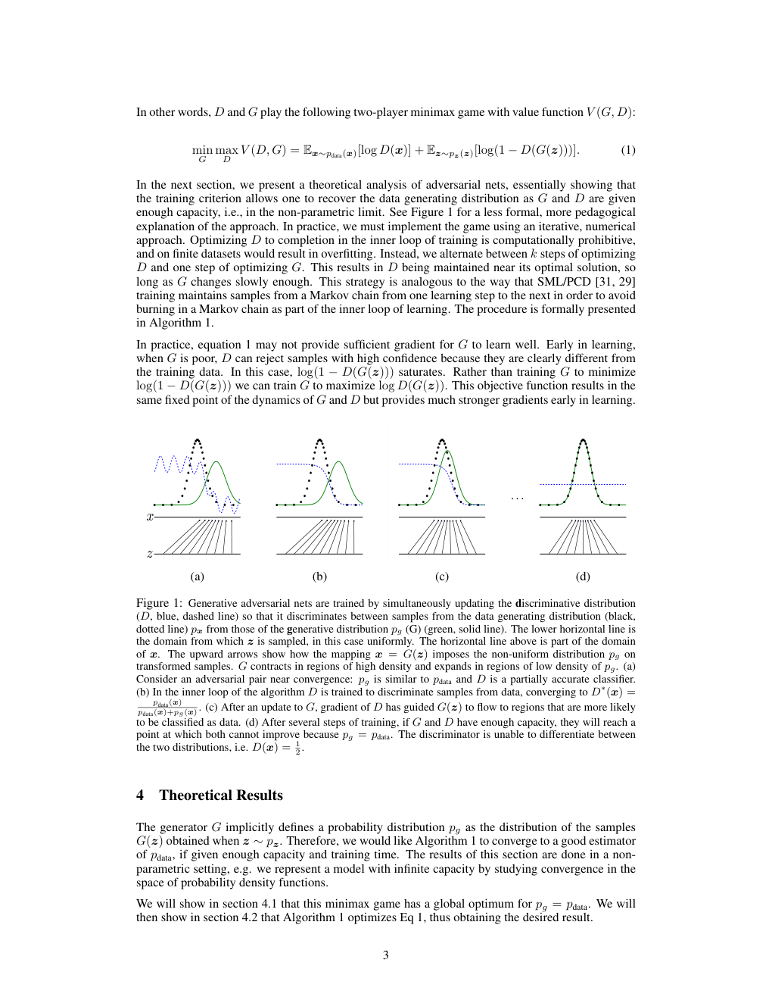
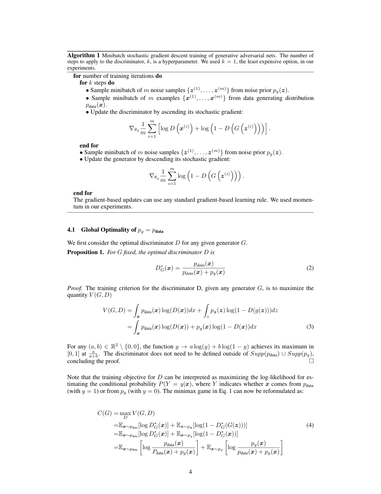
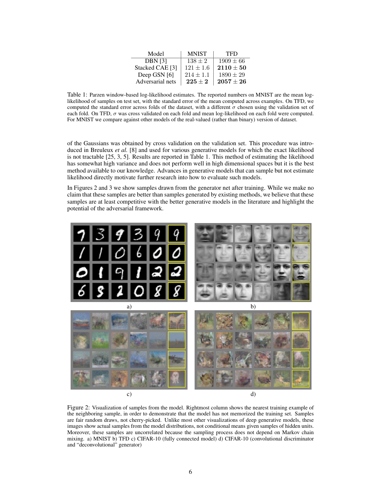
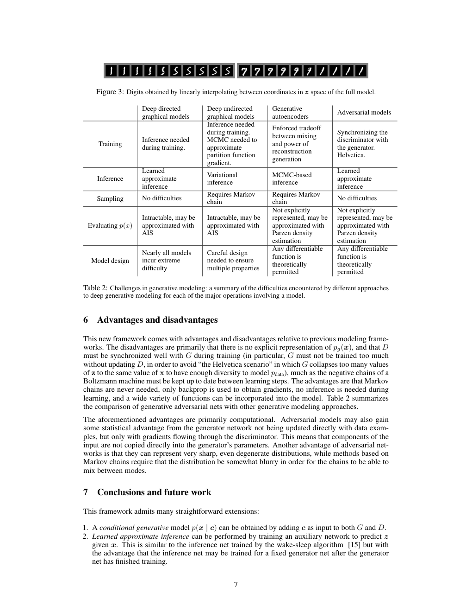

# Generative Adversarial Nets（生成对抗网络）

> 全文双语对照翻译。原论文：Ian J. Goodfellow 等，arXiv:1406.2661v1 [stat.ML]，2014 年 6 月 10 日。
> 翻译规则：公式原样保留；模型名/人名/数据集/会议名不译；术语首次出现写「中文译名（English）」，之后统一；参考文献整体保留原文。
> 原图见 `paper.pdf`，页码标注于各图/表处。

---

**Original:** Generative Adversarial Nets

**中文:** 生成对抗网络（Generative Adversarial Nets）

**Original:** Ian J. Goodfellow, Jean Pouget-Abadie*, Mehdi Mirza, Bing Xu, David Warde-Farley, Sherjil Ozair†, Aaron Courville, Yoshua Bengio‡
Département d'informatique et de recherche opérationnelle（计算机科学与运筹学系）
Université de Montréal（蒙特利尔大学）
Montréal, QC H3C 3J7

**中文:** 作者姓名与机构保留原文（人名、机构名不译）。作者依次为 Ian J. Goodfellow、Jean Pouget-Abadie*、Mehdi Mirza、Bing Xu、David Warde-Farley、Sherjil Ozair†、Aaron Courville、Yoshua Bengio‡；单位：蒙特利尔大学计算机科学与运筹学系。

> 脚注（原文）：*Jean Pouget-Abadie is visiting Université de Montréal from Ecole Polytechnique.
> 脚注（译文）：*Jean Pouget-Abadie 从巴黎综合理工学院（Ecole Polytechnique）到蒙特利尔大学访问。
> 脚注（原文）：†Sherjil Ozair is visiting Université de Montréal from Indian Institute of Technology Delhi
> 脚注（译文）：†Sherjil Ozair 从印度理工学院德里分校（Indian Institute of Technology Delhi）到蒙特利尔大学访问。
> 脚注（原文）：‡Yoshua Bengio is a CIFAR Senior Fellow.
> 脚注（译文）：‡Yoshua Bengio 是 CIFAR 高级会士（Senior Fellow）。

---

## 摘要（Abstract）

**Original:** We propose a new framework for estimating generative models via an adversarial process, in which we simultaneously train two models: a generative model $G$ that captures the data distribution, and a discriminative model $D$ that estimates the probability that a sample came from the training data rather than $G$. The training procedure for $G$ is to maximize the probability of $D$ making a mistake. This framework corresponds to a minimax two-player game. In the space of arbitrary functions $G$ and $D$, a unique solution exists, with $G$ recovering the training data distribution and $D$ equal to $\frac{1}{2}$ everywhere. In the case where $G$ and $D$ are defined by multilayer perceptrons, the entire system can be trained with backpropagation. There is no need for any Markov chains or unrolled approximate inference networks during either training or generation of samples. Experiments demonstrate the potential of the framework through qualitative and quantitative evaluation of the generated samples.

**中文:** 我们提出一个新的框架，通过对抗过程（adversarial process）来估计生成模型（generative model）：在过程中我们同时训练两个模型——一个捕获数据分布的生成模型 $G$，和一个估计样本来自训练数据而非 $G$ 的概率的判别模型（discriminative model）$D$。$G$ 的训练过程是最大化 $D$ 犯错的概率。这个框架对应一个极小极大双人博弈（minimax two-player game）。在 $G$ 和 $D$ 为任意函数的空间中，存在唯一解：$G$ 恢复训练数据分布，且 $D$ 处处等于 $\frac{1}{2}$。当 $G$ 和 $D$ 都由多层感知机（multilayer perceptron，MLP）定义时，整个系统可以用反向传播（backpropagation）训练。在训练或生成样本的过程中，不需要任何马尔可夫链（Markov chain）或展开的近似推断（approximate inference）网络。实验通过对生成样本的定性与定量评估，展示了该框架的潜力。

---

## 1 引言（Introduction）

**Original:** The promise of deep learning is to discover rich, hierarchical models [2] that represent probability distributions over the kinds of data encountered in artificial intelligence applications, such as natural images, audio waveforms containing speech, and symbols in natural language corpora. So far, the most striking successes in deep learning have involved discriminative models, usually those that map a high-dimensional, rich sensory input to a class label [14, 22]. These striking successes have primarily been based on the backpropagation and dropout algorithms, using piecewise linear units [19, 9, 10] which have a particularly well-behaved gradient. Deep *generative* models have had less of an impact, due to the difficulty of approximating many intractable probabilistic computations that arise in maximum likelihood estimation and related strategies, and due to difficulty of leveraging the benefits of piecewise linear units in the generative context. We propose a new generative model estimation procedure that sidesteps these difficulties.¹

**中文:** 深度学习（deep learning）的愿景是发现丰富的层次模型（hierarchical model）[2]，这些模型表示人工智能应用中所遇到的各种数据的概率分布（probability distribution），例如自然图像、包含语音的音频波形，以及自然语言语料库中的符号。迄今为止，深度学习最引人注目的成功来自判别模型，通常是那些将高维、丰富的感官输入映射到类别标签的模型 [14, 22]。这些引人注目的成功主要基于反向传播和随机失活（Dropout）算法，使用了梯度特性特别良好的分段线性单元（piecewise linear unit）[19, 9, 10]。深度*生成*模型的影响较小，原因在于最大似然估计（maximum likelihood estimation）及相关策略中出现的许多难以处理的概率计算难以近似，也在于难以在生成场景中利用分段线性单元的好处。我们提出一个新的生成模型估计过程，绕开这些困难。¹

> 脚注（原文）：¹All code and hyperparameters available at http://www.github.com/goodfeli/adversarial
> 脚注（译文）：¹所有代码和超参数见 http://www.github.com/goodfeli/adversarial

**Original:** In the proposed *adversarial nets* framework, the generative model is pitted against an adversary: a discriminative model that learns to determine whether a sample is from the model distribution or the data distribution. The generative model can be thought of as analogous to a team of counterfeiters, trying to produce fake currency and use it without detection, while the discriminative model is analogous to the police, trying to detect the counterfeit currency. Competition in this game drives both teams to improve their methods until the counterfeits are indistiguishable from the genuine articles. [译注：原文 "indistiguishable" 为 "indistinguishable" 的拼写笔误。]

**中文:** 在本文提出的对抗网络（adversarial nets）框架中，生成模型与一个对手对垒：对手是一个判别模型，它学习判断一个样本来自模型分布还是数据分布。生成模型可以类比为伪造货币的团伙，试图制造假币并在不被发现的情况下使用；而判别模型则类比于警察，试图识破假币。这场博弈中的竞争驱使双方不断改进自己的方法，直到假币与真品无法区分。[译注：原文 "indistiguishable" 为 "indistinguishable" 的拼写笔误。]

**Original:** This framework can yield specific training algorithms for many kinds of model and optimization algorithm. In this article, we explore the special case when the generative model generates samples by passing random noise through a multilayer perceptron, and the discriminative model is also a multilayer perceptron. We refer to this special case as *adversarial nets*. In this case, we can train both models using only the highly successful backpropagation and dropout algorithms [17] and sample from the generative model using only forward propagation. No approximate inference or Markov chains are necessary.

**中文:** 这个框架可以为多种模型和优化算法导出具体的训练算法。在本文中，我们探索一种特例：生成模型通过把随机噪声传入多层感知机来生成样本，判别模型也是一个多层感知机。我们称这种特例为对抗网络。在这种情形下，我们可以只用极为成功的反向传播与随机失活算法 [17] 来训练两个模型，并只用前向传播（forward propagation）从生成模型采样。不需要近似推断或马尔可夫链。

---

## 2 相关工作（Related work）

**Original:** An alternative to directed graphical models with latent variables are undirected graphical models with latent variables, such as restricted Boltzmann machines (RBMs) [27, 16], deep Boltzmann machines (DBMs) [26] and their numerous variants. The interactions within such models are represented as the product of unnormalized potential functions, normalized by a global summation/integration over all states of the random variables. This quantity (the *partition function*) and its gradient are intractable for all but the most trivial instances, although they can be estimated by Markov chain Monte Carlo (MCMC) methods. Mixing poses a significant problem for learning algorithms that rely on MCMC [3, 5].

**中文:** 带隐变量（latent variable）的有向图模型（directed graphical model）的一种替代方案是带隐变量的无向图模型（undirected graphical model），例如受限玻尔兹曼机（restricted Boltzmann machine，RBM）[27, 16]、深度玻尔兹曼机（deep Boltzmann machine，DBM）[26] 及其众多变体。这类模型内部的相互作用被表示为未归一化势函数（potential function）的乘积，再除以对所有随机变量状态的整体求和/积分进行归一化。这个量（配分函数，partition function）及其梯度除最平凡的情形外都难以处理，不过可以用马尔可夫链蒙特卡洛（Markov chain Monte Carlo，MCMC）方法估计。混合（mixing）对依赖 MCMC 的学习算法构成显著问题 [3, 5]。

**Original:** Deep belief networks (DBNs) [16] are hybrid models containing a single undirected layer and several directed layers. While a fast approximate layer-wise training criterion exists, DBNs incur the computational difficulties associated with both undirected and directed models.

**中文:** 深度信念网络（deep belief network，DBN）[16] 是混合模型，包含一个无向层和若干有向层。虽然存在快速的近似逐层训练准则，但 DBN 同时承受着无向模型与有向模型两者的计算困难。

**Original:** Alternative criteria that do not approximate or bound the log-likelihood have also been proposed, such as score matching [18] and noise-contrastive estimation (NCE) [13]. Both of these require the learned probability density to be analytically specified up to a normalization constant. Note that in many interesting generative models with several layers of latent variables (such as DBNs and DBMs), it is not even possible to derive a tractable unnormalized probability density. Some models such as denoising auto-encoders [30] and contractive autoencoders have learning rules very similar to score matching applied to RBMs. In NCE, as in this work, a discriminative training criterion is employed to fit a generative model. However, rather than fitting a separate discriminative model, the generative model itself is used to discriminate generated data from samples a fixed noise distribution. Because NCE uses a fixed noise distribution, learning slows dramatically after the model has learned even an approximately correct distribution over a small subset of the observed variables.

**中文:** 也有人提出不近似、不限界对数似然（log-likelihood）的替代准则，例如得分匹配（score matching）[18] 和噪声对比估计（noise-contrastive estimation，NCE）[13]。两者都要求学习到的概率密度可以在差一个归一化常数的范围内解析地写出。注意，在许多带多层隐变量的有趣生成模型（如 DBN 和 DBM）中，甚至不可能推导出一个可处理的未归一化概率密度。一些模型（如去噪自编码器（denoising auto-encoder）[30] 和收缩自编码器（contractive autoencoder））的学习规则与应用于 RBM 的得分匹配非常相似。在 NCE 中，和本文一样，采用了判别式训练准则来拟合生成模型。然而，NCE 不是拟合一个单独的判别模型，而是用生成模型本身把生成数据与来自固定噪声分布的样本区分开。由于 NCE 使用固定的噪声分布，一旦模型学得哪怕只是观测变量的小子集上的近似正确分布，学习就会急剧变慢。

**Original:** Finally, some techniques do not involve defining a probability distribution explicitly, but rather train a generative machine to draw samples from the desired distribution. This approach has the advantage that such machines can be designed to be trained by back-propagation. Prominent recent work in this area includes the generative stochastic network (GSN) framework [5], which extends generalized denoising auto-encoders [4]: both can be seen as defining a parameterized Markov chain, i.e., one learns the parameters of a machine that performs one step of a generative Markov chain. Compared to GSNs, the adversarial nets framework does not require a Markov chain for sampling. Because adversarial nets do not require feedback loops during generation, they are better able to leverage piecewise linear units [19, 9, 10], which improve the performance of backpropagation but have problems with unbounded activation when used ina feedback loop. [译注：原文 "ina" 为 "in a" 的排版笔误。] More recent examples of training a generative machine by back-propagating into it include recent work on auto-encoding variational Bayes [20] and stochastic backpropagation [24].

**中文:** 最后，有些技术不显式定义概率分布，而是训练一台生成机器（generative machine）从期望的分布中抽取样本。这种方法的优点是：这类机器可以设计成通过反向传播训练。该领域近期的重要工作包括生成随机网络（generative stochastic network，GSN）框架 [5]，它推广了广义去噪自编码器（generalized denoising auto-encoder）[4]：两者都可以看作定义了一条参数化马尔可夫链，即学习一台执行生成式马尔可夫链单步的机器的参数。与 GSN 相比，对抗网络框架采样时不需要马尔可夫链。由于对抗网络在生成过程中不需要反馈回路（feedback loop），它们能更好地利用分段线性单元 [19, 9, 10]——分段线性单元能改善反向传播的性能，但在反馈回路中使用时存在激活无界的问题。[译注：原文 "ina" 为 "in a" 的排版笔误。] 通过把反向传播传入生成机器来训练它的更新例子，还包括近期关于自编码变分贝叶斯（auto-encoding variational Bayes）[20] 和随机反向传播（stochastic backpropagation）[24] 的工作。

---

## 3 对抗网络（Adversarial nets）

**Original:** The adversarial modeling framework is most straightforward to apply when the models are both multilayer perceptrons. To learn the generator's distribution $p_g$ over data $\bm{x}$, we define a prior on input noise variables $p_{\bm{z}}(\bm{z})$, then represent a mapping to data space as $G(\bm{z}; \theta_g)$, where $G$ is a differentiable function represented by a multilayer perceptron with parameters $\theta_g$. We also define a second multilayer perceptron $D(\bm{x}; \theta_d)$ that outputs a single scalar. $D(\bm{x})$ represents the probability that $\bm{x}$ came from the data rather than $p_g$. We train $D$ to maximize the probability of assigning the correct label to both training examples and samples from $G$. We simultaneously train $G$ to minimize $\log(1-D(G(\bm{z})))$:

**中文:** 当两个模型都是多层感知机时，对抗建模框架最容易直接应用。为了学习生成器（generator）在数据 $\bm{x}$ 上的分布 $p_g$，我们对输入噪声变量定义先验（prior）$p_{\bm{z}}(\bm{z})$，然后将到数据空间的映射表示为 $G(\bm{z}; \theta_g)$，其中 $G$ 是由参数为 $\theta_g$ 的多层感知机表示的可微函数（differentiable function）。我们还定义了第二个多层感知机 $D(\bm{x}; \theta_d)$，它输出单个标量（scalar）。$D(\bm{x})$ 表示 $\bm{x}$ 来自数据而非 $p_g$ 的概率。我们训练 $D$ 以最大化给训练样本和来自 $G$ 的样本都分配正确标签的概率。同时训练 $G$ 以最小化 $\log(1-D(G(\bm{z})))$：

**Original:** In other words, $D$ and $G$ play the following two-player minimax game with value function $V(G, D)$:

$$\min_G \max_D V(D, G) = \mathbb{E}_{\bm{x} \sim p_{\text{data}}(\bm{x})}[\log D(\bm{x})] + \mathbb{E}_{\bm{z} \sim p_{\bm{z}}(\bm{z})}[\log (1 - D(G(\bm{z})))]. \tag{1}$$

[译注：原文正文写价值函数为 $V(G, D)$，而公式 (1) 中写为 $V(D, G)$，此处按原文原样保留。]

**中文:** 换言之，$D$ 和 $G$ 进行如下具有价值函数（value function）$V(G, D)$ 的双人极小极大博弈（two-player minimax game）：

$$\min_G \max_D V(D, G) = \mathbb{E}_{\bm{x} \sim p_{\text{data}}(\bm{x})}[\log D(\bm{x})] + \mathbb{E}_{\bm{z} \sim p_{\bm{z}}(\bm{z})}[\log (1 - D(G(\bm{z})))]. \tag{1}$$

[译注：原文正文写价值函数为 $V(G, D)$，而公式 (1) 中写为 $V(D, G)$，此处按原文原样保留。]

**Original:** In the next section, we present a theoretical analysis of adversarial nets, essentially showing that the training criterion allows one to recover the data generating distribution as $G$ and $D$ are given enough capacity, i.e., in the non-parametric limit. See Figure 1 for a less formal, more pedagogical explanation of the approach. In practice, we must implement the game using an iterative, numerical approach. Optimizing $D$ to completion in the inner loop of training is computationally prohibitive, and on finite datasets would result in overfitting. Instead, we alternate between $k$ steps of optimizing $D$ and one step of optimizing $G$. This results in $D$ being maintained near its optimal solution, so long as $G$ changes slowly enough. This strategy is analogous to the way that SML/PCD [31, 29] training maintains samples from a Markov chain from one learning step to the next in order to avoid burning in a Markov chain as part of the inner loop of learning. The procedure is formally presented in Algorithm 1.

**中文:** 下一节我们给出对抗网络的理论分析，本质上说明：当 $G$ 和 $D$ 被赋予足够的容量，即在非参数极限（non-parametric limit）下，这个训练准则允许恢复数据生成分布。关于该方法的更直观、更具教学性的解释见图 1。在实践中，我们必须用迭代的数值方法实现这个博弈。在训练的内循环中把 $D$ 优化到最优在计算上不可行，而且在有限数据集上会导致过拟合（overfitting）。因此我们交替进行 $k$ 步优化 $D$ 和一步优化 $G$。只要 $G$ 变化得足够慢，这就能让 $D$ 保持在最优解附近。这一策略类似于 SML/PCD [31, 29] 训练的做法：在相邻学习步之间保持来自马尔可夫链的样本，以避免在学习的内部循环中对马尔可夫链做预热（burn in）。该过程正式表述见算法 1。

**Original:** In practice, equation 1 may not provide sufficient gradient for $G$ to learn well. Early in learning, when $G$ is poor, $D$ can reject samples with high confidence because they are clearly different from the training data. In this case, $\log(1 - D(G(\bm{z})))$ saturates. Rather than training $G$ to minimize $\log(1 - D(G(\bm{z})))$ we can train $G$ to maximize $\log D(G(\bm{z}))$. This objective function results in the same fixed point of the dynamics of $G$ and $D$ but provides much stronger gradients early in learning.

**中文:** 在实践中，方程 1 可能无法为 $G$ 提供足够的梯度（gradient）使其学好。在学习早期，当 $G$ 表现差时，$D$ 可以高置信度地拒绝样本，因为这些样本与训练数据明显不同。此时 $\log(1 - D(G(\bm{z})))$ 饱和（saturate）。与其训练 $G$ 最小化 $\log(1 - D(G(\bm{z})))$，不如训练 $G$ 最大化 $\log D(G(\bm{z}))$。这个目标函数在 $G$ 和 $D$ 的动力学上具有相同的不动点（fixed point），但在学习早期提供强得多的梯度。

> **图 1（译）**：Figure 1
>
> **Original:** Generative adversarial nets are trained by simultaneously updating the discriminative distribution ($D$, blue, dashed line) so that it discriminates between samples from the data generating distribution (black, dotted line) $p_{\bm{x}}$ from those of the generative distribution $p_g$ (G) (green, solid line). The lower horizontal line is the domain from which $\bm{z}$ is sampled, in this case uniformly. The horizontal line above is part of the domain of $\bm{x}$. The upward arrows show how the mapping $\bm{x}=G(\bm{z})$ imposes the non-uniform distribution $p_g$ on transformed samples. $G$ contracts in regions of high density and expands in regions of low density of $p_g$. (a) Consider an adversarial pair near convergence: $p_g$ is similar to $p_\text{data}$ and $D$ is a partially accurate classifier. (b) In the inner loop of the algorithm $D$ is trained to discriminate samples from data, converging to $D^*(\bm{x}) = \frac{p_\text{data}(\bm{x})}{p_\text{data}(\bm{x}) + p_g(\bm{x})}$. (c) After an update to $G$, gradient of $D$ has guided $G(\bm{z})$ to flow to regions that are more likely to be classified as data. (d) After several steps of training, if $G$ and $D$ have enough capacity, they will reach a point at which both cannot improve because $p_g = p_\text{data}$. The discriminator is unable to differentiate between the two distributions, i.e. $D(\bm{x}) = \frac{1}{2}$.
>
> **中文:** 生成对抗网络通过同时更新判别分布（$D$，蓝色虚线）来训练，使其区分来自数据生成分布（黑色点线）$p_{\bm{x}}$ 的样本与来自生成分布 $p_g$（G，绿色实线）的样本。下方水平线是采样 $\bm{z}$ 的定义域，此处为均匀采样。上方水平线是 $\bm{x}$ 定义域的一部分。向上的箭头展示了映射 $\bm{x}=G(\bm{z})$ 如何给变换后的样本施加非均匀分布 $p_g$。$G$ 在 $p_g$ 的高密度区域收缩、在低密度区域扩张。(a) 考虑一对接近收敛的对抗组合：$p_g$ 与 $p_\text{data}$ 相似，$D$ 是一个部分准确的分类器（classifier）。(b) 在算法的内循环中，$D$ 被训练来判别来自数据的样本，收敛到 $D^*(\bm{x}) = \frac{p_\text{data}(\bm{x})}{p_\text{data}(\bm{x}) + p_g(\bm{x})}$。(c) 在 $G$ 的一次更新后，$D$ 的梯度引导 $G(\bm{z})$ 流向更可能被分类为数据的区域。(d) 经过若干步训练后，如果 $G$ 和 $D$ 有足够容量，它们将到达一个双方都无法再改进的点，因为 $p_g = p_\text{data}$。判别器无法区分这两个分布，即 $D(\bm{x}) = \frac{1}{2}$。
>
> （原图见 paper.pdf 第 3 页，见下方图）



**Original（算法 1）:**

```
Algorithm 1 Minibatch stochastic gradient descent training of generative adversarial nets. The number of steps to apply to the discriminator, k, is a hyperparameter. We used k = 1, the least expensive option, in our experiments.

for number of training iterations do
  for k steps do
    • Sample minibatch of m noise samples {z(1), ..., z(m)} from noise prior pg(z).
    • Sample minibatch of m examples {x(1), ..., x(m)} from data generating distribution pdata(x).
    • Update the discriminator by ascending its stochastic gradient:
        ∇θd (1/m) Σ_{i=1}^{m} [ log D(x(i)) + log(1 − D(G(z(i)))) ].
  end for
  • Sample minibatch of m noise samples {z(1), ..., z(m)} from noise prior pg(z).
  • Update the generator by descending its stochastic gradient:
      ∇θg (1/m) Σ_{i=1}^{m} log(1 − D(G(z(i)))).
end for

The gradient-based updates can use any standard gradient-based learning rule. We used momentum in our experiments.
```

**中文（算法 1 对照）:**

```
算法 1 生成对抗网络的小批量随机梯度下降训练。施加于判别器的步数 k 是一个超参数。我们在实验中取 k = 1，这是开销最小的选择。

for 训练迭代次数 do
  for k 步 do
    • 从噪声先验 pg(z) 中采样 m 个噪声样本的小批量 {z(1), ..., z(m)}。[译注：原文此处两处 "from noise prior pg(z)" 疑为 pz(z) 的笔误，按原文保留。]
    • 从数据生成分布 pdata(x) 中采样 m 个样本的小批量 {x(1), ..., x(m)}。
    • 通过上升其随机梯度来更新判别器：
        ∇θd (1/m) Σ_{i=1}^{m} [ log D(x(i)) + log(1 − D(G(z(i)))) ]。
  end for
  • 从噪声先验 pg(z) 中采样 m 个噪声样本的小批量 {z(1), ..., z(m)}。
  • 通过下降其随机梯度来更新生成器：
      ∇θg (1/m) Σ_{i=1}^{m} log(1 − D(G(z(i))))。
end for

基于梯度的更新可以使用任何标准的基于梯度的学习规则。我们在实验中使用了动量。
```

> （算法 1 原图见 paper.pdf 第 4 页，见下方图）



---

## 4 理论结果（Theoretical Results）

**Original:** The generator $G$ implicitly defines a probability distribution $p_g$ as the distribution of the samples $G(\bm{z})$ obtained when $\bm{z} \sim p_{\bm{z}}$. Therefore, we would like Algorithm 1 to converge to a good estimator of $p_\text{data}$, if given enough capacity and training time. The results of this section are done in a non-parametric setting, e.g. we represent a model with infinite capacity by studying convergence in the space of probability density functions.

**中文:** 生成器 $G$ 隐式地定义了一个概率分布 $p_g$，即当 $\bm{z} \sim p_{\bm{z}}$ 时得到的样本 $G(\bm{z})$ 的分布。因此，如果给予足够的容量与训练时间，我们希望算法 1 收敛到 $p_\text{data}$ 的一个好的估计。本节的结果都在非参数设定（non-parametric setting）下完成，例如，我们通过在概率密度函数（probability density function）空间中研究收敛来表示一个容量无限的模型。

**Original:** We will show in section 4.1 that this minimax game has a global optimum for $p_g = p_\text{data}$. We will then show in section 4.2 that Algorithm 1 optimizes Eq 1, thus obtaining the desired result.

**中文:** 我们将在 4.1 节证明该极小极大博弈在 $p_g = p_\text{data}$ 处有全局最优（global optimum）。然后在 4.2 节证明算法 1 优化方程 1，从而得到期望的结果。

### 4.1 $p_g = p_\text{data}$ 的全局最优性（Global Optimality of $p_g = p_\text{data}$）

**Original:** We first consider the optimal discriminator $D$ for any given generator $G$.

**中文:** 我们首先考虑任意给定生成器 $G$ 下的最优判别器（optimal discriminator）$D$。

**Original:** Proposition 1. For $G$ fixed, the optimal discriminator $D$ is

$$D^*_G(\bm{x}) = \frac{p_\text{data}(\bm{x})}{p_\text{data}(\bm{x}) + p_g(\bm{x})} \tag{2}$$

**中文:** 命题（Proposition）1. 对于固定的 $G$，最优判别器 $D$ 为

$$D^*_G(\bm{x}) = \frac{p_\text{data}(\bm{x})}{p_\text{data}(\bm{x}) + p_g(\bm{x})} \tag{2}$$

**Original:** Proof. The training criterion for the discriminator D, given any generator $G$, is to maximize the quantity $V(G, D)$

$$V(G, D) = \int_{\bm{x}} p_\text{data}(\bm{x}) \log(D(\bm{x})) dx + \int_z p_{\bm{z}}(\bm{z}) \log(1 - D(g(\bm{z}))) dz \tag{3}$$

$$= \int_{\bm{x}} p_\text{data}(\bm{x}) \log(D(\bm{x})) + p_g(\bm{x}) \log(1 - D(\bm{x})) dx$$

**中文:** 证明（Proof）. 给定任意生成器 $G$，判别器 D 的训练准则是最大化量 $V(G, D)$

$$V(G, D) = \int_{\bm{x}} p_\text{data}(\bm{x}) \log(D(\bm{x})) dx + \int_z p_{\bm{z}}(\bm{z}) \log(1 - D(g(\bm{z}))) dz \tag{3}$$

$$= \int_{\bm{x}} p_\text{data}(\bm{x}) \log(D(\bm{x})) + p_g(\bm{x}) \log(1 - D(\bm{x})) dx$$

**Original:** For any $(a,b) \in \mathbb{R}^2 \setminus \{0, 0\}$, the function $y \rightarrow a \log (y) + b \log (1-y)$ achieves its maximum in $[0,1]$ at $\frac{a}{a+b}$. The discriminator does not need to be defined outside of $Supp(p_\text{data}) \cup Supp(p_g)$, concluding the proof.

**中文:** 对任意 $(a,b) \in \mathbb{R}^2 \setminus \{0, 0\}$，函数 $y \rightarrow a \log (y) + b \log (1-y)$ 在 $[0,1]$ 上于 $\frac{a}{a+b}$ 处取得最大值。判别器不需要定义在 $Supp(p_\text{data}) \cup Supp(p_g)$（两个分布的支撑集，support）之外，证毕。

**Original:** Note that the training objective for $D$ can be interpreted as maximizing the log-likelihood for estimating the conditional probability $P(Y=y|\bm{x})$, where $Y$ indicates whether $\bm{x}$ comes from $p_\text{data}$ (with $y=1$) or from $p_g$ (with $y=0$). The minimax game in Eq. 1 can now be reformulated as:

$$C(G) = \max_D V(G,D) \tag{4}$$

$$= \mathbb{E}_{\bm{x} \sim p_\text{data}}[\log D^*_G(\bm{x})] + \mathbb{E}_{\bm{z} \sim p_{\bm{z}}}[\log (1 - D^*_G(G(\bm{z})))]$$

$$= \mathbb{E}_{\bm{x} \sim p_\text{data}}[\log D^*_G(\bm{x})] + \mathbb{E}_{\bm{x} \sim p_g}[\log (1 - D^*_G(\bm{x}))]$$

$$= \mathbb{E}_{\bm{x} \sim p_\text{data}}\left[\log \frac{p_\text{data}(\bm{x})}{P_\text{data}(\bm{x}) + p_g(\bm{x})}\right] + \mathbb{E}_{\bm{x} \sim p_g}\left[\log \frac{p_g(\bm{x})}{p_\text{data}(\bm{x}) + p_g(\bm{x})}\right]$$

[译注：公式 (4) 最后一行分子中的 $P_\text{data}(\bm{x})$ 首字母大写，与全文其余处的 $p_\text{data}(\bm{x})$ 不一致，系原文笔误，按原文保留。]

**中文:** 注意，$D$ 的训练目标可以解释为最大化估计条件概率（conditional probability）$P(Y=y|\bm{x})$ 的对数似然，其中 $Y$ 表示 $\bm{x}$ 来自 $p_\text{data}$（$y=1$）还是来自 $p_g$（$y=0$）。方程 1 中的极小极大博弈现在可以改写为：

$$C(G) = \max_D V(G,D) \tag{4}$$

$$= \mathbb{E}_{\bm{x} \sim p_\text{data}}[\log D^*_G(\bm{x})] + \mathbb{E}_{\bm{z} \sim p_{\bm{z}}}[\log (1 - D^*_G(G(\bm{z})))]$$

$$= \mathbb{E}_{\bm{x} \sim p_\text{data}}[\log D^*_G(\bm{x})] + \mathbb{E}_{\bm{x} \sim p_g}[\log (1 - D^*_G(\bm{x}))]$$

$$= \mathbb{E}_{\bm{x} \sim p_\text{data}}\left[\log \frac{p_\text{data}(\bm{x})}{P_\text{data}(\bm{x}) + p_g(\bm{x})}\right] + \mathbb{E}_{\bm{x} \sim p_g}\left[\log \frac{p_g(\bm{x})}{p_\text{data}(\bm{x}) + p_g(\bm{x})}\right]$$

[译注：公式 (4) 最后一行分子中的 $P_\text{data}(\bm{x})$ 首字母大写，与全文其余处的 $p_\text{data}(\bm{x})$ 不一致，系原文笔误，按原文保留。]

**Original:** Theorem 1. The global minimum of the virtual training criterion $C(G)$ is achieved if and only if $p_g = p_\text{data}$. At that point, $C(G)$ achieves the value $-\log 4$.

**中文:** 定理（Theorem）1. 虚拟训练准则（virtual training criterion）$C(G)$ 的全局最小值当且仅当 $p_g = p_\text{data}$ 时取得。在该点处，$C(G)$ 取值为 $-\log 4$。

**Original:** Proof. For $p_g=p_\text{data}$, $D^*_G(\bm{x})=\frac{1}{2}$, (consider Eq. 2). Hence, by inspecting Eq. 4 at $D^*_G(\bm{x})=\frac{1}{2}$, we find $C(G)=\log\frac{1}{2} + \log\frac{1}{2} = - \log 4$. To see that this is the best possible value of $C(G)$, reached only for $p_g = p_\text{data}$, observe that

$$\mathbb{E}_{\bm{x} \sim p_\text{data}} \left[ - \log 2 \right] + \mathbb{E}_{\bm{x} \sim p_g} \left[ - \log 2 \right] = -\log 4$$

and that by subtracting this expression from $C(G) = V(D_G^*,G)$, we obtain:

$$C(G) = -\log(4) + KL \left(p_\text{data} \left\| \frac{p_\text{data} + p_g}{2} \right. \right) + KL \left(p_g \left\| \frac{p_\text{data} + p_g}{2} \right. \right) \tag{5}$$

where KL is the Kullback–Leibler divergence. We recognize in the previous expression the Jensen–Shannon divergence between the model's distribution and the data generating process:

$$C(G) = - \log(4) + 2 \cdot JSD \left(p_\text{data} \left\| p_g \right. \right) \tag{6}$$

Since the Jensen–Shannon divergence between two distributions is always non-negative and zero only when they are equal, we have shown that $C^* = - \log (4)$ is the global minimum of $C(G)$ and that the only solution is $p_g=p_\text{data}$, i.e., the generative model perfectly replicating the data generating process.

**中文:** 证明. 当 $p_g=p_\text{data}$ 时，$D^*_G(\bm{x})=\frac{1}{2}$（见方程 2）。因此，在 $D^*_G(\bm{x})=\frac{1}{2}$ 处考察方程 4，可得 $C(G)=\log\frac{1}{2} + \log\frac{1}{2} = - \log 4$。要看出这是 $C(G)$ 可能取得的最好值、且仅在 $p_g = p_\text{data}$ 时达到，注意到

$$\mathbb{E}_{\bm{x} \sim p_\text{data}} \left[ - \log 2 \right] + \mathbb{E}_{\bm{x} \sim p_g} \left[ - \log 2 \right] = -\log 4$$

并且从 $C(G) = V(D_G^*,G)$ 中减去这个表达式，得到：

$$C(G) = -\log(4) + KL \left(p_\text{data} \left\| \frac{p_\text{data} + p_g}{2} \right. \right) + KL \left(p_g \left\| \frac{p_\text{data} + p_g}{2} \right. \right) \tag{5}$$

其中 KL 是 Kullback–Leibler 散度（KL 散度）。我们在上一表达式中认出模型分布与数据生成过程之间的 Jensen–Shannon 散度：

$$C(G) = - \log(4) + 2 \cdot JSD \left(p_\text{data} \left\| p_g \right. \right) \tag{6}$$

由于两个分布之间的 Jensen–Shannon 散度总是非负的，且仅当两个分布相等时为零，我们证明了 $C^* = - \log (4)$ 是 $C(G)$ 的全局最小值，且唯一解是 $p_g=p_\text{data}$，即生成模型完美复现数据生成过程。

### 4.2 算法 1 的收敛性（Convergence of Algorithm 1）

**Original:** Proposition 2. If $G$ and $D$ have enough capacity, and at each step of Algorithm 1, the discriminator is allowed to reach its optimum given $G$, and $p_g$ is updated so as to improve the criterion

$$\mathbb{E}_{\bm{x} \sim p_\text{data}}[\log D^*_G(\bm{x})] + \mathbb{E}_{\bm{x} \sim p_g}[\log (1 - D^*_G(\bm{x}))]$$

then $p_g$ converges to $p_\text{data}$

**中文:** 命题 2. 如果 $G$ 和 $D$ 有足够的容量，且在算法 1 的每一步中，判别器都被允许在给定 $G$ 时达到其最优，且 $p_g$ 的更新使以下准则得到改进：

$$\mathbb{E}_{\bm{x} \sim p_\text{data}}[\log D^*_G(\bm{x})] + \mathbb{E}_{\bm{x} \sim p_g}[\log (1 - D^*_G(\bm{x}))]$$

那么 $p_g$ 收敛到 $p_\text{data}$。

**Original:** Proof. Consider $V(G,D)=U(p_g,D)$ as a function of $p_g$ as done in the above criterion. Note that $U(p_g,D)$ is convex in $p_g$. The subderivatives of a supremum of convex functions include the derivative of the function at the point where the maximum is attained. In other words, if $f(x) = \sup_{\alpha \in \mathcal{A}} f_\alpha(x)$ and $f_\alpha(x)$ is convex in $x$ for every $\alpha$, then $\partial f_\beta(x) \in \partial f$ if $\beta = \arg \sup_{\alpha \in \mathcal{A}} f_\alpha(x)$. This is equivalent to computing a gradient descent update for $p_g$ at the optimal $D$ given the corresponding $G$. $\sup_D U(p_g,D)$ is convex in $p_g$ with a unique global optima as proven in Thm 1, therefore with sufficiently small updates of $p_g$, $p_g$ converges to $p_x$, concluding the proof.

**中文:** 证明. 如上准则所示，把 $V(G,D)=U(p_g,D)$ 看作 $p_g$ 的函数。注意 $U(p_g,D)$ 关于 $p_g$ 是凸（convex）的。凸函数族的上确界（supremum）的次导数（subderivative）包含该函数在最大值取得点处的导数。换言之，若 $f(x) = \sup_{\alpha \in \mathcal{A}} f_\alpha(x)$ 且对每个 $\alpha$，$f_\alpha(x)$ 关于 $x$ 都是凸的，则当 $\beta = \arg \sup_{\alpha \in \mathcal{A}} f_\alpha(x)$ 时，$\partial f_\beta(x) \in \partial f$。这等价于在给定相应 $G$ 的最优 $D$ 处对 $p_g$ 执行梯度下降更新。由定理 1 所证，$\sup_D U(p_g,D)$ 关于 $p_g$ 是凸的，且具有唯一的全局最优，因此只要 $p_g$ 的更新足够小，$p_g$ 就收敛到 $p_x$，证毕。

**Original:** In practice, adversarial nets represent a limited family of $p_g$ distributions via the function $G(\bm{z}; \theta_g)$, and we optimize $\theta_g$ rather than $p_g$ itself. Using a multilayer perceptron to define $G$ introduces multiple critical points in parameter space. However, the excellent performance of multilayer perceptrons in practice suggests that they are a reasonable model to use despite their lack of theoretical guarantees.

**中文:** 在实践中，对抗网络通过函数 $G(\bm{z}; \theta_g)$ 表示有限的 $p_g$ 分布族，我们优化的是 $\theta_g$ 而非 $p_g$ 本身。用多层感知机定义 $G$ 会在参数空间（parameter space）中引入多个临界点（critical point）。然而，多层感知机在实践中表现优异，这表明尽管缺乏理论保证，它们仍是合理的模型。

---

## 5 实验（Experiments）

**Original:** We trained adversarial nets an a range of datasets including MNIST [23], the Toronto Face Database (TFD) [28], and CIFAR-10 [21]. [译注：原文 "an a range" 为 "on a range" 的笔误。] The generator nets used a mixture of rectifier linear activations [19, 9] and sigmoid activations, while the discriminator net used maxout [10] activations. Dropout [17] was applied in training the discriminator net. While our theoretical framework permits the use of dropout and other noise at intermediate layers of the generator, we used noise as the input to only the bottommost layer of the generator network.

**中文:** 我们在一系列数据集上训练了对抗网络，包括 MNIST [23]、Toronto Face Database（TFD）[28] 和 CIFAR-10 [21]。[译注：原文 "an a range" 为 "on a range" 的笔误。] 生成器网络混合使用修正线性激活（rectifier linear activation）[19, 9] 和 sigmoid 激活，判别器网络则使用 maxout [10] 激活。训练判别器网络时使用了随机失活 [17]。虽然我们的理论框架允许在生成器的中间层使用随机失活和其他噪声，但我们只把噪声用作生成器网络最底层（bottommost layer）的输入。

**Original:** We estimate probability of the test set data under $p_g$ by fitting a Gaussian Parzen window to the samples generated with $G$ and reporting the log-likelihood under this distribution. The $\sigma$ parameter of the Gaussians was obtained by cross validation on the validation set. This procedure was introduced in Breuleux et al. [8] and used for various generative models for which the exact likelihood is not tractable [25, 3, 5]. Results are reported in Table 1. This method of estimating the likelihood has somewhat high variance and does not perform well in high dimensional spaces but it is the best method available to our knowledge. Advances in generative models that can sample but not estimate likelihood directly motivate further research into how to evaluate such models.

**中文:** 我们通过对 $G$ 生成的样本拟合高斯 Parzen 窗（Gaussian Parzen window），并在该分布下报告对数似然，来估计测试集数据在 $p_g$ 下的概率。高斯的 $\sigma$ 参数通过验证集上的交叉验证（cross validation）获得。该过程由 Breuleux 等人 [8] 引入，并被用于各种精确似然不可处理的生成模型 [25, 3, 5]。结果见表 1。这种估计似然的方法方差（variance）较高，在高维空间中表现不佳，但就我们所知已是最好的可用方法。那些能够采样但无法直接估计似然的生成模型的进展，进一步激励了对如何评估这类模型的研究。

> **表 1（译）**：Table 1
>
> **Original:** Parzen window-based log-likelihood estimates. The reported numbers on MNIST are the mean log-likelihood of samples on test set, with the standard error of the mean computed across examples. On TFD, we computed the standard error across folds of the dataset, with a different $\sigma$ chosen using the validation set of each fold. On TFD, $\sigma$ was cross validated on each fold and mean log-likelihood on each fold were computed. For MNIST we compare against other models of the real-valued (rather than binary) version of dataset.
>
> **中文:** 基于 Parzen 窗的对数似然估计。MNIST 上报告的数字是测试集样本的平均对数似然，均值的标准误（standard error）在样本间计算。在 TFD 上，我们在数据集各折（fold）之间计算标准误，每一折用其验证集选取不同的 $\sigma$。在 TFD 上，$\sigma$ 在每一折上做交叉验证，并计算每一折的平均对数似然。对 MNIST，我们与数据集实值（而非二值）版本上的其他模型进行比较。
>
> | Model（模型） | MNIST | TFD |
> |---|---|---|
> | DBN [3] | 138 ± 2 | 1909 ± 66 |
> | Stacked CAE [3] | 121 ± 1.6 | **2110 ± 50** |
> | Deep GSN [6] | 214 ± 1.1 | 1890 ± 29 |
> | Adversarial nets（对抗网络） | **225 ± 2** | **2057 ± 26** |
>
> （原表见 paper.pdf 第 6 页，见下方图）



**Original:** In Figures 2 and 3 we show samples drawn from the generator net after training. While we make no claim that these samples are better than samples generated by existing methods, we believe that these samples are at least competitive with the better generative models in the literature and highlight the potential of the adversarial framework.

**中文:** 在图 2 和图 3 中，我们展示了训练后从生成器网络抽取的样本。虽然我们不声称这些样本优于现有方法生成的样本，但我们相信这些样本至少能与文献中较好的生成模型相竞争，并凸显了对抗框架的潜力。

> **图 2（译）**：Figure 2
>
> **Original:** Visualization of samples from the model. Rightmost column shows the nearest training example of the neighboring sample, in order to demonstrate that the model has not memorized the training set. Samples are fair random draws, not cherry-picked. Unlike most other visualizations of deep generative models, these images show actual samples from the model distributions, not conditional means given samples of hidden units. Moreover, these samples are uncorrelated because the sampling process does not depend on Markov chain mixing. a) MNIST b) TFD c) CIFAR-10 (fully connected model) d) CIFAR-10 (convolutional discriminator and "deconvolutional" generator)
>
> **中文:** 模型样本的可视化。最右列显示的是相邻样本最接近的训练样本，以证明模型没有记住训练集。样本是公平的随机抽取，而非精心挑选。与大多数深度生成模型的可视化不同，这些图像展示的是来自模型分布的真实样本，而不是给定隐单元（hidden unit）样本的条件均值（conditional mean）。此外，这些样本互不相关，因为采样过程不依赖马尔可夫链的混合。a) MNIST b) TFD c) CIFAR-10（全连接模型）d) CIFAR-10（卷积判别器和「反卷积」生成器）
>
> （原图见 paper.pdf 第 6 页，[第 6 页图](assets/pages/page-6.png)）

> **图 3（译）**：Figure 3
>
> **Original:** Digits obtained by linearly interpolating between coordinates in $z$ space of the full model.
>
> **中文:** 在完整模型的 $z$ 空间中对坐标做线性插值得到的数字。
>
> （原图见 paper.pdf 第 7 页，见下方图）



> **表 2（译）**：Table 2
>
> **Original:** Challenges in generative modeling: a summary of the difficulties encountered by different approaches to deep generative modeling for each of the major operations involving a model.
>
> **中文:** 生成建模中的挑战：对涉及模型的每种主要操作，总结深度生成建模不同方法所遇到的困难。
>
> |  | Deep directed graphical models（深度有向图模型） | Deep undirected graphical models（深度无向图模型） | Generative autoencoders（生成式自编码器） | Adversarial models（对抗模型） |
> |---|---|---|---|---|
> | Training（训练） | Inference needed during training.（训练期间需要推断。） | Inference needed during training. MCMC needed to approximate partition function gradient.（训练期间需要推断；需要用 MCMC 近似配分函数梯度。） | Enforced tradeoff between mixing and power of reconstruction generation（在混合与重建生成能力之间强制取舍） | Synchronizing the discriminator with the generator. Helvetica.（使判别器与生成器同步。Helvetica。）[译注：原文此处 "Helvetica." 疑为作者遗留的占位文本，按原文保留。] |
> | Inference（推断） | Learned approximate inference（学习式近似推断） | Variational inference（变分推断） | MCMC-based inference（基于 MCMC 的推断） | Learned approximate inference（学习式近似推断） |
> | Sampling（采样） | No difficulties（无困难） | Requires Markov chain（需要马尔可夫链） | Requires Markov chain（需要马尔可夫链） | No difficulties（无困难） |
> | Evaluating $p(x)$（评估 $p(x)$） | Intractable, may be approximated with AIS（不可处理，可用 AIS 近似） | Intractable, may be approximated with AIS（不可处理，可用 AIS 近似） | Not explicitly represented, may be approximated with Parzen density estimation（未被显式表示，可用 Parzen 密度估计近似） | Not explicitly represented, may be approximated with Parzen density estimation（未被显式表示，可用 Parzen 密度估计近似） |
> | Model design（模型设计） | Nearly all models incur extreme difficulty（几乎所有模型都会遇到极大的困难） | Careful design needed to ensure multiple properties（需要精心设计以保证多项性质） | Any differentiable function is theoretically permitted（理论上任何可微函数都被允许） | Any differentiable function is theoretically permitted（理论上任何可微函数都被允许） |
>
> （原表见 paper.pdf 第 7 页，[第 7 页图](assets/pages/page-7.png)）

---

## 6 优点与缺点（Advantages and disadvantages）

**Original:** This new framework comes with advantages and disadvantages relative to previous modeling frameworks. The disadvantages are primarily that there is no explicit representation of $p_g(\bm{x})$, and that $D$ must be synchronized well with $G$ during training (in particular, $G$ must not be trained too much without updating $D$, in order to avoid "the Helvetica scenario" in which $G$ collapses too many values of $\bm{z}$ to the same value of $\bm{x}$ to have enough diversity to model $p_\text{data}$), much as the negative chains of a Boltzmann machine must be kept up to date between learning steps. The advantages are that Markov chains are never needed, only backprop is used to obtain gradients, no inference is needed during learning, and a wide variety of functions can be incorporated into the model. Table 2 summarizes the comparison of generative adversarial nets with other generative modeling approaches.

**中文:** 相对于先前的建模框架，这个新框架有利有弊。缺点主要在于：$p_g(\bm{x})$ 没有显式表示；训练期间 $D$ 必须与 $G$ 保持良好同步（特别是，$G$ 不能在不更新 $D$ 的情况下训练得太多，以避免「Helvetica 情景（the Helvetica scenario）」——即 $G$ 把太多 $\bm{z}$ 值坍缩到同一个 $\bm{x}$ 值，从而没有足够的多样性来建模 $p_\text{data}$），正如玻尔兹曼机（Boltzmann machine）的负链（negative chains）必须在各学习步之间保持更新。优点是：永远不需要马尔可夫链，只用反向传播获得梯度，学习期间不需要推断，并且各种函数都可以纳入模型。表 2 总结了生成对抗网络与其他生成建模方法的比较。[译注：「Helvetica 情景」是作者内部的说法，指生成器把多种输入坍缩成同一种输出的失败模式，即后来所称的「模式坍缩（mode collapse）」的早期描述；Helvetica 为一种字体名。]

**Original:** The aforementioned advantages are primarily computational. Adversarial models may also gain some statistical advantage from the generator network not being updated directly with data examples, but only with gradients flowing through the discriminator. This means that components of the input are not copied directly into the generator's parameters. Another advantage of adversarial networks is that they can represent very sharp, even degenerate distributions, while methods based on Markov chains require that the distribution be somewhat blurry in order for the chains to be able to mix between modes.

**中文:** 上述优点主要是计算上的。对抗模型还可能获得一些统计上的优势，因为生成器网络不直接用数据样本更新，而只通过流经判别器的梯度更新。这意味着输入的成分不会被直接复制进生成器的参数。对抗网络的另一个优点是：它们可以表示非常尖锐甚至退化的分布（degenerate distribution），而基于马尔可夫链的方法则要求分布有些模糊（blurry），链才能在模态（mode）之间混合。

---

## 7 结论与未来工作（Conclusions and future work）

**Original:** This framework admits many straightforward extensions:

1. A *conditional generative* model $p(\bm{x} \mid \bm{c})$ can be obtained by adding $\bm{c}$ as input to both $G$ and $D$.
2. *Learned approximate inference* can be performed by training an auxiliary network to predict $\bm{z}$ given $\bm{x}$. This is similar to the inference net trained by the wake-sleep algorithm [15] but with the advantage that the inference net may be trained for a fixed generator net after the generator net has finished training.
3. One can approximately model all conditionals $p(\bm{x}_S \mid \bm{x}_{\not S})$ where $S$ is a subset of the indices of $\bm{x}$ by training a family of conditional models that share parameters. Essentially, one can use adversarial nets to implement a stochastic extension of the deterministic MP-DBM [11].
4. *Semi-supervised learning*: features from the discriminator or inference net could improve performance of classifiers when limited labeled data is available.
5. *Efficiency improvements:* training could be accelerated greatly by divising better methods for coordinating $G$ and $D$ or determining better distributions to sample $\bm{z}$ from during training. [译注：原文 "divising" 为 "devising" 的拼写笔误。]

**中文:** 这个框架允许许多直接的扩展：

1. 条件生成模型（conditional generative model）$p(\bm{x} \mid \bm{c})$ 可以通过把 $\bm{c}$ 作为输入同时加给 $G$ 和 $D$ 来获得。
2. 学习式近似推断（learned approximate inference）可以通过训练一个辅助网络、在给定 $\bm{x}$ 时预测 $\bm{z}$ 来实现。这类似于 wake-sleep 算法 [15] 训练的推断网络，但优点是：推断网络可以在生成器网络训练完成后针对固定的生成器网络来训练。
3. 可以通过训练一组共享参数的条件模型来近似建模所有条件分布 $p(\bm{x}_S \mid \bm{x}_{\not S})$，其中 $S$ 是 $\bm{x}$ 指标的一个子集。本质上，可以用对抗网络实现确定性 MP-DBM [11] 的一个随机扩展。
4. 半监督学习（semi-supervised learning）：当可用标注数据（labeled data）有限时，来自判别器或推断网络的特征可以提升分类器的性能。
5. 效率改进（efficiency improvements）：通过设计更好的方法来协调 $G$ 和 $D$，或确定训练期间采样 $\bm{z}$ 的更好分布，可以大大加速训练。[译注：原文 "divising" 为 "devising" 的拼写笔误。]

**Original:** This paper has demonstrated the viability of the adversarial modeling framework, suggesting that these research directions could prove useful.

**中文:** 本文已经证明了对抗建模框架的可行性，表明这些研究方向可能是有用的。

---

## 致谢（Acknowledgments）

**Original:** We would like to acknowledge Patrice Marcotte, Olivier Delalleau, Kyunghyun Cho, Guillaume Alain and Jason Yosinski for helpful discussions. Yann Dauphin shared his Parzen window evaluation code with us. We would like to thank the developers of Pylearn2 [12] and Theano [7, 1], particularly Frédéric Bastien who rushed a Theano feature specifically to benefit this project. Arnaud Bergeron provided much-needed support with LaTeX typesetting. We would also like to thank CIFAR, and Canada Research Chairs for funding, and Compute Canada, and Calcul Québec for providing computational resources. Ian Goodfellow is supported by the 2013 Google Fellowship in Deep Learning. Finally, we would like to thank Les Trois Brasseurs for stimulating our creativity.

**中文:** 我们要感谢 Patrice Marcotte、Olivier Delalleau、Kyunghyun Cho、Guillaume Alain 和 Jason Yosinski 的有益讨论。Yann Dauphin 与我们分享了他的 Parzen 窗评估代码。我们要感谢 Pylearn2 [12] 和 Theano [7, 1] 的开发者，特别是 Frédéric Bastien，他专门为这个项目赶制了一个 Theano 特性。Arnaud Bergeron 提供了亟需的 LaTeX 排版支持。我们还要感谢 CIFAR 和 Canada Research Chairs 的资助，以及 Compute Canada 和 Calcul Québec 提供的计算资源。Ian Goodfellow 受 2013 年 Google 深度学习奖学金（Google Fellowship in Deep Learning）资助。最后，我们要感谢 Les Trois Brasseurs 激发了我们的创造力。

---

## 参考文献（References）

> 按翻译规范，参考文献整体保留原文，不翻译。

[1] Bastien, F., Lamblin, P., Pascanu, R., Bergstra, J., Goodfellow, I. J., Bergeron, A., Bouchard, N., and Bengio, Y. (2012). Theano: new features and speed improvements. Deep Learning and Unsupervised Feature Learning NIPS 2012 Workshop.

[2] Bengio, Y. (2009). Learning deep architectures for AI. Now Publishers.

[3] Bengio, Y., Mesnil, G., Dauphin, Y., and Rifai, S. (2013a). Better mixing via deep representations. In ICML'13.

[4] Bengio, Y., Yao, L., Alain, G., and Vincent, P. (2013b). Generalized denoising auto-encoders as generative models. In NIPS26. Nips Foundation.

[5] Bengio, Y., Thibodeau-Laufer, E., and Yosinski, J. (2014a). Deep generative stochastic networks trainable by backprop. In ICML'14.

[6] Bengio, Y., Thibodeau-Laufer, E., Alain, G., and Yosinski, J. (2014b). Deep generative stochastic networks trainable by backprop. In Proceedings of the 30th International Conference on Machine Learning (ICML'14).

[7] Bergstra, J., Breuleux, O., Bastien, F., Lamblin, P., Pascanu, R., Desjardins, G., Turian, J., Warde-Farley, D., and Bengio, Y. (2010). Theano: a CPU and GPU math expression compiler. In Proceedings of the Python for Scientific Computing Conference (SciPy). Oral Presentation.

[8] Breuleux, O., Bengio, Y., and Vincent, P. (2011). Quickly generating representative samples from an RBM-derived process. Neural Computation, 23(8), 2053–2073.

[9] Glorot, X., Bordes, A., and Bengio, Y. (2011). Deep sparse rectifier neural networks. In AISTATS'2011.

[10] Goodfellow, I. J., Warde-Farley, D., Mirza, M., Courville, A., and Bengio, Y. (2013a). Maxout networks. In ICML'2013.

[11] Goodfellow, I. J., Mirza, M., Courville, A., and Bengio, Y. (2013b). Multi-prediction deep Boltzmann machines. In NIPS'2013.

[12] Goodfellow, I. J., Warde-Farley, D., Lamblin, P., Dumoulin, V., Mirza, M., Pascanu, R., Bergstra, J., Bastien, F., and Bengio, Y. (2013c). Pylearn2: a machine learning research library. arXiv preprint arXiv:1308.4214.

[13] Gutmann, M. and Hyvarinen, A. (2010). Noise-contrastive estimation: A new estimation principle for unnormalized statistical models. In AISTATS'2010.

[14] Hinton, G., Deng, L., Dahl, G. E., Mohamed, A., Jaitly, N., Senior, A., Vanhoucke, V., Nguyen, P., Sainath, T., and Kingsbury, B. (2012a). Deep neural networks for acoustic modeling in speech recognition. IEEE Signal Processing Magazine, 29(6), 82–97.

[15] Hinton, G. E., Dayan, P., Frey, B. J., and Neal, R. M. (1995). The wake-sleep algorithm for unsupervised neural networks. Science, 268, 1558–1161.

[16] Hinton, G. E., Osindero, S., and Teh, Y. (2006). A fast learning algorithm for deep belief nets. Neural Computation, 18, 1527–1554.

[17] Hinton, G. E., Srivastava, N., Krizhevsky, A., Sutskever, I., and Salakhutdinov, R. (2012b). Improving neural networks by preventing co-adaptation of feature detectors. Technical report, arXiv:1207.0580.

[18] Hyvärinen, A. (2005). Estimation of non-normalized statistical models using score matching. J. Machine Learning Res., 6.

[19] Jarrett, K., Kavukcuoglu, K., Ranzato, M., and LeCun, Y. (2009). What is the best multi-stage architecture for object recognition? In Proc. International Conference on Computer Vision (ICCV'09), pages 2146–2153. IEEE.

[20] Kingma, D. P. and Welling, M. (2014). Auto-encoding variational bayes. In Proceedings of the International Conference on Learning Representations (ICLR).

[21] Krizhevsky, A. and Hinton, G. (2009). Learning multiple layers of features from tiny images. Technical report, University of Toronto.

[22] Krizhevsky, A., Sutskever, I., and Hinton, G. (2012). ImageNet classification with deep convolutional neural networks. In NIPS'2012.

[23] LeCun, Y., Bottou, L., Bengio, Y., and Haffner, P. (1998). Gradient-based learning applied to document recognition. Proceedings of the IEEE, 86(11), 2278–2324.

[24] Rezende, D. J., Mohamed, S., and Wierstra, D. (2014). Stochastic backpropagation and approximate inference in deep generative models. Technical report, arXiv:1401.4082.

[25] Rifai, S., Bengio, Y., Dauphin, Y., and Vincent, P. (2012). A generative process for sampling contractive auto-encoders. In ICML'12.

[26] Salakhutdinov, R. and Hinton, G. E. (2009). Deep Boltzmann machines. In AISTATS'2009, pages 448–455.

[27] Smolensky, P. (1986). Information processing in dynamical systems: Foundations of harmony theory. In D. E. Rumelhart and J. L. McClelland, editors, Parallel Distributed Processing, volume 1, chapter 6, pages 194–281. MIT Press, Cambridge.

[28] Susskind, J., Anderson, A., and Hinton, G. E. (2010). The Toronto face dataset. Technical Report UTML TR 2010-001, U. Toronto.

[29] Tieleman, T. (2008). Training restricted Boltzmann machines using approximations to the likelihood gradient. In W. W. Cohen, A. McCallum, and S. T. Roweis, editors, ICML 2008, pages 1064–1071. ACM.

[30] Vincent, P., Larochelle, H., Bengio, Y., and Manzagol, P.-A. (2008). Extracting and composing robust features with denoising autoencoders. In ICML 2008.

[31] Younes, L. (1999). On the convergence of Markovian stochastic algorithms with rapidly decreasing ergodicity rates. Stochastics and Stochastic Reports, 65(3), 177–228.
