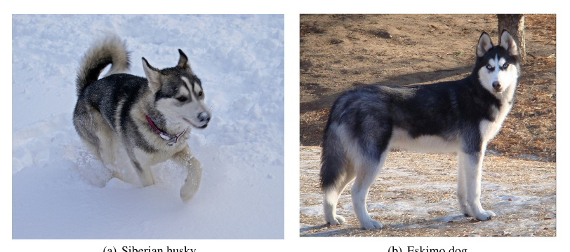
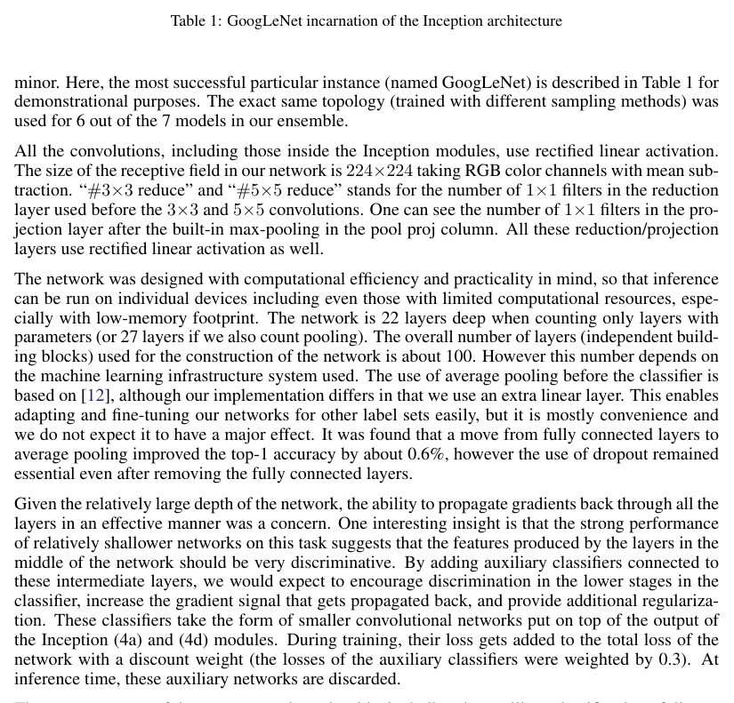
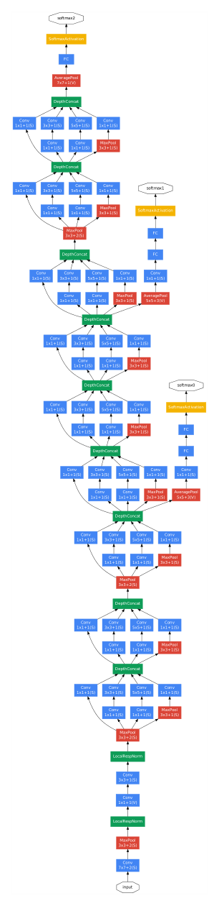
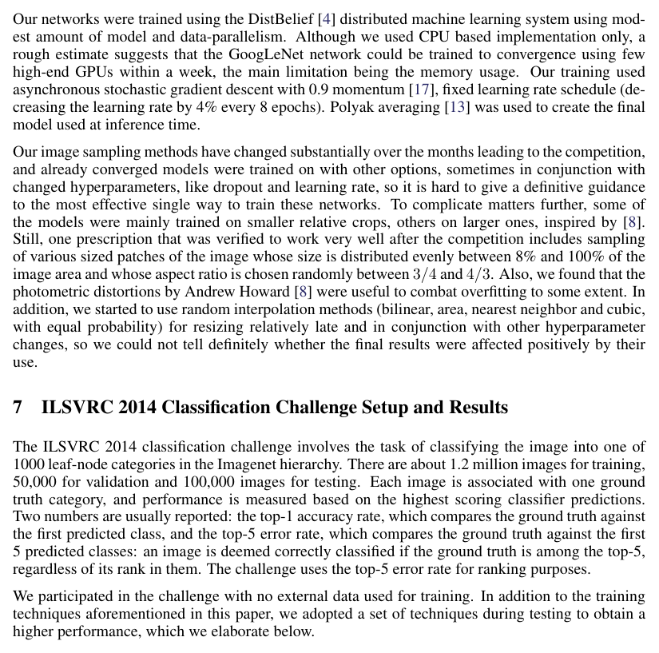
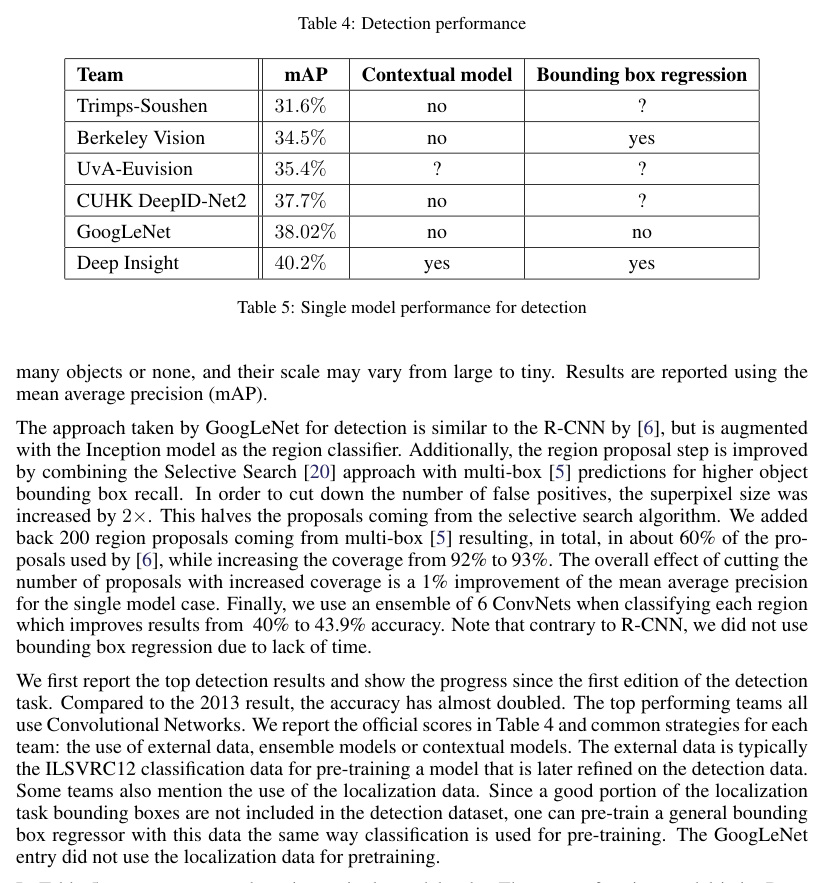

# Going deeper with convolutions / 用卷积走得更深（Inception 架构）

**Original:** Christian Szegedy (Google Inc.), Wei Liu (University of North Carolina, Chapel Hill), Yangqing Jia (Google Inc.), Pierre Sermanet (Google Inc.), Scott Reed (University of Michigan), Dragomir Anguelov (Google Inc.), Dumitru Erhan (Google Inc.), Vincent Vanhoucke (Google Inc.), Andrew Rabinovich (Google Inc.)

**中文:** 作者：Christian Szegedy（Google Inc.）、Wei Liu（北卡罗来纳大学教堂山分校）、Yangqing Jia（Google Inc.）、Pierre Sermanet（Google Inc.）、Scott Reed（密歇根大学）、Dragomir Anguelov（Google Inc.）、Dumitru Erhan（Google Inc.）、Vincent Vanhoucke（Google Inc.）、Andrew Rabinovich（Google Inc.）

> 原文出处：arXiv:1409.4842v1 [cs.CV]，2014 年 9 月 17 日。原图原表见 `paper.pdf`。

## Abstract（摘要）

**Original:** We propose a deep convolutional neural network architecture codenamed Inception, which was responsible for setting the new state of the art for classification and detection in the ImageNet Large-Scale Visual Recognition Challenge 2014 (ILSVRC14). The main hallmark of this architecture is the improved utilization of the computing resources inside the network. This was achieved by a carefully crafted design that allows for increasing the depth and width of the network while keeping the computational budget constant. To optimize quality, the architectural decisions were based on the Hebbian principle and the intuition of multi-scale processing. One particular incarnation used in our submission for ILSVRC14 is called GoogLeNet, a 22 layers deep network, the quality of which is assessed in the context of classification and detection.

**中文:** 我们提出了一种代号为 Inception 的深度卷积神经网络（convolutional neural network, CNN）架构，该架构在 2014 年 ImageNet 大规模视觉识别挑战赛（ILSVRC14）中创造了分类与检测任务的新纪录（state of the art）。这一架构的主要标志是提升了网络内部计算资源的利用效率。这得益于一个精心设计的方案：在保持计算开销（computational budget）不变的前提下，增加网络的深度与宽度。为了优化质量，架构决策以赫布原则（Hebbian principle）和多尺度（multi-scale）处理的直觉为依据。我们提交给 ILSVRC14 的一个具体实例被称为 GoogLeNet，它是一个 22 层深的网络，其质量在分类与检测任务中得到了检验。

## 1 Introduction（引言）

**Original:** In the last three years, mainly due to the advances of deep learning, more concretely convolutional networks [10], the quality of image recognition and object detection has been progressing at a dramatic pace. One encouraging news is that most of this progress is not just the result of more powerful hardware, larger datasets and bigger models, but mainly a consequence of new ideas, algorithms and improved network architectures. No new data sources were used, for example, by the top entries in the ILSVRC 2014 competition besides the classification dataset of the same competition for detection purposes. Our GoogLeNet submission to ILSVRC 2014 actually uses 12× fewer parameters than the winning architecture of Krizhevsky et al [9] from two years ago, while being significantly more accurate. The biggest gains in object-detection have not come from the utilization of deep networks alone or bigger models, but from the synergy of deep architectures and classical computer vision, like the R-CNN algorithm by Girshick et al [6].

**中文:** 近三年来，主要得益于深度学习（deep learning）、更具体地说是卷积网络（convolutional networks）[10] 的进展，图像识别与目标检测（object detection）的质量以惊人的速度提升。一个令人鼓舞的事实是，这些进步大部分不只是更强大的硬件、更大的数据集和更大的模型带来的，而主要是新思想、新算法和改良的网络架构的结果。例如，ILSVRC 2014 竞赛的顶尖参赛队伍除了使用该竞赛自身的分类数据集用于检测之外，并未使用任何新的数据源。我们提交给 ILSVRC 2014 的 GoogLeNet 实际使用的参数量仅为两年前 Krizhevsky 等人 [9] 的夺冠架构的 1/12，而准确率却显著更高。目标检测领域的最大增益并非仅来自深度网络或更大模型的使用，而是来自深度架构与经典计算机视觉方法的协同，例如 Girshick 等人 [6] 提出的 R-CNN 算法。

**Original:** Another notable factor is that with the ongoing traction of mobile and embedded computing, the efficiency of our algorithms – especially their power and memory use – gains importance. It is noteworthy that the considerations leading to the design of the deep architecture presented in this paper included this factor rather than having a sheer fixation on accuracy numbers. For most of the experiments, the models were designed to keep a computational budget of 1.5 billion multiply-adds at inference time, so that the they do not end up to be a purely academic curiosity, but could be put to real world use, even on large datasets, at a reasonable cost.

**中文:** 另一个值得注意的因素是，随着移动计算与嵌入式计算持续普及，算法的效率——尤其是功耗与内存占用——变得愈发重要。值得指出的是，本文所提出的深度架构的设计考量中纳入了这一因素，而不是单纯执着于准确率数字。在大多数实验中，模型被设计为在推理（inference）时保持 15 亿次乘加运算（multiply-adds）的计算开销，使其不至于沦为纯粹的学术玩物，而是能够以合理的成本投入实际应用，即使在大型数据集上也是如此。[译注：原文 "so that the they do not end up" 中 "the" 疑为笔误。]

**Original:** In this paper, we will focus on an efficient deep neural network architecture for computer vision, codenamed Inception, which derives its name from the Network in network paper by Lin et al [12] in conjunction with the famous "we need to go deeper" internet meme [1]. In our case, the word "deep" is used in two different meanings: first of all, in the sense that we introduce a new level of organization in the form of the "Inception module" and also in the more direct sense of increased network depth. In general, one can view the Inception model as a logical culmination of [12] while taking inspiration and guidance from the theoretical work by Arora et al [2]. The benefits of the architecture are experimentally verified on the ILSVRC 2014 classification and detection challenges, on which it significantly outperforms the current state of the art.

**中文:** 在本文中，我们将重点介绍一种面向计算机视觉的高效深度神经网络架构，代号 Inception。该名称来源于 Lin 等人 [12] 的 Network in Network 论文，并与著名的 "we need to go deeper" 网络梗 [1] 结合。在我们的语境下，"deep"（深）一词有两种含义：其一，我们以 "Inception module"（Inception 模块）的形式引入了新的组织层级；其二，更直接地指网络深度的增加。总体而言，可以把 Inception 模型看作 [12] 的逻辑延续，同时从 Arora 等人 [2] 的理论工作中汲取灵感与指导。该架构的收益在 ILSVRC 2014 分类与检测挑战赛上得到了实验验证，其结果显著优于当时的当前最优水平。

## 2 Related Work（相关工作）

**Original:** Starting with LeNet-5 [10], convolutional neural networks (CNN) have typically had a standard structure – stacked convolutional layers (optionally followed by contrast normalization and max-pooling) are followed by one or more fully-connected layers. Variants of this basic design are prevalent in the image classification literature and have yielded the best results to-date on MNIST, CIFAR and most notably on the ImageNet classification challenge [9, 21]. For larger datasets such as Imagenet, the recent trend has been to increase the number of layers [12] and layer size [21, 14], while using dropout [7] to address the problem of overfitting.

**中文:** 自 LeNet-5 [10] 起，卷积神经网络（convolutional neural network, CNN）通常采用一种标准结构：堆叠的卷积层（可选地后接对比度归一化与最大池化（max pooling））之后接一个或多个全连接层（fully connected layer）。这一基本设计的各种变体在图像分类文献中十分普遍，并且在 MNIST、CIFAR 以及最著名的 ImageNet 分类挑战赛上取得了当时最好的成绩 [9, 21]。对于 ImageNet 这类更大的数据集，近期的趋势是增加网络层数 [12] 与层的大小 [21, 14]，同时使用随机失活（Dropout）[7] 来解决过拟合（overfitting）问题。

**Original:** Despite concerns that max-pooling layers result in loss of accurate spatial information, the same convolutional network architecture as [9] has also been successfully employed for localization [9, 14], object detection [6, 14, 18, 5] and human pose estimation [19]. Inspired by a neuroscience model of the primate visual cortex, Serre et al. [15] use a series of fixed Gabor filters of different sizes in order to handle multiple scales, similarly to the Inception model. However, contrary to the fixed 2-layer deep model of [15], all filters in the Inception model are learned. Furthermore, Inception layers are repeated many times, leading to a 22-layer deep model in the case of the GoogLeNet model.

**中文:** 尽管有人担心最大池化层会导致精确空间信息的丢失，与 [9] 相同的卷积网络架构仍被成功地用于定位（localization）[9, 14]、目标检测 [6, 14, 18, 5] 与人体姿态估计（human pose estimation）[19]。受灵长类视觉皮层的神经科学模型启发，Serre 等人 [15] 使用一系列不同尺寸的固定 Gabor 滤波器（Gabor filters）来处理多个尺度，这与 Inception 模型类似。然而，与 [15] 中固定的 2 层深度模型不同，Inception 模型中的所有滤波器都是学习得到的。此外，Inception 层被重复多次，在 GoogLeNet 模型中构成了一个 22 层深的模型。

**Original:** Network-in-Network is an approach proposed by Lin et al. [12] in order to increase the representational power of neural networks. When applied to convolutional layers, the method could be viewed as additional 1 × 1 convolutional layers followed typically by the rectified linear activation [9]. This enables it to be easily integrated in the current CNN pipelines. We use this approach heavily in our architecture. However, in our setting, 1 × 1 convolutions have dual purpose: most critically, they are used mainly as dimension reduction modules to remove computational bottlenecks, that would otherwise limit the size of our networks. This allows for not just increasing the depth, but also the width of our networks without significant performance penalty.

**中文:** Network-in-Network 是 Lin 等人 [12] 提出的一种提升神经网络表示能力的方法。应用于卷积层时，该方法可以视为在原有卷积层之后增加 $1 \times 1$ 卷积层，其后通常接修正线性激活（rectified linear activation, ReLU）[9]。这使它能够轻松融入现有的 CNN 流程中。我们在架构中大量使用了这一方法。但在我们的设定中，$1 \times 1$ 卷积具有双重作用：最关键的是，它们主要被用作降维（dimension reduction）模块，以消除那些会限制网络规模的计算瓶颈。这样，我们不仅能够增加网络的深度，还能在不显著损失性能的前提下增加网络的宽度。

**Original:** The current leading approach for object detection is the Regions with Convolutional Neural Networks (R-CNN) proposed by Girshick et al. [6]. R-CNN decomposes the overall detection problem into two subproblems: to first utilize low-level cues such as color and superpixel consistency for potential object proposals in a category-agnostic fashion, and to then use CNN classifiers to identify object categories at those locations. Such a two stage approach leverages the accuracy of bounding box segmentation with low-level cues, as well as the highly powerful classification power of state-of-the-art CNNs. We adopted a similar pipeline in our detection submissions, but have explored enhancements in both stages, such as multi-box [5] prediction for higher object bounding box recall, and ensemble approaches for better categorization of bounding box proposals.

**中文:** 当前目标检测的主流方法是 Girshick 等人 [6] 提出的带卷积神经网络的候选区域方法（Regions with Convolutional Neural Networks, R-CNN）。R-CNN 将整体检测问题分解为两个子问题：首先以类别无关（category-agnostic）的方式，利用颜色与超像素（superpixel）一致性等底层线索生成潜在目标候选框；然后使用 CNN 分类器在这些位置上识别物体类别。这种两阶段方法既利用了底层线索在边界框（bounding box）分割上的准确性，也利用了当前最优 CNN 强大的分类能力。我们在检测任务提交中采用了类似的流程，但对两个阶段都做了改进，例如使用 multi-box [5] 预测来提高目标边界框的召回率（recall），以及使用集成（ensemble）方法来更好地对边界框候选进行分类。

## 3 Motivation and High Level Considerations（动机与高层考量）

**Original:** The most straightforward way of improving the performance of deep neural networks is by increasing their size. This includes both increasing the depth – the number of levels – of the network and its width: the number of units at each level. This is as an easy and safe way of training higher quality models, especially given the availability of a large amount of labeled training data. However this simple solution comes with two major drawbacks.

**中文:** 提升深度神经网络性能最直接的方式是增大其规模。这既包括增加网络的深度（层数），也包括增加宽度（每层的单元数）。这是一个训练更高质量模型的简单且稳妥的方法，尤其在拥有大量带标签训练数据的情况下。然而，这种简单方案存在两个主要缺点。[译注：原文 "This is as an easy and safe way" 中 "as" 疑为笔误。]

**Original:** Bigger size typically means a larger number of parameters, which makes the enlarged network more prone to overfitting, especially if the number of labeled examples in the training set is limited. This can become a major bottleneck, since the creation of high quality training sets can be tricky and expensive, especially if expert human raters are necessary to distinguish between fine-grained visual categories like those in ImageNet (even in the 1000-class ILSVRC subset) as demonstrated by Figure 1.

**中文:** 更大的规模通常意味着更多的参数（parameters），这使得扩大后的网络更容易过拟合，尤其是在训练集中带标签样本数量有限的情况下。这可能成为主要瓶颈，因为高质量训练集的构建既棘手又昂贵——特别是当需要人类标注专家来区分像 ImageNet 中那样的细粒度视觉类别时（即便只是 1000 类的 ILSVRC 子集），如图 1 所示。

> **图 1（译）**：ILSVRC 2014 分类挑战赛 1000 个类别中的两个不同类别（(a) 西伯利亚雪橇犬，(b) 爱斯基摩犬）。（原图见 paper.pdf 第 3 页，见下方图）

**Original:** Another drawback of uniformly increased network size is the dramatically increased use of computational resources. For example, in a deep vision network, if two convolutional layers are chained, any uniform increase in the number of their filters results in a quadratic increase of computation. If the added capacity is used inefficiently (for example, if most weights end up to be close to zero), then a lot of computation is wasted. Since in practice the computational budget is always finite, an efficient distribution of computing resources is preferred to an indiscriminate increase of size, even when the main objective is to increase the quality of results.

**中文:** 均匀增大网络规模的另一个缺点是计算资源消耗的急剧增加。例如，在一个深度视觉网络中，若两个卷积层串联，则它们滤波器（filter）数量的任何均匀增加都会导致计算量的平方级增长。如果新增的容量没有被有效利用（例如大部分权重最终接近零），那么大量计算就被浪费了。由于实际中的计算开销总是有限的，即使主要目标是提升结果质量，也应优先考虑计算资源的高效分配，而不是不加区分地扩大规模。

**Original:** The fundamental way of solving both issues would be by ultimately moving from fully connected to sparsely connected architectures, even inside the convolutions. Besides mimicking biological systems, this would also have the advantage of firmer theoretical underpinnings due to the groundbreaking work of Arora et al. [2]. Their main result states that if the probability distribution of the data-set is representable by a large, very sparse deep neural network, then the optimal network topology can be constructed layer by layer by analyzing the correlation statistics of the activations of the last layer and clustering neurons with highly correlated outputs. Although the strict mathematical proof requires very strong conditions, the fact that this statement resonates with the well known Hebbian principle – neurons that fire together, wire together – suggests that the underlying idea is applicable even under less strict conditions, in practice.

**中文:** 从根本上解决这两个问题的方式，是最终从全连接架构转向稀疏连接架构，甚至在卷积内部也是如此。除了模仿生物系统之外，由于 Arora 等人 [2] 的开创性工作，这一做法还拥有更坚实的理论基础。他们的主要结论表明：如果数据集的概率分布可以由一个大型且非常稀疏的深度神经网络表示，那么可以通过分析最后一层激活值的相关性统计、并将输出高度相关的神经元聚成簇，来逐层构建最优网络拓扑。尽管严格的数学证明需要非常强的条件，但这一论断与众所周知的赫布原则——"一起放电的神经元连在一起"（neurons that fire together, wire together）——相呼应，这一事实表明其背后的思想在实践中即使在较弱的条件下也仍然适用。

**Original:** On the downside, todays computing infrastructures are very inefficient when it comes to numerical calculation on non-uniform sparse data structures. Even if the number of arithmetic operations is reduced by 100×, the overhead of lookups and cache misses is so dominant that switching to sparse matrices would not pay off. The gap is widened even further by the use of steadily improving, highly tuned, numerical libraries that allow for extremely fast dense matrix multiplication, exploiting the minute details of the underlying CPU or GPU hardware [16, 9]. Also, non-uniform sparse models require more sophisticated engineering and computing infrastructure. Most current vision oriented machine learning systems utilize sparsity in the spatial domain just by the virtue of employing convolutions. However, convolutions are implemented as collections of dense connections to the patches in the earlier layer. ConvNets have traditionally used random and sparse connection tables in the feature dimensions since [11] in order to break the symmetry and improve learning, the trend changed back to full connections with [9] in order to better optimize parallel computing. The uniformity of the structure and a large number of filters and greater batch size allow for utilizing efficient dense computation.

**中文:** 不利的一面是，当今的计算基础设施在非均匀稀疏数据结构上进行数值计算时效率非常低下。即使算术运算次数减少了 100 倍，查找与缓存未命中的开销仍然占据主导地位，以至于改用稀疏矩阵得不偿失。此外，不断改进、高度调优的数值计算库利用底层 CPU 或 GPU 硬件的细微特性实现了极快的稠密矩阵乘法，进一步拉大了这一差距 [16, 9]。同时，非均匀稀疏模型需要更复杂的工程与计算基础设施。目前大多数面向视觉的机器学习系统仅仅由于采用了卷积，就在空间域利用了稀疏性。然而，卷积被实现为对前一层中图像块（patch）的稠密连接集合。自 [11] 以来，ConvNet 传统上在特征维度使用随机且稀疏的连接表，以打破对称性、改善学习效果；而随着 [9] 的出现，趋势又回到了全连接，以便更好地优化并行计算。结构的均匀性、大量的滤波器以及更大的批次（batch）大小，使得高效的稠密计算成为可能。

**Original:** This raises the question whether there is any hope for a next, intermediate step: an architecture that makes use of the extra sparsity, even at filter level, as suggested by the theory, but exploits our current hardware by utilizing computations on dense matrices. The vast literature on sparse matrix computations (e.g. [3]) suggests that clustering sparse matrices into relatively dense submatrices tends to give state of the art practical performance for sparse matrix multiplication. It does not seem far-fetched to think that similar methods would be utilized for the automated construction of non-uniform deep-learning architectures in the near future.

**中文:** 这就引出了一个问题：是否存在一种可能的、居中的下一步方案——即一种架构，它按理论所建议的那样利用额外的稀疏性（甚至在滤波器层面），同时又通过稠密矩阵上的计算来发挥当前硬件的优势。关于稀疏矩阵计算的丰富文献（例如 [3]）表明，将稀疏矩阵聚簇为相对稠密的子矩阵，往往能在稀疏矩阵乘法上取得当前最优的实际性能。由此设想，在不久的将来，类似的方法可能被用于自动构建非均匀的深度学习架构，这似乎并不牵强。

**Original:** The Inception architecture started out as a case study of the first author for assessing the hypothetical output of a sophisticated network topology construction algorithm that tries to approximate a sparse structure implied by [2] for vision networks and covering the hypothesized outcome by dense, readily available components. Despite being a highly speculative undertaking, only after two iterations on the exact choice of topology, we could already see modest gains against the reference architecture based on [12]. After further tuning of learning rate, hyperparameters and improved training methodology, we established that the resulting Inception architecture was especially useful in the context of localization and object detection as the base network for [6] and [5]. Interestingly, while most of the original architectural choices have been questioned and tested thoroughly, they turned out to be at least locally optimal.

**中文:** Inception 架构起初是第一作者的一个案例研究：评估一个复杂网络拓扑构建算法的假设性输出——该算法试图逼近 [2] 所暗示的适用于视觉网络的稀疏结构，并用现成的稠密组件来覆盖这一假设结果。尽管这是一项高度投机性的尝试，但仅仅在对拓扑的具体选择进行了两次迭代之后，我们便已经看到了相对于基于 [12] 的参考架构的适度增益。在进一步调整学习率（learning rate）、超参数（hyperparameter）并改进训练方法之后，我们确认所得的 Inception 架构在定位与目标检测场景中作为 [6] 和 [5] 的基础网络（base network）尤为有用。有趣的是，尽管大多数最初的架构选择都受到了质疑并经过了彻底检验，它们最终被证明至少是局部最优的。

**Original:** One must be cautious though: although the proposed architecture has become a success for computer vision, it is still questionable whether its quality can be attributed to the guiding principles that have lead to its construction. Making sure would require much more thorough analysis and verification: for example, if automated tools based on the principles described below would find similar, but better topology for the vision networks. The most convincing proof would be if an automated system would create network topologies resulting in similar gains in other domains using the same algorithm but with very differently looking global architecture. At very least, the initial success of the Inception architecture yields firm motivation for exciting future work in this direction.

**中文:** 然而必须谨慎：尽管所提出的架构在计算机视觉领域取得了成功，其质量能否归功于引导其构建的那些指导性原则，仍然存疑。要确认这一点，需要更彻底的分析与验证：例如，如果基于下文所述原则的自动化工具能够为视觉网络找到相似但更优的拓扑，那就是一个佐证。最有说服力的证明是：一个自动化系统使用相同的算法，却以截然不同的整体架构，在其他领域构建出能带来相似增益的网络拓扑。至少，Inception 架构的初步成功为这一方向上激动人心的未来工作提供了坚实的动力。

## 4 Architectural Details（架构细节）

**Original:** The main idea of the Inception architecture is based on finding out how an optimal local sparse structure in a convolutional vision network can be approximated and covered by readily available dense components. Note that assuming translation invariance means that our network will be built from convolutional building blocks. All we need is to find the optimal local construction and to repeat it spatially. Arora et al. [2] suggests a layer-by layer construction in which one should analyze the correlation statistics of the last layer and cluster them into groups of units with high correlation. These clusters form the units of the next layer and are connected to the units in the previous layer. We assume that each unit from the earlier layer corresponds to some region of the input image and these units are grouped into filter banks. In the lower layers (the ones close to the input) correlated units would concentrate in local regions. This means, we would end up with a lot of clusters concentrated in a single region and they can be covered by a layer of 1×1 convolutions in the next layer, as suggested in [12]. However, one can also expect that there will be a smaller number of more spatially spread out clusters that can be covered by convolutions over larger patches, and there will be a decreasing number of patches over larger and larger regions. In order to avoid patch-alignment issues, current incarnations of the Inception architecture are restricted to filter sizes 1×1, 3×3 and 5×5, however this decision was based more on convenience rather than necessity. It also means that the suggested architecture is a combination of all those layers with their output filter banks concatenated into a single output vector forming the input of the next stage. Additionally, since pooling operations have been essential for the success in current state of the art convolutional networks, it suggests that adding an alternative parallel pooling path in each such stage should have additional beneficial effect, too (see Figure 2(a)).

**中文:** Inception 架构的主要思想，是探究卷积视觉网络中的最优局部稀疏结构如何能被现成的稠密组件近似并覆盖。注意，假设平移不变性（translation invariance）意味着我们的网络将由卷积构建块（building blocks）组成。我们所需要做的只是找到最优的局部构造，并在空间上重复它。Arora 等人 [2] 提出了一种逐层构建方法：分析最后一层的相关性统计，将其聚簇为高相关性的单元组。这些簇构成下一层的单元，并与上一层的单元相连。我们假设前一层中的每个单元对应输入图像的某个区域，且这些单元被组织成滤波器组（filter banks）。在较低层（靠近输入的层）中，相关的单元会集中在局部区域。这意味着最终会出现大量集中在单个区域内的簇，它们可以被下一层中的 $1\times1$ 卷积层覆盖，正如 [12] 所建议的。然而，也可以预期会存在较少数量的、空间上更为分散的簇，它们可以被更大图像块上的卷积所覆盖；并且随着区域越来越大，图像块的数量会越来越少。为避免图像块对齐问题，Inception 架构目前的版本将滤波器尺寸限制为 $1\times1$、$3\times3$ 和 $5\times5$，不过这一决定更多出于便利而非必要。这也意味着所提出的架构是所有这些层的组合，其输出滤波器组被拼接（concatenate）成单一的输出向量，构成下一阶段的输入。此外，由于池化（pooling）操作对当前最优卷积网络的成功至关重要，这表明在每个这样的阶段中加入一条并行的池化路径也应带来额外收益（见图 2(a)）。

**Original:** As these "Inception modules" are stacked on top of each other, their output correlation statistics are bound to vary: as features of higher abstraction are captured by higher layers, their spatial concentration is expected to decrease suggesting that the ratio of 3×3 and 5×5 convolutions should increase as we move to higher layers.

**中文:** 随着这些 "Inception 模块" 逐层堆叠，它们的输出相关性统计必然发生变化：更高层捕捉到更抽象的特征，其空间集中度预期会下降，这意味着随着我们向更高层推进，$3\times3$ 与 $5\times5$ 卷积的比例应当增大。

**Original:** One big problem with the above modules, at least in this naïve form, is that even a modest number of 5×5 convolutions can be prohibitively expensive on top of a convolutional layer with a large number of filters. This problem becomes even more pronounced once pooling units are added to the mix: their number of output filters equals to the number of filters in the previous stage. The merging of the output of the pooling layer with the outputs of convolutional layers would lead to an inevitable increase in the number of outputs from stage to stage. Even while this architecture might cover the optimal sparse structure, it would do it very inefficiently, leading to a computational blow up within a few stages.

**中文:** 上述模块的一个大问题——至少在其朴素（naïve）形式下——是：在一个拥有大量滤波器的卷积层之上，即使数量不算多的 $5\times5$ 卷积也可能昂贵得令人望而却步。一旦把池化单元加入其中，这个问题会更加突出：池化单元的输出滤波器数量等于前一阶段的滤波器数量。池化层输出与卷积层输出的合并，将不可避免地导致输出数量逐阶段增加。即使这一架构可能覆盖了最优稀疏结构，其实现方式也非常低效，几个阶段之内就会导致计算量爆炸。

**Original:** This leads to the second idea of the proposed architecture: judiciously applying dimension reductions and projections wherever the computational requirements would increase too much otherwise. This is based on the success of embeddings: even low dimensional embeddings might contain a lot of information about a relatively large image patch. However, embeddings represent information in a dense, compressed form and compressed information is harder to model. We would like to keep our representation sparse at most places (as required by the conditions of [2]) and compress the signals only whenever they have to be aggregated en masse. That is, 1×1 convolutions are used to compute reductions before the expensive 3×3 and 5×5 convolutions. Besides being used as reductions, they also include the use of rectified linear activation which makes them dual-purpose. The final result is depicted in Figure 2(b).

**中文:** 由此引出所提出架构的第二个思想：在任何计算需求会过度膨胀之处，审慎地应用降维与投影。这基于嵌入（embedding）的成功经验：即使是低维嵌入，也可能包含关于一个相对较大的图像块的大量信息。然而，嵌入以稠密、压缩的形式表示信息，而压缩后的信息更难建模。我们希望表示在大多数位置保持稀疏（如 [2] 的条件所要求的那样），只在信号必须被整体聚合时才对其进行压缩。也就是说，$1\times1$ 卷积被用于在昂贵的 $3\times3$ 和 $5\times5$ 卷积之前执行降维。除了用作降维之外，它们还包含修正线性激活，因此具有双重用途。最终结果见图 2(b)。

> **图 2（译）**：Inception 模块。（a）朴素版 Inception 模块；（b）带降维的 Inception 模块。（原图见 paper.pdf 第 4-5 页）

**Original:** In general, an Inception network is a network consisting of modules of the above type stacked upon each other, with occasional max-pooling layers with stride 2 to halve the resolution of the grid. For technical reasons (memory efficiency during training), it seemed beneficial to start using Inception modules only at higher layers while keeping the lower layers in traditional convolutional fashion. This is not strictly necessary, simply reflecting some infrastructural inefficiencies in our current implementation.

**中文:** 总体而言，Inception 网络是由上述类型的模块相互堆叠而成的网络，其间偶尔插入步长（stride）为 2 的最大池化层，使网格分辨率减半。出于技术原因（训练期间的内存效率），只在较高层开始使用 Inception 模块、而让较低层保持传统卷积形式，似乎是更有利的做法。这并非严格必要，只是反映了我们当前实现中的一些基础设施方面的低效之处。

**Original:** One of the main beneficial aspects of this architecture is that it allows for increasing the number of units at each stage significantly without an uncontrolled blow-up in computational complexity. The ubiquitous use of dimension reduction allows for shielding the large number of input filters of the last stage to the next layer, first reducing their dimension before convolving over them with a large patch size. Another practically useful aspect of this design is that it aligns with the intuition that visual information should be processed at various scales and then aggregated so that the next stage can abstract features from different scales simultaneously.

**中文:** 该架构的主要优点之一是：它允许显著增加每个阶段的单元数量，而不会导致计算复杂度失控膨胀。降维的无处不在，使得上一阶段的大量输入滤波器在进入下一层之前得以"屏蔽"——先用大尺寸图像块对它们卷积之前，先降低其维度。该设计的另一个实用之处在于，它与一种直觉相契合：视觉信息应当在多个尺度上被处理，然后再聚合，从而使下一阶段能够同时从不同尺度中抽象出特征。

**Original:** The improved use of computational resources allows for increasing both the width of each stage as well as the number of stages without getting into computational difficulties. Another way to utilize the inception architecture is to create slightly inferior, but computationally cheaper versions of it. We have found that all the included the knobs and levers allow for a controlled balancing of computational resources that can result in networks that are 2 − 3× faster than similarly performing networks with non-Inception architecture, however this requires careful manual design at this point.

**中文:** 计算资源利用效率的提升，使得我们既能增加每个阶段的宽度，也能增加阶段的数量，而不会陷入计算困境。利用 Inception 架构的另一种方式是创建性能略逊但计算成本更低的版本。我们发现，架构中包含的各种可调旋钮（knobs and levers）允许对计算资源进行可控的平衡，从而可以得到比同等性能的非 Inception 架构网络快 2-3 倍的网络，不过目前这还需要精心的人工设计。[译注：原文 "all the included the knobs and levers" 中 "the included" 疑为笔误。]

## 5 GoogLeNet

**Original:** We chose GoogLeNet as our team-name in the ILSVRC14 competition. This name is an homage to Yann LeCuns pioneering LeNet 5 network [10]. We also use GoogLeNet to refer to the particular incarnation of the Inception architecture used in our submission for the competition. We have also used a deeper and wider Inception network, the quality of which was slightly inferior, but adding it to the ensemble seemed to improve the results marginally. We omit the details of that network, since our experiments have shown that the influence of the exact architectural parameters is relatively minor. Here, the most successful particular instance (named GoogLeNet) is described in Table 1 for demonstrational purposes. The exact same topology (trained with different sampling methods) was used for 6 out of the 7 models in our ensemble.

**中文:** 我们选择了 GoogLeNet 作为在 ILSVRC14 竞赛中的队名。这个名字是对 Yann LeCun 开创性的 LeNet 5 网络 [10] 的致敬。我们也用 GoogLeNet 指代我们参赛提交中所使用的 Inception 架构的具体实例。我们还使用过一个更深更宽的 Inception 网络，其质量略逊，但将其加入集成后似乎能略微改善结果。我们省略了该网络的细节，因为我们的实验表明，具体架构参数的影响相对较小。这里，最成功的具体实例（名为 GoogLeNet）在表 1 中给出，以供演示。我们集成中的 7 个模型有 6 个使用了完全相同的拓扑（只是采用不同的采样方法训练）。

> **表 1（译）**：GoogLeNet——Inception 架构的具体实例。（原表见 paper.pdf 第 6 页，见下方图）

>
> 英文原表（表头不译）：
>
> | type | patch size/stride | output size | depth | #1×1 | #3×3 reduce | #3×3 | #5×5 reduce | #5×5 | pool proj | params | ops |
> |---|---|---|---|---|---|---|---|---|---|---|---|
> | convolution | 7×7/2 | 112×112×64 | 1 | | | | | | | 2.7K | 34M |
> | max pool | 3×3/2 | 56×56×64 | 0 | | | | | | | | |
> | convolution | 3×3/1 | 56×56×192 | 2 | | 64 | 192 | | | | 112K | 360M |
> | max pool | 3×3/2 | 28×28×192 | 0 | | | | | | | | |
> | inception (3a) | | 28×28×256 | 2 | 64 | 96 | 128 | 16 | 32 | 32 | 159K | 128M |
> | inception (3b) | | 28×28×480 | 2 | 128 | 128 | 192 | 32 | 96 | 64 | 380K | 304M |
> | max pool | 3×3/2 | 14×14×480 | 0 | | | | | | | | |
> | inception (4a) | | 14×14×512 | 2 | 192 | 96 | 208 | 16 | 48 | 64 | 364K | 73M |
> | inception (4b) | | 14×14×512 | 2 | 160 | 112 | 224 | 24 | 64 | 64 | 437K | 88M |
> | inception (4c) | | 14×14×512 | 2 | 128 | 128 | 256 | 24 | 64 | 64 | 463K | 100M |
> | inception (4d) | | 14×14×528 | 2 | 112 | 144 | 288 | 32 | 64 | 64 | 580K | 119M |
> | inception (4e) | | 14×14×832 | 2 | 256 | 160 | 320 | 32 | 128 | 128 | 840K | 170M |
> | max pool | 3×3/2 | 7×7×832 | 0 | | | | | | | | |
> | inception (5a) | | 7×7×832 | 2 | 256 | 160 | 320 | 32 | 128 | 128 | 1072K | 54M |
> | inception (5b) | | 7×7×1024 | 2 | 384 | 192 | 384 | 48 | 128 | 128 | 1388K | 71M |
> | avg pool | 7×7/1 | 1×1×1024 | 0 | | | | | | | | |
> | dropout (40%) | | 1×1×1024 | 0 | | | | | | | | |
> | linear | | 1×1×1000 | 1 | | | | | | | 1000K | 1M |
> | softmax | | 1×1×1000 | 0 | | | | | | | | |
>
> 中文表：
>
> | 类型 | 图像块尺寸/步长 | 输出尺寸 | 深度 | #1×1 | #3×3 降维 | #3×3 | #5×5 降维 | #5×5 | 池化投影 | 参数量 | 运算量 |
> |---|---|---|---|---|---|---|---|---|---|---|---|
> | 卷积 | 7×7/2 | 112×112×64 | 1 | | | | | | | 2.7K | 34M |
> | 最大池化 | 3×3/2 | 56×56×64 | 0 | | | | | | | | |
> | 卷积 | 3×3/1 | 56×56×192 | 2 | | 64 | 192 | | | | 112K | 360M |
> | 最大池化 | 3×3/2 | 28×28×192 | 0 | | | | | | | | |
> | inception (3a) | | 28×28×256 | 2 | 64 | 96 | 128 | 16 | 32 | 32 | 159K | 128M |
> | inception (3b) | | 28×28×480 | 2 | 128 | 128 | 192 | 32 | 96 | 64 | 380K | 304M |
> | 最大池化 | 3×3/2 | 14×14×480 | 0 | | | | | | | | |
> | inception (4a) | | 14×14×512 | 2 | 192 | 96 | 208 | 16 | 48 | 64 | 364K | 73M |
> | inception (4b) | | 14×14×512 | 2 | 160 | 112 | 224 | 24 | 64 | 64 | 437K | 88M |
> | inception (4c) | | 14×14×512 | 2 | 128 | 128 | 256 | 24 | 64 | 64 | 463K | 100M |
> | inception (4d) | | 14×14×528 | 2 | 112 | 144 | 288 | 32 | 64 | 64 | 580K | 119M |
> | inception (4e) | | 14×14×832 | 2 | 256 | 160 | 320 | 32 | 128 | 128 | 840K | 170M |
> | 最大池化 | 3×3/2 | 7×7×832 | 0 | | | | | | | | |
> | inception (5a) | | 7×7×832 | 2 | 256 | 160 | 320 | 32 | 128 | 128 | 1072K | 54M |
> | inception (5b) | | 7×7×1024 | 2 | 384 | 192 | 384 | 48 | 128 | 128 | 1388K | 71M |
> | 平均池化 | 7×7/1 | 1×1×1024 | 0 | | | | | | | | |
> | 随机失活 (40%) | | 1×1×1024 | 0 | | | | | | | | |
> | 线性层 | | 1×1×1000 | 1 | | | | | | | 1000K | 1M |
> | softmax | | 1×1×1000 | 0 | | | | | | | | |

**Original:** All the convolutions, including those inside the Inception modules, use rectified linear activation. The size of the receptive field in our network is 224×224 taking RGB color channels with mean subtraction. "#3×3 reduce" and "#5×5 reduce" stands for the number of 1×1 filters in the reduction layer used before the 3×3 and 5×5 convolutions. One can see the number of 1×1 filters in the projection layer after the built-in max-pooling in the pool proj column. All these reduction/projection layers use rectified linear activation as well.

**中文:** 所有卷积，包括 Inception 模块内部的卷积，都使用修正线性激活。我们网络的感受野（receptive field）尺寸为 224×224，接收经过均值消减（mean subtraction）的 RGB 彩色通道。"#3×3 降维" 与 "#5×5 降维" 表示在 $3\times3$ 和 $5\times5$ 卷积之前使用的降维层中 $1\times1$ 滤波器的数量。内置最大池化之后的投影层中 $1\times1$ 滤波器的数量见 "池化投影"（pool proj）一列。所有这些降维/投影层同样使用修正线性激活。

**Original:** The network was designed with computational efficiency and practicality in mind, so that inference can be run on individual devices including even those with limited computational resources, especially with low-memory footprint. The network is 22 layers deep when counting only layers with parameters (or 27 layers if we also count pooling). The overall number of layers (independent building blocks) used for the construction of the network is about 100. However this number depends on the machine learning infrastructure system used. The use of average pooling before the classifier is based on [12], although our implementation differs in that we use an extra linear layer. This enables adapting and fine-tuning our networks for other label sets easily, but it is mostly convenience and we do not expect it to have a major effect. It was found that a move from fully connected layers to average pooling improved the top-1 accuracy by about 0.6%, however the use of dropout remained essential even after removing the fully connected layers.

**中文:** 该网络的设计兼顾了计算效率与实用性，因此推理可以运行在单独的设备上，包括那些计算资源有限的设备，尤其是内存占用（memory footprint）较低的设备。若只统计带参数的层，该网络深 22 层（若把池化也计入则为 27 层）。用于构建该网络的层（独立构建块）总数约为 100。不过这一数字取决于所使用的机器学习基础设施系统。在分类器之前使用平均池化（average pooling）的做法基于 [12]，但我们的实现有所不同：我们额外使用了一个线性层。这使我们的网络能够轻松地适配并微调（fine-tune）到其他标签集上，但这主要是为了方便，我们并不预期它会产生重大影响。我们发现，从全连接层改为平均池化使 top-1 准确率（top-1 accuracy）提升了约 0.6%；然而，即使移除了全连接层，随机失活的使用仍然不可或缺。

**Original:** Given the relatively large depth of the network, the ability to propagate gradients back through all the layers in an effective manner was a concern. One interesting insight is that the strong performance of relatively shallower networks on this task suggests that the features produced by the layers in the middle of the network should be very discriminative. By adding auxiliary classifiers connected to these intermediate layers, we would expect to encourage discrimination in the lower stages in the classifier, increase the gradient signal that gets propagated back, and provide additional regularization. These classifiers take the form of smaller convolutional networks put on top of the output of the Inception (4a) and (4d) modules. During training, their loss gets added to the total loss of the network with a discount weight (the losses of the auxiliary classifiers were weighted by 0.3). At inference time, these auxiliary networks are discarded.

**中文:** 鉴于网络深度相对较大，梯度（gradient）能否有效地反向传播穿过所有层，是一个令人担忧的问题。一个有趣的洞见是：较浅的网络在此任务上的强劲表现说明，网络中间层产生的特征应当具有很强的判别力（discriminative）。通过在中间层连接辅助分类器（auxiliary classifier），我们期望能促使分类器中较低阶段的特征更具判别性、增强反向传播的梯度信号，并提供额外的正则化（regularization）。这些分类器采取小型卷积网络的形式，置于 Inception (4a) 与 (4d) 模块的输出之上。训练期间，它们的损失以折扣权重（辅助分类器的损失按 0.3 加权）计入网络的总损失。推理时，这些辅助网络被丢弃。

**Original:** The exact structure of the extra network on the side, including the auxiliary classifier, is as follows:
- An average pooling layer with 5×5 filter size and stride 3, resulting in an 4×4×512 output for the (4a), and 4×4×528 for the (4d) stage.

**中文:** 旁路附加网络（包括辅助分类器）的具体结构如下：
- 一个滤波器尺寸为 $5\times5$、步长为 3 的平均池化层，在 (4a) 阶段产生 $4\times4\times512$ 的输出，在 (4d) 阶段产生 $4\times4\times528$ 的输出。

**Original:**
- A 1×1 convolution with 128 filters for dimension reduction and rectified linear activation.
- A fully connected layer with 1024 units and rectified linear activation.
- A dropout layer with 70% ratio of dropped outputs.
- A linear layer with softmax loss as the classifier (predicting the same 1000 classes as the main classifier, but removed at inference time).

**中文:**
- 一个带 128 个滤波器的 $1\times1$ 卷积，用于降维，采用修正线性激活。
- 一个有 1024 个单元的全连接层，采用修正线性激活。
- 一个输出丢弃比率为 70% 的随机失活层。
- 一个以 softmax 损失作为分类器的线性层（预测与主分类器相同的 1000 个类别，但在推理时被移除）。

**Original:** A schematic view of the resulting network is depicted in Figure 3.

**中文:** 所得网络的示意图见图 3。

> **图 3（译）**：GoogLeNet 网络（含全部结构细节）。（原图见 paper.pdf 第 7 页；图中节点标注如 "Conv 7x7+2(S)"、"DepthConcat" 等为 Caffe 风格的层配置文本，属图内容，保留原文。，见下方图）

## 6 Training Methodology（训练方法）

**Original:** Our networks were trained using the DistBelief [4] distributed machine learning system using modest amount of model and data-parallelism. Although we used CPU based implementation only, a rough estimate suggests that the GoogLeNet network could be trained to convergence using few high-end GPUs within a week, the main limitation being the memory usage. Our training used asynchronous stochastic gradient descent with 0.9 momentum [17], fixed learning rate schedule (decreasing the learning rate by 4% every 8 epochs). Polyak averaging [13] was used to create the final model used at inference time.

**中文:** 我们的网络使用 DistBelief [4] 分布式机器学习系统进行训练，采用适度的模型并行与数据并行。尽管我们仅使用了基于 CPU 的实现，粗略估计表明，GoogLeNet 网络可以用几块高端 GPU 在一周内训练至收敛（convergence），主要限制在于内存使用。我们的训练使用动量为 0.9 的异步随机梯度下降（stochastic gradient descent, SGD）[17]，以及固定的学习率调度（每 8 个轮次（epoch）将学习率降低 4%）。最终用于推理的模型由 Polyak 平均（Polyak averaging）[13] 得到。

**Original:** Our image sampling methods have changed substantially over the months leading to the competition, and already converged models were trained on with other options, sometimes in conjunction with changed hyperparameters, like dropout and learning rate, so it is hard to give a definitive guidance to the most effective single way to train these networks. To complicate matters further, some of the models were mainly trained on smaller relative crops, others on larger ones, inspired by [8]. Still, one prescription that was verified to work very well after the competition includes sampling of various sized patches of the image whose size is distributed evenly between 8% and 100% of the image area and whose aspect ratio is chosen randomly between 3/4 and 4/3. Also, we found that the photometric distortions by Andrew Howard [8] were useful to combat overfitting to some extent. In addition, we started to use random interpolation methods (bilinear, area, nearest neighbor and cubic, with equal probability) for resizing relatively late and in conjunction with other hyperparameter changes, so we could not tell definitely whether the final results were affected positively by their use.

**中文:** 在比赛前的数月里，我们的图像采样方法经历了大幅变化；已经收敛的模型还会用其他选项继续训练，有时与修改后的超参数（如随机失活和学习率）结合使用，因此很难给出关于训练这些网络的最有效单一方法的确定性指导。使情况更加复杂的是，受 [8] 启发，一些模型主要在较小的相对裁剪（crop）上训练，另一些则在较大的裁剪上训练。尽管如此，有一个在赛后验证效果非常好的方案：采样图像中大小均匀分布于图像面积 8% 到 100% 之间的各种尺寸的图像块，且其宽高比在 3/4 到 4/3 之间随机选取。此外，我们发现 Andrew Howard 的光度畸变（photometric distortions）[8] 在一定程度上对抗过拟合很有帮助。另外，我们较晚才开始使用随机插值方法（双线性、面积、最近邻与三次插值，等概率选取）来调整图像尺寸，且与其他超参数修改同时进行，因此我们无法确定最终结果是否因其使用而得到正面影响。

## 7 ILSVRC 2014 Classification Challenge Setup and Results（ILSVRC 2014 分类挑战赛设置与结果）

**Original:** The ILSVRC 2014 classification challenge involves the task of classifying the image into one of 1000 leaf-node categories in the Imagenet hierarchy. There are about 1.2 million images for training, 50,000 for validation and 100,000 images for testing. Each image is associated with one ground truth category, and performance is measured based on the highest scoring classifier predictions. Two numbers are usually reported: the top-1 accuracy rate, which compares the ground truth against the first predicted class, and the top-5 error rate, which compares the ground truth against the first 5 predicted classes: an image is deemed correctly classified if the ground truth is among the top-5, regardless of its rank in them. The challenge uses the top-5 error rate for ranking purposes.

**中文:** ILSVRC 2014 分类挑战赛的任务是将图像分类到 ImageNet 层级中 1000 个叶节点类别之一。训练集约有 120 万张图像，验证集 5 万张，测试集 10 万张。每张图像关联一个真值（ground truth）类别，性能根据分类器得分最高的预测来衡量。通常报告两个数字：top-1 准确率，即真值与第一预测类别比较；以及 top-5 错误率（top-5 error rate），即真值与前 5 个预测类别比较——只要真值出现在前 5 名之中（无论其具体排名），该图像即被判定为分类正确。挑战赛以 top-5 错误率作为排名依据。

**Original:** We participated in the challenge with no external data used for training. In addition to the training techniques aforementioned in this paper, we adopted a set of techniques during testing to obtain a higher performance, which we elaborate below.

**中文:** 我们参赛时没有使用任何外部数据训练。除了本文前述的训练技术之外，我们在测试阶段还采用了一系列技术以获得更高的性能，详述如下。

**Original:** 1. We independently trained 7 versions of the same GoogLeNet model (including one wider version), and performed ensemble prediction with them. These models were trained with the same initialization (even with the same initial weights, mainly because of an oversight) and learning rate policies, and they only differ in sampling methodologies and the random order in which they see input images.

**中文:** 1. 我们独立训练了 7 个版本的同一 GoogLeNet 模型（包括一个更宽的版本），并用它们进行集成预测（ensemble prediction）。这些模型使用相同的初始化（甚至使用相同的初始权重——这主要是由于一次疏忽）、相同的学习率策略进行训练，它们仅在采样方法和输入图像的随机顺序上有所不同。

**Original:** 2. During testing, we adopted a more aggressive cropping approach than that of Krizhevsky et al. [9]. Specifically, we resize the image to 4 scales where the shorter dimension (height or width) is 256, 288, 320 and 352 respectively, take the left, center and right square of these resized images (in the case of portrait images, we take the top, center and bottom squares). For each square, we then take the 4 corners and the center 224×224 crop as well as the square resized to 224×224, and their mirrored versions. This results in 4×3×6×2 = 144 crops per image. A similar approach was used by Andrew Howard [8] in the previous year's entry, which we empirically verified to perform slightly worse than the proposed scheme. We note that such aggressive cropping may not be necessary in real applications, as the benefit of more crops becomes marginal after a reasonable number of crops are present (as we will show later on).

**中文:** 2. 测试期间，我们采用了比 Krizhevsky 等人 [9] 更激进的裁剪方案。具体来说，我们将图像缩放到 4 个尺度，较短边（高或宽）分别为 256、288、320 和 352，然后从缩放后的图像中取左侧、中间和右侧的正方形（对于竖版图像，取顶部、中间和底部的正方形）。对于每个正方形，我们再取 4 个角与中心的 224×224 裁剪，以及将该正方形整体缩放到 224×224，并取它们的镜像版本。这样每张图像共产生 $4\times3\times6\times2 = 144$ 个裁剪。Andrew Howard [8] 在前一年的参赛方案中使用了类似的方法，我们经实验验证其性能略逊于我们所提出的方案。我们注意到，这种激进的裁剪在实际应用中可能并不必要，因为当裁剪数量达到合理水平之后，更多裁剪带来的收益就变得微不足道了（后文将展示这一点）。

**Original:** 3. The softmax probabilities are averaged over multiple crops and over all the individual classifiers to obtain the final prediction. In our experiments we analyzed alternative approaches on the validation data, such as max pooling over crops and averaging over classifiers, but they lead to inferior performance than the simple averaging.

**中文:** 3. 最终预测通过 softmax 概率在多个裁剪和所有单个分类器上的平均得到。在实验中，我们在验证数据上分析了替代方案，例如对裁剪做最大池化、对分类器做平均等，但它们的性能都不如简单的平均。

**Original:** In the remainder of this paper, we analyze the multiple factors that contribute to the overall performance of the final submission.

**中文:** 在本文剩余部分，我们分析对最终提交的整体性能有所贡献的多个因素。

**Original:** Our final submission in the challenge obtains a top-5 error of 6.67% on both the validation and testing data, ranking the first among other participants. This is a 56.5% relative reduction compared to the SuperVision approach in 2012, and about 40% relative reduction compared to the previous year's best approach (Clarifai), both of which used external data for training the classifiers. The following table shows the statistics of some of the top-performing approaches.

**中文:** 我们在挑战赛中的最终提交在验证集与测试集上均取得了 6.67% 的 top-5 错误率，在参赛者中排名第一。与 2012 年的 SuperVision 方案相比，这是 56.5% 的相对下降；与上一年最佳方案（Clarifai）相比约为 40% 的相对下降——而后两者在训练分类器时都使用了外部数据。下表展示了部分表现最佳的方案的统计数据。

> **表 2（译）**：分类性能。（原表见 paper.pdf 第 9 页，见下方图）

>
> 英文原表：
>
> | Team | Year | Place | Error (top-5) | Uses external data |
> |---|---|---|---|---|
> | SuperVision | 2012 | 1st | 16.4% | no |
> | SuperVision | 2012 | 1st | 15.3% | Imagenet 22k |
> | Clarifai | 2013 | 1st | 11.7% | no |
> | Clarifai | 2013 | 1st | 11.2% | Imagenet 22k |
> | MSRA | 2014 | 3rd | 7.35% | no |
> | VGG | 2014 | 2nd | 7.32% | no |
> | GoogLeNet | 2014 | 1st | 6.67% | no |
>
> 中文表：
>
> | 队伍 | 年份 | 名次 | 错误率（top-5） | 是否使用外部数据 |
> |---|---|---|---|---|
> | SuperVision | 2012 | 第 1 | 16.4% | 否 |
> | SuperVision | 2012 | 第 1 | 15.3% | ImageNet 22k |
> | Clarifai | 2013 | 第 1 | 11.7% | 否 |
> | Clarifai | 2013 | 第 1 | 11.2% | ImageNet 22k |
> | MSRA | 2014 | 第 3 | 7.35% | 否 |
> | VGG | 2014 | 第 2 | 7.32% | 否 |
> | GoogLeNet | 2014 | 第 1 | 6.67% | 否 |

**Original:** We also analyze and report the performance of multiple testing choices, by varying the number of models and the number of crops used when predicting an image in the following table. When we use one model, we chose the one with the lowest top-1 error rate on the validation data. All numbers are reported on the validation dataset in order to not overfit to the testing data statistics.

**中文:** 我们还在下表中分析并报告了多种测试选择方案的性能，通过改变预测一张图像时所使用的模型数量与裁剪数量。当使用单个模型时，我们选择在验证数据上 top-1 错误率最低的那个模型。所有数字均报告在验证集上，以免对测试数据的统计特性过拟合。

> **表 3（译）**：GoogLeNet 分类性能分解。（原表见 paper.pdf 第 9 页，[第 9 页图](assets/figures/tab-3.png)）
>
> 英文原表：
>
> | Number of models | Number of Crops | Cost | Top-5 error | compared to base |
> |---|---|---|---|---|
> | 1 | 1 | 1 | 10.07% | base |
> | 1 | 10 | 10 | 9.15% | -0.92% |
> | 1 | 144 | 144 | 7.89% | -2.18% |
> | 7 | 1 | 7 | 8.09% | -1.98% |
> | 7 | 10 | 70 | 7.62% | -2.45% |
> | 7 | 144 | 1008 | 6.67% | -3.45% |
>
> 中文表：
>
> | 模型数量 | 裁剪数量 | 开销 | Top-5 错误率 | 相对基准 |
> |---|---|---|---|---|
> | 1 | 1 | 1 | 10.07% | 基准 |
> | 1 | 10 | 10 | 9.15% | -0.92% |
> | 1 | 144 | 144 | 7.89% | -2.18% |
> | 7 | 1 | 7 | 8.09% | -1.98% |
> | 7 | 10 | 70 | 7.62% | -2.45% |
> | 7 | 144 | 1008 | 6.67% | -3.45% |

## 8 ILSVRC 2014 Detection Challenge Setup and Results（ILSVRC 2014 检测挑战赛设置与结果）

**Original:** The ILSVRC detection task is to produce bounding boxes around objects in images among 200 possible classes. Detected objects count as correct if they match the class of the groundtruth and their bounding boxes overlap by at least 50% (using the Jaccard index). Extraneous detections count as false positives and are penalized. Contrary to the classification task, each image may contain many objects or none, and their scale may vary from large to tiny. Results are reported using the mean average precision (mAP).

**中文:** ILSVRC 检测任务要求在图像中为 200 个可能类别中的物体生成边界框。若检测到的物体与真值类别匹配，且其边界框重叠至少 50%（使用 Jaccard 指数衡量），则记为正确。多余的检测记为假阳性（false positive）并受到惩罚。与分类任务不同，每张图像可能包含许多物体，也可能一个都没有，且物体的尺度可能从大到小各不相同。结果以平均精度均值（mean average precision, mAP）报告。

**Original:** The approach taken by GoogLeNet for detection is similar to the R-CNN by [6], but is augmented with the Inception model as the region classifier. Additionally, the region proposal step is improved by combining the Selective Search [20] approach with multi-box [5] predictions for higher object bounding box recall. In order to cut down the number of false positives, the superpixel size was increased by 2×. This halves the proposals coming from the selective search algorithm. We added back 200 region proposals coming from multi-box [5] resulting, in total, in about 60% of the proposals used by [6], while increasing the coverage from 92% to 93%. The overall effect of cutting the number of proposals with increased coverage is a 1% improvement of the mean average precision for the single model case. Finally, we use an ensemble of 6 ConvNets when classifying each region which improves results from 40% to 43.9% accuracy. Note that contrary to R-CNN, we did not use bounding box regression due to lack of time.

**中文:** GoogLeNet 采用的检测方法与 [6] 的 R-CNN 相似，但加入了 Inception 模型作为区域分类器（region classifier）。此外，通过将 Selective Search [20] 方法与 multi-box [5] 预测相结合，改进了候选区域生成（region proposal）步骤，以获得更高的目标边界框召回率。为了减少假阳性的数量，超像素尺寸被增大了 2 倍，这使得 Selective Search 算法产生的候选数量减半。我们补充了来自 multi-box [5] 的 200 个候选区域，最终候选总数约为 [6] 所用数量的 60%，同时覆盖率从 92% 提升到 93%。减少候选数量并提升覆盖率的总体效果，是单模型情况下平均精度均值提升 1%。最后，在分类每个区域时，我们使用 6 个 ConvNet 的集成，将准确率从 40% 提升到 43.9%。注意，与 R-CNN 不同，由于时间所限我们没有使用边界框回归（bounding box regression）。

**Original:** We first report the top detection results and show the progress since the first edition of the detection task. Compared to the 2013 result, the accuracy has almost doubled. The top performing teams all use Convolutional Networks. We report the official scores in Table 4 and common strategies for each team: the use of external data, ensemble models or contextual models. The external data is typically the ILSVRC12 classification data for pre-training a model that is later refined on the detection data. Some teams also mention the use of the localization data. Since a good portion of the localization task bounding boxes are not included in the detection dataset, one can pre-train a general bounding box regressor with this data the same way classification is used for pre-training. The GoogLeNet entry did not use the localization data for pretraining.

**中文:** 我们首先报告最好的检测结果，并展示检测任务自首届以来的进展。与 2013 年的结果相比，准确率几乎翻了一番。表现最好的队伍全部使用了卷积网络。我们在表 4 中报告官方成绩，以及各队采用的常用策略：使用外部数据、集成模型或上下文模型（contextual model）。外部数据通常是 ILSVRC12 分类数据，用于预训练（pre-training）一个之后在检测数据上精调的模型。一些队伍还提到使用了定位任务的数据。由于定位任务中的很大一部分边界框并未包含在检测数据集中，可以用这些数据预训练一个通用的边界框回归器，就像用分类任务做预训练那样。GoogLeNet 参赛方案没有使用定位数据做预训练。

> **表 4（译）**：检测性能。（原表见 paper.pdf 第 10 页，见下方图）

>
> 英文原表：
>
> | Team | Year | Place | mAP | external data | ensemble approach |
> |---|---|---|---|---|---|
> | UvA-Euvision | 2013 | 1st | 22.6% | none | ? | Fisher vectors |
> | Deep Insight | 2014 | 3rd | 40.5% | ImageNet 1k | 3 | CNN |
> | CUHK DeepID-Net | 2014 | 2nd | 40.7% | ImageNet 1k | ? | CNN |
> | GoogLeNet | 2014 | 1st | 43.9% | ImageNet 1k | 6 | CNN |
>
> 中文表：
>
> | 队伍 | 年份 | 名次 | mAP | 外部数据 | 集成方法 |
> |---|---|---|---|---|---|
> | UvA-Euvision | 2013 | 第 1 | 22.6% | 无 | ? | Fisher 向量 |
> | Deep Insight | 2014 | 第 3 | 40.5% | ImageNet 1k | 3 | CNN |
> | CUHK DeepID-Net | 2014 | 第 2 | 40.7% | ImageNet 1k | ? | CNN |
> | GoogLeNet | 2014 | 第 1 | 43.9% | ImageNet 1k | 6 | CNN |

**Original:** In Table 5, we compare results using a single model only. The top performing model is by Deep Insight and surprisingly only improves by 0.3 points with an ensemble of 3 models while the GoogLeNet obtains significantly stronger results with the ensemble.

**中文:** 在表 5 中，我们仅比较单模型的结果。性能最好的模型来自 Deep Insight，令人惊讶的是，其使用 3 个模型的集成后仅提升了 0.3 个百分点，而 GoogLeNet 使用集成后获得了显著更好的结果。

> **表 5（译）**：检测任务单模型性能。（原表见 paper.pdf 第 10 页，[第 10 页图](assets/figures/tab-5.png)）
>
> 英文原表：
>
> | Team | mAP | Contextual model | Bounding box regression |
> |---|---|---|---|
> | Trimps-Soushen | 31.6% | no | ? |
> | Berkeley Vision | 34.5% | no | yes |
> | UvA-Euvision | 35.4% | ? | ? |
> | CUHK DeepID-Net2 | 37.7% | no | ? |
> | GoogLeNet | 38.02% | no | no |
> | Deep Insight | 40.2% | yes | yes |
>
> 中文表：
>
> | 队伍 | mAP | 上下文模型 | 边界框回归 |
> |---|---|---|---|
> | Trimps-Soushen | 31.6% | 否 | ? |
> | Berkeley Vision | 34.5% | 否 | 是 |
> | UvA-Euvision | 35.4% | ? | ? |
> | CUHK DeepID-Net2 | 37.7% | 否 | ? |
> | GoogLeNet | 38.02% | 否 | 否 |
> | Deep Insight | 40.2% | 是 | 是 |

## 9 Conclusions（结论）

**Original:** Our results seem to yield a solid evidence that approximating the expected optimal sparse structure by readily available dense building blocks is a viable method for improving neural networks for computer vision. The main advantage of this method is a significant quality gain at a modest increase of computational requirements compared to shallower and less wide networks. Also note that our detection work was competitive despite of neither utilizing context nor performing bounding box regression and this fact provides further evidence of the strength of the Inception architecture. Although it is expected that similar quality of result can be achieved by much more expensive networks of similar depth and width, our approach yields solid evidence that moving to sparser architectures is feasible and useful idea in general. This suggest promising future work towards creating sparser and more refined structures in automated ways on the basis of [2].

**中文:** 我们的结果似乎提供了有力的证据：用现成的稠密构建块去近似预期的（expected）最优稀疏结构，是一种改进计算机视觉神经网络的有效方法。与更浅、更窄的网络相比，该方法的主要优势在于：仅以计算需求的小幅增加，换来显著的质量提升。还需注意，我们的检测工作虽然没有利用上下文信息、也没有做边界框回归，仍然具有竞争力，这一事实进一步证明了 Inception 架构的强大。尽管可以预期，用规模相近但昂贵得多的网络也能达到类似的结果质量，但我们的方法提供了有力证据：总体而言，转向更稀疏的架构是可行且有用的思路。这为未来的工作指明了有前景的方向——在 [2] 的基础上以自动化方式创建更稀疏、更精细的结构。

## 10 Acknowledgements（致谢）

**Original:** We would like to thank Sanjeev Arora and Aditya Bhaskara for fruitful discussions on [2]. Also we are indebted to the DistBelief [4] team for their support especially to Rajat Monga, Jon Shlens, Alex Krizhevsky, Jeff Dean, Ilya Sutskever and Andrea Frome. We would also like to thank to Tom Duerig and Ning Ye for their help on photometric distortions. Also our work would not have been possible without the support of Chuck Rosenberg and Hartwig Adam.

**中文:** 我们要感谢 Sanjeev Arora 和 Aditya Bhaskara 就 [2] 进行的富有成效的讨论。同时，我们深深感谢 DistBelief [4] 团队的支持，特别是 Rajat Monga、Jon Shlens、Alex Krizhevsky、Jeff Dean、Ilya Sutskever 和 Andrea Frome。我们还要感谢 Tom Duerig 和 Ning Ye 在光度畸变方面提供的帮助。此外，没有 Chuck Rosenberg 和 Hartwig Adam 的支持，我们的工作也不可能完成。

## References（参考文献）

以下参考文献整体保留原文，不做翻译。

[1] Know your meme: We need to go deeper. http://knowyourmeme.com/memes/we-need-to-go-deeper . Accessed: 2014-09-15.

[2] Sanjeev Arora, Aditya Bhaskara, Rong Ge, and Tengyu Ma. Provable bounds for learning some deep representations. CoRR, abs/1310.6343, 2013.

[3] Ümit V. Çatalyürek, Cevdet Aykanat, and Bora Uçar. On two-dimensional sparse matrix partitioning: Models, methods, and a recipe. SIAM J. Sci. Comput., 32(2):656–683, February 2010.

[4] Jeffrey Dean, Greg Corrado, Rajat Monga, Kai Chen, Matthieu Devin, Mark Mao, Marc'aurelio Ranzato, Andrew Senior, Paul Tucker, Ke Yang, Quoc V. Le, and Andrew Y. Ng. Large scale distributed deep networks. In P. Bartlett, F.c.n. Pereira, C.j.c. Burges, L. Bottou, and K.q. Weinberger, editors, Advances in Neural Information Processing Systems 25, pages 1232–1240. 2012.

[5] Dumitru Erhan, Christian Szegedy, Alexander Toshev, and Dragomir Anguelov. Scalable object detection using deep neural networks. In Computer Vision and Pattern Recognition, 2014. CVPR 2014. IEEE Conference on, 2014.

[6] Ross B. Girshick, Jeff Donahue, Trevor Darrell, and Jitendra Malik. Rich feature hierarchies for accurate object detection and semantic segmentation. In Computer Vision and Pattern Recognition, 2014. CVPR 2014. IEEE Conference on, 2014.

[7] Geoffrey E. Hinton, Nitish Srivastava, Alex Krizhevsky, Ilya Sutskever, and Ruslan Salakhutdinov. Improving neural networks by preventing co-adaptation of feature detectors. CoRR, abs/1207.0580, 2012.

[8] Andrew G. Howard. Some improvements on deep convolutional neural network based image classification. CoRR, abs/1312.5402, 2013.

[9] Alex Krizhevsky, Ilya Sutskever, and Geoff Hinton. Imagenet classification with deep convolutional neural networks. In Advances in Neural Information Processing Systems 25, pages 1106–1114, 2012.

[10] Y. LeCun, B. Boser, J. S. Denker, D. Henderson, R. E. Howard, W. Hubbard, and L. D. Jackel. Backpropagation applied to handwritten zip code recognition. Neural Comput., 1(4):541–551, December 1989.

[11] Yann LeCun, Léon Bottou, Yoshua Bengio, and Patrick Haffner. Gradient-based learning applied to document recognition. Proceedings of the IEEE, 86(11):2278–2324, 1998.

[12] Min Lin, Qiang Chen, and Shuicheng Yan. Network in network. CoRR, abs/1312.4400, 2013.

[13] B. T. Polyak and A. B. Juditsky. Acceleration of stochastic approximation by averaging. SIAM J. Control Optim., 30(4):838–855, July 1992.

[14] Pierre Sermanet, David Eigen, Xiang Zhang, Michaël Mathieu, Rob Fergus, and Yann LeCun. Overfeat: Integrated recognition, localization and detection using convolutional networks. CoRR, abs/1312.6229, 2013.

[15] Thomas Serre, Lior Wolf, Stanley M. Bileschi, Maximilian Riesenhuber, and Tomaso Poggio. Robust object recognition with cortex-like mechanisms. IEEE Trans. Pattern Anal. Mach. Intell., 29(3):411–426, 2007.

[16] Fengguang Song and Jack Dongarra. Scaling up matrix computations on shared-memory manycore systems with 1000 cpu cores. In Proceedings of the 28th ACM International Conference on Supercomputing, ICS '14, pages 333–342, New York, NY, USA, 2014. ACM.

[17] Ilya Sutskever, James Martens, George E. Dahl, and Geoffrey E. Hinton. On the importance of initialization and momentum in deep learning. In Proceedings of the 30th International Conference on Machine Learning, ICML 2013, Atlanta, GA, USA, 16-21 June 2013, volume 28 of JMLR Proceedings, pages 1139–1147. JMLR.org, 2013.

[18] Christian Szegedy, Alexander Toshev, and Dumitru Erhan. Deep neural networks for object detection. In Christopher J. C. Burges, Léon Bottou, Zoubin Ghahramani, and Kilian Q. Weinberger, editors, Advances in Neural Information Processing Systems 26: 27th Annual Conference on Neural Information Processing Systems 2013. Proceedings of a meeting held December 5-8, 2013, Lake Tahoe, Nevada, United States., pages 2553–2561, 2013.

[19] Alexander Toshev and Christian Szegedy. Deeppose: Human pose estimation via deep neural networks. CoRR, abs/1312.4659, 2013.

[20] Koen E. A. van de Sande, Jasper R. R. Uijlings, Theo Gevers, and Arnold W. M. Smeulders. Segmentation as selective search for object recognition. In Proceedings of the 2011 International Conference on Computer Vision, ICCV '11, pages 1879–1886, Washington, DC, USA, 2011. IEEE Computer Society.

[21] Matthew D. Zeiler and Rob Fergus. Visualizing and understanding convolutional networks. In David J. Fleet, Tomás Pajdla, Bernt Schiele, and Tinne Tuytelaars, editors, Computer Vision - ECCV 2014 - 13th European Conference, Zurich, Switzerland, September 6-12, 2014, Proceedings, Part I, volume 8689 of Lecture Notes in Computer Science, pages 818–833. Springer, 2014.
