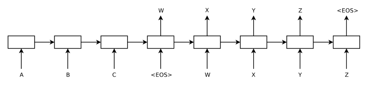
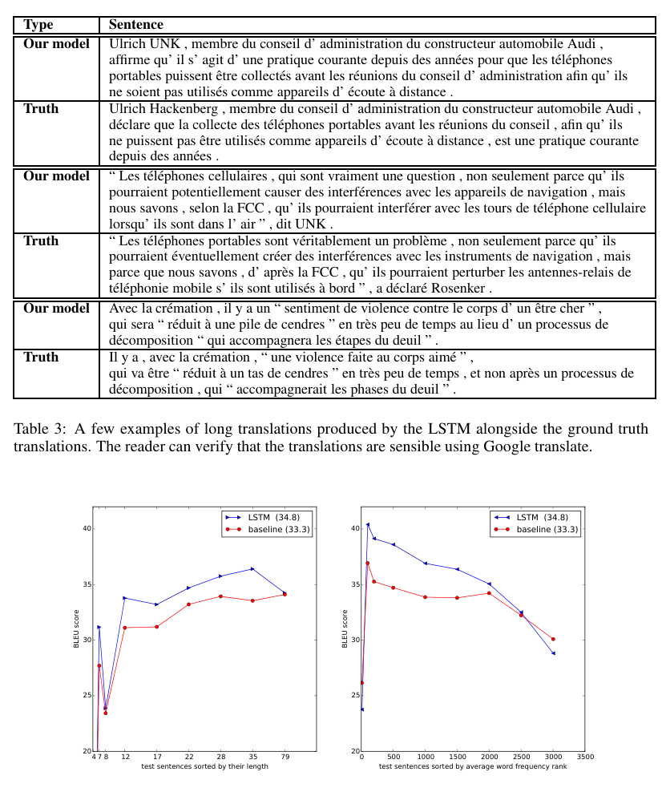
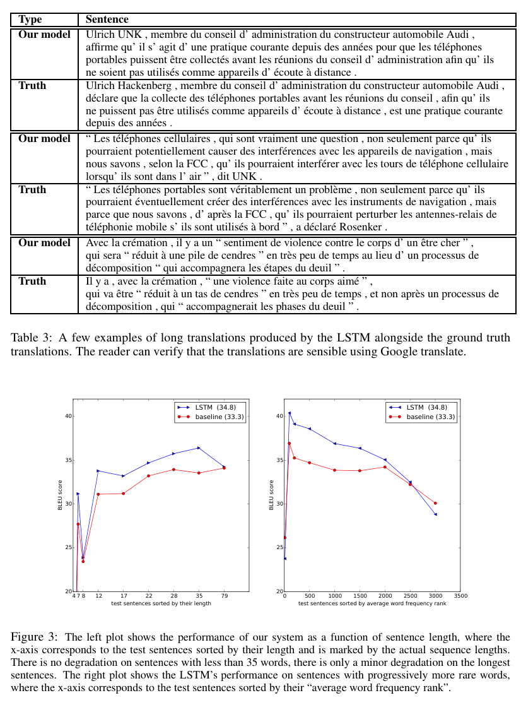

# 用神经网络做序列到序列学习（Sequence to Sequence Learning with Neural Networks）

- **作者**：Ilya Sutskever（Google, ilyasu@google.com）、Oriol Vinyals（Google, vinyals@google.com）、Quoc V. Le（Google, qvl@google.com）
- **来源**：arXiv:1409.3215v3 [cs.CL]，2014 年 12 月 14 日
- **说明**：本文为全文双语对照翻译。每个段落先给出原文（**Original:**），再给出中文译文（**中文:**）。数学公式以 LaTeX 原样保留。图与表以块引用标注中文译名，原图见 paper.pdf 对应页码。参考文献部分整体保留原文。术语首次出现时以「中文译名（English）」形式标注，之后统一使用中文译名。

---

## Abstract（摘要）

**Original:**

Deep Neural Networks (DNNs) are powerful models that have achieved excellent performance on difficult learning tasks. Although DNNs work well whenever large labeled training sets are available, they cannot be used to map sequences to sequences. In this paper, we present a general end-to-end approach to sequence learning that makes minimal assumptions on the sequence structure. Our method uses a multilayered Long Short-Term Memory (LSTM) to map the input sequence to a vector of a fixed dimensionality, and then another deep LSTM to decode the target sequence from the vector. Our main result is that on an English to French translation task from the WMT'14 dataset, the translations produced by the LSTM achieve a BLEU score of 34.8 on the entire test set, where the LSTM's BLEU score was penalized on out-of-vocabulary words. Additionally, the LSTM did not have difficulty on long sentences. For comparison, a phrase-based SMT system achieves a BLEU score of 33.3 on the same dataset. When we used the LSTM to rerank the 1000 hypotheses produced by the aforementioned SMT system, its BLEU score increases to 36.5, which is close to the previous best result on this task. The LSTM also learned sensible phrase and sentence representations that are sensitive to word order and are relatively invariant to the active and the passive voice. Finally, we found that reversing the order of the words in all source sentences (but not target sentences) improved the LSTM's performance markedly, because doing so introduced many short term dependencies between the source and the target sentence which made the optimization problem easier.

**中文:**

深度神经网络（Deep Neural Networks, DNN）是强大的模型，在许多困难的学习任务上取得了出色的表现。尽管只要有大规模标注训练集可用，DNN 就能表现良好，但它们无法用于把序列映射到序列。本文中，我们提出一种通用的端到端序列学习方法，对序列结构只做最小限度的假设。我们的方法使用一个多层长短期记忆网络（Long Short-Term Memory, LSTM）把输入序列映射为一个固定维数的向量，再用另一个深层 LSTM 从这个向量解码出目标序列。我们的主要结果是：在 WMT'14 数据集的英法翻译任务上，LSTM 生成的译文在整个测试集上取得了 34.8 的 BLEU 分数，而且这一分数还因词表外（out-of-vocabulary）词而被扣分。此外，LSTM 在长句上没有遇到困难。作为对比，一个基于短语的 SMT 系统在同一数据集上的 BLEU 分数为 33.3。当我们用 LSTM 对前述 SMT 系统产生的 1000 个假设（hypothesis）进行重排序时，其 BLEU 分数提高到 36.5，接近该任务此前的最高结果。LSTM 还学到了合理的短语与句子表示，这些表示对词序敏感，并且对主动语态与被动语态相对不敏感。最后，我们发现反转所有源句（但不反转目标句）中的词序能显著提升 LSTM 的性能，因为这样做在源句与目标句之间引入了许多短期依赖，使优化问题变得更容易。

## 1 Introduction（引言）

**Original:**

Deep Neural Networks (DNNs) are extremely powerful machine learning models that achieve excellent performance on difficult problems such as speech recognition [13, 7] and visual object recognition [19, 6, 21, 20]. DNNs are powerful because they can perform arbitrary parallel computation for a modest number of steps. A surprising example of the power of DNNs is their ability to sort N N-bit numbers using only 2 hidden layers of quadratic size [27]. So, while neural networks are related to conventional statistical models, they learn an intricate computation. Furthermore, large DNNs can be trained with supervised backpropagation whenever the labeled training set has enough information to specify the network's parameters. Thus, if there exists a parameter setting of a large DNN that achieves good results (for example, because humans can solve the task very rapidly), supervised backpropagation will find these parameters and solve the problem.

**中文:**

深度神经网络（DNN）是极其强大的机器学习模型，在语音识别 [13, 7] 和视觉目标识别 [19, 6, 21, 20] 等困难问题上取得了出色的表现。DNN 之所以强大，是因为它们能用不多的计算步骤完成任意的并行计算。一个体现 DNN 强大能力的惊人例子是：只用 2 个平方规模的隐藏层，就能对 N 个 N 位数排序 [27]。因此，虽然神经网络与传统统计模型有关联，但它们学到的是精巧的计算。此外，只要标注训练集包含足够的信息来指定网络参数，大型 DNN 就可以用有监督的反向传播来训练。于是，只要存在某种能取得好结果的大型 DNN 参数设置（例如，因为人类能非常迅速地解决该任务），有监督的反向传播就能找到这些参数并解决问题。

**Original:**

Despite their flexibility and power, DNNs can only be applied to problems whose inputs and targets can be sensibly encoded with vectors of fixed dimensionality. It is a significant limitation, since many important problems are best expressed with sequences whose lengths are not known a-priori. For example, speech recognition and machine translation are sequential problems. Likewise, question answering can also be seen as mapping a sequence of words representing the question to a sequence of words representing the answer. It is therefore clear that a domain-independent method that learns to map sequences to sequences would be useful.

**中文:**

尽管 DNN 灵活而强大，它们只能应用于输入和目标都能合理地用固定维数向量编码的问题。这是一个显著的限制，因为许多重要问题最适合用长度事先未知的序列来表达。例如，语音识别和机器翻译就是序列问题。同样地，问答也可以看作把表示问题的一个词序列映射为表示答案的一个词序列。因此，一种与领域无关的、能学会把序列映射为序列的方法显然会很有用。

**Original:**

Sequences pose a challenge for DNNs because they require that the dimensionality of the inputs and outputs is known and fixed. In this paper, we show that a straightforward application of the Long Short-Term Memory (LSTM) architecture [16] can solve general sequence to sequence problems. The idea is to use one LSTM to read the input sequence, one timestep at a time, to obtain large fixed-dimensional vector representation, and then to use another LSTM to extract the output sequence from that vector (fig. 1). The second LSTM is essentially a recurrent neural network language model [28, 23, 30] except that it is conditioned on the input sequence. The LSTM's ability to successfully learn on data with long range temporal dependencies makes it a natural choice for this application due to the considerable time lag between the inputs and their corresponding outputs (fig. 1).

**中文:**

序列给 DNN 带来了挑战，因为 DNN 要求输入和输出的维数是已知且固定的。本文中，我们证明直接应用长短期记忆网络（LSTM）架构 [16] 就能解决一般的序列到序列问题。其思路是：用一个 LSTM 逐时间步读取输入序列，得到一个大的固定维数向量表示，然后用另一个 LSTM 从这个向量中提取出输出序列（图 1）。第二个 LSTM 本质上是一个循环神经网络语言模型 [28, 23, 30]，只是它以输入序列为条件。由于输入与其对应输出之间存在相当大的时间滞后，LSTM 能够成功学习具有长程时间依赖数据的能力，使它成为这一应用的自然选择（图 1）。

**Original:**

There have been a number of related attempts to address the general sequence to sequence learning problem with neural networks. Our approach is closely related to Kalchbrenner and Blunsom [18] who were the first to map the entire input sentence to vector, and is related to Cho et al. [5] although the latter was used only for rescoring hypotheses produced by a phrase-based system. Graves [10] introduced a novel differentiable attention mechanism that allows neural networks to focus on different parts of their input, and an elegant variant of this idea was successfully applied to machine translation by Bahdanau et al. [2]. The Connectionist Sequence Classification is another popular technique for mapping sequences to sequences with neural networks, but it assumes a monotonic alignment between the inputs and the outputs [11].

**中文:**

此前已有若干相关工作试图用神经网络解决一般的序列到序列学习问题。我们的方法与前人工作密切相关：Kalchbrenner 和 Blunsom [18] 最早把整个输入句子映射为向量；也与 Cho et al. [5] 相关，尽管后者只用于对基于短语的系统产生的假设进行重打分（rescore）。Graves [10] 提出了一种新颖的可微注意力机制，使神经网络能聚焦于输入的不同部分，Bahdanau et al. [2] 又把这一思想的一个优雅变体成功应用于机器翻译。联结主义序列分类（Connectionist Sequence Classification）[译注：原文如此，通常指 Graves 等人提出的联结主义时序分类（Connectionist Temporal Classification, CTC），引文 [11] 即 CTC 论文。] 是另一种用神经网络把序列映射为序列的流行技术，但它假设输入与输出之间存在单调对齐 [11]。

> **图 1（译）**：我们的模型读取输入句子 "ABC"，产生输出句子 "WXYZ"。模型在输出句末标记后停止预测。注意 LSTM 是倒序读取输入句子的，因为这样做会在数据中引入许多短期依赖，使优化问题容易得多。（原图见 paper.pdf 第 2 页，见下方图）

**Original:**

The main result of this work is the following. On the WMT'14 English to French translation task, we obtained a BLEU score of 34.81 by directly extracting translations from an ensemble of 5 deep LSTMs (with 384M parameters and 8,000 dimensional state each) using a simple left-to-right beam-search decoder. This is by far the best result achieved by direct translation with large neural networks. For comparison, the BLEU score of an SMT baseline on this dataset is 33.30 [29]. The 34.81 BLEU score was achieved by an LSTM with a vocabulary of 80k words, so the score was penalized whenever the reference translation contained a word not covered by these 80k. This result shows that a relatively unoptimized small-vocabulary neural network architecture which has much room for improvement outperforms a phrase-based SMT system.

**中文:**

本文的主要结果如下。在 WMT'14 英法翻译任务上，我们用一个简单的从左到右束搜索解码器，从 5 个深层 LSTM 的集成（每个 LSTM 有 3.84 亿参数和 8000 维状态）中直接提取译文，取得了 34.81 的 BLEU 分数。这是迄今用大型神经网络直接翻译所取得的最好结果。作为对比，该数据集上 SMT 基线的 BLEU 分数是 33.30 [29]。34.81 的 BLEU 分数是由一个词表为 8 万词的 LSTM 取得的，因此只要参考译文包含这 8 万词之外的词，分数就会被扣分。这一结果表明：一个相对未经优化、词表较小、仍有很大改进空间的神经网络架构，就超过了基于短语的 SMT 系统。

**Original:**

Finally, we used the LSTM to rescore the publicly available 1000-best lists of the SMT baseline on the same task [29]. By doing so, we obtained a BLEU score of 36.5, which improves the baseline by 3.2 BLEU points and is close to the previous best published result on this task (which is 37.0 [9]). Surprisingly, the LSTM did not suffer on very long sentences, despite the recent experience of other researchers with related architectures [26]. We were able to do well on long sentences because we reversed the order of words in the source sentence but not the target sentences in the training and test set. By doing so, we introduced many short term dependencies that made the optimization problem much simpler (see sec. 2 and 3.3). As a result, SGD could learn LSTMs that had no trouble with long sentences. The simple trick of reversing the words in the source sentence is one of the key technical contributions of this work.

**中文:**

最后，我们用 LSTM 对同一任务上公开可得的 SMT 基线 1000-best 列表进行重打分 [29]。这样做我们取得了 36.5 的 BLEU 分数，比基线提高了 3.2 个 BLEU 点，接近该任务此前公开发表的最好结果（37.0 [9]）。令人惊讶的是，尽管其他研究者最近在相关架构上遇到了困难 [26]，LSTM 在很长的句子上并没有表现不佳。我们能在长句上表现良好，是因为我们在训练集和测试集中反转了源句中的词序、但不反转目标句。这样做引入了许多短期依赖，使优化问题大为简化（见第 2 节与 3.3 节）。因此，随机梯度下降（SGD）能训练出对长句毫无困难的 LSTM。反转源句中词序这一简单技巧，是本文的关键技术贡献之一。

**Original:**

A useful property of the LSTM is that it learns to map an input sentence of variable length into a fixed-dimensional vector representation. Given that translations tend to be paraphrases of the source sentences, the translation objective encourages the LSTM to find sentence representations that capture their meaning, as sentences with similar meanings are close to each other while different sentences meanings will be far. A qualitative evaluation supports this claim, showing that our model is aware of word order and is fairly invariant to the active and passive voice.

**中文:**

LSTM 的一个有用的性质是：它能学会把变长的输入句子映射为固定维数的向量表示。鉴于译文往往是源句的改写（paraphrase），翻译目标会促使 LSTM 去寻找能够捕捉句子含义的句子表示——含义相近的句子彼此靠近，含义不同的句子则相距较远。定性评估支持了这一论断，表明我们的模型对词序有感知，并且对主动语态与被动语态相当不敏感。

## 2 The model（模型）

**Original:**

The Recurrent Neural Network (RNN) [31, 28] is a natural generalization of feedforward neural networks to sequences. Given a sequence of inputs $(x_1, \ldots, x_T)$, a standard RNN computes a sequence of outputs $(y_1, \ldots, y_T)$ by iterating the following equation:

$$h_t = \mathrm{sigm}\left(W^{hx} x_t + W^{hh} h_{t-1}\right)$$

$$y_t = W^{yh} h_t$$

**中文:**

循环神经网络（Recurrent Neural Network, RNN）[31, 28] 是前馈神经网络向序列的自然推广。给定一个输入序列 $(x_1, \ldots, x_T)$，标准 RNN 通过迭代以下公式计算输出序列 $(y_1, \ldots, y_T)$：

（公式同上，不译）

**Original:**

The RNN can easily map sequences to sequences whenever the alignment between the inputs the outputs is known ahead of time. However, it is not clear how to apply an RNN to problems whose input and the output sequences have different lengths with complicated and non-monotonic relationships.

**中文:**

只要输入与输出之间的对齐方式是事先已知的，RNN 就能轻松地把序列映射为序列。然而，对于输入和输出序列长度不同、且关系复杂而非单调的问题，如何应用 RNN 并不清楚。

**Original:**

The simplest strategy for general sequence learning is to map the input sequence to a fixed-sized vector using one RNN, and then to map the vector to the target sequence with another RNN (this approach has also been taken by Cho et al. [5]). While it could work in principle since the RNN is provided with all the relevant information, it would be difficult to train the RNNs due to the resulting long term dependencies (figure 1) [14, 4, 16, 15]. However, the Long Short-Term Memory (LSTM) [16] is known to learn problems with long range temporal dependencies, so an LSTM may succeed in this setting.

**中文:**

一般序列学习的最简单策略是：用一个 RNN 把输入序列映射为固定大小的向量，再用另一个 RNN 把这个向量映射为目标序列（Cho et al. [5] 也采用了这一做法）。尽管由于 RNN 获得了全部相关信息，这一做法原则上可行，但由此产生的长期依赖会使 RNN 难以训练（图 1）[14, 4, 16, 15]。不过，长短期记忆网络（LSTM）[16] 以能够学习长程时间依赖问题而著称，因此 LSTM 在这一设定下可能取得成功。

**Original:**

The goal of the LSTM is to estimate the conditional probability $p(y_1, \ldots, y_{T'} \mid x_1, \ldots, x_T)$ where $(x_1, \ldots, x_T)$ is an input sequence and $y_1, \ldots, y_{T'}$ is its corresponding output sequence whose length $T'$ may differ from $T$. The LSTM computes this conditional probability by first obtaining the fixed-dimensional representation $v$ of the input sequence $(x_1, \ldots, x_T)$ given by the last hidden state of the LSTM, and then computing the probability of $y_1, \ldots, y_{T'}$ with a standard LSTM-LM formulation whose initial hidden state is set to the representation $v$ of $x_1, \ldots, x_T$:

$$p(y_1, \ldots, y_{T'} \mid x_1, \ldots, x_T) = \prod_{t=1}^{T'} p(y_t \mid v, y_1, \ldots, y_{t-1}) \tag{1}$$

**中文:**

LSTM 的目标是估计条件概率 $p(y_1, \ldots, y_{T'} \mid x_1, \ldots, x_T)$，其中 $(x_1, \ldots, x_T)$ 是输入序列，$y_1, \ldots, y_{T'}$ 是其对应的输出序列，输出长度 $T'$ 可以与 $T$ 不同。LSTM 计算这一条件概率的方式是：先由 LSTM 的最后一个隐藏状态得到输入序列 $(x_1, \ldots, x_T)$ 的固定维数表示 $v$，然后用标准的 LSTM-LM 公式计算 $y_1, \ldots, y_{T'}$ 的概率，其初始隐藏状态设为 $x_1, \ldots, x_T$ 的表示 $v$：

（公式 (1) 同上，不译）

**Original:**

In this equation, each $p(y_t \mid v, y_1, \ldots, y_{t-1})$ distribution is represented with a softmax over all the words in the vocabulary. We use the LSTM formulation from Graves [10]. Note that we require that each sentence ends with a special end-of-sentence symbol "&lt;EOS&gt;", which enables the model to define a distribution over sequences of all possible lengths. The overall scheme is outlined in figure 1, where the shown LSTM computes the representation of "A", "B", "C", "&lt;EOS&gt;" and then uses this representation to compute the probability of "W", "X", "Y", "Z", "&lt;EOS&gt;".

**中文:**

在该公式中，每个 $p(y_t \mid v, y_1, \ldots, y_{t-1})$ 分布都用词表中所有词上的 Softmax 来表示。我们采用 Graves [10] 的 LSTM 公式。注意，我们要求每个句子以特殊的句末符号 "&lt;EOS&gt;" 结尾，这使模型能够在所有可能长度的序列上定义分布。整体方案如图 1 所示，其中所示的 LSTM 先计算 "A"、"B"、"C"、"&lt;EOS&gt;" 的表示，再用这个表示计算 "W"、"X"、"Y"、"Z"、"&lt;EOS&gt;" 的概率。

**Original:**

Our actual models differ from the above description in three important ways. First, we used two different LSTMs: one for the input sequence and another for the output sequence, because doing so increases the number model parameters at negligible computational cost and makes it natural to train the LSTM on multiple language pairs simultaneously [18]. Second, we found that deep LSTMs significantly outperformed shallow LSTMs, so we chose an LSTM with four layers. Third, we found it extremely valuable to reverse the order of the words of the input sentence. So for example, instead of mapping the sentence a, b, c to the sentence α, β, γ, the LSTM is asked to map c, b, a to α, β, γ, where α, β, γ is the translation of a, b, c. This way, a is in close proximity to α, b is fairly close to β, and so on, a fact that makes it easy for SGD to "establish communication" between the input and the output. We found this simple data transformation to greatly improve the performance of the LSTM.

**中文:**

我们的实际模型与上述描述有三点重要区别。第一，我们使用了两个不同的 LSTM：一个用于输入序列，另一个用于输出序列。因为这样做以可忽略的计算代价增加了模型参数数量，并且便于在多语言对上同时训练 LSTM [18]。第二，我们发现深层 LSTM 明显优于浅层 LSTM，因此选择了四层的 LSTM。第三，我们发现反转输入句子的词序极有价值。举例来说，不再让 LSTM 把句子 a, b, c 映射到句子 α, β, γ，而是要求它把 c, b, a 映射到 α, β, γ，其中 α, β, γ 是 a, b, c 的译文。这样，a 与 α 邻近，b 与 β 相当接近，依此类推，这一事实使 SGD 容易在输入与输出之间"建立联系"。我们发现这一简单的数据变换极大地提升了 LSTM 的性能。

## 3 Experiments（实验）

**Original:**

We applied our method to the WMT'14 English to French MT task in two ways. We used it to directly translate the input sentence without using a reference SMT system and we it to rescore the n-best lists of an SMT baseline. [译注：原文 "and we it to rescore" 疑为 "and we used it to rescore" 的笔误。] We report the accuracy of these translation methods, present sample translations, and visualize the resulting sentence representation.

**中文:**

我们用两种方式把方法应用于 WMT'14 英法机器翻译任务：一是用它直接翻译输入句子、不借助任何参考 SMT 系统；二是用它为 SMT 基线的 n-best 列表重打分。我们报告这些翻译方法的准确率，展示译文样例，并可视化所得的句子表示。

### 3.1 Dataset details（数据集细节）

**Original:**

We used the WMT'14 English to French dataset. We trained our models on a subset of 12M sentences consisting of 348M French words and 304M English words, which is a clean "selected" subset from [29]. We chose this translation task and this specific training set subset because of the public availability of a tokenized training and test set together with 1000-best lists from the baseline SMT [29].

**中文:**

我们使用了 WMT'14 英法数据集。我们在一个由 1200 万句组成的子集上训练模型，该子集包含 3.48 亿法语词和 3.04 亿英语词，是 [29] 中一个干净的"筛选"子集。我们选择这一翻译任务和这个特定的训练子集，是因为其分词后的训练集和测试集以及基线 SMT 的 1000-best 列表都是公开可得的 [29]。

**Original:**

As typical neural language models rely on a vector representation for each word, we used a fixed vocabulary for both languages. We used 160,000 of the most frequent words for the source language and 80,000 of the most frequent words for the target language. Every out-of-vocabulary word was replaced with a special "UNK" token.

**中文:**

由于典型的神经语言模型依赖每个词的向量表示，我们为两种语言都使用了固定词表：源语言取最频繁的 16 万个词，目标语言取最频繁的 8 万个词。每个词表外词都被替换为特殊的 "UNK" 标记。

### 3.2 Decoding and Rescoring（解码与重打分）

**Original:**

The core of our experiments involved training a large deep LSTM on many sentence pairs. We trained it by maximizing the log probability of a correct translation $T$ given the source sentence $S$, so the training objective is

$$\frac{1}{|\mathcal{S}|} \sum_{(T,S) \in \mathcal{S}} \log p(T \mid S)$$

where $\mathcal{S}$ is the training set. Once training is complete, we produce translations by finding the most likely translation according to the LSTM:

$$\hat{T} = \arg\max_T \, p(T \mid S) \tag{2}$$

**中文:**

我们实验的核心是在大量句对上训练一个大型深层 LSTM。训练方式是：给定源句 $S$，最大化正确译文 $T$ 的对数概率，因此训练目标是

（公式同上，不译）

其中 $\mathcal{S}$ 是训练集。训练完成后，我们通过寻找 LSTM 认为最可能的译文来生成翻译：

（公式 (2) 同上，不译）

**Original:**

We search for the most likely translation using a simple left-to-right beam search decoder which maintains a small number $B$ of partial hypotheses, where a partial hypothesis is a prefix of some translation. At each timestep we extend each partial hypothesis in the beam with every possible word in the vocabulary. This greatly increases the number of the hypotheses so we discard all but the $B$ most likely hypotheses according to the model's log probability. As soon as the "&lt;EOS&gt;" symbol is appended to a hypothesis, it is removed from the beam and is added to the set of complete hypotheses. While this decoder is approximate, it is simple to implement. Interestingly, our system performs well even with a beam size of 1, and a beam of size 2 provides most of the benefits of beam search (Table 1).

**中文:**

我们用简单的从左到右束搜索解码器搜索最可能的译文。该解码器维护数量为 $B$ 的部分假设，其中部分假设是某个译文的前缀。每个时间步，我们用词表中的每个可能的词扩展束中的每个部分假设。这使假设数量大增，因此我们只保留模型的数概率下最可能的 $B$ 个假设，其余全部丢弃。一旦 "&lt;EOS&gt;" 符号被追加到某个假设上，该假设就从束中移除，并加入完整假设集合。虽然这个解码器是近似的，但实现简单。有趣的是，我们的系统即使束宽为 1 也表现良好，而束宽为 2 就能获得束搜索的大部分收益（表 1）。

**Original:**

We also used the LSTM to rescore the 1000-best lists produced by the baseline system [29]. To rescore an n-best list, we computed the log probability of every hypothesis with our LSTM and took an even average with their score and the LSTM's score.

**中文:**

我们还用 LSTM 为基线系统 [29] 产生的 1000-best 列表重打分。对 n-best 列表重打分时，我们用 LSTM 计算每个假设的对数概率，并把其自身分数与 LSTM 分数做等权平均。

### 3.3 Reversing the Source Sentences（反转源句）

**Original:**

While the LSTM is capable of solving problems with long term dependencies, we discovered that the LSTM learns much better when the source sentences are reversed (the target sentences are not reversed). By doing so, the LSTM's test perplexity dropped from 5.8 to 4.7, and the test BLEU scores of its decoded translations increased from 25.9 to 30.6.

**中文:**

虽然 LSTM 有能力解决带有长期依赖的问题，但我们发现，当源句被反转（目标句不反转）时，LSTM 学得要好得多。这样做后，LSTM 的测试困惑度从 5.8 降到 4.7，其解码译文的测试 BLEU 分数从 25.9 提高到 30.6。

**Original:**

While we do not have a complete explanation to this phenomenon, we believe that it is caused by the introduction of many short term dependencies to the dataset. Normally, when we concatenate a source sentence with a target sentence, each word in the source sentence is far from its corresponding word in the target sentence. As a result, the problem has a large "minimal time lag" [17]. By reversing the words in the source sentence, the average distance between corresponding words in the source and target language is unchanged. However, the first few words in the source language are now very close to the first few words in the target language, so the problem's minimal time lag is greatly reduced. Thus, backpropagation has an easier time "establishing communication" between the source sentence and the target sentence, which in turn results in substantially improved overall performance.

**中文:**

虽然我们对这一现象没有完整的解释，但我们相信它源于数据集中引入了许多短期依赖。通常，当我们把源句与目标句拼接起来时，源句中的每个词都远离目标句中与之对应的词。结果，问题具有很大的"最小时滞"（minimal time lag）[17]。反转源句中的词序后，源语言与目标语言中对应词之间的平均距离不变；然而，源语言开头的几个词现在与目标语言开头的几个词非常接近，因此问题的最小时滞大大减小。于是，反向传播更容易在源句与目标句之间"建立联系"，进而使整体性能显著提升。

**Original:**

Initially, we believed that reversing the input sentences would only lead to more confident predictions in the early parts of the target sentence and to less confident predictions in the later parts. However, LSTMs trained on reversed source sentences did much better on long sentences than LSTMs trained on the raw source sentences (see sec. 3.7), which suggests that reversing the input sentences results in LSTMs with better memory utilization.

**中文:**

起初，我们以为反转输入句子只会让目标句前部的预测更自信、后部的预测更不自信。然而，在反转源句上训练的 LSTM 在长句上的表现远好于在原始源句上训练的 LSTM（见 3.7 节），这表明反转输入句子使 LSTM 的记忆利用率更高。

### 3.4 Training details（训练细节）

**Original:**

We found that the LSTM models are fairly easy to train. We used deep LSTMs with 4 layers, with 1000 cells at each layer and 1000 dimensional word embeddings, with an input vocabulary of 160,000 and an output vocabulary of 80,000. Thus the deep LSTM uses 8000 real numbers to represent a sentence. We found deep LSTMs to significantly outperform shallow LSTMs, where each additional layer reduced perplexity by nearly 10%, possibly due to their much larger hidden state. We used a naive softmax over 80,000 words at each output. The resulting LSTM has 384M parameters of which 64M are pure recurrent connections (32M for the "encoder" LSTM and 32M for the "decoder" LSTM). The complete training details are given below:

**中文:**

我们发现 LSTM 模型相当容易训练。我们使用了 4 层的深层 LSTM，每层 1000 个单元、1000 维词嵌入，输入词表 16 万词、输出词表 8 万词。因此，深层 LSTM 用 8000 个实数来表示一个句子。我们发现深层 LSTM 明显优于浅层 LSTM，每增加一层，困惑度就降低近 10%，这可能是因为其隐藏状态大得多。我们在每个输出上使用覆盖 8 万词的朴素 Softmax。得到的 LSTM 有 3.84 亿参数，其中 6400 万是纯循环连接（"编码器" LSTM 3200 万、"解码器" LSTM 3200 万）。完整的训练细节如下：

**Original:**

- We initialized all of the LSTM's parameters with the uniform distribution between -0.08 and 0.08
- We used stochastic gradient descent without momentum, with a fixed learning rate of 0.7. After 5 epochs, we begun halving the learning rate every half epoch. We trained our models for a total of 7.5 epochs.
- We used batches of 128 sequences for the gradient and divided it the size of the batch (namely, 128). [译注：原文 "divided it the size" 疑为 "divided it by the size" 的笔误。]
- Although LSTMs tend to not suffer from the vanishing gradient problem, they can have exploding gradients. Thus we enforced a hard constraint on the norm of the gradient [10, 25] by scaling it when its norm exceeded a threshold. For each training batch, we compute $s = \lVert g \rVert_2$, where $g$ is the gradient divided by 128. If $s > 5$, we set $g = \frac{5g}{s}$.
- Different sentences have different lengths. Most sentences are short (e.g., length 20-30) but some sentences are long (e.g., length > 100), so a minibatch of 128 randomly chosen training sentences will have many short sentences and few long sentences, and as a result, much of the computation in the minibatch is wasted. To address this problem, we made sure that all sentences in a minibatch are roughly of the same length, yielding a 2x speedup.

**中文:**

- 我们用 -0.08 到 0.08 之间的均匀分布初始化 LSTM 的所有参数。
- 我们使用无动量的随机梯度下降，学习率固定为 0.7。5 个轮次（epoch）之后，每过半个轮次就把学习率减半。模型总共训练 7.5 个轮次。
- 我们以 128 个序列为一批计算梯度，并用批次大小（即 128）去除。[译注：原文 "divided it the size" 疑为 "divided it by the size" 的笔误。]
- 虽然 LSTM 往往不受梯度消失问题的困扰，但它们可能出现梯度爆炸。因此我们对梯度范数施加硬约束 [10, 25]：当梯度范数超过阈值时对其缩放。对每个训练批次，我们计算 $s = \lVert g \rVert_2$，其中 $g$ 是除以 128 之后的梯度。若 $s > 5$，则令 $g = \frac{5g}{s}$。
- 不同句子长度不同。大多数句子很短（例如长度 20-30），但有些句子很长（例如长度 > 100），因此由 128 个随机选取的训练句组成的小批量会包含许多短句和少量长句，导致小批量中大量计算被浪费。为解决这个问题，我们确保小批量中的所有句子长度大致相同，从而获得了 2 倍加速。

### 3.5 Parallelization（并行化）

**Original:**

A C++ implementation of deep LSTM with the configuration from the previous section on a single GPU processes a speed of approximately 1,700 words per second. This was too slow for our purposes, so we parallelized our model using an 8-GPU machine. Each layer of the LSTM was executed on a different GPU and communicated its activations to the next GPU / layer as soon as they were computed. Our models have 4 layers of LSTMs, each of which resides on a separate GPU. The remaining 4 GPUs were used to parallelize the softmax, so each GPU was responsible for multiplying by a 1000 × 20000 matrix. The resulting implementation achieved a speed of 6,300 (both English and French) words per second with a minibatch size of 128. Training took about a ten days with this implementation. [译注：原文 "about a ten days" 疑为 "about ten days" 的笔误。]

**中文:**

采用上一节配置的深层 LSTM 的 C++ 实现，在单个 GPU 上的处理速度约为每秒 1700 词。这对我们的目的来说太慢了，因此我们用一台 8-GPU 机器对模型做了并行化。LSTM 的每一层在不同 GPU 上执行，激活值一计算出来就传给下一个 GPU / 层。我们的模型有 4 层 LSTM，每层驻留在一个单独的 GPU 上。其余 4 个 GPU 用于并行化 Softmax，每个 GPU 负责一个 1000 × 20000 矩阵的乘法。最终实现在小批量大小为 128 时达到了每秒 6300 词（英法两种语言合计）的速度。用这个实现训练大约花了十天。[译注：原文 "about a ten days" 疑为 "about ten days" 的笔误。]

### 3.6 Experimental Results（实验结果）

**Original:**

We used the cased BLEU score [24] to evaluate the quality of our translations. We computed our BLEU scores using multi-bleu.pl¹ on the tokenized predictions and ground truth. This way of evaluating the BELU score is consistent with [5] and [2], and reproduces the 33.3 score of [29]. However, if we evaluate the best WMT'14 system [9] (whose predictions can be downloaded from statmt.org\matrix) in this manner, we get 37.0, which is greater than the 35.8 reported by statmt.org\matrix.

¹ There several variants of the BLEU score, and each variant is defined with a perl script. [译注：原文 "There several variants" 疑为 "There are several variants" 的笔误。]

**中文:**

我们用区分大小写的 BLEU 分数（cased BLEU score）[24] 评估译文质量。我们用 multi-bleu.pl¹ 在分词后的预测结果和参考译文上计算 BLEU 分数。这种评估方式与 [5] 和 [2] 一致，并能复现 [29] 的 33.3 分。然而，如果用同样的方式评估 WMT'14 最好的系统 [9]（其预测结果可从 statmt.org\matrix 下载），我们得到 37.0 分，高于 statmt.org\matrix 报告的 35.8 分。

¹ BLEU 分数有若干变体，每个变体都由一个 perl 脚本定义。[译注：原文 "There several variants" 疑为 "There are several variants" 的笔误。]

**Original:**

The results are presented in tables 1 and 2. Our best results are obtained with an ensemble of LSTMs that differ in their random initializations and in the random order of minibatches. While the decoded translations of the LSTM ensemble do not outperform the best WMT'14 system, it is the first time that a pure neural translation system outperforms a phrase-based SMT baseline on a large scale MT task by a sizeable margin, despite its inability to handle out-of-vocabulary words. The LSTM is within 0.5 BLEU points of the best WMT'14 result if it is used to rescore the 1000-best list of the baseline system.

**中文:**

结果见表 1 和表 2。我们最好的结果由 LSTM 集成取得，这些 LSTM 在随机初始化和小批量的随机顺序上各不相同。虽然 LSTM 集成解码出的译文没有超过 WMT'14 最好的系统，但这是纯神经翻译系统首次在大规模机器翻译任务上以可观优势超过基于短语的 SMT 基线——尽管它无法处理词表外词。若用 LSTM 为基线系统的 1000-best 列表重打分，它与 WMT'14 最好结果的差距在 0.5 个 BLEU 点以内。

> **表 1（译）**：LSTM 在 WMT'14 英法测试集（ntst14）上的表现。注意，5 个 LSTM 的集成配合束宽 2，比单个 LSTM 配合束宽 12 更省算力。（原图见 paper.pdf 第 6 页，见下方图）

| Method（方法） | test BLEU score (ntst14) |
|---|---|
| Bahdanau et al. [2] | 28.45 |
| Baseline System [29] | 33.30 |
| Single forward LSTM, beam size 12 | 26.17 |
| Single reversed LSTM, beam size 12 | 30.59 |
| Ensemble of 5 reversed LSTMs, beam size 1 | 33.00 |
| Ensemble of 2 reversed LSTMs, beam size 12 | 33.27 |
| Ensemble of 5 reversed LSTMs, beam size 2 | 34.50 |
| Ensemble of 5 reversed LSTMs, beam size 12 | 34.81 |

> **表 2（译）**：在 WMT'14 英法测试集（ntst14）上把神经网络与 SMT 系统结合使用的方法。（原图见 paper.pdf 第 6 页，[第 6 页图](assets/figures/tab-2.png)）

| Method（方法） | test BLEU score (ntst14) |
|---|---|
| Baseline System [29] | 33.30 |
| Cho et al. [5] | 34.54 |
| Best WMT'14 result [9] | 37.0 |
| Rescoring the baseline 1000-best with a single forward LSTM | 35.61 |
| Rescoring the baseline 1000-best with a single reversed LSTM | 35.85 |
| Rescoring the baseline 1000-best with an ensemble of 5 reversed LSTMs | 36.5 |
| Oracle Rescoring of the Baseline 1000-best lists | ∼45 |

### 3.7 Performance on long sentences（长句上的表现）

**Original:**

We were surprised to discover that the LSTM did well on long sentences, which is shown quantitatively in figure 3. Table 3 presents several examples of long sentences and their translations.

**中文:**

我们惊讶地发现 LSTM 在长句上表现良好，图 3 定量展示了这一点。表 3 给出了几个长句及其译文的例子。

### 3.8 Model Analysis（模型分析）

> **图 2（译）**：该图展示了 LSTM 处理图中短语后所得隐藏状态的二维主成分分析（PCA）投影。短语按含义聚集；在这些例子中，含义主要由词序决定，这是词袋（bag-of-words）模型难以捕捉的。注意两个簇具有相似的内部结构。（原图见 paper.pdf 第 6 页，[第 6 页图](assets/figures/fig-2.png)）

**Original:**

One of the attractive features of our model is its ability to turn a sequence of words into a vector of fixed dimensionality. Figure 2 visualizes some of the learned representations. The figure clearly shows that the representations are sensitive to the order of words, while being fairly insensitive to the replacement of an active voice with a passive voice. The two-dimensional projections are obtained using PCA.

**中文:**

我们模型的一个吸引人的特点是：它能把词序列转化为固定维数的向量。图 2 可视化了一些学到的表示。该图清楚地表明，这些表示对词序敏感，而对主动语态替换为被动语态相当不敏感。二维投影由主成分分析（PCA）得到。

> **表 3（译）**：LSTM 生成的几个长句译文示例，与参考译文（ground truth）并列。读者可以用 Google Translate 验证这些译文是通顺的。（原图见 paper.pdf 第 7 页，见下方图）

>
> [译注：表中为英法翻译任务的语料例句（法语），作为数据整体保留原文不译。]

| Type（类型） | Sentence（句子） |
|---|---|
| Our model | Ulrich UNK, membre du conseil d'administration du constructeur automobile Audi, affirme qu'il s'agit d'une pratique courante depuis des années pour que les téléphones portables puissent être collectés avant les réunions du conseil d'administration afin qu'ils ne soient pas utilisés comme appareils d'écoute à distance. |
| Truth | Ulrich Hackenberg, membre du conseil d'administration du constructeur automobile Audi, déclare que la collecte des téléphones portables avant les réunions du conseil, afin qu'ils ne puissent pas être utilisés comme appareils d'écoute à distance, est une pratique courante depuis des années. |
| Our model | "Les téléphones cellulaires, qui sont vraiment une question, non seulement parce qu'ils pourraient potentiellement causer des interférences avec les appareils de navigation, mais nous savons, selon la FCC, qu'ils pourraient interférer avec les tours de téléphone cellulaire lorsqu'ils sont dans l'air", dit UNK. |
| Truth | "Les téléphones portables sont véritablement un problème, non seulement parce qu'ils pourraient éventuellement créer des interférences avec les instruments de navigation, mais parce que nous savons, d'après la FCC, qu'ils pourraient perturber les antennes-relais de téléphonie mobile s'ils sont utilisés à bord", a déclaré Rosenker. |
| Our model | Avec la crémation, il y a un "sentiment de violence contre le corps d'un être cher", qui sera "réduit à une pile de cendres" en très peu de temps au lieu d'un processus de décomposition "qui accompagnera les étapes du deuil". |
| Truth | Il y a, avec la crémation, "une violence faite au corps aimé", qui va être "réduit à un tas de cendres" en très peu de temps, et non après un processus de décomposition, qui "accompagnerait les phases du deuil". |

> **图 3（译）**：左图展示了我们系统随句子长度的表现，x 轴对应按长度排序的测试句子，并用实际序列长度标出。少于 35 词的句子上没有性能下降，最长的句子上也只有轻微下降。右图展示了 LSTM 在越来越罕见的词上的表现，x 轴对应按"平均词频排名"排序的测试句子。（原图见 paper.pdf 第 7 页，[第 7 页图](assets/figures/fig-3.png)）

## 4 Related work（相关工作）

**Original:**

There is a large body of work on applications of neural networks to machine translation. So far, the simplest and most effective way of applying an RNN-Language Model (RNNLM) [23] or a Feedforward Neural Network Language Model (NNLM) [3] to an MT task is by rescoring the n-best lists of a strong MT baseline [22], which reliably improves translation quality.

**中文:**

关于神经网络在机器翻译中的应用已有大量工作。到目前为止，把循环神经网络语言模型（RNN-Language Model, RNNLM）[23] 或前馈神经网络语言模型（Feedforward Neural Network Language Model, NNLM）[3] 应用于机器翻译任务最简单、最有效的方式，是为强大 MT 基线的 n-best 列表重打分 [22]，这能可靠地提升翻译质量。

**Original:**

More recently, researchers have begun to look into ways of including information about the source language into the NNLM. Examples of this work include Auli et al. [1], who combine an NNLM with a topic model of the input sentence, which improves rescoring performance. Devlin et al. [8] followed a similar approach, but they incorporated their NNLM into the decoder of an MT system and used the decoder's alignment information to provide the NNLM with the most useful words in the input sentence. Their approach was highly successful and it achieved large improvements over their baseline.

**中文:**

近来，研究者开始探索把源语言信息纳入 NNLM 的方法。此类工作的例子包括 Auli et al. [1]，他们把 NNLM 与输入句子的主题模型相结合，从而提升了重打分性能。Devlin et al. [8] 采用了类似的方法，但他们把 NNLM 整合进 MT 系统的解码器中，并利用解码器的对齐信息为 NNLM 提供输入句子中最有用的词。他们的方法非常成功，相对其基线取得了大幅提升。

**Original:**

Our work is closely related to Kalchbrenner and Blunsom [18], who were the first to map the input sentence into a vector and then back to a sentence, although they map sentences to vectors using convolutional neural networks, which lose the ordering of the words. Similarly to this work, Cho et al. [5] used an LSTM-like RNN architecture to map sentences into vectors and back, although their primary focus was on integrating their neural network into an SMT system. Bahdanau et al. [2] also attempted direct translations with a neural network that used an attention mechanism to overcome the poor performance on long sentences experienced by Cho et al. [5] and achieved encouraging results. Likewise, Pouget-Abadie et al. [26] attempted to address the memory problem of Cho et al. [5] by translating pieces of the source sentence in way that produces smooth translations, which is similar to a phrase-based approach. We suspect that they could achieve similar improvements by simply training their networks on reversed source sentences.

**中文:**

我们的工作与 Kalchbrenner 和 Blunsom [18] 密切相关，他们最早把输入句子映射为向量再映射回句子，尽管他们用卷积神经网络把句子映射为向量，而这会丢失词序信息。与本文类似，Cho et al. [5] 用类似 LSTM 的 RNN 架构把句子映射为向量再映射回去，尽管他们的主要关注点是把神经网络整合进 SMT 系统。Bahdanau et al. [2] 也尝试过用带注意力机制的神经网络直接翻译，以克服 Cho et al. [5] 在长句上的糟糕表现，并取得了令人鼓舞的结果。同样地，Pouget-Abadie et al. [26] 试图通过翻译源句的各个片段来生成流畅译文，以解决 Cho et al. [5] 的记忆问题，这类似于基于短语的方法。我们猜想，他们只要在反转的源句上训练网络，就能取得类似的提升。

**Original:**

End-to-end training is also the focus of Hermann et al. [12], whose model represents the inputs and outputs by feedforward networks, and map them to similar points in space. However, their approach cannot generate translations directly: to get a translation, they need to do a look up for closest vector in the pre-computed database of sentences, or to rescore a sentence.

**中文:**

端到端训练也是 Hermann et al. [12] 的关注点，他们的模型用前馈网络表示输入和输出，并把它们映射到空间中相近的点。然而，他们的方法不能直接生成译文：要得到译文，需要在预先计算好的句子数据库里查找最接近的向量，或者对句子重打分。

## 5 Conclusion（结论）

**Original:**

In this work, we showed that a large deep LSTM, that has a limited vocabulary and that makes almost no assumption about problem structure can outperform a standard SMT-based system whose vocabulary is unlimited on a large-scale MT task. The success of our simple LSTM-based approach on MT suggests that it should do well on many other sequence learning problems, provided they have enough training data.

**中文:**

在本文中，我们证明了：在大规模机器翻译任务上，一个词表有限、几乎不对问题结构做任何假设的大型深层 LSTM，可以超过词表不受限制的标准 SMT 系统。我们基于 LSTM 的简单方法在机器翻译上的成功表明，只要有足够的训练数据，它在许多其他序列学习问题上也应该表现出色。

**Original:**

We were surprised by the extent of the improvement obtained by reversing the words in the source sentences. We conclude that it is important to find a problem encoding that has the greatest number of short term dependencies, as they make the learning problem much simpler. In particular, while we were unable to train a standard RNN on the non-reversed translation problem (shown in fig. 1), we believe that a standard RNN should be easily trainable when the source sentences are reversed (although we did not verify it experimentally).

**中文:**

反转源句词序所带来的提升幅度令我们惊讶。我们得出的结论是：找到一种短期依赖最多的问題编码很重要，因为短期依赖能使学习问题大为简化。特别地，虽然我们无法在未反转的翻译问题上训练标准 RNN（如图 1 所示），但我们相信，当源句被反转时，标准 RNN 应当可以轻松训练（尽管我们没有通过实验验证这一点）。

**Original:**

We were also surprised by the ability of the LSTM to correctly translate very long sentences. We were initially convinced that the LSTM would fail on long sentences due to its limited memory, and other researchers reported poor performance on long sentences with a model similar to ours [5, 2, 26]. And yet, LSTMs trained on the reversed dataset had little difficulty translating long sentences.

**中文:**

LSTM 能正确翻译很长的句子，同样令我们惊讶。起初我们确信 LSTM 会因为记忆有限而在长句上失败，其他研究者也报告了与我们类似的模型在长句上的糟糕表现 [5, 2, 26]。然而，在反转数据集上训练的 LSTM 翻译长句几乎没有困难。

**Original:**

Most importantly, we demonstrated that a simple, straightforward and a relatively unoptimized approach can outperform an SMT system, so further work will likely lead to even greater translation accuracies. These results suggest that our approach will likely do well on other challenging sequence to sequence problems.

**中文:**

最重要的是，我们证明了：一个简单、直接、相对未经优化的方法就能超过 SMT 系统，因此进一步的工作很可能带来更高的翻译准确率。这些结果表明，我们的方法很可能在其他具有挑战性的序列到序列问题上也表现良好。

## 6 Acknowledgments（致谢）

**Original:**

We thank Samy Bengio, Jeff Dean, Matthieu Devin, Geoffrey Hinton, Nal Kalchbrenner, Thang Luong, Wolfgang Macherey, Rajat Monga, Vincent Vanhoucke, Peng Xu, Wojciech Zaremba, and the Google Brain team for useful comments and discussions.

**中文:**

我们感谢 Samy Bengio、Jeff Dean、Matthieu Devin、Geoffrey Hinton、Nal Kalchbrenner、Thang Luong、Wolfgang Macherey、Rajat Monga、Vincent Vanhoucke、Peng Xu、Wojciech Zaremba 以及 Google Brain 团队的有益评论与讨论。

## References（参考文献，原文保留不译）

[1] M. Auli, M. Galley, C. Quirk, and G. Zweig. Joint language and translation modeling with recurrent neural networks. In EMNLP, 2013.

[2] D. Bahdanau, K. Cho, and Y. Bengio. Neural machine translation by jointly learning to align and translate. arXiv preprint arXiv:1409.0473, 2014.

[3] Y. Bengio, R. Ducharme, P. Vincent, and C. Jauvin. A neural probabilistic language model. In Journal of Machine Learning Research, pages 1137–1155, 2003.

[4] Y. Bengio, P. Simard, and P. Frasconi. Learning long-term dependencies with gradient descent is difficult. IEEE Transactions on Neural Networks, 5(2):157–166, 1994.

[5] K. Cho, B. Merrienboer, C. Gulcehre, F. Bougares, H. Schwenk, and Y. Bengio. Learning phrase representations using RNN encoder-decoder for statistical machine translation. In Arxiv preprint arXiv:1406.1078, 2014.

[6] D. Ciresan, U. Meier, and J. Schmidhuber. Multi-column deep neural networks for image classification. In CVPR, 2012.

[7] G. E. Dahl, D. Yu, L. Deng, and A. Acero. Context-dependent pre-trained deep neural networks for large vocabulary speech recognition. IEEE Transactions on Audio, Speech, and Language Processing - Special Issue on Deep Learning for Speech and Language Processing, 2012.

[8] J. Devlin, R. Zbib, Z. Huang, T. Lamar, R. Schwartz, and J. Makhoul. Fast and robust neural network joint models for statistical machine translation. In ACL, 2014.

[9] Nadir Durrani, Barry Haddow, Philipp Koehn, and Kenneth Heafield. Edinburgh's phrase-based machine translation systems for wmt-14. In WMT, 2014.

[10] A. Graves. Generating sequences with recurrent neural networks. In Arxiv preprint arXiv:1308.0850, 2013.

[11] A. Graves, S. Fernández, F. Gomez, and J. Schmidhuber. Connectionist temporal classification: labelling unsegmented sequence data with recurrent neural networks. In ICML, 2006.

[12] K. M. Hermann and P. Blunsom. Multilingual distributed representations without word alignment. In ICLR, 2014.

[13] G. Hinton, L. Deng, D. Yu, G. Dahl, A. Mohamed, N. Jaitly, A. Senior, V. Vanhoucke, P. Nguyen, T. Sainath, and B. Kingsbury. Deep neural networks for acoustic modeling in speech recognition. IEEE Signal Processing Magazine, 2012.

[14] S. Hochreiter. Untersuchungen zu dynamischen neuronalen netzen. Master's thesis, Institut fur Informatik, Technische Universitat, Munchen, 1991.

[15] S. Hochreiter, Y. Bengio, P. Frasconi, and J. Schmidhuber. Gradient flow in recurrent nets: the difficulty of learning long-term dependencies, 2001.

[16] S. Hochreiter and J. Schmidhuber. Long short-term memory. Neural Computation, 1997.

[17] S. Hochreiter and J. Schmidhuber. LSTM can solve hard long time lag problems. 1997.

[18] N. Kalchbrenner and P. Blunsom. Recurrent continuous translation models. In EMNLP, 2013.

[19] A. Krizhevsky, I. Sutskever, and G. E. Hinton. ImageNet classification with deep convolutional neural networks. In NIPS, 2012.

[20] Q.V. Le, M.A. Ranzato, R. Monga, M. Devin, K. Chen, G.S. Corrado, J. Dean, and A.Y. Ng. Building high-level features using large scale unsupervised learning. In ICML, 2012.

[21] Y. LeCun, L. Bottou, Y. Bengio, and P. Haffner. Gradient-based learning applied to document recognition. Proceedings of the IEEE, 1998.

[22] T. Mikolov. Statistical Language Models based on Neural Networks. PhD thesis, Brno University of Technology, 2012.

[23] T. Mikolov, M. Karafiát, L. Burget, J. Cernocký, and S. Khudanpur. Recurrent neural network based language model. In INTERSPEECH, pages 1045–1048, 2010.

[24] K. Papineni, S. Roukos, T. Ward, and W. J. Zhu. BLEU: a method for automatic evaluation of machine translation. In ACL, 2002.

[25] R. Pascanu, T. Mikolov, and Y. Bengio. On the difficulty of training recurrent neural networks. arXiv preprint arXiv:1211.5063, 2012.

[26] J. Pouget-Abadie, D. Bahdanau, B. van Merrienboer, K. Cho, and Y. Bengio. Overcoming the curse of sentence length for neural machine translation using automatic segmentation. arXiv preprint arXiv:1409.1257, 2014.

[27] A. Razborov. On small depth threshold circuits. In Proc. 3rd Scandinavian Workshop on Algorithm Theory, 1992.

[28] D. Rumelhart, G. E. Hinton, and R. J. Williams. Learning representations by back-propagating errors. Nature, 323(6088):533–536, 1986.

[29] H. Schwenk. University le mans. http://www-lium.univ-lemans.fr/~schwenk/cslm_joint_paper/, 2014. [Online; accessed 03-September-2014].

[30] M. Sundermeyer, R. Schluter, and H. Ney. LSTM neural networks for language modeling. In INTERSPEECH, 2010.

[31] P. Werbos. Backpropagation through time: what it does and how to do it. Proceedings of IEEE, 1990.
