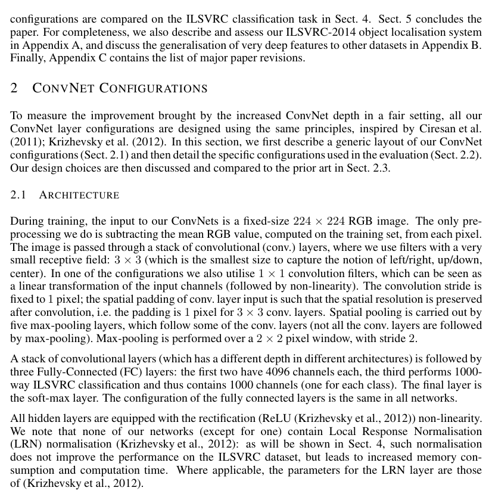
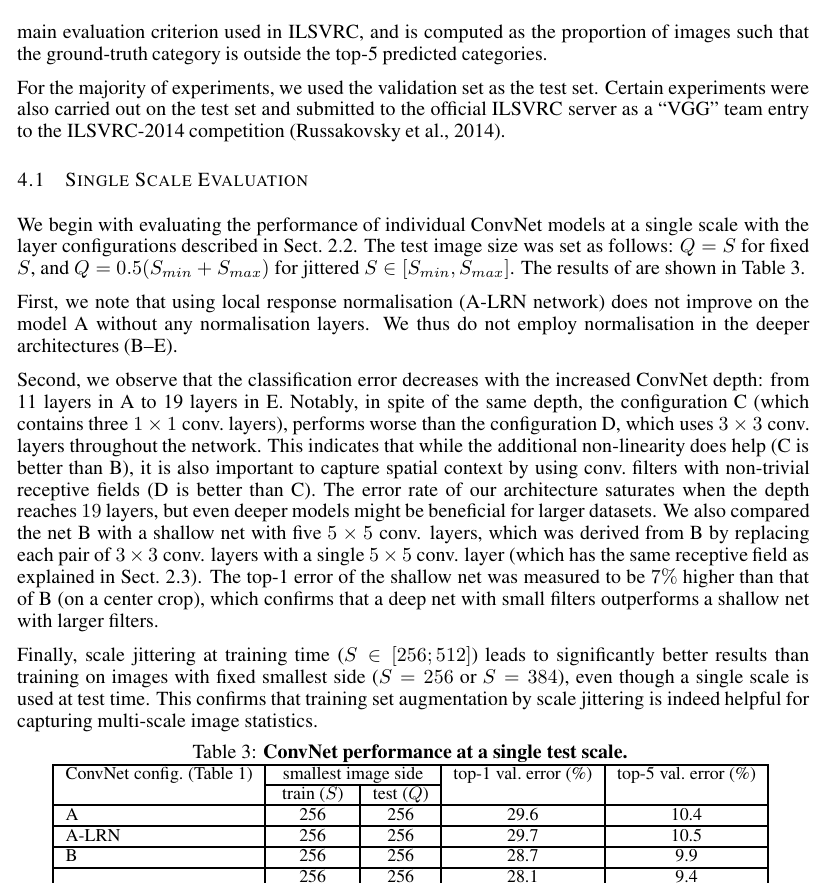
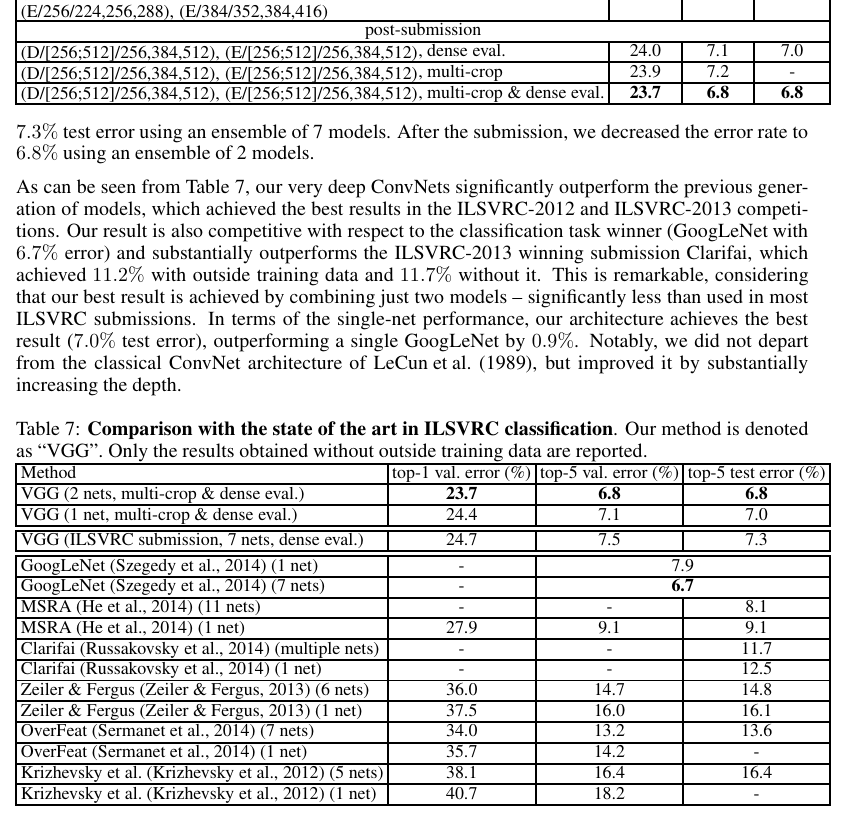
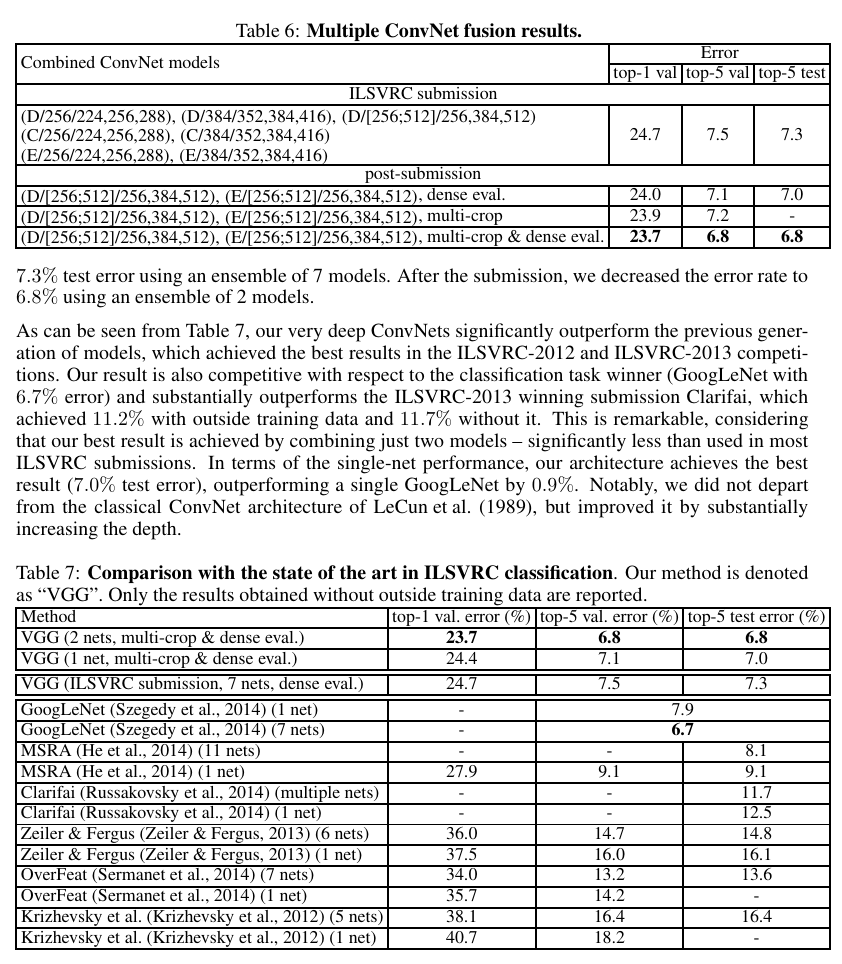
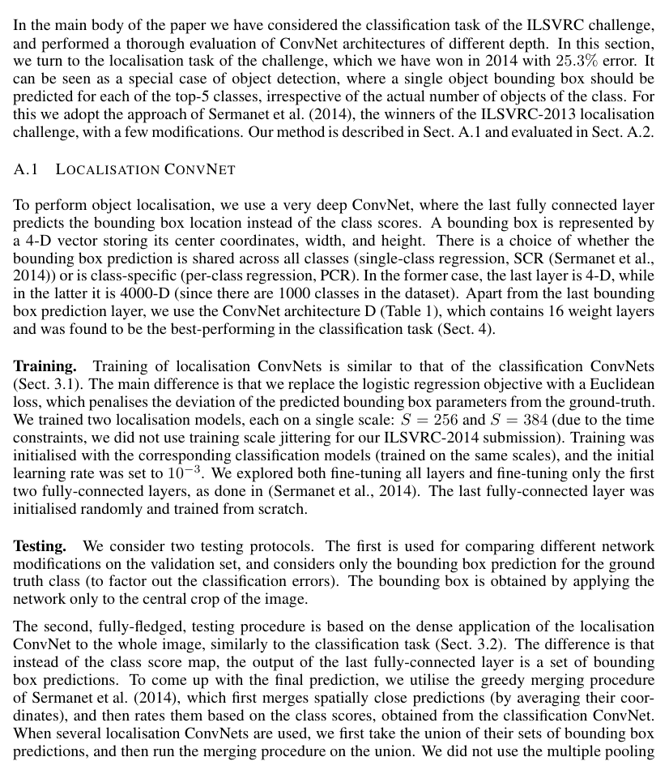
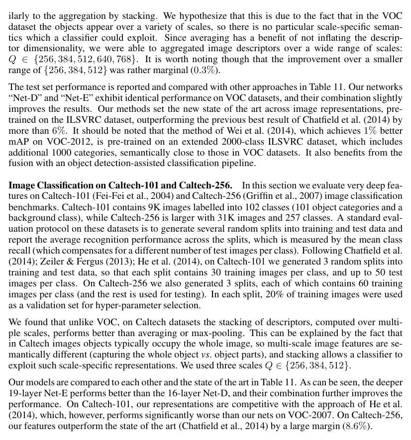

# 用于大规模图像识别的非常深卷积网络

> Very Deep Convolutional Networks for Large-Scale Image Recognition
> Karen Simonyan & Andrew Zisserman, Visual Geometry Group, Department of Engineering Science, University of Oxford
> arXiv:1409.1556v6，ICLR 2015 会议论文。本文为全文双语对照翻译，参考文献部分按规范保留原文。

## ABSTRACT

**Original:** In this work we investigate the effect of the convolutional network depth on its accuracy in the large-scale image recognition setting. Our main contribution is a thorough evaluation of networks of increasing depth using an architecture with very small (3×3) convolution filters, which shows that a significant improvement on the prior-art configurations can be achieved by pushing the depth to 16–19 weight layers. These findings were the basis of our ImageNet Challenge 2014 submission, where our team secured the first and the second places in the localisation and classification tracks respectively. We also show that our representations generalise well to other datasets, where they achieve state-of-the-art results. We have made our two best-performing ConvNet models publicly available to facilitate further research on the use of deep visual representations in computer vision.

**中文:** 在这项工作中，我们研究了卷积网络（Convolutional Networks，ConvNets）的深度在大规模图像识别场景下对其准确率的影响。我们的主要贡献是：使用带极小（3×3）卷积滤波器（filters）的架构，对深度不断增加的网络进行了一次全面评估，结果表明，将深度推进到 16–19 个权重层（weight layers）可以比既有最优（prior-art）配置取得显著提升。这些发现是我们参加 ImageNet Challenge 2014 的基础——我们的团队分别在定位（localisation）与分类（classification）赛道（tracks）中取得了第一名和第二名。我们还表明，我们的表示（representations）能够很好地泛化（generalise）到其他数据集，并在其上取得了当前最优（state-of-the-art）的结果。我们已将两个性能最佳的 ConvNet 模型公开发布，以促进对计算机视觉中深度视觉表示（deep visual representations）的使用的进一步研究。

## 1 INTRODUCTION

**Original:** Convolutional networks (ConvNets) have recently enjoyed a great success in large-scale image and video recognition (Krizhevsky et al., 2012; Zeiler & Fergus, 2013; Sermanet et al., 2014; Simonyan & Zisserman, 2014) which has become possible due to the large public image repositories, such as ImageNet (Deng et al., 2009), and high-performance computing systems, such as GPUs or large-scale distributed clusters (Dean et al., 2012). In particular, an important role in the advance of deep visual recognition architectures has been played by the ImageNet Large-Scale Visual Recognition Challenge (ILSVRC) (Russakovsky et al., 2014), which has served as a testbed for a few generations of large-scale image classification systems, from high-dimensional shallow feature encodings (Perronnin et al., 2010) (the winner of ILSVRC-2011) to deep ConvNets (Krizhevsky et al., 2012) (the winner of ILSVRC-2012).

**中文:** 卷积网络（Convolutional Networks，ConvNets）最近在大规模图像与视频识别中取得了巨大成功（Krizhevsky et al., 2012; Zeiler & Fergus, 2013; Sermanet et al., 2014; Simonyan & Zisserman, 2014），这得益于大型公开图像库（如 ImageNet（Deng et al., 2009））以及高性能计算系统（如 GPU 或大规模分布式集群（Dean et al., 2012））。特别地，ImageNet 大规模视觉识别挑战赛（ImageNet Large-Scale Visual Recognition Challenge，ILSVRC）（Russakovsky et al., 2014）在深度视觉识别架构的发展中扮演了重要角色，它为几代大规模图像分类系统充当了试验场（testbed）——从高维浅层特征编码（Perronnin et al., 2010）（ILSVRC-2011 的获胜者）到深度 ConvNets（Krizhevsky et al., 2012）（ILSVRC-2012 的获胜者）。

**Original:** With ConvNets becoming more of a commodity in the computer vision field, a number of attempts have been made to improve the original architecture of Krizhevsky et al. (2012) in a bid to achieve better accuracy. For instance, the best-performing submissions to the ILSVRC-2013 (Zeiler & Fergus, 2013; Sermanet et al., 2014) utilised smaller receptive window size and smaller stride of the first convolutional layer. Another line of improvements dealt with training and testing the networks densely over the whole image and over multiple scales (Sermanet et al., 2014; Howard, 2014). In this paper, we address another important aspect of ConvNet architecture design – its depth. To this end, we fix other parameters of the architecture, and steadily increase the depth of the network by adding more convolutional layers, which is feasible due to the use of very small (3×3) convolution filters in all layers.

**中文:** 随着 ConvNets 在计算机视觉领域日益成为一种基础工具（commodity），人们进行了许多尝试来改进 Krizhevsky et al. (2012) 的原始架构，以求获得更高的准确率。例如，ILSVRC-2013 中表现最佳的参赛方案（Zeiler & Fergus, 2013; Sermanet et al., 2014）使用了更小的感受窗口（receptive window）尺寸和更小的第一卷积层步长（stride）。另一类改进则是在整幅图像上和多个尺度（scales）上对网络进行密集（densely）训练与测试（Sermanet et al., 2014; Howard, 2014）。在本文中，我们关注 ConvNet 架构设计的另一个重要方面——深度。为此，我们固定架构的其他参数，通过添加更多卷积层（convolutional layers）来稳步增加网络深度，而这一点之所以可行，是因为所有层都使用了极小（3×3）的卷积滤波器。

**Original:** As a result, we come up with significantly more accurate ConvNet architectures, which not only achieve the state-of-the-art accuracy on ILSVRC classification and localisation tasks, but are also applicable to other image recognition datasets, where they achieve excellent performance even when used as a part of a relatively simple pipelines (e.g. deep features classified by a linear SVM without fine-tuning). We have released our two best-performing models¹ to facilitate further research.

**中文:** 最终，我们得到了准确率显著更高的 ConvNet 架构，它们不仅在 ILSVRC 分类与定位任务上达到了当前最优（state-of-the-art）准确率，还适用于其他图像识别数据集——即使只是作为相对简单的流水线（pipelines）的一部分使用（例如，无需微调（fine-tuning）、由线性 SVM 分类的深度特征），它们在这些数据集上也能取得出色的性能。我们已发布两个性能最佳的模型¹，以促进进一步研究。

**Original:** The rest of the paper is organised as follows. In Sect. 2, we describe our ConvNet configurations. The details of the image classification training and evaluation are then presented in Sect. 3, and the configurations are compared on the ILSVRC classification task in Sect. 4. Sect. 5 concludes the paper. For completeness, we also describe and assess our ILSVRC-2014 object localisation system in Appendix A, and discuss the generalisation of very deep features to other datasets in Appendix B. Finally, Appendix C contains the list of major paper revisions.

**中文:** 本文其余部分组织如下：第 2 节描述我们的 ConvNet 配置（configurations）；第 3 节给出图像分类训练与评估的细节；第 4 节在 ILSVRC 分类任务上对各配置进行比较；第 5 节总结全文。为完整起见，我们还在附录 A 中描述并评估了我们的 ILSVRC-2014 目标定位系统，并在附录 B 中讨论了非常深的特征向其他数据集泛化的情况。最后，附录 C 列出了论文的主要修订记录。

**Original:** ¹http://www.robots.ox.ac.uk/~vgg/research/very_deep/

**中文:** ¹http://www.robots.ox.ac.uk/~vgg/research/very_deep/（译者注：模型发布页面）

**Original:** ∗current affiliation: Google DeepMind; +current affiliation: University of Oxford and Google DeepMind

**中文:** ∗现所属机构：Google DeepMind；+现所属机构：University of Oxford 与 Google DeepMind

## 2 CONVNET CONFIGURATIONS

**Original:** To measure the improvement brought by the increased ConvNet depth in a fair setting, all our ConvNet layer configurations are designed using the same principles, inspired by Ciresan et al. (2011); Krizhevsky et al. (2012). In this section, we first describe a generic layout of our ConvNet configurations (Sect. 2.1) and then detail the specific configurations used in the evaluation (Sect. 2.2). Our design choices are then discussed and compared to the prior art in Sect. 2.3.

**中文:** 为了在公平的条件下衡量加深 ConvNet 所带来的改进，我们所有的卷积网络层配置都遵循同一套原则设计，其灵感来自 Ciresan et al. (2011); Krizhevsky et al. (2012)。在本节中，我们首先描述卷积网络配置的通用布局（第 2.1 节），然后详述评估所用的具体配置（第 2.2 节）。我们的设计选择将在第 2.3 节中加以讨论，并与既有方法（prior art）进行比较。

### 2.1 ARCHITECTURE

**Original:** During training, the input to our ConvNets is a fixed-size 224×224 RGB image. The only pre-processing we do is subtracting the mean RGB value, computed on the training set, from each pixel. The image is passed through a stack of convolutional (conv.) layers, where we use filters with a very small receptive field: 3×3 (which is the smallest size to capture the notion of left/right, up/down, center). In one of the configurations we also utilise 1×1 convolution filters, which can be seen as a linear transformation of the input channels (followed by non-linearity). The convolution stride is fixed to 1 pixel; the spatial padding of conv. layer input is such that the spatial resolution is preserved after convolution, i.e. the padding is 1 pixel for 3×3 conv. layers. Spatial pooling is carried out by five max-pooling layers, which follow some of the conv. layers (not all the conv. layers are followed by max-pooling). Max-pooling is performed over a 2×2 pixel window, with stride 2.

**中文:** 训练期间，输入到我们卷积网络的是一幅固定尺寸的 224×224 RGB 图像。我们做的唯一预处理是：从每个像素中减去在训练集上计算出的 RGB 均值。图像随后通过一叠卷积（conv.）层，其中我们使用的滤波器具有非常小的感受野（receptive field）：3×3（这是能够捕捉左/右、上/下、中心概念的最小尺寸）。在其中一个配置中，我们还使用了 1×1 卷积滤波器，它可以被看作是对输入通道（channels）的线性变换（其后跟非线性）。卷积步长固定为 1 个像素；卷积层输入的空间填充（padding）方式使得卷积后空间分辨率（spatial resolution）保持不变，即对于 3×3 卷积层，填充为 1 个像素。空间池化（spatial pooling）由五个最大池化（max-pooling）层完成，它们跟在部分卷积层之后（并非所有卷积层之后都跟最大池化）。最大池化在 2×2 像素窗口上进行，步长为 2。

**Original:** A stack of convolutional layers (which has a different depth in different architectures) is followed by three Fully-Connected (FC) layers: the first two have 4096 channels each, the third performs 1000-way ILSVRC classification and thus contains 1000 channels (one for each class). The final layer is the soft-max layer. The configuration of the fully connected layers is the same in all networks.

**中文:** 一叠卷积层（在不同架构中具有不同的深度）之后跟着三个全连接（Fully-Connected，FC）层：前两层各有 4096 个通道，第三层执行 1000 路的 ILSVRC 分类，因而含有 1000 个通道（每个类别一个）。最后一层是 Softmax 层。所有网络中全连接层的配置都相同。

**Original:** All hidden layers are equipped with the rectification (ReLU (Krizhevsky et al., 2012)) non-linearity. We note that none of our networks (except for one) contain Local Response Normalisation (LRN) normalisation (Krizhevsky et al., 2012): as will be shown in Sect. 4, such normalisation does not improve the performance on the ILSVRC dataset, but leads to increased memory consumption and computation time. Where applicable, the parameters for the LRN layer are those of (Krizhevsky et al., 2012).

**中文:** 所有隐藏层都配备了整流（ReLU（Krizhevsky et al., 2012））非线性。我们要指出，我们的网络（除一个之外）都不包含局部响应归一化（Local Response Normalisation，LRN）层（Krizhevsky et al., 2012）：如第 4 节将展示的，这种归一化并不会提升在 ILSVRC 数据集上的性能，反而会导致内存消耗和计算时间的增加。在适用的地方，LRN 层的参数与（Krizhevsky et al., 2012）相同。

### 2.2 CONFIGURATIONS

**Original:** The ConvNet configurations, evaluated in this paper, are outlined in Table 1, one per column. In the following we will refer to the nets by their names (A–E). All configurations follow the generic design presented in Sect. 2.1, and differ only in the depth: from 11 weight layers in the network A (8 conv. and 3 FC layers) to 19 weight layers in the network E (16 conv. and 3 FC layers). The width of conv. layers (the number of channels) is rather small, starting from 64 in the first layer and then increasing by a factor of 2 after each max-pooling layer, until it reaches 512.

**中文:** 本文评估的卷积网络配置在表 1 中列出，每列一个配置。下文我们将用名字（A–E）来指代这些网络。所有配置都遵循第 2.1 节给出的通用设计，区别仅在深度：从网络 A 的 11 个权重层（8 个卷积层和 3 个 FC 层）到网络 E 的 19 个权重层（16 个卷积层和 3 个 FC 层）。卷积层的宽度（即通道数）相当小，从第一层的 64 开始，每经过一个最大池化层就扩大 2 倍，直到达到 512。

> **表 1（译）**：卷积网络配置（按列展示）。配置的深度从左（A）到右（E）递增，随着更多层被添加（新增层以粗体显示）。卷积层参数记作「conv⟨感受野大小⟩-⟨通道数⟩」。为简洁起见，未展示 ReLU 激活函数。（原表见 paper.pdf 第 3 页，见下方图）



（表格内容如下，按列展开；"LRN" 列仅在 A-LRN 中出现）

```
             A          A-LRN        B           C            D            E
权 重 层 数   11         11           13          16           16           19
conv 层 数    8          8            10          13           13           16

input (224 × 224 RGB image)

conv3-64    conv3-64   conv3-64    conv3-64     conv3-64     conv3-64
             LRN
conv3-64    conv3-64   conv3-64    conv3-64     conv3-64     conv3-64
maxpool

conv3-128   conv3-128  conv3-128   conv3-128    conv3-128    conv3-128
conv3-128   conv3-128  conv3-128   conv3-128    conv3-128    conv3-128
maxpool

conv3-256   conv3-256  conv3-256   conv3-256    conv3-256    conv3-256
conv3-256   conv3-256  conv3-256   conv3-256    conv3-256    conv3-256
                                     conv1-256    conv3-256    conv3-256
                                                  conv3-256    conv3-256
maxpool

conv3-512   conv3-512  conv3-512   conv3-512    conv3-512    conv3-512
conv3-512   conv3-512  conv3-512   conv3-512    conv3-512    conv3-512
                                     conv1-512    conv3-512    conv3-512
                                                  conv3-512    conv3-512
maxpool

conv3-512   conv3-512  conv3-512   conv3-512    conv3-512    conv3-512
conv3-512   conv3-512  conv3-512   conv3-512    conv3-512    conv3-512
                                     conv1-512    conv3-512    conv3-512
                                                  conv3-512    conv3-512
maxpool

FC-4096
FC-4096
FC-1000
soft-max
```

**Original:** In Table 2 we report the number of parameters for each configuration. In spite of a large depth, the number of weights in our nets is not greater than the number of weights in a more shallow net with larger conv. layer widths and receptive fields (144M weights in (Sermanet et al., 2014)).

**中文:** 表 2 中我们报告了每个配置的参数数量。尽管深度很大，我们网络中的权重数量并不比那些卷积层更宽、感受野更大的较浅网络多（(Sermanet et al., 2014) 中有 1.44 亿（144M）个权重）。

> **表 2（译）**：参数数量（单位：百万）。（原表见 paper.pdf 第 3 页，[第 3 页图](assets/figures/tab-2.png)）

| 网络 | A, A-LRN | B | C | D | E |
|---|---|---|---|---|---|
| 参数数量 | 133 | 133 | 134 | 138 | 144 |

### 2.3 DISCUSSION

**Original:** Our ConvNet configurations are quite different from the ones used in the top-performing entries of the ILSVRC-2012 (Krizhevsky et al., 2012) and ILSVRC-2013 competitions (Zeiler & Fergus, 2013; Sermanet et al., 2014). Rather than using relatively large receptive fields in the first conv. layers (e.g. 11×11 with stride 4 in (Krizhevsky et al., 2012), or 7×7 with stride 2 in (Zeiler & Fergus, 2013; Sermanet et al., 2014)), we use very small 3×3 receptive fields throughout the whole net, which are convolved with the input at every pixel (with stride 1). It is easy to see that a stack of two 3×3 conv. layers (without spatial pooling in between) has an effective receptive field of 5×5; three such layers have a 7×7 effective receptive field.

**中文:** 我们的卷积网络配置与 ILSVRC-2012（Krizhevsky et al., 2012）和 ILSVRC-2013 竞赛（Zeiler & Fergus, 2013; Sermanet et al., 2014）中表现最佳参赛方案所用的配置差别很大。我们不在前几个卷积层中使用相对较大的感受野（例如（Krizhevsky et al., 2012）中的 11×11、步长 4，或（Zeiler & Fergus, 2013; Sermanet et al., 2014）中的 7×7、步长 2），而是在整个网络中都使用非常小的 3×3 感受野，并在每个像素处与输入做卷积（步长为 1）。容易看出，两层 3×3 卷积层的堆叠（中间无空间池化）具有 5×5 的有效感受野；三层这样的层则具有 7×7 的有效感受野。

**Original:** So what have we gained by using, for instance, a stack of three 3×3 conv. layers instead of a single 7×7 layer? First, we incorporate three non-linear rectification layers instead of a single one, which makes the decision function more discriminative. Second, we decrease the number of parameters: assuming that both the input and the output of a three-layer 3×3 convolution stack has C channels, the stack is parametrised by $3(3^2 C^2) = 27 C^2$ weights; at the same time, a single 7×7 conv. layer would require $7^2 C^2 = 49 C^2$ parameters, i.e. 81% more. This can be seen as imposing a regularisation on the 7×7 conv. filters, forcing them to have a decomposition through the 3×3 filters (with non-linearity injected in between).

**中文:** 那么，例如用三层 3×3 卷积层的堆叠取代单个 7×7 层，我们得到了什么？第一，我们纳入了三个非线性整流层而不是一个，这使得决策函数（decision function）更具判别力。第二，我们减少了参数数量：假设三层 3×3 卷积堆叠的输入和输出都有 $C$ 个通道，那么该堆叠的参数为 $3(3^2 C^2) = 27 C^2$ 个权重；同时，单个 7×7 卷积层则需要 $7^2 C^2 = 49 C^2$ 个参数，即多出 81%。这可以看作是对 7×7 卷积滤波器施加了一种正则化（regularisation），迫使它们经由 3×3 滤波器（并在其间注入非线性）进行分解（decomposition）。

**Original:** The incorporation of 1×1 conv. layers (configuration C, Table 1) is a way to increase the non-linearity of the decision function without affecting the receptive fields of the conv. layers. Even though in our case the 1×1 convolution is essentially a linear projection onto the space of the same dimensionality (the number of input and output channels is the same), an additional non-linearity is introduced by the rectification function. It should be noted that 1×1 conv. layers have recently been utilised in the "Network in Network" architecture of Lin et al. (2014).

**中文:** 引入 1×1 卷积层（配置 C，表 1）是一种在不影响卷积层感受野的情况下增加决策函数非线性的方式。尽管在我们的情形中，1×1 卷积本质上是向同维空间（输入和输出通道数相同）的线性投影，但整流函数引入了额外的非线性。应当指出，1×1 卷积层近来已在 Lin et al. (2014) 的 "Network in Network" 架构中得到使用。

**Original:** Small-size convolution filters have been previously used by Ciresan et al. (2011), but their nets are significantly less deep than ours, and they did not evaluate on the large-scale ILSVRC dataset. Goodfellow et al. (2014) applied deep ConvNets (11 weight layers) to the task of street number recognition, and showed that the increased depth led to better performance. GoogLeNet (Szegedy et al., 2014), a top-performing entry of the ILSVRC-2014 classification task, was developed independently of our work, but is similar in that it is based on very deep ConvNets (22 weight layers) and small convolution filters (apart from 3×3, they also use 1×1 and 5×5 convolutions). Their network topology is, however, more complex than ours, and the spatial resolution of the feature maps is reduced more aggressively in the first layers to decrease the amount of computation. As will be shown in Sect. 4.5, our model is outperforming that of Szegedy et al. (2014) in terms of the single-network classification accuracy.

**中文:** 小尺寸卷积滤波器此前已被 Ciresan et al. (2011) 使用过，但他们的网络远不如我们的深，而且他们未在大规模 ILSVRC 数据集上做评估。Goodfellow et al. (2014) 将深度卷积网络（11 个权重层）应用于街景门牌号识别任务，并表明深度增加带来了更好的性能。GoogLeNet（Szegedy et al., 2014）是 ILSVRC-2014 分类任务中表现最佳的参赛方案之一，它与我们的工作相互独立地开发，但相似之处在于它也基于非常深的卷积网络（22 个权重层）和小卷积滤波器（除 3×3 外，他们还使用 1×1 和 5×5 卷积）。不过，他们的网络拓扑（topology）比我们的更复杂，并且在前几层更激进地降低了特征图（feature maps）的空间分辨率以减少计算量。如第 4.5 节将展示的，就单网络分类准确率而言，我们的模型优于 Szegedy et al. (2014) 的模型。

## 3 CLASSIFICATION FRAMEWORK

**Original:** In the previous section we presented the details of our network configurations. In this section, we describe the details of classification ConvNet training and evaluation.

**中文:** 上一节我们介绍了网络配置的细节。本节描述分类卷积网络训练与评估的细节。

### 3.1 TRAINING

**Original:** The ConvNet training procedure generally follows Krizhevsky et al. (2012) (except for sampling the input crops from multi-scale training images, as explained later). Namely, the training is carried out by optimising the multinomial logistic regression objective using mini-batch gradient descent (based on back-propagation (LeCun et al., 1989)) with momentum. The batch size was set to 256, momentum to 0.9. The training was regularised by weight decay (the L2 penalty multiplier set to $5 \cdot 10^{-4}$) and dropout regularisation for the first two fully-connected layers (dropout ratio set to 0.5). The learning rate was initially set to $10^{-2}$, and then decreased by a factor of 10 when the validation set accuracy stopped improving. In total, the learning rate was decreased 3 times, and the learning was stopped after 370K iterations (74 epochs). We conjecture that in spite of the larger number of parameters and the greater depth of our nets compared to (Krizhevsky et al., 2012), the nets required less epochs to converge due to (a) implicit regularisation imposed by greater depth and smaller conv. filter sizes; (b) pre-initialisation of certain layers.

**中文:** 卷积网络的训练流程总体遵循 Krizhevsky et al. (2012)（除了从多尺度训练图像中采样输入裁剪块（crops）这一点，下文将解释）。具体而言，训练通过使用带动量（momentum）的小批量梯度下降（mini-batch gradient descent）（基于反向传播（back-propagation）（LeCun et al., 1989））优化多项式逻辑回归目标（multinomial logistic regression objective）来进行。批次大小（batch size）设为 256，动量设为 0.9。训练通过权重衰减（weight decay）（L2 惩罚乘子设为 $5 \cdot 10^{-4}$）以及前两个全连接层上的随机失活（Dropout）正则化（失活比率设为 0.5）来正则化。学习率（learning rate）初始设为 $10^{-2}$，当验证集准确率不再提升时减小为原来的十分之一。总计学习率下调了 3 次，学习在 37 万（370K）次迭代（74 个轮次（epoch））后停止。我们推测，尽管与（Krizhevsky et al., 2012）相比我们的网络参数更多、深度更大，网络收敛所需的轮次却更少，原因在于：(a) 更大的深度与更小的卷积滤波器尺寸所施加的隐式正则化；(b) 某些层的预初始化（pre-initialisation）。

**Original:** The initialisation of the network weights is important, since bad initialisation can stall learning due to the instability of gradient in deep nets. To circumvent this problem, we began with training the configuration A (Table 1), shallow enough to be trained with random initialisation. Then, when training deeper architectures, we initialised the first four convolutional layers and the last three fully-connected layers with the layers of net A (the intermediate layers were initialised randomly). We did not decrease the learning rate for the pre-initialised layers, allowing them to change during learning. For random initialisation (where applicable), we sampled the weights from a normal distribution with the zero mean and $10^{-2}$ variance. The biases were initialised with zero. It is worth noting that after the paper submission we found that it is possible to initialise the weights without pre-training by using the random initialisation procedure of Glorot & Bengio (2010).

**中文:** 网络权重的初始化很重要，因为糟糕的初始化会由于深层网络中梯度的不稳定性而使学习停滞。为规避这一问题，我们从训练配置 A（表 1）开始，它足够浅，可以用随机初始化训练。随后，在训练更深的架构时，我们用网络 A 的层来初始化前四个卷积层和最后三个全连接层（中间层随机初始化）。我们没有为预初始化的层降低学习率，允许它们在训练中继续变化。对于随机初始化（在适用的地方），我们从均值为 0、方差为 $10^{-2}$ 的正态分布中采样权重。偏置（biases）初始化为 0。值得注意的是，论文提交之后我们发现，使用 Glorot & Bengio (2010) 的随机初始化流程即可在无需预训练的情况下完成权重初始化。

**Original:** To obtain the fixed-size 224×224 ConvNet input images, they were randomly cropped from rescaled training images (one crop per image per SGD iteration). To further augment the training set, the crops underwent random horizontal flipping and random RGB colour shift (Krizhevsky et al., 2012). Training image rescaling is explained below.

**中文:** 为了获得固定尺寸 224×224 的卷积网络输入图像，我们将其从缩放后的训练图像中随机裁剪得到（每次 SGD 迭代每张图像一个裁剪块）。为了进一步扩充（augment）训练集，裁剪块还经过了随机水平翻转和随机 RGB 颜色偏移（Krizhevsky et al., 2012）。训练图像的缩放方式在下面解释。

**Original:** Training image size. Let S be the smallest side of an isotropically-rescaled training image, from which the ConvNet input is cropped (we also refer to S as the training scale). While the crop size is fixed to 224×224, in principle S can take on any value not less than 224: for S = 224 the crop will capture whole-image statistics, completely spanning the smallest side of a training image; for S ≫ 224 the crop will correspond to a small part of the image, containing a small object or an object part.

**中文:** **训练图像尺寸。** 令 $S$ 为经过各向同性缩放（isotropically-rescaled）的训练图像的最短边，卷积网络输入即从该图像中裁剪（我们也将 $S$ 称为训练尺度（training scale））。虽然裁剪尺寸固定为 224×224，原则上 $S$ 可以取任何不小于 224 的值：当 $S = 224$ 时，裁剪块将捕获整幅图像的统计信息，完全覆盖训练图像的最短边；当 $S \gg 224$ 时，裁剪块将对应图像的一小部分，其中包含一个小目标或目标的一部分。

**Original:** We consider two approaches for setting the training scale S. The first is to fix S, which corresponds to single-scale training (note that image content within the sampled crops can still represent multi-scale image statistics). In our experiments, we evaluated models trained at two fixed scales: S = 256 (which has been widely used in the prior art (Krizhevsky et al., 2012; Zeiler & Fergus, 2013; Sermanet et al., 2014)) and S = 384. Given a ConvNet configuration, we first trained the network using S = 256. To speed-up training of the S = 384 network, it was initialised with the weights pre-trained with S = 256, and we used a smaller initial learning rate of $10^{-3}$.

**中文:** 我们考虑两种设置训练尺度 $S$ 的方法。第一种是固定 $S$，这对应单尺度训练（single-scale training）（注意：采样裁剪块中的图像内容仍可代表多尺度的图像统计）。在我们的实验中，我们评估了以两种固定尺度训练的模型：$S = 256$（在既有方法中被广泛使用（Krizhevsky et al., 2012; Zeiler & Fergus, 2013; Sermanet et al., 2014））和 $S = 384$。对于给定的卷积网络配置，我们首先用 $S = 256$ 训练网络。为加速 $S = 384$ 网络的训练，我们用 $S = 256$ 预训练的权重对其初始化，并使用较小的初始学习率 $10^{-3}$。

**Original:** The second approach to setting S is multi-scale training, where each training image is individually rescaled by randomly sampling S from a certain range $[S_{min}, S_{max}]$ (we used $S_{min} = 256$ and $S_{max} = 512$). Since objects in images can be of different size, it is beneficial to take this into account during training. This can also be seen as training set augmentation by scale jittering, where a single model is trained to recognise objects over a wide range of scales. For speed reasons, we trained multi-scale models by fine-tuning all layers of a single-scale model with the same configuration, pre-trained with fixed S = 384.

**中文:** 设置 $S$ 的第二种方法是多尺度训练（multi-scale training），即每张训练图像单独缩放，通过从某个区间 $[S_{min}, S_{max}]$ 中随机采样 $S$（我们使用 $S_{min} = 256$ 和 $S_{max} = 512$）。由于图像中的目标可能大小不一，在训练中考虑到这一点是有益的。这也可以看作是通过尺度抖动（scale jittering）进行的训练集扩充，从而训练单个模型在很宽的尺度范围内识别目标。出于速度考虑，我们通过微调（fine-tuning）一个以固定 $S = 384$ 预训练、配置相同的单尺度模型的所有层来训练多尺度模型。

### 3.2 TESTING

**Original:** At test time, given a trained ConvNet and an input image, it is classified in the following way. First, it is isotropically rescaled to a pre-defined smallest image side, denoted as Q (we also refer to it as the test scale). We note that Q is not necessarily equal to the training scale S (as we will show in Sect. 4, using several values of Q for each S leads to improved performance). Then, the network is applied densely over the rescaled test image in a way similar to (Sermanet et al., 2014). Namely, the fully-connected layers are first converted to convolutional layers (the first FC layer to a 7×7 conv. layer, the last two FC layers to 1×1 conv. layers). The resulting fully-convolutional net is then applied to the whole (uncropped) image. The result is a class score map with the number of channels equal to the number of classes, and a variable spatial resolution, dependent on the input image size. Finally, to obtain a fixed-size vector of class scores for the image, the class score map is spatially averaged (sum-pooled). We also augment the test set by horizontal flipping of the images; the soft-max class posteriors of the original and flipped images are averaged to obtain the final scores for the image.

**中文:** 测试时，给定一个训练好的卷积网络和一幅输入图像，分类按以下方式进行。首先，图像被各向同性地缩放到一个预定义的最短边，记为 $Q$（我们也称之为测试尺度（test scale））。我们指出，$Q$ 未必等于训练尺度 $S$（如第 4 节将展示的，对每个 $S$ 使用多个 $Q$ 值能带来性能提升）。然后，网络以类似于（Sermanet et al., 2014）的方式在缩放后的测试图像上密集地（densely）应用。具体而言，全连接层首先被转换为卷积层（第一个 FC 层转换为 7×7 卷积层，最后两个 FC 层转换为 1×1 卷积层）。由此得到的全卷积网络（fully-convolutional net）随后被应用于整幅（未裁剪的）图像。结果是一张类别得分图（class score map），其通道数等于类别数，空间分辨率随输入图像尺寸而变化。最后，为了得到该图像固定尺寸的类别得分向量，类别得分图被空间平均（求和池化（sum-pooled））。我们还通过对图像做水平翻转来扩充测试集；原始图像与翻转图像的 Softmax 类别后验概率（posteriors）被平均，得到该图像的最终得分。

**Original:** Since the fully-convolutional network is applied over the whole image, there is no need to sample multiple crops at test time (Krizhevsky et al., 2012), which is less efficient as it requires network re-computation for each crop. At the same time, using a large set of crops, as done by Szegedy et al. (2014), can lead to improved accuracy, as it results in a finer sampling of the input image compared to the fully-convolutional net. Also, multi-crop evaluation is complementary to dense evaluation due to different convolution boundary conditions: when applying a ConvNet to a crop, the convolved feature maps are padded with zeros, while in the case of dense evaluation the padding for the same crop naturally comes from the neighbouring parts of an image (due to both the convolutions and spatial pooling), which substantially increases the overall network receptive field, so more context is captured. While we believe that in practice the increased computation time of multiple crops does not justify the potential gains in accuracy, for reference we also evaluate our networks using 50 crops per scale (5×5 regular grid with 2 flips), for a total of 150 crops over 3 scales, which is comparable to 144 crops over 4 scales used by Szegedy et al. (2014).

**中文:** 由于全卷积网络在整幅图像上应用，测试时无需采样多个裁剪块（Krizhevsky et al., 2012）——那种做法效率较低，因为每个裁剪块都需要重新计算网络。同时，像 Szegedy et al. (2014) 那样使用大量裁剪块可以带来准确率提升，因为与全卷积网络相比，它对输入图像做了更细的采样。此外，由于卷积边界条件不同，多裁剪评估（multi-crop evaluation）与密集评估（dense evaluation）是互补的：将卷积网络应用于一个裁剪块时，卷积得到的特征图用零填充，而在密集评估的情形下，同一裁剪块的填充自然来自图像的邻近部分（由于卷积和空间池化的共同作用），这显著增大了整个网络的感受野，从而捕获更多上下文。虽然我们认为在实际中，多裁剪块带来的计算时间增加并不足以抵消其潜在的准确率收益，但作为参考，我们还以每尺度 50 个裁剪块（5×5 规则网格加 2 种翻转）、共 3 个尺度合计 150 个裁剪块来评估我们的网络，这与 Szegedy et al. (2014) 使用的 4 个尺度共 144 个裁剪块相当。

### 3.3 IMPLEMENTATION DETAILS

**Original:** Our implementation is derived from the publicly available C++ Caffe toolbox (Jia, 2013) (branched out in December 2013), but contains a number of significant modifications, allowing us to perform training and evaluation on multiple GPUs installed in a single system, as well as train and evaluate on full-size (uncropped) images at multiple scales (as described above). Multi-GPU training exploits data parallelism, and is carried out by splitting each batch of training images into several GPU batches, processed in parallel on each GPU. After the GPU batch gradients are computed, they are averaged to obtain the gradient of the full batch. Gradient computation is synchronous across the GPUs, so the result is exactly the same as when training on a single GPU.

**中文:** 我们的实现衍生自公开的 C++ Caffe 工具箱（Jia, 2013）（2013 年 12 月分支），但包含若干重要修改，使我们能够在单个系统安装的多块 GPU 上进行训练与评估，并在多个尺度上对全尺寸（未裁剪）图像进行训练与评估（如上所述）。多 GPU 训练利用了数据并行（data parallelism），其做法是把每个批次的训练图像拆分成若干 GPU 批次，在每块 GPU 上并行处理。各 GPU 批次的梯度计算完毕后，取平均得到整个批次的梯度。梯度计算在各 GPU 间是同步的，因此结果与在单块 GPU 上训练完全相同。

**Original:** While more sophisticated methods of speeding up ConvNet training have been recently proposed (Krizhevsky, 2014), which employ model and data parallelism for different layers of the net, we have found that our conceptually much simpler scheme already provides a speedup of 3.75 times on an off-the-shelf 4-GPU system, as compared to using a single GPU. On a system equipped with four NVIDIA Titan Black GPUs, training a single net took 2–3 weeks depending on the architecture.

**中文:** 尽管近来已有人提出更精巧的加速卷积网络训练的方法（Krizhevsky, 2014），它们对网络的不同层采用模型与数据并行（model and data parallelism），但我们发现，与使用单块 GPU 相比，我们这套概念上简单得多的方案在现成的 4 GPU 系统上已能提供 3.75 倍的加速。在一台配备四块 NVIDIA Titan Black GPU 的系统上，训练一个网络需要 2–3 周，具体取决于架构。

## 4 CLASSIFICATION EXPERIMENTS

**Original:** Dataset. In this section, we present the image classification results achieved by the described ConvNet architectures on the ILSVRC-2012 dataset (which was used for ILSVRC 2012–2014 challenges). The dataset includes images of 1000 classes, and is split into three sets: training (1.3M images), validation (50K images), and testing (100K images with held-out class labels). The classification performance is evaluated using two measures: the top-1 and top-5 error. The former is a multi-class classification error, i.e. the proportion of incorrectly classified images; the latter is the main evaluation criterion used in ILSVRC, and is computed as the proportion of images such that the ground-truth category is outside the top-5 predicted categories.

**中文:** **数据集。** 本节展示所述卷积网络架构在 ILSVRC-2012 数据集（该数据集用于 ILSVRC 2012–2014 挑战赛）上取得的图像分类结果。该数据集包含 1000 个类别的图像，分为三个集合：训练集（130 万张图像）、验证集（5 万张图像）和测试集（10 万张图像，类别标签不公开）。分类性能用两个指标评估：top-1 和 top-5 错误率。前者是多类分类错误率，即被错误分类的图像比例；后者是 ILSVRC 使用的主要评估标准，计算为真值类别（ground-truth category）不在预测的前 5 个类别之中的图像比例。

**Original:** For the majority of experiments, we used the validation set as the test set. Certain experiments were also carried out on the test set and submitted to the official ILSVRC server as a "VGG" team entry to the ILSVRC-2014 competition (Russakovsky et al., 2014).

**中文:** 在大多数实验中，我们把验证集用作测试集。部分实验也在测试集上进行，并作为 "VGG" 团队的参赛方案提交给 ILSVRC-2014 竞赛的官方 ILSVRC 服务器（Russakovsky et al., 2014）。

### 4.1 SINGLE SCALE EVALUATION

**Original:** We begin with evaluating the performance of individual ConvNet models at a single scale with the layer configurations described in Sect. 2.2. The test image size was set as follows: Q = S for fixed S, and Q = 0.5(Smin + Smax) for jittered S ∈ [Smin, Smax]. The results of are shown in Table 3.

**中文:** 我们首先以第 2.2 节描述的层配置，评估各卷积网络模型在单一尺度下的性能。测试图像尺寸设置如下：对固定 $S$，$Q = S$；对抖动的 $S \in [S_{min}, S_{max}]$，$Q = 0.5(S_{min} + S_{max})$。结果见表 3。

**Original:** First, we note that using local response normalisation (A-LRN network) does not improve on the model A without any normalisation layers. We thus do not employ normalisation in the deeper architectures (B–E).

**中文:** 首先，我们注意到使用局部响应归一化（A-LRN 网络）并不比没有任何归一化层的模型 A 更好。因此，我们在更深的架构（B–E）中不采用归一化。

**Original:** Second, we observe that the classification error decreases with the increased ConvNet depth: from 11 layers in A to 19 layers in E. Notably, in spite of the same depth, the configuration C (which contains three 1×1 conv. layers), performs worse than the configuration D, which uses 3×3 conv. layers throughout the network. This indicates that while the additional non-linearity does help (C is better than B), it is also important to capture spatial context by using conv. filters with non-trivial receptive fields (D is better than C). The error rate of our architecture saturates when the depth reaches 19 layers, but even deeper models might be beneficial for larger datasets. We also compared the net B with a shallow net with five 5×5 conv. layers, which was derived from B by replacing each pair of 3×3 conv. layers with a single 5×5 conv. layer (which has the same receptive field as explained in Sect. 2.3). The top-1 error of the shallow net was measured to be 7% higher than that of B (on a center crop), which confirms that a deep net with small filters outperforms a shallow net with larger filters.

**中文:** 第二，我们观察到分类错误率随卷积网络深度的增加而下降：从 A 的 11 层到 E 的 19 层。值得注意的是，尽管深度相同，配置 C（包含三个 1×1 卷积层）的表现比在整个网络中使用 3×3 卷积层的配置 D 更差。这表明，虽然额外的非线性确实有帮助（C 优于 B），但使用具有非平凡感受野的卷积滤波器来捕获空间上下文同样重要（D 优于 C）。当深度达到 19 层时，我们架构的错误率趋于饱和，但对于更大的数据集，更深的模型可能仍有益处。我们还将网络 B 与一个具有五个 5×5 卷积层的浅层网络做了比较，后者由 B 通过把每对 3×3 卷积层替换为单个 5×5 卷积层（如第 2.3 节所述，其感受野相同）得到。实测浅层网络的 top-1 错误率比 B 高 7%（在中心裁剪块上），这证实了带小滤波器的深层网络优于带较大滤波器的浅层网络。

**Original:** Finally, scale jittering at training time (S ∈ [256; 512]) leads to significantly better results than training on images with fixed smallest side (S = 256 or S = 384), even though a single scale is used at test time. This confirms that training set augmentation by scale jittering is indeed helpful for capturing multi-scale image statistics.

**中文:** 最后，训练时的尺度抖动（$S \in [256; 512]$）带来的结果显著优于在固定最短边图像上训练（$S = 256$ 或 $S = 384$），即便测试时只使用单一尺度。这证实了通过尺度抖动进行训练集扩充确实有助于捕获多尺度图像统计。

> **表 3（译）**：单一测试尺度下的卷积网络性能。（原表见 paper.pdf 第 6 页，见下方图）



| 卷积网络配置（表 1） | 最短边 train (S) | 最短边 test (Q) | top-1 验证错误率 (%) | top-5 验证错误率 (%) |
|---|---|---|---|---|
| A | 256 | 256 | 29.6 | 10.4 |
| A-LRN | 256 | 256 | 29.7 | 10.5 |
| B | 256 | 256 | 28.7 | 9.9 |
| C | 256 | 256 | 28.1 | 9.4 |
| C | 384 | 384 | 28.1 | 9.3 |
| C | [256;512] | 384 | 27.3 | 8.8 |
| D | 256 | 256 | 27.0 | 8.8 |
| D | 384 | 384 | 26.8 | 8.7 |
| D | [256;512] | 384 | 25.6 | 8.1 |
| E | 256 | 256 | 27.3 | 9.0 |
| E | 384 | 384 | 26.9 | 8.7 |
| E | [256;512] | 384 | 25.5 | 8.0 |

### 4.2 MULTI-SCALE EVALUATION

**Original:** Having evaluated the ConvNet models at a single scale, we now assess the effect of scale jittering at test time. It consists of running a model over several rescaled versions of a test image (corresponding to different values of Q), followed by averaging the resulting class posteriors. Considering that a large discrepancy between training and testing scales leads to a drop in performance, the models trained with fixed S were evaluated over three test image sizes, close to the training one: Q = {S − 32, S, S + 32}. At the same time, scale jittering at training time allows the network to be applied to a wider range of scales at test time, so the model trained with variable S ∈ [Smin; Smax] was evaluated over a larger range of sizes Q = {Smin, 0.5(Smin + Smax), Smax}.

**中文:** 在单一尺度下评估完卷积网络模型之后，我们现在评估测试时尺度抖动的作用。其做法是让模型在一幅测试图像的若干个缩放版本（对应不同的 $Q$ 值）上运行，然后对得到的类别后验概率取平均。考虑到训练与测试尺度之间过大的差异会导致性能下降，用固定 $S$ 训练的模型在三个接近训练尺度的测试图像尺寸上评估：$Q = \{S - 32, S, S + 32\}$。同时，训练时的尺度抖动使得网络在测试时可应用于更宽的尺度范围，因此用可变 $S \in [S_{min}; S_{max}]$ 训练的模型在更大的尺寸范围 $Q = \{S_{min}, 0.5(S_{min} + S_{max}), S_{max}\}$ 上评估。

**Original:** The results, presented in Table 4, indicate that scale jittering at test time leads to better performance (as compared to evaluating the same model at a single scale, shown in Table 3). As before, the deepest configurations (D and E) perform the best, and scale jittering is better than training with a fixed smallest side S. Our best single-network performance on the validation set is 24.8%/7.5% top-1/top-5 error (highlighted in bold in Table 4). On the test set, the configuration E achieves 7.3% top-5 error.

**中文:** 表 4 给出的结果表明，测试时的尺度抖动带来了更好的性能（与表 3 中同一模型在单一尺度下的评估相比）。与之前一样，最深的配置（D 和 E）表现最佳，且尺度抖动优于以固定最短边 $S$ 训练。我们在验证集上最好的单网络性能是 24.8%/7.5% 的 top-1/top-5 错误率（表 4 中以粗体突出显示）。在测试集上，配置 E 取得 7.3% 的 top-5 错误率。

> **表 4（译）**：多个测试尺度下的卷积网络性能。（原表见 paper.pdf 第 7 页，见下方图）



| 卷积网络配置（表 1） | 最短边 train (S) | 最短边 test (Q) | top-1 验证错误率 (%) | top-5 验证错误率 (%) |
|---|---|---|---|---|
| B | 256 | 224,256,288 | 28.2 | 9.6 |
| C | 256 | 224,256,288 | 27.7 | 9.2 |
| C | 384 | 352,384,416 | 27.8 | 9.2 |
| C | [256;512] | 256,384,512 | 26.3 | 8.2 |
| D | 256 | 224,256,288 | 26.6 | 8.6 |
| D | 384 | 352,384,416 | 26.5 | 8.6 |
| D | [256;512] | 256,384,512 | **24.8** | **7.5** |
| E | 256 | 224,256,288 | 26.9 | 8.7 |
| E | 384 | 352,384,416 | 26.7 | 8.6 |
| E | [256;512] | 256,384,512 | **24.8** | **7.5** |

### 4.3 MULTI-CROP EVALUATION

**Original:** In Table 5 we compare dense ConvNet evaluation with mult-crop evaluation (see Sect. 3.2 for details). We also assess the complementarity of the two evaluation techniques by averaging their soft-max outputs. As can be seen, using multiple crops performs slightly better than dense evaluation, and the two approaches are indeed complementary, as their combination outperforms each of them. As noted above, we hypothesize that this is due to a different treatment of convolution boundary conditions.

**中文:** 表 5 中我们比较了密集评估与多裁剪评估（细节见第 3.2 节）。我们还通过平均二者的 Softmax 输出来评估这两种评估技术的互补性。可以看出，使用多个裁剪块的表现略优于密集评估，而且这两种方法确实是互补的，因为它们的组合优于其中任何一种。如上所述，我们推测这是由于卷积边界条件处理方式不同所致。（译者注：原文此处 "mult-crop" 应为 "multi-crop"，系原论文笔误。）

> **表 5（译）**：卷积网络评估技术比较。所有实验中训练尺度 S 均从 [256;512] 中采样，并考虑三个测试尺度 Q：{256, 384, 512}。（原表见 paper.pdf 第 7 页，[第 7 页图](assets/figures/tab-5.png)）

| 卷积网络配置（表 1） | 评估方法 | top-1 验证错误率 (%) | top-5 验证错误率 (%) |
|---|---|---|---|
| D | dense（密集） | 24.8 | 7.5 |
| D | multi-crop（多裁剪） | 24.6 | 7.5 |
| D | multi-crop & dense | 24.4 | 7.2 |
| E | dense（密集） | 24.8 | 7.5 |
| E | multi-crop（多裁剪） | 24.6 | 7.4 |
| E | multi-crop & dense | 24.4 | 7.1 |

### 4.4 CONVNET FUSION

**Original:** Up until now, we evaluated the performance of individual ConvNet models. In this part of the experiments, we combine the outputs of several models by averaging their soft-max class posteriors. This improves the performance due to complementarity of the models, and was used in the top ILSVRC submissions in 2012 (Krizhevsky et al., 2012) and 2013 (Zeiler & Fergus, 2013; Sermanet et al., 2014).

**中文:** 到目前为止，我们评估的都是单个卷积网络模型的性能。在这部分实验中，我们通过平均多个模型的 Softmax 类别后验概率来组合它们的输出。由于模型间的互补性，这能提升性能，2012 年（Krizhevsky et al., 2012）和 2013 年（Zeiler & Fergus, 2013; Sermanet et al., 2014）的顶级 ILSVRC 参赛方案都采用了这一做法。

**Original:** The results are shown in Table 6. By the time of ILSVRC submission we had only trained the single-scale networks, as well as a multi-scale model D (by fine-tuning only the fully-connected layers rather than all layers). The resulting ensemble of 7 networks has 7.3% ILSVRC test error. After the submission, we considered an ensemble of only two best-performing multi-scale models (configurations D and E), which reduced the test error to 7.0% using dense evaluation and 6.8% using combined dense and multi-crop evaluation. For reference, our best-performing single model achieves 7.1% error (model E, Table 5).

**中文:** 结果见表 6。到 ILSVRC 提交截止时，我们只训练了单尺度网络，外加一个多尺度模型 D（仅微调全连接层而非所有层）。由此得到的 7 网络集成（ensemble）在 ILSVRC 测试集上取得 7.3% 的错误率。提交之后，我们又考虑了一个仅由两个性能最佳的多尺度模型（配置 D 和 E）组成的集成，使用密集评估时测试错误率降至 7.0%，使用密集与多裁剪联合评估时降至 6.8%。作为参考，我们性能最好的单个模型取得 7.1% 的错误率（模型 E，表 5）。

> **表 6（译）**：多个卷积网络融合（fusion）的结果。（原表见 paper.pdf 第 8 页，见下方图）



| 组合的卷积网络模型 | top-1 验证 | top-5 验证 | top-5 测试 |
|---|---|---|---|
| ILSVRC 提交版 (D/256/224,256,288), (D/384/352,384,416), (D/[256;512]/256,384,512), (C/256/224,256,288), (C/384/352,384,416), (E/256/224,256,288), (E/384/352,384,416) | 24.7 | 7.5 | 7.3 |
| 提交后 (D/[256;512]/256,384,512), (E/[256;512]/256,384,512), dense eval.（密集评估） | 24.0 | 7.1 | 7.0 |
| 提交后 (D/[256;512]/256,384,512), (E/[256;512]/256,384,512), multi-crop（多裁剪） | 23.9 | 7.2 | – |
| 提交后 (D/[256;512]/256,384,512), (E/[256;512]/256,384,512), multi-crop & dense eval. | 23.7 | 6.8 | 6.8 |

**Original:** Finally, we compare our results with the state of the art in Table 7. In the classification task of ILSVRC-2014 challenge (Russakovsky et al., 2014), our "VGG" team secured the 2nd place with 7.3% test error using an ensemble of 7 models. After the submission, we decreased the error rate to 6.8% using an ensemble of 2 models.

**中文:** 最后，我们在表 7 中把我们的结果与当前最优（state of the art）方法比较。在 ILSVRC-2014 挑战赛的分类任务（Russakovsky et al., 2014）中，我们的 "VGG" 团队以 7 个模型的集成取得 7.3% 的测试错误率，获得第 2 名。提交之后，我们用 2 个模型的集成将错误率降至 6.8%。

### 4.5 COMPARISON WITH THE STATE OF THE ART

**Original:** As can be seen from Table 7, our very deep ConvNets significantly outperform the previous generation of models, which achieved the best results in the ILSVRC-2012 and ILSVRC-2013 competitions. Our result is also competitive with respect to the classification task winner (GoogLeNet with 6.7% error) and substantially outperforms the ILSVRC-2013 winning submission Clarifai, which achieved 11.2% with outside training data and 11.7% without it. This is remarkable, considering that our best result is achieved by combining just two models – significantly less than used in most ILSVRC submissions. In terms of the single-net performance, our architecture achieves the best result (7.0% test error), outperforming a single GoogLeNet by 0.9%. Notably, we did not depart from the classical ConvNet architecture of LeCun et al. (1989), but improved it by substantially increasing the depth.

**中文:** 从表 7 可以看出，我们的非常深卷积网络显著优于在 ILSVRC-2012 和 ILSVRC-2013 竞赛中取得最好成绩的上一代模型。我们的结果与分类任务冠军（GoogLeNet，6.7% 错误率）相比也颇具竞争力，并大幅超越了 ILSVRC-2013 的获胜方案 Clarifai——后者在使用外部训练数据时错误率为 11.2%，不使用时为 11.7%。考虑到我们的最佳结果只组合了两个模型——远少于大多数 ILSVRC 参赛方案所用数量——这一点尤为突出。就单网络性能而言，我们的架构取得了最好成绩（7.0% 测试错误率），比单个 GoogLeNet 高出 0.9%。值得注意的是，我们并未脱离 LeCun et al. (1989) 的经典卷积网络架构，而是通过大幅增加深度对其加以改进。

> **表 7（译）**：与 ILSVRC 分类当前最优方法的比较。我们的方法记为 "VGG"。表中仅报告未使用外部训练数据得到的结果。（原表见 paper.pdf 第 8 页，[第 8 页图](assets/figures/tab-7.png)）

| 方法 | top-1 验证错误率 (%) | top-5 验证错误率 (%) | top-5 测试错误率 (%) |
|---|---|---|---|
| VGG (2 nets, multi-crop & dense eval.) | 23.7 | 6.8 | 6.8 |
| VGG (1 net, multi-crop & dense eval.) | 24.4 | 7.1 | 7.0 |
| VGG (ILSVRC submission, 7 nets, dense eval.) | 24.7 | 7.5 | 7.3 |
| GoogLeNet (Szegedy et al., 2014) (1 net) | – | – | 7.9 |
| GoogLeNet (Szegedy et al., 2014) (7 nets) | – | – | 6.7 |
| MSRA (He et al., 2014) (11 nets) | – | – | 8.1 |
| MSRA (He et al., 2014) (1 net) | 27.9 | 9.1 | 9.1 |
| Clarifai (Russakovsky et al., 2014) (multiple nets) | – | – | 11.7 |
| Clarifai (Russakovsky et al., 2014) (1 net) | – | – | 12.5 |
| Zeiler & Fergus (Zeiler & Fergus, 2013) (6 nets) | 36.0 | 14.7 | 14.8 |
| Zeiler & Fergus (Zeiler & Fergus, 2013) (1 net) | 37.5 | 16.0 | 16.1 |
| OverFeat (Sermanet et al., 2014) (7 nets) | 34.0 | 13.2 | 13.6 |
| OverFeat (Sermanet et al., 2014) (1 net) | 35.7 | 14.2 | – |
| Krizhevsky et al. (Krizhevsky et al., 2012) (5 nets) | 38.1 | 16.4 | 16.4 |
| Krizhevsky et al. (Krizhevsky et al., 2012) (1 net) | 40.7 | 18.2 | – |

## 5 CONCLUSION

**Original:** In this work we evaluated very deep convolutional networks (up to 19 weight layers) for large-scale image classification. It was demonstrated that the representation depth is beneficial for the classification accuracy, and that state-of-the-art performance on the ImageNet challenge dataset can be achieved using a conventional ConvNet architecture (LeCun et al., 1989; Krizhevsky et al., 2012) with substantially increased depth. In the appendix, we also show that our models generalise well to a wide range of tasks and datasets, matching or outperforming more complex recognition pipelines built around less deep image representations. Our results yet again confirm the importance of depth in visual representations.

**中文:** 在这项工作中，我们评估了用于大规模图像分类的非常深卷积网络（多达 19 个权重层）。实验表明，表示深度有利于分类准确率，并且使用深度大幅增加的经典卷积网络架构（LeCun et al., 1989; Krizhevsky et al., 2012），就可以在 ImageNet 挑战赛数据集上取得当前最优的性能。在附录中我们还表明，我们的模型能很好地泛化到广泛的任务与数据集，与围绕较浅图像表示构建的更复杂识别流水线相比持平或更优。我们的结果再次证实了深度在视觉表示中的重要性。

## ACKNOWLEDGEMENTS

**Original:** This work was supported by ERC grant VisRec no. 228180. We gratefully acknowledge the support of NVIDIA Corporation with the donation of the GPUs used for this research.

**中文:** 本工作由 ERC 基金 VisRec（编号 228180）支持。我们衷心感谢 NVIDIA Corporation 捐赠本研究使用的 GPU。

## REFERENCES

（按翻译规范，参考文献整体保留原文，不翻译。）

Bell, S., Upchurch, P., Snavely, N., and Bala, K. Material recognition in the wild with the materials in context database. CoRR, abs/1412.0623, 2014.

Chatfield, K., Simonyan, K., Vedaldi, A., and Zisserman, A. Return of the devil in the details: Delving deep into convolutional nets. In Proc. BMVC., 2014.

Cimpoi, M., Maji, S., and Vedaldi, A. Deep convolutional filter banks for texture recognition and segmentation. CoRR, abs/1411.6836, 2014.

Ciresan, D. C., Meier, U., Masci, J., Gambardella, L. M., and Schmidhuber, J. Flexible, high performance convolutional neural networks for image classification. In IJCAI, pp. 1237–1242, 2011.

Dean, J., Corrado, G., Monga, R., Chen, K., Devin, M., Mao, M., Ranzato, M., Senior, A., Tucker, P., Yang, K., Le, Q. V., and Ng, A. Y. Large scale distributed deep networks. In NIPS, pp. 1232–1240, 2012.

Deng, J., Dong, W., Socher, R., Li, L.-J., Li, K., and Fei-Fei, L. Imagenet: A large-scale hierarchical image database. In Proc. CVPR, 2009.

Donahue, J., Jia, Y., Vinyals, O., Hoffman, J., Zhang, N., Tzeng, E., and Darrell, T. Decaf: A deep convolutional activation feature for generic visual recognition. CoRR, abs/1310.1531, 2013.

Everingham, M., Eslami, S. M. A., Van Gool, L., Williams, C., Winn, J., and Zisserman, A. The Pascal visual object classes challenge: A retrospective. IJCV, 111(1):98–136, 2015.

Fei-Fei, L., Fergus, R., and Perona, P. Learning generative visual models from few training examples: An incremental bayesian approach tested on 101 object categories. In IEEE CVPR Workshop of Generative Model Based Vision, 2004.

Girshick, R. B., Donahue, J., Darrell, T., and Malik, J. Rich feature hierarchies for accurate object detection and semantic segmentation. CoRR, abs/1311.2524v5, 2014. Published in Proc. CVPR, 2014.

Gkioxari, G., Girshick, R., and Malik, J. Actions and attributes from wholes and parts. CoRR, abs/1412.2604, 2014.

Glorot, X. and Bengio, Y. Understanding the difficulty of training deep feedforward neural networks. In Proc. AISTATS, volume 9, pp. 249–256, 2010.

Goodfellow, I. J., Bulatov, Y., Ibarz, J., Arnoud, S., and Shet, V. Multi-digit number recognition from street view imagery using deep convolutional neural networks. In Proc. ICLR, 2014.

Griffin, G., Holub, A., and Perona, P. Caltech-256 object category dataset. Technical Report 7694, California Institute of Technology, 2007.

He, K., Zhang, X., Ren, S., and Sun, J. Spatial pyramid pooling in deep convolutional networks for visual recognition. CoRR, abs/1406.4729v2, 2014.

Hoai, M. Regularized max pooling for image categorization. In Proc. BMVC., 2014.

Howard, A. G. Some improvements on deep convolutional neural network based image classification. In Proc. ICLR, 2014.

Jia, Y. Caffe: An open source convolutional architecture for fast feature embedding. http://caffe.berkeleyvision.org/, 2013.

Karpathy, A. and Fei-Fei, L. Deep visual-semantic alignments for generating image descriptions. CoRR, abs/1412.2306, 2014.

Kiros, R., Salakhutdinov, R., and Zemel, R. S. Unifying visual-semantic embeddings with multimodal neural language models. CoRR, abs/1411.2539, 2014.

Krizhevsky, A. One weird trick for parallelizing convolutional neural networks. CoRR, abs/1404.5997, 2014.

Krizhevsky, A., Sutskever, I., and Hinton, G. E. ImageNet classification with deep convolutional neural networks. In NIPS, pp. 1106–1114, 2012.

LeCun, Y., Boser, B., Denker, J. S., Henderson, D., Howard, R. E., Hubbard, W., and Jackel, L. D. Backpropagation applied to handwritten zip code recognition. Neural Computation, 1(4):541–551, 1989.

Lin, M., Chen, Q., and Yan, S. Network in network. In Proc. ICLR, 2014.

Long, J., Shelhamer, E., and Darrell, T. Fully convolutional networks for semantic segmentation. CoRR, abs/1411.4038, 2014.

Oquab, M., Bottou, L., Laptev, I., and Sivic, J. Learning and Transferring Mid-Level Image Representations using Convolutional Neural Networks. In Proc. CVPR, 2014.

Perronnin, F., Sánchez, J., and Mensink, T. Improving the Fisher kernel for large-scale image classification. In Proc. ECCV, 2010.

Razavian, A., Azizpour, H., Sullivan, J., and Carlsson, S. CNN Features off-the-shelf: an Astounding Baseline for Recognition. CoRR, abs/1403.6382, 2014.

Russakovsky, O., Deng, J., Su, H., Krause, J., Satheesh, S., Ma, S., Huang, Z., Karpathy, A., Khosla, A., Bernstein, M., Berg, A. C., and Fei-Fei, L. ImageNet large scale visual recognition challenge. CoRR, abs/1409.0575, 2014.

Sermanet, P., Eigen, D., Zhang, X., Mathieu, M., Fergus, R., and LeCun, Y. OverFeat: Integrated Recognition, Localization and Detection using Convolutional Networks. In Proc. ICLR, 2014.

Simonyan, K. and Zisserman, A. Two-stream convolutional networks for action recognition in videos. CoRR, abs/1406.2199, 2014. Published in Proc. NIPS, 2014.

Szegedy, C., Liu, W., Jia, Y., Sermanet, P., Reed, S., Anguelov, D., Erhan, D., Vanhoucke, V., and Rabinovich, A. Going deeper with convolutions. CoRR, abs/1409.4842, 2014.

Wei, Y., Xia, W., Huang, J., Ni, B., Dong, J., Zhao, Y., and Yan, S. CNN: Single-label to multi-label. CoRR, abs/1406.5726, 2014.

Zeiler, M. D. and Fergus, R. Visualizing and understanding convolutional networks. CoRR, abs/1311.2901, 2013. Published in Proc. ECCV, 2014.

## A LOCALISATION

**Original:** In the main body of the paper we have considered the classification task of the ILSVRC challenge, and performed a thorough evaluation of ConvNet architectures of different depth. In this section, we turn to the localisation task of the challenge, which we have won in 2014 with 25.3% error. It can be seen as a special case of object detection, where a single object bounding box should be predicted for each of the top-5 classes, irrespective of the actual number of objects of the class. For this we adopt the approach of Sermanet et al. (2014), the winners of the ILSVRC-2013 localisation challenge, with a few modifications. Our method is described in Sect. A.1 and evaluated in Sect. A.2.

**中文:** 论文主体部分我们讨论了 ILSVRC 挑战赛的分类任务，并对不同深度的卷积网络架构做了全面评估。本节转向该挑战赛的定位（localisation）任务——我们以 25.3% 的错误率赢得了 2014 年的该项比赛。该任务可以看作目标检测（object detection）的特例：需要为 top-5 中的每个类别预测一个目标边界框（bounding box），而不管该类别的目标实际有多少个。为此，我们采用了 Sermanet et al. (2014)（ILSVRC-2013 定位挑战赛的获胜者）的方法，并做了少量修改。我们的方法在第 A.1 节描述，在第 A.2 节评估。

### A.1 LOCALISATION CONVNET

**Original:** To perform object localisation, we use a very deep ConvNet, where the last fully connected layer predicts the bounding box location instead of the class scores. A bounding box is represented by a 4-D vector storing its center coordinates, width, and height. There is a choice of whether the bounding box prediction is shared across all classes (single-class regression, SCR (Sermanet et al., 2014)) or is class-specific (per-class regression, PCR). In the former case, the last layer is 4-D, while in the latter it is 4000-D (since there are 1000 classes in the dataset). Apart from the last bounding box prediction layer, we use the ConvNet architecture D (Table 1), which contains 16 weight layers and was found to be the best-performing in the classification task (Sect. 4).

**中文:** 为了执行目标定位，我们使用一个非常深的卷积网络，其中最后一个全连接层预测边界框的位置而非类别得分。边界框由一个 4 维向量表示，存储其中心坐标、宽度和高度。这里有一个选择：边界框预测是所有类别共享的（单类回归，single-class regression，SCR（Sermanet et al., 2014）），还是按类别各异的（逐类回归，per-class regression，PCR）。前一种情形中最后一层是 4 维，后一种情形中则是 4000 维（因为数据集中有 1000 个类别）。除了最后的边界框预测层之外，我们使用卷积网络架构 D（表 1），它包含 16 个权重层，并被认为在分类任务中表现最佳（第 4 节）。

**Original:** Training. Training of localisation ConvNets is similar to that of the classification ConvNets (Sect. 3.1). The main difference is that we replace the logistic regression objective with a Euclidean loss, which penalises the deviation of the predicted bounding box parameters from the ground-truth. We trained two localisation models, each on a single scale: S = 256 and S = 384 (due to the time constraints, we did not use training scale jittering for our ILSVRC-2014 submission). Training was initialised with the corresponding classification models (trained on the same scales), and the initial learning rate was set to 10−3. We explored both fine-tuning all layers and fine-tuning only the first two fully-connected layers, as done in (Sermanet et al., 2014). The last fully-connected layer was initialised randomly and trained from scratch.

**中文:** **训练。** 定位卷积网络的训练与分类卷积网络类似（第 3.1 节）。主要区别在于，我们把逻辑回归目标替换为欧氏损失（Euclidean loss），它惩罚预测边界框参数与真值（ground-truth）之间的偏差。我们训练了两个定位模型，各用单一尺度：$S = 256$ 和 $S = 384$（由于时间限制，我们的 ILSVRC-2014 参赛方案未使用训练尺度抖动）。训练用相应的分类模型（以相同尺度训练）初始化，初始学习率设为 $10^{-3}$。我们探索了两种做法：微调所有层，以及像（Sermanet et al., 2014）那样只微调前两个全连接层。最后一个全连接层随机初始化，从头训练。

**Original:** Testing. We consider two testing protocols. The first is used for comparing different network modifications on the validation set, and considers only the bounding box prediction for the ground truth class (to factor out the classification errors). The bounding box is obtained by applying the network only to the central crop of the image.

**中文:** **测试。** 我们考虑两种测试协议。第一种用于在验证集上比较不同的网络改动，它只考察对真值类别的边界框预测（以排除分类错误的影响）。边界框通过仅把网络应用于图像的中心裁剪块得到。

**Original:** The second, fully-fledged, testing procedure is based on the dense application of the localisation ConvNet to the whole image, similarly to the classification task (Sect. 3.2). The difference is that instead of the class score map, the output of the last fully-connected layer is a set of bounding box predictions. To come up with the final prediction, we utilise the greedy merging procedure of Sermanet et al. (2014), which first merges spatially close predictions (by averaging their coordinates), and then rates them based on the class scores, obtained from the classification ConvNet. When several localisation ConvNets are used, we first take the union of their sets of bounding box predictions, and then run the merging procedure on the union. We did not use the multiple pooling offsets technique of Sermanet et al. (2014), which increases the spatial resolution of the bounding box predictions and can further improve the results.

**中文:** 第二种是完整（fully-fledged）的测试流程，它与分类任务（第 3.2 节）类似，基于定位卷积网络在整幅图像上的密集应用。区别在于：最后一个全连接层的输出不再是类别得分图，而是一组边界框预测。为得到最终预测，我们使用 Sermanet et al. (2014) 的贪心合并（greedy merging）流程：先合并空间上相近的预测（通过平均它们的坐标），再根据从分类卷积网络得到的类别得分对其打分。当使用多个定位卷积网络时，我们先把它们的边界框预测集合取并集，再在并集上运行合并流程。我们没有使用 Sermanet et al. (2014) 的多池化偏移（multiple pooling offsets）技术——该技术能提高边界框预测的空间分辨率，并可进一步提升结果。

### A.2 LOCALISATION EXPERIMENTS

**Original:** In this section we first determine the best-performing localisation setting (using the first test protocol), and then evaluate it in a fully-fledged scenario (the second protocol). The localisation error is measured according to the ILSVRC criterion (Russakovsky et al., 2014), i.e. the bounding box prediction is deemed correct if its intersection over union ratio with the ground-truth bounding box is above 0.5.

**中文:** 本节我们首先确定性能最佳的定位设置（使用第一种测试协议），然后在完整场景中评估它（第二种协议）。定位错误率按 ILSVRC 标准（Russakovsky et al., 2014）衡量，即若边界框预测与真值边界框的交并比（intersection over union，IoU）高于 0.5，则认为预测正确。

**Original:** Settings comparison. As can be seen from Table 8, per-class regression (PCR) outperforms the class-agnostic single-class regression (SCR), which differs from the findings of Sermanet et al. (2014), where PCR was outperformed by SCR. We also note that fine-tuning all layers for the localisation task leads to noticeably better results than fine-tuning only the fully-connected layers (as done in (Sermanet et al., 2014)). In these experiments, the smallest images side was set to S = 384; the results with S = 256 exhibit the same behaviour and are not shown for brevity.

**中文:** **设置比较。** 从表 8 可以看出，逐类回归（PCR）优于类别无关的单类回归（SCR），这与 Sermanet et al. (2014) 的发现（其中 PCR 被 SCR 超过）不同。我们还注意到，为定位任务微调所有层带来的结果明显优于只微调全连接层（如（Sermanet et al., 2014）的做法）。在这些实验中，图像最短边设为 $S = 384$；$S = 256$ 的结果表现出相同的行为，为简洁起见未展示。

> **表 8（译）**：简化测试协议下不同改动的定位错误率：边界框从单个中心裁剪块预测，并使用真值类别。除最后一层外，所有卷积网络层均为配置 D（表 1），最后一层执行单类回归（SCR）或逐类回归（PCR）。（原表见 paper.pdf 第 11 页，见下方图）



| 微调的层 | 回归类型 | GT 类别定位错误率 (%) |
|---|---|---|
| 第 1、2 个 FC 层 | SCR | 36.4 |
| 第 1、2 个 FC 层 | PCR | 34.3 |
| 所有层 | PCR | 33.1 |

**Original:** Fully-fledged evaluation. Having determined the best localisation setting (PCR, fine-tuning of all layers), we now apply it in the fully-fledged scenario, where the top-5 class labels are predicted using our best-performing classification system (Sect. 4.5), and multiple densely-computed bounding box predictions are merged using the method of Sermanet et al. (2014). As can be seen from Table 9, application of the localisation ConvNet to the whole image substantially improves the results compared to using a center crop (Table 8), despite using the top-5 predicted class labels instead of the ground truth. Similarly to the classification task (Sect. 4), testing at several scales and combining the predictions of multiple networks further improves the performance.

**中文:** **完整评估。** 在确定最佳定位设置（PCR，微调所有层）之后，我们现在将其应用于完整场景：top-5 类别标签用我们性能最佳的分类系统预测（第 4.5 节），多个密集计算的边界框预测用 Sermanet et al. (2014) 的方法合并。从表 9 可以看出，尽管使用的是 top-5 预测类别标签而非真值，将定位卷积网络应用于整幅图像相比使用中心裁剪块（表 8）仍大幅改善了结果。与分类任务（第 4 节）类似，在多个尺度上测试并组合多个网络的预测可进一步提升性能。

> **表 9（译）**：定位错误率。（原表见 paper.pdf 第 11 页，[第 11 页图](assets/figures/tab-9.png)）

| 最短边 train (S) | 最短边 test (Q) | top-5 定位错误率 val. (%) | top-5 定位错误率 test. (%) |
|---|---|---|---|
| 256 | 256 | 29.5 | – |
| 384 | 384 | 28.2 | 26.7 |
| 384 | 352,384 | 27.5 | – |
| fusion: 256/256 与 384/352,384（两列合并） | 26.9 | 25.3 | |

**Original:** Comparison with the state of the art. We compare our best localisation result with the state of the art in Table 10. With 25.3% test error, our "VGG" team won the localisation challenge of ILSVRC-2014 (Russakovsky et al., 2014). Notably, our results are considerably better than those of the ILSVRC-2013 winner Overfeat (Sermanet et al., 2014), even though we used less scales and did not employ their resolution enhancement technique. We envisage that better localisation performance can be achieved if this technique is incorporated into our method. This indicates the performance advancement brought by our very deep ConvNets – we got better results with a simpler localisation method, but a more powerful representation.

**中文:** **与当前最优方法比较。** 我们在表 10 中把我们的最佳定位结果与当前最优方法比较。凭借 25.3% 的测试错误率，我们的 "VGG" 团队赢得了 ILSVRC-2014 的定位挑战赛（Russakovsky et al., 2014）。值得注意的是，我们的结果明显优于 ILSVRC-2013 的获胜者 Overfeat（Sermanet et al., 2014），尽管我们使用的尺度更少，且没有采用他们的分辨率增强技术。我们设想，若把该技术纳入我们的方法，可以取得更好的定位性能。这表明我们非常深的卷积网络带来了性能进步——我们用更简单的定位方法、却更强大的表示，取得了更好的结果。

> **表 10（译）**：与 ILSVRC 定位当前最优方法的比较。我们的方法记为 "VGG"。（原表见 paper.pdf 第 12 页，见下方图）


| 方法 | top-5 验证错误率 (%) | top-5 测试错误率 (%) |
|---|---|---|
| VGG | 26.9 | 25.3 |
| GoogLeNet (Szegedy et al., 2014) | – | 26.7 |
| OverFeat (Sermanet et al., 2014) | 30.0 | 29.9 |
| Krizhevsky et al. (Krizhevsky et al., 2012) | – | 34.2 |

## B GENERALISATION OF VERY DEEP FEATURES

**Original:** In the previous sections we have discussed training and evaluation of very deep ConvNets on the ILSVRC dataset. In this section, we evaluate our ConvNets, pre-trained on ILSVRC, as feature extractors on other, smaller, datasets, where training large models from scratch is not feasible due to over-fitting. Recently, there has been a lot of interest in such a use case (Zeiler & Fergus, 2013; Donahue et al., 2013; Razavian et al., 2014; Chatfield et al., 2014), as it turns out that deep image representations, learnt on ILSVRC, generalise well to other datasets, where they have outperformed hand-crafted representations by a large margin. Following that line of work, we investigate if our models lead to better performance than more shallow models utilised in the state-of-the-art methods.

**中文:** 在前几节中，我们讨论了非常深卷积网络在 ILSVRC 数据集上的训练与评估。本节中，我们把在 ILSVRC 上预训练的卷积网络作为特征提取器（feature extractors），在其他更小的数据集上评估它们——在那些数据集上，由于过拟合（over-fitting），从头训练大模型并不可行。近来这类用法引起了广泛关注（Zeiler & Fergus, 2013; Donahue et al., 2013; Razavian et al., 2014; Chatfield et al., 2014），因为事实证明，在 ILSVRC 上学到的深度图像表示能很好地泛化到其他数据集，并大幅超过了手工设计的表示（hand-crafted representations）。延续这一工作路线，我们考察：与当前最优方法中使用的较浅模型相比，我们的模型能否带来更好的性能。

**Original:** In this evaluation, we consider two models with the best classification performance on ILSVRC (Sect. 4) – configurations "Net-D" and "Net-E" (which we made publicly available).

**中文:** 在这项评估中，我们考虑两个在 ILSVRC 上分类性能最佳的模型（第 4 节）——配置 "Net-D" 和 "Net-E"（我们已将其公开发布）。

**Original:** To utilise the ConvNets, pre-trained on ILSVRC, for image classification on other datasets, we remove the last fully-connected layer (which performs 1000-way ILSVRC classification), and use 4096-D activations of the penultimate layer as image features, which are aggregated across multiple locations and scales. The resulting image descriptor is L2-normalised and combined with a linear SVM classifier, trained on the target dataset. For simplicity, pre-trained ConvNet weights are kept fixed (no fine-tuning is performed).

**中文:** 为了把在 ILSVRC 上预训练的卷积网络用于其他数据集的图像分类，我们移除最后一个全连接层（它执行 1000 路的 ILSVRC 分类），并使用倒数第二层的 4096 维激活作为图像特征，这些特征在多个位置和尺度上聚合。得到的图像描述子（image descriptor）经过 L2 归一化，并与在目标数据集上训练的线性支持向量机（SVM）分类器结合。为简单起见，预训练的卷积网络权重保持固定（不做微调）。

**Original:** Aggregation of features is carried out in a similar manner to our ILSVRC evaluation procedure (Sect. 3.2). Namely, an image is first rescaled so that its smallest side equals Q, and then the network is densely applied over the image plane (which is possible when all weight layers are treated as convolutional). We then perform global average pooling on the resulting feature map, which produces a 4096-D image descriptor. The descriptor is then averaged with the descriptor of a horizontally flipped image. As was shown in Sect. 4.2, evaluation over multiple scales is beneficial, so we extract features over several scales Q. The resulting multi-scale features can be either stacked or pooled across scales. Stacking allows a subsequent classifier to learn how to optimally combine image statistics over a range of scales; this, however, comes at the cost of the increased descriptor dimensionality. We return to the discussion of this design choice in the experiments below. We also assess late fusion of features, computed using two networks, which is performed by stacking their respective image descriptors.

**中文:** 特征聚合的方式与我们的 ILSVRC 评估流程（第 3.2 节）类似。具体而言，图像首先被缩放，使其最短边等于 $Q$，然后网络在图像平面上被密集地应用（当所有权重层都被视为卷积层时这是可行的）。随后我们对得到的特征图执行全局平均池化（global average pooling），产生一个 4096 维的图像描述子。该描述子再与水平翻转图像的描述子取平均。如第 4.2 节所示，在多个尺度上评估是有益的，因此我们在若干尺度 $Q$ 上提取特征。得到的多尺度特征既可以跨尺度堆叠（stacked），也可以跨尺度池化（pooled）。堆叠允许后续分类器学习如何在一个尺度范围内最优地组合图像统计；但其代价是描述子维度增大。我们将在下面的实验中回到这一设计选择的讨论。我们还评估了两个网络所计算特征的后期融合（late fusion），其做法是把它们各自的图像描述子堆叠起来。

**Original:** Notably, by examining the performance on the validation sets of VOC-2007 and VOC-2012, we found that aggregating image descriptors, computed at multiple scales, by averaging performs similarly to the aggregation by stacking. We hypothesize that this is due to the fact that in the VOC dataset the objects appear over a variety of scales, so there is no particular scale-specific semantics which a classifier could exploit. Since averaging has a benefit of not inflating the descriptor dimensionality, we were able to aggregated image descriptors over a wide range of scales: Q ∈ {256, 384, 512, 640, 768}. It is worth noting though that the improvement over a smaller range of {256, 384, 512} was rather marginal (0.3%).

**中文:** 值得注意的是，通过检查在 VOC-2007 和 VOC-2012 验证集上的性能，我们发现：对多个尺度计算的图像描述子做平均聚合，其表现与堆叠聚合相当。我们推测，这是因为在 VOC 数据集中目标以多种尺度出现，不存在分类器可以利用的特定尺度语义。由于平均不会膨胀描述子维度，我们得以在很宽的尺度范围上聚合图像描述子：$Q \in \{256, 384, 512, 640, 768\}$。不过值得一提的是，相比更小的范围 {256, 384, 512}，其提升相当有限（0.3%）。

**Original:** Image Classification on VOC-2007 and VOC-2012. We begin with the evaluation on the image classification task of PASCAL VOC-2007 and VOC-2012 benchmarks (Everingham et al., 2015). These datasets contain 10K and 22.5K images respectively, and each image is annotated with one or several labels, corresponding to 20 object categories. The VOC organisers provide a pre-defined split into training, validation, and test data (the test data for VOC-2012 is not publicly available; instead, an official evaluation server is provided). Recognition performance is measured using mean average precision (mAP) across classes.

**中文:** **VOC-2007 与 VOC-2012 上的图像分类。** 我们从 PASCAL VOC-2007 和 VOC-2012 基准测试（benchmarks）（Everingham et al., 2015）的图像分类任务评估开始。这两个数据集分别包含 1 万张和 2.25 万张图像，每张图像标注有一个或多个标签，对应 20 个目标类别。VOC 组织方提供了预定义的训练、验证和测试数据划分（VOC-2012 的测试数据不公开，而是提供官方评估服务器）。识别性能用各类别间的平均精度均值（mean average precision，mAP）衡量。

**Original:** The test set performance is reported and compared with other approaches in Table 11. Our networks "Net-D" and "Net-E" exhibit identical performance on VOC datasets, and their combination slightly improves the results. Our methods set the new state of the art across image representations, pre-trained on the ILSVRC dataset, outperforming the previous best result of Chatfield et al. (2014) by more than 6%. It should be noted that the method of Wei et al. (2014), which achieves 1% better mAP on VOC-2012, is pre-trained on an extended 2000-class ILSVRC dataset, which includes additional 1000 categories, semantically close to those in VOC datasets. It also benefits from the fusion with an object detection-assisted classification pipeline.

**中文:** 测试集性能在表 11 中报告，并与其他方法比较。我们的网络 "Net-D" 和 "Net-E" 在 VOC 数据集上表现出相同的性能，二者组合后结果略有提升。在基于 ILSVRC 数据集预训练的图像表示中，我们的方法确立了新的当前最优，比此前 Chatfield et al. (2014) 的最好结果高出 6% 以上。应当指出，Wei et al. (2014) 的方法在 VOC-2012 上取得了高 1% 的 mAP，但它是在扩展的 2000 类 ILSVRC 数据集上预训练的，该数据集额外包含 1000 个与 VOC 数据集类别语义相近的类别，并且还受益于与一个目标检测辅助分类流水线的融合。

> **表 11（译）**：与 VOC-2007、VOC-2012、Caltech-101 和 Caltech-256 上图像分类当前最优方法的比较。我们的模型记为 "VGG"。带 * 的结果使用在扩展 ILSVRC 数据集（2000 类）上预训练的卷积网络得到。（原表见 paper.pdf 第 12 页，[第 12 页图](assets/figures/tab-11.png)）

| 方法 | VOC-2007 (mean AP) | VOC-2012 (mean AP) | Caltech-101 (mean class recall) | Caltech-256 (mean class recall) |
|---|---|---|---|---|
| Zeiler & Fergus (Zeiler & Fergus, 2013) | – | 79.0 | 86.5 ± 0.5 | 74.2 ± 0.3 |
| Chatfield et al. (Chatfield et al., 2014) | 82.4 | 83.2 | 88.4 ± 0.6 | 77.6 ± 0.1 |
| He et al. (He et al., 2014) | 82.4 | – | 93.4 ± 0.5 | – |
| Wei et al. (Wei et al., 2014) | 81.5 (85.2∗) | 81.7 (90.3∗) | – | – |
| VGG Net-D (16 layers) | 89.3 | 89.0 | 91.8 ± 1.0 | 85.0 ± 0.2 |
| VGG Net-E (19 layers) | 89.3 | 89.0 | 92.3 ± 0.5 | 85.1 ± 0.3 |
| VGG Net-D & Net-E | 89.7 | 89.3 | 92.7 ± 0.5 | 86.2 ± 0.3 |

**Original:** Image Classification on Caltech-101 and Caltech-256. In this section we evaluate very deep features on Caltech-101 (Fei-Fei et al., 2004) and Caltech-256 (Griffin et al., 2007) image classification benchmarks. Caltech-101 contains 9K images labelled into 102 classes (101 object categories and a background class), while Caltech-256 is larger with 31K images and 257 classes. A standard evaluation protocol on these datasets is to generate several random splits into training and test data and report the average recognition performance across the splits, which is measured by the mean class recall (which compensates for a different number of test images per class). Following Chatfield et al. (2014); Zeiler & Fergus (2013); He et al. (2014), on Caltech-101 we generated 3 random splits into training and test data, so that each split contains 30 training images per class, and up to 50 test images per class. On Caltech-256 we also generated 3 splits, each of which contains 60 training images per class (and the rest is used for testing). In each split, 20% of training images were used as a validation set for hyper-parameter selection.

**中文:** **Caltech-101 与 Caltech-256 上的图像分类。** 本节我们在 Caltech-101（Fei-Fei et al., 2004）和 Caltech-256（Griffin et al., 2007）图像分类基准测试上评估非常深的特征。Caltech-101 包含 9000 张标注为 102 类的图像（101 个目标类别加一个背景类），Caltech-256 则更大，有 3.1 万张图像和 257 个类别。这些数据集上的标准评估协议是：生成若干随机的训练/测试数据划分，并报告各划分上的平均识别性能，该性能以平均类别召回率（mean class recall）衡量（它补偿了各类别测试图像数量不同的影响）。遵循 Chatfield et al. (2014); Zeiler & Fergus (2013); He et al. (2014)，在 Caltech-101 上我们生成 3 个随机训练/测试划分，每个划分每类含 30 张训练图像，测试图像每类最多 50 张。在 Caltech-256 上我们也生成 3 个划分，每个划分每类含 60 张训练图像（其余用于测试）。在每个划分中，20% 的训练图像被用作验证集以进行超参数（hyper-parameter）选择。

**Original:** We found that unlike VOC, on Caltech datasets the stacking of descriptors, computed over multiple scales, performs better than averaging or max-pooling. This can be explained by the fact that in Caltech images objects typically occupy the whole image, so multi-scale image features are semantically different (capturing the whole object vs. object parts), and stacking allows a classifier to exploit such scale-specific representations. We used three scales Q ∈ {256, 384, 512}.

**中文:** 我们发现，与 VOC 不同，在 Caltech 数据集上，对多尺度计算的描述子做堆叠的表现优于平均或最大池化。这可以解释为：在 Caltech 图像中，目标通常占据整幅图像，因此多尺度图像特征在语义上是不同的（捕获整个目标 vs. 目标的各个部分），而堆叠允许分类器利用这种尺度特定的表示。我们使用三个尺度 $Q \in \{256, 384, 512\}$。

**Original:** Our models are compared to each other and the state of the art in Table 11. As can be seen, the deeper 19-layer Net-E performs better than the 16-layer Net-D, and their combination further improves the performance. On Caltech-101, our representations are competitive with the approach of He et al. (2014), which, however, performs significantly worse than our nets on VOC-2007. On Caltech-256, our features outperform the state of the art (Chatfield et al., 2014) by a large margin (8.6%).

**中文:** 表 11 中我们的模型相互比较并与当前最优方法比较。可以看出，更深的 19 层 Net-E 优于 16 层 Net-D，二者组合后性能进一步提升。在 Caltech-101 上，我们的表示与 He et al. (2014) 的方法不相上下，而后者在 VOC-2007 上的表现明显差于我们的网络。在 Caltech-256 上，我们的特征大幅超过当前最优（Chatfield et al., 2014）（高出 8.6%）。

**Original:** Action Classification on VOC-2012. We also evaluated our best-performing image representation (the stacking of Net-D and Net-E features) on the PASCAL VOC-2012 action classification task (Everingham et al., 2015), which consists in predicting an action class from a single image, given a bounding box of the person performing the action. The dataset contains 4.6K training images, labelled into 11 classes. Similarly to the VOC-2012 object classification task, the performance is measured using the mAP. We considered two training settings: (i) computing the ConvNet features on the whole image and ignoring the provided bounding box; (ii) computing the features on the whole image and on the provided bounding box, and stacking them to obtain the final representation. The results are compared to other approaches in Table 12.

**中文:** **VOC-2012 上的动作分类。** 我们还在 PASCAL VOC-2012 动作分类任务（Everingham et al., 2015）上评估了我们性能最佳的图像表示（Net-D 与 Net-E 特征的堆叠）。该任务要求在给定执行动作的人的边界框的情况下，从单幅图像预测动作类别。数据集包含 4600 张训练图像，标注为 11 个类别。与 VOC-2012 目标分类任务类似，性能用 mAP 衡量。我们考虑两种训练设置：(i) 在整幅图像上计算卷积网络特征，忽略所提供的边界框；(ii) 在整幅图像和所提供的边界框上都计算特征，并将其堆叠得到最终表示。结果在表 12 中与其他方法比较。

**Original:** Our representation achieves the state of art on the VOC action classification task even without using the provided bounding boxes, and the results are further improved when using both images and bounding boxes. Unlike other approaches, we did not incorporate any task-specific heuristics, but relied on the representation power of very deep convolutional features.

**中文:** 即使不使用所提供的边界框，我们的表示也在 VOC 动作分类任务上达到了当前最优，而同时使用图像和边界框时结果进一步提升。与其他方法不同，我们没有引入任何任务特定的启发式，而是依赖非常深卷积特征的表示能力。

> **表 12（译）**：与 VOC-2012 单幅图像动作分类当前最优方法的比较。我们的模型记为 "VGG"。带 * 的结果使用在扩展 ILSVRC 数据集（1512 类）上预训练的卷积网络得到。（原表见 paper.pdf 第 14 页，见下方图）



| 方法 | VOC-2012 (mean AP) |
|---|---|
| (Oquab et al., 2014) | 70.2∗ |
| (Gkioxari et al., 2014) | 73.6 |
| (Hoai, 2014) | 76.3 |
| VGG Net-D & Net-E, image-only | 79.2 |
| VGG Net-D & Net-E, image and bounding box | 84.0 |

**Original:** Other Recognition Tasks. Since the public release of our models, they have been actively used by the research community for a wide range of image recognition tasks, consistently outperforming more shallow representations. For instance, Girshick et al. (2014) achieve the state of the object detection results by replacing the ConvNet of Krizhevsky et al. (2012) with our 16-layer model. Similar gains over a more shallow architecture of Krizhevsky et al. (2012) have been observed in semantic segmentation (Long et al., 2014), image caption generation (Kiros et al., 2014; Karpathy & Fei-Fei, 2014), texture and material recognition (Cimpoi et al., 2014; Bell et al., 2014).

**中文:** **其他识别任务。** 自我们的模型公开发布以来，研究界已将其广泛用于各类图像识别任务，且它们始终优于较浅的表示。例如，Girshick et al. (2014) 用我们的 16 层模型替换 Krizhevsky et al. (2012) 的卷积网络，取得了当时最优的目标检测结果。在语义分割（semantic segmentation）（Long et al., 2014）、图像描述生成（image caption generation）（Kiros et al., 2014; Karpathy & Fei-Fei, 2014）、纹理与材质识别（Cimpoi et al., 2014; Bell et al., 2014）中，也观察到了相对 Krizhevsky et al. (2012) 较浅架构的类似增益。

## C PAPER REVISIONS

**Original:** Here we present the list of major paper revisions, outlining the substantial changes for the convenience of the reader.

**中文:** 这里我们列出论文的主要修订记录，概述其中的实质改动，以方便读者。

**Original:** v1 Initial version. Presents the experiments carried out before the ILSVRC submission.

**中文:** v1 初始版本。给出了在 ILSVRC 提交之前进行的实验。

**Original:** v2 Adds post-submission ILSVRC experiments with training set augmentation using scale jittering, which improves the performance.

**中文:** v2 增加了提交之后的 ILSVRC 实验，使用尺度抖动进行训练集扩充，从而提升了性能。

**Original:** v3 Adds generalisation experiments (Appendix B) on PASCAL VOC and Caltech image classification datasets. The models used for these experiments are publicly available.

**中文:** v3 在 PASCAL VOC 和 Caltech 图像分类数据集上增加了泛化实验（附录 B）。这些实验所用的模型已公开发布。

**Original:** v4 The paper is converted to ICLR-2015 submission format. Also adds experiments with multiple crops for classification.

**中文:** v4 论文转换为 ICLR-2015 投稿格式。同时增加了用于分类的多裁剪实验。

**Original:** v6 Camera-ready ICLR-2015 conference paper. Adds a comparison of the net B with a shallow net and the results on PASCAL VOC action classification benchmark.

**中文:** v6 ICLR-2015 会议论文终稿（camera-ready）。增加了网络 B 与浅层网络的比较，以及 PASCAL VOC 动作分类基准上的结果。


