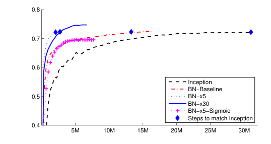
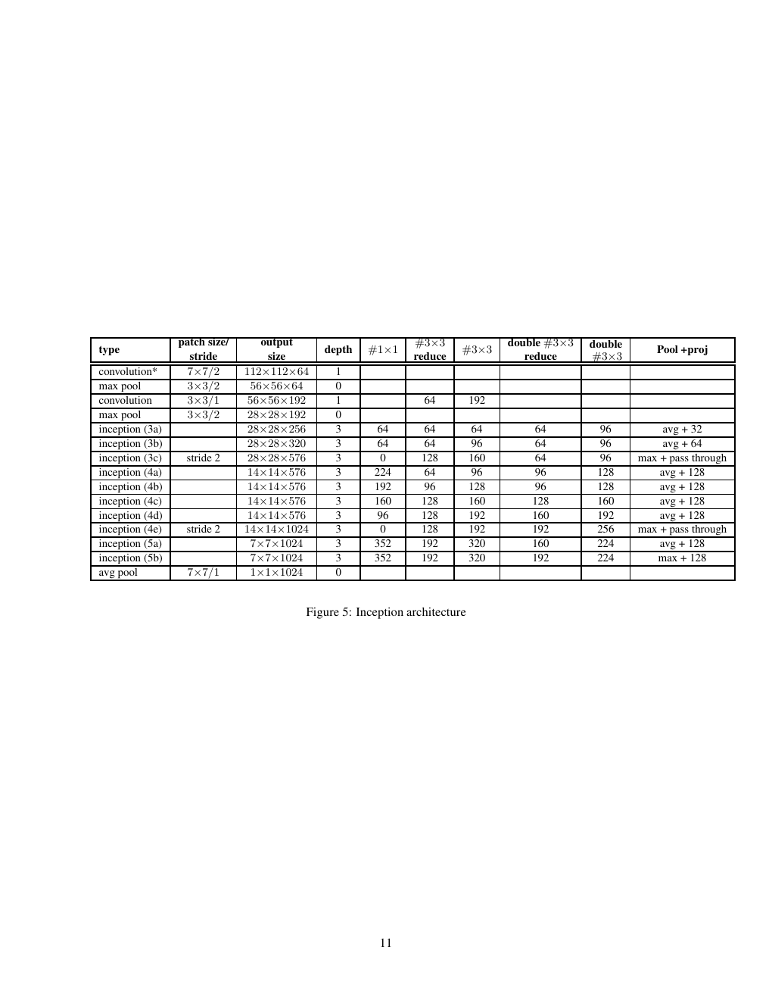

# Batch Normalization: Accelerating Deep Network Training by Reducing Internal Covariate Shift

**中文译名**：批归一化：通过减少内部协变量偏移加速深度网络训练

**Original:** arXiv:1502.03167v3 [cs.LG] 2 Mar 2015

**中文:** arXiv:1502.03167v3 [cs.LG]，2015 年 3 月 2 日

**Original:** Sergey Ioffe, Google Inc., sioffe@google.com
Christian Szegedy, Google Inc., szegedy@google.com

**中文:** Sergey Ioffe（Google Inc.，sioffe@google.com）；Christian Szegedy（Google Inc.，szegedy@google.com）

## Abstract（摘要）

**Original:** Training Deep Neural Networks is complicated by the fact that the distribution of each layer's inputs changes during training, as the parameters of the previous layers change. This slows down the training by requiring lower learning rates and careful parameter initialization, and makes it notoriously hard to train models with saturating nonlinearities. We refer to this phenomenon as internal covariate shift, and address the problem by normalizing layer inputs. Our method draws its strength from making normalization a part of the model architecture and performing the normalization for each training mini-batch. Batch Normalization allows us to use much higher learning rates and be less careful about initialization. It also acts as a regularizer, in some cases eliminating the need for Dropout. Applied to a state-of-the-art image classification model, Batch Normalization achieves the same accuracy with 14 times fewer training steps, and beats the original model by a significant margin. Using an ensemble of batch-normalized networks, we improve upon the best published result on ImageNet classification: reaching 4.9% top-5 validation error (and 4.8% test error), exceeding the accuracy of human raters.

**中文:** 训练深度神经网络（Deep Neural Network）之所以困难，是因为在训练过程中，随着前面各层参数的变化，每一层输入的分布也在不断改变。这要求使用更低的学习率（learning rate）和谨慎的参数初始化（parameter initialization），从而拖慢训练，并且使得带饱和非线性（saturating nonlinearities）的模型极难训练。我们将这一现象称为内部协变量偏移（internal covariate shift），并通过归一化（normalizing）各层输入来解决这一问题。我们方法的优势在于：把归一化作为模型架构的一部分，并且对每个训练小批量（mini-batch）都执行归一化。批归一化（Batch Normalization）使我们能够使用高得多的学习率，并且不必那么在意初始化。它还具有正则化项（regularizer）的作用，在某些情况下可以免去随机失活（Dropout）的需要。将批归一化应用于一个当前最优（state-of-the-art）的图像分类（image classification）模型，只用 1/14 的训练步数就能达到同样的准确率（accuracy），并且以显著优势超越原模型。使用一批经批归一化的网络组成的集成（ensemble），我们在 ImageNet 分类上刷新了已发表的最好成绩：top-5 验证错误率（validation error）达到 4.9%（测试错误率 4.8%），超过了人工标注者（human raters）的准确率。

## 1 Introduction（引言）

**Original:** Deep learning has dramatically advanced the state of the art in vision, speech, and many other areas. Stochastic gradient descent (SGD) has proved to be an effective way of training deep networks, and SGD variants such as momentum (Sutskever et al., 2013) and Adagrad (Duchi et al., 2011) have been used to achieve state of the art performance. SGD optimizes the parameters Θ of the network, so as to minimize the loss

$$\Theta = \arg\min_\Theta \frac{1}{N}\sum_{i=1}^N \ell(\mathbf{x}_i, \Theta)$$

where $\mathbf{x}_{1\ldots N}$ is the training data set. With SGD, the training proceeds in steps, and at each step we consider a mini-batch $\mathbf{x}_{1\ldots m}$ of size $m$. The mini-batch is used to approximate the gradient of the loss function with respect to the parameters, by computing

$$\frac{1}{m} \frac{\partial \ell(\mathbf{x}_i, \Theta)}{\partial \Theta}.$$

**中文:** 深度学习（deep learning）极大地推动了视觉、语音以及许多其他领域的当前最优（state of the art）水平。随机梯度下降（stochastic gradient descent，SGD）已被证明是训练深度网络的有效方法，而 SGD 的变体，如动量（momentum）(Sutskever et al., 2013) 与 Adagrad (Duchi et al., 2011)，也已被用于取得当前最优性能。SGD 优化网络的参数 $\Theta$，以最小化损失

$$\Theta = \arg\min_\Theta \frac{1}{N}\sum_{i=1}^N \ell(\mathbf{x}_i, \Theta)$$

其中 $\mathbf{x}_{1\ldots N}$ 是训练数据集。使用 SGD 时，训练按步进行，每一步考虑一个大小为 $m$ 的小批量（mini-batch）$\mathbf{x}_{1\ldots m}$。小批量被用来近似损失函数关于参数的梯度，即计算

$$\frac{1}{m} \frac{\partial \ell(\mathbf{x}_i, \Theta)}{\partial \Theta}.$$

**Original:** Using mini-batches of examples, as opposed to one example at a time, is helpful in several ways. First, the gradient of the loss over a mini-batch is an estimate of the gradient over the training set, whose quality improves as the batch size increases. Second, computation over a batch can be much more efficient than m computations for individual examples, due to the parallelism afforded by the modern computing platforms.

**中文:** 使用小批量样本（而不是一次一个样本）在几个方面都很有益。第一，一个小批量上损失的梯度是对整个训练集梯度的估计，其质量随批量大小的增大而提高。第二，由于现代计算平台提供的并行性，对一个批量的计算可以比逐样本的 $m$ 次计算高效得多。

**Original:** While stochastic gradient is simple and effective, it requires careful tuning of the model hyper-parameters, specifically the learning rate used in optimization, as well as the initial values for the model parameters. The training is complicated by the fact that the inputs to each layer are affected by the parameters of all preceding layers – so that small changes to the network parameters amplify as the network becomes deeper.

**中文:** 虽然随机梯度方法简单而有效，但它需要仔细调节模型的超参数（hyper-parameters），尤其是优化所用的学习率以及模型参数的初始值。训练之所以复杂，是因为每一层的输入都受到它前面所有层参数的影响——因此随着网络变深，网络参数的微小变化会被不断放大。

**Original:** The change in the distributions of layers' inputs presents a problem because the layers need to continuously adapt to the new distribution. When the input distribution to a learning system changes, it is said to experience covariate shift (Shimodaira, 2000). This is typically handled via domain adaptation (Jiang, 2008). However, the notion of covariate shift can be extended beyond the learning system as a whole, to apply to its parts, such as a sub-network or a layer. Consider a network computing

$$\ell = F_2(F_1(\mathbf{u}, \Theta_1), \Theta_2)$$

where $F_1$ and $F_2$ are arbitrary transformations, and the parameters $\Theta_1, \Theta_2$ are to be learned so as to minimize the loss $\ell$. Learning $\Theta_2$ can be viewed as if the inputs $\mathbf{x}=F_1(\mathbf{u},\Theta_1)$ are fed into the sub-network

$$\ell = F_2(\mathbf{x}, \Theta_2).$$

For example, a gradient descent step

$$\Theta_2\leftarrow \Theta_2 - \frac{\alpha}{m}\sum_{i=1}^m \frac{\partial F_2(\mathbf{x}_i,\Theta_2)}{\partial \Theta_2}$$

(for batch size $m$ and learning rate $\alpha$) is exactly equivalent to that for a stand-alone network $F_2$ with input $\mathbf{x}$. Therefore, the input distribution properties that make training more efficient – such as having the same distribution between the training and test data – apply to training the sub-network as well. As such it is advantageous for the distribution of $\mathbf{x}$ to remain fixed over time. Then, $\Theta_2$ does not have to readjust to compensate for the change in the distribution of $\mathbf{x}$.

**中文:** 各层输入分布的变化会带来问题，因为各层需要不断适应新的分布。当一个学习系统的输入分布发生变化时，我们称它经历了协变量偏移（covariate shift）(Shimodaira, 2000)。这通常通过领域自适应（domain adaptation）来处理 (Jiang, 2008)。然而，协变量偏移的概念可以超出整个学习系统的范畴，推广到它的各个组成部分，例如一个子网络或一个层。考虑一个计算

$$\ell = F_2(F_1(\mathbf{u}, \Theta_1), \Theta_2)$$

的网络，其中 $F_1$ 和 $F_2$ 是任意变换，参数 $\Theta_1, \Theta_2$ 要通过学习来最小化损失 $\ell$。学习 $\Theta_2$ 可以看作把输入 $\mathbf{x}=F_1(\mathbf{u},\Theta_1)$ 馈入子网络

$$\ell = F_2(\mathbf{x}, \Theta_2).$$

例如，一个梯度下降步

$$\Theta_2\leftarrow \Theta_2 - \frac{\alpha}{m}\sum_{i=1}^m \frac{\partial F_2(\mathbf{x}_i,\Theta_2)}{\partial \Theta_2}$$

（批量大小为 $m$、学习率为 $\alpha$）与以 $\mathbf{x}$ 为输入的独立网络 $F_2$ 的对应步骤完全等价。因此，那些使训练更高效的输入分布性质——例如训练数据与测试数据服从同一分布——同样适用于子网络的训练。这样一来，让 $\mathbf{x}$ 的分布随时间保持固定就是有利的。于是，$\Theta_2$ 就不必再重新调整以适应 $\mathbf{x}$ 分布的变化。

**Original:** Fixed distribution of inputs to a sub-network would have positive consequences for the layers outside the sub-network, as well. Consider a layer with a sigmoid activation function $\mathbf{z} = g(W\mathbf{u}+\mathbf{b})$ where $\mathbf{u}$ is the layer input, the weight matrix $W$ and bias vector $\mathbf{b}$ are the layer parameters to be learned, and $g(x) = \frac{1}{1+\exp(-x)}$. As $|x|$ increases, $g'(x)$ tends to zero. This means that for all dimensions of $\mathbf{x}=W\mathbf{u}+\mathbf{b}$ except those with small absolute values, the gradient flowing down to $\mathbf{u}$ will vanish and the model will train slowly. However, since $\mathbf{x}$ is affected by $W, \mathbf{b}$ and the parameters of all the layers below, changes to those parameters during training will likely move many dimensions of $\mathbf{x}$ into the saturated regime of the nonlinearity and slow down the convergence. This effect is amplified as the network depth increases. In practice, the saturation problem and the resulting vanishing gradients are usually addressed by using Rectified Linear Units (Nair & Hinton, 2010) $ReLU(x)=\max(x,0)$, careful initialization (Bengio & Glorot, 2010; Saxe et al., 2013), and small learning rates. If, however, we could ensure that the distribution of nonlinearity inputs remains more stable as the network trains, then the optimizer would be less likely to get stuck in the saturated regime, and the training would accelerate.

**中文:** 子网络输入的固定分布对子网络之外的各层同样有积极影响。考虑一个带 sigmoid 激活函数的层 $\mathbf{z} = g(W\mathbf{u}+\mathbf{b})$，其中 $\mathbf{u}$ 是层的输入，权重矩阵（weight matrix）$W$ 和偏置向量（bias vector）$\mathbf{b}$ 是待学习的层参数，而 $g(x) = \frac{1}{1+\exp(-x)}$。随着 $|x|$ 增大，$g'(x)$ 趋于零。这意味着对 $\mathbf{x}=W\mathbf{u}+\mathbf{b}$ 的所有维度（绝对值很小的那些除外），向下流到 $\mathbf{u}$ 的梯度都会消失，模型将训练得很慢。然而，由于 $\mathbf{x}$ 受 $W, \mathbf{b}$ 以及下面所有层的参数影响，训练中这些参数的变化很可能把 $\mathbf{x}$ 的许多维度推入非线性的饱和区（saturated regime），从而减慢收敛（convergence）。这一效应随网络深度增加而加剧。实践中，饱和问题以及由此产生的梯度消失（vanishing gradients）通常通过使用修正线性单元（Rectified Linear Units）(Nair & Hinton, 2010) $ReLU(x)=\max(x,0)$、谨慎的初始化 (Bengio & Glorot, 2010; Saxe et al., 2013) 和小学习率来解决。然而，如果我们能保证在训练过程中非线性输入的分布保持更稳定，那么优化器就不太会陷入饱和区，训练就会加速。

**Original:** We refer to the change in the distributions of internal nodes of a deep network, in the course of training, as Internal Covariate Shift. Eliminating it offers a promise of faster training. We propose a new mechanism, which we call Batch Normalization, that takes a step towards reducing internal covariate shift, and in doing so dramatically accelerates the training of deep neural nets. It accomplishes this via a normalization step that fixes the means and variances of layer inputs. Batch Normalization also has a beneficial effect on the gradient flow through the network, by reducing the dependence of gradients on the scale of the parameters or of their initial values. This allows us to use much higher learning rates without the risk of divergence. Furthermore, batch normalization regularizes the model and reduces the need for Dropout (Srivastava et al., 2014). Finally, Batch Normalization makes it possible to use saturating nonlinearities by preventing the network from getting stuck in the saturated modes.

**中文:** 我们把深度网络内部节点分布在训练过程中的变化称为内部协变量偏移（Internal Covariate Shift）。消除它可以带来更快的训练。我们提出一种新机制，称之为批归一化（Batch Normalization），它朝着减少内部协变量偏移迈出了一步，并借此显著加速深度神经网络的训练。它通过一个固定各层输入均值和方差的归一化步骤来实现这一点。批归一化还通过降低梯度对参数尺度及其初始值的依赖，对网络中梯度的流动产生有益影响。这使得我们可以使用高得多的学习率而无需担心发散（divergence）。此外，批归一化对模型有正则化（regularize）作用，减少了对随机失活（Dropout）(Srivastava et al., 2014) 的需求。最后，批归一化通过防止网络陷入饱和模式，使得使用饱和非线性成为可能。

**Original:** In Sec. 4.2, we apply Batch Normalization to the best-performing ImageNet classification network, and show that we can match its performance using only 7% of the training steps, and can further exceed its accuracy by a substantial margin. Using an ensemble of such networks trained with Batch Normalization, we achieve the top-5 error rate that improves upon the best known results on ImageNet classification.

**中文:** 在第 4.2 节，我们将批归一化应用于表现最好的 ImageNet 分类网络，并表明只需 7% 的训练步数就能追平其性能，还能以可观的优势进一步提升其准确率。使用一组经批归一化训练的网络构成的集成，我们取得了超越 ImageNet 分类已知最好结果的 top-5 错误率。

## 2 Towards Reducing Internal Covariate Shift（朝着减少内部协变量偏移）

**Original:** We define Internal Covariate Shift as the change in the distribution of network activations due to the change in network parameters during training. To improve the training, we seek to reduce the internal covariate shift. By fixing the distribution of the layer inputs $\mathbf{x}$ as the training progresses, we expect to improve the training speed. It has been long known (LeCun et al., 1998b; Wiesler & Ney, 2011) that the network training converges faster if its inputs are whitened – i.e., linearly transformed to have zero means and unit variances, and decorrelated. As each layer observes the inputs produced by the layers below, it would be advantageous to achieve the same whitening of the inputs of each layer. By whitening the inputs to each layer, we would take a step towards achieving the fixed distributions of inputs that would remove the ill effects of the internal covariate shift.

**中文:** 我们把内部协变量偏移定义为：训练过程中网络激活值（activations）的分布因网络参数变化而发生的变化。为改进训练，我们力求减少内部协变量偏移。随着训练推进，固定各层输入 $\mathbf{x}$ 的分布，我们预期能提高训练速度。人们早已知道 (LeCun et al., 1998b; Wiesler & Ney, 2011)，如果网络输入经过白化（whitened）——即经线性变换使其均值为零、方差为 1，并且去相关——网络训练会收敛得更快。由于每一层观察到的输入都来自其下各层的产出，对每一层的输入都实现同样的白化将是有利的。通过对每一层的输入做白化，我们就朝着固定的输入分布迈出了一步，从而消除内部协变量偏移的不利影响。

**Original:** We could consider whitening activations at every training step or at some interval, either by modifying the network directly or by changing the parameters of the optimization algorithm to depend on the network activation values (Wiesler et al., 2014; Raiko et al., 2012; Povey et al., 2014; Desjardins & Kavukcuoglu). However, if these modifications are interspersed with the optimization steps, then the gradient descent step may attempt to update the parameters in a way that requires the normalization to be updated, which reduces the effect of the gradient step. For example, consider a layer with the input $u$ that adds the learned bias $b$, and normalizes the result by subtracting the mean of the activation computed over the training data: $\widehat{x}=x - E[x]$ where $x = u+b$, $\mathcal{X}=\{x_{1\ldots N}\}$ is the set of values of $x$ over the training set, and $E[x] = \frac{1}{N}\sum_{i=1}^N x_i$. If a gradient descent step ignores the dependence of $E[x]$ on $b$, then it will update $b\leftarrow b+\Delta b$, where $\Delta b\propto -\partial{\ell}/\partial{\widehat{x}}$. Then $u+(b+\Delta b) - E[u+(b+\Delta b)] = u+b-E[u+b]$. Thus, the combination of the update to $b$ and subsequent change in normalization led to no change in the output of the layer nor, consequently, the loss. As the training continues, $b$ will grow indefinitely while the loss remains fixed. This problem can get worse if the normalization not only centers but also scales the activations. We have observed this empirically in initial experiments, where the model blows up when the normalization parameters are computed outside the gradient descent step.

**中文:** 我们可以考虑在每个训练步或每隔一定间隔对激活值做白化，要么直接修改网络，要么修改优化算法的参数使其依赖于网络的激活值 (Wiesler et al., 2014; Raiko et al., 2012; Povey et al., 2014; Desjardins & Kavukcuoglu)。然而，如果这些修改与优化步骤交错进行，那么梯度下降步可能会以某种方式更新参数，而这种更新又要求归一化随之更新，从而削弱梯度步的效果。例如，考虑一个输入为 $u$ 的层，它加上学习到的偏置（bias）$b$，并通过减去训练数据上算出的激活均值来归一化结果：$\widehat{x}=x - E[x]$，其中 $x = u+b$，$\mathcal{X}=\{x_{1\ldots N}\}$ 是 $x$ 在训练集上的取值集合，$E[x] = \frac{1}{N}\sum_{i=1}^N x_i$。如果梯度下降步忽略了 $E[x]$ 对 $b$ 的依赖，那么它会更新 $b\leftarrow b+\Delta b$，其中 $\Delta b\propto -\partial{\ell}/\partial{\widehat{x}}$。于是 $u+(b+\Delta b) - E[u+(b+\Delta b)] = u+b-E[u+b]$。因此，对 $b$ 的更新与随之而来的归一化变化相结合，导致层的输出没有变化，损失因而也没有变化。随着训练继续，$b$ 会无限增长而损失保持不变。如果归一化不仅中心化（center）还缩放（scale）激活值，这一问题会更严重。我们在初步实验中从经验上观察到了这一点：当归一化参数在梯度下降步之外计算时，模型会发散。

**Original:** The issue with the above approach is that the gradient descent optimization does not take into account the fact that the normalization takes place. To address this issue, we would like to ensure that, for any parameter values, the network always produces activations with the desired distribution. Doing so would allow the gradient of the loss with respect to the model parameters to account for the normalization, and for its dependence on the model parameters $\Theta$. Let again $\mathbf{x}$ be a layer input, treated as a vector, and $\mathcal{X}$ be the set of these inputs over the training data set. The normalization can then be written as a transformation

$$\widehat{\mathbf{x}}=\text{Norm}(\mathbf{x},\mathcal{X})$$

which depends not only on the given training example $\mathbf{x}$ but on all examples $\mathcal{X}$ – each of which depends on $\Theta$ if $\mathbf{x}$ is generated by another layer. For backpropagation, we would need to compute the Jacobians

$$\frac{\partial \text{Norm}(\mathbf{x},\mathcal{X})}{\partial \mathbf{x}} \text{ and } \frac{\partial \text{Norm}(\mathbf{x},\mathcal{X})}{\partial \mathcal{X}};$$

ignoring the latter term would lead to the explosion described above. Within this framework, whitening the layer inputs is expensive, as it requires computing the covariance matrix $\text{Cov}[\mathbf{x}]=\text{E}_{\mathbf{x}\in\mathcal{X}}[\mathbf{x} \mathbf{x}^T]-\text{E}[\mathbf{x}]\text{E}[\mathbf{x}]^T$ and its inverse square root, to produce the whitened activations $\text{Cov}[\mathbf{x}]^{-1/2}(\mathbf{x}-\text{E}[\mathbf{x}])$, as well as the derivatives of these transforms for backpropagation. This motivates us to seek an alternative that performs input normalization in a way that is differentiable and does not require the analysis of the entire training set after every parameter update. Some of the previous approaches (e.g. (Lyu & Simoncelli, 2008)) use statistics computed over a single training example, or, in the case of image networks, over different feature maps at a given location. However, this changes the representation ability of a network by discarding the absolute scale of activations. We want to a preserve the information in the network, by normalizing the activations in a training example relative to the statistics of the entire training data.

**中文:** 上述方法的问题在于，梯度下降优化没有把「归一化正在发生」这一事实考虑在内。为解决这个问题，我们希望保证：对任意参数值，网络始终产生具有期望分布的激活值。这样一来，损失关于模型参数的梯度就能把归一化及其对模型参数 $\Theta$ 的依赖纳入计算。再次令 $\mathbf{x}$ 为一个层的输入（视为向量），$\mathcal{X}$ 为这些输入在整个训练数据集上的集合。归一化就可以写成一个变换

$$\widehat{\mathbf{x}}=\text{Norm}(\mathbf{x},\mathcal{X})$$

它不但依赖于给定的训练样本 $\mathbf{x}$，还依赖于所有样本 $\mathcal{X}$——如果 $\mathbf{x}$ 是由另一层生成的，则其中的每个样本都依赖于 $\Theta$。对反向传播（backpropagation）而言，我们需要计算雅可比矩阵（Jacobians）

$$\frac{\partial \text{Norm}(\mathbf{x},\mathcal{X})}{\partial \mathbf{x}} \text{ 和 } \frac{\partial \text{Norm}(\mathbf{x},\mathcal{X})}{\partial \mathcal{X}};$$

忽略后一项会导致上面描述的发散。在这一框架内，对各层输入做白化代价高昂，因为它需要计算协方差矩阵 $\text{Cov}[\mathbf{x}]=\text{E}_{\mathbf{x}\in\mathcal{X}}[\mathbf{x} \mathbf{x}^T]-\text{E}[\mathbf{x}]\text{E}[\mathbf{x}]^T$ 及其平方根的逆，以得到白化后的激活值 $\text{Cov}[\mathbf{x}]^{-1/2}(\mathbf{x}-\text{E}[\mathbf{x}])$，还需要计算这些变换的导数用于反向传播。这促使我们寻找一种替代方案：以一种可微（differentiable）的方式执行输入归一化，且无需在每次参数更新后分析整个训练集。之前的一些方法（如 (Lyu & Simoncelli, 2008)）使用在单个训练样本上——或者对图像网络而言，在同一位置的不同特征图（feature maps）上——计算的统计量。然而，这会丢弃激活值的绝对尺度，从而改变网络的表征能力。我们希望保留网络中的信息 [译注：原文此处为 "We want to a preserve the information"，多了一个 "a"，系 arXiv v3 版本的笔误]，做法是相对于整个训练数据的统计量来归一化训练样本中的激活值。

## 3 Normalization via Mini-Batch Statistics（基于小批量统计量的归一化）

**Original:** Since the full whitening of each layer's inputs is costly and not everywhere differentiable, we make two necessary simplifications. The first is that instead of whitening the features in layer inputs and outputs jointly, we will normalize each scalar feature independently, by making it have the mean of zero and the variance of 1. For a layer with $d$-dimensional input $\mathbf{x} = (x^{(1)}\ldots x^{(d)})$, we will normalize each dimension

$$\widehat{x}^{(k)} = \frac{x^{(k)}-\text{E}[x^{(k)}]}{\sqrt{\text{Var}[x^{(k)}]}}$$

where the expectation and variance are computed over the training data set. As shown in (LeCun et al., 1998b), such normalization speeds up convergence, even when the features are not decorrelated.

**中文:** 由于对每一层的输入做完全白化代价高昂且并非处处可微，我们做了两个必要的简化。第一，不再联合地对层输入和输出中的特征做白化，而是独立地归一化每个标量特征，使其均值为零、方差为 1。对于一个输入为 $d$ 维向量 $\mathbf{x} = (x^{(1)}\ldots x^{(d)})$ 的层，我们对每个维度做如下归一化

$$\widehat{x}^{(k)} = \frac{x^{(k)}-\text{E}[x^{(k)}]}{\sqrt{\text{Var}[x^{(k)}]}}$$

其中期望和方差在整个训练数据集上计算。如 (LeCun et al., 1998b) 所示，即使特征没有去相关，这样的归一化也能加速收敛。

**Original:** Note that simply normalizing each input of a layer may change what the layer can represent. For instance, normalizing the inputs of a sigmoid would constrain them to the linear regime of the nonlinearity. To address this, we make sure that the transformation inserted in the network can represent the identity transform. To accomplish this, we introduce, for each activation $x^{(k)}$, a pair of parameters $\gamma^{(k)}, \beta^{(k)}$, which scale and shift the normalized value:

$$y^{(k)} = \gamma^{(k)}\widehat{x}^{(k)} + \beta^{(k)}.$$

These parameters are learned along with the original model parameters, and restore the representation power of the network. Indeed, by setting $\gamma^{(k)} = \sqrt{\text{Var}[x^{(k)}]}$ and $\beta^{(k)} = \text{E}[x^{(k)}]$, we could recover the original activations, if that were the optimal thing to do.

**中文:** 注意，仅仅归一化一个层的每个输入可能会改变该层所能表示的内容。例如，对 sigmoid 的输入做归一化会把它们约束到非线性的线性区（linear regime）。为解决这个问题，我们要确保插入网络的变换能够表示恒等变换（identity transform）。为此，对每个激活值 $x^{(k)}$，我们引入一对参数 $\gamma^{(k)}, \beta^{(k)}$，用来缩放和平移归一化后的值：

$$y^{(k)} = \gamma^{(k)}\widehat{x}^{(k)} + \beta^{(k)}.$$

这些参数与原始模型参数一起被学习，并恢复了网络的表征能力。事实上，通过令 $\gamma^{(k)} = \sqrt{\text{Var}[x^{(k)}]}$ 和 $\beta^{(k)} = \text{E}[x^{(k)}]$，如果这确实是最优选择，我们就能恢复出原始激活值。

**Original:** In the batch setting where each training step is based on the entire training set, we would use the whole set to normalize activations. However, this is impractical when using stochastic optimization. Therefore, we make the second simplification: since we use mini-batches in stochastic gradient training, each mini-batch produces estimates of the mean and variance of each activation. This way, the statistics used for normalization can fully participate in the gradient backpropagation. Note that the use of mini-batches is enabled by computation of per-dimension variances rather than joint covariances; in the joint case, regularization would be required since the mini-batch size is likely to be smaller than the number of activations being whitened, resulting in singular covariance matrices.

**中文:** 在批量（batch）设定下，每个训练步都基于整个训练集，我们会用整个集合来归一化激活值。但在使用随机优化（stochastic optimization）时这并不现实。因此，我们做第二个简化：由于我们在随机梯度训练中使用小批量，每个小批量都会给出每个激活值均值和方差的估计。这样一来，用于归一化的统计量就能完全参与梯度的反向传播。注意，小批量的使用之所以可行，是因为我们计算的是逐维的方差而不是联合协方差；在联合的情况下，由于小批量大小很可能小于被白化的激活值的数目，协方差矩阵将是奇异的，必须加正则化。

**Original:** Consider a mini-batch $\mathcal{B}$ of size $m$. Since the normalization is applied to each activation independently, let us focus on a particular activation $x^{(k)}$ and omit $k$ for clarity. We have $m$ values of this activation in the mini-batch,

$$\mathcal{B}=\{x_{1\ldots m}\}.$$

Let the normalized values be $\widehat{x}_{1\ldots m}$, and their linear transformations be $y_{1\ldots m}$. We refer to the transform

$$\text{BN}_{\gamma,\beta}: x_{1\ldots m}\rightarrow y_{1\ldots m}$$

as the Batch Normalizing Transform. We present the BN Transform in Algorithm 1. In the algorithm, $\epsilon$ is a constant added to the mini-batch variance for numerical stability.

**中文:** 考虑一个大小为 $m$ 的小批量 $\mathcal{B}$。由于归一化独立地作用于每个激活值，我们聚焦于某个特定的激活值 $x^{(k)}$，为清晰起见略去 $k$。该激活值在小批量中有 $m$ 个取值，

$$\mathcal{B}=\{x_{1\ldots m}\}.$$

令归一化后的值为 $\widehat{x}_{1\ldots m}$，它们的线性变换为 $y_{1\ldots m}$。我们称变换

$$\text{BN}_{\gamma,\beta}: x_{1\ldots m}\rightarrow y_{1\ldots m}$$

为批归一化变换（Batch Normalizing Transform）。我们在算法 1 中给出 BN 变换。算法中，$\epsilon$ 是为了数值稳定性而加到小批量方差上的一个常数。

**Original (Algorithm 1):** Batch Normalizing Transform, applied to activation $x$ over a mini-batch.

```
Input:  Values of x over a mini-batch: B = {x_{1...m}};
        Parameters to be learned: γ, β
Output: {y_i = BN_{γ,β}(x_i)}

  μ_B   ← (1/m) Σ_{i=1}^{m} x_i              // mini-batch mean
  σ²_B  ← (1/m) Σ_{i=1}^{m} (x_i − μ_B)²     // mini-batch variance
  x̂_i   ← (x_i − μ_B) / √(σ²_B + ϵ)          // normalize
  y_i   ← γx̂_i + β ≡ BN_{γ,β}(x_i)           // scale and shift
```

**中文（算法 1，注释已译）:** 批归一化变换（Batch Normalizing Transform），应用于一个小批量上的激活值 $x$。

```
输入：小批量上 x 的取值：B = {x_{1...m}}；
      待学习参数：γ, β
输出：{y_i = BN_{γ,β}(x_i)}

  μ_B   ← (1/m) Σ_{i=1}^{m} x_i              // 小批量均值
  σ²_B  ← (1/m) Σ_{i=1}^{m} (x_i − μ_B)²     // 小批量方差
  x̂_i   ← (x_i − μ_B) / √(σ²_B + ϵ)          // 归一化
  y_i   ← γx̂_i + β ≡ BN_{γ,β}(x_i)           // 缩放和平移
```

**Original:** The BN transform can be added to a network to manipulate any activation. In the notation $y = \text{BN}_{\gamma,\beta}(x)$, we indicate that the parameters $\gamma$ and $\beta$ are to be learned, but it should be noted that the BN transform does not independently process the activation in each training example. Rather, $\text{BN}_{\gamma,\beta}(x)$ depends both on the training example and the other examples in the mini-batch. The scaled and shifted values $y$ are passed to other network layers. The normalized activations $\widehat{x}$ are internal to our transformation, but their presence is crucial. The distributions of values of any $\widehat{x}$ has the expected value of 0 and the variance of 1, as long as the elements of each mini-batch are sampled from the same distribution, and if we neglect $\epsilon$. This can be seen by observing that $\sum_{i=1}^m \widehat{x}_i = 0$ and $\frac{1}{m}\sum_{i=1}^m \widehat{x}_i^2 = 1$, and taking expectations. Each normalized activation $\widehat{x}^{(k)}$ can be viewed as an input to a sub-network composed of the linear transform $y^{(k)}=\gamma^{(k)}\widehat{x}^{(k)}+\beta^{(k)}$, followed by the other processing done by the original network. These sub-network inputs all have fixed means and variances, and although the joint distribution of these normalized $\widehat{x}^{(k)}$ can change over the course of training, we expect that the introduction of normalized inputs accelerates the training of the sub-network and, consequently, the network as a whole.

**中文:** BN 变换可以被加到网络中，作用于任意激活值。记法 $y = \text{BN}_{\gamma,\beta}(x)$ 表明参数 $\gamma$ 和 $\beta$ 是待学习的，但要注意，BN 变换并不是独立地处理每个训练样本中的激活值。相反，$\text{BN}_{\gamma,\beta}(x)$ 既依赖于该训练样本，也依赖于小批量中的其他样本。缩放和平移后的值 $y$ 被传给网络的其他层。归一化后的激活值 $\widehat{x}$ 是我们变换的内部量，但它们的存在至关重要。只要每个小批量的元素是从同一分布采样得到的，并且忽略 $\epsilon$，任意 $\widehat{x}$ 取值的分布就具有期望 0 和方差 1。观察到 $\sum_{i=1}^m \widehat{x}_i = 0$ 与 $\frac{1}{m}\sum_{i=1}^m \widehat{x}_i^2 = 1$，再取期望即可看出这一点。每个归一化后的激活值 $\widehat{x}^{(k)}$ 都可以看作一个子网络的输入，该子网络由线性变换 $y^{(k)}=\gamma^{(k)}\widehat{x}^{(k)}+\beta^{(k)}$ 加上原始网络后续的处理组成。这些子网络的输入都有固定的均值和方差，虽然这些归一化后的 $\widehat{x}^{(k)}$ 的联合分布会随训练进程而变化，但我们预期归一化输入的引入会加速子网络的训练，进而加速整个网络的训练。

**Original:** During training we need to backpropagate the gradient of loss $\ell$ through this transformation, as well as compute the gradients with respect to the parameters of the BN transform. We use chain rule, as follows (before simplification):

$$\frac{\partial \ell}{\partial \widehat{x}_i} = \frac{\partial \ell}{\partial y_i}\cdot \gamma$$

$$\frac{\partial \ell}{\partial \sigma_\mathcal{B}^2} = \sum_{i=1}^m \frac{\partial \ell}{\partial \widehat{x}_i}\cdot(x_i-\mu_\mathcal{B})\cdot \frac{-1}{2}(\sigma_\mathcal{B}^2+\epsilon)^{-3/2}$$

$$\frac{\partial \ell}{\partial \mu_\mathcal{B}} = \bigg(\sum_{i=1}^m \frac{\partial \ell}{\partial \widehat{x}_i}\cdot \frac{-1}{\sqrt{\sigma_\mathcal{B}^2+\epsilon}}\bigg) + \frac{\partial \ell}{\partial \sigma_\mathcal{B}^2}\cdot\frac{\sum_{i=1}^m -2(x_i-\mu_\mathcal{B})}{m}$$

$$\frac{\partial \ell}{\partial x_i} = \frac{\partial \ell}{\partial \widehat{x}_i} \cdot \frac{1}{\sqrt{\sigma_\mathcal{B}^2+\epsilon}} + \frac{\partial \ell}{\partial \sigma_\mathcal{B}^2}\cdot \frac{2(x_i-\mu_\mathcal{B})}{m} + \frac{\partial \ell}{\partial \mu_\mathcal{B}}\cdot \frac{1}{m}$$

$$\frac{\partial \ell}{\partial \gamma}= \sum_{i=1}^m \frac{\partial \ell}{\partial y_i} \cdot \widehat{x}_i$$

$$\frac{\partial \ell}{\partial \beta} = \sum_{i=1}^m \frac{\partial \ell}{\partial y_i}$$

Thus, BN transform is a differentiable transformation that introduces normalized activations into the network. This ensures that as the model is training, layers can continue learning on input distributions that exhibit less internal covariate shift, thus accelerating the training. Furthermore, the learned affine transform applied to these normalized activations allows the BN transform to represent the identity transformation and preserves the network capacity.

**中文:** 在训练过程中，我们需要让损失 $\ell$ 的梯度反向传播穿过这一变换，同时计算关于 BN 变换参数的梯度。我们使用链式法则（chain rule），如下所示（简化前）：

$$\frac{\partial \ell}{\partial \widehat{x}_i} = \frac{\partial \ell}{\partial y_i}\cdot \gamma$$

$$\frac{\partial \ell}{\partial \sigma_\mathcal{B}^2} = \sum_{i=1}^m \frac{\partial \ell}{\partial \widehat{x}_i}\cdot(x_i-\mu_\mathcal{B})\cdot \frac{-1}{2}(\sigma_\mathcal{B}^2+\epsilon)^{-3/2}$$

$$\frac{\partial \ell}{\partial \mu_\mathcal{B}} = \bigg(\sum_{i=1}^m \frac{\partial \ell}{\partial \widehat{x}_i}\cdot \frac{-1}{\sqrt{\sigma_\mathcal{B}^2+\epsilon}}\bigg) + \frac{\partial \ell}{\partial \sigma_\mathcal{B}^2}\cdot\frac{\sum_{i=1}^m -2(x_i-\mu_\mathcal{B})}{m}$$

$$\frac{\partial \ell}{\partial x_i} = \frac{\partial \ell}{\partial \widehat{x}_i} \cdot \frac{1}{\sqrt{\sigma_\mathcal{B}^2+\epsilon}} + \frac{\partial \ell}{\partial \sigma_\mathcal{B}^2}\cdot \frac{2(x_i-\mu_\mathcal{B})}{m} + \frac{\partial \ell}{\partial \mu_\mathcal{B}}\cdot \frac{1}{m}$$

$$\frac{\partial \ell}{\partial \gamma}= \sum_{i=1}^m \frac{\partial \ell}{\partial y_i} \cdot \widehat{x}_i$$

$$\frac{\partial \ell}{\partial \beta} = \sum_{i=1}^m \frac{\partial \ell}{\partial y_i}$$

因此，BN 变换是一个可微变换，它把归一化后的激活值引入网络。这保证了模型训练期间，各层能在内部协变量偏移更小的输入分布上继续学习，从而加速训练。此外，作用于这些归一化激活值上的可学习仿射变换（affine transform），使 BN 变换能够表示恒等变换，并保持了网络的容量（capacity）。

### 3.1 Training and Inference with Batch-Normalized Networks（批归一化网络的训练与推理）

**Original:** To Batch-Normalize a network, we specify a subset of activations and insert the BN transform for each of them, according to Alg. 1. Any layer that previously received $x$ as the input, now receives $\text{BN}(x)$. A model employing Batch Normalization can be trained using batch gradient descent, or Stochastic Gradient Descent with a mini-batch size $m>1$, or with any of its variants such as Adagrad (Duchi et al., 2011). The normalization of activations that depends on the mini-batch allows efficient training, but is neither necessary nor desirable during inference; we want the output to depend only on the input, deterministically. For this, once the network has been trained, we use the normalization

$$\widehat{x}=\frac{x-\text{E}[x]}{\sqrt{\text{Var}[x]+\epsilon}}$$

using the population, rather than mini-batch, statistics. Neglecting $\epsilon$, these normalized activations have the same mean 0 and variance 1 as during training. We use the unbiased variance estimate $\text{Var}[x] = \frac{m}{m-1}\cdot\text{E}_\mathcal{B}[\sigma_\mathcal{B}^2]$, where the expectation is over training mini-batches of size $m$ and $\sigma_\mathcal{B}^2$ are their sample variances. Using moving averages instead, we can track the accuracy of a model as it trains. Since the means and variances are fixed during inference, the normalization is simply a linear transform applied to each activation. It may further be composed with the scaling by $\gamma$ and shift by $\beta$, to yield a single linear transform that replaces $\text{BN}(x)$. Algorithm 2 summarizes the procedure for training batch-normalized networks.

**中文:** 要对一个网络做批归一化，我们先指定一个激活值的子集，并按算法 1 为其中每个激活值插入 BN 变换。任何之前以 $x$ 为输入的层，现在接收 $\text{BN}(x)$。使用批归一化的模型可以用批量梯度下降（batch gradient descent）训练，也可以用带小批量大小 $m>1$ 的随机梯度下降或其任意变体（如 Adagrad (Duchi et al., 2011)）训练。依赖小批量的激活值归一化使训练高效，但在推理（inference）阶段既非必要也不受欢迎；我们希望输出只确定性地依赖于输入。为此，一旦网络训练完成，我们就使用

$$\widehat{x}=\frac{x-\text{E}[x]}{\sqrt{\text{Var}[x]+\epsilon}}$$

进行归一化，其中使用的是总体统计量（population statistics）而非小批量统计量。忽略 $\epsilon$，这些归一化后的激活值具有与训练期间相同的均值 0 和方差 1。我们使用无偏方差估计（unbiased variance estimate）$\text{Var}[x] = \frac{m}{m-1}\cdot\text{E}_\mathcal{B}[\sigma_\mathcal{B}^2]$，其中期望是在大小为 $m$ 的训练小批量上取的，$\sigma_\mathcal{B}^2$ 是它们的样本方差。改用移动平均（moving averages），我们可以在训练过程中跟踪模型的准确率。由于推理期间均值和方差固定不变，归一化就只是作用于每个激活值的一个线性变换。它还可以进一步与 $\gamma$ 的缩放和 $\beta$ 的平移复合，得到单个替代 $\text{BN}(x)$ 的线性变换。算法 2 总结了训练批归一化网络的过程。

**Original (Algorithm 2):** Training a Batch-Normalized Network

```
Input:  Network N with trainable parameters Θ;
        subset of activations {x^{(k)}}_{k=1}^{K}
Output: Batch-normalized network for inference, N^inf_BN

1: N^tr_BN ← N                                 // Training BN network
2: for k = 1...K do
3:     Add transformation y^{(k)} = BN_{γ^{(k)},β^{(k)}}(x^{(k)}) to N^tr_BN (Alg. 1)
4:     Modify each layer in N^tr_BN with input x^{(k)} to take y^{(k)} instead
5: end for
6: Train N^tr_BN to optimize the parameters Θ ∪ {γ^{(k)}, β^{(k)}}_{k=1}^{K}
7: N^inf_BN ← N^tr_BN                          // Inference BN network with frozen
                                               // parameters
8: for k = 1...K do
9:     // For clarity, x ≡ x^{(k)}, γ ≡ γ^{(k)}, μ_B ≡ μ_B^{(k)}, etc.
10:    Process multiple training mini-batches B, each of size m, and average over them:
         E[x] ← E_B[μ_B]
         Var[x] ← (m/(m−1)) · E_B[σ²_B]
11:    In N^inf_BN, replace the transform y = BN_{γ,β}(x) with
         y = (γ/√(Var[x]+ϵ)) · x + (β − (γ·E[x])/√(Var[x]+ϵ))
12: end for
```

**中文（算法 2，注释已译）:** 训练一个批归一化网络

```
输入：具有可训练参数 Θ 的网络 N；
      激活值子集 {x^{(k)}}_{k=1}^{K}
输出：用于推理的批归一化网络 N^inf_BN

1: N^tr_BN ← N                                 // 训练用 BN 网络
2: for k = 1...K do
3:     向 N^tr_BN 添加变换 y^{(k)} = BN_{γ^{(k)},β^{(k)}}(x^{(k)})（算法 1）
4:     修改 N^tr_BN 中以 x^{(k)} 为输入的每一层，使其改为接收 y^{(k)}
5: end for
6: 训练 N^tr_BN 以优化参数 Θ ∪ {γ^{(k)}, β^{(k)}}_{k=1}^{K}
7: N^inf_BN ← N^tr_BN                          // 参数冻结的推理用 BN 网络
8: for k = 1...K do
9:     // 为清晰起见，x ≡ x^{(k)}，γ ≡ γ^{(k)}，μ_B ≡ μ_B^{(k)}，等等
10:    处理多个大小为 m 的训练小批量 B，并对其取平均：
         E[x] ← E_B[μ_B]
         Var[x] ← (m/(m−1)) · E_B[σ²_B]
11:    在 N^inf_BN 中，将变换 y = BN_{γ,β}(x) 替换为
         y = (γ/√(Var[x]+ϵ)) · x + (β − (γ·E[x])/√(Var[x]+ϵ))
12: end for
```

### 3.2 Batch-Normalized Convolutional Networks（批归一化卷积网络）

**Original:** Batch Normalization can be applied to any set of activations in the network. Here, we focus on transforms that consist of an affine transformation followed by an element-wise nonlinearity:

$$\mathbf{z} = g(W\mathbf{u}+\mathbf{b})$$

where $W$ and $\mathbf{b}$ are learned parameters of the model, and $g(\cdot)$ is the nonlinearity such as sigmoid or ReLU. This formulation covers both fully-connected and convolutional layers. We add the BN transform immediately before the nonlinearity, by normalizing $\mathbf{x}=W\mathbf{u}+\mathbf{b}$. We could have also normalized the layer inputs $\mathbf{u}$, but since $\mathbf{u}$ is likely the output of another nonlinearity, the shape of its distribution is likely to change during training, and constraining its first and second moments would not eliminate the covariate shift. In contrast, $W\mathbf{u}+\mathbf{b}$ is more likely to have a symmetric, non-sparse distribution, that is "more Gaussian" (Hyvärinen & Oja, 2000); normalizing it is likely to produce activations with a stable distribution.

**中文:** 批归一化可以应用于网络中的任意一组激活值。这里我们聚焦于由仿射变换后接逐元素非线性（element-wise nonlinearity）构成的变换：

$$\mathbf{z} = g(W\mathbf{u}+\mathbf{b})$$

其中 $W$ 和 $\mathbf{b}$ 是模型学习到的参数，$g(\cdot)$ 是非线性函数，如 sigmoid 或 ReLU。这一形式同时涵盖全连接层（fully-connected layer）和卷积层（convolutional layer）。我们在非线性之前紧邻处加入 BN 变换，即归一化 $\mathbf{x}=W\mathbf{u}+\mathbf{b}$。我们本也可以归一化层的输入 $\mathbf{u}$，但由于 $\mathbf{u}$ 很可能是另一个非线性的输出，其分布的形状在训练期间很可能发生变化，约束它的一阶矩和二阶矩并不能消除协变量偏移。相比之下，$W\mathbf{u}+\mathbf{b}$ 更可能具有对称、非稀疏的分布，即「更高斯」("more Gaussian") 的分布 (Hyvärinen & Oja, 2000)；对它做归一化更可能产生分布稳定的激活值。

**Original:** Note that, since we normalize $W\mathbf{u}+\mathbf{b}$, the bias $\mathbf{b}$ can be ignored since its effect will be canceled by the subsequent mean subtraction (the role of the bias is subsumed by $\beta$ in Alg. 1). Thus, $\mathbf{z} = g(W\mathbf{u}+\mathbf{b})$ is replaced with

$$\mathbf{z} = g(\text{BN}(W\mathbf{u}))$$

where the BN transform is applied independently to each dimension of $\mathbf{x}=W\mathbf{u}$, with a separate pair of learned parameters $\gamma^{(k)}$, $\beta^{(k)}$ per dimension.

**中文:** 注意，由于我们归一化 $W\mathbf{u}+\mathbf{b}$，偏置 $\mathbf{b}$ 可以被忽略，因为它的作用会被随后的均值相减抵消（偏置的角色由算法 1 中的 $\beta$ 承担）。于是，$\mathbf{z} = g(W\mathbf{u}+\mathbf{b})$ 被替换为

$$\mathbf{z} = g(\text{BN}(W\mathbf{u}))$$

其中 BN 变换独立地作用于 $\mathbf{x}=W\mathbf{u}$ 的每个维度，每个维度有一对单独的学习参数 $\gamma^{(k)}$, $\beta^{(k)}$。

**Original:** For convolutional layers, we additionally want the normalization to obey the convolutional property – so that different elements of the same feature map, at different locations, are normalized in the same way. To achieve this, we jointly normalize all the activations in a mini-batch, over all locations. In Alg. 1, we let $\mathcal{B}$ be the set of all values in a feature map across both the elements of a mini-batch and spatial locations – so for a mini-batch of size $m$ and feature maps of size $p\times q$, we use the effective mini-batch of size $m'=|\mathcal{B}| = m\cdot p\, q$. We learn a pair of parameters $\gamma^{(k)}$ and $\beta^{(k)}$ per feature map, rather than per activation. Alg. 2 is modified similarly, so that during inference the BN transform applies the same linear transformation to each activation in a given feature map.

**中文:** 对卷积层，我们还希望归一化遵循卷积性质（convolutional property）——即同一特征图（feature map）在不同位置上的不同元素以相同方式被归一化。为此，我们联合地归一化一个小批量中所有位置上的所有激活值。在算法 1 中，我们令 $\mathcal{B}$ 为一个特征图中跨越小批量所有元素和所有空间位置的全部取值——因此，对于大小为 $m$ 的小批量和大小为 $p\times q$ 的特征图，我们使用的有效小批量大小为 $m'=|\mathcal{B}| = m\cdot p\, q$。我们为每个特征图（而非每个激活值）学习一对参数 $\gamma^{(k)}$ 和 $\beta^{(k)}$。算法 2 也做类似修改，使得推理期间 BN 变换对给定特征图中的每个激活值应用相同的线性变换。

### 3.3 Batch Normalization enables higher learning rates（批归一化支持更高的学习率）

**Original:** In traditional deep networks, too-high learning rate may result in the gradients that explode or vanish, as well as getting stuck in poor local minima. Batch Normalization helps address these issues. By normalizing activations throughout the network, it prevents small changes to the parameters from amplifying into larger and suboptimal changes in activations in gradients; for instance, it prevents the training from getting stuck in the saturated regimes of nonlinearities.

**中文:** 在传统深度网络中，过高的学习率可能导致梯度爆炸（explode）或梯度消失（vanish），还会使训练陷入较差的局部极小值（local minima）。批归一化有助于解决这些问题。通过归一化网络各处的激活值，它防止参数的微小变化放大为激活值和梯度中更大的、次优的变化；例如，它防止训练陷入非线性的饱和区。

**Original:** Batch Normalization also makes training more resilient to the parameter scale. Normally, large learning rates may increase the scale of layer parameters, which then amplify the gradient during backpropagation and lead to the model explosion. However, with Batch Normalization, backpropagation through a layer is unaffected by the scale of its parameters. Indeed, for a scalar $a$,

$$\text{BN}(W\mathbf{u}) = \text{BN}((aW)\mathbf{u})$$

and we can show that

$$\frac{\partial \text{BN}((aW)\mathbf{u})}{\partial \mathbf{u}} = \frac{\partial \text{BN}(W\mathbf{u})}{\partial \mathbf{u}}$$

$$\frac{\partial \text{BN}((aW)\mathbf{u})}{\partial (aW)} = \frac{1}{a}\cdot \frac{\partial \text{BN}(W\mathbf{u})}{\partial W}$$

The scale does not affect the layer Jacobian nor, consequently, the gradient propagation. Moreover, larger weights lead to smaller gradients, and Batch Normalization will stabilize the parameter growth.

**中文:** 批归一化还使训练对参数的尺度更具鲁棒性。通常，较大的学习率会增大层参数的尺度，这会在反向传播中放大梯度并导致模型发散。然而，有了批归一化，穿过一个层的反向传播不受其参数尺度的影响。事实上，对标量 $a$，

$$\text{BN}(W\mathbf{u}) = \text{BN}((aW)\mathbf{u})$$

并且我们可以证明

$$\frac{\partial \text{BN}((aW)\mathbf{u})}{\partial \mathbf{u}} = \frac{\partial \text{BN}(W\mathbf{u})}{\partial \mathbf{u}}$$

$$\frac{\partial \text{BN}((aW)\mathbf{u})}{\partial (aW)} = \frac{1}{a}\cdot \frac{\partial \text{BN}(W\mathbf{u})}{\partial W}$$

尺度既不影响该层的雅可比矩阵（Jacobian），也就不会影响梯度的传播。此外，更大的权重导致更小的梯度，批归一化将稳定参数的增长。

**Original:** We further conjecture that Batch Normalization may lead the layer Jacobians to have singular values close to 1, which is known to be beneficial for training (Saxe et al., 2013). Consider two consecutive layers with normalized inputs, and the transformation between these normalized vectors: $\widehat{\mathbf{z}} = F(\widehat{\mathbf{x}})$. If we assume that $\widehat{\mathbf{x}}$ and $\widehat{\mathbf{z}}$ are Gaussian and uncorrelated, and that $F(\widehat{\mathbf{x}})\approx J\widehat{\mathbf{x}}$ is a linear transformation for the given model parameters, then both $\widehat{\mathbf{x}}$ and $\widehat{\mathbf{z}}$ have unit covariances, and $I=\text{Cov}[\widehat{\mathbf{z}}] =J \text{Cov}[\widehat{\mathbf{x}}] J^T = JJ^T$. Thus, $JJ^T=I$, and so all singular values of $J$ are equal to 1, which preserves the gradient magnitudes during backpropagation. In reality, the transformation is not linear, and the normalized values are not guaranteed to be Gaussian nor independent, but we nevertheless expect Batch Normalization to help make gradient propagation better behaved. The precise effect of Batch Normalization on gradient propagation remains an area of further study.

**中文:** 我们进一步推测，批归一化可能使各层雅可比矩阵的奇异值（singular values）接近 1，而已知这对训练是有益的 (Saxe et al., 2013)。考虑两个输入已归一化的相邻层，以及这两个归一化向量之间的变换：$\widehat{\mathbf{z}} = F(\widehat{\mathbf{x}})$。假设 $\widehat{\mathbf{x}}$ 和 $\widehat{\mathbf{z}}$ 是高斯且不相关的，并且在给定模型参数下 $F(\widehat{\mathbf{x}})\approx J\widehat{\mathbf{x}}$ 是一个线性变换，那么 $\widehat{\mathbf{x}}$ 和 $\widehat{\mathbf{z}}$ 都具有单位协方差，且 $I=\text{Cov}[\widehat{\mathbf{z}}] =J \text{Cov}[\widehat{\mathbf{x}}] J^T = JJ^T$。于是 $JJ^T=I$，因此 $J$ 的所有奇异值都等于 1，这在反向传播中保持了梯度的幅值。现实中，该变换并非线性，归一化后的值也不能保证是高斯或独立的，但我们仍然预期批归一化有助于使梯度传播表现得更好。批归一化对梯度传播的确切影响仍是有待进一步研究的领域。

### 3.4 Batch Normalization regularizes the model（批归一化对模型的正则化作用）

**Original:** When training with Batch Normalization, a training example is seen in conjunction with other examples in the mini-batch, and the training network no longer producing deterministic values for a given training example. In our experiments, we found this effect to be advantageous to the generalization of the network. Whereas Dropout (Srivastava et al., 2014) is typically used to reduce overfitting, in a batch-normalized network we found that it can be either removed or reduced in strength.

**中文:** 使用批归一化训练时，一个训练样本总是与小批量中的其他样本一起被看到，训练网络对给定的训练样本不再产生确定性的值 [译注：原文 "the training network no longer producing" 语法上缺谓语，系 arXiv v3 版本的笔误，不影响理解]。在我们的实验中，我们发现这一效应对网络的泛化（generalization）是有利的。随机失活 (Srivastava et al., 2014) 通常被用来减少过拟合（overfitting），而在批归一化网络中，我们发现它可以被移除或减弱强度。

## 4 Experiments（实验）

### 4.1 Activations over time（激活值随时间的变化）

**Original:** To verify the effects of internal covariate shift on training, and the ability of Batch Normalization to combat it, we considered the problem of predicting the digit class on the MNIST dataset (LeCun et al., 1998a). We used a very simple network, with a 28x28 binary image as input, and 3 fully-connected hidden layers with 100 activations each. Each hidden layer computes $\mathbf{y} = g(W\mathbf{u}+\mathbf{b})$ with sigmoid nonlinearity, and the weights $W$ initialized to small random Gaussian values. The last hidden layer is followed by a fully-connected layer with 10 activations (one per class) and cross-entropy loss. We trained the network for 50000 steps, with 60 examples per mini-batch. We added Batch Normalization to each hidden layer of the network, as in Sec. 3.1. We were interested in the comparison between the baseline and batch-normalized networks, rather than achieving the state of the art performance on MNIST (which the described architecture does not).

**中文:** 为验证内部协变量偏移对训练的影响以及批归一化对抗它的能力，我们考虑了在 MNIST 数据集 (LeCun et al., 1998a) 上预测数字类别的问题。我们使用了一个非常简单的网络：以 28x28 的二值图像为输入，3 个全连接隐藏层，每层 100 个激活值。每个隐藏层以 sigmoid 非线性计算 $\mathbf{y} = g(W\mathbf{u}+\mathbf{b})$，权重 $W$ 初始化为小的随机高斯值。最后一个隐藏层之后接一个带 10 个激活值（每类一个）的全连接层和交叉熵损失（cross-entropy loss）。我们训练该网络 50000 步，每个小批量 60 个样本。我们按第 3.1 节的方式给网络的每个隐藏层添加批归一化。我们感兴趣的是基线网络与批归一化网络之间的对比，而不是在 MNIST 上取得当前最优性能（所述架构也达不到）。

> **图 1（Figure 1，译）**：(a) 使用与不使用批归一化训练的 MNIST 网络的测试准确率，随训练步数的变化。批归一化使网络训练更快并取得更高准确率。(b, c) 一个典型 sigmoid 的输入分布在训练过程中的演变，以第 $\{15, 50, 85\}$ 百分位数（percentiles）表示。批归一化使分布更稳定，减少了内部协变量偏移。（原图见 paper.pdf 第 6 页，见下方图）



**Original:** Figure 1(a) shows the fraction of correct predictions by the two networks on held-out test data, as training progresses. The batch-normalized network enjoys the higher test accuracy. To investigate why, we studied inputs to the sigmoid, in the original network $\text{N}$ and batch-normalized network $\text{N}_{\text{BN}}^{\text{tr}}$ (Alg. 2) over the course of training. In Fig. 1(b,c) we show, for one typical activation from the last hidden layer of each network, how its distribution evolves. The distributions in the original network change significantly over time, both in their mean and the variance, which complicates the training of the subsequent layers. In contrast, the distributions in the batch-normalized network are much more stable as training progresses, which aids the training.

**中文:** 图 1(a) 展示了随着训练的进行，两个网络在留出的测试数据上的正确预测比例。批归一化网络享有更高的测试准确率。为探究原因，我们研究了训练过程中原始网络 $\text{N}$ 与批归一化网络 $\text{N}_{\text{BN}}^{\text{tr}}$（算法 2）中 sigmoid 的输入。在图 1(b,c) 中，我们展示了每个网络最后一个隐藏层中一个有代表性的激活值，其分布如何演变。原始网络中的分布随时间显著变化——均值和方差都在变，这使得后续各层的训练变得复杂。相比之下，批归一化网络中的分布随训练进行要稳定得多，这有助于训练。

### 4.2 ImageNet classification（ImageNet 分类）

**Original:** We applied Batch Normalization to a new variant of the Inception network (Szegedy et al., 2014), trained on the ImageNet classification task (Russakovsky et al., 2014). The network has a large number of convolutional and pooling layers, with a softmax layer to predict the image class, out of 1000 possibilities. Convolutional layers use ReLU as the nonlinearity. The main difference to the network described in (Szegedy et al., 2014) is that the $5\times 5$ convolutional layers are replaced by two consecutive layers of $3\times 3$ convolutions with up to $128$ filters. The network contains $13.6\cdot 10^6$ parameters, and, other than the top softmax layer, has no fully-connected layers. More details are given in the Appendix. We refer to this model as Inception in the rest of the text. The model was trained using a version of Stochastic Gradient Descent with momentum (Sutskever et al., 2013), using the mini-batch size of 32. The training was performed using a large-scale, distributed architecture (similar to (Dean et al., 2012)). All networks are evaluated as training progresses by computing the validation accuracy $@1$, i.e. the probability of predicting the correct label out of 1000 possibilities, on a held-out set, using a single crop per image.

**中文:** 我们将批归一化应用于 Inception 网络 (Szegedy et al., 2014) 的一个新变体，在 ImageNet 分类任务 (Russakovsky et al., 2014) 上进行训练。该网络有大量的卷积层和池化层（pooling layer），用一个 softmax 层在 1000 个类别中预测图像类别。卷积层使用 ReLU 作为非线性。与 (Szegedy et al., 2014) 中网络的主要区别在于：$5\times 5$ 卷积层被替换为两个连续的 $3\times 3$ 卷积层，最多 $128$ 个滤波器（filters）。网络包含 $13.6\cdot 10^6$（1360 万）个参数，除顶部的 softmax 层外没有全连接层。更多细节见附录。下文中我们把这个模型称为 Inception。该模型使用带动量 (Sutskever et al., 2013) 的随机梯度下降版本训练，小批量大小为 32。训练在大规模分布式架构上进行（与 (Dean et al., 2012) 类似）。随着训练推进，所有网络都通过在留出集上计算验证准确率 $@1$——即从 1000 个类别中预测出正确标签的概率，每张图像使用单次裁剪（single crop）——来评估。

**Original:** In our experiments, we evaluated several modifications of Inception with Batch Normalization. In all cases, Batch Normalization was applied to the input of each nonlinearity, in a convolutional way, as described in section 3.2, while keeping the rest of the architecture constant.

**中文:** 在实验中，我们评估了带批归一化的 Inception 的若干修改版本。在所有情况下，批归一化都按第 3.2 节所述，以卷积方式应用于每个非线性的输入，同时保持架构其余部分不变。

#### 4.2.1 Accelerating BN Networks（加速 BN 网络）

**Original:** Simply adding Batch Normalization to a network does not take full advantage of our method. To do so, we further changed the network and its training parameters, as follows:

**中文:** 仅仅把批归一化加进网络并不能充分发挥我们方法的作用。为此，我们进一步修改了网络及其训练参数，如下：

**Original:** Increase learning rate. In a batch-normalized model, we have been able to achieve a training speedup from higher learning rates, with no ill side effects (Sec. 3.3).

**中文:** 提高学习率。在批归一化模型中，我们得以借助更高的学习率取得训练加速，且没有不良副作用（第 3.3 节）。

**Original:** Remove Dropout. As described in Sec. 3.4, Batch Normalization fulfills some of the same goals as Dropout. Removing Dropout from Modified BN-Inception speeds up training, without increasing overfitting.

**中文:** 移除随机失活。如第 3.4 节所述，批归一化实现了与随机失活部分相同的目标。从修改版 BN-Inception（Modified BN-Inception）中移除随机失活可以加速训练，且不增加过拟合。

**Original:** Reduce the $L_2$ weight regularization. While in Inception an $L_2$ loss on the model parameters controls overfitting, in Modified BN-Inception the weight of this loss is reduced by a factor of 5. We find that this improves the accuracy on the held-out validation data.

**中文:** 减小 $L_2$ 权重正则化。在 Inception 中，作用于模型参数的 $L_2$ 损失控制过拟合；而在修改版 BN-Inception 中，该损失的权重被减小为原来的 1/5。我们发现这提高了留出验证数据上的准确率。

**Original:** Accelerate the learning rate decay. In training Inception, learning rate was decayed exponentially. Because our network trains faster than Inception, we lower the learning rate 6 times faster.

**中文:** 加快学习率衰减。训练 Inception 时，学习率按指数衰减。由于我们的网络比 Inception 训练得更快，我们以 6 倍的速度降低学习率。

**Original:** Remove Local Response Normalization While Inception and other networks (Srivastava et al., 2014) benefit from it, we found that with Batch Normalization it is not necessary.

**中文:** 移除局部响应归一化（Local Response Normalization）。虽然 Inception 和其他网络 (Srivastava et al., 2014) 从中受益，但我们发现有了批归一化之后它就不再必要。

**Original:** Shuffle training examples more thoroughly. We enabled within-shard shuffling of the training data, which prevents the same examples from always appearing in a mini-batch together. This led to about 1% improvements in the validation accuracy, which is consistent with the view of Batch Normalization as a regularizer (Sec. 3.4): the randomization inherent in our method should be most beneficial when it affects an example differently each time it is seen.

**中文:** 更彻底地打乱训练样本。我们启用了训练数据的分片内打乱（within-shard shuffling），防止相同的样本总是成对出现在同一个小批量中。这带来约 1% 的验证准确率提升，与「批归一化是正则化项」（第 3.4 节）的观点一致：当我们的方法固有的随机性每次以不同方式影响一个样本时，其益处最大。

**Original:** Reduce the photometric distortions. Because batch-normalized networks train faster and observe each training example fewer times, we let the trainer focus on more "real" images by distorting them less.

**中文:** 减小光度畸变（photometric distortions）。由于批归一化网络训练更快、每个训练样本被看到的次数更少，我们减少对图像的畸变，让训练器专注于更「真实」的图像。

#### 4.2.2 Single-Network Classification（单网络分类）

**Original:** We evaluated the following networks, all trained on the LSVRC2012 training data, and tested on the validation data:

**中文:** 我们评估了以下网络，它们都在 LSVRC2012 训练数据上训练，并在验证数据上测试：

**Original:** Inception: the network described at the beginning of Section 4.2, trained with the initial learning rate of 0.0015.

**中文:** Inception：第 4.2 节开头描述的网络，以初始学习率 0.0015 训练。

**Original:** BN-Baseline: Same as Inception with Batch Normalization before each nonlinearity.

**中文:** BN-Baseline：与 Inception 相同，但在每个非线性之前加入批归一化。

**Original:** BN-x5: Inception with Batch Normalization and the modifications in Sec. 4.2.1. The initial learning rate was increased by a factor of 5, to 0.0075. The same learning rate increase with original Inception caused the model parameters to reach machine infinity.

**中文:** BN-x5：带批归一化和第 4.2.1 节修改的 Inception。初始学习率提高到 5 倍，即 0.0075。对原始 Inception 做同样的学习率提高会导致模型参数达到机器无穷（machine infinity，即数值溢出）。

**Original:** BN-x30: Like BN-x5, but with the initial learning rate 0.045 (30 times that of Inception).

**中文:** BN-x30：与 BN-x5 类似，但初始学习率为 0.045（Inception 的 30 倍）。

**Original:** BN-x5-Sigmoid: Like BN-x5, but with sigmoid nonlinearity $g(t)=\frac{1}{1+\exp(-x)}$ instead of ReLU. We also attempted to train the original Inception with sigmoid, but the model remained at the accuracy equivalent to chance.

**中文:** BN-x5-Sigmoid：与 BN-x5 类似，但用 sigmoid 非线性 $g(t)=\frac{1}{1+\exp(-x)}$ 代替 ReLU [译注：原文此处函数自变量写作 $t$、表达式却用 $x$，不一致，系原文笔误]。我们也尝试过用 sigmoid 训练原始 Inception，但模型始终停留在相当于随机猜测的准确率。

**Original:** In Figure 2, we show the validation accuracy of the networks, as a function of the number of training steps. Inception reached the accuracy of 72.2% after $31\cdot 10^6$ training steps. The Figure 3 shows, for each network, the number of training steps required to reach the same 72.2% accuracy, as well as the maximum validation accuracy reached by the network and the number of steps to reach it.

**中文:** 图 2 展示了各网络的验证准确率随训练步数的变化。Inception 在 $31\cdot 10^6$（3100 万）个训练步后达到 72.2% 的准确率。图 3 展示了每个网络达到同样 72.2% 准确率所需的训练步数，以及网络达到的最大验证准确率和达到该准确率的步数。

> **图 2（Figure 2，译）**：Inception 及其批归一化变体的单次裁剪验证准确率，随训练步数的变化。（原图见 paper.pdf 第 7 页，见下方图）


**Original (table in Figure 3):**

| Model | Steps to 72.2% | Max accuracy |
|---|---|---|
| Inception | $31.0\cdot 10^6$ | 72.2% |
| BN-Baseline | $13.3\cdot 10^6$ | 72.7% |
| BN-x5 | $2.1\cdot 10^6$ | 73.0% |
| BN-x30 | $2.7\cdot 10^6$ | 74.8% |
| BN-x5-Sigmoid | | 69.8% |

**中文（图 3 表格）:**

| 模型 | 达到 72.2% 所需步数 | 最大准确率 |
|---|---|---|
| Inception | $31.0\cdot 10^6$（3100 万） | 72.2% |
| BN-Baseline | $13.3\cdot 10^6$（1330 万） | 72.7% |
| BN-x5 | $2.1\cdot 10^6$（210 万） | 73.0% |
| BN-x30 | $2.7\cdot 10^6$（270 万） | 74.8% |
| BN-x5-Sigmoid | | 69.8% |

> **图 3（Figure 3，译）**：对 Inception 和批归一化变体，达到 Inception 最大准确率（72.2%）所需的训练步数，以及网络达到的最大准确率。（原图见 paper.pdf 第 7 页，[第 7 页图](assets/figures/fig-3.png)）

**Original:** By only using Batch Normalization (BN-Baseline), we match the accuracy of Inception in less than half the number of training steps. By applying the modifications in Sec. 4.2.1, we significantly increase the training speed of the network. BN-x5 needs 14 times fewer steps than Inception to reach the 72.2% accuracy. Interestingly, increasing the learning rate further (BN-x30) causes the model to train somewhat slower initially, but allows it to reach a higher final accuracy. It reaches 74.8% after $6\cdot 10^6$ steps, i.e. 5 times fewer steps than required by Inception to reach 72.2%.

**中文:** 仅使用批归一化（BN-Baseline），我们用不到一半的训练步数就追平了 Inception 的准确率。应用第 4.2.1 节的修改后，我们显著提高了网络的训练速度。BN-x5 达到 72.2% 准确率所需的步数比 Inception 少 14 倍。有趣的是，进一步增大学习率（BN-x30）使模型初期训练稍慢，但允许它达到更高的最终准确率。它在 $6\cdot 10^6$（600 万）步后达到 74.8%，即所需步数比 Inception 达到 72.2% 少 5 倍。

**Original:** We also verified that the reduction in internal covariate shift allows deep networks with Batch Normalization to be trained when sigmoid is used as the nonlinearity, despite the well-known difficulty of training such networks. Indeed, BN-x5-Sigmoid achieves the accuracy of 69.8%. Without Batch Normalization, Inception with sigmoid never achieves better than $1/1000$ accuracy.

**中文:** 我们还验证了：内部协变量偏移的减少使得使用 sigmoid 作为非线性的深度网络可以借助批归一化进行训练，尽管训练这类网络众所周知的困难。事实上，BN-x5-Sigmoid 达到了 69.8% 的准确率。没有批归一化时，带 sigmoid 的 Inception 的准确率从未超过 $1/1000$。

#### 4.2.3 Ensemble Classification（集成分类）

**Original:** The current reported best results on the ImageNet Large Scale Visual Recognition Competition are reached by the Deep Image ensemble of traditional models (Wu et al., 2015) and the ensemble model of (He et al., 2015). The latter reports the top-5 error of 4.94%, as evaluated by the ILSVRC server. Here we report a top-5 validation error of 4.9%, and test error of 4.82% (according to the ILSVRC server). This improves upon the previous best result, and exceeds the estimated accuracy of human raters according to (Russakovsky et al., 2014).

**中文:** 目前 ImageNet 大规模视觉识别竞赛（ImageNet Large Scale Visual Recognition Competition，ILSVRC）所报告的最好成绩，来自传统模型的 Deep Image 集成 (Wu et al., 2015) 和 (He et al., 2015) 的集成模型。后者报告了经 ILSVRC 服务器评估的 top-5 错误率 4.94%。这里我们报告的 top-5 验证错误率为 4.9%，测试错误率为 4.82%（据 ILSVRC 服务器）。这超越了之前的最好成绩，也超过了 (Russakovsky et al., 2014) 所估计的人工标注者准确率。

**Original:** For our ensemble, we used 6 networks. Each was based on BN-x30, modified via some of the following: increased initial weights in the convolutional layers; using Dropout (with the Dropout probability of 5% or 10%, vs. 40% for the original Inception); and using non-convolutional, per-activation Batch Normalization with last hidden layers of the model. Each network achieved its maximum accuracy after about $6\cdot 10^6$ training steps. The ensemble prediction was based on the arithmetic average of class probabilities predicted by the constituent networks. The details of ensemble and multicrop inference are similar to (Szegedy et al., 2014).

**中文:** 我们的集成使用了 6 个网络。每个网络都基于 BN-x30，并经过以下部分修改：增大卷积层的初始权重；使用随机失活（随机失活概率为 5% 或 10%，而原始 Inception 为 40%）；在模型的最后几个隐藏层使用非卷积的、逐激活值的批归一化。每个网络都在约 $6\cdot 10^6$（600 万）个训练步后达到其最大准确率。集成预测基于各组成网络所预测类别概率的算术平均。集成与多裁剪推理（multicrop inference）的细节与 (Szegedy et al., 2014) 类似。

> **图 4（Figure 4，译）**：批归一化 Inception 与此前当前最优方法在所提供的验证集（含 50000 张图像）上的对比。*BN-Inception 集成在 ImageNet 测试集的 100000 张图像上达到了 4.82% 的 top-5 错误率，由测试服务器报告。（原图见 paper.pdf 第 8 页，见下方图）


**Original (table in Figure 4):**

| Model | Resolution | Crops | Models | Top-1 error | Top-5 error |
|---|---|---|---|---|---|
| GoogLeNet ensemble | 224 | 144 | 7 | - | 6.67% |
| Deep Image low-res | 256 | - | 1 | - | 7.96% |
| Deep Image high-res | 512 | - | 1 | 24.88 | 7.42% |
| Deep Image ensemble | variable | - | - | - | 5.98% |
| BN-Inception single crop | 224 | 1 | 1 | 25.2% | 7.82% |
| BN-Inception multicrop | 224 | 144 | 1 | 21.99% | 5.82% |
| BN-Inception ensemble | 224 | 144 | 6 | 20.1% | **4.9%*** |

**中文（图 4 表格）:**

| 模型 | 分辨率 | 裁剪数 | 模型数 | Top-1 错误率 | Top-5 错误率 |
|---|---|---|---|---|---|
| GoogLeNet ensemble | 224 | 144 | 7 | - | 6.67% |
| Deep Image low-res | 256 | - | 1 | - | 7.96% |
| Deep Image high-res | 512 | - | 1 | 24.88 [译注：原文缺百分号，应为 24.88%] | 7.42% |
| Deep Image ensemble | variable | - | - | - | 5.98% |
| BN-Inception single crop | 224 | 1 | 1 | 25.2% | 7.82% |
| BN-Inception multicrop | 224 | 144 | 1 | 21.99% | 5.82% |
| BN-Inception ensemble | 224 | 144 | 6 | 20.1% | **4.9%*** |

**Original:** We demonstrate in Fig. 4 that batch normalization allows us to set new state-of-the-art by a healthy margin on the ImageNet classification challenge benchmarks.

**中文:** 我们在图 4 中展示了批归一化使我们在 ImageNet 分类挑战的基准测试（benchmarks）上以可观的优势刷新当前最优水平。

## 5 Conclusion（结论）

**Original:** We have presented a novel mechanism for dramatically accelerating the training of deep networks. It is based on the premise that covariate shift, which is known to complicate the training of machine learning systems, also applies to sub-networks and layers, and removing it from internal activations of the network may aid in training. Our proposed method draws its power from normalizing activations, and from incorporating this normalization in the network architecture itself. This ensures that the normalization is appropriately handled by any optimization method that is being used to train the network. To enable stochastic optimization methods commonly used in deep network training, we perform the normalization for each mini-batch, and backpropagate the gradients through the normalization parameters. Batch Normalization adds only two extra parameters per activation, and in doing so preserves the representation ability of the network. We presented an algorithm for constructing, training, and performing inference with batch-normalized networks. The resulting networks can be trained with saturating nonlinearities, are more tolerant to increased training rates, and often do not require Dropout for regularization.

**中文:** 我们提出了一种能显著加速深度网络训练的新机制。它基于这样一个前提：已知会使机器学习系统训练变复杂的协变量偏移，同样适用于子网络和层，而把它从网络的内部激活值中移除可能有助于训练。我们提出的方法从两方面汲取力量：归一化激活值，以及把这种归一化纳入网络架构本身。这保证了训练网络所用的任何优化方法都能恰当地处理归一化。为使深度网络训练中常用的随机优化方法可行，我们对每个小批量执行归一化，并让梯度反向传播穿过归一化参数。批归一化对每个激活值只增加两个额外参数，并因此保持了网络的表征能力。我们给出了构建、训练批归一化网络并用其进行推理的算法。由此得到的网络可以用饱和非线性训练，对提高的训练速率（学习率）更宽容，并且通常不需要随机失活来正则化。

**Original:** Merely adding Batch Normalization to a state-of-the-art image classification model yields a substantial speedup in training. By further increasing the learning rates, removing Dropout, and applying other modifications afforded by Batch Normalization, we reach the previous state of the art with only a small fraction of training steps – and then beat the state of the art in single-network image classification. Furthermore, by combining multiple models trained with Batch Normalization, we perform better than the best known system on ImageNet, by a significant margin.

**中文:** 仅仅把批归一化加进一个当前最优的图像分类模型，就能带来训练速度的显著提升。通过进一步提高学习率、移除随机失活以及应用批归一化带来的其他修改，我们仅用一小部分训练步数就达到了此前的当前最优水平——随后在单网络图像分类上超越了当前最优。此外，通过组合多个用批归一化训练的模型，我们以显著优势超过了 ImageNet 上已知最好的系统。

**Original:** Interestingly, our method bears similarity to the standardization layer of (Gülçehre & Bengio, 2013), though the two methods stem from very different goals, and perform different tasks. The goal of Batch Normalization is to achieve a stable distribution of activation values throughout training, and in our experiments we apply it before the nonlinearity since that is where matching the first and second moments is more likely to result in a stable distribution. On the contrary, (Gülçehre & Bengio, 2013) apply the standardization layer to the output of the nonlinearity, which results in sparser activations. In our large-scale image classification experiments, we have not observed the nonlinearity inputs to be sparse, neither with nor without Batch Normalization. Other notable differentiating characteristics of Batch Normalization include the learned scale and shift that allow the BN transform to represent identity (the standardization layer did not require this since it was followed by the learned linear transform that, conceptually, absorbs the necessary scale and shift), handling of convolutional layers, deterministic inference that does not depend on the mini-batch, and batch-normalizing each convolutional layer in the network.

**中文:** 有趣的是，我们的方法与 (Gülçehre & Bengio, 2013) 的标准化层（standardization layer）有相似之处，尽管两种方法源于非常不同的目标，并执行不同的任务。批归一化的目标是在整个训练过程中获得稳定的激活值分布；在我们的实验中，我们把它应用于非线性之前，因为在那里匹配一阶矩和二阶矩更可能得到稳定的分布。相反，(Gülçehre & Bengio, 2013) 把标准化层应用于非线性的输出，这导致激活值更稀疏。在我们的大规模图像分类实验中，无论是否使用批归一化，我们都未观察到非线性的输入是稀疏的。批归一化其他值得注意的区别性特征包括：允许 BN 变换表示恒等变换的可学习缩放和平移（标准化层不需要这一点，因为它后面跟着一个可学习的线性变换，从概念上吸收了必要的缩放和平移）；对卷积层的处理；不依赖小批量的确定性推理；以及对网络中每个卷积层做批归一化。

**Original:** In this work, we have not explored the full range of possibilities that Batch Normalization potentially enables. Our future work includes applications of our method to Recurrent Neural Networks (Pascanu et al., 2013), where the internal covariate shift and the vanishing or exploding gradients may be especially severe, and which would allow us to more thoroughly test the hypothesis that normalization improves gradient propagation (Sec. 3.3). We plan to investigate whether Batch Normalization can help with domain adaptation, in its traditional sense – i.e. whether the normalization performed by the network would allow it to more easily generalize to new data distributions, perhaps with just a recomputation of the population means and variances (Alg. 2). Finally, we believe that further theoretical analysis of the algorithm would allow still more improvements and applications.

**中文:** 在这项工作中，我们尚未探索批归一化可能带来的全部可能性。我们未来的工作包括把我们的方法应用于循环神经网络（Recurrent Neural Networks）(Pascanu et al., 2013)，在那里内部协变量偏移以及梯度消失或梯度爆炸（exploding gradients）可能格外严重，这也将使我们能更彻底地检验「归一化改善梯度传播」这一假设（第 3.3 节）。我们计划研究批归一化能否帮助传统意义上的领域自适应——即网络执行的归一化能否让它更容易泛化到新的数据分布，也许只需重新计算总体均值和方差（算法 2）。最后，我们相信对算法的进一步理论分析将带来更多改进和应用。

## References（参考文献，原文保留）

Bengio, Yoshua and Glorot, Xavier. Understanding the difficulty of training deep feedforward neural networks. In Proceedings of AISTATS 2010, volume 9, pp. 249–256, May 2010.

Dean, Jeffrey, Corrado, Greg S., Monga, Rajat, Chen, Kai, Devin, Matthieu, Le, Quoc V., Mao, Mark Z., Ranzato, Marc'Aurelio, Senior, Andrew, Tucker, Paul, Yang, Ke, and Ng, Andrew Y. Large scale distributed deep networks. In NIPS, 2012.

Desjardins, Guillaume and Kavukcuoglu, Koray. Natural neural networks. (unpublished).

Duchi, John, Hazan, Elad, and Singer, Yoram. Adaptive subgradient methods for online learning and stochastic optimization. J. Mach. Learn. Res., 12:2121–2159, July 2011. ISSN 1532-4435.

Gülçehre, Çaglar and Bengio, Yoshua. Knowledge matters: Importance of prior information for optimization. CoRR, abs/1301.4083, 2013.

He, K., Zhang, X., Ren, S., and Sun, J. Delving Deep into Rectifiers: Surpassing Human-Level Performance on ImageNet Classification. ArXiv e-prints, February 2015.

Hyvärinen, A. and Oja, E. Independent component analysis: Algorithms and applications. Neural Netw., 13(4-5):411–430, May 2000.

Jiang, Jing. A literature survey on domain adaptation of statistical classifiers, 2008.

LeCun, Y., Bottou, L., Bengio, Y., and Haffner, P. Gradient-based learning applied to document recognition. Proceedings of the IEEE, 86(11):2278–2324, November 1998a.

LeCun, Y., Bottou, L., Orr, G., and Muller, K. Efficient backprop. In Orr, G. and K., Muller (eds.), Neural Networks: Tricks of the trade. Springer, 1998b.

Lyu, S and Simoncelli, E P. Nonlinear image representation using divisive normalization. In Proc. Computer Vision and Pattern Recognition, pp. 1–8. IEEE Computer Society, Jun 23-28 2008. doi: 10.1109/CVPR.2008.4587821.

Nair, Vinod and Hinton, Geoffrey E. Rectified linear units improve restricted boltzmann machines. In ICML, pp. 807–814. Omnipress, 2010.

Pascanu, Razvan, Mikolov, Tomas, and Bengio, Yoshua. On the difficulty of training recurrent neural networks. In Proceedings of the 30th International Conference on Machine Learning, ICML 2013, Atlanta, GA, USA, 16-21 June 2013, pp. 1310–1318, 2013.

Povey, Daniel, Zhang, Xiaohui, and Khudanpur, Sanjeev. Parallel training of deep neural networks with natural gradient and parameter averaging. CoRR, abs/1410.7455, 2014.

Raiko, Tapani, Valpola, Harri, and LeCun, Yann. Deep learning made easier by linear transformations in perceptrons. In International Conference on Artificial Intelligence and Statistics (AISTATS), pp. 924–932, 2012.

Russakovsky, Olga, Deng, Jia, Su, Hao, Krause, Jonathan, Satheesh, Sanjeev, Ma, Sean, Huang, Zhiheng, Karpathy, Andrej, Khosla, Aditya, Bernstein, Michael, Berg, Alexander C., and Fei-Fei, Li. ImageNet Large Scale Visual Recognition Challenge, 2014.

Saxe, Andrew M., McClelland, James L., and Ganguli, Surya. Exact solutions to the nonlinear dynamics of learning in deep linear neural networks. CoRR, abs/1312.6120, 2013.

Shimodaira, Hidetoshi. Improving predictive inference under covariate shift by weighting the log-likelihood function. Journal of Statistical Planning and Inference, 90(2):227–244, October 2000.

Srivastava, Nitish, Hinton, Geoffrey, Krizhevsky, Alex, Sutskever, Ilya, and Salakhutdinov, Ruslan. Dropout: A simple way to prevent neural networks from overfitting. J. Mach. Learn. Res., 15(1):1929–1958, January 2014.

Sutskever, Ilya, Martens, James, Dahl, George E., and Hinton, Geoffrey E. On the importance of initialization and momentum in deep learning. In ICML (3), volume 28 of JMLR Proceedings, pp. 1139–1147. JMLR.org, 2013.

Szegedy, Christian, Liu, Wei, Jia, Yangqing, Sermanet, Pierre, Reed, Scott, Anguelov, Dragomir, Erhan, Dumitru, Vanhoucke, Vincent, and Rabinovich, Andrew. Going deeper with convolutions. CoRR, abs/1409.4842, 2014.

Wiesler, Simon and Ney, Hermann. A convergence analysis of log-linear training. In Shawe-Taylor, J., Zemel, R.S., Bartlett, P., Pereira, F.C.N., and Weinberger, K.Q. (eds.), Advances in Neural Information Processing Systems 24, pp. 657–665, Granada, Spain, December 2011.

Wiesler, Simon, Richard, Alexander, Schlüter, Ralf, and Ney, Hermann. Mean-normalized stochastic gradient for large-scale deep learning. In IEEE International Conference on Acoustics, Speech, and Signal Processing, pp. 180–184, Florence, Italy, May 2014.

Wu, Ren, Yan, Shengen, Shan, Yi, Dang, Qingqing, and Sun, Gang. Deep image: Scaling up image recognition, 2015.

## Appendix（附录）

### Variant of the Inception Model Used（所用 Inception 模型变体）

**Original:** Figure 5 documents the changes that were performed compared to the architecture with respect to the GoogleNet archictecture. For the interpretation of this table, please consult (Szegedy et al., 2014). The notable architecture changes compared to the GoogLeNet model include:

**中文:** 图 5 记录了相对 GoogLeNet 架构所做的更改 [译注：原文 "GoogleNet archictecture" 系 "GoogLeNet architecture" 的拼写错误]。该表的解读请参阅 (Szegedy et al., 2014)。与 GoogLeNet 模型相比，值得注意的架构更改包括：

**Original:** • The $5\times 5$ convolutional layers are replaced by two consecutive $3\times 3$ convolutional layers. This increases the maximum depth of the network by 9 weight layers. Also it increases the number of parameters by 25% and the computational cost is increased by about 30%.

**中文:** • $5\times 5$ 卷积层被替换为两个连续的 $3\times 3$ 卷积层。这使网络的最大深度增加了 9 个权重层，参数数量增加 25%，计算开销增加约 30%。

**Original:** • The number $28\times 28$ inception modules is increased from 2 to 3.

**中文:** • $28\times 28$ 的 inception 模块数量从 2 个增加到 3 个。

**Original:** • Inside the modules, sometimes average, sometimes maximum-pooling is employed. This is indicated in the entries corresponding to the pooling layers of the table.

**中文:** • 在模块内部，有时采用平均池化，有时采用最大池化。这在表格中池化层对应的条目中有标注。

**Original:** • There are no across the board pooling layers between any two Inception modules, but stride-2 convolution/pooling layers are employed before the filter concatenation in the modules 3c, 4e.

**中文:** • 任意两个 Inception 模块之间没有全局的池化层，但在模块 3c 和 4e 中，滤波器拼接（filter concatenation）之前使用了步长（stride）为 2 的卷积/池化层。

**Original:** Our model employed separable convolution with depth multiplier $8$ on the first convolutional layer. This reduces the computational cost while increasing the memory consumption at training time.

**中文:** 我们的模型在第一个卷积层上使用了深度乘数（depth multiplier）为 $8$ 的可分离卷积（separable convolution）。这降低了计算开销，同时增加了训练时的内存消耗。

> **图 5（Figure 5，译）**：Inception 架构。（原图见 paper.pdf 第 11 页，见下方图）



**Original (table in Figure 5):**

| type | patch size/stride | output size | depth | #1×1 | #3×3 reduce | #3×3 | double #3×3 reduce | double #3×3 | Pool +proj |
|---|---|---|---|---|---|---|---|---|---|
| convolution* | 7×7/2 | 112×112×64 | 1 | | | | | | |
| max pool | 3×3/2 | 56×56×64 | 0 | | | | | | |
| convolution | 3×3/1 | 56×56×192 | 1 | | 64 | 192 | | | |
| max pool | 3×3/2 | 28×28×192 | 0 | | | | | | |
| inception (3a) | | 28×28×256 | 3 | 64 | 64 | 64 | 64 | 96 | avg + 32 |
| inception (3b) | | 28×28×320 | 3 | 64 | 64 | 96 | 64 | 96 | avg + 64 |
| inception (3c) | stride 2 | 28×28×576 | 3 | 0 | 128 | 160 | 64 | 96 | max + pass through |
| inception (4a) | | 14×14×576 | 3 | 224 | 64 | 96 | 96 | 128 | avg + 128 |
| inception (4b) | | 14×14×576 | 3 | 192 | 96 | 128 | 96 | 128 | avg + 128 |
| inception (4c) | | 14×14×576 | 3 | 160 | 128 | 160 | 128 | 160 | avg + 128 |
| inception (4d) | | 14×14×576 | 3 | 96 | 128 | 192 | 160 | 192 | avg + 128 |
| inception (4e) | stride 2 | 14×14×1024 | 3 | 0 | 128 | 192 | 192 | 256 | max + pass through |
| inception (5a) | | 7×7×1024 | 3 | 352 | 192 | 320 | 160 | 224 | avg + 128 |
| inception (5b) | | 7×7×1024 | 3 | 352 | 192 | 320 | 192 | 224 | max + 128 |
| avg pool | 7×7/1 | 1×1×1024 | 0 | | | | | | |

**中文（图 5 表格，表头译文）:**

| 类型 | 卷积核尺寸/步长 | 输出尺寸 | 深度 | #1×1 | #3×3 降维 | #3×3 | 双 #3×3 降维 | 双 #3×3 | 池化 +投影 |
|---|---|---|---|---|---|---|---|---|---|
| convolution* | 7×7/2 | 112×112×64 | 1 | | | | | | |
| max pool | 3×3/2 | 56×56×64 | 0 | | | | | | |
| convolution | 3×3/1 | 56×56×192 | 1 | | 64 | 192 | | | |
| max pool | 3×3/2 | 28×28×192 | 0 | | | | | | |
| inception (3a) | | 28×28×256 | 3 | 64 | 64 | 64 | 64 | 96 | avg + 32 |
| inception (3b) | | 28×28×320 | 3 | 64 | 64 | 96 | 64 | 96 | avg + 64 |
| inception (3c) | stride 2 | 28×28×576 | 3 | 0 | 128 | 160 | 64 | 96 | max + pass through |
| inception (4a) | | 14×14×576 | 3 | 224 | 64 | 96 | 96 | 128 | avg + 128 |
| inception (4b) | | 14×14×576 | 3 | 192 | 96 | 128 | 96 | 128 | avg + 128 |
| inception (4c) | | 14×14×576 | 3 | 160 | 128 | 160 | 128 | 160 | avg + 128 |
| inception (4d) | | 14×14×576 | 3 | 96 | 128 | 192 | 160 | 192 | avg + 128 |
| inception (4e) | stride 2 | 14×14×1024 | 3 | 0 | 128 | 192 | 192 | 256 | max + pass through |
| inception (5a) | | 7×7×1024 | 3 | 352 | 192 | 320 | 160 | 224 | avg + 128 |
| inception (5b) | | 7×7×1024 | 3 | 352 | 192 | 320 | 192 | 224 | max + 128 |
| avg pool | 7×7/1 | 1×1×1024 | 0 | | | | | | |
