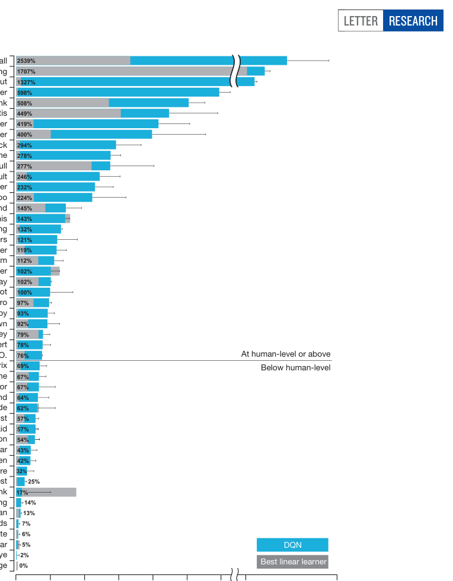
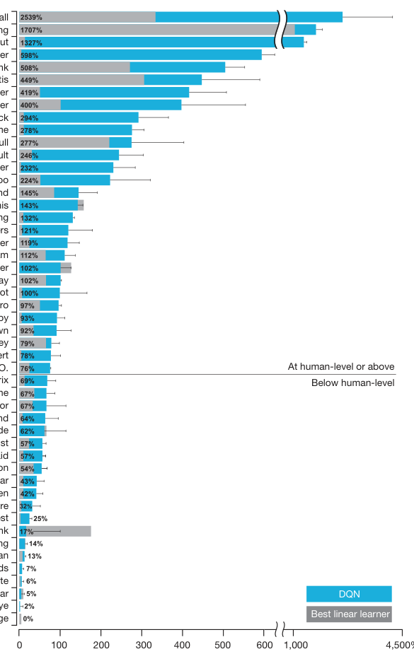
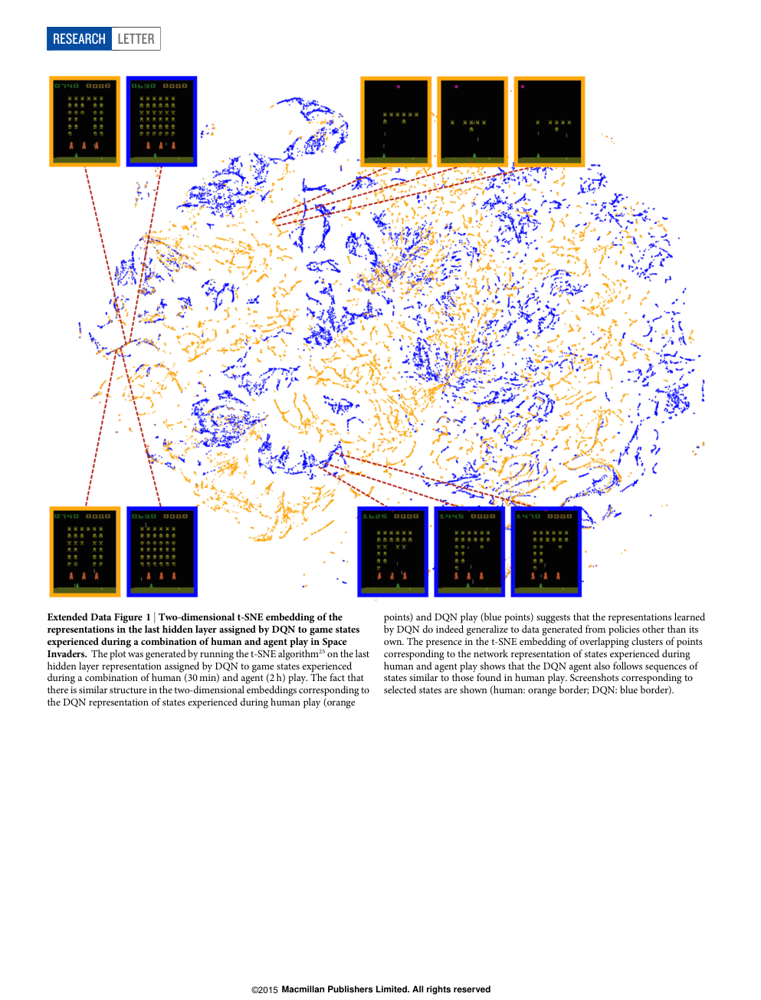
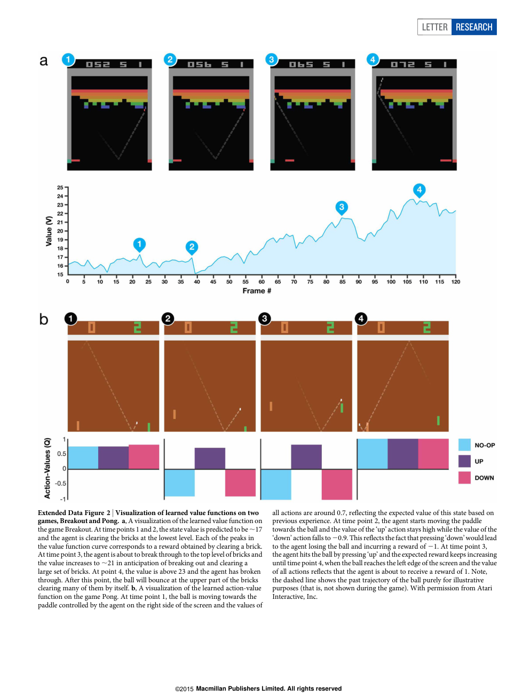

# Human-level control through deep reinforcement learning

# 通过深度强化学习实现人类水平的控制

**Original (authors):** Volodymyr Mnih*, Koray Kavukcuoglu*, David Silver*, Andrei A. Rusu, Joel Veness, Marc G. Bellemare, Alex Graves, Martin Riedmiller, Andreas K. Fidjeland, Georg Ostrovski, Stig Petersen, Charles Beattie, Amir Sadik, Ioannis Antonoglou, Helen King, Dharshan Kumaran, Daan Wierstra, Shane Legg & Demis Hassabis

**中文:** 作者：Volodymyr Mnih*、Koray Kavukcuoglu*、David Silver*、Andrei A. Rusu、Joel Veness、Marc G. Bellemare、Alex Graves、Martin Riedmiller、Andreas K. Fidjeland、Georg Ostrovski、Stig Petersen、Charles Beattie、Amir Sadik、Ioannis Antonoglou、Helen King、Dharshan Kumaran、Daan Wierstra、Shane Legg、Demis Hassabis（*表示共同第一作者）

**Original (affiliation):** Google DeepMind, 5 New Street Square, London EC4A 3TW, UK.

**中文:** 单位：Google DeepMind，5 New Street Square，London EC4A 3TW，UK（英国伦敦）。

**Original (publication info):** *Nature* 518, 529–533 (26 February 2015), doi:10.1038/nature14236. Received 10 July 2014; accepted 16 January 2015.

**中文:** 发表信息：《Nature》第 518 卷，529–533 页（2015 年 2 月 26 日），doi:10.1038/nature14236。收稿日期 2014 年 7 月 10 日；录用日期 2015 年 1 月 16 日。

---

## Abstract / 摘要

**Original:**

The theory of reinforcement learning provides a normative account, deeply rooted in psychological and neuroscientific perspectives on animal behaviour, of how agents may optimize their control of an environment. To use reinforcement learning successfully in situations approaching real-world complexity, however, agents are confronted with a difficult task: they must derive efficient representations of the environment from high-dimensional sensory inputs, and use these to generalize past experience to new situations. Remarkably, humans and other animals seem to solve this problem through a harmonious combination of reinforcement learning and hierarchical sensory processing systems, the former evidenced by a wealth of neural data revealing notable parallels between the phasic signals emitted by dopaminergic neurons and temporal difference reinforcement learning algorithms. While reinforcement learning agents have achieved some successes in a variety of domains, their applicability has previously been limited to domains in which useful features can be handcrafted, or to domains with fully observed, low-dimensional state spaces. Here we use recent advances in training deep neural networks to develop a novel artificial agent, termed a deep Q-network, that can learn successful policies directly from high-dimensional sensory inputs using end-to-end reinforcement learning. We tested this agent on the challenging domain of classic Atari 2600 games. We demonstrate that the deep Q-network agent, receiving only the pixels and the game score as inputs, was able to surpass the performance of all previous algorithms and achieve a level comparable to that of a professional human games tester across a set of 49 games, using the same algorithm, network architecture and hyperparameters. This work bridges the divide between high-dimensional sensory inputs and actions, resulting in the first artificial agent that is capable of learning to excel at a diverse array of challenging tasks.

**中文:**

强化学习（reinforcement learning）理论为智能体（agent）如何优化其对环境（environment）的控制提供了一种规范性说明（normative account），这一理论深深植根于心理学与神经科学关于动物行为的视角。然而，要在接近真实世界复杂度的情形中成功使用强化学习，智能体面临一项困难的任务：它们必须从高维感官输入中推导出对环境的高效表示（representation），并用这些表示把过去的经验泛化（generalize）到新情境。值得注意的是，人类和其他动物似乎是通过强化学习与层级化感官处理系统的和谐组合来解决这一问题的，前者有大量神经数据佐证：多巴胺能神经元（dopaminergic neurons）发出的相位信号（phasic signals）与时序差分（temporal difference，TD）强化学习算法之间存在显著平行关系。虽然强化学习智能体已在多个领域取得一些成功，但其适用性此前一直局限于那些有用特征可以人工构造（handcrafted）的领域，或状态空间完全可观测、低维的领域。本文中，我们利用训练深度神经网络（deep neural networks）方面的最新进展，开发了一种新型人工智能体——深度 Q 网络（deep Q-network，DQN），它能通过端到端（end-to-end）强化学习，直接从高维感官输入中学习成功的策略（policy）。我们在经典 Atari 2600 游戏这一富有挑战性的领域上测试了该智能体。我们证明：仅以像素和游戏得分作为输入的 DQN 智能体，在 49 个游戏上使用同一套算法、网络架构（network architecture）和超参数（hyperparameter），就能超越此前所有算法的表现，并达到与专业人类游戏测试员相当的水平。这项工作弥合了高维感官输入与动作（action）之间的鸿沟，造就了第一个能够学会在多种多样的挑战性任务中表现出色的人工智能体。

---

## Letter / 正文

**Original:**

We set out to create a single algorithm that would be able to develop a wide range of competencies on a varied range of challenging tasks—a central goal of general artificial intelligence that has eluded previous efforts. To achieve this, we developed a novel agent, a deep Q-network (DQN), which is able to combine reinforcement learning with a class of artificial neural network known as deep neural networks. Notably, recent advances in deep neural networks, in which several layers of nodes are used to build up progressively more abstract representations of the data, have made it possible for artificial neural networks to learn concepts such as object categories directly from raw sensory data. We use one particularly successful architecture, the deep convolutional network, which uses hierarchical layers of tiled convolutional filters to mimic the effects of receptive fields—inspired by Hubel and Wiesel's seminal work on feedforward processing in early visual cortex—thereby exploiting the local spatial correlations present in images, and building in robustness to natural transformations such as changes of viewpoint or scale.

**中文:**

我们的目标是创造一个单一算法，使它能够在多种多样的挑战性任务上发展出广泛的能力——这是通用人工智能（general artificial intelligence）的一个核心目标，此前的种种努力一直未能实现。为达成这一目标，我们开发了一种新型智能体——深度 Q 网络（deep Q-network，DQN），它能够把强化学习与一类被称为深度神经网络的人工神经网络（artificial neural network）结合起来。值得注意的是，深度神经网络的最新进展——用若干层节点逐步构建出越来越抽象的数据表示——已经使人工神经网络能够直接从原始感官数据中学习诸如物体类别之类的概念。我们采用了一种特别成功的架构：深度卷积网络（deep convolutional network）。它使用层级化排列的平铺卷积滤波器（tiled convolutional filters）来模拟感受野（receptive field）的效应——这一设计受到 Hubel 和 Wiesel 关于早期视觉皮层前馈处理的开创性工作的启发——从而利用图像中存在的局部空间相关性（local spatial correlations），并对诸如视角或尺度变化之类的自然变换建立起鲁棒性（robustness）。

**Original:**

We consider tasks in which the agent interacts with an environment through a sequence of observations, actions and rewards. The goal of the agent is to select actions in a fashion that maximizes cumulative future reward. More formally, we use a deep convolutional neural network to approximate the optimal action-value function

$$Q^*(s, a) = \max_{\pi} \mathbb{E}\left[ r_t + \gamma r_{t+1} + \gamma^2 r_{t+2} + \cdots \mid s_t = s,\ a_t = a,\ \pi \right],$$

which is the maximum sum of rewards $r_t$ discounted by $\gamma$ at each time-step $t$, achievable by a behaviour policy $\pi = P(a|s)$, after making an observation ($s$) and taking an action ($a$) (see Methods).

**中文:**

我们考虑这样一类任务：智能体通过一系列观察（observation）、动作与奖励（reward）与环境进行交互。智能体的目标是选择动作，使累积未来奖励最大化。更形式化地说，我们使用深度卷积神经网络（deep convolutional neural network）来逼近最优动作值函数（optimal action-value function）

$$Q^*(s, a) = \max_{\pi} \mathbb{E}\left[ r_t + \gamma r_{t+1} + \gamma^2 r_{t+2} + \cdots \mid s_t = s,\ a_t = a,\ \pi \right],$$

即在做出观察（$s$）并采取动作（$a$）之后，由行为策略（behaviour policy）$\pi = P(a|s)$ 所能取得的、在每个时间步 $t$ 以 $\gamma$ 折扣（discount）的奖励 $r_t$ 之和的最大值（见 Methods）。

**Original:**

Reinforcement learning is known to be unstable or even to diverge when a nonlinear function approximator such as a neural network is used to represent the action-value (also known as Q) function. This instability has several causes: the correlations present in the sequence of observations, the fact that small updates to Q may significantly change the policy and therefore change the data distribution, and the correlations between the action-values (Q) and the target values $r + \gamma \max_{a'} Q(s', a')$. We address these instabilities with a novel variant of Q-learning, which uses two key ideas. First, we used a biologically inspired mechanism termed experience replay that randomizes over the data, thereby removing correlations in the observation sequence and smoothing over changes in the data distribution (see below for details). Second, we used an iterative update that adjusts the action-values (Q) towards target values that are only periodically updated, thereby reducing correlations with the target.

**中文:**

众所周知，当使用神经网络之类的非线性函数逼近器（nonlinear function approximator）来表示动作值（action-value，也称为 Q）函数时，强化学习是不稳定的，甚至会发散（diverge）。这种不稳定性有若干成因：观察序列中存在的相关性；Q 的微小更新可能显著改变策略、进而改变数据分布；以及动作值（Q）与目标值（target values）$r + \gamma \max_{a'} Q(s', a')$ 之间的相关性。我们以一种新颖的 Q 学习（Q-learning）变体来应对这些不稳定性，它使用了两个关键思想。第一，我们使用了一种受生物学启发的机制，称为经验回放（experience replay）：它对数据做随机化，从而消除观察序列中的相关性，并平滑数据分布的变化（详见下文）。第二，我们使用迭代更新，让动作值（Q）朝着只做周期性更新的目标值调整，从而降低与目标之间的相关性。

**Original:**

While other stable methods exist for training neural networks in the reinforcement learning setting, such as neural fitted Q-iteration, these methods involve the repeated training of networks de novo on hundreds of iterations. Consequently, these methods, unlike our algorithm, are too inefficient to be used successfully with large neural networks. We parameterize an approximate value function $Q(s, a; \theta_i)$ using the deep convolutional neural network shown in Fig. 1, in which $\theta_i$ are the parameters (that is, weights) of the Q-network at iteration $i$. To perform experience replay we store the agent's experiences $e_t = (s_t, a_t, r_t, s_{t+1})$ at each time-step $t$ in a data set $D_t = \{e_1, \ldots, e_t\}$. During learning, we apply Q-learning updates, on samples (or minibatches) of experience $(s, a, r, s') \sim U(D)$, drawn uniformly at random from the pool of stored samples. The Q-learning update at iteration $i$ uses the following loss function:

$$L_i(\theta_i) = \mathbb{E}_{(s, a, r, s') \sim U(D)} \left[ \left( r + \gamma \max_{a'} Q(s', a'; \theta_i^-) - Q(s, a; \theta_i) \right)^2 \right],$$

in which $\gamma$ is the discount factor determining the agent's horizon, $\theta_i$ are the parameters of the Q-network at iteration $i$ and $\theta_i^-$ are the network parameters used to compute the target at iteration $i$. The target network parameters $\theta_i^-$ are only updated with the Q-network parameters ($\theta_i$) every C steps and are held fixed between individual updates (see Methods).

**中文:**

虽然在强化学习设定下训练神经网络还有其他稳定方法，例如神经拟合 Q 迭代（neural fitted Q-iteration），但这些方法需要在数百次迭代中反复从头（de novo）训练网络。因此，与我们算法不同，这些方法效率太低，无法成功地用于大型神经网络。我们使用图 1 所示的深度卷积神经网络来参数化一个近似值函数 $Q(s, a; \theta_i)$，其中 $\theta_i$ 是第 $i$ 次迭代时 Q 网络（Q-network）的参数（即权重，weights）。为了实现经验回放，我们在每个时间步 $t$ 把智能体的经验 $e_t = (s_t, a_t, r_t, s_{t+1})$ 存入数据集 $D_t = \{e_1, \ldots, e_t\}$。学习过程中，我们对从存储样本池中均匀随机抽取的经验样本（或小批量（minibatch））$(s, a, r, s') \sim U(D)$ 施加 Q 学习更新。第 $i$ 次迭代的 Q 学习更新使用以下损失函数（loss function）：

$$L_i(\theta_i) = \mathbb{E}_{(s, a, r, s') \sim U(D)} \left[ \left( r + \gamma \max_{a'} Q(s', a'; \theta_i^-) - Q(s, a; \theta_i) \right)^2 \right],$$

其中 $\gamma$ 是决定智能体视野（horizon）的折扣因子（discount factor），$\theta_i$ 是第 $i$ 次迭代时 Q 网络的参数，$\theta_i^-$ 是第 $i$ 次迭代用于计算目标的网络参数。目标网络（target network）参数 $\theta_i^-$ 每隔 C 步才用 Q 网络参数（$\theta_i$）更新一次，且在两次更新之间保持固定（见 Methods）。

**Original:**

To evaluate our DQN agent, we took advantage of the Atari 2600 platform, which offers a diverse array of tasks ($n = 49$) designed to be difficult and engaging for human players. We used the same network architecture, hyperparameter values (see Extended Data Table 1) and learning procedure throughout—taking high-dimensional data ($210 \times 160$ colour video at 60 Hz) as input—to demonstrate that our approach robustly learns successful policies over a variety of games based solely on sensory inputs with only very minimal prior knowledge (that is, merely the input data were visual images, and the number of actions available in each game, but not their correspondences; see Methods). Notably, our method was able to train large neural networks using a reinforcement learning signal and stochastic gradient descent in a stable manner—illustrated by the temporal evolution of two indices of learning (the agent's average score-per-episode and average predicted Q-values; see Fig. 2 and Supplementary Discussion for details).

**中文:**

为评估我们的 DQN 智能体，我们利用了 Atari 2600 平台，它提供了一系列多样化的任务（$n = 49$），这些任务对人类玩家而言既困难又有吸引力。我们全程使用相同的网络架构、超参数值（见 Extended Data Table 1）和学习流程——以高维数据（$210 \times 160$ 彩色视频，60 Hz）为输入——以证明我们的方法仅凭感官输入和极少量的先验知识（prior knowledge）（即仅知道输入数据是视觉图像，以及每个游戏可用动作的数量，但不知道它们之间的对应关系；见 Methods），就能在各种各样的游戏上稳健地学会成功的策略。值得注意的是，我们的方法能够以稳定的方式、仅使用强化学习信号和随机梯度下降（stochastic gradient descent，SGD）来训练大型神经网络——这一点可由两个学习指标（智能体的每回合平均得分（average score-per-episode）和平均预测 Q 值）随时间的演变来说明（见图 2 和 Supplementary Discussion 的详细说明）。

> **图 1（译）**：卷积神经网络的结构示意图。网络结构的细节在 Methods 中说明。神经网络的输入是一幅由预处理映射 $\phi$ 生成的 $84 \times 84 \times 4$ 图像，其后是三个卷积层（注意：蜿蜒的蓝色线条表示每个滤波器在输入图像上的滑动），以及两个全连接层（fully connected layers），每个合法动作对应一个输出单元。每个隐藏层之后都跟有一个整流非线性（rectifier nonlinearity，即 $\max(0, x)$）。（原图见 paper.pdf 第 2 页，见下方图）



**Original:**

We compared DQN with the best performing methods from the reinforcement learning literature on the 49 games where results were available. In addition to the learned agents, we also report scores for a professional human games tester playing under controlled conditions and a policy that selects actions uniformly at random (Extended Data Table 2 and Fig. 3, denoted by 100% (human) and 0% (random) on y axis; see Methods). Our DQN method outperforms the best existing reinforcement learning methods on 43 of the games without incorporating any of the additional prior knowledge about Atari 2600 games used by other approaches (for example, refs 12, 15). Furthermore, our DQN agent performed at a level that was comparable to that of a professional human games tester across the set of 49 games, achieving more than 75% of the human score on more than half of the games (29 games; see Fig. 3, Supplementary Discussion and Extended Data Table 2).

**中文:**

我们在有结果可查的 49 个游戏上，将 DQN 与强化学习文献中表现最好的方法进行了比较。除了学习型智能体的得分，我们还报告了在受控条件下进行游戏的专业人类测试员的得分，以及均匀随机选择动作的策略的得分（Extended Data Table 2 与图 3，在 y 轴上分别以 100%（human）和 0%（random）表示；见 Methods）。我们的 DQN 方法在 43 个游戏上超越了现有最好的强化学习方法，而且没有使用其他方法所引入的任何关于 Atari 2600 游戏的额外先验知识（例如参考文献 12、15）。此外，在全部 49 个游戏上，我们的 DQN 智能体表现达到了与专业人类游戏测试员相当的水平，在其中超过一半的游戏（29 个）上取得了人类得分的 75% 以上（见图 3、Supplementary Discussion 和 Extended Data Table 2）。

**Original:**

In additional simulations (see Supplementary Discussion and Extended Data Tables 3 and 4), we demonstrate the importance of the individual core components of the DQN agent—the replay memory, separate target Q-network and deep convolutional network architecture—by disabling them and demonstrating the detrimental effects on performance.

**中文:**

在额外的模拟实验中（见 Supplementary Discussion 和 Extended Data Tables 3、4），我们通过逐一禁用 DQN 智能体的各个核心组件——回放记忆（replay memory）、独立的目标 Q 网络（target Q-network）以及深度卷积网络架构——并展示禁用后对性能的有害影响，来证明这些组件的各自重要性。

> **图 2（译）**：跟踪智能体平均得分与平均预测动作值的训练曲线。a，在 Space Invaders 上以 ε-贪心策略（ε-greedy policy，$\varepsilon = 0.05$）运行 520k 帧后，智能体每个回合取得的平均得分。b，在 Seaquest 上每个回合取得的平均得分。c，在 Space Invaders 的留出（held-out）状态集上的平均预测动作值。曲线上的每个点是在留出状态集上计算的动作值 Q 的平均值。注意，由于奖励截断（clipping of rewards，见 Methods），Q 值经过了缩放。d，在 Seaquest 上的平均预测动作值。详见 Supplementary Discussion。（原图见 paper.pdf 第 2 页，[第 2 页图](assets/figures/fig-2.png)）

> **图 3（译）**：DQN 智能体与文献中最好的强化学习方法（参考文献 15）的比较。DQN 的表现相对于专业人类游戏测试员（即 100% 水平）和随机游玩（即 0% 水平）做了归一化。注意，DQN 的归一化表现以百分比表示，计算公式为：$100 \times (\text{DQN 得分} - \text{随机游玩得分}) / (\text{人类得分} - \text{随机游玩得分})$。可以看到，DQN 几乎在所有游戏上都优于竞争方法（另见 Extended Data Table 2），并且在多数游戏上达到了与专业人类游戏测试员大体相当或更优的水平（即达到 75% 或以上水平）。人类玩家和智能体的音频输出均被关闭。误差棒（error bars）表示从不同初始条件开始的 30 个评估回合（evaluation episodes）的标准差（s.d.）。（原图见 paper.pdf 第 3 页，见下方图）



**Original:**

We next examined the representations learned by DQN that underpinned the successful performance of the agent in the context of the game Space Invaders (see Supplementary Video 1 for a demonstration of the performance of DQN), by using a technique developed for the visualization of high-dimensional data called 't-SNE' (Fig. 4). As expected, the t-SNE algorithm tends to map the DQN representation of perceptually similar states to nearby points. Interestingly, we also found instances in which the t-SNE algorithm generated similar embeddings for DQN representations of states that are close in terms of expected reward but perceptually dissimilar (Fig. 4, bottom right, top left and middle), consistent with the notion that the network is able to learn representations that support adaptive behaviour from high-dimensional sensory inputs. Furthermore, we also show that the representations learned by DQN are able to generalize to data generated from policies other than its own—in simulations where we presented as input to the network game states experienced during human and agent play, recorded the representations of the last hidden layer, and visualized the embeddings generated by the t-SNE algorithm (Extended Data Fig. 1 and Supplementary Discussion). Extended Data Fig. 2 provides an additional illustration of how the representations learned by DQN allow it to accurately predict state and action values.

**中文:**

接下来，我们在游戏 Space Invaders 的背景下（DQN 的表现演示见 Supplementary Video 1），使用一种为高维数据可视化而开发的技术 t-SNE（图 4），考察了支撑智能体良好表现的 DQN 所学到的表示。正如预期，t-SNE 算法倾向于把感知上相似的状态所对应的 DQN 表示映射到邻近的点。有趣的是，我们还发现了一些实例：对于期望奖励相近但感知上不相似的状态（图 4 右下、左上和中部），t-SNE 算法为它们的 DQN 表示生成了相似的嵌入（embedding）。这与如下观点一致：该网络能够从高维感官输入中学习到支持自适应行为的表示。此外，我们还表明 DQN 学到的表示能够泛化到由其他策略（而非其自身策略）产生的数据上——在模拟实验中，我们把人类游玩和智能体游玩期间经历的游戏状态作为输入提供给网络，记录最后一个隐藏层的表示，并用 t-SNE 算法对生成的嵌入进行可视化（Extended Data Fig. 1 和 Supplementary Discussion）。Extended Data Fig. 2 进一步展示了 DQN 学到的表示如何使其能够准确预测状态值和动作值。

> **图 4（译）**：DQN 为游玩 Space Invaders 期间经历的游戏状态、在最后一个隐藏层中赋予的表示的二维 t-SNE 嵌入。该图是让 DQN 智能体游玩 2 小时真实游戏时间，并对 DQN 为每个经历过的游戏状态赋予的最后一个隐藏层表示运行 t-SNE 算法（参考文献 25）生成的。点的颜色按照 DQN 为相应游戏状态预测的状态值（state value，V，即一个状态的最大期望奖励）着色（范围从暗红（最高 V）到深蓝（最低 V））。图中展示了所选若干点对应的游戏截图。DQN 智能体为完整的屏幕（右上截图）和几乎完整的屏幕（左下截图）都预测出较高的状态值，因为它已经学会：清完一屏会出现一屏新的满屏敌舰。部分完成的屏幕（下方截图）被赋予较低的状态值，因为可获得的即时奖励较少。右下、左上和中部所示的屏幕之间的感知相似度低于其他例子，但它们仍被映射到邻近的表示和相近的值，因为在关卡接近尾声时橙色掩体并不具有重大意义。图片经 Square Enix Limited 授权使用。（原图见 paper.pdf 第 3–4 页）

**Original:**

It is worth noting that the games in which DQN excels are extremely varied in their nature, from side-scrolling shooters (River Raid) to boxing games (Boxing) and three-dimensional car-racing games (Enduro). Indeed, in certain games DQN is able to discover a relatively long-term strategy (for example, Breakout: the agent learns the optimal strategy, which is to first dig a tunnel around the side of the wall allowing the ball to be sent around the back to destroy a large number of blocks; see Supplementary Video 2 for illustration of development of DQN's performance over the course of training). Nevertheless, games demanding more temporally extended planning strategies still constitute a major challenge for all existing agents including DQN (for example, Montezuma's Revenge).

**中文:**

值得注意的是，DQN 表现出色的游戏在性质上极为多样：从横版卷轴射击游戏（River Raid）到拳击游戏（Boxing），再到三维赛车游戏（Enduro）。确实，在某些游戏中 DQN 能够发现相对长期的策略（例如 Breakout：智能体学会了最优策略，即先在墙的侧面挖出一条通道，让球绕到砖墙后方，从而摧毁大量砖块；DQN 表现随训练发展的情况见 Supplementary Video 2）。不过，需要更具时间延展性的规划策略（temporally extended planning strategies）的游戏，对包括 DQN 在内的所有现有智能体来说仍构成重大挑战（例如 Montezuma's Revenge）。

**Original:**

In this work, we demonstrate that a single architecture can successfully learn control policies in a range of different environments with only very minimal prior knowledge, receiving only the pixels and the game score as inputs, and using the same algorithm, network architecture and hyperparameters on each game, privy only to the inputs a human player would have. In contrast to previous work, our approach incorporates 'end-to-end' reinforcement learning that uses reward to continuously shape representations within the convolutional network towards salient features of the environment that facilitate value estimation. This principle draws on neurobiological evidence that reward signals during perceptual learning may influence the characteristics of representations within primate visual cortex. Notably, the successful integration of reinforcement learning with deep network architectures was critically dependent on our incorporation of a replay algorithm involving the storage and representation of recently experienced transitions. Convergent evidence suggests that the hippocampus may support the physical realization of such a process in the mammalian brain, with the time-compressed reactivation of recently experienced trajectories during offline periods (for example, waking rest) providing a putative mechanism by which value functions may be efficiently updated through interactions with the basal ganglia. In the future, it will be important to explore the potential use of biasing the content of experience replay towards salient events, a phenomenon that characterizes empirically observed hippocampal replay, and relates to the notion of 'prioritized sweeping' in reinforcement learning. Taken together, our work illustrates the power of harnessing state-of-the-art machine learning techniques with biologically inspired mechanisms to create agents that are capable of learning to master a diverse array of challenging tasks.

**中文:**

在这项工作中，我们证明了：单一架构只需极少的先验知识，仅以像素和游戏得分作为输入，并且在每个游戏上使用相同的算法、网络架构和超参数——只接触到人类玩家所能获得的输入——就能在一系列不同的环境中成功学会控制策略（control policies）。与以往工作不同，我们的方法融合了「端到端」强化学习：利用奖励在卷积网络内部持续塑造表示，使其朝向环境中有利于价值估计的显著特征（salient features）。这一原理借鉴了神经生物学证据：知觉学习（perceptual learning）过程中的奖励信号可能影响灵长类视觉皮层内表示的特性。值得注意的是，强化学习与深度网络架构的成功结合，关键取决于我们引入的回放算法（replay algorithm）——它涉及对最近经历的转移（transition）的存储与表示。汇聚性的证据表明，海马体（hippocampus）可能在哺乳动物大脑中支持这一过程的物理实现：在离线时段（例如清醒休息期间）对最近经历的轨迹做时间压缩式的再激活（reactivation），为值函数通过与基底神经节（basal ganglia）的交互而被高效更新提供了一种可能的机制。未来，探索把经验回放的内容偏向显著事件（salient events）这一潜在用法将十分重要——这一现象是经验观察到的海马回放（hippocampal replay）的特征，并与强化学习中「优先回溯」（prioritized sweeping）的概念相关。总而言之，我们的工作展示了：把当前最优（state-of-the-art）的机器学习技术与受生物学启发的机制结合起来，就能创造出能够学会掌握多种多样挑战性任务的智能体。

**Original:**

Online Content Methods, along with any additional Extended Data display items and Source Data, are available in the online version of the paper; references unique to these sections appear only in the online paper.

**中文:**

在线内容：Methods 以及所有额外的 Extended Data 图表与 Source Data，可在本文在线版中获取；仅在这些部分出现的参考文献只出现在在线版论文中。

---

## Methods / 方法

### Preprocessing / 预处理

**Original:**

Working directly with raw Atari 2600 frames, which are 210 × 160 pixel images with a 128-colour palette, can be demanding in terms of computation and memory requirements. We apply a basic preprocessing step aimed at reducing the input dimensionality and dealing with some artefacts of the Atari 2600 emulator. First, to encode a single frame we take the maximum value for each pixel colour value over the frame being encoded and the previous frame. This was necessary to remove flickering that is present in games where some objects appear only in even frames while other objects appear only in odd frames, an artefact caused by the limited number of sprites Atari 2600 can display at once. Second, we then extract the Y channel, also known as luminance, from the RGB frame and rescale it to 84 × 84. The function φ from algorithm 1 described below applies this preprocessing to the m most recent frames and stacks them to produce the input to the Q-function, in which m = 4, although the algorithm is robust to different values of m (for example, 3 or 5).

**中文:**

直接处理原始 Atari 2600 帧——即 128 色调色板的 210 × 160 像素图像——在计算量和内存需求上可能要求很高。我们采用一个基本的预处理步骤，旨在降低输入维度并处理 Atari 2600 模拟器（emulator）的一些伪影（artefact）。首先，为了编码单帧图像，我们对正在编码的帧和前一帧取每个像素颜色值的最大值。这一步是必要的，用以消除某些游戏中存在的闪烁现象——在这些游戏中，有些物体只出现在偶数帧，而另一些物体只出现在奇数帧，这是 Atari 2600 一次能显示的精灵（sprite）数量有限造成的伪影。其次，我们从 RGB 帧中提取 Y 通道（即亮度，luminance），并将其缩放（rescale）到 84 × 84。下文算法 1 中描述的函数 $\phi$ 对最近的 $m$ 帧应用这一预处理并将其堆叠（stack），以生成 Q 函数的输入；其中 $m = 4$，不过该算法对不同的 $m$ 值（例如 3 或 5）是稳健的。

### Code availability / 代码可得性

**Original:**

The source code can be accessed at https://sites.google.com/a/deepmind.com/dqn for non-commercial uses only.

**中文:**

源代码可在 https://sites.google.com/a/deepmind.com/dqn 获取，仅限非商业用途。

### Model architecture / 模型架构

**Original:**

There are several possible ways of parameterizing Q using a neural network. Because Q maps history–action pairs to scalar estimates of their Q-value, the history and the action have been used as inputs to the neural network by some previous approaches. The main drawback of this type of architecture is that a separate forward pass is required to compute the Q-value of each action, resulting in a cost that scales linearly with the number of actions. We instead use an architecture in which there is a separate output unit for each possible action, and only the state representation is an input to the neural network. The outputs correspond to the predicted Q-values of the individual actions for the input state. The main advantage of this type of architecture is the ability to compute Q-values for all possible actions in a given state with only a single forward pass through the network.

The exact architecture, shown schematically in Fig. 1, is as follows. The input to the neural network consists of an 84 × 84 × 4 image produced by the preprocessing map φ. The first hidden layer convolves 32 filters of 8 × 8 with stride 4 with the input image and applies a rectifier nonlinearity. The second hidden layer convolves 64 filters of 4 × 4 with stride 2, again followed by a rectifier nonlinearity. This is followed by a third convolutional layer that convolves 64 filters of 3 × 3 with stride 1 followed by a rectifier. The final hidden layer is fully-connected and consists of 512 rectifier units. The output layer is a fully-connected linear layer with a single output for each valid action. The number of valid actions varied between 4 and 18 on the games we considered.

**中文:**

用神经网络参数化 Q 有若干种可能的方式。由于 Q 把「历史–动作」对映射为其 Q 值的标量估计，此前的一些方法把历史和动作一并作为神经网络的输入。这类架构的主要缺点是：计算每个动作的 Q 值需要单独一次前向传播（forward pass），导致代价随动作数量线性增长。我们改用另一种架构：为每个可能的动作设置一个单独的输出单元，只有状态表示作为神经网络的输入。输出对应输入状态下各个动作的预测 Q 值。这类架构的主要优点是：只需一次网络前向传播，就能计算出给定状态下所有可能动作的 Q 值。

确切架构如图 1 所示，具体如下。神经网络的输入是一幅由预处理映射 $\phi$ 生成的 84 × 84 × 4 图像。第一个隐藏层用 32 个 8 × 8、步长（stride）为 4 的滤波器对输入图像做卷积，并施加整流非线性。第二个隐藏层用 64 个 4 × 4、步长为 2 的滤波器做卷积，其后同样跟有整流非线性。其后的第三个卷积层用 64 个 3 × 3、步长为 1 的滤波器做卷积，后接整流。最后一个隐藏层是全连接层（fully-connected layer），由 512 个整流单元组成。输出层是一个全连接线性层，每个合法动作对应一个输出。在我们所考虑的游戏上，合法动作的数量在 4 到 18 之间变化。

### Training details / 训练细节

**Original:**

We performed experiments on 49 Atari 2600 games where results were available for all other comparable methods. A different network was trained on each game: the same network architecture, learning algorithm and hyperparameter settings (see Extended Data Table 1) were used across all games, showing that our approach is robust enough to work on a variety of games while incorporating only minimal prior knowledge (see below). While we evaluated our agents on unmodified games, we made one change to the reward structure of the games during training only. As the scale of scores varies greatly from game to game, we clipped all positive rewards at 1 and all negative rewards at −1, leaving 0 rewards unchanged. Clipping the rewards in this manner limits the scale of the error derivatives and makes it easier to use the same learning rate across multiple games. At the same time, it could affect the performance of our agent since it cannot differentiate between rewards of different magnitude. For games where there is a life counter, the Atari 2600 emulator also sends the number of lives left in the game, which is then used to mark the end of an episode during training.

**中文:**

我们在 49 个 Atari 2600 游戏上进行了实验，这些游戏都有其他所有可比方法的结果可用。每个游戏单独训练一个网络：所有游戏使用相同的网络架构、学习算法和超参数设置（见 Extended Data Table 1），这表明我们的方法足够稳健，能在仅引入极少先验知识（见下文）的情况下适用于多种游戏。虽然我们在未修改的游戏上评估智能体，但我们在训练阶段对游戏的奖励结构做了一处改动。由于不同游戏的得分量级差异很大，我们把所有正奖励截断为 1，把所有负奖励截断为 −1，0 奖励保持不变。以这种方式截断奖励限制了误差导数（error derivatives）的量级，使我们在多个游戏上更容易使用相同的学习率（learning rate）。同时，这可能会影响智能体的表现，因为它无法区分不同大小的奖励。对于有生命计数器的游戏，Atari 2600 模拟器还会发送游戏中剩余生命数，训练中用它来标记回合的结束。

**Original:**

In these experiments, we used the RMSProp (see http://www.cs.toronto.edu/~tijmen/csc321/slides/lecture_slides_lec6.pdf) algorithm with minibatches of size 32. The behaviour policy during training was ε-greedy with ε annealed linearly from 1.0 to 0.1 over the first million frames, and fixed at 0.1 thereafter. We trained for a total of 50 million frames (that is, around 38 days of game experience in total) and used a replay memory of 1 million most recent frames.

**中文:**

在这些实验中，我们使用了 RMSProp（见 http://www.cs.toronto.edu/~tijmen/csc321/slides/lecture_slides_lec6.pdf）算法，小批量大小为 32。训练期间的行为策略是 ε-贪心（ε-greedy）策略：ε 在最初一百万帧内从 1.0 线性退火（anneal）到 0.1，之后固定为 0.1。我们总共训练了 5000 万帧（即总计约 38 天的游戏经验），并使用了保存最近 100 万帧的回放记忆。

**Original:**

Following previous approaches to playing Atari 2600 games, we also use a simple frame-skipping technique. More precisely, the agent sees and selects actions on every kth frame instead of every frame, and its last action is repeated on skipped frames. Because running the emulator forward for one step requires much less computation than having the agent select an action, this technique allows the agent to play roughly k times more games without significantly increasing the runtime. We use k = 4 for all games.

**中文:**

沿用此前玩 Atari 2600 游戏的方法，我们也使用了一种简单的跳帧（frame-skipping）技术。更确切地说，智能体每隔第 k 帧才观察并选择一次动作，而不是每一帧都如此，其上一个动作在被跳过的帧上重复执行。由于让模拟器前进一步所需的计算量远小于让智能体选择一次动作，这种技术使智能体能够多玩大约 k 倍的游戏，而运行时间没有显著增加。所有游戏我们都取 $k = 4$。

**Original:**

The values of all the hyperparameters and optimization parameters were selected by performing an informal search on the games Pong, Breakout, Seaquest, Space Invaders and Beam Rider. We did not perform a systematic grid search owing to the high computational cost. These parameters were then held fixed across all other games. The values and descriptions of all hyperparameters are provided in Extended Data Table 1.

**中文:**

所有超参数和优化参数的值，是通过在游戏 Pong、Breakout、Seaquest、Space Invaders 和 Beam Rider 上进行非正式搜索（informal search）选定的。由于计算成本高昂，我们没有进行系统的网格搜索（grid search）。这些参数随后在所有其他游戏上保持不变。所有超参数的值与说明见 Extended Data Table 1。

**Original:**

Our experimental setup amounts to using the following minimal prior knowledge: that the input data consisted of visual images (motivating our use of a convolutional deep network), the game-specific score (with no modification), number of actions, although not their correspondences (for example, specification of the up 'button') and the life count.

**中文:**

我们的实验设置归结为使用以下极少的先验知识：输入数据由视觉图像构成（这促使我们使用卷积深度网络）、各游戏特有的得分（不做修改）、动作的数量（但不知道它们之间的对应关系，例如「上」按钮的具体指定），以及生命计数。

### Evaluation procedure / 评估流程

**Original:**

The trained agents were evaluated by playing each game 30 times for up to 5 min each time with different initial random conditions ('no-op'; see Extended Data Table 1) and an ε-greedy policy with ε = 0.05. This procedure is adopted to minimize the possibility of overfitting during evaluation. The random agent served as a baseline comparison and chose a random action at 10 Hz which is every sixth frame, repeating its last action on intervening frames. 10 Hz is about the fastest that a human player can select the 'fire' button, and setting the random agent to this frequency avoids spurious baseline scores in a handful of the games. We did also assess the performance of a random agent that selected an action at 60 Hz (that is, every frame). This had a minimal effect: changing the normalized DQN performance by more than 5% in only six games (Boxing, Breakout, Crazy Climber, Demon Attack, Krull and Robotank), and in all these games DQN outperformed the expert human by a considerable margin.

The professional human tester used the same emulator engine as the agents, and played under controlled conditions. The human tester was not allowed to pause, save or reload games. As in the original Atari 2600 environment, the emulator was run at 60 Hz and the audio output was disabled: as such, the sensory input was equated between human player and agents. The human performance is the average reward achieved from around 20 episodes of each game lasting a maximum of 5 min each, following around 2 h of practice playing each game.

**中文:**

训练好的智能体的评估方式是：每个游戏游玩 30 次，每次最多 5 分钟，使用不同的随机初始条件（「no-op」；见 Extended Data Table 1）和 $\varepsilon = 0.05$ 的 ε-贪心策略。采用这一流程是为了在评估期间把过拟合（overfitting）的可能性降到最低。随机智能体作为基线（baseline）对照，以 10 Hz（即每第六帧）选择一次随机动作，在中间帧上重复其上一个动作。10 Hz 大约是人类玩家按「开火」按钮的最快速度，把随机智能体设为这一频率可以避免在少数几个游戏中出现虚假的基线得分。我们还评估了以 60 Hz（即每帧）选择动作的随机智能体的表现。其影响微乎其微：只在 6 个游戏（Boxing、Breakout、Crazy Climber、Demon Attack、Krull 和 Robotank）中使归一化 DQN 表现改变超过 5%，而在所有这些游戏中 DQN 都以相当大的优势超越专家级人类玩家。

专业人类测试员使用与智能体相同的模拟器引擎，并在受控条件下游玩。人类测试员不允许暂停、存档或重新载入游戏。与原始 Atari 2600 环境一样，模拟器以 60 Hz 运行，音频输出被关闭：这样人类玩家与智能体的感官输入是对等的。人类表现是每个游戏游玩约 20 个回合（每个回合最长 5 分钟）所取得的平均奖励，在此之前对每个游戏进行了约 2 小时的练习。

### Algorithm / 算法

**Original:**

We consider tasks in which an agent interacts with an environment, in this case the Atari emulator, in a sequence of actions, observations and rewards. At each time-step the agent selects an action $a_t$ from the set of legal game actions, $\mathcal{A} = \{1, \ldots, K\}$. The action is passed to the emulator and modifies its internal state and the game score. In general the environment may be stochastic. The emulator's internal state is not observed by the agent; instead the agent observes an image $x_t \in \mathbb{R}^d$ from the emulator, which is a vector of pixel values representing the current screen. In addition it receives a reward $r_t$ representing the change in game score. Note that in general the game score may depend on the whole previous sequence of actions and observations; feedback about an action may only be received after many thousands of time-steps have elapsed.

Because the agent only observes the current screen, the task is partially observed and many emulator states are perceptually aliased (that is, it is impossible to fully understand the current situation from only the current screen $x_t$). Therefore, sequences of actions and observations, $s_t = x_1, a_1, x_2, \ldots, a_{t-1}, x_t$, are input to the algorithm, which then learns game strategies depending upon these sequences. All sequences in the emulator are assumed to terminate in a finite number of time-steps. This formalism gives rise to a large but finite Markov decision process (MDP) in which each sequence is a distinct state. As a result, we can apply standard reinforcement learning methods for MDPs, simply by using the complete sequence $s_t$ as the state representation at time $t$.

**中文:**

我们考虑这样一类任务：智能体以一串动作、观察和奖励的序列与环境——此处即 Atari 模拟器——进行交互。在每个时间步，智能体从合法游戏动作集合 $\mathcal{A} = \{1, \ldots, K\}$ 中选择一个动作 $a_t$。该动作被传给模拟器并改变其内部状态与游戏得分。一般来说环境可能是随机的。智能体观察不到模拟器的内部状态；它观察到的是模拟器给出的一幅图像 $x_t \in \mathbb{R}^d$，即表示当前屏幕的像素值向量。此外它还收到一个奖励 $r_t$，表示游戏得分的变化。注意，一般来说游戏得分可能依赖于此前的整个动作与观察序列；关于某个动作的反馈可能要经过数千个时间步之后才会到来。

由于智能体只能观察当前屏幕，该任务是部分可观测（partially observed）的，许多模拟器状态在感知上是混叠的（perceptually aliased，即仅凭当前屏幕 $x_t$ 不可能完全理解当前局势）。因此，动作与观察的序列 $s_t = x_1, a_1, x_2, \ldots, a_{t-1}, x_t$ 被输入给算法，算法据此学习游戏策略。假设模拟器中所有序列都在有限时间步内终止。这一形式化导出一个大型但有限的马尔可夫决策过程（Markov decision process，MDP），其中每个序列是一个不同的状态。因此，我们只需把完整序列 $s_t$ 作为时刻 $t$ 的状态表示，就可以应用标准的 MDP 强化学习方法。

**Original:**

The goal of the agent is to interact with the emulator by selecting actions in a way that maximizes future rewards. We make the standard assumption that future rewards are discounted by a factor of $\gamma$ per time-step ($\gamma$ was set to 0.99 throughout), and define the future discounted return at time $t$ as $R_t = \sum_{t'=t}^{T} \gamma^{t'-t} r_{t'}$, in which $T$ is the time-step at which the game terminates. We define the optimal action-value function $Q^*(s, a)$ as the maximum expected return achievable by following any policy, after seeing some sequence $s$ and then taking some action $a$, $Q^*(s, a) = \max_{\pi} \mathbb{E}[R_t \mid s_t = s, a_t = a, \pi]$, in which $\pi$ is a policy mapping sequences to actions (or distributions over actions).

**中文:**

智能体的目标是：通过与模拟器交互来选择动作，使未来奖励最大化。我们采用标准假设：未来奖励每个时间步以因子 $\gamma$ 折扣（全篇 $\gamma$ 均设为 0.99），并把时刻 $t$ 的未来折扣回报（discounted return）定义为 $R_t = \sum_{t'=t}^{T} \gamma^{t'-t} r_{t'}$，其中 $T$ 是游戏终止的时间步。我们把最优动作值函数 $Q^*(s, a)$ 定义为：在看到某个序列 $s$ 并采取某个动作 $a$ 之后，遵循任意策略所能取得的最大期望回报，即 $Q^*(s, a) = \max_{\pi} \mathbb{E}[R_t \mid s_t = s, a_t = a, \pi]$，其中 $\pi$ 是把序列映射到动作（或动作上的分布）的策略。

**Original:**

The optimal action-value function obeys an important identity known as the Bellman equation. This is based on the following intuition: if the optimal value $Q^*(s', a')$ of the sequence $s'$ at the next time-step was known for all possible actions $a'$, then the optimal strategy is to select the action $a'$ maximizing the expected value of $r + \gamma Q^*(s', a')$:

$$Q^*(s, a) = \mathbb{E}_{s' \sim \mathcal{E}} \left[ r + \gamma \max_{a'} Q^*(s', a') \mid s, a \right].$$

**中文:**

最优动作值函数服从一个重要的恒等式，即 Bellman 方程（Bellman equation）。它基于如下直觉：如果下一时间步的序列 $s'$ 对所有可能动作 $a'$ 的最优值 $Q^*(s', a')$ 已知，那么最优策略就是选择使 $r + \gamma Q^*(s', a')$ 的期望值最大的动作 $a'$：

$$Q^*(s, a) = \mathbb{E}_{s' \sim \mathcal{E}} \left[ r + \gamma \max_{a'} Q^*(s', a') \mid s, a \right].$$

**Original:**

The basic idea behind many reinforcement learning algorithms is to estimate the action-value function by using the Bellman equation as an iterative update, $Q_{i+1}(s, a) = \mathbb{E}_{s' \sim \mathcal{E}} [r + \gamma \max_{a'} Q_i(s', a') \mid s, a]$. Such value iteration algorithms converge to the optimal action-value function, $Q_i \to Q^*$ as $i \to \infty$. In practice, this basic approach is impractical, because the action-value function is estimated separately for each sequence, without any generalization. Instead, it is common to use a function approximator to estimate the action-value function, $Q(s, a; \theta) \approx Q^*(s, a)$. In the reinforcement learning community this is typically a linear function approximator, but sometimes a nonlinear function approximator is used instead, such as a neural network. We refer to a neural network function approximator with weights $\theta$ as a Q-network. A Q-network can be trained by adjusting the parameters $\theta_i$ at iteration $i$ to reduce the mean-squared error in the Bellman equation, where the optimal target values $r + \gamma \max_{a'} Q^*(s', a')$ are substituted with approximate target values $y = r + \gamma \max_{a'} Q(s', a'; \theta_i^-)$, using parameters from some previous iteration. This leads to a sequence of loss functions $L_i(\theta_i)$ that changes at each iteration $i$,

$$L_i(\theta_i) = \mathbb{E}_{s, a, r \sim \rho(\cdot)} \left[ \left( \mathbb{E}_{s' \sim \mathcal{E}} [y \mid s, a] - Q(s, a; \theta_i) \right)^2 \right] + \mathbb{E}_{s, a, r \sim \rho(\cdot)} \left[ \mathbb{V}_{s' \sim \mathcal{E}} [y] \right].$$

Note that the targets depend on the network weights; this is in contrast with the targets used for supervised learning, which are fixed before learning begins. At each stage of optimization, we hold the parameters from the previous iteration $\theta_{i-1}$ fixed when optimizing the $i$th loss function $L_i(\theta_i)$, resulting in a sequence of well-defined optimization problems. The final term is the variance of the targets, which does not depend on the parameters $\theta_i$ that we are currently optimizing, and may therefore be ignored. Differentiating the loss function with respect to the weights we arrive at the following gradient:

$$\nabla_{\theta_i} L_i(\theta_i) = \mathbb{E}_{s, a, r \sim \rho(\cdot); s' \sim \mathcal{E}} \left[ \left( r + \gamma \max_{a'} Q(s', a'; \theta_i^-) - Q(s, a; \theta_i) \right) \nabla_{\theta_i} Q(s, a; \theta_i) \right].$$

**中文:**

许多强化学习算法的基本思想是：把 Bellman 方程用作迭代更新来估计动作值函数，即 $Q_{i+1}(s, a) = \mathbb{E}_{s' \sim \mathcal{E}} [r + \gamma \max_{a'} Q_i(s', a') \mid s, a]$。这类值迭代（value iteration）算法收敛到最优动作值函数：当 $i \to \infty$ 时 $Q_i \to Q^*$。在实践中，这一基本方法并不可行，因为动作值函数是对每个序列单独估计的，没有任何泛化。常见的做法是改用函数逼近器（function approximator）来估计动作值函数，$Q(s, a; \theta) \approx Q^*(s, a)$。在强化学习领域，这通常是线性函数逼近器，但有时也使用非线性函数逼近器，例如神经网络。我们把带权重 $\theta$ 的神经网络函数逼近器称为 Q 网络。Q 网络的训练方式是：在第 $i$ 次迭代调整参数 $\theta_i$，以减小 Bellman 方程中的均方误差（mean-squared error），其中最优目标值 $r + \gamma \max_{a'} Q^*(s', a')$ 被替换为使用先前某次迭代参数得到的近似目标值 $y = r + \gamma \max_{a'} Q(s', a'; \theta_i^-)$。这导出一个在每次迭代 $i$ 都变化的损失函数序列 $L_i(\theta_i)$：

$$L_i(\theta_i) = \mathbb{E}_{s, a, r \sim \rho(\cdot)} \left[ \left( \mathbb{E}_{s' \sim \mathcal{E}} [y \mid s, a] - Q(s, a; \theta_i) \right)^2 \right] + \mathbb{E}_{s, a, r \sim \rho(\cdot)} \left[ \mathbb{V}_{s' \sim \mathcal{E}} [y] \right].$$

注意，这些目标依赖于网络权重；这与监督学习（supervised learning）中使用的目标形成对照——后者的目标在学习开始之前就已固定。在优化的每个阶段，我们在优化第 $i$ 个损失函数 $L_i(\theta_i)$ 时把前一次迭代的参数 $\theta_{i-1}$ 保持固定，从而得到一系列良定义（well-defined）的优化问题。最后一项是目标的方差（variance），它不依赖于我们当前正在优化的参数 $\theta_i$，因此可以忽略。对损失函数关于权重求导，我们得到如下梯度（gradient）：

$$\nabla_{\theta_i} L_i(\theta_i) = \mathbb{E}_{s, a, r \sim \rho(\cdot); s' \sim \mathcal{E}} \left[ \left( r + \gamma \max_{a'} Q(s', a'; \theta_i^-) - Q(s, a; \theta_i) \right) \nabla_{\theta_i} Q(s, a; \theta_i) \right].$$

**Original:**

Rather than computing the full expectations in the above gradient, it is often computationally expedient to optimize the loss function by stochastic gradient descent. The familiar Q-learning algorithm can be recovered in this framework by updating the weights after every time step, replacing the expectations using single samples, and setting $\theta_i^- = \theta_{i-1}$.

Note that this algorithm is model-free: it solves the reinforcement learning task directly using samples from the emulator, without explicitly estimating the reward and transition dynamics $P(r, s' \mid s, a)$. It is also off-policy: it learns about the greedy policy $a = \arg\max_{a'} Q(s, a'; \theta)$, while following a behaviour distribution that ensures adequate exploration of the state space. In practice, the behaviour distribution is often selected by an ε-greedy policy that follows the greedy policy with probability $1 - \varepsilon$ and selects a random action with probability $\varepsilon$.

**中文:**

与其计算上述梯度中的完整期望，在计算上更便捷的做法是用随机梯度下降（stochastic gradient descent）来优化损失函数。熟知的 Q 学习算法可以在这个框架下重现：在每个时间步之后更新权重、用单个样本替换期望、并令 $\theta_i^- = \theta_{i-1}$。

注意，该算法是无模型（model-free）的：它直接用来自模拟器的样本求解强化学习任务，而不显式估计奖励与转移动力学（transition dynamics）$P(r, s' \mid s, a)$。它也是离策略（off-policy）的：它学习的是贪心策略（greedy policy）$a = \arg\max_{a'} Q(s, a'; \theta)$，同时遵循一个确保对状态空间充分探索的行为分布（behaviour distribution）。在实践中，行为分布通常由 ε-贪心策略选定：以概率 $1 - \varepsilon$ 遵循贪心策略，以概率 $\varepsilon$ 选择随机动作。

### Training algorithm for deep Q-networks / 深度 Q 网络的训练算法

**Original:**

The full algorithm for training deep Q-networks is presented in Algorithm 1. The agent selects and executes actions according to an ε-greedy policy based on Q. Because using histories of arbitrary length as inputs to a neural network can be difficult, our Q-function instead works on a fixed length representation of histories produced by the function φ described above. The algorithm modifies standard online Q-learning in two ways to make it suitable for training large neural networks without diverging.

First, we use a technique known as experience replay in which we store the agent's experiences at each time-step, $e_t = (s_t, a_t, r_t, s_{t+1})$, in a data set $D_t = \{e_1, \ldots, e_t\}$, pooled over many episodes (where the end of an episode occurs when a terminal state is reached) into a replay memory. During the inner loop of the algorithm, we apply Q-learning updates, or minibatch updates, to samples of experience, $(s, a, r, s') \sim U(D)$, drawn at random from the pool of stored samples. This approach has several advantages over standard online Q-learning. First, each step of experience is potentially used in many weight updates, which allows for greater data efficiency. Second, learning directly from consecutive samples is inefficient, owing to the strong correlations between the samples; randomizing the samples breaks these correlations and therefore reduces the variance of the updates. Third, when learning on-policy the current parameters determine the next data sample that the parameters are trained on. For example, if the maximizing action is to move left then the training samples will be dominated by samples from the left-hand side; if the maximizing action then switches to the right then the training distribution will also switch. It is easy to see how unwanted feedback loops may arise and the parameters could get stuck in a poor local minimum, or even diverge catastrophically. By using experience replay the behaviour distribution is averaged over many of its previous states, smoothing out learning and avoiding oscillations or divergence in the parameters. Note that when learning by experience replay, it is necessary to learn off-policy (because our current parameters are different to those used to generate the sample), which motivates the choice of Q-learning.

In practice, our algorithm only stores the last N experience tuples in the replay memory, and samples uniformly at random from D when performing updates. This approach is in some respects limited because the memory buffer does not differentiate important transitions and always overwrites with recent transitions owing to the finite memory size N. Similarly, the uniform sampling gives equal importance to all transitions in the replay memory. A more sophisticated sampling strategy might emphasize transitions from which we can learn the most, similar to prioritized sweeping.

The second modification to online Q-learning aimed at further improving the stability of our method with neural networks is to use a separate network for generating the targets $y_j$ in the Q-learning update. More precisely, every C updates we clone the network Q to obtain a target network $\hat{Q}$ and use $\hat{Q}$ for generating the Q-learning targets $y_j$ for the following C updates to Q. This modification makes the algorithm more stable compared to standard online Q-learning, where an update that increases $Q(s_t, a_t)$ often also increases $Q(s_{t+1}, a)$ for all $a$ and hence also increases the target $y_j$, possibly leading to oscillations or divergence of the policy. Generating the targets using an older set of parameters adds a delay between the time an update to Q is made and the time the update affects the targets $y_j$, making divergence or oscillations much more unlikely.

We also found it helpful to clip the error term from the update $r + \gamma \max_{a'} Q(s', a'; \theta_i^-) - Q(s, a; \theta_i)$ to be between −1 and 1. Because the absolute value loss function $|x|$ has a derivative of −1 for all negative values of $x$ and a derivative of 1 for all positive values of $x$, clipping the squared error to be between −1 and 1 corresponds to using an absolute value loss function for errors outside of the (−1, 1) interval. This form of error clipping further improved the stability of the algorithm.

**中文:**

训练深度 Q 网络的完整算法见算法 1（Algorithm 1）。智能体按照基于 Q 的 ε-贪心策略选择和执行动作。由于把任意长度的历史直接作为神经网络的输入可能很困难，我们的 Q 函数改为作用于由上文所述的函数 $\phi$ 生成的定长历史表示。该算法对标准在线（online）Q 学习做了两处修改，使其适合训练大型神经网络而不发散。

第一，我们使用一种称为经验回放的技术：在每个时间步把智能体的经验 $e_t = (s_t, a_t, r_t, s_{t+1})$ 存入数据集 $D_t = \{e_1, \ldots, e_t\}$，跨越多个回合汇集（当一个回合到达终止状态（terminal state）时该回合结束）到回放记忆中。在算法的内层循环中，我们对从存储样本池中随机抽取的经验样本 $(s, a, r, s') \sim U(D)$ 施加 Q 学习更新（即小批量更新）。与标准在线 Q 学习相比，这一方法有若干优点。第一，每一步经验都可能被用于多次权重更新，从而带来更高的数据效率（data efficiency）。第二，由于连续样本之间存在强相关性，直接从连续样本学习是低效的；对样本做随机化打破了这些相关性，从而降低更新的方差。第三，在同策略（on-policy）学习时，当前参数决定了下一条用于训练这些参数的数据样本。例如，若最大化动作是向左移动，那么训练样本将被来自画面左侧的样本主导；若最大化动作随后切换为向右，训练分布也会随之切换。不难看出，不希望的反馈环路可能由此产生，参数可能陷入较差的局部极小值（local minimum），甚至灾难性发散。而借助经验回放，行为分布是对其大量历史状态取平均的结果，使学习变得平滑，避免参数振荡（oscillation）或发散。注意，用经验回放学习时，必须做离策略学习（因为当前参数与生成样本时的参数不同），这正是选择 Q 学习的原因。

在实践中，我们的算法只在回放记忆中存储最近 N 条经验元组（experience tuple），执行更新时从 D 中均匀随机采样。这种方法在某些方面是受限的，因为内存缓冲区（memory buffer）不区分重要转移，并且由于内存大小 N 有限，总是用最近的转移覆盖旧内容。类似地，均匀采样对回放记忆中的所有转移一视同仁。更精细的采样策略或许会着重选择我们能从中学习到最多的转移，类似优先回溯。

对在线 Q 学习的第二处修改——旨在进一步提高我们方法在神经网络上的稳定性——是使用一个单独的网络来生成 Q 学习更新中的目标 $y_j$。更确切地说，每隔 C 次更新，我们克隆网络 Q 得到目标网络 $\hat{Q}$，并用 $\hat{Q}$ 为接下来的 C 次对 Q 的更新生成 Q 学习目标 $y_j$。与标准在线 Q 学习相比，这一修改使算法更稳定：在标准在线 Q 学习中，一次提高 $Q(s_t, a_t)$ 的更新往往也会提高所有 $a$ 的 $Q(s_{t+1}, a)$，因而也提高了目标 $y_j$，可能导致策略振荡或发散。用一组更旧的参数来生成目标，在对 Q 的更新发生与更新影响到目标 $y_j$ 之间引入了一段延迟，使发散或振荡的可能性大大降低。

我们还发现，把更新中的误差项 $r + \gamma \max_{a'} Q(s', a'; \theta_i^-) - Q(s, a; \theta_i)$ 截断到 −1 与 1 之间是有益的。由于绝对值损失函数 $|x|$ 对 $x$ 的所有负值导数为 −1、对所有正值导数为 1，把平方误差截断到 −1 与 1 之间等价于对（−1, 1）区间之外的误差使用绝对值损失函数。这种形式的误差截断进一步提高了算法的稳定性。

**Original (Algorithm 1):**

```
Algorithm 1: deep Q-learning with experience replay.

Initialize replay memory D to capacity N
Initialize action-value function Q with random weights θ
Initialize target action-value function Q̂ with weights θ⁻ = θ
For episode = 1, M do
    Initialize sequence s₁ = {x₁} and preprocessed sequence φ₁ = φ(s₁)
    For t = 1, T do
        With probability ε select a random action a_t
        otherwise select a_t = argmax_a Q(φ(s_t), a; θ)
        Execute action a_t in emulator and observe reward r_t and image x_{t+1}
        Set s_{t+1} = s_t, a_t, x_{t+1} and preprocess φ_{t+1} = φ(s_{t+1})
        Store transition (φ_t, a_t, r_t, φ_{t+1}) in D
        Sample random minibatch of transitions (φ_j, a_j, r_j, φ_{j+1}) from D
        Set y_j = { r_j                                  if episode terminates at step j+1
                    r_j + γ max_{a'} Q̂(φ_{j+1}, a'; θ⁻)  otherwise }
        Perform a gradient descent step on (y_j − Q(φ_j, a_j; θ))² with respect to the network parameters θ
        Every C steps reset Q̂ = Q
    End For
End For
```

**中文（Algorithm 1 逐行注释）：**

```
算法 1：带经验回放的深度 Q 学习。

把回放记忆 D 初始化到容量 N
用随机权重 θ 初始化动作值函数 Q
用权重 θ⁻ = θ 初始化目标动作值函数 Q̂
For episode = 1, M do
    初始化序列 s₁ = {x₁} 与预处理后的序列 φ₁ = φ(s₁)
    For t = 1, T do
        以概率 ε 选择一个随机动作 a_t
        否则选择 a_t = argmax_a Q(φ(s_t), a; θ)
        在模拟器中执行动作 a_t，观察到奖励 r_t 与图像 x_{t+1}
        令 s_{t+1} = s_t, a_t, x_{t+1} 并预处理 φ_{t+1} = φ(s_{t+1})
        把转移 (φ_t, a_t, r_t, φ_{t+1}) 存入 D
        从 D 中随机采样转移的小批量 (φ_j, a_j, r_j, φ_{j+1})
        令 y_j = { r_j                                  若回合在 j+1 步终止
                   r_j + γ max_{a'} Q̂(φ_{j+1}, a'; θ⁻)  否则 }
        对 (y_j − Q(φ_j, a_j; θ))² 关于网络参数 θ 执行一步梯度下降
        每隔 C 步令 Q̂ = Q
    End For
End For
```

---

## References / 参考文献（整体保留原文，不译）

1. Sutton, R. & Barto, A. *Reinforcement Learning: An Introduction* (MIT Press, 1998).
2. Thorndike, E. L. *Animal Intelligence: Experimental studies* (Macmillan, 1911).
3. Schultz, W., Dayan, P. & Montague, P. R. A neural substrate of prediction and reward. *Science* 275, 1593–1599 (1997).
4. Serre, T., Wolf, L. & Poggio, T. Object recognition with features inspired by visual cortex. *Proc. IEEE. Comput. Soc. Conf. Comput. Vis. Pattern. Recognit.* 994–1000 (2005).
5. Fukushima, K. Neocognitron: A self-organizing neural network model for a mechanism of pattern recognition unaffected by shift in position. *Biol. Cybern.* 36, 193–202 (1980).
6. Tesauro, G. Temporal difference learning and TD-Gammon. *Commun. ACM* 38, 58–68 (1995).
7. Riedmiller, M., Gabel, T., Hafner, R. & Lange, S. Reinforcement learning for robot soccer. *Auton. Robots* 27, 55–73 (2009).
8. Diuk, C., Cohen, A. & Littman, M. L. An object-oriented representation for efficient reinforcement learning. *Proc. Int. Conf. Mach. Learn.* 240–247 (2008).
9. Bengio, Y. Learning deep architectures for AI. *Foundations and Trends in Machine Learning* 2, 1–127 (2009).
10. Krizhevsky, A., Sutskever, I. & Hinton, G. ImageNet classification with deep convolutional neural networks. *Adv. Neural Inf. Process. Syst.* 25, 1106–1114 (2012).
11. Hinton, G. E. & Salakhutdinov, R. R. Reducing the dimensionality of data with neural networks. *Science* 313, 504–507 (2006).
12. Bellemare, M. G., Naddaf, Y., Veness, J. & Bowling, M. The arcade learning environment: An evaluation platform for general agents. *J. Artif. Intell. Res.* 47, 253–279 (2013).
13. Legg, S. & Hutter, M. Universal Intelligence: a definition of machine intelligence. *Minds Mach.* 17, 391–444 (2007).
14. Genesereth, M., Love, N. & Pell, B. General game playing: overview of the AAAI competition. *AI Mag.* 26, 62–72 (2005).
15. Bellemare, M. G., Veness, J. & Bowling, M. Investigating contingency awareness using Atari 2600 games. *Proc. Conf. AAAI. Artif. Intell.* 864–871 (2012).
16. McClelland, J. L., Rumelhart, D. E. & Group, T. P. R. *Parallel Distributed Processing: Explorations in the Microstructure of Cognition* (MIT Press, 1986).
17. LeCun, Y., Bottou, L., Bengio, Y. & Haffner, P. Gradient-based learning applied to document recognition. *Proc. IEEE* 86, 2278–2324 (1998).
18. Hubel, D. H. & Wiesel, T. N. Shape and arrangement of columns in cat's striate cortex. *J. Physiol.* 165, 559–568 (1963).
19. Watkins, C. J. & Dayan, P. Q-learning. *Mach. Learn.* 8, 279–292 (1992).
20. Tsitsiklis, J. & Roy, B. V. An analysis of temporal-difference learning with function approximation. *IEEE Trans. Automat. Contr.* 42, 674–690 (1997).
21. McClelland, J. L., McNaughton, B. L. & O'Reilly, R. C. Why there are complementary learning systems in the hippocampus and neocortex: insights from the successes and failures of connectionist models of learning and memory. *Psychol. Rev.* 102, 419–457 (1995).
22. O'Neill, J., Pleydell-Bouverie, B., Dupret, D. & Csicsvari, J. Play it again: reactivation of waking experience and memory. *Trends Neurosci.* 33, 220–229 (2010).
23. Lin, L.-J. Reinforcement learning for robots using neural networks. Technical Report, DTIC Document (1993).
24. Riedmiller, M. Neural fitted Q iteration — first experiences with a data efficient neural reinforcement learning method. *Mach. Learn.: ECML*, 3720, 317–328 (Springer, 2005).
25. Van der Maaten, L. J. P. & Hinton, G. E. Visualizing high-dimensional data using t-SNE. *J. Mach. Learn. Res.* 9, 2579–2605 (2008).
26. Lange, S. & Riedmiller, M. Deep auto-encoder neural networks in reinforcement learning. *Proc. Int. Jt. Conf. Neural. Netw.* 1–8 (2010).
27. Law, C.-T. & Gold, J. I. Reinforcement learning can account for associative and perceptual learning on a visual decision task. *Nature Neurosci.* 12, 655 (2009).
28. Sigala, N. & Logothetis, N. K. Visual categorization shapes feature selectivity in the primate temporal cortex. *Nature* 415, 318–320 (2002).
29. Bendor, D. & Wilson, M. A. Biasing the content of hippocampal replay during sleep. *Nature Neurosci.* 15, 1439–1444 (2012).
30. Moore, A. & Atkeson, C. Prioritized sweeping: reinforcement learning with less data and less real time. *Mach. Learn.* 13, 103–130 (1993).
31. Jarrett, K., Kavukcuoglu, K., Ranzato, M. A. & LeCun, Y. What is the best multi-stage architecture for object recognition? *Proc. IEEE. Int. Conf. Comput. Vis.* 2146–2153 (2009).
32. Nair, V. & Hinton, G. E. Rectified linear units improve restricted Boltzmann machines. *Proc. Int. Conf. Mach. Learn.* 807–814 (2010).
33. Kaelbling, L. P., Littman, M. L. & Cassandra, A. R. Planning and acting in partially observable stochastic domains. *Artificial Intelligence* 101, 99–134 (1994).

---

## Supplementary Information / 补充信息说明（原句与译文）

**Original:** Supplementary Information is available in the online version of the paper.

**中文:** 补充信息（Supplementary Information）可在本文在线版中获取。

## Acknowledgements / 致谢

**Original:** We thank G. Hinton, P. Dayan and M. Bowling for discussions, A. Cain and J. Keene for work on the visuals, K. Keller and P. Rogers for help with the visuals, G. Wayne for comments on an earlier version of the manuscript, and the rest of the DeepMind team for their support, ideas and encouragement.

**中文:** 我们感谢 G. Hinton、P. Dayan 与 M. Bowling 的讨论，A. Cain 与 J. Keene 在视觉材料上的工作，K. Keller 与 P. Rogers 对视觉材料的帮助，G. Wayne 对本文早期版本的意见，以及 DeepMind 团队其他成员的支持、想法与鼓励。

## Author Contributions / 作者贡献

**Original:** V.M., K.K., D.S., J.V., M.G.B., M.R., A.G., D.W., S.L. and D.H. conceptualized the problem and the technical framework. V.M., K.K., A.A.R. and D.S. developed and tested the algorithms. J.V., S.P., C.B., A.A.R., M.G.B., I.A., A.K.F., G.O. and A.S. created the testing platform. K.K., H.K., S.L. and D.H. managed the project. K.K., D.K., D.H., V.M., D.S., A.G., A.A.R., J.V. and M.G.B. wrote the paper.

**中文:** V.M.、K.K.、D.S.、J.V.、M.G.B.、M.R.、A.G.、D.W.、S.L. 与 D.H. 提出并构思了问题与技术框架。V.M.、K.K.、A.A.R. 与 D.S. 开发并测试了算法。J.V.、S.P.、C.B.、A.A.R.、M.G.B.、I.A.、A.K.F.、G.O. 与 A.S. 搭建了测试平台。K.K.、H.K.、S.L. 与 D.H. 管理项目。K.K.、D.K.、D.H.、V.M.、D.S.、A.G.、A.A.R.、J.V. 与 M.G.B. 撰写论文。

## Author Information / 作者信息

**Original:** Reprints and permissions information is available at www.nature.com/reprints. The authors declare no competing financial interests. Readers are welcome to comment on the online version of the paper. Correspondence and requests for materials should be addressed to K.K. (korayk@google.com) or D.H. (demishassabis@google.com).

**中文:** 重印与授权信息见 www.nature.com/reprints。作者声明不存在竞争性经济利益。欢迎读者对本文在线版发表评论。通信与材料索取请求请寄至 K.K.（korayk@google.com）或 D.H.（demishassabis@google.com）。

---

## Extended Data / 扩展数据图注与表注

> **Extended Data Figure 1（译）**：DQN 为人类与智能体混合游玩 Space Invaders 期间经历的游戏状态、在最后一个隐藏层中赋予的表示，所作的二维 t-SNE 嵌入。该图是在 DQN 为人类（30 分钟）与智能体（2 小时）混合游玩期间经历的游戏状态赋予的最后一个隐藏层表示上运行 t-SNE 算法（参考文献 25）生成的。人类游玩期间经历的状态所对应的 DQN 表示（橙色点）与 DQN 游玩期间经历的状态对应的表示（蓝色点）在二维嵌入中结构相似，这一事实表明：DQN 学到的表示确实能够泛化到由其他策略（而非其自身策略）产生的数据。t-SNE 嵌入中，人类与智能体游玩期间经历的状态所对应的网络表示的点簇相互重叠，说明 DQN 智能体遵循的状态序列也与人类游玩中的状态序列相似。图中展示了所选状态对应的截图（人类：橙色边框；DQN：蓝色边框）。（原图见 paper.pdf 第 8 页，见下方图）



> **Extended Data Figure 2（译）**：在两个游戏 Breakout 与 Pong 上学到的值函数的可视化。a，游戏 Breakout 上学到的值函数的可视化。在时间点 1 和 2，状态值被预测为约 17，智能体正在清除最底层的砖块。值函数曲线中的每个峰对应清除一块砖所获得的奖励。在时间点 3，智能体即将突破到砖块顶层，值上升到约 21，因为预期将突破并清除一大片砖块。在时间点 4，值高于 23，智能体已完成突破。此后，球将在砖块上部弹跳，自行清除大量砖块。b，游戏 Pong 上学到的动作值函数的可视化。在时间点 1，球正朝着由智能体控制的、位于屏幕右侧的球拍移动，所有动作的值约为 0.7，反映了基于以往经验该状态的期望价值。在时间点 2，智能体开始把球拍移向球，「上」动作的值保持在高位，而「下」动作的值降至 −0.9。这反映了按下「下」会导致智能体丢球并受到 −1 的奖励。在时间点 3，智能体按下「上」击中球，期望奖励持续上升，直到时间点 4：球到达屏幕左边缘，所有动作的值都反映出智能体即将获得 1 的奖励。注意，虚线仅出于示意目的画出球过去的轨迹（即游戏过程中并不显示）。图片经 Atari Interactive, Inc. 授权使用。（原图见 paper.pdf 第 9 页，见下方图）



> **Extended Data Table 1（译）**：超参数及其取值列表。所有超参数的值是通过在游戏 Pong、Breakout、Seaquest、Space Invaders 和 Beam Rider 上进行非正式搜索选定的。由于计算成本高昂，我们没有进行系统的网格搜索，尽管可以想见，通过系统地调整超参数值或许能得到更好的结果。（表内数值为 PDF 中的图片，见 paper.pdf 第 10 页）

> **Extended Data Table 2（译）**：DQN 智能体与文献方法（参考文献 12、15）及专业人类游戏测试员的游戏得分比较。Best Linear Learner 是线性函数逼近器在不同类型的人工设计特征上取得的最好结果（参考文献 12）。Contingency (SARSA) 智能体一列为参考文献 15 中的结果。注意，最后一列的数字表示 DQN 相对于人类游戏测试员的表现，以百分比表示，即 $100 \times (\text{DQN 得分} - \text{随机游玩得分}) / (\text{人类得分} - \text{随机游玩得分})$。（表内数值为 PDF 中的图片，见 paper.pdf 第 11 页）

> **Extended Data Table 3（译）**：回放与分离目标 Q 网络的影响。DQN 智能体使用标准超参数训练 1000 万帧，涵盖开启/关闭回放、使用/不使用独立目标 Q 网络的所有组合，以及三个不同的学习率。每个智能体每训练 25 万帧就在 13.5 万验证帧上评估一次，报告最高的平均回合得分。注意，这些评估回合未被截断为 5 分钟，因此 Enduro 上的得分高于 Extended Data Table 2 中报告的得分。另注意，与 Extended Data Table 2 中呈现的主要结果（5000 万帧）相比，训练帧数更短（1000 万帧）。（表内数值为 PDF 中的图片，见 paper.pdf 第 12 页）

> **Extended Data Table 4（译）**：DQN 与线性函数逼近器的表现比较。在 5 个验证游戏上，把 DQN 智能体的表现与线性函数逼近器的表现进行比较（即用单个线性层代替卷积网络，并结合回放与独立目标网络）。智能体使用标准超参数和三个不同的学习率训练 1000 万帧。每个智能体每训练 25 万帧就在 13.5 万验证帧上评估一次，报告最高的平均回合得分。注意，这些评估回合未被截断为 5 分钟，因此 Enduro 上的得分高于 Extended Data Table 2 中报告的得分。另注意，与 Extended Data Table 2 中呈现的主要结果（5000 万帧）相比，训练帧数更短（1000 万帧）。（表内数值为 PDF 中的图片，见 paper.pdf 第 13 页）
