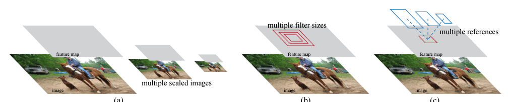
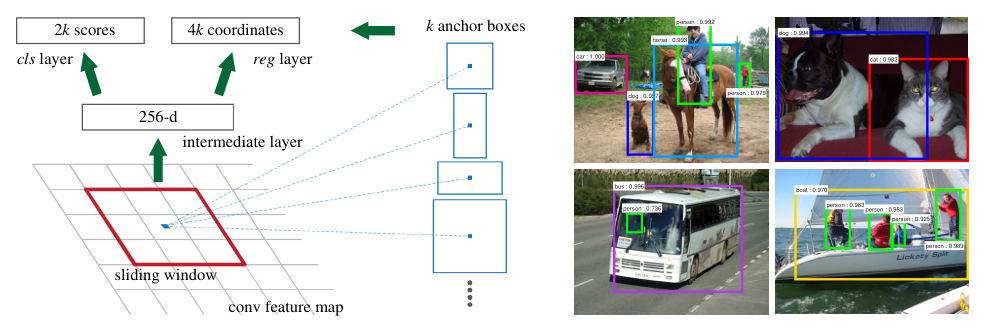
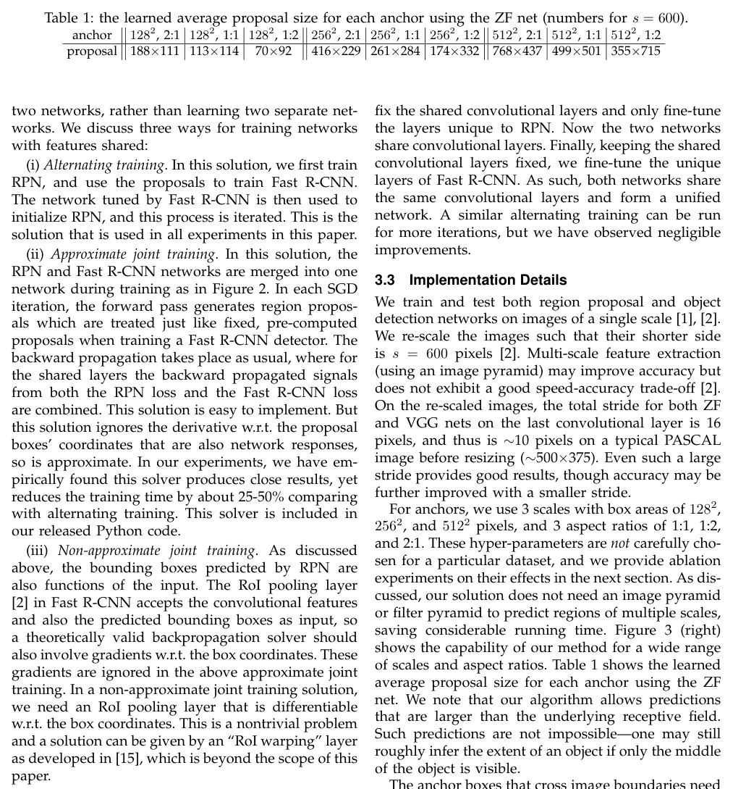
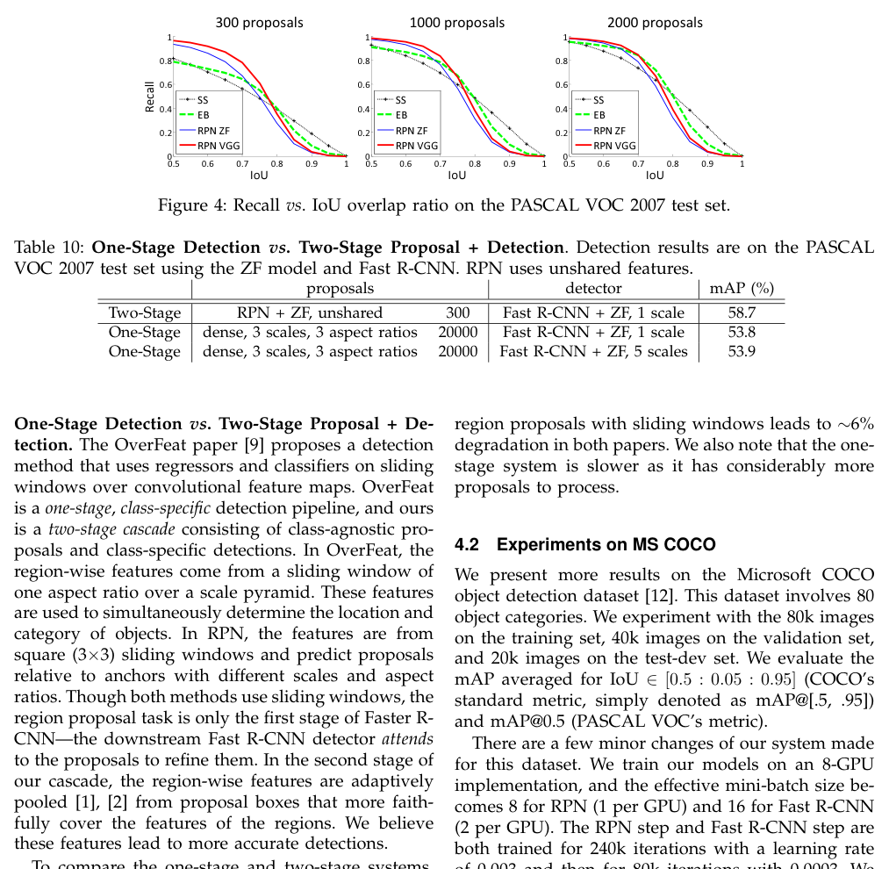
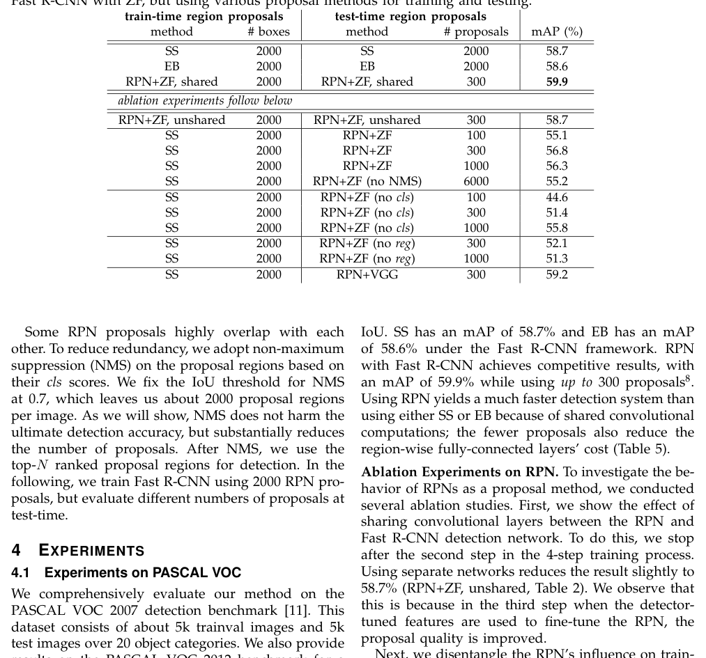
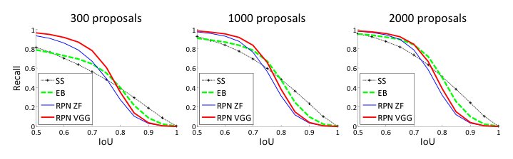
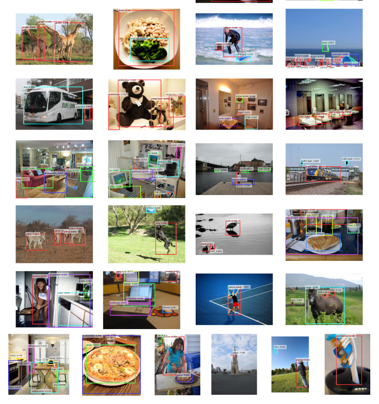
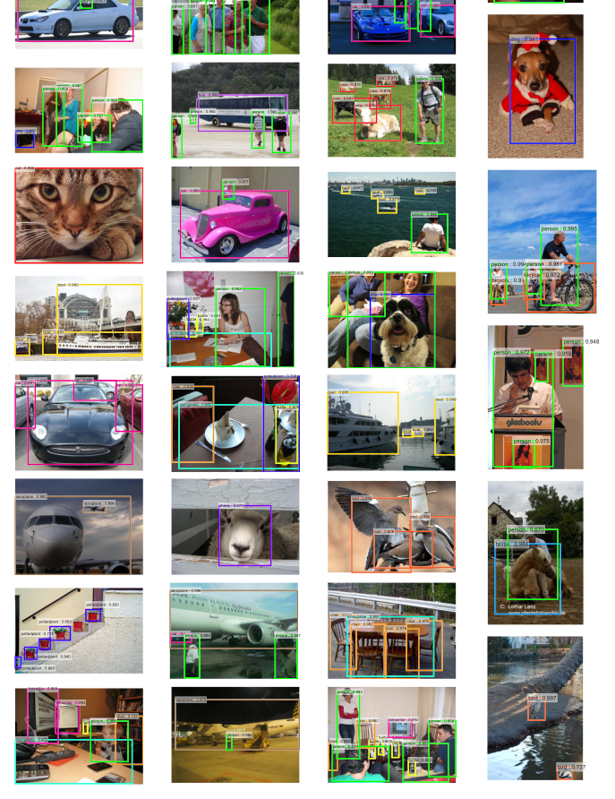

# Faster R-CNN: Towards Real-Time Object Detection with Region Proposal Networks

**Faster R-CNN：用候选区域网络走向实时目标检测**

**作者**：Shaoqing Ren, Kaiming He, Ross Girshick, and Jian Sun（任少卿，何恺明，Ross Girshick，孙剑）

**Original（作者脚注）:** • S. Ren is with University of Science and Technology of China, Hefei, China. This work was done when S. Ren was an intern at Microsoft Research. Email: sqren@mail.ustc.edu.cn • K. He and J. Sun are with Visual Computing Group, Microsoft Research. E-mail: {kahe,jiansun}@microsoft.com • R. Girshick is with Facebook AI Research. The majority of this work was done when R. Girshick was with Microsoft Research. E-mail: rbg@fb.com

**中文（作者脚注）:** • S. Ren 就职于中国科学技术大学（中国合肥）。本工作在 S. Ren 于微软研究院实习期间完成。邮箱：sqren@mail.ustc.edu.cn • K. He 与 J. Sun 就职于微软研究院视觉计算组。邮箱：{kahe,jiansun}@microsoft.com • R. Girshick 就职于 Facebook AI Research。本工作的主体部分在 R. Girshick 就职于微软研究院期间完成。邮箱：rbg@fb.com

> 本文为全文双语对照翻译。原文为 arXiv:1506.01497v3（2016-01-06，NIPS 2015 会议版的扩展版本），下载自 https://arxiv.org/pdf/1506.01497，共 14 页，原 PDF 见同目录 paper.pdf。术语首次出现以「中文译名（English）」标注，之后统一用中文译名。

---

## Abstract（摘要）

**Original:** State-of-the-art object detection networks depend on region proposal algorithms to hypothesize object locations. Advances like SPPnet [1] and Fast R-CNN [2] have reduced the running time of these detection networks, exposing region proposal computation as a bottleneck. In this work, we introduce a Region Proposal Network (RPN) that shares full-image convolutional features with the detection network, thus enabling nearly cost-free region proposals. An RPN is a fully convolutional network that simultaneously predicts object bounds and objectness scores at each position. The RPN is trained end-to-end to generate high-quality region proposals, which are used by Fast R-CNN for detection. We further merge RPN and Fast R-CNN into a single network by sharing their convolutional features—using the recently popular terminology of neural networks with “attention” mechanisms, the RPN component tells the unified network where to look. For the very deep VGG-16 model [3], our detection system has a frame rate of 5fps (including all steps) on a GPU, while achieving state-of-the-art object detection accuracy on PASCAL VOC 2007, 2012, and MS COCO datasets with only 300 proposals per image. In ILSVRC and COCO 2015 competitions, Faster R-CNN and RPN are the foundations of the 1st-place winning entries in several tracks. Code has been made publicly available.

**中文:** 当前最优（state-of-the-art）的目标检测（object detection）网络依赖候选区域（region proposal）算法来推测目标可能的位置。SPPnet [1] 与 Fast R-CNN [2] 等进展缩短了这些检测网络的运行时间，从而暴露出候选区域计算这一瓶颈。在本文中，我们提出候选区域网络（Region Proposal Network，RPN），它与检测网络共享全图卷积（convolutional）特征，从而以近乎零成本的方式生成候选区域。RPN 是一种全卷积网络（fully convolutional network），在每个位置上同时预测目标边界与目标性分数（objectness score）。RPN 经端到端（end-to-end）训练以生成高质量的候选区域，随后由 Fast R-CNN 用于检测。我们进一步通过共享卷积特征将 RPN 与 Fast R-CNN 合并为单一网络——借用近来流行的、带「注意力（attention）」机制的神经网络术语，RPN 组件告诉统一网络该看向何处。对于非常深的 VGG-16 模型 [3]，我们的检测系统在 GPU 上达到 5fps 的帧率（含所有步骤），同时仅用每张图像 300 个候选区域，就在 PASCAL VOC 2007、2012 与 MS COCO 数据集上取得当前最优的目标检测精度。在 ILSVRC 与 COCO 2015 竞赛中，Faster R-CNN 与 RPN 是多个赛道第一名方案的基础。代码已公开发布。

## Index Terms（关键词）

**Original:** Object Detection, Region Proposal, Convolutional Neural Network.

**中文:** 目标检测，候选区域，卷积神经网络。

---

## 1 Introduction（引言）

**Original:** Recent advances in object detection are driven by the success of region proposal methods (e.g., [4]) and region-based convolutional neural networks (R-CNNs) [5]. Although region-based CNNs were computationally expensive as originally developed in [5], their cost has been drastically reduced thanks to sharing convolutions across proposals [1], [2]. The latest incarnation, Fast R-CNN [2], achieves near real-time rates using very deep networks [3], when ignoring the time spent on region proposals. Now, proposals are the test-time computational bottleneck in state-of-the-art detection systems.

**中文:** 目标检测的近期进展，由候选区域方法（如 [4]）与基于区域的卷积神经网络（region-based CNN，即 R-CNN）[5] 的成功所驱动。虽然基于区域的 CNN 在 [5] 最初提出时计算开销高昂，但得益于在各候选区域之间共享卷积 [1], [2]，其开销已大幅降低。最新的形态 Fast R-CNN [2] 在使用非常深的网络 [3] 时、在忽略候选区域所耗时间的前提下，已能达到接近实时的速度。如今，候选区域已成为当前最优检测系统在测试时的计算瓶颈。

**Original:** Region proposal methods typically rely on inexpensive features and economical inference schemes. Selective Search [4], one of the most popular methods, greedily merges superpixels based on engineered low-level features. Yet when compared to efficient detection networks [2], Selective Search is an order of magnitude slower, at 2 seconds per image in a CPU implementation. EdgeBoxes [6] currently provides the best tradeoff between proposal quality and speed, at 0.2 seconds per image. Nevertheless, the region proposal step still consumes as much running time as the detection network.

**中文:** 候选区域方法通常依赖廉价的特征与经济的推理（inference）方案。Selective Search [4] 是最流行的方法之一，它基于人工设计的低级特征（low-level features）贪心地合并超像素（superpixel）。然而与高效的检测网络 [2] 相比，Selective Search 在 CPU 实现下每张图像耗时 2 秒，慢了一个数量级。EdgeBoxes [6] 目前在候选质量与速度之间提供了最佳权衡，每张图像仅 0.2 秒。尽管如此，候选区域步骤仍消耗与检测网络相当多的运行时间。

**Original:** One may note that fast region-based CNNs take advantage of GPUs, while the region proposal methods used in research are implemented on the CPU, making such runtime comparisons inequitable. An obvious way to accelerate proposal computation is to re-implement it for the GPU. This may be an effective engineering solution, but re-implementation ignores the down-stream detection network and therefore misses important opportunities for sharing computation.

**中文:** 有人可能会指出，快速的基于区域的 CNN 利用了 GPU，而研究中使用的候选区域方法是在 CPU 上实现的，因此这样的运行时间比较并不公平。加速候选计算的一个显然办法是把它重新实现到 GPU 上。这可能是一个有效的工程方案，但重新实现忽视了下游的检测网络，因而错失了共享计算的重要机会。

**Original:** In this paper, we show that an algorithmic change—computing proposals with a deep convolutional neural network—leads to an elegant and effective solution where proposal computation is nearly cost-free given the detection network’s computation. To this end, we introduce novel Region Proposal Networks (RPNs) that share convolutional layers with state-of-the-art object detection networks [1], [2]. By sharing convolutions at test-time, the marginal cost for computing proposals is small (e.g., 10ms per image).

**中文:** 在本文中，我们展示一种算法层面的改变——用深度卷积神经网络计算候选区域——可以带来一个优雅而有效的解决方案：在检测网络已有计算的基础上，候选区域的计算几乎零成本。为此，我们提出新颖的候选区域网络（Region Proposal Network，RPN），它与当前最优的目标检测网络 [1], [2] 共享卷积层。通过在测试时共享卷积，计算候选区域的边际成本很小（例如每张图像 10ms）。

**Original:** Our observation is that the convolutional feature maps used by region-based detectors, like Fast R-CNN, can also be used for generating region proposals. On top of these convolutional features, we construct an RPN by adding a few additional convolutional layers that simultaneously regress region bounds and objectness scores at each location on a regular grid. The RPN is thus a kind of fully convolutional network (FCN) [7] and can be trained end-to-end specifically for the task for generating detection proposals.

**中文:** 我们的观察是：基于区域的检测器（如 Fast R-CNN）所用的卷积特征图（feature map），也可以用来生成候选区域。在这些卷积特征之上，我们通过额外增加若干卷积层来构建 RPN，这些层在规则网格的每个位置上同时回归区域边界并给出目标性分数。因此 RPN 是一种全卷积网络（fully convolutional network，FCN）[7]，可以端到端地专门为生成检测候选区域这一任务进行训练。

**Original:** RPNs are designed to efficiently predict region proposals with a wide range of scales and aspect ratios. In contrast to prevalent methods [8], [9], [1], [2] that use pyramids of images (Figure 1, a) or pyramids of filters (Figure 1, b), we introduce novel “anchor” boxes that serve as references at multiple scales and aspect ratios. Our scheme can be thought of as a pyramid of regression references (Figure 1, c), which avoids enumerating images or filters of multiple scales or aspect ratios. This model performs well when trained and tested using single-scale images and thus benefits running speed.

**中文:** RPN 的设计目标，是高效预测具有广泛尺度（scale）与长宽比（aspect ratio）范围的候选区域。与流行方法 [8], [9], [1], [2] 使用图像金字塔（Figure 1, a）或滤波器金字塔（Figure 1, b）不同，我们引入新颖的「锚框（anchor）」盒，作为多尺度、多长宽比的参考。我们的方案可以看作回归参考的金字塔（Figure 1, c），从而避免枚举多尺度或多长宽比的图像或滤波器。该模型在使用单尺度图像训练与测试时表现良好，因而有利于运行速度。

> **图 1（译）**：处理多尺度与多尺寸问题的不同方案。(a) 构建图像与特征图金字塔，分类器在所有尺度上运行。(b) 在特征图上运行多尺度/多尺寸的滤波器金字塔。(c) 我们在回归函数中使用参考框的金字塔。（原图见 paper.pdf 第 2 页，见下方图）

**Original:** To unify RPNs with Fast R-CNN [2] object detection networks, we propose a training scheme that alternates between fine-tuning for the region proposal task and then fine-tuning for object detection, while keeping the proposals fixed. This scheme converges quickly and produces a unified network with convolutional features that are shared between both tasks.

**中文:** 为了把 RPN 与 Fast R-CNN [2] 目标检测网络统一起来，我们提出一种训练方案：在针对候选区域任务的微调（fine-tuning）与针对目标检测的微调之间交替进行，同时保持候选区域固定不变。该方案收敛迅速，并产生一个在两个任务之间共享卷积特征的统一网络。

**Original（脚注 1）:** Since the publication of the conference version of this paper [10], we have also found that RPNs can be trained jointly with Fast R-CNN networks leading to less training time.

**中文（脚注 1）:** 自本文会议版 [10] 发表以来，我们还发现 RPN 可以与 Fast R-CNN 网络联合训练，从而缩短训练时间。

**Original:** We comprehensively evaluate our method on the PASCAL VOC detection benchmarks [11] where RPNs with Fast R-CNNs produce detection accuracy better than the strong baseline of Selective Search with Fast R-CNNs. Meanwhile, our method waives nearly all computational burdens of Selective Search at test-time—the effective running time for proposals is just 10 milliseconds. Using the expensive very deep models of [3], our detection method still has a frame rate of 5fps (including all steps) on a GPU, and thus is a practical object detection system in terms of both speed and accuracy. We also report results on the MS COCO dataset [12] and investigate the improvements on PASCAL VOC using the COCO data. Code has been made publicly available at https://github.com/shaoqingren/faster_rcnn (in MATLAB) and https://github.com/rbgirshick/py-faster-rcnn (in Python).

**中文:** 我们在 PASCAL VOC 检测基准测试（benchmark）[11] 上全面评估了我们的方法：RPN 与 Fast R-CNN 组合所取得的检测精度，优于 Selective Search 与 Fast R-CNN 这一强基线（baseline）。同时，我们的方法在测试时几乎免除了 Selective Search 的全部计算负担——候选区域的有效运行时间仅为 10 毫秒。即使使用 [3] 中昂贵的超深模型，我们的检测方法在 GPU 上仍达到 5fps 的帧率（含所有步骤），因此在速度与精度两方面都是一个实用的目标检测系统。我们还报告了在 MS COCO 数据集 [12] 上的结果，并研究了使用 COCO 数据对 PASCAL VOC 的提升。代码已公开发布于 https://github.com/shaoqingren/faster_rcnn（MATLAB 版）和 https://github.com/rbgirshick/py-faster-rcnn（Python 版）。

**Original:** A preliminary version of this manuscript was published previously [10]. Since then, the frameworks of RPN and Faster R-CNN have been adopted and generalized to other methods, such as 3D object detection [13], part-based detection [14], instance segmentation [15], and image captioning [16]. Our fast and effective object detection system has also been built in commercial systems such as at Pinterests [17], with user engagement improvements reported.

**中文:** 本文手稿的初步版本已先行发表 [10]。此后，RPN 与 Faster R-CNN 的框架被采纳并推广到其他方法中，如 3D 目标检测 [13]、基于部件的检测（part-based detection）[14]、实例分割（instance segmentation）[15] 与图像描述（image captioning）[16]。我们快速有效的目标检测系统也已在商业系统中落地，例如 Pinterest [17]，并报告了用户参与度的提升。

**Original:** In ILSVRC and COCO 2015 competitions, Faster R-CNN and RPN are the basis of several 1st-place entries [18] in the tracks of ImageNet detection, ImageNet localization, COCO detection, and COCO segmentation. RPNs completely learn to propose regions from data, and thus can easily benefit from deeper and more expressive features (such as the 101-layer residual nets adopted in [18]). Faster R-CNN and RPN are also used by several other leading entries in these competitions. These results suggest that our method is not only a cost-efficient solution for practical usage, but also an effective way of improving object detection accuracy.

**中文:** 在 ILSVRC 与 COCO 2015 竞赛中，Faster R-CNN 与 RPN 是 ImageNet 检测、ImageNet 定位、COCO 检测与 COCO 分割等多个赛道若干第一名方案 [18] 的基础。RPN 完全从数据中学习如何提出区域，因此很容易受益于更深、更具表达力的特征（如 [18] 中所采用的 101 层残差网络）。Faster R-CNN 与 RPN 也被这些竞赛中其他几个领先方案所使用。这些结果表明，我们的方法不仅是实际应用中高性价比的解决方案，也是提升目标检测精度的有效途径。

**Original（脚注 2）:** http://image-net.org/challenges/LSVRC/2015/results

**中文（脚注 2）:** （URL 保留原文，即 ILSVRC 2015 结果页面链接）

---

## 2 Related Work（相关工作）

**Original:** There is a large literature on object proposal methods. Comprehensive surveys and comparisons of object proposal methods can be found in [19], [20], [21]. Widely used object proposal methods include those based on grouping super-pixels (e.g., Selective Search [4], CPMC [22], MCG [23]) and those based on sliding windows (e.g., objectness in windows [24], EdgeBoxes [6]). Object proposal methods were adopted as external modules independent of the detectors (e.g., Selective Search [4] object detectors, R-CNN [5], and Fast R-CNN [2]).

**中文:** 关于目标候选（object proposal）方法的文献浩如烟海。相关综述与比较可见 [19], [20], [21]。广泛使用的目标候选方法包括基于超像素分组的方法（如 Selective Search [4]、CPMC [22]、MCG [23]）与基于滑动窗口（sliding window）的方法（如窗口目标性 [24]、EdgeBoxes [6]）。目标候选方法曾作为独立于检测器的外部模块被采用（如 Selective Search [4] 目标检测器、R-CNN [5] 与 Fast R-CNN [2]）。

**Original:** The R-CNN method [5] trains CNNs end-to-end to classify the proposal regions into object categories or background. R-CNN mainly plays as a classifier, and it does not predict object bounds (except for refining by bounding box regression). Its accuracy depends on the performance of the region proposal module (see comparisons in [20]). Several papers have proposed ways of using deep networks for predicting object bounding boxes [25], [9], [26], [27]. In the OverFeat method [9], a fully-connected layer is trained to predict the box coordinates for the localization task that assumes a single object. The fully-connected layer is then turned into a convolutional layer for detecting multiple class-specific objects. The MultiBox methods [26], [27] generate region proposals from a network whose last fully-connected layer simultaneously predicts multiple class-agnostic boxes, generalizing the “single-box” fashion of OverFeat. These class-agnostic boxes are used as proposals for R-CNN [5]. The MultiBox proposal network is applied on a single image crop or multiple large image crops (e.g., 224×224), in contrast to our fully convolutional scheme. MultiBox does not share features between the proposal and detection networks. We discuss OverFeat and MultiBox in more depth later in context with our method. Concurrent with our work, the DeepMask method [28] is developed for learning segmentation proposals.

**中文:** R-CNN 方法 [5] 端到端地训练 CNN，把候选区域分类为目标类别或背景。R-CNN 主要扮演分类器（classifier）的角色，并不预测目标的边界（仅通过边界框回归做细化）。其精度取决于候选区域模块的表现（见 [20] 中的比较）。若干论文提出了用深度网络预测目标边界框（bounding box）的方法 [25], [9], [26], [27]。在 OverFeat 方法 [9] 中，一个全连接（fully-connected）层被训练来为假定只含单个目标的定位任务预测框坐标，随后该全连接层被转换为卷积层，用于检测多个类别相关（class-specific）的目标。MultiBox 方法 [26], [27] 从一个网络中生成候选区域，该网络最后的全连接层同时预测多个类别无关（class-agnostic）的框，推广了 OverFeat 的「单框」模式。这些类别无关的框被用作 R-CNN [5] 的候选区域。MultiBox 的候选网络作用于单个图像裁剪块或多个大的图像裁剪块（如 224×224），与我们的全卷积方案形成对比。MultiBox 不在候选网络与检测网络之间共享特征。我们稍后会在与本文方法的对照中更深入地讨论 OverFeat 与 MultiBox。与我们的工作同时，DeepMask 方法 [28] 被开发出来用于学习分割候选。

> **图 2（译）**：Faster R-CNN 是用于目标检测的单一、统一网络。RPN 模块充当这个统一网络的「注意力」。（原图见 paper.pdf 第 3 页，见下方图）

**Original:** Shared computation of convolutions [9], [1], [29], [7], [2] has been attracting increasing attention for efficient, yet accurate, visual recognition. The OverFeat paper [9] computes convolutional features from an image pyramid for classification, localization, and detection. Adaptively-sized pooling (SPP) [1] on shared convolutional feature maps is developed for efficient region-based object detection [1], [30] and semantic segmentation [29]. Fast R-CNN [2] enables end-to-end detector training on shared convolutional features and shows compelling accuracy and speed.

**中文:** 卷积的共享计算 [9], [1], [29], [7], [2] 因兼顾高效与准确而日益受到视觉识别领域的关注。OverFeat 论文 [9] 从图像金字塔计算卷积特征，用于分类、定位与检测。在共享卷积特征图上进行自适应尺寸池化（pooling）的 SPP [1] 被开发出来，用于高效的基于区域的目标检测 [1], [30] 与语义分割（semantic segmentation）[29]。Fast R-CNN [2] 使检测器得以在共享卷积特征上端到端地训练，并展现出令人瞩目的精度与速度。

---

## 3 Faster R-CNN

**Original:** Our object detection system, called Faster R-CNN, is composed of two modules. The first module is a deep fully convolutional network that proposes regions, and the second module is the Fast R-CNN detector [2] that uses the proposed regions. The entire system is a single, unified network for object detection (Figure 2). Using the recently popular terminology of neural networks with ‘attention’ [31] mechanisms, the RPN module tells the Fast R-CNN module where to look. In Section 3.1 we introduce the designs and properties of the network for region proposal. In Section 3.2 we develop algorithms for training both modules with features shared.

**中文:** 我们的目标检测系统名为 Faster R-CNN，由两个模块组成。第一个模块是提出区域的深度全卷积网络，第二个模块是使用这些区域的 Fast R-CNN 检测器 [2]。整个系统是用于目标检测的单一、统一网络（图 2）。借用近来流行的、带「注意力」[31] 机制的神经网络术语，RPN 模块告诉 Fast R-CNN 模块该看向何处。第 3.1 节介绍候选区域网络的设计与性质，第 3.2 节给出在共享特征下训练两个模块的算法。

### 3.1 Region Proposal Networks（候选区域网络）

**Original:** A Region Proposal Network (RPN) takes an image (of any size) as input and outputs a set of rectangular object proposals, each with an objectness score. We model this process with a fully convolutional network [7], which we describe in this section. Because our ultimate goal is to share computation with a Fast R-CNN object detection network [2], we assume that both nets share a common set of convolutional layers. In our experiments, we investigate the Zeiler and Fergus model [32] (ZF), which has 5 shareable convolutional layers and the Simonyan and Zisserman model [3] (VGG-16), which has 13 shareable convolutional layers.

**中文:** 候选区域网络（RPN）以一幅图像（任意尺寸）为输入，输出一组矩形目标候选区域，每个候选带有一个目标性分数。我们用全卷积网络 [7] 对该过程建模，并在本节描述。由于我们的最终目标是与 Fast R-CNN 目标检测网络 [2] 共享计算，我们假设两个网络共享一组共同的卷积层。在实验中，我们考察 Zeiler 和 Fergus 模型 [32]（ZF，含 5 个可共享卷积层）与 Simonyan 和 Zisserman 模型 [3]（VGG-16，含 13 个可共享卷积层）。

**Original（脚注 3）:** “Region” is a generic term and in this paper we only consider rectangular regions, as is common for many methods (e.g., [27], [4], [6]). “Objectness” measures membership to a set of object classes vs. background.

**中文（脚注 3）:** 「区域（Region）」是一个通用术语，本文只考虑矩形区域，这与许多方法的常见做法一致（如 [27], [4], [6]）。「目标性（Objectness）」度量的是某物属于某一组目标类别而非背景的程度。

**Original:** To generate region proposals, we slide a small network over the convolutional feature map output by the last shared convolutional layer. This small network takes as input an n × n spatial window of the input convolutional feature map. Each sliding window is mapped to a lower-dimensional feature (256-d for ZF and 512-d for VGG, with ReLU [33] following). This feature is fed into two sibling fully-connected layers—a box-regression layer (reg) and a box-classification layer (cls). We use n = 3 in this paper, noting that the effective receptive field on the input image is large (171 and 228 pixels for ZF and VGG, respectively). This mini-network is illustrated at a single position in Figure 3 (left). Note that because the mini-network operates in a sliding-window fashion, the fully-connected layers are shared across all spatial locations. This architecture is naturally implemented with an n×n convolutional layer followed by two sibling 1 × 1 convolutional layers (for reg and cls, respectively).

**中文:** 为了生成候选区域，我们在最后一个共享卷积层输出的卷积特征图上滑动一个小网络。这个小网络以输入卷积特征图的一个 $n \times n$ 空间窗口为输入。每个滑动窗口被映射为一个低维特征（ZF 为 256 维，VGG 为 512 维，其后接 ReLU [33]）。该特征被送入两个并行的全连接层——边界框回归层（box-regression layer，reg）与边界框分类层（box-classification layer，cls）。本文取 $n = 3$，注意此时在输入图像上的有效感受野（receptive field）很大（ZF 与 VGG 分别为 171 与 228 像素）。这个小网络在单个位置上的情形如图 3（左）所示。注意，由于小网络以滑动窗口方式工作，全连接层在所有空间位置上是共享的。该架构自然地由一个 $n\times n$ 卷积层后接两个并行的 $1 \times 1$ 卷积层（分别对应 reg 与 cls）实现。

**Original（脚注 4）:** For simplicity we implement the cls layer as a two-class softmax layer. Alternatively, one may use logistic regression to produce k scores.

**中文（脚注 4）:** 为简单起见，我们把 cls 层实现为两类 softmax 层。也可以用逻辑回归（logistic regression）来产生 $k$ 个分数。

> **图 3（译）**：左：候选区域网络（RPN）。右：在 PASCAL VOC 2007 测试集上使用 RPN 候选区域的检测示例。我们的方法能检测各种尺度与长宽比的目标。（原图见 paper.pdf 第 4 页，见下方图）

#### 3.1.1 Anchors（锚框）

**Original:** At each sliding-window location, we simultaneously predict multiple region proposals, where the number of maximum possible proposals for each location is denoted as k. So the reg layer has 4k outputs encoding the coordinates of k boxes, and the cls layer outputs 2k scores that estimate probability of object or not object for each proposal. The k proposals are parameterized relative to k reference boxes, which we call anchors. An anchor is centered at the sliding window in question, and is associated with a scale and aspect ratio (Figure 3, left). By default we use 3 scales and 3 aspect ratios, yielding k = 9 anchors at each sliding position. For a convolutional feature map of a size W × H (typically ∼2,400), there are WHk anchors in total.

**中文:** 在每个滑动窗口位置上，我们同时预测多个候选区域，每个位置的最大可能候选数记为 $k$。因此 reg 层有 $4k$ 个输出，编码 $k$ 个框的坐标；cls 层输出 $2k$ 个分数，估计每个候选是目标或不是目标的概率。这 $k$ 个候选相对于 $k$ 个参考框（reference box）进行参数化，这些参考框我们称之为锚框（anchor）。一个锚框以当前滑动窗口为中心，并关联一个尺度与一个长宽比（图 3 左）。默认我们使用 3 个尺度与 3 个长宽比，在每个滑动位置产生 $k = 9$ 个锚框。对于尺寸为 $W \times H$ 的卷积特征图（典型值约 2,400），总共有 $WHk$ 个锚框。

**Translation-Invariant Anchors（平移不变的锚框）**

**Original:** An important property of our approach is that it is translation invariant, both in terms of the anchors and the functions that compute proposals relative to the anchors. If one translates an object in an image, the proposal should translate and the same function should be able to predict the proposal in either location. This translation-invariant property is guaranteed by our method. As a comparison, the MultiBox method [27] uses k-means to generate 800 anchors, which are not translation invariant. So MultiBox does not guarantee that the same proposal is generated if an object is translated.

**中文:** 我们方法的一个重要性质是平移不变（translation invariant）——无论就锚框本身而言，还是就相对于锚框计算候选的函数而言都是如此。如果图像中的一个目标发生平移，候选也应随之平移，并且同一函数应能在任何位置预测出该候选。这一平移不变性由我们的方法保证。作为对比，MultiBox 方法 [27] 用 k-means 生成 800 个锚框，它们不是平移不变的。因此当目标平移时，MultiBox 不能保证生成相同的候选。

**Original（脚注 5）:** As is the case of FCNs [7], our network is translation invariant up to the network’s total stride.

**中文（脚注 5）:** 与 FCN [7] 的情形一样，我们的网络在网络总步长范围内是平移不变的。

**Original:** The translation-invariant property also reduces the model size. MultiBox has a (4 + 1) × 800-dimensional fully-connected output layer, whereas our method has a (4 + 2) × 9-dimensional convolutional output layer in the case of k = 9 anchors. As a result, our output layer has 2.8 × 10⁴ parameters (512 × (4 + 2) × 9 for VGG-16), two orders of magnitude fewer than MultiBox’s output layer that has 6.1 × 10⁶ parameters (1536 × (4 + 1) × 800 for GoogleNet [34] in MultiBox [27]). If considering the feature projection layers, our proposal layers still have an order of magnitude fewer parameters than MultiBox. We expect our method to have less risk of overfitting on small datasets, like PASCAL VOC.

**中文:** 平移不变性还缩小了模型规模。MultiBox 有一个 $(4 + 1) \times 800$ 维的全连接输出层，而我们的方法在 $k = 9$ 个锚框时是一个 $(4 + 2) \times 9$ 维的卷积输出层。因此，我们的输出层有 $2.8 \times 10^4$ 个参数（VGG-16 为 $512 \times (4 + 2) \times 9$），比 MultiBox 的输出层（$6.1 \times 10^6$ 个参数，MultiBox [27] 中 GoogleNet [34] 为 $1536 \times (4 + 1) \times 800$）少两个数量级。即使计入特征投影层，我们的候选层的参数仍然比 MultiBox 少一个数量级。我们预期自己的方法在 PASCAL VOC 这类小数据集上过拟合（overfitting）的风险更小。

**Original（脚注 6）:** Considering the feature projection layers, our proposal layers’ parameter count is 3 × 3 × 512 × 512 + 512 × 6 × 9 = 2.4 × 10⁶; MultiBox’s proposal layers’ parameter count is 7 × 7 × (64 + 96 + 64 + 64) × 1536 + 1536 × 5 × 800 = 27 × 10⁶.

**中文（脚注 6）:** 计入特征投影层后，我们候选层的参数量为 $3 \times 3 \times 512 \times 512 + 512 \times 6 \times 9 = 2.4 \times 10^6$；MultiBox 候选层的参数量为 $7 \times 7 \times (64 + 96 + 64 + 64) \times 1536 + 1536 \times 5 \times 800 = 27 \times 10^6$。

**Multi-Scale Anchors as Regression References（作为回归参考的多尺度锚框）**

**Original:** Our design of anchors presents a novel scheme for addressing multiple scales (and aspect ratios). As shown in Figure 1, there have been two popular ways for multi-scale predictions. The first way is based on image/feature pyramids, e.g., in DPM [8] and CNN-based methods [9], [1], [2]. The images are resized at multiple scales, and feature maps (HOG [8] or deep convolutional features [9], [1], [2]) are computed for each scale (Figure 1(a)). This way is often useful but is time-consuming. The second way is to use sliding windows of multiple scales (and/or aspect ratios) on the feature maps. For example, in DPM [8], models of different aspect ratios are trained separately using different filter sizes (such as 5×7 and 7×5). If this way is used to address multiple scales, it can be thought of as a “pyramid of filters” (Figure 1(b)). The second way is usually adopted jointly with the first way [8].

**中文:** 我们的锚框设计为处理多尺度（与长宽比）问题提供了一种新方案。如图 1 所示，多尺度预测有两条流行路线。第一条路线基于图像/特征金字塔，例如 DPM [8] 与基于 CNN 的方法 [9], [1], [2]：图像被缩放到多个尺度，并对每个尺度计算特征图（HOG [8] 或深度卷积特征 [9], [1], [2]）（图 1(a)）。这条路线常常有效但耗时。第二条路线是在特征图上使用多尺度（和/或多长宽比）的滑动窗口。例如在 DPM [8] 中，不同长宽比的模型用不同尺寸的滤波器（如 5×7 与 7×5）分别训练。若用这条路线处理多尺度，可以看作「滤波器金字塔」（图 1(b)）。第二条路线通常与第一条联合使用 [8]。

**Original:** As a comparison, our anchor-based method is built on a pyramid of anchors, which is more cost-efficient. Our method classifies and regresses bounding boxes with reference to anchor boxes of multiple scales and aspect ratios. It only relies on images and feature maps of a single scale, and uses filters (sliding windows on the feature map) of a single size. We show by experiments the effects of this scheme for addressing multiple scales and sizes (Table 8).

**中文:** 相比之下，我们基于锚框的方法建立在锚框金字塔之上，更具成本效益。我们的方法参照多尺度、多长宽比的锚框来分类并回归边界框。它只依赖单一尺度的图像与特征图，并使用单一尺寸的滤波器（特征图上的滑动窗口）。我们用实验展示了该方案处理多尺度与多尺寸的效果（表 8）。

**Original:** Because of this multi-scale design based on anchors, we can simply use the convolutional features computed on a single-scale image, as is also done by the Fast R-CNN detector [2]. The design of multi-scale anchors is a key component for sharing features without extra cost for addressing scales.

**中文:** 由于这种基于锚框的多尺度设计，我们可以简单地使用在单尺度图像上计算出的卷积特征，Fast R-CNN 检测器 [2] 也是这么做的。多尺度锚框的设计，是无需额外代价即可处理尺度并共享特征的关键组件。

#### 3.1.2 Loss Function（损失函数）

**Original:** For training RPNs, we assign a binary class label (of being an object or not) to each anchor. We assign a positive label to two kinds of anchors: (i) the anchor/anchors with the highest Intersection-over-Union (IoU) overlap with a ground-truth box, or (ii) an anchor that has an IoU overlap higher than 0.7 with any ground-truth box. Note that a single ground-truth box may assign positive labels to multiple anchors. Usually the second condition is sufficient to determine the positive samples; but we still adopt the first condition for the reason that in some rare cases the second condition may find no positive sample. We assign a negative label to a non-positive anchor if its IoU ratio is lower than 0.3 for all ground-truth boxes. Anchors that are neither positive nor negative do not contribute to the training objective.

**中文:** 为了训练 RPN，我们给每个锚框分配一个二值类别标签（是目标或不是目标）。两类锚框被赋予正标签：(i) 与某个真实标注框（ground-truth box）交并比（Intersection-over-Union，IoU）最高的锚框，或 (ii) 与任一真实标注框的 IoU 高于 0.7 的锚框。注意，单个真实标注框可能给多个锚框分配正标签。通常第二个条件就足以确定正样本（positive sample）；但我们仍采用第一个条件，因为在个别罕见情况下第二个条件可能找不到任何正样本。若一个非正锚框与所有真实标注框的 IoU 都低于 0.3，则赋予负标签。既非正也非负的锚框对训练目标没有贡献。

**Original:** With these definitions, we minimize an objective function following the multi-task loss in Fast R-CNN [2]. Our loss function for an image is defined as:

**中文:** 基于这些定义，我们遵循 Fast R-CNN [2] 中的多任务损失（multi-task loss）来最小化一个目标函数（objective function）。我们对一幅图像定义的损失函数如下：

$$
L(\{p_i\}, \{t_i\}) = \frac{1}{N_{cls}} \sum_i L_{cls}(p_i, p_i^*) + \lambda \frac{1}{N_{reg}} \sum_i p_i^* L_{reg}(t_i, t_i^*) \tag{1}
$$

**Original:** Here, i is the index of an anchor in a mini-batch and pᵢ is the predicted probability of anchor i being an object. The ground-truth label pᵢ* is 1 if the anchor is positive, and is 0 if the anchor is negative. tᵢ is a vector representing the 4 parameterized coordinates of the predicted bounding box, and tᵢ* is that of the ground-truth box associated with a positive anchor. The classification loss L_cls is log loss over two classes (object vs. not object). For the regression loss, we use L_reg(tᵢ, tᵢ*) = R(tᵢ − tᵢ*) where R is the robust loss function (smooth L1) defined in [2]. The term pᵢ* L_reg means the regression loss is activated only for positive anchors (pᵢ* = 1) and is disabled otherwise (pᵢ* = 0). The outputs of the cls and reg layers consist of {pᵢ} and {tᵢ} respectively.

**中文:** 这里，$i$ 是小批量（mini-batch）中一个锚框的下标，$p_i$ 是锚框 $i$ 为目标（object）的预测概率。真实标注标签 $p_i^*$ 在锚框为正时取 1，为负时取 0。$t_i$ 是一个向量，表示预测边界框的 4 个参数化坐标；$t_i^*$ 是与正锚框相关联的真实标注框的对应坐标。分类损失 $L_{cls}$ 是两类（目标 vs. 非目标）的对数损失（log loss）。回归损失我们使用 $L_{reg}(t_i, t_i^*) = R(t_i - t_i^*)$，其中 $R$ 是 [2] 中定义的稳健损失函数（robust loss function，即 smooth L1）。$p_i^* L_{reg}$ 这一项意味着回归损失只对正锚框（$p_i^* = 1$）激活，否则关闭（$p_i^* = 0$）。cls 层与 reg 层的输出分别由 $\{p_i\}$ 与 $\{t_i\}$ 组成。

**Original:** The two terms are normalized by N_cls and N_reg and weighted by a balancing parameter λ. In our current implementation (as in the released code), the cls term in Eqn.(1) is normalized by the mini-batch size (i.e., N_cls = 256) and the reg term is normalized by the number of anchor locations (i.e., N_reg ∼2,400). By default we set λ = 10, and thus both cls and reg terms are roughly equally weighted. We show by experiments that the results are insensitive to the values of λ in a wide range (Table 9). We also note that the normalization as above is not required and could be simplified.

**中文:** 这两项分别由 $N_{cls}$ 与 $N_{reg}$ 归一化（normalize），并由平衡参数 $\lambda$ 加权。在我们当前的实现（与发布代码一致）中，式 (1) 的 cls 项按小批量大小归一化（即 $N_{cls} = 256$），reg 项按锚框位置数归一化（即 $N_{reg} \sim 2{,}400$）。默认取 $\lambda = 10$，此时 cls 与 reg 两项的权重大致相等。我们通过实验表明，结果在很宽的范围内对 $\lambda$ 的取值不敏感（表 9）。我们还注意到，上述归一化并非必需，可以简化。

**Original:** For bounding box regression, we adopt the parameterizations of the 4 coordinates following [5]:

**中文:** 对于边界框回归，我们采用 [5] 中对 4 个坐标的参数化方式：

$$
t_x = (x - x_a)/w_a, \quad t_y = (y - y_a)/h_a, \quad t_w = \log(w/w_a), \quad t_h = \log(h/h_a)
$$
$$
t_x^* = (x^* - x_a)/w_a, \quad t_y^* = (y^* - y_a)/h_a, \quad t_w^* = \log(w^*/w_a), \quad t_h^* = \log(h^*/h_a) \tag{2}
$$

**Original:** where x, y, w, and h denote the box’s center coordinates and its width and height. Variables x, x_a, and x* are for the predicted box, anchor box, and ground-truth box respectively (likewise for y, w, h). This can be thought of as bounding-box regression from an anchor box to a nearby ground-truth box.

**中文:** 其中 $x, y, w, h$ 表示框的中心坐标及其宽度与高度。变量 $x$、$x_a$ 与 $x^*$ 分别对应预测框、锚框与真实标注框（$y, w, h$ 同理）。这可以看作从一个锚框到其附近真实标注框的边界框回归。

**Original:** Nevertheless, our method achieves bounding-box regression by a different manner from previous RoI-based (Region of Interest) methods [1], [2]. In [1], [2], bounding-box regression is performed on features pooled from arbitrarily sized RoIs, and the regression weights are shared by all region sizes. In our formulation, the features used for regression are of the same spatial size (3 × 3) on the feature maps. To account for varying sizes, a set of k bounding-box regressors are learned. Each regressor is responsible for one scale and one aspect ratio, and the k regressors do not share weights. As such, it is still possible to predict boxes of various sizes even though the features are of a fixed size/scale, thanks to the design of anchors.

**中文:** 尽管如此，我们实现边界框回归的方式，与以往基于 RoI（Region of Interest，感兴趣区域）的方法 [1], [2] 不同。在 [1], [2] 中，边界框回归在从任意尺寸 RoI 池化得到的特征上进行，回归权重由所有区域尺寸共享。而在我们的公式化方案中，用于回归的特征在特征图上具有相同的空间尺寸（$3 \times 3$）。为应对不同的尺寸，我们学习一组 $k$ 个边界框回归器（regressor）。每个回归器负责一个尺度与一个长宽比，$k$ 个回归器之间不共享权重。如此，即便特征是固定尺寸/尺度的，也仍能预测各种尺寸的框——这要归功于锚框的设计。

#### 3.1.3 Training RPNs（训练 RPN）

**Original:** The RPN can be trained end-to-end by back-propagation and stochastic gradient descent (SGD) [35]. We follow the “image-centric” sampling strategy from [2] to train this network. Each mini-batch arises from a single image that contains many positive and negative example anchors. It is possible to optimize for the loss functions of all anchors, but this will bias towards negative samples as they are dominate. Instead, we randomly sample 256 anchors in an image to compute the loss function of a mini-batch, where the sampled positive and negative anchors have a ratio of up to 1:1. If there are fewer than 128 positive samples in an image, we pad the mini-batch with negative ones.

**中文:** RPN 可以通过反向传播（back-propagation）与随机梯度下降（stochastic gradient descent，SGD）[35] 端到端训练。我们沿用 [2] 中「以图像为中心（image-centric）」的采样策略来训练该网络。每个小批量来自单幅图像，其中包含许多正、负样本锚框。对所有锚框的损失函数进行优化是可行的，但这会偏向负样本，因为负样本占多数。取而代之，我们在一幅图像中随机采样 256 个锚框来计算一个小批量的损失函数，其中正负锚框的比例最高为 1:1。如果一幅图像中正样本不足 128 个，就用负样本填充小批量。

**Original:** We randomly initialize all new layers by drawing weights from a zero-mean Gaussian distribution with standard deviation 0.01. All other layers (i.e., the shared convolutional layers) are initialized by pre-training a model for ImageNet classification [36], as is standard practice [5]. We tune all layers of the ZF net, and conv3_1 and up for the VGG net to conserve memory [2]. We use a learning rate of 0.001 for 60k mini-batches, and 0.0001 for the next 20k mini-batches on the PASCAL VOC dataset. We use a momentum of 0.9 and a weight decay of 0.0005 [37]. Our implementation uses Caffe [38].

**中文:** 所有新层通过从标准差 0.01 的零均值高斯分布中抽取权重来随机初始化。所有其他层（即共享卷积层）通过为 ImageNet 分类 [36] 预训练（pre-training）的模型来初始化，这是标准做法 [5]。我们微调 ZF 网络的全部层；对 VGG 网络，为节省内存只微调 conv3_1 及其以上的层 [2]。在 PASCAL VOC 数据集上，前 60k 个小批量使用学习率（learning rate）0.001，其后 20k 个使用 0.0001。动量（momentum）取 0.9，权重衰减（weight decay）取 0.0005 [37]。我们的实现使用 Caffe [38]。

### 3.2 Sharing Features for RPN and Fast R-CNN（为 RPN 与 Fast R-CNN 共享特征）

**Original:** Thus far we have described how to train a network for region proposal generation, without considering the region-based object detection CNN that will utilize these proposals. For the detection network, we adopt Fast R-CNN [2]. Next we describe algorithms that learn a unified network composed of RPN and Fast R-CNN with shared convolutional layers (Figure 2).

**中文:** 至此我们描述了如何训练一个生成候选区域的网络，而尚未考虑将使用这些候选区域的、基于区域的目标检测 CNN。检测网络我们采用 Fast R-CNN [2]。接下来我们描述学习由 RPN 与 Fast R-CNN 组成、共享卷积层的统一网络（图 2）的算法。

**Original:** Both RPN and Fast R-CNN, trained independently, will modify their convolutional layers in different ways. We therefore need to develop a technique that allows for sharing convolutional layers between the two networks, rather than learning two separate networks. We discuss three ways for training networks with features shared:

**中文:** 独立训练的 RPN 与 Fast R-CNN 会以不同的方式修改各自的卷积层。因此我们需要开发一种技术，让两个网络能够共享卷积层，而不是学习两个分离的网络。我们讨论三种共享特征训练网络的方式：

> **表 1（译）**：使用 ZF 网络学到的每个锚框的平均候选尺寸（s = 600 时的数值）。（原表见 paper.pdf 第 6 页，见下方图）

>
> | anchor（锚框） | proposal（候选） |
> |---|---|
> | 128², 2:1 | 188×111 |
> | 128², 1:1 | 113×114 |
> | 128², 1:2 | 70×92 |
> | 256², 2:1 | 416×229 |
> | 256², 1:1 | 261×284 |
> | 256², 1:2 | 174×332 |
> | 512², 2:1 | 768×437 |
> | 512², 1:1 | 499×501 |
> | 512², 1:2 | 355×715 |

**Original:** (i) Alternating training. In this solution, we first train RPN, and use the proposals to train Fast R-CNN. The network tuned by Fast R-CNN is then used to initialize RPN, and this process is iterated. This is the solution that is used in all experiments in this paper.

**中文:** (i) 交替训练（alternating training）。该方案先训练 RPN，再用其候选区域训练 Fast R-CNN。随后用 Fast R-CNN 微调过的网络初始化 RPN，如此迭代。本文所有实验都使用这一方案。

**Original:** (ii) Approximate joint training. In this solution, the RPN and Fast R-CNN networks are merged into one network during training as in Figure 2. In each SGD iteration, the forward pass generates region proposals which are treated just like fixed, pre-computed proposals when training a Fast R-CNN detector. The backward propagation takes place as usual, where for the shared layers the backward propagated signals from both the RPN loss and the Fast R-CNN loss are combined. This solution is easy to implement. But this solution ignores the derivative w.r.t. the proposal boxes’ coordinates that are also network responses, so is approximate. In our experiments, we have empirically found this solver produces close results, yet reduces the training time by about 25-50% comparing with alternating training. This solver is included in our released Python code.

**中文:** (ii) 近似联合训练（approximate joint training）。该方案在训练期间把 RPN 与 Fast R-CNN 合并为一个网络，如图 2 所示。在每次 SGD 迭代中，前向传播生成候选区域，这些候选在训练 Fast R-CNN 检测器时被当作固定的、预先计算好的候选。反向传播照常进行：对于共享层，来自 RPN 损失与 Fast R-CNN 损失的反向传播信号被合并。该方案容易实现，但它忽略了关于候选框坐标的导数——这些坐标同样是网络的响应，因此该方案是近似的。在我们的实验中，经验上发现这个求解器能产生接近的结果，且与交替训练相比训练时间缩短约 25-50%。该求解器包含在我们发布的 Python 代码中。

**Original:** (iii) Non-approximate joint training. As discussed above, the bounding boxes predicted by RPN are also functions of the input. The RoI pooling layer [2] in Fast R-CNN accepts the convolutional features and also the predicted bounding boxes as input, so a theoretically valid backpropagation solver should also involve gradients w.r.t. the box coordinates. These gradients are ignored in the above approximate joint training. In a non-approximate joint training solution, we need an RoI pooling layer that is differentiable w.r.t. the box coordinates. This is a nontrivial problem and a solution can be given by an “RoI warping” layer as developed in [15], which is beyond the scope of this paper.

**中文:** (iii) 非近似联合训练（non-approximate joint training）。如上所述，RPN 预测的边界框也是输入的函数。Fast R-CNN 中的 RoI 池化层 [2] 同时接受卷积特征与预测的边界框作为输入，因此理论上有效的反向传播求解器也应包含关于框坐标的梯度。这些梯度在上述近似联合训练中被忽略了。在非近似联合训练方案中，我们需要一个关于框坐标可微（differentiable）的 RoI 池化层。这是一个不易解决的问题，[15] 中开发的「RoI warping」层可以给出一种解法，但这超出本文范围。

**Original:** 4-Step Alternating Training. In this paper, we adopt a pragmatic 4-step training algorithm to learn shared features via alternating optimization. In the first step, we train the RPN as described in Section 3.1.3. This network is initialized with an ImageNet-pre-trained model and fine-tuned end-to-end for the region proposal task. In the second step, we train a separate detection network by Fast R-CNN using the proposals generated by the step-1 RPN. This detection network is also initialized by the ImageNet-pre-trained model. At this point the two networks do not share convolutional layers. In the third step, we use the detector network to initialize RPN training, but we fix the shared convolutional layers and only fine-tune the layers unique to RPN. Now the two networks share convolutional layers. Finally, keeping the shared convolutional layers fixed, we fine-tune the unique layers of Fast R-CNN. As such, both networks share the same convolutional layers and form a unified network. A similar alternating training can be run for more iterations, but we have observed negligible improvements.

**中文:** 四步交替训练（4-Step Alternating Training）。在本文中，我们采用一个务实的四步训练算法，通过交替优化来学习共享特征。第一步，按 3.1.3 节所述训练 RPN。该网络用 ImageNet 预训练模型初始化，并针对候选区域任务端到端微调。第二步，用第一步 RPN 生成的候选区域，通过 Fast R-CNN 训练一个独立的检测网络。该检测网络同样用 ImageNet 预训练模型初始化。此时两个网络尚不共享卷积层。第三步，用检测器网络初始化 RPN 训练，但固定共享卷积层，只微调 RPN 独有的层。现在两个网络共享卷积层。最后，保持共享卷积层固定，微调 Fast R-CNN 独有的层。这样，两个网络共享相同的卷积层并构成统一网络。类似的交替训练可以多迭代几轮，但我们观察到的提升可忽略不计。

### 3.3 Implementation Details（实现细节）

**Original:** We train and test both region proposal and object detection networks on images of a single scale [1], [2]. We re-scale the images such that their shorter side is s = 600 pixels [2]. Multi-scale feature extraction (using an image pyramid) may improve accuracy but does not exhibit a good speed-accuracy trade-off [2]. On the re-scaled images, the total stride for both ZF and VGG nets on the last convolutional layer is 16 pixels, and thus is ∼10 pixels on a typical PASCAL image before resizing (∼500×375). Even such a large stride provides good results, though accuracy may be further improved with a smaller stride.

**中文:** 我们在单尺度的图像上训练与测试候选区域网络和检测网络 [1], [2]。我们把图像重新缩放，使其短边为 $s = 600$ 像素 [2]。多尺度特征提取（使用图像金字塔）或许能提升精度，但未表现出良好的速度-精度权衡 [2]。在重缩放后的图像上，ZF 与 VGG 网络在最后一个卷积层的总步长（stride）为 16 像素，因此在典型的 PASCAL 图像（重缩放前约 500×375）上约为 10 像素。即便步长如此之大仍能得到好结果，不过用更小的步长或许能进一步提升精度。

**Original:** For anchors, we use 3 scales with box areas of 128², 256², and 512² pixels, and 3 aspect ratios of 1:1, 1:2, and 2:1. These hyper-parameters are not carefully chosen for a particular dataset, and we provide ablation experiments on their effects in the next section. As discussed, our solution does not need an image pyramid or filter pyramid to predict regions of multiple scales, saving considerable running time. Figure 3 (right) shows the capability of our method for a wide range of scales and aspect ratios. Table 1 shows the learned average proposal size for each anchor using the ZF net. We note that our algorithm allows predictions that are larger than the underlying receptive field. Such predictions are not impossible—one may still roughly infer the extent of an object if only the middle of the object is visible.

**中文:** 对于锚框，我们使用 3 个尺度，框面积分别为 $128^2$、$256^2$、$512^2$ 像素，以及 1:1、1:2、2:1 共 3 个长宽比。这些超参数（hyper-parameter）并未针对特定数据集精挑细选，下一节给出它们影响的消融实验（ablation study）。如前所述，我们的方案无需图像金字塔或滤波器金字塔即可预测多尺度区域，节省了大量运行时间。图 3（右）展示了我们的方法在广泛尺度与长宽比上的能力。表 1 展示了使用 ZF 网络学到的每个锚框的平均候选尺寸。我们注意到，我们的算法允许预测结果大于其背后的感受野。这样的预测并非不可能——即便只看到目标的中间部分，人们仍能大致推断目标的延伸范围。

**Original:** The anchor boxes that cross image boundaries need to be handled with care. During training, we ignore all cross-boundary anchors so they do not contribute to the loss. For a typical 1000 × 600 image, there will be roughly 20000 (≈60 × 40 × 9) anchors in total. With the cross-boundary anchors ignored, there are about 6000 anchors per image for training. If the boundary-crossing outliers are not ignored in training, they introduce large, difficult to correct error terms in the objective, and training does not converge. During testing, however, we still apply the fully convolutional RPN to the entire image. This may generate cross-boundary proposal boxes, which we clip to the image boundary.

**中文:** 跨越图像边界的锚框需要谨慎处理。训练时，我们忽略所有跨边界（cross-boundary）锚框，使其不贡献损失。对于典型的 1000 × 600 图像，总共约有 20000（≈60 × 40 × 9）个锚框。忽略跨边界锚框后，训练时每幅图像约有 6000 个锚框。若训练时不忽略这些跨边界离群点，它们会在目标函数中引入难以修正的大误差项，导致训练不收敛（convergence）。然而测试时，我们仍将全卷积 RPN 应用于整幅图像，这可能产生跨边界的候选框，我们将它们裁剪（clip）到图像边界内。

**Original:** Some RPN proposals highly overlap with each other. To reduce redundancy, we adopt non-maximum suppression (NMS) on the proposal regions based on their cls scores. We fix the IoU threshold for NMS at 0.7, which leaves us about 2000 proposal regions per image. As we will show, NMS does not harm the ultimate detection accuracy, but substantially reduces the number of proposals. After NMS, we use the top-N ranked proposal regions for detection. In the following, we train Fast R-CNN using 2000 RPN proposals, but evaluate different numbers of proposals at test-time.

**中文:** 一些 RPN 候选相互高度重叠。为减少冗余，我们基于 cls 分数对候选区域施以非极大值抑制（non-maximum suppression，NMS）。NMS 的 IoU 阈值固定为 0.7，每幅图像约留下 2000 个候选区域。我们将展示，NMS 不损害最终的检测精度，却大幅减少了候选数量。NMS 之后，我们取排名前 N 的候选区域用于检测。下文用 2000 个 RPN 候选训练 Fast R-CNN，但测试时评估不同数量的候选。

---

## 4 Experiments（实验）

### 4.1 Experiments on PASCAL VOC（PASCAL VOC 上的实验）

**Original:** We comprehensively evaluate our method on the PASCAL VOC 2007 detection benchmark [11]. This dataset consists of about 5k trainval images and 5k test images over 20 object categories. We also provide results on the PASCAL VOC 2012 benchmark for a few models. For the ImageNet pre-trained network, we use the “fast” version of ZF net [32] that has 5 convolutional layers and 3 fully-connected layers, and the public VGG-16 model [3] that has 13 convolutional layers and 3 fully-connected layers. We primarily evaluate detection mean Average Precision (mAP), because this is the actual metric for object detection (rather than focusing on object proposal proxy metrics).

**中文:** 我们在 PASCAL VOC 2007 检测基准测试 [11] 上全面评估了我们的方法。该数据集包含约 5k 张 trainval 图像与 5k 张测试图像，涵盖 20 个目标类别。我们也给出少数模型在 PASCAL VOC 2012 基准测试上的结果。对于 ImageNet 预训练网络，我们使用 ZF net [32] 的「fast」版本（5 个卷积层加 3 个全连接层）以及公开的 VGG-16 模型 [3]（13 个卷积层加 3 个全连接层）。我们主要评估检测平均精度均值（mean Average Precision，mAP），因为这才是目标检测的实际指标（而不是关注目标候选的代理指标）。

**Original（脚注 7）:** www.robots.ox.ac.uk/∼vgg/research/very deep/

**中文（脚注 7）:** （URL 保留原文，即 VGG 组项目页链接）

**Original:** Table 2 (top) shows Fast R-CNN results when trained and tested using various region proposal methods. These results use the ZF net. For Selective Search (SS) [4], we generate about 2000 proposals by the “fast” mode. For EdgeBoxes (EB) [6], we generate the proposals by the default EB setting tuned for 0.7 IoU. SS has an mAP of 58.7% and EB has an mAP of 58.6% under the Fast R-CNN framework. RPN with Fast R-CNN achieves competitive results, with an mAP of 59.9% while using up to 300 proposals. Using RPN yields a much faster detection system than using either SS or EB because of shared convolutional computations; the fewer proposals also reduce the region-wise fully-connected layers’ cost (Table 5).

**中文:** 表 2（上部）展示了用各种候选区域方法训练与测试时 Fast R-CNN 的结果。这些结果使用 ZF net。对于 Selective Search（SS）[4]，我们用「fast」模式生成约 2000 个候选。对于 EdgeBoxes（EB）[6]，我们按针对 0.7 IoU 调优的默认 EB 设置生成候选。在 Fast R-CNN 框架下，SS 的 mAP 为 58.7%，EB 为 58.6%。RPN 与 Fast R-CNN 组合取得了有竞争力的结果：最多用 300 个候选即达 59.9% mAP。由于共享卷积计算，使用 RPN 得到的检测系统比使用 SS 或 EB 快得多；更少的候选也降低了逐区域（region-wise）全连接层的开销（表 5）。

**Original（脚注 8）:** For RPN, the number of proposals (e.g., 300) is the maximum number for an image. RPN may produce fewer proposals after NMS, and thus the average number of proposals is smaller.

**中文（脚注 8）:** 对 RPN 而言，候选数（如 300）是每幅图像的上限。NMS 之后 RPN 可能产生更少的候选，因此候选的平均数量更小。

> **表 2（译）**：PASCAL VOC 2007 测试集上的检测结果（用 VOC 2007 trainval 训练）。检测器为使用 ZF 的 Fast R-CNN，但训练与测试采用各种不同的候选区域方法。（原表见 paper.pdf 第 7 页，见下方图）

>
> | 训练时候选区域 | | 测试时候选区域 | | mAP (%) |
> |---|---|---|---|---|
> | 方法 | # 框数 | 方法 | # 候选数 | |
> | SS | 2000 | SS | 2000 | 58.7 |
> | EB | 2000 | EB | 2000 | 58.6 |
> | RPN+ZF, shared | 2000 | RPN+ZF, shared | 300 | 59.9 |
> | （消融实验如下） | | | | |
> | RPN+ZF, unshared | 2000 | RPN+ZF, unshared | 300 | 58.7 |
> | SS | 2000 | RPN+ZF | 100 | 55.1 |
> | SS | 2000 | RPN+ZF | 300 | 56.8 |
> | SS | 2000 | RPN+ZF | 1000 | 56.3 |
> | SS | 2000 | RPN+ZF (no NMS) | 6000 | 55.2 |
> | SS | 2000 | RPN+ZF (no cls) | 100 | 44.6 |
> | SS | 2000 | RPN+ZF (no cls) | 300 | 51.4 |
> | SS | 2000 | RPN+ZF (no cls) | 1000 | 55.8 |
> | SS | 2000 | RPN+ZF (no reg) | 300 | 52.1 |
> | SS | 2000 | RPN+ZF (no reg) | 1000 | 51.3 |
> | SS | 2000 | RPN+VGG | 300 | 59.2 |

**Original:** To investigate the behavior of RPNs as a proposal method, we conducted several ablation studies. First, we show the effect of sharing convolutional layers between the RPN and Fast R-CNN detection network. To do this, we stop after the second step in the 4-step training process. Using separate networks reduces the result slightly to 58.7% (RPN+ZF, unshared, Table 2). We observe that this is because in the third step when the detector-tuned features are used to fine-tune the RPN, the proposal quality is improved.

**中文:** 为了研究 RPN 作为候选方法的行为，我们进行了若干消融实验。首先，我们展示在 RPN 与 Fast R-CNN 检测网络之间共享卷积层的效果。为此，我们在四步训练过程的第二步后停止。使用分离的网络使结果小幅降至 58.7%（RPN+ZF, unshared，表 2）。我们观察到，这是因为第三步中用检测器调优过的特征来微调 RPN 时，候选质量得到了提升。

**Original:** Next, we disentangle the RPN’s influence on training the Fast R-CNN detection network. For this purpose, we train a Fast R-CNN model by using the 2000 SS proposals and ZF net. We fix this detector and evaluate the detection mAP by changing the proposal regions used at test-time. In these ablation experiments, the RPN does not share features with the detector.

**中文:** 接下来，我们把 RPN 对 Fast R-CNN 检测网络训练的影响分离出来。为此，我们用 2000 个 SS 候选与 ZF net 训练一个 Fast R-CNN 模型。我们固定这个检测器，通过更换测试时所用的候选区域来评估检测 mAP。在这些消融实验中，RPN 不与检测器共享特征。

**Original:** Replacing SS with 300 RPN proposals at test-time leads to an mAP of 56.8%. The loss in mAP is because of the inconsistency between the training/testing proposals. This result serves as the baseline for the following comparisons.

**中文:** 测试时用 300 个 RPN 候选替换 SS，得到 56.8% 的 mAP。mAP 的下降源于训练/测试候选的不一致。该结果作为后续比较的基线。

**Original:** Somewhat surprisingly, the RPN still leads to a competitive result (55.1%) when using the top-ranked 100 proposals at test-time, indicating that the top-ranked RPN proposals are accurate. On the other extreme, using the top-ranked 6000 RPN proposals (without NMS) has a comparable mAP (55.2%), suggesting NMS does not harm the detection mAP and may reduce false alarms.

**中文:** 有些出人意料的是，测试时仅用排名前 100 的候选，RPN 仍取得有竞争力的结果（55.1%），这表明排名靠前的 RPN 候选是准确的。另一个极端是使用排名前 6000 的 RPN 候选（不做 NMS），mAP 相当（55.2%），说明 NMS 不损害检测 mAP，还可能减少误报。

**Original:** Next, we separately investigate the roles of RPN’s cls and reg outputs by turning off either of them at test-time. When the cls layer is removed at test-time (thus no NMS/ranking is used), we randomly sample N proposals from the unscored regions. The mAP is nearly unchanged with N = 1000 (55.8%), but degrades considerably to 44.6% when N = 100. This shows that the cls scores account for the accuracy of the highest ranked proposals.

**中文:** 接下来，我们在测试时分别关闭 cls 或 reg 输出来单独考察二者的作用。当测试时移除 cls 层（因此不做 NMS/排序）后，我们从无分数的区域中随机采样 N 个候选。N = 1000 时 mAP 几乎不变（55.8%），但 N = 100 时显著退化至 44.6%。这说明 cls 分数是排名最靠前的候选之准确性的来源。

**Original:** On the other hand, when the reg layer is removed at test-time (so the proposals become anchor boxes), the mAP drops to 52.1%. This suggests that the high-quality proposals are mainly due to the regressed box bounds. The anchor boxes, though having multiple scales and aspect ratios, are not sufficient for accurate detection.

**中文:** 另一方面，当测试时移除 reg 层（候选因此退化为锚框本身）后，mAP 降至 52.1%。这表明高质量候选主要归功于回归出的框边界。锚框虽有多尺度与多长宽比，但不足以支撑精确检测。

**Original:** We also evaluate the effects of more powerful networks on the proposal quality of RPN alone. We use VGG-16 to train the RPN, and still use the above detector of SS+ZF. The mAP improves from 56.8% (using RPN+ZF) to 59.2% (using RPN+VGG). This is a promising result, because it suggests that the proposal quality of RPN+VGG is better than that of RPN+ZF. Because proposals of RPN+ZF are competitive with SS (both are 58.7% when consistently used for training and testing), we may expect RPN+VGG to be better than SS. The following experiments justify this hypothesis.

**中文:** 我们还评估了更强的网络对 RPN 单独候选质量的影响。我们用 VGG-16 训练 RPN，检测器仍用上述 SS+ZF。mAP 从 56.8%（RPN+ZF）提升到 59.2%（RPN+VGG）。这是一个有前景的结果，因为它表明 RPN+VGG 的候选质量优于 RPN+ZF。由于 RPN+ZF 的候选与 SS 不相上下（在训练测试一致使用时均为 58.7%），我们可以期待 RPN+VGG 优于 SS。下面的实验证实了这一假设。

**Original:** Table 3 shows the results of VGG-16 for both proposal and detection. Using RPN+VGG, the result is 68.5% for unshared features, slightly higher than the SS baseline. As shown above, this is because the proposals generated by RPN+VGG are more accurate than SS. Unlike SS that is pre-defined, the RPN is actively trained and benefits from better networks. For the feature-shared variant, the result is 69.9%—better than the strong SS baseline, yet with nearly cost-free proposals. We further train the RPN and detection network on the union set of PASCAL VOC 2007 trainval and 2012 trainval. The mAP is 73.2%. Figure 5 shows some results on the PASCAL VOC 2007 test set. On the PASCAL VOC 2012 test set (Table 4), our method has an mAP of 70.4% trained on the union set of VOC 2007 trainval+test and VOC 2012 trainval. Table 6 and Table 7 show the detailed numbers.

**中文:** 表 3 展示了 VGG-16 同时用于候选与检测的结果。使用 RPN+VGG 且不共享特征时结果为 68.5%，略高于 SS 基线。如上所示，这是因为 RPN+VGG 生成的候选比 SS 更准确。与预先定义好的 SS 不同，RPN 经过主动训练，能受益于更好的网络。特征共享的变体得到 69.9%——优于强劲的 SS 基线，同时候选几乎零成本。我们进一步在 PASCAL VOC 2007 trainval 与 2012 trainval 的并集上训练 RPN 与检测网络，mAP 为 73.2%。图 5 展示了 PASCAL VOC 2007 测试集上的一些结果。在 PASCAL VOC 2012 测试集（表 4）上，用 VOC 2007 trainval+test 与 VOC 2012 trainval 的并集训练时，我们的方法取得 70.4% 的 mAP。表 6 与表 7 给出详细数值。

> **表 6（译）**：PASCAL VOC 2007 测试集上使用 Fast R-CNN 检测器与 VGG-16 的结果。对 RPN，Fast R-CNN 的训练时候选数为 2000。RPN\* 表示不共享特征的版本。类别列依次为 PASCAL VOC 的 20 个类别：aeroplane, bicycle, bird, boat, bottle, bus, car, cat, chair, cow, diningtable, dog, horse, motorbike, person, pottedplant, sheep, sofa, train, tvmonitor（原文表头中 "areo" 为原文笔误，应为 aeroplane；"table" 指 diningtable；"mbike" 指 motorbike；"plant" 指 pottedplant；"tv" 指 tvmonitor）。（原表见 paper.pdf 第 9 页，见下方图）

>
> | method | # box | data | mAP | areo | bike | bird | boat | bottle | bus | car | cat | chair | cow | table | dog | horse | mbike | person | plant | sheep | sofa | train | tv |
> |---|---|---|---|---|---|---|---|---|---|---|---|---|---|---|---|---|---|---|---|---|---|---|---|---|
> | SS | 2000 | 07 | 66.9 | 74.5 | 78.3 | 69.2 | 53.2 | 36.6 | 77.3 | 78.2 | 82.0 | 40.7 | 72.7 | 67.9 | 79.6 | 79.2 | 73.0 | 69.0 | 30.1 | 65.4 | 70.2 | 75.8 | 65.8 |
> | SS | 2000 | 07+12 | 70.0 | 77.0 | 78.1 | 69.3 | 59.4 | 38.3 | 81.6 | 78.6 | 86.7 | 42.8 | 78.8 | 68.9 | 84.7 | 82.0 | 76.6 | 69.9 | 31.8 | 70.1 | 74.8 | 80.4 | 70.4 |
> | RPN\* | 300 | 07 | 68.5 | 74.1 | 77.2 | 67.7 | 53.9 | 51.0 | 75.1 | 79.2 | 78.9 | 50.7 | 78.0 | 61.1 | 79.1 | 81.9 | 72.2 | 75.9 | 37.2 | 71.4 | 62.5 | 77.4 | 66.4 |
> | RPN | 300 | 07 | 69.9 | 70.0 | 80.6 | 70.1 | 57.3 | 49.9 | 78.2 | 80.4 | 82.0 | 52.2 | 75.3 | 67.2 | 80.3 | 79.8 | 75.0 | 76.3 | 39.1 | 68.3 | 67.3 | 81.1 | 67.6 |
> | RPN | 300 | 07+12 | 73.2 | 76.5 | 79.0 | 70.9 | 65.5 | 52.1 | 83.1 | 84.7 | 86.4 | 52.0 | 81.9 | 65.7 | 84.8 | 84.6 | 77.5 | 76.7 | 38.8 | 73.6 | 73.9 | 83.0 | 72.6 |
> | RPN | 300 | COCO+07+12 | 78.8 | 84.3 | 82.0 | 77.7 | 68.9 | 65.7 | 88.1 | 88.4 | 88.9 | 63.6 | 86.3 | 70.8 | 85.9 | 87.6 | 80.1 | 82.3 | 53.6 | 80.4 | 75.8 | 86.6 | 78.9 |

> **表 7（译）**：PASCAL VOC 2012 测试集上使用 Fast R-CNN 检测器与 VGG-16 的结果。对 RPN，Fast R-CNN 的训练时候选数为 2000。类别列名含义同表 6。（原表见 paper.pdf 第 9 页，[第 9 页图](assets/figures/tab-7.png)）
>
> | method | # box | data | mAP | areo | bike | bird | boat | bottle | bus | car | cat | chair | cow | table | dog | horse | mbike | person | plant | sheep | sofa | train | tv |
> |---|---|---|---|---|---|---|---|---|---|---|---|---|---|---|---|---|---|---|---|---|---|---|---|---|
> | SS | 2000 | 12 | 65.7 | 80.3 | 74.7 | 66.9 | 46.9 | 37.7 | 73.9 | 68.6 | 87.7 | 41.7 | 71.1 | 51.1 | 86.0 | 77.8 | 79.8 | 69.8 | 32.1 | 65.5 | 63.8 | 76.4 | 61.7 |
> | SS | 2000 | 07++12 | 68.4 | 82.3 | 78.4 | 70.8 | 52.3 | 38.7 | 77.8 | 71.6 | 89.3 | 44.2 | 73.0 | 55.0 | 87.5 | 80.5 | 80.8 | 72.0 | 35.1 | 68.3 | 65.7 | 80.4 | 64.2 |
> | RPN | 300 | 12 | 67.0 | 82.3 | 76.4 | 71.0 | 48.4 | 45.2 | 72.1 | 72.3 | 87.3 | 42.2 | 73.7 | 50.0 | 86.8 | 78.7 | 78.4 | 77.4 | 34.5 | 70.1 | 57.1 | 77.1 | 58.9 |
> | RPN | 300 | 07++12 | 70.4 | 84.9 | 79.8 | 74.3 | 53.9 | 49.8 | 77.5 | 75.9 | 88.5 | 45.6 | 77.1 | 55.3 | 86.9 | 81.7 | 80.9 | 79.6 | 40.1 | 72.6 | 60.9 | 81.2 | 61.5 |
> | RPN | 300 | COCO+07++12 | 75.9 | 87.4 | 83.6 | 76.8 | 62.9 | 59.6 | 81.9 | 82.0 | 91.3 | 54.9 | 82.6 | 59.0 | 89.0 | 85.5 | 84.7 | 84.1 | 52.2 | 78.9 | 65.5 | 85.4 | 70.2 |

> **表 3（译）**：PASCAL VOC 2007 测试集上的检测结果。检测器为 Fast R-CNN 与 VGG-16。训练数据：「07」：VOC 2007 trainval；「07+12」：VOC 2007 trainval 与 VOC 2012 trainval 的并集。对 RPN，Fast R-CNN 的训练时候选数为 2000。†：该数值来自 [2]；使用本文提供的代码库，此结果更高（68.1）。（原表见 paper.pdf 第 8 页，见下方图）

>
> | 方法 | # 候选数 | 数据 | mAP (%) |
> |---|---|---|---|
> | SS | 2000 | 07 | 66.9† |
> | SS | 2000 | 07+12 | 70.0 |
> | RPN+VGG, unshared | 300 | 07 | 68.5 |
> | RPN+VGG, shared | 300 | 07 | 69.9 |
> | RPN+VGG, shared | 300 | 07+12 | 73.2 |
> | RPN+VGG, shared | 300 | COCO+07+12 | 78.8 |

> **表 4（译）**：PASCAL VOC 2012 测试集上的检测结果。检测器为 Fast R-CNN 与 VGG-16。训练数据：「07」：VOC 2007 trainval；「07++12」：VOC 2007 trainval+test 与 VOC 2012 trainval 的并集。对 RPN，Fast R-CNN 的训练时候选数为 2000。†: http://host.robots.ox.ac.uk:8080/anonymous/HZJTQA.html ‡: http://host.robots.ox.ac.uk:8080/anonymous/YNPLXB.html §: http://host.robots.ox.ac.uk:8080/anonymous/XEDH10.html（原表见 paper.pdf 第 8 页，[第 8 页图](assets/figures/tab-4.png)）
>
> | 方法 | # 候选数 | 数据 | mAP (%) |
> |---|---|---|---|
> | SS | 2000 | 12 | 65.7 |
> | SS | 2000 | 07++12 | 68.4 |
> | RPN+VGG, shared† | 300 | 12 | 67.0 |
> | RPN+VGG, shared‡ | 300 | 07++12 | 70.4 |
> | RPN+VGG, shared§ | 300 | COCO+07++12 | 75.9 |

> **表 5（译）**：在 K40 GPU 上的耗时（ms），其中 SS 候选在 CPU 上评估。「Region-wise（逐区域）」包括 NMS、池化、全连接与 softmax 层。运行时间的细分见我们发布的代码。（原表见 paper.pdf 第 8 页，[第 8 页图](assets/figures/tab-5.png)）
>
> | 模型 | 系统 | conv（卷积） | proposal（候选） | region-wise（逐区域） | total（总计） | rate（帧率） |
> |---|---|---|---|---|---|---|
> | VGG | SS + Fast R-CNN | 146 | 1510 | 174 | 1830 | 0.5 fps |
> | VGG | RPN + Fast R-CNN | 141 | 10 | 47 | 198 | 5 fps |
> | ZF | RPN + Fast R-CNN | 31 | 3 | 25 | 59 | 17 fps |

**Original:** In Table 5 we summarize the running time of the entire object detection system. SS takes 1-2 seconds depending on content (on average about 1.5s), and Fast R-CNN with VGG-16 takes 320ms on 2000 SS proposals (or 223ms if using SVD on fully-connected layers [2]). Our system with VGG-16 takes in total 198ms for both proposal and detection. With the convolutional features shared, the RPN alone only takes 10ms computing the additional layers. Our region-wise computation is also lower, thanks to fewer proposals (300 per image). Our system has a frame-rate of 17 fps with the ZF net.

**中文:** 表 5 汇总了整个目标检测系统的运行时间。SS 依内容耗时 1-2 秒（平均约 1.5s）；在 2000 个 SS 候选上，VGG-16 的 Fast R-CNN 耗时 320ms（若对全连接层使用奇异值分解（SVD）[2] 则为 223ms）。我们的 VGG-16 系统在候选与检测上合计耗时 198ms。由于共享卷积特征，RPN 计算附加层仅需 10ms。得益于更少的候选（每图 300 个），我们逐区域的计算也更少。使用 ZF net 时，我们的系统帧率达 17 fps。

**Original:** In Table 8 we investigate the settings of anchors. By default we use 3 scales and 3 aspect ratios (69.9% mAP in Table 8). If using just one anchor at each position, the mAP drops by a considerable margin of 3-4%. The mAP is higher if using 3 scales (with 1 aspect ratio) or 3 aspect ratios (with 1 scale), demonstrating that using anchors of multiple sizes as the regression references is an effective solution. Using just 3 scales with 1 aspect ratio (69.8%) is as good as using 3 scales with 3 aspect ratios on this dataset, suggesting that scales and aspect ratios are not disentangled dimensions for the detection accuracy. But we still adopt these two dimensions in our designs to keep our system flexible.

**中文:** 表 8 考察了锚框的设置。默认我们使用 3 个尺度与 3 个长宽比（表 8 中 69.9% mAP）。若每个位置只用 1 个锚框，mAP 会明显下降 3-4%。用 3 个尺度（配 1 个长宽比）或 3 个长宽比（配 1 个尺度）时 mAP 更高，证明把多种尺寸的锚框用作回归参考是一种有效的解决方案。在该数据集上，只用 3 个尺度配 1 个长宽比（69.8%）与用 3 个尺度配 3 个长宽比一样好，说明尺度与长宽比并不是影响检测精度的可分离维度。但我们仍在设计中保留这两个维度，以保持系统灵活。

**Original:** In Table 9 we compare different values of λ in Equation (1). By default we use λ = 10 which makes the two terms in Equation (1) roughly equally weighted after normalization. Table 9 shows that our result is impacted just marginally (by ∼1%) when λ is within a scale of about two orders of magnitude (1 to 100). This demonstrates that the result is insensitive to λ in a wide range.

**中文:** 表 9 比较了式 (1) 中不同的 $\lambda$ 取值。默认取 $\lambda = 10$，此时式 (1) 两项经归一化后权重大致相等。表 9 显示，当 $\lambda$ 在约两个数量级的跨度（1 到 100）内取值时，我们的结果只受轻微影响（约 1%）。这表明结果在很宽的范围内对 $\lambda$ 不敏感。

> **表 8（译）**：Faster R-CNN 在 PASCAL VOC 2007 测试集上使用不同锚框设置的检测结果。网络为 VGG-16，训练数据为 VOC 2007 trainval。默认设置（3 个尺度与 3 个长宽比，69.9%）与表 3 相同。（原表见 paper.pdf 第 9 页，[第 9 页图](assets/figures/tab-8.png)）
>
> | 设置 | 锚框尺度 | 长宽比 | mAP (%) |
> |---|---|---|---|
> | 1 scale, 1 ratio | 128² | 1:1 | 65.8 |
> | 1 scale, 1 ratio | 256² | 1:1 | 66.7 |
> | 1 scale, 3 ratios | 128² | {2:1, 1:1, 1:2} | 68.8 |
> | 1 scale, 3 ratios | 256² | {2:1, 1:1, 1:2} | 67.9 |
> | 3 scales, 1 ratio | {128², 256², 512²} | 1:1 | 69.8 |
> | 3 scales, 3 ratios | {128², 256², 512²} | {2:1, 1:1, 1:2} | 69.9 |

> **表 9（译）**：Faster R-CNN 在 PASCAL VOC 2007 测试集上使用式 (1) 中不同 $\lambda$ 值的检测结果。网络为 VGG-16，训练数据为 VOC 2007 trainval。默认设置（$\lambda = 10$，69.9%）与表 3 相同。（原表见 paper.pdf 第 9 页，[第 9 页图](assets/figures/tab-9.png)）
>
> | λ | 0.1 | 1 | 10 | 100 |
> |---|---|---|---|---|
> | mAP (%) | 67.2 | 68.9 | 69.9 | 69.1 |

**Original:** Next we compute the recall of proposals at different IoU ratios with ground-truth boxes. It is noteworthy that the Recall-to-IoU metric is just loosely [19], [20], [21] related to the ultimate detection accuracy. It is more appropriate to use this metric to diagnose the proposal method than to evaluate it.

**中文:** 接下来，我们计算候选在与真实标注框取不同 IoU 比率时的召回率（recall）。值得注意的是，Recall-to-IoU 这一指标与最终检测精度只是松散相关 [19], [20], [21]。用它来诊断候选方法比用来评价候选方法更合适。

**Original:** In Figure 4, we show the results of using 300, 1000, and 2000 proposals. We compare with SS and EB, and the N proposals are the top-N ranked ones based on the confidence generated by these methods. The plots show that the RPN method behaves gracefully when the number of proposals drops from 2000 to 300. This explains why the RPN has a good ultimate detection mAP when using as few as 300 proposals. As we analyzed before, this property is mainly attributed to the cls term of the RPN. The recall of SS and EB drops more quickly than RPN when the proposals are fewer.

**中文:** 图 4 展示了使用 300、1000、2000 个候选的结果。我们与 SS 和 EB 比较，N 个候选是这些方法按各自置信度排序后的前 N 名。曲线显示，当候选数从 2000 降到 300 时，RPN 方法表现平稳。这解释了为什么 RPN 在仅用 300 个候选时仍有良好的最终检测 mAP。如前所述，这一性质主要归功于 RPN 的 cls 项。候选变少时，SS 与 EB 的召回率下降得比 RPN 更快。

> **图 4（译）**：PASCAL VOC 2007 测试集上的召回率 vs. IoU 重叠比率。（原图见 paper.pdf 第 10 页，见下方图）

**Original:** The OverFeat paper [9] proposes a detection method that uses regressors and classifiers on sliding windows over convolutional feature maps. OverFeat is a one-stage, class-specific detection pipeline, and ours is a two-stage cascade consisting of class-agnostic proposals and class-specific detections. In OverFeat, the region-wise features come from a sliding window of one aspect ratio over a scale pyramid. These features are used to simultaneously determine the location and category of objects. In RPN, the features are from square (3×3) sliding windows and predict proposals relative to anchors with different scales and aspect ratios. Though both methods use sliding windows, the region proposal task is only the first stage of Faster R-CNN—the downstream Fast R-CNN detector attends to the proposals to refine them. In the second stage of our cascade, the region-wise features are adaptively pooled [1], [2] from proposal boxes that more faithfully cover the features of the regions. We believe these features lead to more accurate detections.

**中文:** OverFeat 论文 [9] 提出一种检测方法，在卷积特征图上用滑动窗口配回归器与分类器。OverFeat 是单阶段（one-stage）、类别相关的检测流程（pipeline），我们的则是两阶段（two-stage）级联：类别无关的候选加类别相关的检测。在 OverFeat 中，逐区域特征来自尺度金字塔上单一长宽比的滑动窗口，这些特征被用来同时确定目标的位置与类别。在 RPN 中，特征来自方形（3×3）滑动窗口，并相对于不同尺度与长宽比的锚框预测候选。虽然两种方法都使用滑动窗口，但候选区域任务只是 Faster R-CNN 的第一阶段——下游的 Fast R-CNN 检测器会关注这些候选并对其细化。在我们级联的第二阶段，逐区域特征从候选框中自适应池化 [1], [2] 而来，这些候选框更忠实地覆盖了区域的特征。我们相信这些特征带来了更准确的检测。

**Original:** To compare the one-stage and two-stage systems, we emulate the OverFeat system (and thus also circumvent other differences of implementation details) by one-stage Fast R-CNN. In this system, the “proposals” are dense sliding windows of 3 scales (128, 256, 512) and 3 aspect ratios (1:1, 1:2, 2:1). Fast R-CNN is trained to predict class-specific scores and regress box locations from these sliding windows. Because the OverFeat system adopts an image pyramid, we also evaluate using convolutional features extracted from 5 scales. We use those 5 scales as in [1], [2].

**中文:** 为了比较单阶段与两阶段系统，我们用单阶段 Fast R-CNN 模拟 OverFeat 系统（从而也规避了实现细节上的其他差异）。在该系统中，「候选」是 3 个尺度（128, 256, 512）与 3 个长宽比（1:1, 1:2, 2:1）的密集滑动窗口。Fast R-CNN 被训练来从这些滑动窗口预测类别相关分数并回归框位置。由于 OverFeat 系统采用了图像金字塔，我们也评估用 5 个尺度提取卷积特征的情形，这 5 个尺度同 [1], [2]。

**Original:** Table 10 compares the two-stage system and two variants of the one-stage system. Using the ZF model, the one-stage system has an mAP of 53.9%. This is lower than the two-stage system (58.7%) by 4.8%. This experiment justifies the effectiveness of cascaded region proposals and object detection. Similar observations are reported in [2], [39], where replacing SS region proposals with sliding windows leads to ∼6% degradation in both papers. We also note that the one-stage system is slower as it has considerably more proposals to process.

**中文:** 表 10 比较了两阶段系统与单阶段系统的两个变体。使用 ZF 模型时，单阶段系统的 mAP 为 53.9%，比两阶段系统（58.7%）低 4.8%。该实验证实了级联候选区域与目标检测的有效性。[2], [39] 报告了类似的观察：用滑动窗口替换 SS 候选区域，在两篇论文中都导致约 6% 的退化。我们还注意到，单阶段系统更慢，因为它要处理的候选多得多。

> **表 10（译）**：单阶段检测 vs. 两阶段候选+检测。检测结果为 PASCAL VOC 2007 测试集上使用 ZF 模型与 Fast R-CNN 的结果。RPN 使用非共享特征。（原表见 paper.pdf 第 10 页，[第 10 页图](assets/figures/tab-10.png)）
>
> | | 候选 | 检测器 | mAP (%) |
> |---|---|---|---|
> | Two-Stage（两阶段） | RPN + ZF, unshared, 300 | Fast R-CNN + ZF, 1 scale | 58.7 |
> | One-Stage（单阶段） | dense, 3 scales, 3 aspect ratios, 20000 | Fast R-CNN + ZF, 1 scale | 53.8 |
> | One-Stage（单阶段） | dense, 3 scales, 3 aspect ratios, 20000 | Fast R-CNN + ZF, 5 scales | 53.9 |

### 4.2 Experiments on MS COCO（MS COCO 上的实验）

**Original:** We present more results on the Microsoft COCO object detection dataset [12]. This dataset involves 80 object categories. We experiment with the 80k images on the training set, 40k images on the validation set, and 20k images on the test-dev set. We evaluate the mAP averaged for IoU ∈ [0.5 : 0.05 : 0.95] (COCO’s standard metric, simply denoted as mAP@[.5, .95]) and mAP@0.5 (PASCAL VOC’s metric).

**中文:** 我们在 Microsoft COCO 目标检测数据集 [12] 上给出更多结果。该数据集包含 80 个目标类别。我们在 80k 张训练集图像、40k 张验证集图像与 20k 张 test-dev 集图像上实验。我们评估在 IoU ∈ [0.5 : 0.05 : 0.95] 上平均的 mAP（COCO 的标准指标，简记为 mAP@[.5, .95]）与 mAP@0.5（PASCAL VOC 的指标）。

**Original:** There are a few minor changes of our system made for this dataset. We train our models on an 8-GPU implementation, and the effective mini-batch size becomes 8 for RPN (1 per GPU) and 16 for Fast R-CNN (2 per GPU). The RPN step and Fast R-CNN step are both trained for 240k iterations with a learning rate of 0.003 and then for 80k iterations with 0.0003. We modify the learning rates (starting with 0.003 instead of 0.001) because the mini-batch size is changed. For the anchors, we use 3 aspect ratios and 4 scales (adding 64²), mainly motivated by handling small objects on this dataset. In addition, in our Fast R-CNN step, the negative samples are defined as those with a maximum IoU with ground truth in the interval of [0, 0.5), instead of [0.1, 0.5) used in [1], [2]. We note that in the SPPnet system [1], the negative samples in [0.1, 0.5) are used for network fine-tuning, but the negative samples in [0, 0.5) are still visited in the SVM step with hard-negative mining. But the Fast R-CNN system [2] abandons the SVM step, so the negative samples in [0, 0.1) are never visited. Including these [0, 0.1) samples improves mAP@0.5 on the COCO dataset for both Fast R-CNN and Faster R-CNN systems (but the impact is negligible on PASCAL VOC).

**中文:** 针对该数据集，我们对系统做了几处小改动。模型在 8-GPU 实现上训练，有效小批量大小变为 RPN 8 个（每 GPU 1 个）、Fast R-CNN 16 个（每 GPU 2 个）。RPN 阶段与 Fast R-CNN 阶段都先以学习率 0.003 训练 240k 次迭代，再以 0.0003 训练 80k 次。我们修改学习率（起始用 0.003 而非 0.001），因为小批量大小变了。锚框方面，我们用 3 个长宽比与 4 个尺度（新增 $64^2$），主要是为了处理该数据集上的小目标。此外，在 Fast R-CNN 阶段，负样本定义为与真实标注的最大 IoU 落在 [0, 0.5) 区间内的样本，而不是 [1], [2] 中使用的 [0.1, 0.5)。我们注意到，在 SPPnet 系统 [1] 中，[0.1, 0.5) 内的负样本用于网络微调，而 [0, 0.5) 内的负样本仍会在带难负样本挖掘（hard-negative mining）的 SVM 阶段被访问。但 Fast R-CNN 系统 [2] 弃用了 SVM 阶段，因此 [0, 0.1) 内的负样本从未被访问。纳入这些 [0, 0.1) 样本在 COCO 数据集上同时提升了 Fast R-CNN 与 Faster R-CNN 系统的 mAP@0.5（但对 PASCAL VOC 的影响可忽略）。

**Original:** The rest of the implementation details are the same as on PASCAL VOC. In particular, we keep using 300 proposals and single-scale (s = 600) testing. The testing time is still about 200ms per image on the COCO dataset.

**中文:** 其余实现细节与 PASCAL VOC 相同。特别地，我们保持使用 300 个候选与单尺度（s = 600）测试。在 COCO 数据集上，测试时间仍约为每图 200ms。

**Original:** In Table 11 we first report the results of the Fast R-CNN system [2] using the implementation in this paper. Our Fast R-CNN baseline has 39.3% mAP@0.5 on the test-dev set, higher than that reported in [2]. We conjecture that the reason for this gap is mainly due to the definition of the negative samples and also the changes of the mini-batch sizes. We also note that the mAP@[.5, .95] is just comparable.

**中文:** 表 11 首先报告了用本文实现复现的 Fast R-CNN 系统 [2] 的结果。我们的 Fast R-CNN 基线在 test-dev 集上为 39.3% mAP@0.5，高于 [2] 报告的值。我们推测这一差距主要源于负样本的定义以及小批量大小的改变。我们还注意到，mAP@[.5, .95] 只是相当。

**Original:** Next we evaluate our Faster R-CNN system. Using the COCO training set to train, Faster R-CNN has 42.1% mAP@0.5 and 21.5% mAP@[.5, .95] on the COCO test-dev set. This is 2.8% higher for mAP@0.5 and 2.2% higher for mAP@[.5, .95] than the Fast R-CNN counterpart under the same protocol (Table 11). This indicates that RPN performs excellent for improving the localization accuracy at higher IoU thresholds. Using the COCO trainval set to train, Faster R-CNN has 42.7% mAP@0.5 and 21.9% mAP@[.5, .95] on the COCO test-dev set. Figure 6 shows some results on the MS COCO test-dev set.

**中文:** 接着评估我们的 Faster R-CNN 系统。用 COCO 训练集训练时，Faster R-CNN 在 COCO test-dev 集上取得 42.1% mAP@0.5 与 21.5% mAP@[.5, .95]，比同协议下的 Fast R-CNN 对应值分别高 2.8%（mAP@0.5）与 2.2%（mAP@[.5, .95]）（表 11）。这表明 RPN 在更高 IoU 阈值下改善定位精度的表现优异。用 COCO trainval 集训练时，Faster R-CNN 在 COCO test-dev 集上取得 42.7% mAP@0.5 与 21.9% mAP@[.5, .95]。图 6 展示了 MS COCO test-dev 集上的一些结果。

> **表 11（译）**：MS COCO 数据集上的目标检测结果（%）。模型为 VGG-16。（原表见 paper.pdf 第 11 页，见下方图）

>
> | 方法 | 候选 | 训练数据 | mAP@.5 (val) | mAP@[.5, .95] (val) | mAP@.5 (test-dev) | mAP@[.5, .95] (test-dev) |
> |---|---|---|---|---|---|---|
> | Fast R-CNN [2] | SS, 2000 | COCO train | - | - | 35.9 | 19.7 |
> | Fast R-CNN [本文实现] | SS, 2000 | COCO train | 38.6 | 18.9 | 39.3 | 19.3 |
> | Faster R-CNN | RPN, 300 | COCO train | 41.5 | 21.2 | 42.1 | 21.5 |
> | Faster R-CNN | RPN, 300 | COCO trainval | - | - | 42.7 | 21.9 |

**Original:** We have demonstrated that Faster R-CNN benefits more from better features, thanks to the fact that the RPN completely learns to propose regions by neural networks. This observation is still valid even when one increases the depth substantially to over 100 layers [18]. Only by replacing VGG-16 with a 101-layer residual net (ResNet-101) [18], the Faster R-CNN system increases the mAP from 41.5%/21.2% (VGG-16) to 48.4%/27.2% (ResNet-101) on the COCO val set. With other improvements orthogonal to Faster R-CNN, He et al. [18] obtained a single-model result of 55.7%/34.9% and an ensemble result of 59.0%/37.4% on the COCO test-dev set, which won the 1st place in the COCO 2015 object detection competition. The same system [18] also won the 1st place in the ILSVRC 2015 object detection competition, surpassing the second place by absolute 8.5%. RPN is also a building block of the 1st-place winning entries in ILSVRC 2015 localization and COCO 2015 segmentation competitions, for which the details are available in [18] and [15] respectively.

**中文:** 我们已经证明，由于 RPN 完全靠神经网络学习提出区域，Faster R-CNN 能从更好的特征中获益更多。即便把深度大幅增加到 100 层以上 [18]，这一观察依然成立。仅把 VGG-16 换成 101 层残差网络（ResNet-101）[18]，Faster R-CNN 系统在 COCO val 集上的 mAP 就从 41.5%/21.2%（VGG-16）提升到 48.4%/27.2%（ResNet-101）。加上与 Faster R-CNN 正交的其他改进，He 等人 [18] 在 COCO test-dev 集上取得了单模型 55.7%/34.9%、集成（ensemble）59.0%/37.4% 的结果，赢得 COCO 2015 目标检测竞赛第一名。同一系统 [18] 也赢得 ILSVRC 2015 目标检测竞赛第一名，比第二名高出绝对 8.5%。RPN 还是 ILSVRC 2015 定位与 COCO 2015 分割竞赛第一名方案的组成部分，细节分别见 [18] 与 [15]。

> **表 12（译）**：Faster R-CNN 使用不同训练数据在 PASCAL VOC 2007 与 2012 测试集上的检测 mAP（%）。模型为 VGG-16。「COCO」表示用 COCO trainval 集训练。另见表 6 与表 7。（原表见 paper.pdf 第 11 页，[第 11 页图](assets/figures/tab-12.png)）
>
> | 训练数据 | 2007 test | 2012 test |
> |---|---|---|
> | VOC07 | 69.9 | 67.0 |
> | VOC07+12 | 73.2 | - |
> | VOC07++12 | - | 70.4 |
> | COCO (no VOC) | 76.1 | 73.0 |
> | COCO+VOC07+12 | 78.8 | - |
> | COCO+VOC07++12 | - | 75.9 |

### 4.3 From MS COCO to PASCAL VOC（从 MS COCO 到 PASCAL VOC）

**Original:** Large-scale data is of crucial importance for improving deep neural networks. Next, we investigate how the MS COCO dataset can help with the detection performance on PASCAL VOC.

**中文:** 大规模数据对改进深度神经网络至关重要。接下来，我们研究 MS COCO 数据集如何帮助提升 PASCAL VOC 上的检测性能。

**Original:** As a simple baseline, we directly evaluate the COCO detection model on the PASCAL VOC dataset, without fine-tuning on any PASCAL VOC data. This evaluation is possible because the categories on COCO are a superset of those on PASCAL VOC. The categories that are exclusive on COCO are ignored in this experiment, and the softmax layer is performed only on the 20 categories plus background. The mAP under this setting is 76.1% on the PASCAL VOC 2007 test set (Table 12). This result is better than that trained on VOC07+12 (73.2%) by a good margin, even though the PASCAL VOC data are not exploited.

**中文:** 作为一个简单基线，我们直接在 PASCAL VOC 数据集上评估 COCO 检测模型，不做任何 PASCAL VOC 数据上的微调。这一评估之所以可行，是因为 COCO 的类别是 PASCAL VOC 类别的超集。本实验忽略 COCO 独有的类别，softmax 层仅在 20 个类别加背景上进行。该设置下 PASCAL VOC 2007 测试集的 mAP 为 76.1%（表 12）。即便没有利用 PASCAL VOC 数据，这一结果也明显优于在 VOC07+12 上训练的结果（73.2%）。

**Original:** Then we fine-tune the COCO detection model on the VOC dataset. In this experiment, the COCO model is in place of the ImageNet-pre-trained model (that is used to initialize the network weights), and the Faster R-CNN system is fine-tuned as described in Section 3.2. Doing so leads to 78.8% mAP on the PASCAL VOC 2007 test set. The extra data from the COCO set increases the mAP by 5.6%. Table 6 shows that the model trained on COCO+VOC has the best AP for every individual category on PASCAL VOC 2007. Similar improvements are observed on the PASCAL VOC 2012 test set (Table 12 and Table 7). We note that the test-time speed of obtaining these strong results is still about 200ms per image.

**中文:** 然后我们在 VOC 数据集上微调 COCO 检测模型。本实验中，COCO 模型取代 ImageNet 预训练模型（后者用于初始化网络权重），Faster R-CNN 系统按 3.2 节所述进行微调。这样做在 PASCAL VOC 2007 测试集上得到 78.8% 的 mAP。来自 COCO 集的额外数据使 mAP 提升了 5.6%。表 6 显示，用 COCO+VOC 训练的模型在 PASCAL VOC 2007 的每一个类别上都有最佳 AP。PASCAL VOC 2012 测试集上也观察到类似的提升（表 12 与表 7）。我们注意到，取得这些强结果的测试时速度仍约为每图 200ms。

---

## 5 Conclusion（结论）

**Original:** We have presented RPNs for efficient and accurate region proposal generation. By sharing convolutional features with the down-stream detection network, the region proposal step is nearly cost-free. Our method enables a unified, deep-learning-based object detection system to run at near real-time frame rates. The learned RPN also improves region proposal quality and thus the overall object detection accuracy.

**中文:** 我们提出了用于高效、精确生成候选区域的 RPN。通过与下游检测网络共享卷积特征，候选区域步骤几乎零成本。我们的方法使一个统一的、基于深度学习的目标检测系统能够以接近实时的帧率运行。学得的 RPN 还提升了候选区域质量，从而提升了整体目标检测精度。

> **图 5（译）**：使用 Faster R-CNN 系统在 PASCAL VOC 2007 测试集上的目标检测结果示例。模型为 VGG-16，训练数据为 07+12 trainval（2007 测试集上 73.2% mAP）。我们的方法检测各种尺度与长宽比的目标。每个输出框附有类别标签与一个 [0, 1] 区间的 softmax 分数。展示这些图像所用分数阈值为 0.6。取得这些结果的运行时间为每图 198ms，含所有步骤。（原图见 paper.pdf 第 12 页，见下方图）

> **图 6（译）**：使用 Faster R-CNN 系统在 MS COCO test-dev 集上的目标检测结果示例。模型为 VGG-16，训练数据为 COCO trainval（test-dev 集上 42.7% mAP@0.5）。每个输出框附有类别标签与一个 [0, 1] 区间的 softmax 分数。展示这些图像所用分数阈值为 0.6。每幅图像中，一种颜色代表该图像中的一种目标类别。（原图见 paper.pdf 第 13 页，见下方图）

---

## References（参考文献）

> 依翻译规范，参考文献整体保留原文，不翻译。原参考文献见 paper.pdf 第 12-14 页。

[1] K. He, X. Zhang, S. Ren, and J. Sun, “Spatial pyramid pooling in deep convolutional networks for visual recognition,” in European Conference on Computer Vision (ECCV), 2014.

[2] R. Girshick, “Fast R-CNN,” in IEEE International Conference on Computer Vision (ICCV), 2015.

[3] K. Simonyan and A. Zisserman, “Very deep convolutional networks for large-scale image recognition,” in International Conference on Learning Representations (ICLR), 2015.

[4] J. R. Uijlings, K. E. van de Sande, T. Gevers, and A. W. Smeulders, “Selective search for object recognition,” International Journal of Computer Vision (IJCV), 2013.

[5] R. Girshick, J. Donahue, T. Darrell, and J. Malik, “Rich feature hierarchies for accurate object detection and semantic segmentation,” in IEEE Conference on Computer Vision and Pattern Recognition (CVPR), 2014.

[6] C. L. Zitnick and P. Dollár, “Edge boxes: Locating object proposals from edges,” in European Conference on Computer Vision (ECCV), 2014.

[7] J. Long, E. Shelhamer, and T. Darrell, “Fully convolutional networks for semantic segmentation,” in IEEE Conference on Computer Vision and Pattern Recognition (CVPR), 2015.

[8] P. F. Felzenszwalb, R. B. Girshick, D. McAllester, and D. Ramanan, “Object detection with discriminatively trained part-based models,” IEEE Transactions on Pattern Analysis and Machine Intelligence (TPAMI), 2010.

[9] P. Sermanet, D. Eigen, X. Zhang, M. Mathieu, R. Fergus, and Y. LeCun, “Overfeat: Integrated recognition, localization and detection using convolutional networks,” in International Conference on Learning Representations (ICLR), 2014.

[10] S. Ren, K. He, R. Girshick, and J. Sun, “Faster R-CNN: Towards real-time object detection with region proposal networks,” in Neural Information Processing Systems (NIPS), 2015.

[11] M. Everingham, L. Van Gool, C. K. I. Williams, J. Winn, and A. Zisserman, “The PASCAL Visual Object Classes Challenge 2007 (VOC2007) Results,” 2007.

[12] T.-Y. Lin, M. Maire, S. Belongie, J. Hays, P. Perona, D. Ramanan, P. Dollár, and C. L. Zitnick, “Microsoft COCO: Common Objects in Context,” in European Conference on Computer Vision (ECCV), 2014.

[13] S. Song and J. Xiao, “Deep sliding shapes for amodal 3d object detection in rgb-d images,” arXiv:1511.02300, 2015.

[14] J. Zhu, X. Chen, and A. L. Yuille, “DeePM: A deep part-based model for object detection and semantic part localization,” arXiv:1511.07131, 2015.

[15] J. Dai, K. He, and J. Sun, “Instance-aware semantic segmentation via multi-task network cascades,” arXiv:1512.04412, 2015.

[16] J. Johnson, A. Karpathy, and L. Fei-Fei, “Densecap: Fully convolutional localization networks for dense captioning,” arXiv:1511.07571, 2015.

[17] D. Kislyuk, Y. Liu, D. Liu, E. Tzeng, and Y. Jing, “Human curation and convnets: Powering item-to-item recommendations on pinterest,” arXiv:1511.04003, 2015.

[18] K. He, X. Zhang, S. Ren, and J. Sun, “Deep residual learning for image recognition,” arXiv:1512.03385, 2015.

[19] J. Hosang, R. Benenson, and B. Schiele, “How good are detection proposals, really?” in British Machine Vision Conference (BMVC), 2014.

[20] J. Hosang, R. Benenson, P. Dollár, and B. Schiele, “What makes for effective detection proposals?” IEEE Transactions on Pattern Analysis and Machine Intelligence (TPAMI), 2015.

[21] N. Chavali, H. Agrawal, A. Mahendru, and D. Batra, “Object-Proposal Evaluation Protocol is 'Gameable',” arXiv:1505.05836, 2015.

[22] J. Carreira and C. Sminchisescu, “CPMC: Automatic object segmentation using constrained parametric min-cuts,” IEEE Transactions on Pattern Analysis and Machine Intelligence (TPAMI), 2012.

[23] P. Arbeláez, J. Pont-Tuset, J. T. Barron, F. Marques, and J. Malik, “Multiscale combinatorial grouping,” in IEEE Conference on Computer Vision and Pattern Recognition (CVPR), 2014.

[24] B. Alexe, T. Deselaers, and V. Ferrari, “Measuring the objectness of image windows,” IEEE Transactions on Pattern Analysis and Machine Intelligence (TPAMI), 2012.

[25] C. Szegedy, A. Toshev, and D. Erhan, “Deep neural networks for object detection,” in Neural Information Processing Systems (NIPS), 2013.

[26] D. Erhan, C. Szegedy, A. Toshev, and D. Anguelov, “Scalable object detection using deep neural networks,” in IEEE Conference on Computer Vision and Pattern Recognition (CVPR), 2014.

[27] C. Szegedy, S. Reed, D. Erhan, and D. Anguelov, “Scalable, high-quality object detection,” arXiv:1412.1441 (v1), 2015.

[28] P. O. Pinheiro, R. Collobert, and P. Dollar, “Learning to segment object candidates,” in Neural Information Processing Systems (NIPS), 2015.

[29] J. Dai, K. He, and J. Sun, “Convolutional feature masking for joint object and stuff segmentation,” in IEEE Conference on Computer Vision and Pattern Recognition (CVPR), 2015.

[30] S. Ren, K. He, R. Girshick, X. Zhang, and J. Sun, “Object detection networks on convolutional feature maps,” arXiv:1504.06066, 2015.

[31] J. K. Chorowski, D. Bahdanau, D. Serdyuk, K. Cho, and Y. Bengio, “Attention-based models for speech recognition,” in Neural Information Processing Systems (NIPS), 2015.

[32] M. D. Zeiler and R. Fergus, “Visualizing and understanding convolutional neural networks,” in European Conference on Computer Vision (ECCV), 2014.

[33] V. Nair and G. E. Hinton, “Rectified linear units improve restricted boltzmann machines,” in International Conference on Machine Learning (ICML), 2010.

[34] C. Szegedy, W. Liu, Y. Jia, P. Sermanet, S. Reed, D. Anguelov, D. Erhan, and A. Rabinovich, “Going deeper with convolutions,” in IEEE Conference on Computer Vision and Pattern Recognition (CVPR), 2015.

[35] Y. LeCun, B. Boser, J. S. Denker, D. Henderson, R. E. Howard, W. Hubbard, and L. D. Jackel, “Backpropagation applied to handwritten zip code recognition,” Neural computation, 1989.

[36] O. Russakovsky, J. Deng, H. Su, J. Krause, S. Satheesh, S. Ma, Z. Huang, A. Karpathy, A. Khosla, M. Bernstein, A. C. Berg, and L. Fei-Fei, “ImageNet Large Scale Visual Recognition Challenge,” in International Journal of Computer Vision (IJCV), 2015.

[37] A. Krizhevsky, I. Sutskever, and G. Hinton, “Imagenet classification with deep convolutional neural networks,” in Neural Information Processing Systems (NIPS), 2012.

[38] Y. Jia, E. Shelhamer, J. Donahue, S. Karayev, J. Long, R. Girshick, S. Guadarrama, and T. Darrell, “Caffe: Convolutional architecture for fast feature embedding,” arXiv:1408.5093, 2014.

[39] K. Lenc and A. Vedaldi, “R-CNN minus R,” in British Machine Vision Conference (BMVC), 2015.

