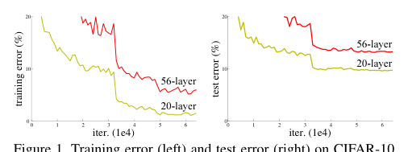
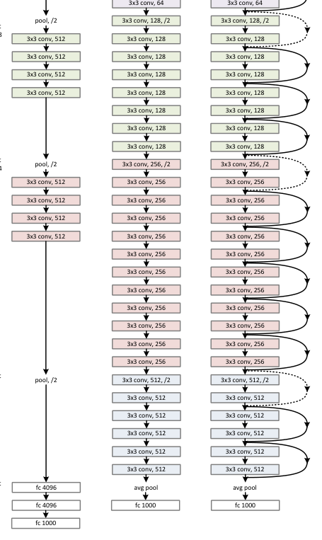
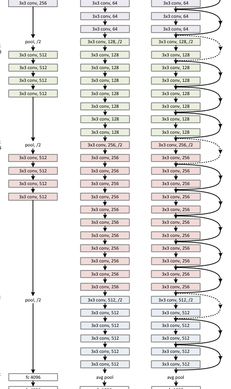
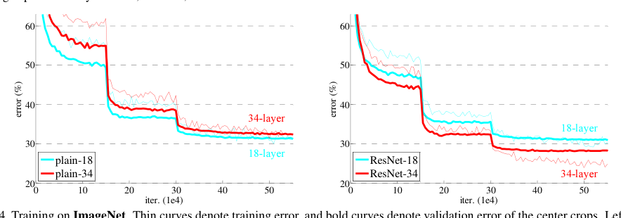
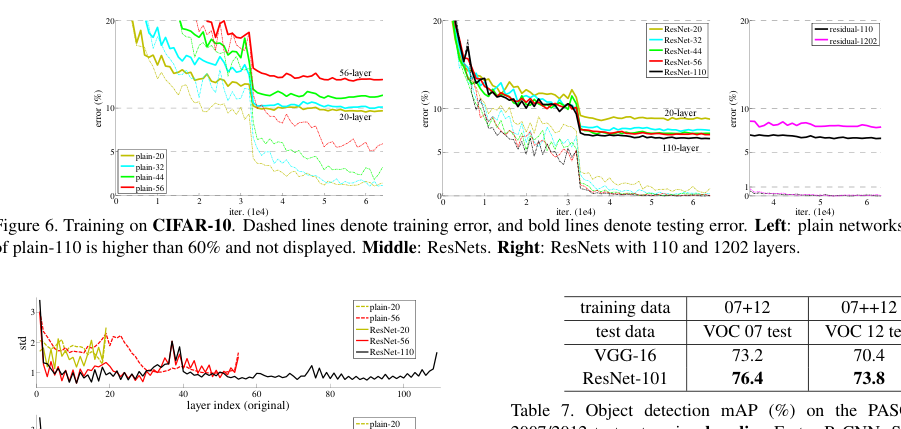
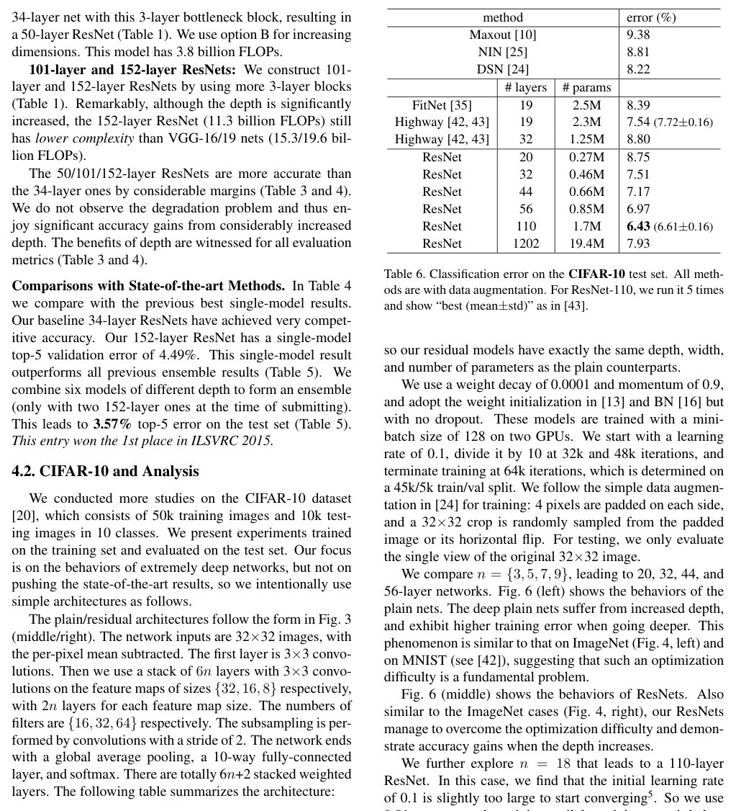
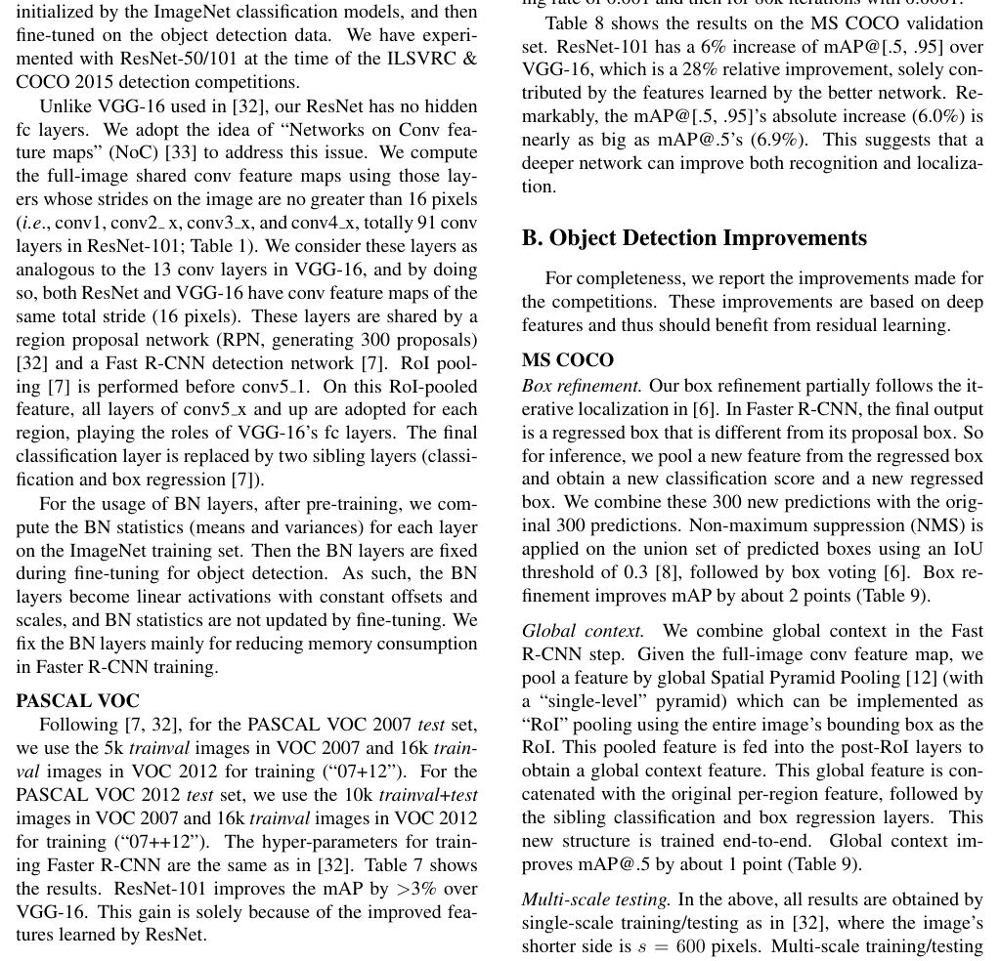
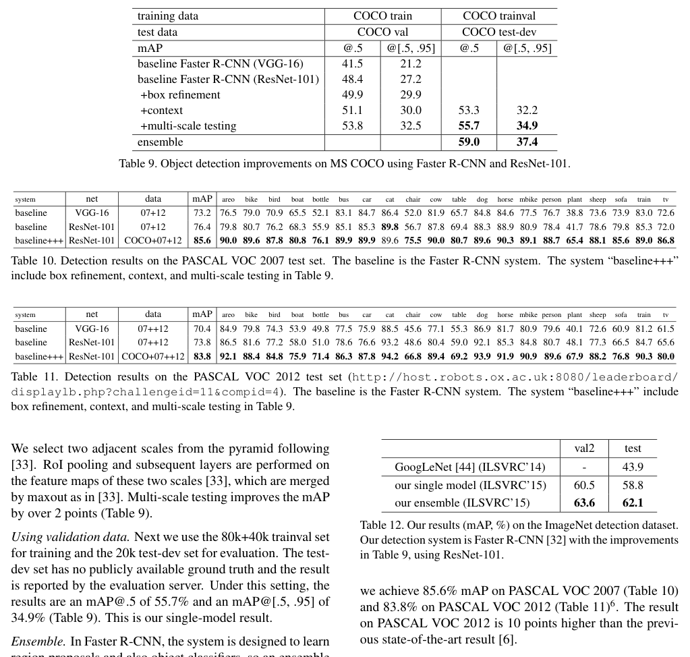

# Deep Residual Learning for Image Recognition（用于图像识别的深度残差学习）

**Original:**

> Deep Residual Learning for Image Recognition
>
> Kaiming He, Xiangyu Zhang, Shaoqing Ren, Jian Sun
>
> Microsoft Research
>
> {kahe, v-xiangz, v-shren, jiansun}@microsoft.com
>
> arXiv:1512.03385v1 [cs.CV] 10 Dec 2015

**中文:**

> 《用于图像识别的深度残差学习》（Deep Residual Learning for Image Recognition）
>
> 作者：Kaiming He、Xiangyu Zhang、Shaoqing Ren、Jian Sun
>
> 单位：微软研究院（Microsoft Research）
>
> 邮箱：{kahe, v-xiangz, v-shren, jiansun}@microsoft.com
>
> arXiv 编号：arXiv:1512.03385v1 [cs.CV]，2015 年 12 月 10 日

## Abstract

**Original:**

> Deeper neural networks are more difficult to train. We present a residual learning framework to ease the training of networks that are substantially deeper than those used previously. We explicitly reformulate the layers as learning residual functions with reference to the layer inputs, instead of learning unreferenced functions. We provide comprehensive empirical evidence showing that these residual networks are easier to optimize, and can gain accuracy from considerably increased depth. On the ImageNet dataset we evaluate residual nets with a depth of up to 152 layers—8× deeper than VGG nets [41] but still having lower complexity. An ensemble of these residual nets achieves 3.57% error on the ImageNet test set. This result won the 1st place on the ILSVRC 2015 classification task. We also present analysis on CIFAR-10 with 100 and 1000 layers.
>
> The depth of representations is of central importance for many visual recognition tasks. Solely due to our extremely deep representations, we obtain a 28% relative improvement on the COCO object detection dataset. Deep residual nets are foundations of our submissions to ILSVRC & COCO 2015 competitions¹, where we also won the 1st places on the tasks of ImageNet detection, ImageNet localization, COCO detection, and COCO segmentation.

**中文:**

> 更深的神经网络更难训练。我们提出一种残差学习框架（residual learning framework），以减轻比以往所用网络深得多的网络的训练难度。我们明确地将各层重新表述为参照层输入学习残差函数（residual functions），而不是学习无参照的函数。我们提供了全面的经验证据，表明这些残差网络（residual nets）更容易优化，并且能够从大幅增加的深度中获得精度提升。在 ImageNet 数据集上，我们评估了深度高达 152 层的残差网络——比 VGG 网络 [41] 深 8 倍，但复杂度仍然更低。这些残差网络的集成（ensemble）在 ImageNet 测试集上取得了 3.57% 的错误率。这一结果赢得了 ILSVRC 2015 图像分类任务的第一名。我们还在 CIFAR-10 上展示了 100 层和 1000 层网络的分析。
>
> 表示（representations）的深度对许多视觉识别任务至关重要。仅仅由于我们极深的表示，我们在 COCO 目标检测（object detection）数据集上获得了 28% 的相对提升。深度残差网络是我们提交给 ILSVRC & COCO 2015 竞赛各项方案的基础¹，在这些竞赛中我们还在 ImageNet 检测、ImageNet 定位、COCO 检测和 COCO 分割任务上夺得了第一名。

> ¹ 原文脚注：http://image-net.org/challenges/LSVRC/2015/ 和 http://mscoco.org/dataset/#detections-challenge2015。

## 1. Introduction

**Original:**

> Deep convolutional neural networks [22, 21] have led to a series of breakthroughs for image classification [21, 50, 40]. Deep networks naturally integrate low/mid/high-level features [50] and classifiers in an end-to-end multi-layer fashion, and the “levels” of features can be enriched by the number of stacked layers (depth). Recent evidence [41, 44] reveals that network depth is of crucial importance, and the leading results [41, 44, 13, 16] on the challenging ImageNet dataset [36] all exploit “very deep” [41] models, with a depth of sixteen [41] to thirty [16]. Many other non-trivial visual recognition tasks [8, 12, 7, 32, 27] have also greatly benefited from very deep models.

**中文:**

> 深度卷积神经网络（deep convolutional neural networks）[22, 21] 为图像分类（image classification）带来了一系列突破 [21, 50, 40]。深度网络自然地以端到端（end-to-end）的多层方式整合了低/中/高层特征 [50] 与分类器，特征的“层级”可以通过堆叠层的数量（即深度）得到丰富。近期的证据 [41, 44] 表明网络深度至关重要，在富有挑战性的 ImageNet 数据集 [36] 上的领先结果 [41, 44, 13, 16] 全部利用了“非常深” [41] 的模型，深度从十六层 [41] 到三十层 [16] 不等。许多其他非平凡的视觉识别任务 [8, 12, 7, 32, 27] 也从非常深的模型中获益良多。

**Original:**

> Driven by the significance of depth, a question arises: Is learning better networks as easy as stacking more layers? An obstacle to answering this question was the notorious problem of vanishing/exploding gradients [1, 9], which hamper convergence from the beginning. This problem, however, has been largely addressed by normalized initialization [23, 9, 37, 13] and intermediate normalization layers [16], which enable networks with tens of layers to start converging for stochastic gradient descent (SGD) with backpropagation [22].

**中文:**

> 受深度重要性的驱动，一个问题随之而来：学习更好的网络是否就像堆叠更多层那样容易？回答这一问题的一个障碍是臭名昭著的梯度消失/爆炸（vanishing/exploding gradients）问题 [1, 9]，它从一开始就阻碍收敛。然而，这个问题已在很大程度上通过归一化初始化（normalized initialization）[23, 9, 37, 13] 和中间归一化层 [16] 得到解决，它们使得数十层的网络能够在带反向传播（backpropagation）[22] 的随机梯度下降（stochastic gradient descent，SGD）下开始收敛。

**Original:**

> When deeper networks are able to start converging, a degradation problem has been exposed: with the network depth increasing, accuracy gets saturated (which might be unsurprising) and then degrades rapidly. Unexpectedly, such degradation is not caused by overfitting, and adding more layers to a suitably deep model leads to higher training error, as reported in [11, 42] and thoroughly verified by our experiments. Fig. 1 shows a typical example.

**中文:**

> 当更深的网络能够开始收敛时，一个退化问题（degradation problem）暴露了出来：随着网络深度增加，准确率趋于饱和（这或许并不令人意外），随后迅速退化。出乎意料的是，这种退化并非由过拟合（overfitting）引起，向一个深度适中的模型添加更多层反而会导致更高的训练误差，正如 [11, 42] 所报告、并被我们的实验充分验证的那样。图 1 展示了一个典型例子。

**Original:**

> The degradation (of training accuracy) indicates that not all systems are similarly easy to optimize. Let us consider a shallower architecture and its deeper counterpart that adds more layers onto it. There exists a solution by construction to the deeper model: the added layers are identity mapping, and the other layers are copied from the learned shallower model. The existence of this constructed solution indicates that a deeper model should produce no higher training error than its shallower counterpart. But experiments show that our current solvers on hand are unable to find solutions that are comparably good or better than the constructed solution (or unable to do so in feasible time).

**中文:**

> （训练准确率的）退化表明，并非所有系统都同样容易优化。让我们考虑一个较浅的架构，以及在其上添加更多层得到的更深版本。对更深的模型而言，存在一个构造性解：新增的层是恒等映射（identity mapping），其余层从已学好的较浅模型复制而来。这个构造解的存在表明，更深的模型不应产生比较浅模型更高的训练误差。但实验表明，我们手头现有的求解器无法找到与构造解相当或更好的解（或无法在可行时间内做到）。

**Original:**

> In this paper, we address the degradation problem by introducing a deep residual learning framework. Instead of hoping each few stacked layers directly fit a desired underlying mapping, we explicitly let these layers fit a residual mapping. Formally, denoting the desired underlying mapping as $\mathcal{H}(x)$, we let the stacked nonlinear layers fit another mapping of $\mathcal{F}(x) := \mathcal{H}(x)-x$. The original mapping is recast into $\mathcal{F}(x)+x$. We hypothesize that it is easier to optimize the residual mapping than to optimize the original, unreferenced mapping. To the extreme, if an identity mapping were optimal, it would be easier to push the residual to zero than to fit an identity mapping by a stack of nonlinear layers.

**中文:**

> 在本文中，我们通过引入深度残差学习框架（deep residual learning framework）来解决退化问题。我们不再寄望于每几个堆叠的层直接拟合期望的底层映射，而是显式地让这些层拟合一个残差映射（residual mapping）。形式上，将期望的底层映射记为 $\mathcal{H}(x)$，我们让堆叠的非线性层拟合另一个映射 $\mathcal{F}(x) := \mathcal{H}(x)-x$。原始映射被重构为 $\mathcal{F}(x)+x$。我们假设优化残差映射比优化原始的、无参照的映射更容易。极端地讲，如果恒等映射是最优的，那么把残差推向零要比用一堆非线性层拟合恒等映射更容易。

**Original:**

> The formulation of $\mathcal{F}(x)+x$ can be realized by feedforward neural networks with “shortcut connections” (Fig. 2). Shortcut connections [2, 34, 49] are those skipping one or more layers. In our case, the shortcut connections simply perform identity mapping, and their outputs are added to the outputs of the stacked layers (Fig. 2). Identity shortcut connections add neither extra parameter nor computational complexity. The entire network can still be trained end-to-end by SGD with backpropagation, and can be easily implemented using common libraries (e.g., Caffe [19]) without modifying the solvers.

**中文:**

> $\mathcal{F}(x)+x$ 的表述可以通过带有“捷径连接（shortcut connections）”的前馈神经网络（feedforward neural networks）实现（图 2）。捷径连接 [2, 34, 49] 指跳过一层或多层的连接。在我们的情形中，捷径连接仅仅执行恒等映射，其输出被加到堆叠层的输出上（图 2）。恒等捷径连接既不增加额外参数，也不增加计算复杂度。整个网络仍然可以通过带反向传播的 SGD 进行端到端训练，并且可以使用常用库（如 Caffe [19]）轻松实现，无需修改求解器。
**Original:**

> We present comprehensive experiments on ImageNet [36] to show the degradation problem and evaluate our method. We show that: 1) Our extremely deep residual nets are easy to optimize, but the counterpart “plain” nets (that simply stack layers) exhibit higher training error when the depth increases; 2) Our deep residual nets can easily enjoy accuracy gains from greatly increased depth, producing results substantially better than previous networks.

**中文:**

> 我们在 ImageNet [36] 上展示了全面的实验，以呈现退化问题并评估我们的方法。我们表明：1）我们极深的残差网络易于优化，而与之对应的“普通网络（plain nets）”（即简单堆叠层的网络）在深度增加时表现出更高的训练误差；2）我们的深度残差网络能够轻松地从大幅增加的深度中获得精度提升，产生明显优于以往网络的结果。

**Original:**

> Similar phenomena are also shown on the CIFAR-10 set [20], suggesting that the optimization difficulties and the effects of our method are not just akin to a particular dataset. We present successfully trained models on this dataset with over 100 layers, and explore models with over 1000 layers.

**中文:**

> 类似的现象也出现在 CIFAR-10 数据集 [20] 上，表明优化困难以及我们方法的效果并非仅与某个特定数据集有关。我们在此数据集上展示了成功训练的超过 100 层的模型，并探索了超过 1000 层的模型。

**Original:**

> On the ImageNet classification dataset [36], we obtain excellent results by extremely deep residual nets. Our 152-layer residual net is the deepest network ever presented on ImageNet, while still having lower complexity than VGG nets [41]. Our ensemble has 3.57% top-5 error on the ImageNet test set, and won the 1st place in the ILSVRC 2015 classification competition. The extremely deep representations also have excellent generalization performance on other recognition tasks, and lead us to further win the 1st places on: ImageNet detection, ImageNet localization, COCO detection, and COCO segmentation in ILSVRC & COCO 2015 competitions. This strong evidence shows that the residual learning principle is generic, and we expect that it is applicable in other vision and non-vision problems.

**中文:**

> 在 ImageNet 图像分类数据集 [36] 上，我们借助极深的残差网络取得了优异的结果。我们的 152 层残差网络是 ImageNet 上有史以来最深的网络，同时复杂度仍低于 VGG 网络 [41]。我们的集成在 ImageNet 测试集上取得了 3.57% 的 top-5 错误率，赢得了 ILSVRC 2015 图像分类竞赛的第一名。极深的表示在其他识别任务上同样具有出色的泛化（generalization）性能，并使我们进一步在 ILSVRC & COCO 2015 竞赛中赢得以下任务的第一名：ImageNet 检测、ImageNet 定位、COCO 检测和 COCO 分割。这一有力的证据表明残差学习原理是通用的，我们期望它适用于其他视觉与非视觉问题。

> **图 1（译）**：CIFAR-10 上 20 层与 56 层“普通”网络的训练误差（左）与测试误差（右）。更深的网络具有更高的训练误差，因而测试误差也更高。ImageNet 上的类似现象见图 4。（原图见 paper.pdf 第 1 页，见下方图）

## 2. Related Work

**Original:**

> **Residual Representations.** In image recognition, VLAD [18] is a representation that encodes by the residual vectors with respect to a dictionary, and Fisher Vector [30] can be formulated as a probabilistic version [18] of VLAD. Both of them are powerful shallow representations for image retrieval and classification [4, 48]. For vector quantization, encoding residual vectors [17] is shown to be more effective than encoding original vectors.

**中文:**

> **残差表示。** 在图像识别中，VLAD [18] 是一种通过相对于字典（dictionary）的残差向量进行编码的表示，Fisher Vector [30] 可以被表述为 VLAD 的概率版本 [18]。二者都是用于图像检索与分类 [4, 48] 的强大浅层表示。对于向量量化（vector quantization），编码残差向量 [17] 被证明比编码原始向量更有效。

**Original:**

> In low-level vision and computer graphics, for solving Partial Differential Equations (PDEs), the widely used Multigrid method [3] reformulates the system as subproblems at multiple scales, where each subproblem is responsible for the residual solution between a coarser and a finer scale. An alternative to Multigrid is hierarchical basis preconditioning [45, 46], which relies on variables that represent residual vectors between two scales. It has been shown [3, 45, 46] that these solvers converge much faster than standard solvers that are unaware of the residual nature of the solutions. These methods suggest that a good reformulation or preconditioning can simplify the optimization.

**中文:**

> 在底层视觉与计算机图形学中，为求解偏微分方程（Partial Differential Equations，PDEs），广泛使用的多重网格（Multigrid）方法 [3] 将系统重新表述为多个尺度上的子问题，其中每个子问题负责一个较粗尺度与一个较细尺度之间的残差解。多重网格的一种替代方案是分层基预条件（hierarchical basis preconditioning）[45, 46]，它依赖于表示两个尺度之间残差向量的变量。已有研究表明 [3, 45, 46]，这些求解器比不了解解的残差性质的标准求解器收敛快得多。这些方法表明，一个好的重表述或预条件可以简化优化。

**Original:**

> **Shortcut Connections.** Practices and theories that lead to shortcut connections [2, 34, 49] have been studied for a long time. An early practice of training multi-layer perceptrons (MLPs) is to add a linear layer connected from the network input to the output [34, 49]. In [44, 24], a few intermediate layers are directly connected to auxiliary classifiers for addressing vanishing/exploding gradients. The papers of [39, 38, 31, 47] propose methods for centering layer responses, gradients, and propagated errors, implemented by shortcut connections. In [44], an “inception” layer is composed of a shortcut branch and a few deeper branches.

**中文:**

> **捷径连接。** 导向捷径连接 [2, 34, 49] 的实践与理论已研究了很长时间。训练多层感知机（multi-layer perceptrons，MLPs）的一种早期做法是添加一个从网络输入连接到输出的线性层 [34, 49]。在 [44, 24] 中，一些中间层被直接连接到辅助分类器（auxiliary classifiers），以应对梯度消失/爆炸问题。文献 [39, 38, 31, 47] 提出了对层响应、梯度和传播误差进行中心化的方法，并通过捷径连接实现。在 [44] 中，一个 “inception” 层由一个捷径分支和若干更深的分支组成。

**Original:**

> Concurrent with our work, “highway networks” [42, 43] present shortcut connections with gating functions [15]. These gates are data-dependent and have parameters, in contrast to our identity shortcuts that are parameter-free. When a gated shortcut is “closed” (approaching zero), the layers in highway networks represent non-residual functions. On the contrary, our formulation always learns residual functions; our identity shortcuts are never closed, and all information is always passed through, with additional residual functions to be learned. In addition, highway networks have not demonstrated accuracy gains with extremely increased depth (e.g., over 100 layers).

**中文:**

> 与我们的工作同时，“Highway 网络（highway networks）” [42, 43] 提出了带门控函数（gating functions）[15] 的捷径连接。这些门是数据依赖的且带有参数，与我们的无参数恒等捷径形成对比。当门控捷径“关闭”（趋近于零）时，Highway 网络中的层表示非残差函数。相反，我们的表述始终学习残差函数；我们的恒等捷径从不关闭，所有信息始终通过，另有额外的残差函数待学习。此外，Highway 网络尚未在深度大幅增加（例如超过 100 层）时展现出精度增益。

> **图 2（译）**：残差学习：一个构建块（building block）。（原图见 paper.pdf 第 2 页，见下方图）

## 3. Deep Residual Learning

### 3.1. Residual Learning

**Original:**

> Let us consider $\mathcal{H}(x)$ as an underlying mapping to be fit by a few stacked layers (not necessarily the entire net), with $x$ denoting the inputs to the first of these layers. If one hypothesizes that multiple nonlinear layers can asymptotically approximate complicated functions², then it is equivalent to hypothesize that they can asymptotically approximate the residual functions, i.e., $\mathcal{H}(x) - x$ (assuming that the input and output are of the same dimensions). So rather than expect stacked layers to approximate $\mathcal{H}(x)$, we explicitly let these layers approximate a residual function $\mathcal{F}(x) := \mathcal{H}(x) - x$. The original function thus becomes $\mathcal{F}(x)+x$. Although both forms should be able to asymptotically approximate the desired functions (as hypothesized), the ease of learning might be different.

**中文:**

> 让我们把 $\mathcal{H}(x)$ 视为由若干堆叠层（不必是整个网络）拟合的底层映射，其中 $x$ 表示这些层中第一层的输入。如果假设多个非线性层可以渐近逼近复杂函数²，那么等价地就是假设它们可以渐近逼近残差函数，即 $\mathcal{H}(x) - x$（假定输入与输出维度相同）。因此，与其期望堆叠层逼近 $\mathcal{H}(x)$，我们显式地让这些层逼近残差函数 $\mathcal{F}(x) := \mathcal{H}(x) - x$。原始函数因此变为 $\mathcal{F}(x)+x$。尽管两种形式都应当能够渐近逼近所期望的函数（按假设），但学习的难易程度可能不同。

> ² 原文脚注：This hypothesis, however, is still an open question. See [28].（然而，这一假设仍然是一个开放问题。参见 [28]。）

**Original:**

> This reformulation is motivated by the counterintuitive phenomena about the degradation problem (Fig. 1, left). As we discussed in the introduction, if the added layers can be constructed as identity mappings, a deeper model should have training error no greater than its shallower counterpart. The degradation problem suggests that the solvers might have difficulties in approximating identity mappings by multiple nonlinear layers. With the residual learning reformulation, if identity mappings are optimal, the solvers may simply drive the weights of the multiple nonlinear layers toward zero to approach identity mappings.

**中文:**

> 这一重表述的动机来自退化问题中反直觉的现象（图 1 左）。正如我们在引言中讨论的，如果新增的层能够构造为恒等映射，那么更深的模型应当具有不高于其较浅对应模型的训练误差。退化问题表明，求解器可能难以用多个非线性层逼近恒等映射。借助残差学习的重表述，如果恒等映射是最优的，求解器可以直接将多个非线性层的权重推向零，以趋近恒等映射。

**Original:**

> In real cases, it is unlikely that identity mappings are optimal, but our reformulation may help to precondition the problem. If the optimal function is closer to an identity mapping than to a zero mapping, it should be easier for the solver to find the perturbations with reference to an identity mapping, than to learn the function as a new one. We show by experiments (Fig. 7) that the learned residual functions in general have small responses, suggesting that identity mappings provide reasonable preconditioning.

**中文:**

> 在实际情况中，恒等映射不太可能是最优的，但我们的重表述可能有助于对问题进行预条件（precondition）。如果最优函数比零映射更接近恒等映射，那么求解器参照恒等映射寻找扰动（perturbations），应当比把该函数当作全新函数来学习更容易。我们通过实验（图 7）表明，学到的残差函数通常具有较小的响应，这说明恒等映射提供了合理的预条件。

### 3.2. Identity Mapping by Shortcuts

**Original:**

> We adopt residual learning to every few stacked layers. A building block is shown in Fig. 2. Formally, in this paper we consider a building block defined as:

**中文:**

> 我们将残差学习应用于每几个堆叠的层。图 2 展示了一个构建块（building block）。形式上，本文考虑如下定义的构建块：

$$
y = \mathcal{F}(x, \{W_i\}) + x. \tag{1}
$$

**Original:**

> Here $x$ and $y$ are the input and output vectors of the layers considered. The function $\mathcal{F}(x, \{W_i\})$ represents the residual mapping to be learned. For the example in Fig. 2 that has two layers, $\mathcal{F} = W_2\sigma(W_1x)$ in which $\sigma$ denotes ReLU [29] and the biases are omitted for simplifying notations. The operation $\mathcal{F} + x$ is performed by a shortcut connection and element-wise addition. We adopt the second nonlinearity after the addition (i.e., $\sigma(y)$, see Fig. 2).

**中文:**

> 这里 $x$ 和 $y$ 是所考虑层的输入和输出向量。函数 $\mathcal{F}(x, \{W_i\})$ 表示待学习的残差映射。对于图 2 中具有两层的例子，$\mathcal{F} = W_2\sigma(W_1x)$，其中 $\sigma$ 表示 ReLU [29]，为简化记号省略了偏置项。$\mathcal{F} + x$ 的运算通过一条捷径连接和逐元素相加（element-wise addition）完成。我们在相加之后采用第二次非线性（即 $\sigma(y)$，见图 2）。

**Original:**

> The shortcut connections in Eqn.(1) introduce neither extra parameter nor computation complexity. This is not only attractive in practice but also important in our comparisons between plain and residual networks. We can fairly compare plain/residual networks that simultaneously have the same number of parameters, depth, width, and computational cost (except for the negligible element-wise addition).

**中文:**

> 式 (1) 中的捷径连接既不引入额外参数，也不引入计算复杂度。这不仅在实践中具有吸引力，而且在我们对普通网络与残差网络的比较中也很重要。我们可以公平地比较同时具有相同参数数量、深度、宽度和计算开销（除可忽略的逐元素相加外）的普通/残差网络。

**Original:**

> The dimensions of $x$ and $\mathcal{F}$ must be equal in Eqn.(1). If this is not the case (e.g., when changing the input/output channels), we can perform a linear projection $W_s$ by the shortcut connections to match the dimensions:

**中文:**

> 在式 (1) 中，$x$ 与 $\mathcal{F}$ 的维度必须相等。若并非如此（例如当输入/输出通道数改变时），我们可以通过捷径连接执行一个线性投影（linear projection）$W_s$ 来匹配维度：

$$
y = \mathcal{F}(x, \{W_i\}) + W_s x. \tag{2}
$$

**Original:**

> We can also use a square matrix $W_s$ in Eqn.(1). But we will show by experiments that the identity mapping is sufficient for addressing the degradation problem and is economical, and thus $W_s$ is only used when matching dimensions.

**中文:**

> 我们也可以在式 (1) 中使用方阵 $W_s$。但我们将通过实验表明，恒等映射足以应对退化问题且经济有效，因此 $W_s$ 仅在匹配维度时使用。

**Original:**

> The form of the residual function $\mathcal{F}$ is flexible. Experiments in this paper involve a function $\mathcal{F}$ that has two or three layers (Fig. 5), while more layers are possible. But if $\mathcal{F}$ has only a single layer, Eqn.(1) is similar to a linear layer: $y = W_1x + x$, for which we have not observed advantages.

**中文:**

> 残差函数 $\mathcal{F}$ 的形式是灵活的。本文实验涉及的函数 $\mathcal{F}$ 具有两层或三层（图 5），更多层也是可能的。但如果 $\mathcal{F}$ 只有单层，式 (1) 就类似于一个线性层：$y = W_1x + x$，我们并未观察到这种形式的优势。

**Original:**

> We also note that although the above notations are about fully-connected layers for simplicity, they are applicable to convolutional layers. The function $\mathcal{F}(x, \{W_i\})$ can represent multiple convolutional layers. The element-wise addition is performed on two feature maps, channel by channel.

**中文:**

> 我们还注意到，尽管上述记号为简单起见是关于全连接层（fully-connected layers）的，它们同样适用于卷积层（convolutional layers）。函数 $\mathcal{F}(x, \{W_i\})$ 可以表示多个卷积层。逐元素相加在两个特征图（feature maps）上按通道（channel）逐一执行。
### 3.3. Network Architectures

**Original:**

> We have tested various plain/residual nets, and have observed consistent phenomena. To provide instances for discussion, we describe two models for ImageNet as follows.

**中文:**

> 我们测试了多种普通/残差网络，并观察到一致的现象。为提供讨论实例，我们如下描述两个用于 ImageNet 的模型。

**Original:**

> **Plain Network.** Our plain baselines (Fig. 3, middle) are mainly inspired by the philosophy of VGG nets [41] (Fig. 3, left). The convolutional layers mostly have 3×3 filters and follow two simple design rules: (i) for the same output feature map size, the layers have the same number of filters; and (ii) if the feature map size is halved, the number of filters is doubled so as to preserve the time complexity per layer. We perform downsampling directly by convolutional layers that have a stride of 2. The network ends with a global average pooling layer and a 1000-way fully-connected layer with softmax. The total number of weighted layers is 34 in Fig. 3 (middle).

**中文:**

> **普通网络。** 我们的普通基线（图 3 中）主要受 VGG 网络 [41]（图 3 左）的设计哲学启发。卷积层大多使用 3×3 滤波器（filters），并遵循两条简单的设计规则：(i) 对于相同的输出特征图尺寸，各层具有相同数量的滤波器；(ii) 若特征图尺寸减半，则滤波器数量加倍，以保持每层的时间复杂度。我们直接通过步长（stride）为 2 的卷积层进行下采样（downsampling）。网络以全局平均池化（global average pooling）层和一个带 Softmax 的 1000 路全连接层结束。图 3（中）的加权层（weighted layers）总数为 34。

**Original:**

> It is worth noticing that our model has fewer filters and lower complexity than VGG nets [41] (Fig. 3, left). Our 34-layer baseline has 3.6 billion FLOPs (multiply-adds), which is only 18% of VGG-19 (19.6 billion FLOPs).

**中文:**

> 值得注意的是，我们的模型比 VGG 网络 [41]（图 3 左）具有更少的滤波器和更低的复杂度。我们的 34 层基线有 36 亿 FLOPs（乘加运算），仅为 VGG-19（196 亿 FLOPs）的 18%。

**Original:**

> **Residual Network.** Based on the above plain network, we insert shortcut connections (Fig. 3, right) which turn the network into its counterpart residual version. The identity shortcuts (Eqn.(1)) can be directly used when the input and output are of the same dimensions (solid line shortcuts in Fig. 3). When the dimensions increase (dotted line shortcuts in Fig. 3), we consider two options: (A) The shortcut still performs identity mapping, with extra zero entries padded for increasing dimensions. This option introduces no extra parameter; (B) The projection shortcut in Eqn.(2) is used to match dimensions (done by 1×1 convolutions). For both options, when the shortcuts go across feature maps of two sizes, they are performed with a stride of 2.

**中文:**

> **残差网络。** 在上述普通网络的基础上，我们插入捷径连接（图 3 右），将网络变为其对应的残差版本。当输入与输出维度相同时，可以直接使用恒等捷径（式 (1)）（图 3 中的实线捷径）。当维度增加时（图 3 中的虚线捷径），我们考虑两种方案：(A) 捷径仍然执行恒等映射，为增加的维度填充额外的零条目，该方案不引入额外参数；(B) 使用式 (2) 中的投影捷径来匹配维度（通过 1×1 卷积完成）。对于两种方案，当捷径跨越两种尺寸的特征图时，它们以步长 2 执行。

> **图 3（译）**：用于 ImageNet 的示例网络架构。左：作为参照的 VGG-19 模型 [41]（196 亿 FLOPs）。中：具有 34 个参数层的普通网络（36 亿 FLOPs）。右：具有 34 个参数层的残差网络（36 亿 FLOPs）。虚线捷径增加维度。表 1 展示了更多细节和其他变体。（原图见 paper.pdf 第 4 页，见下方图）

### 3.4. Implementation

**Original:**

> Our implementation for ImageNet follows the practice in [21, 41]. The image is resized with its shorter side randomly sampled in [256, 480] for scale augmentation [41]. A 224×224 crop is randomly sampled from an image or its horizontal flip, with the per-pixel mean subtracted [21]. The standard color augmentation in [21] is used. We adopt batch normalization (BN) [16] right after each convolution and before activation, following [16]. We initialize the weights as in [13] and train all plain/residual nets from scratch. We use SGD with a mini-batch size of 256. The learning rate starts from 0.1 and is divided by 10 when the error plateaus, and the models are trained for up to 60 × 10⁴ iterations. We use a weight decay of 0.0001 and a momentum of 0.9. We do not use dropout [14], following the practice in [16].

**中文:**

> 我们的 ImageNet 实现遵循 [21, 41] 的做法。图像被缩放，其短边在 [256, 480] 中随机采样，以进行尺度增强（scale augmentation）[41]。从图像或其水平翻转（horizontal flip）中随机采样一个 224×224 的裁剪（crop），并减去逐像素均值（per-pixel mean）[21]。使用 [21] 中的标准颜色增强（color augmentation）。我们在每个卷积之后、激活之前采用批归一化（batch normalization，BN）[16]，遵循 [16]。我们按 [13] 初始化权重，并从头训练（from scratch）所有普通/残差网络。我们使用小批量（mini-batch）大小为 256 的 SGD。学习率（learning rate）从 0.1 开始，当误差进入平台期时除以 10，模型最多训练 60 × 10⁴ 次迭代。我们使用 0.0001 的权重衰减（weight decay）和 0.9 的动量（momentum）。我们不使用随机失活（Dropout）[14]，遵循 [16] 的做法。

**Original:**

> In testing, for comparison studies we adopt the standard 10-crop testing [21]. For best results, we adopt the fully-convolutional form as in [41, 13], and average the scores at multiple scales (images are resized such that the shorter side is in {224, 256, 384, 480, 640}).

**中文:**

> 在测试中，为进行比较研究，我们采用标准的 10 裁剪（10-crop）测试 [21]。为取得最佳结果，我们采用 [41, 13] 中的全卷积（fully-convolutional）形式，并在多个尺度（multi-scale）上对分数取平均（图像被缩放，使短边在 {224, 256, 384, 480, 640} 中）。

## 4. Experiments

### 4.1. ImageNet Classification

**Original:**

> We evaluate our method on the ImageNet 2012 classification dataset [36] that consists of 1000 classes. The models are trained on the 1.28 million training images, and evaluated on the 50k validation images. We also obtain a final result on the 100k test images, reported by the test server. We evaluate both top-1 and top-5 error rates.

**中文:**

> 我们在包含 1000 个类别的 ImageNet 2012 分类数据集 [36] 上评估我们的方法。模型在 128 万张训练图像上训练，在 5 万张验证图像上评估。我们还在 10 万张测试图像上取得最终结果，由测试服务器报告。我们同时评估 top-1 和 top-5 错误率。

**Original:**

> **Plain Networks.** We first evaluate 18-layer and 34-layer plain nets. The 34-layer plain net is in Fig. 3 (middle). The 18-layer plain net is of a similar form. See Table 1 for detailed architectures.

**中文:**

> **普通网络。** 我们首先评估 18 层和 34 层普通网络。34 层普通网络见图 3（中）。18 层普通网络形式类似。详细架构见表 1。

**Original:**

> The results in Table 2 show that the deeper 34-layer plain net has higher validation error than the shallower 18-layer plain net. To reveal the reasons, in Fig. 4 (left) we compare their training/validation errors during the training procedure. We have observed the degradation problem - the 34-layer plain net has higher training error throughout the whole training procedure, even though the solution space of the 18-layer plain network is a subspace of that of the 34-layer one.

**中文:**

> 表 2 的结果显示，更深的 34 层普通网络比较浅的 18 层普通网络具有更高的验证误差。为揭示原因，我们在图 4（左）中比较了它们在训练过程中的训练/验证误差。我们观察到了退化问题——34 层普通网络在整个训练过程中具有更高的训练误差，尽管 18 层普通网络的解空间是 34 层网络解空间的子空间。

**Original:**

> We argue that this optimization difficulty is unlikely to be caused by vanishing gradients. These plain networks are trained with BN [16], which ensures forward propagated signals to have non-zero variances. We also verify that the backward propagated gradients exhibit healthy norms with BN. So neither forward nor backward signals vanish. In fact, the 34-layer plain net is still able to achieve competitive accuracy (Table 3), suggesting that the solver works to some extent. We conjecture that the deep plain nets may have exponentially low convergence rates, which impact the reducing of the training error³. The reason for such optimization difficulties will be studied in the future.

**中文:**

> 我们认为这种优化困难不太可能由梯度消失（vanishing gradients）引起。这些普通网络使用 BN [16] 训练，它确保前向传播的信号具有非零方差。我们还验证了在 BN 下反向传播的梯度具有健康的范数。因此前向和后向信号都没有消失。事实上，34 层普通网络仍能取得有竞争力的准确率（表 3），表明求解器在一定程度上是有效的。我们推测深度普通网络可能具有指数级低的收敛速率（convergence rates），这影响了训练误差的降低³。这种优化困难的原因留待未来研究。

> ³ 原文脚注：We have experimented with more training iterations (3×) and still observed the degradation problem, suggesting that this problem cannot be feasibly addressed by simply using more iterations.（我们尝试了更多的训练迭代（3 倍），仍然观察到退化问题，这表明该问题无法通过简单地增加迭代次数来切实解决。）
**Original:**

> **Residual Networks.** Next we evaluate 18-layer and 34-layer residual nets (ResNets). The baseline architectures are the same as the above plain nets, expect that a shortcut connection is added to each pair of 3×3 filters as in Fig. 3 (right). In the first comparison (Table 2 and Fig. 4 right), we use identity mapping for all shortcuts and zero-padding for increasing dimensions (option A). So they have no extra parameter compared to the plain counterparts.

**中文:**

> **残差网络。** 接下来我们评估 18 层和 34 层残差网络（ResNet）。基线架构与上述普通网络相同，只是按图 3（右）为每对 3×3 滤波器添加一条捷径连接[译注：原文 “expect” 应为 “except”]。在第一次比较中（表 2 和图 4 右），我们对所有捷径使用恒等映射，对增加的维度使用零填充（zero-padding）（方案 A）。因此它们与普通网络相比没有额外参数。

**Original:**

> We have three major observations from Table 2 and Fig. 4. First, the situation is reversed with residual learning – the 34-layer ResNet is better than the 18-layer ResNet (by 2.8%). More importantly, the 34-layer ResNet exhibits considerably lower training error and is generalizable to the validation data. This indicates that the degradation problem is well addressed in this setting and we manage to obtain accuracy gains from increased depth.

**中文:**

> 从表 2 和图 4 中我们有三个主要观察。第一，残差学习扭转了局面——34 层 ResNet 优于 18 层 ResNet（高出 2.8%）。更重要的是，34 层 ResNet 表现出低得多的训练误差，并且能够泛化到验证数据。这表明退化问题在此设置下得到了很好的解决，我们得以从增加的深度中获得精度提升。

**Original:**

> Second, compared to its plain counterpart, the 34-layer ResNet reduces the top-1 error by 3.5% (Table 2), resulting from the successfully reduced training error (Fig. 4 right vs. left). This comparison verifies the effectiveness of residual learning on extremely deep systems.

**中文:**

> 第二，与其普通对应网络相比，34 层 ResNet 将 top-1 错误率降低了 3.5%（表 2），这源于训练误差的成功降低（图 4 右对比左）。这一比较验证了残差学习在极深系统上的有效性。

**Original:**

> Last, we also note that the 18-layer plain/residual nets are comparably accurate (Table 2), but the 18-layer ResNet converges faster (Fig. 4 right vs. left). When the net is “not overly deep” (18 layers here), the current SGD solver is still able to find good solutions to the plain net. In this case, the ResNet eases the optimization by providing faster convergence at the early stage.

**中文:**

> 最后，我们还注意到 18 层普通/残差网络具有相当的准确率（表 2），但 18 层 ResNet 收敛得更快（图 4 右对比左）。当网络“不算过深”（这里是 18 层）时，当前的 SGD 求解器仍能为普通网络找到好的解。在这种情况下，ResNet 通过在早期阶段提供更快的收敛来减轻优化难度。

**Original:**

> **Identity vs. Projection Shortcuts.** We have shown that parameter-free, identity shortcuts help with training. Next we investigate projection shortcuts (Eqn.(2)). In Table 3 we compare three options: (A) zero-padding shortcuts are used for increasing dimensions, and all shortcuts are parameter-free (the same as Table 2 and Fig. 4 right); (B) projection shortcuts are used for increasing dimensions, and other shortcuts are identity; and (C) all shortcuts are projections.

**中文:**

> **恒等捷径与投影捷径。** 我们已经表明，无参数的恒等捷径有助于训练。接下来我们研究投影捷径（式 (2)）。在表 3 中我们比较三种方案：(A) 零填充捷径用于维度增加，所有捷径均无参数（与表 2 和图 4 右相同）；(B) 投影捷径用于维度增加，其他捷径为恒等；(C) 所有捷径均为投影。

**Original:**

> Table 3 shows that all three options are considerably better than the plain counterpart. B is slightly better than A. We argue that this is because the zero-padded dimensions in A indeed have no residual learning. C is marginally better than B, and we attribute this to the extra parameters introduced by many (thirteen) projection shortcuts. But the small differences among A/B/C indicate that projection shortcuts are not essential for addressing the degradation problem. So we do not use option C in the rest of this paper, to reduce memory/time complexity and model sizes. Identity shortcuts are particularly important for not increasing the complexity of the bottleneck architectures that are introduced below.

**中文:**

> 表 3 显示三种方案都明显优于普通对应网络。B 略优于 A。我们认为这是因为 A 中零填充的维度实际上没有进行残差学习。C 比 B 稍好，我们将此归因于大量（十三个）投影捷径引入的额外参数。但 A/B/C 之间的微小差异表明，投影捷径对于解决退化问题并非必不可少。因此，本文其余部分不使用方案 C，以减少内存/时间复杂度和模型大小。恒等捷径对于不增加下文引入的瓶颈（bottleneck）架构的复杂度尤为重要。

**Original:**

> **Deeper Bottleneck Architectures.** Next we describe our deeper nets for ImageNet. Because of concerns on the training time that we can afford, we modify the building block as a bottleneck design⁴. For each residual function $\mathcal{F}$, we use a stack of 3 layers instead of 2 (Fig. 5). The three layers are 1×1, 3×3, and 1×1 convolutions, where the 1×1 layers are responsible for reducing and then increasing (restoring) dimensions, leaving the 3×3 layer a bottleneck with smaller input/output dimensions. Fig. 5 shows an example, where both designs have similar time complexity.

**中文:**

> **更深的瓶颈架构。** 接下来我们描述用于 ImageNet 的更深的网络。出于对我们能够承受的训练时间的考虑，我们将构建块修改为瓶颈设计⁴。对于每个残差函数 $\mathcal{F}$，我们使用 3 层堆叠而非 2 层（图 5）。这三层是 1×1、3×3 和 1×1 卷积，其中 1×1 层负责先减小再增大（恢复）维度，使 3×3 层成为一个具有更小输入/输出维度的瓶颈。图 5 展示了一个例子，其中两种设计具有相似的时间复杂度。

> ⁴ 原文脚注：Deeper non-bottleneck ResNets (e.g., Fig. 5 left) also gain accuracy from increased depth (as shown on CIFAR-10), but are not as economical as the bottleneck ResNets. So the usage of bottleneck designs is mainly due to practical considerations. We further note that the degradation problem of plain nets is also witnessed for the bottleneck designs.（更深的非瓶颈 ResNet（例如图 5 左）也能从增加的深度中获得精度（如 CIFAR-10 上所示），但不如瓶颈 ResNet 经济。因此，采用瓶颈设计主要是出于实际考虑。我们进一步指出，普通网络的退化问题在瓶颈设计中也同样存在。）

**Original:**

> The parameter-free identity shortcuts are particularly important for the bottleneck architectures. If the identity shortcut in Fig. 5 (right) is replaced with projection, one can show that the time complexity and model size are doubled, as the shortcut is connected to the two high-dimensional ends. So identity shortcuts lead to more efficient models for the bottleneck designs.

**中文:**

> 无参数的恒等捷径对瓶颈架构尤为重要。若将图 5（右）中的恒等捷径替换为投影，可以证明时间复杂度和模型大小将翻倍，因为该捷径连接的是两个高维端。因此，恒等捷径使瓶颈设计得到更高效的模型。

**Original:**

> **50-layer ResNet:** We replace each 2-layer block in the 34-layer net with this 3-layer bottleneck block, resulting in a 50-layer ResNet (Table 1). We use option B for increasing dimensions. This model has 3.8 billion FLOPs.

**中文:**

> **50 层 ResNet：** 我们将 34 层网络中的每个 2 层块替换为该 3 层瓶颈块，得到 50 层 ResNet（表 1）。我们使用方案 B 处理维度增加。该模型有 38 亿 FLOPs。

**Original:**

> **101-layer and 152-layer ResNets:** We construct 101-layer and 152-layer ResNets by using more 3-layer blocks (Table 1). Remarkably, although the depth is significantly increased, the 152-layer ResNet (11.3 billion FLOPs) still has lower complexity than VGG-16/19 nets (15.3/19.6 billion FLOPs).

**中文:**

> **101 层与 152 层 ResNet：** 我们通过使用更多 3 层块构建 101 层和 152 层 ResNet（表 1）。值得注意的是，尽管深度显著增加，152 层 ResNet（113 亿 FLOPs）的复杂度仍低于 VGG-16/19 网络（153 亿/196 亿 FLOPs）。

**Original:**

> The 50/101/152-layer ResNets are more accurate than the 34-layer ones by considerable margins (Table 3 and 4). We do not observe the degradation problem and thus enjoy significant accuracy gains from considerably increased depth. The benefits of depth are witnessed for all evaluation metrics (Table 3 and 4).

**中文:**

> 50/101/152 层 ResNet 比 34 层 ResNet 的准确率高得多（表 3 和表 4）。我们没有观察到退化问题，因而从大幅增加的深度中获得了显著的精度提升。深度的益处体现在所有评估指标上（表 3 和表 4）。

**Original:**

> **Comparisons with State-of-the-art Methods.** In Table 4 we compare with the previous best single-model results. Our baseline 34-layer ResNets have achieved very competitive accuracy. Our 152-layer ResNet has a single-model top-5 validation error of 4.49%. This single-model result outperforms all previous ensemble results (Table 5). We combine six models of different depth to form an ensemble (only with two 152-layer ones at the time of submitting). This leads to 3.57% top-5 error on the test set (Table 5). This entry won the 1st place in ILSVRC 2015.

**中文:**

> **与当前最优（state-of-the-art）方法的比较。** 在表 4 中，我们与以往最佳的单模型结果进行比较。我们的 34 层 ResNet 基线已取得非常有竞争力的准确率。我们的 152 层 ResNet 单模型 top-5 验证错误率为 4.49%。这一单模型结果超越了以往所有的集成结果（表 5）。我们组合六个不同深度的模型构成一个集成（提交时仅包含两个 152 层模型）。这在测试集上带来 3.57% 的 top-5 错误率（表 5）。该参赛方案赢得了 ILSVRC 2015 第一名。

> **图 4（译）**：ImageNet 上的训练。细曲线表示训练误差，粗曲线表示中心裁剪的验证误差。左：18 层与 34 层普通网络。右：18 层与 34 层 ResNet。在此图中，残差网络与其普通对应网络相比没有额外参数。（原图见 paper.pdf 第 5 页，见下方图）

> **表 1（译）**：ImageNet 的架构。构建块显示在括号中（另见图 5），并标注了堆叠的块数。下采样由步长为 2 的 conv3_1、conv4_1 和 conv5_1 执行。（原表见 paper.pdf 第 5 页，[第 5 页图](assets/figures/tab-1.png)）

| 层名（layer name） | 输出尺寸（output size） | 18-layer | 34-layer | 50-layer | 101-layer | 152-layer |
|---|---|---|---|---|---|---|
| conv1 | 112×112 | 7×7, 64, stride 2（各列相同） | | | | |
| conv2_x | 56×56 | 3×3 max pool, stride 2（各列相同） | | | | |
| | | [3×3, 64; 3×3, 64] ×2 | [3×3, 64; 3×3, 64] ×3 | [1×1, 64; 3×3, 64; 1×1, 256] ×3 | 同 50-layer | 同 50-layer |
| conv3_x | 28×28 | [3×3, 128; 3×3, 128] ×2 | [3×3, 128; 3×3, 128] ×4 | [1×1, 128; 3×3, 128; 1×1, 512] ×4 | 同 50-layer | [1×1, 128; 3×3, 128; 1×1, 512] ×8 |
| conv4_x | 14×14 | [3×3, 256; 3×3, 256] ×2 | [3×3, 256; 3×3, 256] ×6 | [1×1, 256; 3×3, 256; 1×1, 1024] ×6 | [1×1, 256; 3×3, 256; 1×1, 1024] ×23 | [1×1, 256; 3×3, 256; 1×1, 1024] ×36 |
| conv5_x | 7×7 | [3×3, 512; 3×3, 512] ×2 | [3×3, 512; 3×3, 512] ×3 | [1×1, 512; 3×3, 512; 1×1, 2048] ×3 | 同 50-layer | 同 50-layer |
| | 1×1 | 平均池化（average pool）、1000 维全连接层（1000-d fc）、Softmax（各列相同） | | | | |
| FLOPs | | 1.8×10⁹ | 3.6×10⁹ | 3.8×10⁹ | 7.6×10⁹ | 11.3×10⁹ |

> **表 2（译）**：ImageNet 验证集上的 top-1 错误率（%，10 裁剪测试）。此处 ResNet 与其普通对应网络相比没有额外参数。图 4 展示了训练过程。（原表见 paper.pdf 第 5 页，[第 5 页图](assets/figures/tab-2.png)）

| | 18 layers | 34 layers |
|---|---|---|
| plain | 27.94 | 28.54 |
| ResNet | 27.88 | 25.03 |

> **图 5（译）**：用于 ImageNet 的更深残差函数 $\mathcal{F}$。左：ResNet-34 中（作用于 56×56 特征图上）的构建块，如图 3。右：ResNet-50/101/152 的“瓶颈”构建块。（原图见 paper.pdf 第 6 页，见下方图）

> **表 3（译）**：ImageNet 验证集上的错误率（%，10 裁剪测试）。VGG-16 基于我们的测试。ResNet-50/101/152 采用方案 B，仅在维度增加时使用投影。（原表见 paper.pdf 第 6 页，[第 6 页图](assets/figures/tab-3.png)）

| model | top-1 err. | top-5 err. |
|---|---|---|
| VGG-16 [41] | 28.07 | 9.33 |
| GoogLeNet [44] | - | 9.15 |
| PReLU-net [13] | 24.27 | 7.38 |
| plain-34 | 28.54 | 10.02 |
| ResNet-34 A | 25.03 | 7.76 |
| ResNet-34 B | 24.52 | 7.46 |
| ResNet-34 C | 24.19 | 7.40 |
| ResNet-50 | 22.85 | 6.71 |
| ResNet-101 | 21.75 | 6.05 |
| ResNet-152 | 21.43 | 5.71 |

> **表 4（译）**：ImageNet 验证集上单模型结果的错误率（%）（† 为测试集上报告的结果）。（原表见 paper.pdf 第 6 页，[第 6 页图](assets/figures/tab-4.png)）

| method | top-1 err. | top-5 err. |
|---|---|---|
| VGG [41] (ILSVRC'14) | - | 8.43† |
| GoogLeNet [44] (ILSVRC'14) | - | 7.89 |
| VGG [41] (v5) | 24.4 | 7.1 |
| PReLU-net [13] | 21.59 | 5.71 |
| BN-inception [16] | 21.99 | 5.81 |
| ResNet-34 B | 21.84 | 5.71 |
| ResNet-34 C | 21.53 | 5.60 |
| ResNet-50 | 20.74 | 5.25 |
| ResNet-101 | 19.87 | 4.60 |
| ResNet-152 | 19.38 | 4.49 |

> **表 5（译）**：集成的错误率（%）。top-5 错误率位于 ImageNet 测试集上，由测试服务器报告。（原表见 paper.pdf 第 6 页，[第 6 页图](assets/figures/tab-5.png)）

| method | top-5 err. (test) |
|---|---|
| VGG [41] (ILSVRC'14) | 7.32 |
| GoogLeNet [44] (ILSVRC'14) | 6.66 |
| VGG [41] (v5) | 6.8 |
| PReLU-net [13] | 4.94 |
| BN-inception [16] | 4.82 |
| ResNet (ILSVRC'15) | 3.57 |
### 4.2. CIFAR-10 and Analysis

**Original:**

> We conducted more studies on the CIFAR-10 dataset [20], which consists of 50k training images and 10k testing images in 10 classes. We present experiments trained on the training set and evaluated on the test set. Our focus is on the behaviors of extremely deep networks, but not on pushing the state-of-the-art results, so we intentionally use simple architectures as follows.

**中文:**

> 我们在 CIFAR-10 数据集 [20] 上进行了更多研究，该数据集包含 10 个类别的 5 万张训练图像和 1 万张测试图像。我们展示在训练集上训练、在测试集上评估的实验。我们的重点是极深网络的行为，而非刷新当前最优结果，因此我们有意识地采用如下简单架构。

**Original:**

> The plain/residual architectures follow the form in Fig. 3 (middle/right). The network inputs are 32×32 images, with the per-pixel mean subtracted. The first layer is 3×3 convolutions. Then we use a stack of 6n layers with 3×3 convolutions on the feature maps of sizes {32, 16, 8} respectively, with 2n layers for each feature map size. The numbers of filters are {16, 32, 64} respectively. The subsampling is performed by convolutions with a stride of 2. The network ends with a global average pooling, a 10-way fully-connected layer, and softmax. There are totally 6n+2 stacked weighted layers. The following table summarizes the architecture:

**中文:**

> 普通/残差架构遵循图 3（中/右）的形式。网络输入为 32×32 图像，减去逐像素均值。第一层为 3×3 卷积。随后我们使用 6n 层 3×3 卷积的堆叠，分别作用于尺寸为 {32, 16, 8} 的特征图，每种特征图尺寸对应 2n 层。滤波器数量分别为 {16, 32, 64}。下采样由步长为 2 的卷积完成。网络以全局平均池化、10 路全连接层和 Softmax 结束。共有 6n+2 个堆叠的加权层。下表总结了该架构：

| 输出特征图尺寸（output map size） | 32×32 | 16×16 | 8×8 |
|---|---|---|---|
| 层数（# layers） | 1+2n | 2n | 2n |
| 滤波器数（# filters） | 16 | 32 | 64 |

**Original:**

> When shortcut connections are used, they are connected to the pairs of 3×3 layers (totally 3n shortcuts). On this dataset we use identity shortcuts in all cases (i.e., option A), so our residual models have exactly the same depth, width, and number of parameters as the plain counterparts.

**中文:**

> 当使用捷径连接时，它们连接到 3×3 层的各对之间（共 3n 条捷径）。在此数据集上，我们在所有情况下使用恒等捷径（即方案 A），因此我们的残差模型与普通对应模型具有完全相同的深度、宽度和参数数量。

**Original:**

> We use a weight decay of 0.0001 and momentum of 0.9, and adopt the weight initialization in [13] and BN [16] but with no dropout. These models are trained with a mini-batch size of 128 on two GPUs. We start with a learning rate of 0.1, divide it by 10 at 32k and 48k iterations, and terminate training at 64k iterations, which is determined on a 45k/5k train/val split. We follow the simple data augmentation in [24] for training: 4 pixels are padded on each side, and a 32×32 crop is randomly sampled from the padded image or its horizontal flip. For testing, we only evaluate the single view of the original 32×32 image.

**中文:**

> 我们使用 0.0001 的权重衰减和 0.9 的动量，采用 [13] 的权重初始化和 BN [16]，但不使用随机失活（Dropout）。这些模型在两块 GPU 上以小批量大小 128 训练。学习率从 0.1 开始，在第 32k 和 48k 次迭代时除以 10，在第 64k 次迭代时终止训练，该设置由 45k/5k 的训练/验证划分确定。训练遵循 [24] 中的简单数据增强（data augmentation）：四边各填充 4 个像素，从填充后的图像或其水平翻转中随机采样 32×32 的裁剪。测试时，我们仅评估原始 32×32 图像的单一视图。

**Original:**

> We compare n = {3, 5, 7, 9}, leading to 20, 32, 44, and 56-layer networks. Fig. 6 (left) shows the behaviors of the plain nets. The deep plain nets suffer from increased depth, and exhibit higher training error when going deeper. This phenomenon is similar to that on ImageNet (Fig. 4, left) and on MNIST (see [42]), suggesting that such an optimization difficulty is a fundamental problem.

**中文:**

> 我们比较 n = {3, 5, 7, 9}，得到 20、32、44 和 56 层网络。图 6（左）展示了普通网络的行为。深度普通网络因深度增加而受损，越深训练误差越高。这一现象与 ImageNet（图 4 左）和 MNIST（参见 [42]）上的现象相似，表明这种优化困难是一个根本性问题。

**Original:**

> Fig. 6 (middle) shows the behaviors of ResNets. Also similar to the ImageNet cases (Fig. 4, right), our ResNets manage to overcome the optimization difficulty and demonstrate accuracy gains when the depth increases.

**中文:**

> 图 6（中）展示了 ResNet 的行为。与 ImageNet 情形（图 4 右）类似，我们的 ResNet 成功克服了优化困难，并在深度增加时展现出精度提升。

**Original:**

> We further explore n = 18 that leads to a 110-layer ResNet. In this case, we find that the initial learning rate of 0.1 is slightly too large to start converging⁵. So we use 0.01 to warm up the training until the training error is below 80% (about 400 iterations), and then go back to 0.1 and continue training. The rest of the learning schedule is as done previously. This 110-layer network converges well (Fig. 6, middle). It has fewer parameters than other deep and thin networks such as FitNet [35] and Highway [42] (Table 6), yet is among the state-of-the-art results (6.43%, Table 6).

**中文:**

> 我们进一步探索 n = 18，得到 110 层 ResNet。在此情形下，我们发现初始学习率 0.1 略大，难以开始收敛⁵。因此我们用 0.01 预热（warm up）训练，直到训练误差低于 80%（约 400 次迭代），然后回到 0.1 继续训练。其余学习率安排与之前相同。这个 110 层网络收敛良好（图 6 中）。它比其他又深又窄的网络（如 FitNet [35] 和 Highway [42]）参数更少（表 6），却跻身当前最优结果之列（6.43%，表 6）。

> ⁵ 原文脚注：With an initial learning rate of 0.1, it starts converging (<90% error) after several epochs, but still reaches similar accuracy.（采用 0.1 的初始学习率时，它在若干轮次（epoch）后开始收敛（误差 <90%），但仍能达到相近的准确率。）

**Original:**

> **Analysis of Layer Responses.** Fig. 7 shows the standard deviations (std) of the layer responses. The responses are the outputs of each 3×3 layer, after BN and before other nonlinearity (ReLU/addition). For ResNets, this analysis reveals the response strength of the residual functions. Fig. 7 shows that ResNets have generally smaller responses than their plain counterparts. These results support our basic motivation (Sec.3.1) that the residual functions might be generally closer to zero than the non-residual functions. We also notice that the deeper ResNet has smaller magnitudes of responses, as evidenced by the comparisons among ResNet-20, 56, and 110 in Fig. 7. When there are more layers, an individual layer of ResNets tends to modify the signal less.

**中文:**

> **层响应分析。** 图 7 展示了层响应的标准差（standard deviations，std）。响应是每个 3×3 层的输出，位于 BN 之后、其他非线性（ReLU/相加）之前。对 ResNet 而言，这一分析揭示了残差函数的响应强度。图 7 显示 ResNet 的响应通常比其普通对应网络更小。这些结果支持了我们的基本动机（第 3.1 节）：残差函数通常可能比非残差函数更接近零。我们还注意到，更深的 ResNet 具有更小的响应幅值，图 7 中 ResNet-20、56 和 110 之间的比较证明了这一点。当层数更多时，ResNet 的单个层倾向于对信号做更小的改动。

**Original:**

> **Exploring Over 1000 layers.** We explore an aggressively deep model of over 1000 layers. We set n = 200 that leads to a 1202-layer network, which is trained as described above. Our method shows no optimization difficulty, and this 103-layer network [译注：原文如此，应为 1202 层] is able to achieve training error <0.1% (Fig. 6, right). Its test error is still fairly good (7.93%, Table 6).

**中文:**

> **探索超过 1000 层。** 我们探索一个激进地深的、超过 1000 层的模型。我们设 n = 200，得到 1202 层网络，按上述方式训练。我们的方法没有表现出优化困难，这个 103 层网络[译注：原文写作 “103-layer”，应为 1202 层]能够达到 <0.1% 的训练误差（图 6 右）。其测试误差仍然相当不错（7.93%，表 6）。

**Original:**

> But there are still open problems on such aggressively deep models. The testing result of this 1202-layer network is worse than that of our 110-layer network, although both have similar training error. We argue that this is because of overfitting. The 1202-layer network may be unnecessarily large (19.4M) for this small dataset. Strong regularization such as maxout [10] or dropout [14] is applied to obtain the best results ([10, 25, 24, 35]) on this dataset. In this paper, we use no maxout/dropout and just simply impose regularization via deep and thin architectures by design, without distracting from the focus on the difficulties of optimization. But combining with stronger regularization may improve results, which we will study in the future.

**中文:**

> 但在这种激进深的模型上仍有未解决的问题。这个 1202 层网络的测试结果比我们的 110 层网络差，尽管两者具有相近的训练误差。我们认为这是由于过拟合。对这个小型数据集而言，1202 层网络（19.4M 参数）可能大得不必要。在此数据集上，人们应用 maxout [10] 或随机失活（Dropout）[14] 等强正则化（regularization）来获得最佳结果（[10, 25, 24, 35]）。在本文中，我们不使用 maxout/随机失活，只是通过设计上又深又窄的架构来施加正则化，以免分散对优化困难这一焦点的关注。但与更强的正则化结合可能会改进结果，这将留待未来研究。

> **图 6（译）**：CIFAR-10 上的训练。虚线表示训练误差，粗线表示测试误差。左：普通网络。plain-110 的误差高于 60%，未显示。中：ResNet。右：110 层与 1202 层 ResNet。（原图见 paper.pdf 第 8 页，见下方图）

> **图 7（译）**：CIFAR-10 上层响应的标准差（std）。响应是每个 3×3 层的输出，位于 BN 之后、非线性之前。上：各层按原始顺序展示。下：响应按降序排列。（原图见 paper.pdf 第 8 页，[第 8 页图](assets/figures/fig-7.png)）

> **表 6（译）**：CIFAR-10 测试集上的分类误差。所有方法均使用数据增强。对于 ResNet-110，我们运行 5 次，如 [43] 那样展示“最佳（均值±标准差）”。（原表见 paper.pdf 第 7 页，见下方图）

| method | # layers | # params | error (%) |
|---|---|---|---|
| Maxout [10] | | | 9.38 |
| NIN [25] | | | 8.81 |
| DSN [24] | | | 8.22 |
| FitNet [35] | 19 | 2.5M | 8.39 |
| Highway [42, 43] | 19 | 2.3M | 7.54 (7.72±0.16) |
| Highway [42, 43] | 32 | 1.25M | 8.80 |
| ResNet | 20 | 0.27M | 8.75 |
| ResNet | 32 | 0.46M | 7.51 |
| ResNet | 44 | 0.66M | 7.17 |
| ResNet | 56 | 0.85M | 6.97 |
| ResNet | 110 | 1.7M | 6.43 (6.61±0.16) |
| ResNet | 1202 | 19.4M | 7.93 |

### 4.3. Object Detection on PASCAL and MS COCO

**Original:**

> Our method has good generalization performance on other recognition tasks. Table 7 and 8 show the object detection baseline results on PASCAL VOC 2007 and 2012 [5] and COCO [26]. We adopt Faster R-CNN [32] as the detection method. Here we are interested in the improvements of replacing VGG-16 [41] with ResNet-101. The detection implementation (see appendix) of using both models is the same, so the gains can only be attributed to better networks. Most remarkably, on the challenging COCO dataset we obtain a 6.0% increase in COCO’s standard metric (mAP@[.5, .95]), which is a 28% relative improvement. This gain is solely due to the learned representations.

**中文:**

> 我们的方法在其他识别任务上具有良好的泛化性能。表 7 和表 8 展示了在 PASCAL VOC 2007 和 2012 [5] 以及 COCO [26] 上的目标检测基线结果。我们采用 Faster R-CNN [32] 作为检测方法。这里我们关注用 ResNet-101 替换 VGG-16 [41] 所带来的改进。两种模型的检测实现（见附录）相同，因此增益只能归因于更好的网络。最值得注意的是，在富有挑战性的 COCO 数据集上，我们在 COCO 标准指标（mAP@[.5, .95]）上获得了 6.0% 的提升，即 28% 的相对改进。这一增益完全来自学到的表示。

**Original:**

> Based on deep residual nets, we won the 1st places in several tracks in ILSVRC & COCO 2015 competitions: ImageNet detection, ImageNet localization, COCO detection, and COCO segmentation. The details are in the appendix.

**中文:**

> 基于深度残差网络，我们在 ILSVRC & COCO 2015 竞赛的多个赛道上赢得第一名：ImageNet 检测、ImageNet 定位、COCO 检测和 COCO 分割。细节见附录。

> **表 7（译）**：使用基线 Faster R-CNN 在 PASCAL VOC 2007/2012 测试集上的目标检测 mAP（%）。更好的结果另见表 10 和表 11。（原表见 paper.pdf 第 8 页，[第 8 页图](assets/figures/tab-7.png)）

| | 训练数据 07+12 | 训练数据 07++12 |
|---|---|---|
| 测试数据 | VOC 07 test | VOC 12 test |
| VGG-16 | 73.2 | 70.4 |
| ResNet-101 | 76.4 | 73.8 |

> **表 8（译）**：使用基线 Faster R-CNN 在 COCO 验证集上的目标检测 mAP（%）。更好的结果另见表 9。（原表见 paper.pdf 第 8 页，[第 8 页图](assets/figures/tab-8.png)）

| metric | mAP@.5 | mAP@[.5, .95] |
|---|---|---|
| VGG-16 | 41.5 | 21.2 |
| ResNet-101 | 48.4 | 27.2 |
## References

（本部分按规范整体保留原文，不翻译。）

[1] Y. Bengio, P. Simard, and P. Frasconi. Learning long-term dependencies with gradient descent is difficult. IEEE Transactions on Neural Networks, 5(2):157–166, 1994.

[2] C. M. Bishop. Neural networks for pattern recognition. Oxford university press, 1995.

[3] W. L. Briggs, S. F. McCormick, et al. A Multigrid Tutorial. Siam, 2000.

[4] K. Chatfield, V. Lempitsky, A. Vedaldi, and A. Zisserman. The devil is in the details: an evaluation of recent feature encoding methods. In BMVC, 2011.

[5] M. Everingham, L. Van Gool, C. K. Williams, J. Winn, and A. Zisserman. The Pascal Visual Object Classes (VOC) Challenge. IJCV, pages 303–338, 2010.

[6] S. Gidaris and N. Komodakis. Object detection via a multi-region & semantic segmentation-aware cnn model. In ICCV, 2015.

[7] R. Girshick. Fast R-CNN. In ICCV, 2015.

[8] R. Girshick, J. Donahue, T. Darrell, and J. Malik. Rich feature hierarchies for accurate object detection and semantic segmentation. In CVPR, 2014.

[9] X. Glorot and Y. Bengio. Understanding the difficulty of training deep feedforward neural networks. In AISTATS, 2010.

[10] I. J. Goodfellow, D. Warde-Farley, M. Mirza, A. Courville, and Y. Bengio. Maxout networks. arXiv:1302.4389, 2013.

[11] K. He and J. Sun. Convolutional neural networks at constrained time cost. In CVPR, 2015.

[12] K. He, X. Zhang, S. Ren, and J. Sun. Spatial pyramid pooling in deep convolutional networks for visual recognition. In ECCV, 2014.

[13] K. He, X. Zhang, S. Ren, and J. Sun. Delving deep into rectifiers: Surpassing human-level performance on imagenet classification. In ICCV, 2015.

[14] G. E. Hinton, N. Srivastava, A. Krizhevsky, I. Sutskever, and R. R. Salakhutdinov. Improving neural networks by preventing co-adaptation of feature detectors. arXiv:1207.0580, 2012.

[15] S. Hochreiter and J. Schmidhuber. Long short-term memory. Neural computation, 9(8):1735–1780, 1997.

[16] S. Ioffe and C. Szegedy. Batch normalization: Accelerating deep network training by reducing internal covariate shift. In ICML, 2015.

[17] H. Jegou, M. Douze, and C. Schmid. Product quantization for nearest neighbor search. TPAMI, 33, 2011.

[18] H. Jegou, F. Perronnin, M. Douze, J. Sanchez, P. Perez, and C. Schmid. Aggregating local image descriptors into compact codes. TPAMI, 2012.

[19] Y. Jia, E. Shelhamer, J. Donahue, S. Karayev, J. Long, R. Girshick, S. Guadarrama, and T. Darrell. Caffe: Convolutional architecture for fast feature embedding. arXiv:1408.5093, 2014.

[20] A. Krizhevsky. Learning multiple layers of features from tiny images. Tech Report, 2009.

[21] A. Krizhevsky, I. Sutskever, and G. Hinton. Imagenet classification with deep convolutional neural networks. In NIPS, 2012.

[22] Y. LeCun, B. Boser, J. S. Denker, D. Henderson, R. E. Howard, W. Hubbard, and L. D. Jackel. Backpropagation applied to handwritten zip code recognition. Neural computation, 1989.

[23] Y. LeCun, L. Bottou, G. B. Orr, and K.-R. Müller. Efficient backprop. In Neural Networks: Tricks of the Trade, pages 9–50. Springer, 1998.

[24] C.-Y. Lee, S. Xie, P. Gallagher, Z. Zhang, and Z. Tu. Deeply-supervised nets. arXiv:1409.5185, 2014.

[25] M. Lin, Q. Chen, and S. Yan. Network in network. arXiv:1312.4400, 2013.

[26] T.-Y. Lin, M. Maire, S. Belongie, J. Hays, P. Perona, D. Ramanan, P. Dollár, and C. L. Zitnick. Microsoft COCO: Common objects in context. In ECCV. 2014.

[27] J. Long, E. Shelhamer, and T. Darrell. Fully convolutional networks for semantic segmentation. In CVPR, 2015.

[28] G. Montúfar, R. Pascanu, K. Cho, and Y. Bengio. On the number of linear regions of deep neural networks. In NIPS, 2014.

[29] V. Nair and G. E. Hinton. Rectified linear units improve restricted boltzmann machines. In ICML, 2010.

[30] F. Perronnin and C. Dance. Fisher kernels on visual vocabularies for image categorization. In CVPR, 2007.

[31] T. Raiko, H. Valpola, and Y. LeCun. Deep learning made easier by linear transformations in perceptrons. In AISTATS, 2012.

[32] S. Ren, K. He, R. Girshick, and J. Sun. Faster R-CNN: Towards real-time object detection with region proposal networks. In NIPS, 2015.

[33] S. Ren, K. He, R. Girshick, X. Zhang, and J. Sun. Object detection networks on convolutional feature maps. arXiv:1504.06066, 2015.

[34] B. D. Ripley. Pattern recognition and neural networks. Cambridge university press, 1996.

[35] A. Romero, N. Ballas, S. E. Kahou, A. Chassang, C. Gatta, and Y. Bengio. Fitnets: Hints for thin deep nets. In ICLR, 2015.

[36] O. Russakovsky, J. Deng, H. Su, J. Krause, S. Satheesh, S. Ma, Z. Huang, A. Karpathy, A. Khosla, M. Bernstein, et al. Imagenet large scale visual recognition challenge. arXiv:1409.0575, 2014.

[37] A. M. Saxe, J. L. McClelland, and S. Ganguli. Exact solutions to the nonlinear dynamics of learning in deep linear neural networks. arXiv:1312.6120, 2013.

[38] N. N. Schraudolph. Accelerated gradient descent by factor-centering decomposition. Technical report, 1998.

[39] N. N. Schraudolph. Centering neural network gradient factors. In Neural Networks: Tricks of the Trade, pages 207–226. Springer, 1998.

[40] P. Sermanet, D. Eigen, X. Zhang, M. Mathieu, R. Fergus, and Y. LeCun. Overfeat: Integrated recognition, localization and detection using convolutional networks. In ICLR, 2014.

[41] K. Simonyan and A. Zisserman. Very deep convolutional networks for large-scale image recognition. In ICLR, 2015.

[42] R. K. Srivastava, K. Greff, and J. Schmidhuber. Highway networks. arXiv:1505.00387, 2015.

[43] R. K. Srivastava, K. Greff, and J. Schmidhuber. Training very deep networks. 1507.06228, 2015.

[44] C. Szegedy, W. Liu, Y. Jia, P. Sermanet, S. Reed, D. Anguelov, D. Erhan, V. Vanhoucke, and A. Rabinovich. Going deeper with convolutions. In CVPR, 2015.

[45] R. Szeliski. Fast surface interpolation using hierarchical basis functions. TPAMI, 1990.

[46] R. Szeliski. Locally adapted hierarchical basis preconditioning. In SIGGRAPH, 2006.

[47] T. Vatanen, T. Raiko, H. Valpola, and Y. LeCun. Pushing stochastic gradient towards second-order methods–backpropagation learning with transformations in nonlinearities. In Neural Information Processing, 2013.

[48] A. Vedaldi and B. Fulkerson. VLFeat: An open and portable library of computer vision algorithms, 2008.

[49] W. Venables and B. Ripley. Modern applied statistics with s-plus. 1999.

[50] M. D. Zeiler and R. Fergus. Visualizing and understanding convolutional neural networks. In ECCV, 2014.

## A. Object Detection Baselines

**Original:**

> In this section we introduce our detection method based on the baseline Faster R-CNN [32] system. The models are initialized by the ImageNet classification models, and then fine-tuned on the object detection data. We have experimented with ResNet-50/101 at the time of the ILSVRC & COCO 2015 detection competitions.

**中文:**

> 本节我们介绍基于基线 Faster R-CNN [32] 系统的检测方法。模型由 ImageNet 分类模型初始化，然后在目标检测数据上微调（fine-tune）。在 ILSVRC & COCO 2015 检测竞赛期间，我们对 ResNet-50/101 进行了实验。

**Original:**

> Unlike VGG-16 used in [32], our ResNet has no hidden fc layers. We adopt the idea of “Networks on Conv feature maps” (NoC) [33] to address this issue. We compute the full-image shared conv feature maps using those layers whose strides on the image are no greater than 16 pixels (i.e., conv1, conv2_x, conv3_x, and conv4_x, totally 91 conv layers in ResNet-101; Table 1). We consider these layers as analogous to the 13 conv layers in VGG-16, and by doing so, both ResNet and VGG-16 have conv feature maps of the same total stride (16 pixels). These layers are shared by a region proposal network (RPN, generating 300 proposals) [32] and a Fast R-CNN detection network [7]. RoI pooling [7] is performed before conv5_1. On this RoI-pooled feature, all layers of conv5_x and up are adopted for each region, playing the roles of VGG-16’s fc layers. The final classification layer is replaced by two sibling layers (classification and box regression [7]).

**中文:**

> 与 [32] 中使用的 VGG-16 不同，我们的 ResNet 没有隐藏全连接（fc）层。我们采用“卷积特征图上的网络（Networks on Conv feature maps，NoC）” [33] 的思想来解决这一问题。我们使用图像上步长不大于 16 像素的层（即 conv1、conv2_x、conv3_x 和 conv4_x，ResNet-101 中共 91 个卷积层；表 1）计算全图共享的卷积特征图。我们认为这些层类似于 VGG-16 中的 13 个卷积层，这样一来，ResNet 和 VGG-16 都具有相同总步长（16 像素）的卷积特征图。这些层由一个候选区域网络（region proposal network，RPN，生成 300 个候选框 proposals）[32] 和一个 Fast R-CNN 检测网络 [7] 共享。感兴趣区域（RoI）池化 [7] 在 conv5_1 之前执行。在这个经 RoI 池化的特征上，conv5_x 及其上方的所有层被用于每个区域，扮演 VGG-16 中全连接层的角色。最终的分类层被两个并列层（分类与边界框回归 box regression [7]）替换。

**Original:**

> For the usage of BN layers, after pre-training, we compute the BN statistics (means and variances) for each layer on the ImageNet training set. Then the BN layers are fixed during fine-tuning for object detection. As such, the BN layers become linear activations with constant offsets and scales, and BN statistics are not updated by fine-tuning. We fix the BN layers mainly for reducing memory consumption in Faster R-CNN training.

**中文:**

> 关于 BN 层的使用，在预训练（pre-training）之后，我们在 ImageNet 训练集上为每层计算 BN 统计量（均值与方差）。随后在目标检测的微调过程中固定 BN 层。这样，BN 层变成具有恒定偏移和缩放的线性激活，且 BN 统计量不会因微调而更新。我们固定 BN 层主要是为了减少 Faster R-CNN 训练中的内存消耗。

**Original:**

> **PASCAL VOC.** Following [7, 32], for the PASCAL VOC 2007 test set, we use the 5k trainval images in VOC 2007 and 16k trainval images in VOC 2012 for training (“07+12”). For the PASCAL VOC 2012 test set, we use the 10k trainval+test images in VOC 2007 and 16k trainval images in VOC 2012 for training (“07++12”). The hyper-parameters for training Faster R-CNN are the same as in [32]. Table 7 shows the results. ResNet-101 improves the mAP by >3% over VGG-16. This gain is solely because of the improved features learned by ResNet.

**中文:**

> **PASCAL VOC。** 遵循 [7, 32]，对于 PASCAL VOC 2007 测试集，我们使用 VOC 2007 的 5k 张 trainval 图像和 VOC 2012 的 16k 张 trainval 图像进行训练（“07+12”）。对于 PASCAL VOC 2012 测试集，我们使用 VOC 2007 的 10k 张 trainval+test 图像和 VOC 2012 的 16k 张 trainval 图像进行训练（“07++12”）。训练 Faster R-CNN 的超参数（hyper-parameters）与 [32] 相同。表 7 展示了结果。ResNet-101 将 mAP 比 VGG-16 提高了 >3%。这一增益完全归功于 ResNet 学到的更好的特征。

**Original:**

> **MS COCO.** The MS COCO dataset [26] involves 80 object categories. We evaluate the PASCAL VOC metric (mAP @ IoU = 0.5) and the standard COCO metric (mAP @ IoU = .5:.05:.95). We use the 80k images on the train set for training and the 40k images on the val set for evaluation. Our detection system for COCO is similar to that for PASCAL VOC. We train the COCO models with an 8-GPU implementation, and thus the RPN step has a mini-batch size of 8 images (i.e., 1 per GPU) and the Fast R-CNN step has a mini-batch size of 16 images. The RPN step and Fast R-CNN step are both trained for 240k iterations with a learning rate of 0.001 and then for 80k iterations with 0.0001.

**中文:**

> **MS COCO。** MS COCO 数据集 [26] 涉及 80 个物体类别。我们评估 PASCAL VOC 指标（mAP @ IoU = 0.5）和标准 COCO 指标（mAP @ IoU = .5:.05:.95）。我们使用训练集的 80k 张图像进行训练，使用验证集的 40k 张图像进行评估。我们用于 COCO 的检测系统与用于 PASCAL VOC 的相似。我们使用 8-GPU 实现训练 COCO 模型，因此 RPN 步骤的小批量大小为 8 张图像（即每 GPU 1 张），Fast R-CNN 步骤的小批量大小为 16 张图像。RPN 步骤和 Fast R-CNN 步骤均以 0.001 的学习率先训练 240k 次迭代，再以 0.0001 训练 80k 次迭代。

**Original:**

> Table 8 shows the results on the MS COCO validation set. ResNet-101 has a 6% increase of mAP@[.5, .95] over VGG-16, which is a 28% relative improvement, solely contributed by the features learned by the better network. Remarkably, the mAP@[.5, .95]’s absolute increase (6.0%) is nearly as big as mAP@.5’s (6.9%). This suggests that a deeper network can improve both recognition and localization.

**中文:**

> 表 8 展示了 MS COCO 验证集上的结果。ResNet-101 的 mAP@[.5, .95] 比 VGG-16 提高了 6%，即 28% 的相对改进，完全由更好网络学到的特征所贡献。值得注意的是，mAP@[.5, .95] 的绝对提升（6.0%）几乎与 mAP@.5 的（6.9%）一样大。这表明更深的网络能够同时改进识别与定位。
## B. Object Detection Improvements

**Original:**

> For completeness, we report the improvements made for the competitions. These improvements are based on deep features and thus should benefit from residual learning.

**中文:**

> 为完整性起见，我们报告为竞赛所做的改进。这些改进基于深度特征，因此应当受益于残差学习。

**Original:**

> **MS COCO. Box refinement.** Our box refinement partially follows the iterative localization in [6]. In Faster R-CNN, the final output is a regressed box that is different from its proposal box. So for inference, we pool a new feature from the regressed box and obtain a new classification score and a new regressed box. We combine these 300 new predictions with the original 300 predictions. Non-maximum suppression (NMS) is applied on the union set of predicted boxes using an IoU threshold of 0.3 [8], followed by box voting [6]. Box refinement improves mAP by about 2 points (Table 9).

**中文:**

> **MS COCO。边界框精修。** 我们的边界框精修（box refinement）部分遵循 [6] 中的迭代定位（iterative localization）。在 Faster R-CNN 中，最终输出是一个回归后的边界框，与其候选框（proposal box）不同。因此推理（inference）时，我们从回归后的边界框中池化出一个新特征，并获得新的分类分数和新的回归边界框。我们将这 300 个新预测与原始的 300 个预测合并。使用 0.3 的交并比（IoU）阈值 [8] 对预测框的并集应用非极大值抑制（non-maximum suppression，NMS），随后进行边界框投票（box voting）[6]。边界框精修将 mAP 提高了约 2 个点（表 9）。

**Original:**

> **Global context.** We combine global context in the Fast R-CNN step. Given the full-image conv feature map, we pool a feature by global Spatial Pyramid Pooling [12] (with a “single-level” pyramid) which can be implemented as “RoI” pooling using the entire image’s bounding box as the RoI. This pooled feature is fed into the post-RoI layers to obtain a global context feature. This global feature is concatenated with the original per-region feature, followed by the sibling classification and box regression layers. This new structure is trained end-to-end. Global context improves mAP@.5 by about 1 point (Table 9).

**中文:**

> **全局上下文。** 我们在 Fast R-CNN 步骤中结合全局上下文（global context）。给定全图卷积特征图，我们通过全局空间金字塔池化（Spatial Pyramid Pooling）[12]（采用“单层”金字塔）池化出一个特征，它可以实现为以整幅图像的边界框作为 RoI 的“RoI”池化。该池化特征被送入 RoI 之后的层，以获得全局上下文特征。这一全局特征与原始的逐区域特征拼接（concatenate），随后接并列的分类与边界框回归层。这一新结构进行端到端训练。全局上下文将 mAP@.5 提高了约 1 个点（表 9）。

**Original:**

> **Multi-scale testing.** In the above, all results are obtained by single-scale training/testing as in [32], where the image’s shorter side is s = 600 pixels. Multi-scale training/testing has been developed in [12, 7] by selecting a scale from a feature pyramid, and in [33] by using maxout layers. In our current implementation, we have performed multi-scale testing following [33]; we have not performed multi-scale training because of limited time. In addition, we have performed multi-scale testing only for the Fast R-CNN step (but not yet for the RPN step). With a trained model, we compute conv feature maps on an image pyramid, where the image’s shorter sides are s ∈ {200, 400, 600, 800, 1000}. We select two adjacent scales from the pyramid following [33]. RoI pooling and subsequent layers are performed on the feature maps of these two scales [33], which are merged by maxout as in [33]. Multi-scale testing improves the mAP by over 2 points (Table 9).

**中文:**

> **多尺度测试。** 上文中所有结果都通过 [32] 中的单尺度训练/测试获得，图像短边为 s = 600 像素。多尺度训练/测试已在 [12, 7] 中通过从特征金字塔（feature pyramid）选择尺度得到发展，在 [33] 中则通过 maxout 层实现。在我们当前的实现中，我们按 [33] 执行了多尺度测试；由于时间有限，我们尚未执行多尺度训练。此外，我们仅为 Fast R-CNN 步骤执行了多尺度测试（RPN 步骤尚未执行）。使用训练好的模型，我们在图像金字塔（image pyramid）上计算卷积特征图，图像短边为 s ∈ {200, 400, 600, 800, 1000}。我们按 [33] 从金字塔中选择两个相邻尺度。RoI 池化及后续层在这两个尺度的特征图上执行 [33]，并按 [33] 通过 maxout 合并。多尺度测试将 mAP 提高了超过 2 个点（表 9）。

**Original:**

> **Using validation data.** Next we use the 80k+40k trainval set for training and the 20k test-dev set for evaluation. The test-dev set has no publicly available ground truth and the result is reported by the evaluation server. Under this setting, the results are an mAP@.5 of 55.7% and an mAP@[.5, .95] of 34.9% (Table 9). This is our single-model result.

**中文:**

> **使用验证数据。** 接下来我们使用 80k+40k 的 trainval 集进行训练，使用 20k 的 test-dev 集进行评估。test-dev 集没有公开的真值（ground truth），结果由评估服务器报告。在此设置下，结果为 mAP@.5 = 55.7% 和 mAP@[.5, .95] = 34.9%（表 9）。这是我们的单模型结果。

**Original:**

> **Ensemble.** In Faster R-CNN, the system is designed to learn region proposals and also object classifiers, so an ensemble can be used to boost both tasks. We use an ensemble for proposing regions, and the union set of proposals are processed by an ensemble of per-region classifiers. Table 9 shows our result based on an ensemble of 3 networks. The mAP is 59.0% and 37.4% on the test-dev set. This result won the 1st place in the detection task in COCO 2015.

**中文:**

> **集成。** 在 Faster R-CNN 中，系统被设计为同时学习候选区域和物体分类器，因此集成可用于提升这两项任务。我们使用一个集成来生成候选区域，候选区域的并集由一个逐区域分类器集成处理。表 9 展示了我们基于 3 个网络集成的结果。在 test-dev 集上 mAP 为 59.0% 和 37.4%。这一结果赢得了 COCO 2015 检测任务第一名。

> **表 9（译）**：使用 Faster R-CNN 和 ResNet-101 在 MS COCO 上的目标检测改进。（原表见 paper.pdf 第 11 页，见下方图）

| | 训练数据 COCO train | 训练数据 COCO trainval |
|---|---|---|
| 测试数据 | COCO val | COCO test-dev |
| | mAP@.5 | mAP@[.5, .95] | mAP@.5 | mAP@[.5, .95] |
| baseline Faster R-CNN (VGG-16) | 41.5 | 21.2 | | |
| baseline Faster R-CNN (ResNet-101) | 48.4 | 27.2 | | |
| +box refinement | 49.9 | 29.9 | | |
| +context | 51.1 | 30.0 | 53.3 | 32.2 |
| +multi-scale testing | 53.8 | 32.5 | 55.7 | 34.9 |
| ensemble | | | 59.0 | 37.4 |

**Original:**

> **PASCAL VOC.** We revisit the PASCAL VOC dataset based on the above model. With the single model on the COCO dataset (55.7% mAP@.5 in Table 9), we fine-tune this model on the PASCAL VOC sets. The improvements of box refinement, context, and multi-scale testing are also adopted. By doing so we achieve 85.6% mAP on PASCAL VOC 2007 (Table 10) and 83.8% on PASCAL VOC 2012 (Table 11)⁶. The result on PASCAL VOC 2012 is 10 points higher than the previous state-of-the-art result [6].

**中文:**

> **PASCAL VOC。** 我们基于上述模型重新审视 PASCAL VOC 数据集。使用 COCO 数据集上的单模型（表 9 中 55.7% mAP@.5），我们在 PASCAL VOC 集上对该模型进行微调。边界框精修、上下文和多尺度测试的改进同样被采用。由此我们在 PASCAL VOC 2007 上取得 85.6% mAP（表 10），在 PASCAL VOC 2012 上取得 83.8%（表 11）⁶。PASCAL VOC 2012 上的结果比此前的当前最优结果 [6] 高 10 个点。

> ⁶ 原文脚注：http://host.robots.ox.ac.uk:8080/anonymous/3OJ4OJ.html, submitted on 2015-11-26.（http://host.robots.ox.ac.uk:8080/anonymous/3OJ4OJ.html，于 2015-11-26 提交。）

> **表 10（译）**：PASCAL VOC 2007 测试集上的检测结果。基线为 Faster R-CNN 系统。系统“baseline+++”包含表 9 中的边界框精修、上下文和多尺度测试[译注：原文 “include” 应为 “includes”]。（原表见 paper.pdf 第 11 页，[第 11 页图](assets/figures/tab-10.png)）

| system | net | data | mAP | aero | bike | bird | boat | bottle | bus | car | cat | chair | cow | table | dog | horse | mbike | person | plant | sheep | sofa | train | tv |
|---|---|---|---|---|---|---|---|---|---|---|---|---|---|---|---|---|---|---|---|---|---|---|
| baseline | VGG-16 | 07+12 | 73.2 | 76.5 | 79.0 | 70.9 | 65.5 | 52.1 | 83.1 | 84.7 | 86.4 | 52.0 | 81.9 | 65.7 | 84.8 | 84.6 | 77.5 | 76.7 | 38.8 | 73.6 | 73.9 | 83.0 | 72.6 |
| baseline | ResNet-101 | 07+12 | 76.4 | 79.8 | 80.7 | 76.2 | 68.3 | 55.9 | 85.1 | 85.3 | 89.8 | 56.7 | 87.8 | 69.4 | 88.3 | 88.9 | 80.9 | 78.4 | 41.7 | 78.6 | 79.8 | 85.3 | 72.0 |
| baseline+++ | ResNet-101 | COCO+07+12 | 85.6 | 90.0 | 89.6 | 87.8 | 80.8 | 76.1 | 89.9 | 89.9 | 89.6 | 75.5 | 90.0 | 80.7 | 89.6 | 90.3 | 89.1 | 88.7 | 65.4 | 88.1 | 85.6 | 89.0 | 86.8 |

> **表 11（译）**：PASCAL VOC 2012 测试集上的检测结果（http://host.robots.ox.ac.uk:8080/leaderboard/displaylb.php?challengeid=11&compid=4）。基线为 Faster R-CNN 系统。系统“baseline+++”包含表 9 中的边界框精修、上下文和多尺度测试[译注：原文 “include” 应为 “includes”]。（原表见 paper.pdf 第 11 页，[第 11 页图](assets/figures/tab-11.png)）

| system | net | data | mAP | aero | bike | bird | boat | bottle | bus | car | cat | chair | cow | table | dog | horse | mbike | person | plant | sheep | sofa | train | tv |
|---|---|---|---|---|---|---|---|---|---|---|---|---|---|---|---|---|---|---|---|---|---|---|
| baseline | VGG-16 | 07++12 | 70.4 | 84.9 | 79.8 | 74.3 | 53.9 | 49.8 | 77.5 | 75.9 | 88.5 | 45.6 | 77.1 | 55.3 | 86.9 | 81.7 | 80.9 | 79.6 | 40.1 | 72.6 | 60.9 | 81.2 | 61.5 |
| baseline | ResNet-101 | 07++12 | 73.8 | 86.5 | 81.6 | 77.2 | 58.0 | 51.0 | 78.6 | 76.6 | 93.2 | 48.6 | 80.4 | 59.0 | 92.1 | 85.3 | 84.8 | 80.7 | 48.1 | 77.3 | 66.5 | 84.7 | 65.6 |
| baseline+++ | ResNet-101 | COCO+07++12 | 83.8 | 92.1 | 88.4 | 84.8 | 75.9 | 71.4 | 86.3 | 87.8 | 94.2 | 66.8 | 89.4 | 69.2 | 93.9 | 91.9 | 90.9 | 89.6 | 67.9 | 88.2 | 76.8 | 90.3 | 80.0 |

**Original:**

> **ImageNet Detection.** The ImageNet Detection (DET) task involves 200 object categories. The accuracy is evaluated by mAP@.5. Our object detection algorithm for ImageNet DET is the same as that for MS COCO in Table 9. The networks are pre-trained on the 1000-class ImageNet classification set, and are fine-tuned on the DET data. We split the validation set into two parts (val1/val2) following [8]. We fine-tune the detection models using the DET training set and the val1 set. The val2 set is used for validation. We do not use other ILSVRC 2015 data. Our single model with ResNet-101 has 58.8% mAP and our ensemble of 3 models has 62.1% mAP on the DET test set (Table 12). This result won the 1st place in the ImageNet detection task in ILSVRC 2015, surpassing the second place by 8.5 points (absolute).

**中文:**

> **ImageNet 检测。** ImageNet 检测（DET）任务涉及 200 个物体类别，准确率以 mAP@.5 评估。我们用于 ImageNet DET 的目标检测算法与表 9 中用于 MS COCO 的相同。网络在 1000 类 ImageNet 分类集上预训练，并在 DET 数据上微调。我们按 [8] 将验证集划分为两部分（val1/val2）。我们使用 DET 训练集和 val1 集微调检测模型，val2 集用于验证。我们不使用其他 ILSVRC 2015 数据。我们使用 ResNet-101 的单模型在 DET 测试集上取得 58.8% mAP，3 模型集成取得 62.1% mAP（表 12）。这一结果赢得了 ILSVRC 2015 ImageNet 检测任务第一名，比第二名高出 8.5 个点（绝对）。

> **表 12（译）**：我们在 ImageNet 检测数据集上的结果（mAP，%）。我们的检测系统是 Faster R-CNN [32] 加上表 9 中的改进，使用 ResNet-101。（原表见 paper.pdf 第 11 页，[第 11 页图](assets/figures/tab-12.png)）

| | val2 | test |
|---|---|---|
| GoogLeNet [44] (ILSVRC'14) | - | 43.9 |
| our single model (ILSVRC'15) | 60.5 | 58.8 |
| our ensemble (ILSVRC'15) | 63.6 | 62.1 |
## C. ImageNet Localization

**Original:**

> The ImageNet Localization (LOC) task [36] requires to classify and localize the objects. Following [40, 41], we assume that the image-level classifiers are first adopted for predicting the class labels of an image, and the localization algorithm only accounts for predicting bounding boxes based on the predicted classes. We adopt the “per-class regression” (PCR) strategy [40, 41], learning a bounding box regressor for each class. We pre-train the networks for ImageNet classification and then fine-tune them for localization. We train networks on the provided 1000-class ImageNet training set.

**中文:**

> ImageNet 定位（LOC）任务 [36] 要求对物体进行分类和定位。遵循 [40, 41]，我们假设首先采用图像级分类器预测图像的类别标签，定位算法只负责基于预测类别预测边界框。我们采用“逐类回归（per-class regression，PCR）”策略 [40, 41]，为每个类别学习一个边界框回归器。我们为 ImageNet 分类预训练网络，然后为定位进行微调。我们在提供的 1000 类 ImageNet 训练集上训练网络。

**Original:**

> Our localization algorithm is based on the RPN framework of [32] with a few modifications. Unlike the way in [32] that is category-agnostic, our RPN for localization is designed in a per-class form. This RPN ends with two sibling 1×1 convolutional layers for binary classification (cls) and box regression (reg), as in [32]. The cls and reg layers are both in a per-class from, in contrast to [32]. Specifically, the cls layer has a 1000-d output, and each dimension is binary logistic regression for predicting being or not being an object class; the reg layer has a 1000×4-d output consisting of box regressors for 1000 classes. As in [32], our bounding box regression is with reference to multiple translation-invariant “anchor” boxes at each position.

**中文:**

> 我们的定位算法基于 [32] 的 RPN 框架，并做了一些修改。与 [32] 中类别无关（category-agnostic）的方式不同，我们用于定位的 RPN 设计为逐类别（per-class）的形式。该 RPN 与 [32] 一样，以两个并列的 1×1 卷积层结尾，用于二分类（binary classification，cls）和边界框回归（reg）。与 [32] 相反，cls 和 reg 层都是逐类别的形式[译注：原文 “from” 应为 “form”]。具体而言，cls 层有 1000 维输出，每一维是一个逻辑回归（logistic regression），用于预测是或不是某一物体类别；reg 层有 1000×4 维输出，包含 1000 个类别的边界框回归器。与 [32] 一样，我们的边界框回归参照每个位置上多个平移不变（translation-invariant）的“锚框（anchor）”。

**Original:**

> As in our ImageNet classification training (Sec. 3.4), we randomly sample 224×224 crops for data augmentation. We use a mini-batch size of 256 images for fine-tuning. To avoid negative samples being dominate, 8 anchors are randomly sampled for each image, where the sampled positive and negative anchors have a ratio of 1:1 [32]. For testing, the network is applied on the image fully-convolutionally.

**中文:**

> 与我们的 ImageNet 分类训练（第 3.4 节）一样，我们随机采样 224×224 的裁剪进行数据增强。微调使用 256 张图像的小批量。为避免负样本占据主导[译注：原文 “dominate” 应为 “dominant”]，每张图像随机采样 8 个锚框，其中采样的正负锚框比例为 1:1 [32]。测试时，网络以全卷积方式应用于图像。

**Original:**

> Table 13 compares the localization results. Following [41], we first perform “oracle” testing using the ground truth class as the classification prediction. VGG’s paper [41] reports a center-crop error of 33.1% (Table 13) using ground truth classes. Under the same setting, our RPN method using ResNet-101 net significantly reduces the center-crop error to 13.3%. This comparison demonstrates the excellent performance of our framework. With dense (fully convolutional) and multi-scale testing, our ResNet-101 has an error of 11.7% using ground truth classes. Using ResNet-101 for predicting classes (4.6% top-5 classification error, Table 4), the top-5 localization error is 14.4%.

**中文:**

> 表 13 比较了定位结果。遵循 [41]，我们首先使用真值类别作为分类预测进行“oracle”测试。VGG 的论文 [41] 报告在使用真值类别时中心裁剪误差为 33.1%（表 13）。在相同设置下，我们使用 ResNet-101 的 RPN 方法将中心裁剪误差显著降低到 13.3%。这一比较展示了我们框架的出色性能。采用密集（全卷积）与多尺度测试时，我们的 ResNet-101 在使用真值类别时误差为 11.7%。使用 ResNet-101 预测类别（4.6% top-5 分类错误率，表 4）时，top-5 定位错误率为 14.4%。

**Original:**

> The above results are only based on the proposal network (RPN) in Faster R-CNN [32]. One may use the detection network (Fast R-CNN [7]) in Faster R-CNN to improve the results. But we notice that on this dataset, one image usually contains a single dominate object, and the proposal regions highly overlap with each other and thus have very similar RoI-pooled features. As a result, the image-centric training of Fast R-CNN [7] generates samples of small variations, which may not be desired for stochastic training. Motivated by this, in our current experiment we use the original R-CNN [8] that is RoI-centric, in place of Fast R-CNN.

**中文:**

> 上述结果仅基于 Faster R-CNN [32] 中的候选区域网络（RPN）。人们可以使用 Faster R-CNN 中的检测网络（Fast R-CNN [7]）来改进结果。但我们注意到，在此数据集上，一幅图像通常只包含一个占主导的物体[译注：原文 “dominate” 应为 “dominant”]，候选区域彼此高度重叠，因而具有非常相似的 RoI 池化特征。因此，Fast R-CNN [7] 以图像为中心的训练生成的样本变化很小，这可能不适用于随机训练。受此启发，在当前实验中我们使用原始的、以 RoI 为中心的 R-CNN [8] 取代 Fast R-CNN。

**Original:**

> Our R-CNN implementation is as follows. We apply the per-class RPN trained as above on the training images to predict bounding boxes for the ground truth class. These predicted boxes play a role of class-dependent proposals. For each training image, the highest scored 200 proposals are extracted as training samples to train an R-CNN classifier. The image region is cropped from a proposal, warped to 224×224 pixels, and fed into the classification network as in R-CNN [8]. The outputs of this network consist of two sibling fc layers for cls and reg, also in a per-class form. This R-CNN network is fine-tuned on the training set using a mini-batch size of 256 in the RoI-centric fashion. For testing, the RPN generates the highest scored 200 proposals for each predicted class, and the R-CNN network is used to update these proposals’ scores and box positions.

**中文:**

> 我们的 R-CNN 实现如下。我们将如上训练好的逐类 RPN 应用于训练图像，为真值类别预测边界框。这些预测框扮演类别相关候选框的角色。对于每张训练图像，提取得分最高的 200 个候选框作为训练样本，用于训练一个 R-CNN 分类器。图像区域从候选框中裁剪，变形（warp）为 224×224 像素，并如 R-CNN [8] 那样送入分类网络。该网络的输出由两个并列的全连接层组成，分别用于 cls 和 reg，同样是逐类别的形式。该 R-CNN 网络以 RoI 为中心的方式在训练集上微调，小批量大小为 256。测试时，RPN 为每个预测类别生成得分最高的 200 个候选框，R-CNN 网络用于更新这些候选框的分数和边界框位置。

**Original:**

> This method reduces the top-5 localization error to 10.6% (Table 13). This is our single-model result on the validation set. Using an ensemble of networks for both classification and localization, we achieve a top-5 localization error of 9.0% on the test set. This number significantly outperforms the ILSVRC 14 results (Table 14), showing a 64% relative reduction of error. This result won the 1st place in the ImageNet localization task in ILSVRC 2015.

**中文:**

> 该方法将 top-5 定位错误率降至 10.6%（表 13）。这是我们在验证集上的单模型结果。对分类和定位同时使用网络集成时，我们在测试集上取得 9.0% 的 top-5 定位错误率。这一数字明显优于 ILSVRC 14 的结果（表 14），错误率相对降低了 64%。这一结果赢得了 ILSVRC 2015 ImageNet 定位任务第一名。

> **表 13（译）**：ImageNet 验证集上的定位错误率（%）。在“真值类别上的 LOC 错误率”一列（[41]）中，使用的是真值类别。在“testing”一列中，“1-crop”表示在 224×224 像素的中心裁剪上测试，“dense”表示密集（全卷积）与多尺度测试。（原表见 paper.pdf 第 12 页，见下方图）

| LOC method | LOC network | testing | LOC error on GT CLS | classification network | top-5 LOC error on predicted CLS |
|---|---|---|---|---|---|
| VGG's [41] | VGG-16 | 1-crop | 33.1 [41] | | |
| RPN | ResNet-101 | 1-crop | 13.3 | | |
| RPN | ResNet-101 | dense | 11.7 | | |
| RPN+RCNN | ResNet-101 | dense | | ResNet-101 | 14.4 |
| RPN+RCNN | ensemble | dense | | ensemble | 8.9 |

> **表 14（译）**：ImageNet 数据集上与当前最优方法的定位错误率（%）比较。（原表见 paper.pdf 第 12 页，[第 12 页图](assets/figures/tab-14.png)）

| method | val | test |
|---|---|---|
| OverFeat [40] (ILSVRC'13) | 30.0 | 29.9 |
| GoogLeNet [44] (ILSVRC'14) | - | 26.7 |
| VGG [41] (ILSVRC'14) | 26.9 | 25.3 |
| ours (ILSVRC'15) | 8.9 | 9.0 |
