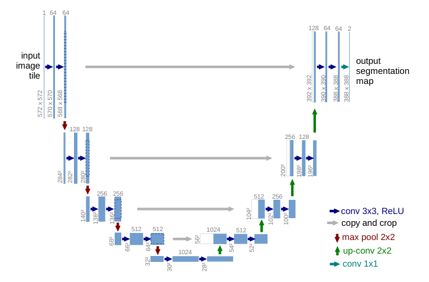
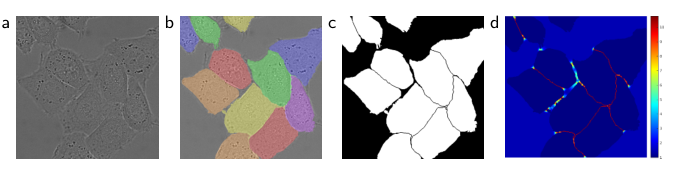
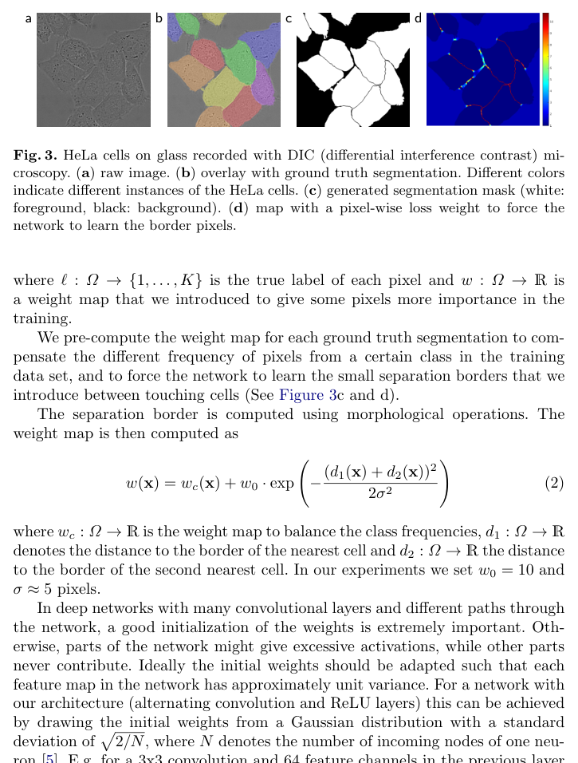
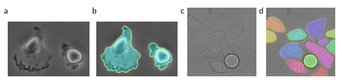

# U-Net: Convolutional Networks for Biomedical Image Segmentation

**中文译名：U-Net：用于生物医学图像分割的卷积网络**

> 来源：arXiv:1505.04597v1 [cs.CV]，2015 年 5 月 18 日。本文为中英对照全文翻译；公式以 LaTeX 原样保留；图题、表题翻译并标注原图页码；References 保留原文。

**Original:**
Olaf Ronneberger, Philipp Fischer, and Thomas Brox
Computer Science Department and BIOSS Centre for Biological Signalling Studies,
University of Freiburg, Germany
ronneber@informatik.uni-freiburg.de,
WWW home page: http://lmb.informatik.uni-freiburg.de/

**中文:** 作者：Olaf Ronneberger、Philipp Fischer 与 Thomas Brox。德国弗莱堡大学计算机科学系、BIOSS 生物信号研究中心。

## Abstract

**Original:**
There is large consent that successful training of deep networks requires many thousand annotated training samples. In this paper, we present a network and training strategy that relies on the strong use of data augmentation to use the available annotated samples more efficiently.

**中文:**
学界普遍认为，成功训练深度网络需要数千个标注训练样本。[译注：原文此处为 "consent"，通常写作 "consensus"。] 在本文中，我们提出一种网络与训练策略，它依赖于对数据增强的强力使用，从而更高效地利用可获得的标注样本。

**Original:**
The architecture consists of a contracting path to capture context and a symmetric expanding path that enables precise localization. We show that such a network can be trained end-to-end from very few images and outperforms the prior best method (a sliding-window convolutional network) on the ISBI challenge for segmentation of neuronal structures in electron microscopic stacks.

**中文:**
该架构由一条用于捕捉上下文的收缩路径（contracting path）和一条与之对称的、用于实现精确定位的扩张路径（expanding path）组成。我们证明，这样的网络可以用极少的图像进行端到端（end-to-end）训练，并在 ISBI 电子显微镜堆栈（electron microscopic stacks）中神经元结构（neuronal structures）分割挑战赛上超越了此前的最佳方法（一种滑动窗口卷积网络，sliding-window convolutional network）。

**Original:**
Using the same network trained on transmitted light microscopy images (phase contrast and DIC) we won the ISBI cell tracking challenge 2015 in these categories by a large margin. Moreover, the network is fast. Segmentation of a 512x512 image takes less than a second on a recent GPU. The full implementation (based on Caffe) and the trained networks are available at http://lmb.informatik.uni-freiburg.de/people/ronneber/u-net.

**中文:**
使用同一网络在透射光显微图像（相差显微镜 phase contrast 与 DIC）上训练后，我们在 ISBI 2015 细胞追踪挑战赛的这些类别中以大幅优势夺冠。此外，该网络速度很快：在一款较新的 GPU 上，对一张 512x512 图像的分割耗时不到一秒。基于 Caffe 的完整实现与训练好的网络可在 http://lmb.informatik.uni-freiburg.de/people/ronneber/u-net 获取。

## 1 Introduction

**Original:**
In the last two years, deep convolutional networks have outperformed the state of the art in many visual recognition tasks, e.g. [7,3]. While convolutional networks have already existed for a long time [8], their success was limited due to the size of the available training sets and the size of the considered networks. The breakthrough by Krizhevsky et al. [7] was due to supervised training of a large network with 8 layers and millions of parameters on the ImageNet dataset with 1 million training images. Since then, even larger and deeper networks have been trained [12].

**中文:**
在过去两年中，深度卷积网络（deep convolutional networks）已在许多视觉识别任务上超越了当前最优水平（state of the art），例如 [7,3]。虽然卷积网络早已存在了很长时间 [8]，但受限于可用训练集的规模与所考虑网络的规模，其成功一直有限。Krizhevsky 等人 [7] 的突破源于在拥有 100 万张训练图像的 ImageNet 数据集上，对一个具有 8 层、数百万参数的深度网络进行监督训练。此后，更大更深的网络陆续被训练出来 [12]。

**Original:**
The typical use of convolutional networks is on classification tasks, where the output to an image is a single class label. However, in many visual tasks, especially in biomedical image processing, the desired output should include localization, i.e., a class label is supposed to be assigned to each pixel. Moreover, thousands of training images are usually beyond reach in biomedical tasks. Hence, Ciresan et al. [1] trained a network in a sliding-window setup to predict the class label of each pixel by providing a local region (patch) around that pixel as input.

**中文:**
卷积网络的典型用途是分类任务，即对一张图像输出单个类别标签。然而，在许多视觉任务中，尤其是生物医学图像处理领域，期望的输出应当包含定位（localization）信息，即每个像素都应被赋予一个类别标签。此外，在生物医学任务中，数千张训练图像通常难以获得。因此，Ciresan 等人 [1] 以滑动窗口（sliding-window）方式训练了一个网络：把每个像素周围的局部区域（图像块，patch）作为输入，来预测该像素的类别标签。

> **图 1（译）**：U-Net 架构（最低分辨率层为 32x32 像素的示例）。每个蓝色方框对应一个多通道特征图；方框上方标注通道数，方框左下角标注 x-y 尺寸。白色方框表示被复制的特征图。箭头表示不同的操作。（原图见 paper.pdf 第 2 页，见下方图）

>
> **Original caption:** Fig. 1. U-net architecture (example for 32x32 pixels in the lowest resolution). Each blue box corresponds to a multi-channel feature map. The number of channels is denoted on top of the box. The x-y-size is provided at the lower left edge of the box. White boxes represent copied feature maps. The arrows denote the different operations.
>
> 图内标注（原图文字 / 译）：input image tile / 输入图像块；output segmentation map / 输出分割图；copy and crop / 复制与裁剪；max pool 2x2 / 2x2 最大池化；up-conv 2x2 / 2x2 上卷积；conv 3x3, ReLU / 3x3 卷积，ReLU；conv 1x1 / 1x1 卷积。

**Original:**
First, this network can localize. Secondly, the training data in terms of patches is much larger than the number of training images. The resulting network won the EM segmentation challenge at ISBI 2012 by a large margin.

**中文:**
首先，这种网络能够进行定位。其次，以图像块计的训练数据量远大于训练图像的数量。由此得到的网络以大幅优势赢得了 ISBI 2012 的 EM（电子显微镜）分割挑战赛。

**Original:**
Obviously, the strategy in Ciresan et al. [1] has two drawbacks. First, it is quite slow because the network must be run separately for each patch, and there is a lot of redundancy due to overlapping patches. Secondly, there is a trade-off between localization accuracy and the use of context. Larger patches require more max-pooling layers that reduce the localization accuracy, while small patches allow the network to see only little context. More recent approaches [11,4] proposed a classifier output that takes into account the features from multiple layers. Good localization and the use of context are possible at the same time.

**中文:**
显然，Ciresan 等人 [1] 的策略有两个缺点。第一，它相当慢，因为网络必须对每个图像块单独运行一次，而且图像块之间的重叠造成大量冗余计算。第二，定位精度与上下文利用之间存在权衡：更大的图像块需要更多最大池化（max-pooling）层，这会降低定位精度；而小的图像块又只能让网络看到很少的上下文。更近期的方法 [11,4] 提出一种考虑了多层特征的分类器输出，使良好的定位与上下文的利用可以兼得。

**Original:**
In this paper, we build upon a more elegant architecture, the so-called "fully convolutional network" [9]. We modify and extend this architecture such that it works with very few training images and yields more precise segmentations; see Figure 1. The main idea in [9] is to supplement a usual contracting network by successive layers, where pooling operators are replaced by upsampling operators. Hence, these layers increase the resolution of the output. In order to localize, high resolution features from the contracting path are combined with the upsampled output.

**中文:**
在本文中，我们基于一种更优雅的架构——所谓"全卷积网络"（fully convolutional network）[9]——进行构建。我们修改并扩展了这一架构，使其仅需极少训练图像即可工作，并产生更精确的分割结果；见图 1。[9] 的主要思想是：在通常的收缩网络之后补充连续的层，其中池化算子（pooling operators）被上采样算子（upsampling operators）取代。因此，这些层提高了输出的分辨率。为了实现定位，来自收缩路径的高分辨率特征与上采样后的输出相结合。

> **图 2（译）**：用于对任意大图像进行无缝分割的重叠平铺（overlap-tile）策略（此处为 EM 堆栈中神经元结构的分割）。预测黄色区域的分割结果，需要蓝色区域内的图像数据作为输入。缺失的输入数据通过镜像（mirroring）外推得到。（原图见 paper.pdf 第 3 页，见下方图）

>
> **Original caption:** Fig. 2. Overlap-tile strategy for seamless segmentation of arbitrary large images (here segmentation of neuronal structures in EM stacks). Prediction of the segmentation in the yellow area, requires image data within the blue area as input. Missing input data is extrapolated by mirroring

**Original:**
A successive convolution layer can then learn to assemble a more precise output based on this information.

**中文:**
后续的卷积层便可以基于这些信息学习拼装出更精确的输出。

**Original:**
One important modification in our architecture is that in the upsampling part we have also a large number of feature channels, which allow the network to propagate context information to higher resolution layers. As a consequence, the expansive path is more or less symmetric to the contracting path, and yields a u-shaped architecture. The network does not have any fully connected layers and only uses the valid part of each convolution, i.e., the segmentation map only contains the pixels, for which the full context is available in the input image. This strategy allows the seamless segmentation of arbitrarily large images by an overlap-tile strategy (see Figure 2). To predict the pixels in the border region of the image, the missing context is extrapolated by mirroring the input image. This tiling strategy is important to apply the network to large images, since otherwise the resolution would be limited by the GPU memory.

**中文:**
我们架构中一个重要的改动是：在上采样部分同样设有大量特征通道（feature channels），使网络能将上下文信息传播到分辨率更高的层。其结果是，扩张路径与收缩路径大致对称，形成一个 U 形架构。该网络没有任何全连接层（fully connected layers），并且只使用每次卷积的有效部分（valid part），即分割图（segmentation map）只包含输入图像中具备完整上下文的那些像素。这一策略通过重叠平铺（overlap-tile）策略实现了对任意大图像的无缝分割（见图 2）。为预测图像边界区域的像素，缺失的上下文通过对输入图像做镜像（mirroring）来外推。这种平铺策略对于将网络应用于大图像十分重要，否则分辨率将受限于 GPU 显存。

**Original:**
As for our tasks there is very little training data available, we use excessive data augmentation by applying elastic deformations to the available training images. This allows the network to learn invariance to such deformations, without the need to see these transformations in the annotated image corpus. This is particularly important in biomedical segmentation, since deformation used to be the most common variation in tissue and realistic deformations can be simulated efficiently. The value of data augmentation for learning invariance has been shown in Dosovitskiy et al. [2] in the scope of unsupervised feature learning.

**中文:**
由于我们的任务中可用的训练数据极少，我们对可用的训练图像施加弹性形变（elastic deformations），进行大强度的数据增强（data augmentation）。这使得网络能够学到对这些形变的不变性（invariance），而无需在标注图像语料中看到这些变换。这在生物医学分割中尤为重要，因为形变是组织中最常见的变化形式，且逼真的形变可以被高效地模拟。数据增强对学习不变性的价值已在 Dosovitskiy 等人 [2] 的无监督特征学习（unsupervised feature learning）研究中得到证明。

**Original:**
Another challenge in many cell segmentation tasks is the separation of touching objects of the same class; see Figure 3. To this end, we propose the use of a weighted loss, where the separating background labels between touching cells obtain a large weight in the loss function.

**中文:**
许多细胞分割任务中的另一个挑战是分离相互接触的同类目标；见图 3。为此，我们提出使用加权损失（weighted loss）：在损失函数中，位于相互接触的细胞之间的分离性背景标签被赋予较大的权重。

**Original:**
The resulting network is applicable to various biomedical segmentation problems. In this paper, we show results on the segmentation of neuronal structures in EM stacks (an ongoing competition started at ISBI 2012), where we outperformed the network of Ciresan et al. [1]. Furthermore, we show results for cell segmentation in light microscopy images from the ISBI cell tracking challenge 2015. Here we won with a large margin on the two most challenging 2D transmitted light datasets.

**中文:**
由此得到的网络适用于多种生物医学分割问题。在本文中，我们展示了在 EM 堆栈中神经元结构分割（一项始于 ISBI 2012、仍在进行的竞赛）上的结果，其中我们超越了 Ciresan 等人 [1] 的网络。此外，我们还展示了在 ISBI 2015 细胞追踪挑战赛的光学显微图像上进行细胞分割的结果。在该赛事的两个最具挑战性的 2D 透射光数据集上，我们以大幅优势获胜。

## 2 Network Architecture

**Original:**
The network architecture is illustrated in Figure 1. It consists of a contracting path (left side) and an expansive path (right side). The contracting path follows the typical architecture of a convolutional network. It consists of the repeated application of two 3x3 convolutions (unpadded convolutions), each followed by a rectified linear unit (ReLU) and a 2x2 max pooling operation with stride 2 for downsampling. At each downsampling step we double the number of feature channels. Every step in the expansive path consists of an upsampling of the feature map followed by a 2x2 convolution ("up-convolution") that halves the number of feature channels, a concatenation with the correspondingly cropped feature map from the contracting path, and two 3x3 convolutions, each followed by a ReLU. The cropping is necessary due to the loss of border pixels in every convolution. At the final layer a 1x1 convolution is used to map each 64-component feature vector to the desired number of classes. In total the network has 23 convolutional layers.

**中文:**
网络架构如图 1 所示。它由一条收缩路径（contracting path，左侧）和一条扩张路径（expansive path，右侧）组成。收缩路径遵循卷积网络的典型架构：重复应用两次 3x3 卷积（无填充卷积，unpadded convolutions），每次卷积后接一个修正线性单元（rectified linear unit，ReLU），再以一个步长为 2 的 2x2 最大池化（max pooling）操作进行下采样（downsampling）。每个下采样步骤中，特征通道数加倍。扩张路径中的每一步包含：对特征图进行上采样，随后是一个将特征通道数减半的 2x2 卷积（"上卷积"，up-convolution），再与来自收缩路径的、经过相应裁剪的特征图拼接（concatenation），最后是两次 3x3 卷积，每次卷积后接一个 ReLU。由于每次卷积都会损失边界像素，因此裁剪是必要的。在最后一层，用一个 1x1 卷积将每个 64 分量特征向量映射到所需的类别数。整个网络共有 23 个卷积层。

**Original:**
To allow a seamless tiling of the output segmentation map (see Figure 2), it is important to select the input tile size such that all 2x2 max-pooling operations are applied to a layer with an even x- and y-size.

**中文:**
为了实现输出分割图的无缝平铺（见图 2），必须选择合适的输入图像块尺寸，使所有 2x2 最大池化操作都作用在 x 尺寸与 y 尺寸均为偶数的层上。

## 3 Training

**Original:**
The input images and their corresponding segmentation maps are used to train the network with the stochastic gradient descent implementation of Caffe [6]. Due to the unpadded convolutions, the output image is smaller than the input by a constant border width. To minimize the overhead and make maximum use of the GPU memory, we favor large input tiles over a large batch size and hence reduce the batch to a single image. Accordingly we use a high momentum (0.99) such that a large number of the previously seen training samples determine the update in the current optimization step.

**中文:**
输入图像及其对应的分割图被用于通过 Caffe [6] 的随机梯度下降（stochastic gradient descent，SGD）实现来训练网络。由于使用了无填充卷积，输出图像比输入图像小一个恒定的边界宽度。为最小化开销并最大限度利用 GPU 显存，我们偏好大的输入图像块而非大的批次大小（batch size），因此将批次减少到单张图像。相应地，我们使用较高的动量（momentum，0.99），使得当前优化步骤中的更新由大量先前见过的训练样本共同决定。

**Original:**
The energy function is computed by a pixel-wise soft-max over the final feature map combined with the cross entropy loss function. The soft-max is defined as

**中文:**
能量函数（energy function）通过对最终特征图做逐像素 Softmax，并结合交叉熵（cross entropy）损失函数来计算。Softmax 定义为

$$p_k(\mathbf{x}) = \exp(a_k(\mathbf{x})) \bigg/ \left( \sum_{k'=1}^{K} \exp(a_{k'}(\mathbf{x})) \right)$$

**Original:**
where $a_k(\mathbf{x})$ denotes the activation in feature channel $k$ at the pixel position $\mathbf{x} \in \Omega$ with $\Omega \subset \mathbb{Z}^2$. $K$ is the number of classes and $p_k(\mathbf{x})$ is the approximated maximum-function. I.e. $p_k(\mathbf{x}) \approx 1$ for the $k$ that has the maximum activation $a_k(\mathbf{x})$ and $p_k(\mathbf{x}) \approx 0$ for all other $k$. The cross entropy then penalizes at each position the deviation of $p_{\ell(\mathbf{x})}(\mathbf{x})$ from 1 using

**中文:**
其中 $a_k(\mathbf{x})$ 表示在像素位置 $\mathbf{x} \in \Omega$（$\Omega \subset \mathbb{Z}^2$）处特征通道 $k$ 中的激活值。$K$ 是类别数，$p_k(\mathbf{x})$ 是近似的最大值函数。也就是说，对拥有最大激活值 $a_k(\mathbf{x})$ 的那个 $k$，有 $p_k(\mathbf{x}) \approx 1$，而对其余所有 $k$，$p_k(\mathbf{x}) \approx 0$。交叉熵随后在每个位置上惩罚 $p_{\ell(\mathbf{x})}(\mathbf{x})$ 偏离 1 的程度，即

$$E = \sum_{\mathbf{x} \in \Omega} w(\mathbf{x}) \log\left( p_{\ell(\mathbf{x})}(\mathbf{x}) \right) \tag{1}$$

**Original:**
where $\ell : \Omega \to \{1, \dots, K\}$ is the true label of each pixel and $w : \Omega \to \mathbb{R}$ is a weight map that we introduced to give some pixels more importance in the training.

**中文:**
其中 $\ell : \Omega \to \{1, \dots, K\}$ 是每个像素的真实标签，$w : \Omega \to \mathbb{R}$ 是我们引入的权重图（weight map），用于在训练中赋予某些像素更高的重要性。

> **图 3（译）**：用 DIC（微分干涉相差）显微镜记录的玻璃上的 HeLa 细胞。(a) 原始图像。(b) 与真值分割叠加显示；不同颜色表示 HeLa 细胞的不同实例。(c) 生成的分割掩膜（白色：前景，黑色：背景）。(d) 带逐像素损失权重的图，用于迫使网络学习边界像素。（原图见 paper.pdf 第 5 页，见下方图）

>
> **Original caption:** Fig. 3. HeLa cells on glass recorded with DIC (differential interference contrast) microscopy. (a) raw image. (b) overlay with ground truth segmentation. Different colors indicate different instances of the HeLa cells. (c) generated segmentation mask (white: foreground, black: background). (d) map with a pixel-wise loss weight to force the network to learn the border pixels.

**Original:**
We pre-compute the weight map for each ground truth segmentation to compensate the different frequency of pixels from a certain class in the training data set, and to force the network to learn the small separation borders that we introduce between touching cells (See Figure 3c and d).

**中文:**
我们为每个真值（ground truth）分割预先计算权重图，以补偿训练数据集中某一类别像素出现频率的差异，并迫使网络去学习我们在相互接触的细胞之间引入的细小分离边界（见图 3c 与 3d）。

**Original:**
The separation border is computed using morphological operations. The weight map is then computed as

**中文:**
分离边界通过形态学操作（morphological operations）计算得出。权重图随后按下式计算：

$$w(\mathbf{x}) = w_c(\mathbf{x}) + w_0 \cdot \exp\left( -\frac{\left(d_1(\mathbf{x}) + d_2(\mathbf{x})\right)^2}{2\sigma^2} \right) \tag{2}$$

**Original:**
where $w_c : \Omega \to \mathbb{R}$ is the weight map to balance the class frequencies, $d_1 : \Omega \to \mathbb{R}$ denotes the distance to the border of the nearest cell and $d_2 : \Omega \to \mathbb{R}$ the distance to the border of the second nearest cell. In our experiments we set $w_0 = 10$ and $\sigma \approx 5$ pixels.

**中文:**
其中 $w_c : \Omega \to \mathbb{R}$ 是用于平衡类别频率的权重图，$d_1 : \Omega \to \mathbb{R}$ 表示到最近细胞边界的距离，$d_2 : \Omega \to \mathbb{R}$ 表示到第二近细胞边界的距离。在我们的实验中，取 $w_0 = 10$，$\sigma \approx 5$ 像素。

**Original:**
In deep networks with many convolutional layers and different paths through the network, a good initialization of the weights is extremely important. Otherwise, parts of the network might give excessive activations, while other parts never contribute. Ideally the initial weights should be adapted such that each feature map in the network has approximately unit variance. For a network with our architecture (alternating convolution and ReLU layers) this can be achieved by drawing the initial weights from a Gaussian distribution with a standard deviation of

$$\sqrt{2/N}$$

**中文:**
在拥有许多卷积层与多条网络通路的深度网络中，良好的权重初始化极为重要。否则，网络的某些部分可能产生过大的激活值，而另一些部分则从不作出贡献。理想情况下，初始权重应使网络中的每个特征图都具有近似单位方差。对于具有我们这种架构（卷积层与 ReLU 层交替）的网络，可以从标准差为

$$\sqrt{2/N}$$

的高斯分布中抽取初始权重来实现这一点。

**Original:**
where $N$ denotes the number of incoming nodes of one neuron [5]. E.g. for a 3x3 convolution and 64 feature channels in the previous layer $N = 9 \cdot 64 = 576$.

**中文:**
其中 $N$ 表示一个神经元的输入节点数量 [5]。例如，对于 3x3 卷积且前一层有 64 个特征通道的情况，$N = 9 \cdot 64 = 576$。

### 3.1 Data Augmentation

**Original:**
Data augmentation is essential to teach the network the desired invariance and robustness properties, when only few training samples are available. In case of microscopical images we primarily need shift and rotation invariance as well as robustness to deformations and gray value variations. Especially random elastic deformations of the training samples seem to be the key concept to train a segmentation network with very few annotated images. We generate smooth deformations using random displacement vectors on a coarse 3 by 3 grid. The displacements are sampled from a Gaussian distribution with 10 pixels standard deviation. Per-pixel displacements are then computed using bicubic interpolation. Drop-out layers at the end of the contracting path perform further implicit data augmentation.

**中文:**
当只有少量训练样本可用时，数据增强对于教会网络所期望的不变性与鲁棒性至关重要。对于显微图像，我们主要需要平移与旋转不变性（shift and rotation invariance），以及对形变和灰度变化的鲁棒性。特别是对训练样本施加随机弹性形变，似乎是仅用极少标注图像训练分割网络的关键概念。我们利用粗 3x3 网格上的随机位移向量（displacement vectors）生成平滑形变，位移从标准差为 10 像素的高斯分布中采样。随后用双三次插值（bicubic interpolation）计算逐像素位移。位于收缩路径末端的随机失活（Dropout）层进一步实现了隐式的数据增强。

## 4 Experiments

**Original:**
We demonstrate the application of the u-net to three different segmentation tasks. The first task is the segmentation of neuronal structures in electron microscopic recordings. An example of the data set and our obtained segmentation is displayed in Figure 2. We provide the full result as Supplementary Material. The data set is provided by the EM segmentation challenge [14] that was started at ISBI 2012 and is still open for new contributions. The training data is a set of 30 images (512x512 pixels) from serial section transmission electron microscopy of the Drosophila first instar larva ventral nerve cord (VNC). Each image comes with a corresponding fully annotated ground truth segmentation map for cells (white) and membranes (black). The test set is publicly available, but its segmentation maps are kept secret. An evaluation can be obtained by sending the predicted membrane probability map to the organizers. The evaluation is done by thresholding the map at 10 different levels and computation of the "warping error", the "Rand error" and the "pixel error" [14].

**中文:**
我们展示了 U-Net 在三个不同分割任务上的应用。第一个任务是对电子显微镜记录中的神经元结构进行分割。数据集示例与我们得到的分割结果见图 2，完整结果见补充材料（Supplementary Material）。该数据集来自 EM 分割挑战赛 [14]，该赛事始于 ISBI 2012，且至今仍接受新的提交。训练数据是 30 张来自果蝇一龄幼虫腹神经索（Drosophila first instar larva ventral nerve cord，VNC）的连续切片透射电子显微镜（serial section transmission electron microscopy）图像（512x512 像素）。每张图像都配有对应的、完整标注的真值分割图，用于区分细胞（白色）与细胞膜（黑色）。测试集是公开的，但其分割图保密。将预测得到的膜概率图（membrane probability map）发送给组织者即可获得评估。评估方法是将概率图在 10 个不同水平上做阈值化（thresholding），并计算 "warping 误差"（warping error）、"Rand 误差"（Rand error）与"像素误差"（pixel error）[14]。

**Original:**
The u-net (averaged over 7 rotated versions of the input data) achieves without any further pre- or postprocessing a warping error of 0.0003529 (the new best score, see Table 1) and a rand-error of 0.0382.

**中文:**
U-Net（对输入数据 7 个旋转版本的结果取平均）在没有任何额外前处理或后处理（pre- or postprocessing）的情况下，取得了 0.0003529 的 warping 误差（新的最佳分数，见表 1）与 0.0382 的 Rand 误差。

> **表 1（译）**：EM 分割挑战赛 [14] 排名（2015 年 3 月 6 日），按 warping 误差排序。（原图见 paper.pdf 第 6 页，见下方图）

>
> **Original caption:** Table 1. Ranking on the EM segmentation challenge [14] (march 6th, 2015), sorted by warping error.
>
> | Rank 排名 | Group name 队伍名称 | Warping Error | Rand Error | Pixel Error |
> |---|---|---|---|---|
> | ** human values ** | 0.000005 | 0.0021 | 0.0010 |
> | 1. u-net | 0.000353 | 0.0382 | 0.0611 |
> | 2. DIVE-SCI | 0.000355 | 0.0305 | 0.0584 |
> | 3. IDSIA [1] | 0.000420 | 0.0504 | 0.0613 |
> | 4. DIVE | 0.000430 | 0.0545 | 0.0582 |
> | ... | | | |
> | 10. IDSIA-SCI | 0.000653 | 0.0189 | 0.1027 |

**Original:**
This is significantly better than the sliding-window convolutional network result by Ciresan et al. [1], whose best submission had a warping error of 0.000420 and a rand error of 0.0504. In terms of rand error the only better performing algorithms on this data set use highly data set specific post-processing methods¹ applied to the probability map of Ciresan et al. [1].

**中文:**
这显著优于 Ciresan 等人 [1] 的滑动窗口卷积网络结果：其最佳提交的 warping 误差为 0.000420，Rand 误差为 0.0504。就 Rand 误差而言，在该数据集上表现更优的算法，都使用了针对该数据集高度特化的后处理方法¹，且这些方法作用于 Ciresan 等人 [1] 的概率图之上。

> **图 4（译）**：ISBI 细胞追踪挑战赛上的结果。(a) "PhC-U373" 数据集输入图像的一部分。(b) 分割结果（青色掩膜）与人工真值（黄色边框）。(c) "DIC-HeLa" 数据集的输入图像。(d) 分割结果（随机彩色掩膜）与人工真值（黄色边框）。（原图见 paper.pdf 第 7 页，见下方图）

>
> **Original caption:** Fig. 4. Result on the ISBI cell tracking challenge. (a) part of an input image of the "PhC-U373" data set. (b) Segmentation result (cyan mask) with manual ground truth (yellow border) (c) input image of the "DIC-HeLa" data set. (d) Segmentation result (random colored masks) with manual ground truth (yellow border).

> **表 2（译）**：ISBI 2015 细胞追踪挑战赛上的分割结果（IoU）。（原图见 paper.pdf 第 7 页，[第 7 页图](assets/figures/tab-2.png)）
>
> **Original caption:** Table 2. Segmentation results (IOU) on the ISBI cell tracking challenge 2015.
>
> | Name 名称 | PhC-U373 | DIC-HeLa |
> |---|---|---|
> | IMCB-SG (2014) | 0.2669 | 0.2935 |
> | KTH-SE (2014) | 0.7953 | 0.4607 |
> | HOUS-US (2014) | 0.5323 | - |
> | second-best 2015 | 0.83 | 0.46 |
> | u-net (2015) | 0.9203 | 0.7756 |

**Original:**
We also applied the u-net to a cell segmentation task in light microscopic images. This segmentation task is part of the ISBI cell tracking challenge 2014 and 2015 [10,13]. The first data set "PhC-U373"² contains Glioblastoma-astrocytoma U373 cells on a polyacrylimide substrate recorded by phase contrast microscopy (see Figure 4a,b and Supp. Material). It contains 35 partially annotated training images. Here we achieve an average IOU ("intersection over union") of 92%, which is significantly better than the second best algorithm with 83% (see Table 2). The second data set "DIC-HeLa"³ are HeLa cells on a flat glass recorded by differential interference contrast (DIC) microscopy (see Figure 3, Figure 4c,d and Supp. Material). It contains 20 partially annotated training images. Here we achieve an average IOU of 77.5% which is significantly better than the second best algorithm with 46%.

**中文:**
我们还将 U-Net 应用于光学显微图像中的细胞分割任务。该分割任务是 ISBI 2014 与 2015 细胞追踪挑战赛 [10,13] 的一部分。第一个数据集 "PhC-U373"² 包含生长在聚丙烯酰胺基底（polyacrylimide substrate）上的胶质母细胞瘤-星形细胞瘤 U373 细胞，由相差显微镜（phase contrast microscopy）记录（见图 4a、4b 及补充材料），包含 35 张部分标注的训练图像。在该数据集上，我们取得了 92% 的平均 IoU（"交并比"，intersection over union），显著优于第二名算法的 83%（见表 2）。第二个数据集 "DIC-HeLa"³ 是平玻璃上的 HeLa 细胞，由微分干涉相差（differential interference contrast，DIC）显微镜记录（见图 3、图 4c、4d 及补充材料），包含 20 张部分标注的训练图像。在该数据集上，我们取得了 77.5% 的平均 IoU，显著优于第二名算法的 46%。

## 5 Conclusion

**Original:**
The u-net architecture achieves very good performance on very different biomedical segmentation applications. Thanks to data augmentation with elastic deformations, it only needs very few annotated images and has a very reasonable training time of only 10 hours on a NVidia Titan GPU (6 GB). We provide the full Caffe[6]-based implementation and the trained networks⁴. We are sure that the u-net architecture can be applied easily to many more tasks.

**中文:**
U-Net 架构在差异很大的各类生物医学分割应用上都取得了非常好的性能。得益于弹性形变数据增强，它只需要极少量的标注图像，且训练时间相当合理——在 NVidia Titan GPU（6 GB）上仅需 10 小时。我们提供了基于 Caffe [6] 的完整实现与训练好的网络⁴。我们确信，U-Net 架构可以轻松应用于更多的任务。

## Acknowledgements

**Original:**
This study was supported by the Excellence Initiative of the German Federal and State governments (EXC 294) and by the BMBF (Fkz 0316185B).

**中文:**
本研究受德国联邦与州政府卓越计划（Excellence Initiative，EXC 294）以及 BMBF（Fkz 0316185B）资助。

## 脚注 Footnotes

**Original:**
¹ The authors of this algorithm have submitted 78 different solutions to achieve this result.

**中文:**
¹ 该算法的作者提交了 78 个不同的方案才取得这一结果。

**Original:**
² Data set provided by Dr. Sanjay Kumar. Department of Bioengineering University of California at Berkeley. Berkeley CA (USA)

**中文:**
² 数据集由 Dr. Sanjay Kumar 提供，来自加州大学伯克利分校生物工程系，美国加州伯克利。

**Original:**
³ Data set provided by Dr. Gert van Cappellen Erasmus Medical Center. Rotterdam. The Netherlands

**中文:**
³ 数据集由 Dr. Gert van Cappellen 提供，来自伊拉斯谟医学中心（Erasmus Medical Center），荷兰鹿特丹。

**Original:**
⁴ U-net implementation, trained networks and supplementary material available at http://lmb.informatik.uni-freiburg.de/people/ronneber/u-net

**中文:**
⁴ U-Net 实现、训练好的网络及补充材料可在 http://lmb.informatik.uni-freiburg.de/people/ronneber/u-net 获取。

## References

（以下参考文献整体保留原文，不翻译。）

1. Ciresan, D.C., Gambardella, L.M., Giusti, A., Schmidhuber, J.: Deep neural networks segment neuronal membranes in electron microscopy images. In: NIPS. pp. 2852–2860 (2012)
2. Dosovitskiy, A., Springenberg, J.T., Riedmiller, M., Brox, T.: Discriminative unsupervised feature learning with convolutional neural networks. In: NIPS (2014)
3. Girshick, R., Donahue, J., Darrell, T., Malik, J.: Rich feature hierarchies for accurate object detection and semantic segmentation. In: Proceedings of the IEEE Conference on Computer Vision and Pattern Recognition (CVPR) (2014)
4. Hariharan, B., Arbelez, P., Girshick, R., Malik, J.: Hypercolumns for object segmentation and fine-grained localization (2014), arXiv:1411.5752 [cs.CV]
5. He, K., Zhang, X., Ren, S., Sun, J.: Delving deep into rectifiers: Surpassing human-level performance on imagenet classification (2015), arXiv:1502.01852 [cs.CV]
6. Jia, Y., Shelhamer, E., Donahue, J., Karayev, S., Long, J., Girshick, R., Guadarrama, S., Darrell, T.: Caffe: Convolutional architecture for fast feature embedding (2014), arXiv:1408.5093 [cs.CV]
7. Krizhevsky, A., Sutskever, I., Hinton, G.E.: Imagenet classification with deep convolutional neural networks. In: NIPS. pp. 1106–1114 (2012)
8. LeCun, Y., Boser, B., Denker, J.S., Henderson, D., Howard, R.E., Hubbard, W., Jackel, L.D.: Backpropagation applied to handwritten zip code recognition. Neural Computation 1(4), 541–551 (1989)
9. Long, J., Shelhamer, E., Darrell, T.: Fully convolutional networks for semantic segmentation (2014), arXiv:1411.4038 [cs.CV]
10. Maska, M., (...), de Solorzano, C.O.: A benchmark for comparison of cell tracking algorithms. Bioinformatics 30, 1609–1617 (2014)
11. Seyedhosseini, M., Sajjadi, M., Tasdizen, T.: Image segmentation with cascaded hierarchical models and logistic disjunctive normal networks. In: Computer Vision (ICCV), 2013 IEEE International Conference on. pp. 2168–2175 (2013)
12. Simonyan, K., Zisserman, A.: Very deep convolutional networks for large-scale image recognition (2014), arXiv:1409.1556 [cs.CV]
13. WWW: Web page of the cell tracking challenge, http://www.codesolorzano.com/celltrackingchallenge/Cell_Tracking_Challenge/Welcome.html
14. WWW: Web page of the em segmentation challenge, http://brainiac2.mit.edu/isbi_challenge/
