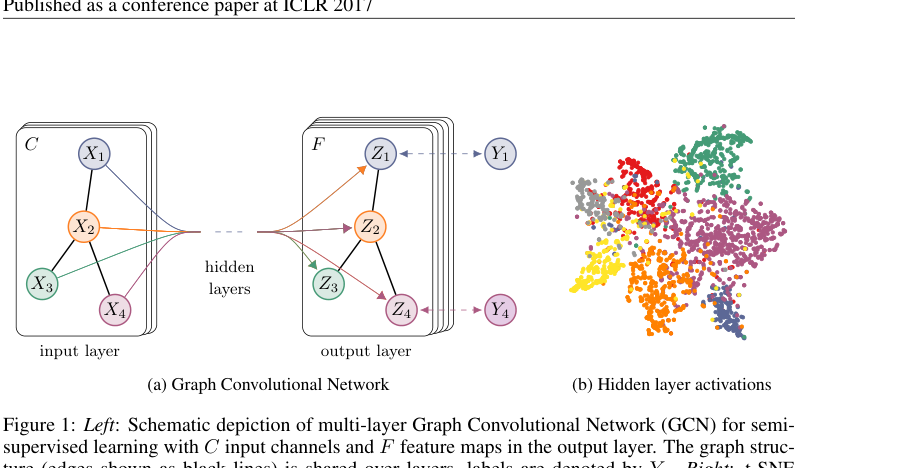
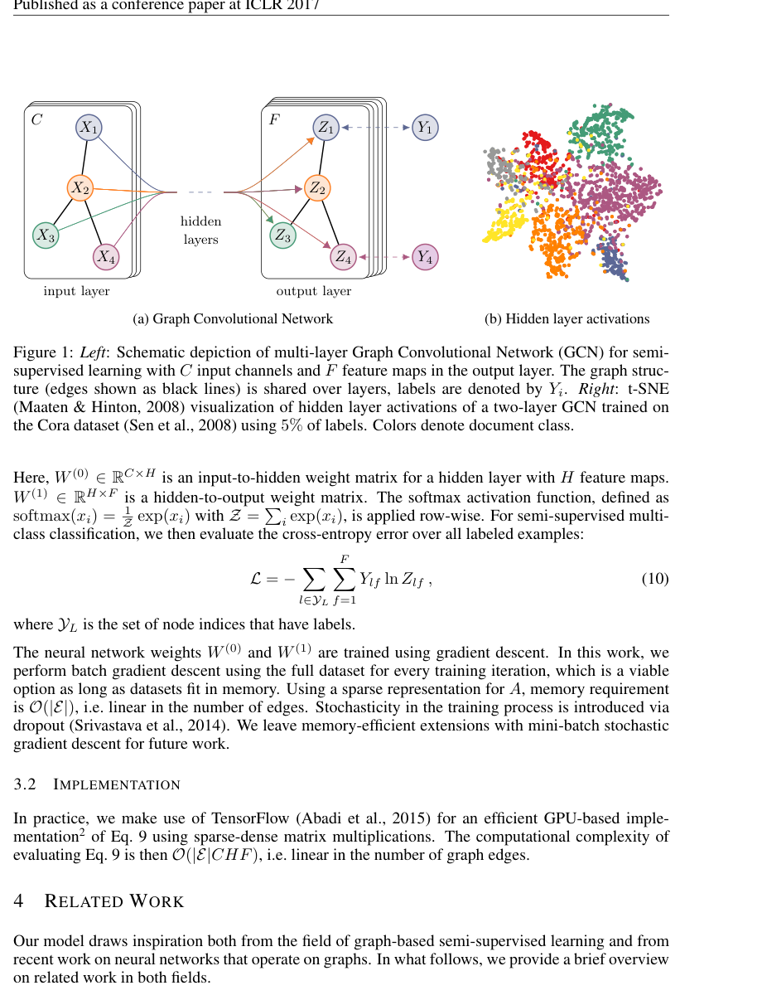
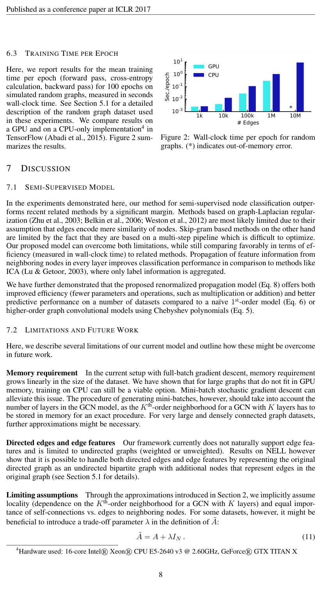
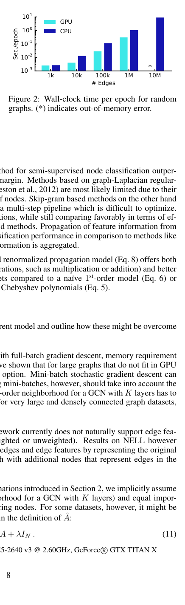
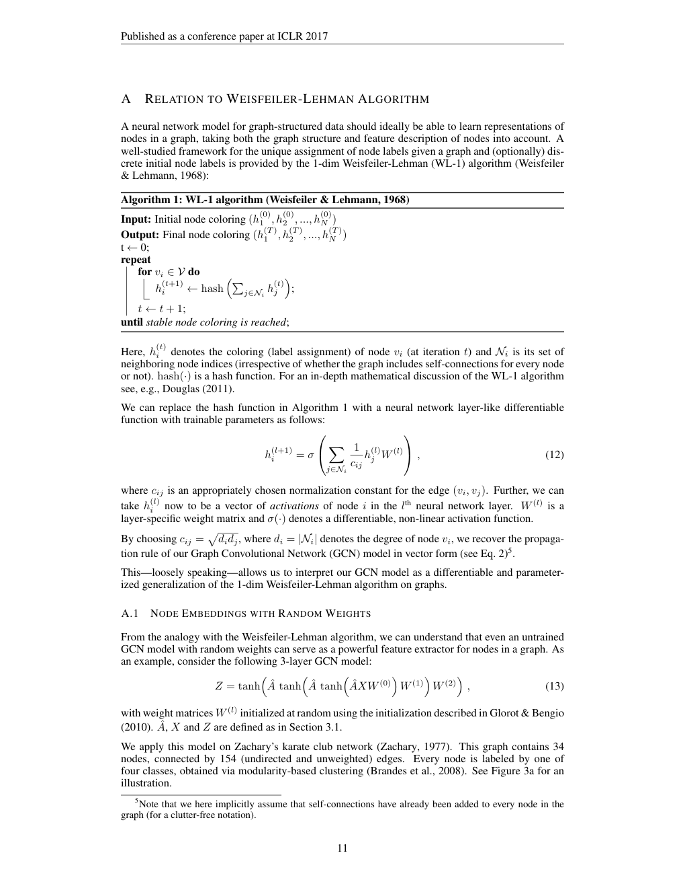
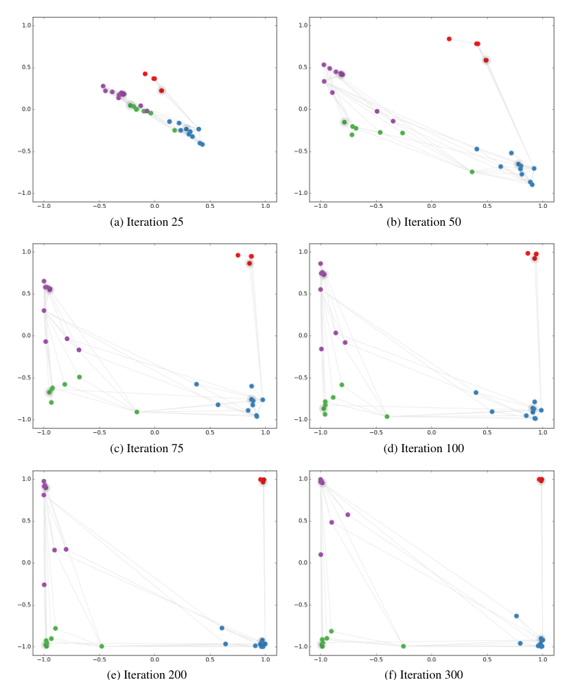
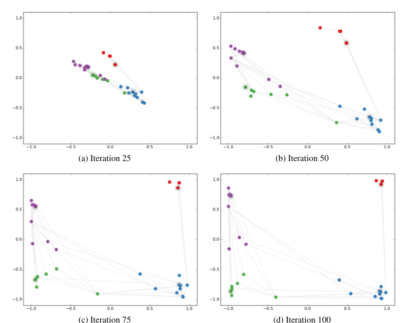

# Semi-Supervised Classification with Graph Convolutional Networks（图卷积网络的半监督分类）

**Original:** Thomas N. Kipf — University of Amsterdam, T.N.Kipf@uva.nl; Max Welling — University of Amsterdam, Canadian Institute for Advanced Research (CIFAR), M.Welling@uva.nl

**中文:** Thomas N. Kipf —— 阿姆斯特丹大学，T.N.Kipf@uva.nl；Max Welling —— 阿姆斯特丹大学、加拿大高等研究院（CIFAR），M.Welling@uva.nl

> Published as a conference paper at ICLR 2017（arXiv:1609.02907v4 [cs.LG] 22 Feb 2017）
> 作为会议论文发表于 ICLR 2017（arXiv:1609.02907v4 [cs.LG]，2017 年 2 月 22 日）

## Abstract（摘要）

**Original:** We present a scalable approach for semi-supervised learning on graph-structured data that is based on an efficient variant of convolutional neural networks which operate directly on graphs. We motivate the choice of our convolutional architecture via a localized first-order approximation of spectral graph convolutions. Our model scales linearly in the number of graph edges and learns hidden layer representations that encode both local graph structure and features of nodes. In a number of experiments on citation networks and on a knowledge graph dataset we demonstrate that our approach outperforms related methods by a significant margin.

**中文:** 我们提出了一种用于图结构数据的半监督学习的可扩展方法，它基于一种直接在图上运算的卷积神经网络的高效变体。我们通过谱图卷积（spectral graph convolution）的局部化一阶近似来论证所选择的卷积架构的合理性。我们的模型随图的边数线性扩展，并学习同时编码局部图结构和节点特征的隐藏层表示。在若干引文网络数据集和一个知识图谱数据集上的大量实验中，我们证明我们的方法以显著优势优于相关方法。

## 1 Introduction（引言）

**Original:** We consider the problem of classifying nodes (such as documents) in a graph (such as a citation network), where labels are only available for a small subset of nodes. This problem can be framed as graph-based semi-supervised learning, where label information is smoothed over the graph via some form of explicit graph-based regularization (Zhu et al., 2003; Zhou et al., 2004; Belkin et al., 2006; Weston et al., 2012), e.g. by using a graph Laplacian regularization term in the loss function:

$$\mathcal{L} = \mathcal{L}_0 + \lambda \mathcal{L}_{\text{reg}}, \quad \text{with} \quad \mathcal{L}_{\text{reg}} = \sum_{i,j} A_{ij} \left\| f(X_i) - f(X_j) \right\|^2 = f(X)^\top \Delta f(X). \tag{1}$$

**中文:** 我们考虑对图（如引文网络）中的节点（如文档）进行分类的问题，其中只有一小部分节点有标签。该问题可以表述为基于图的半监督学习，其中标签信息通过某种显式的基于图的正则化在图上被平滑（Zhu et al., 2003; Zhou et al., 2004; Belkin et al., 2006; Weston et al., 2012），例如在损失函数中使用图拉普拉斯正则化项：

$$\mathcal{L} = \mathcal{L}_0 + \lambda \mathcal{L}_{\text{reg}}, \quad \text{with} \quad \mathcal{L}_{\text{reg}} = \sum_{i,j} A_{ij} \left\| f(X_i) - f(X_j) \right\|^2 = f(X)^\top \Delta f(X). \tag{1}$$

**Original:** Here, $\mathcal{L}_0$ denotes the supervised loss w.r.t. the labeled part of the graph, $f(\cdot)$ can be a neural network-like differentiable function, $\lambda$ is a weighting factor and $X$ is a matrix of node feature vectors $X_i$. $\Delta = D - A$ denotes the unnormalized graph Laplacian of an undirected graph $\mathcal{G} = (\mathcal{V}, \mathcal{E})$ with $N$ nodes $v_i \in \mathcal{V}$, edges $(v_i, v_j) \in \mathcal{E}$, an adjacency matrix $A \in \mathbb{R}^{N \times N}$ (binary or weighted) and a degree matrix $D_{ii} = \sum_j A_{ij}$. The formulation of Eq. 1 relies on the assumption that connected nodes in the graph are likely to share the same label. This assumption, however, might restrict modeling capacity, as graph edges need not necessarily encode node similarity, but could contain additional information.

**中文:** 这里，$\mathcal{L}_0$ 表示相对于图中已标注部分的有监督损失，$f(\cdot)$ 可以是类似神经网络的可微函数，$\lambda$ 是一个加权因子，$X$ 是节点特征向量 $X_i$ 的矩阵。$\Delta = D - A$ 表示无向图 $\mathcal{G} = (\mathcal{V}, \mathcal{E})$ 的未归一化图拉普拉斯矩阵，其中图有 $N$ 个节点 $v_i \in \mathcal{V}$、边 $(v_i, v_j) \in \mathcal{E}$、邻接矩阵 $A \in \mathbb{R}^{N \times N}$（二值或加权）以及度矩阵 $D_{ii} = \sum_j A_{ij}$。式 (1) 的表述依赖如下假设：图中相连的节点很可能共享相同的标签。然而，这一假设可能限制建模能力，因为图的边不一定编码节点相似性，而可能包含额外信息。

**Original:** In this work, we encode the graph structure directly using a neural network model $f(X, A)$ and train on a supervised target $\mathcal{L}_0$ for all nodes with labels, thereby avoiding explicit graph-based regularization in the loss function. Conditioning $f(\cdot)$ on the adjacency matrix of the graph will allow the model to distribute gradient information from the supervised loss $\mathcal{L}_0$ and will enable it to learn representations of nodes both with and without labels.

**中文:** 在本文中，我们直接用神经网络模型 $f(X, A)$ 编码图结构，并在所有带标签的节点上以有监督目标 $\mathcal{L}_0$ 训练，从而避免在损失函数中使用显式的基于图的正则化。让 $f(\cdot)$ 以图的邻接矩阵为条件，将使模型能够把来自有监督损失 $\mathcal{L}_0$ 的梯度信息传播出去，并使其能够学习有标签和无标签节点的表示。

**Original:** Our contributions are two-fold. Firstly, we introduce a simple and well-behaved layer-wise propagation rule for neural network models which operate directly on graphs and show how it can be motivated from a first-order approximation of spectral graph convolutions (Hammond et al., 2011). Secondly, we demonstrate how this form of a graph-based neural network model can be used for fast and scalable semi-supervised classification of nodes in a graph. Experiments on a number of datasets demonstrate that our model compares favorably both in classification accuracy and efficiency (measured in wall-clock time) against state-of-the-art methods for semi-supervised learning.

**中文:** 我们的贡献有两方面。其一，我们为直接在图上运算的神经网络模型引入了一条简单且性质良好的逐层传播规则，并展示它如何由谱图卷积的一阶近似（Hammond et al., 2011）推导而来。其二，我们展示了这种基于图的神经网络模型形式如何用于图中节点的快速、可扩展的半监督分类。在若干数据集上的实验表明，与当前最优（state-of-the-art）的半监督学习方法相比，我们的模型在分类准确率和效率（以墙钟时间 wall-clock time 计）两方面都表现更优。

## 2 Fast Approximate Convolutions on Graphs（图上的快速近似卷积）

**Original:** In this section, we provide theoretical motivation for a specific graph-based neural network model $f(X, A)$ that we will use in the rest of this paper. We consider a multi-layer Graph Convolutional Network (GCN) with the following layer-wise propagation rule:

$$H^{(l+1)} = \sigma\left( \tilde{D}^{-\frac{1}{2}} \tilde{A} \tilde{D}^{-\frac{1}{2}} H^{(l)} W^{(l)} \right). \tag{2}$$

**中文:** 在本节中，我们为本文其余部分将使用的特定基于图的神经网络模型 $f(X, A)$ 提供理论依据。我们考虑具有如下逐层传播规则的多层图卷积网络（Graph Convolutional Network，GCN）：

$$H^{(l+1)} = \sigma\left( \tilde{D}^{-\frac{1}{2}} \tilde{A} \tilde{D}^{-\frac{1}{2}} H^{(l)} W^{(l)} \right). \tag{2}$$

**Original:** Here, $\tilde{A} = A + I_N$ is the adjacency matrix of the undirected graph $\mathcal{G}$ with added self-connections. $I_N$ is the identity matrix, $\tilde{D}_{ii} = \sum_j \tilde{A}_{ij}$ and $W^{(l)}$ is a layer-specific trainable weight matrix. $\sigma(\cdot)$ denotes an activation function, such as the $\text{ReLU}(\cdot) = \max(0, \cdot)$. $H^{(l)} \in \mathbb{R}^{N \times D}$ is the matrix of activations in the $l$th layer; $H^{(0)} = X$. In the following, we show that the form of this propagation rule can be motivated¹ via a first-order approximation of localized spectral filters on graphs (Hammond et al., 2011; Defferrard et al., 2016).

**中文:** 这里，$\tilde{A} = A + I_N$ 是无向图 $\mathcal{G}$ 添加自连接后的邻接矩阵。$I_N$ 是单位矩阵，$\tilde{D}_{ii} = \sum_j \tilde{A}_{ij}$，而 $W^{(l)}$ 是层特定的可训练权重矩阵。$\sigma(\cdot)$ 表示激活函数，例如 $\text{ReLU}(\cdot) = \max(0, \cdot)$。$H^{(l)} \in \mathbb{R}^{N \times D}$ 是第 $l$ 层的激活矩阵；$H^{(0)} = X$。在下文中，我们说明该传播规则的形式可以通过图上局部化谱滤波器的一阶近似来推导¹（Hammond et al., 2011; Defferrard et al., 2016）。

> ¹ 我们在附录 A 中基于 Weisfeiler-Lehman 算法（Weisfeiler & Lehmann, 1968）给出了该传播规则的另一种解释。（原文脚注 1，paper.pdf 第 2 页）

### 2.1 Spectral Graph Convolutions（谱图卷积）

**Original:** We consider spectral convolutions on graphs defined as the multiplication of a signal $x \in \mathbb{R}^N$ (a scalar for every node) with a filter $g_\theta = \text{diag}(\theta)$ parameterized by $\theta \in \mathbb{R}^N$ in the Fourier domain, i.e.:

$$g_\theta \star x = U g_\theta U^\top x, \tag{3}$$

**中文:** 我们考虑定义在谱域的图卷积：信号 $x \in \mathbb{R}^N$（每个节点一个标量）与由 $\theta \in \mathbb{R}^N$ 参数化的滤波器 $g_\theta = \text{diag}(\theta)$ 在傅里叶域中相乘，即：

$$g_\theta \star x = U g_\theta U^\top x, \tag{3}$$

**Original:** where $U$ is the matrix of eigenvectors of the normalized graph Laplacian $L = I_N - D^{-\frac{1}{2}} A D^{-\frac{1}{2}} = U \Lambda U^\top$, with a diagonal matrix of its eigenvalues $\Lambda$ and $U^\top x$ being the graph Fourier transform of $x$. We can understand $g_\theta$ as a function of the eigenvalues of $L$, i.e. $g_\theta(\Lambda)$. Evaluating Eq. 3 is computationally expensive, as multiplication with the eigenvector matrix $U$ is $O(N^2)$. Furthermore, computing the eigendecomposition of $L$ in the first place might be prohibitively expensive for large graphs. To circumvent this problem, it was suggested in Hammond et al. (2011) that $g_\theta(\Lambda)$ can be well-approximated by a truncated expansion in terms of Chebyshev polynomials $T_k(x)$ up to $K$th order:

$$g_{\theta'}(\Lambda) \approx \sum_{k=0}^{K} \theta'_k T_k(\tilde{\Lambda}), \tag{4}$$

**中文:** 其中 $U$ 是归一化图拉普拉斯矩阵 $L = I_N - D^{-\frac{1}{2}} A D^{-\frac{1}{2}} = U \Lambda U^\top$ 的特征向量矩阵，$\Lambda$ 是其特征值的对角矩阵，$U^\top x$ 是 $x$ 的图傅里叶变换。我们可以把 $g_\theta$ 理解为 $L$ 的特征值的函数，即 $g_\theta(\Lambda)$。计算式 (3) 代价很高，因为与特征向量矩阵 $U$ 相乘的复杂度为 $O(N^2)$。此外，对于大图，计算 $L$ 的特征分解本身可能就极其昂贵。为规避这一问题，Hammond et al. (2011) 提出 $g_\theta(\Lambda)$ 可以用切比雪夫多项式（Chebyshev polynomial）$T_k(x)$ 的截断展开式很好地近似，直到 $K$ 阶：

$$g_{\theta'}(\Lambda) \approx \sum_{k=0}^{K} \theta'_k T_k(\tilde{\Lambda}), \tag{4}$$

**Original:** with a rescaled $\tilde{\Lambda} = \frac{2}{\lambda_{\max}} \Lambda - I_N$. $\lambda_{\max}$ denotes the largest eigenvalue of $L$. $\theta' \in \mathbb{R}^K$ is now a vector of Chebyshev coefficients. The Chebyshev polynomials are recursively defined as $T_k(x) = 2x T_{k-1}(x) - T_{k-2}(x)$, with $T_0(x) = 1$ and $T_1(x) = x$. The reader is referred to Hammond et al. (2011) for an in-depth discussion of this approximation.

**中文:** 其中 $\tilde{\Lambda} = \frac{2}{\lambda_{\max}} \Lambda - I_N$ 是重缩放后的矩阵。$\lambda_{\max}$ 表示 $L$ 的最大特征值。$\theta' \in \mathbb{R}^K$ 现在是切比雪夫系数向量。切比雪夫多项式递归定义为 $T_k(x) = 2x T_{k-1}(x) - T_{k-2}(x)$，其中 $T_0(x) = 1$、$T_1(x) = x$。关于该近似的深入讨论，读者可参阅 Hammond et al. (2011)。

**Original:** Going back to our definition of a convolution of a signal $x$ with a filter $g_{\theta'}$, we now have:

$$g_{\theta'} \star x \approx \sum_{k=0}^{K} \theta'_k T_k(\tilde{L}) x, \tag{5}$$

**中文:** 回到信号 $x$ 与滤波器 $g_{\theta'}$ 的卷积定义，我们现在有：

$$g_{\theta'} \star x \approx \sum_{k=0}^{K} \theta'_k T_k(\tilde{L}) x, \tag{5}$$

**Original:** with $\tilde{L} = \frac{2}{\lambda_{\max}} L - I_N$; as can easily be verified by noticing that $(U \Lambda U^\top)^k = U \Lambda^k U^\top$. Note that this expression is now $K$-localized since it is a $K$th-order polynomial in the Laplacian, i.e. it depends only on nodes that are at maximum $K$ steps away from the central node ($K$th-order neighborhood). The complexity of evaluating Eq. 5 is $O(|\mathcal{E}|)$, i.e. linear in the number of edges. Defferrard et al. (2016) use this $K$-localized convolution to define a convolutional neural network on graphs.

**中文:** 其中 $\tilde{L} = \frac{2}{\lambda_{\max}} L - I_N$；注意到 $(U \Lambda U^\top)^k = U \Lambda^k U^\top$，这一点很容易验证。注意此表达式现在是 $K$-局部化的，因为它是拉普拉斯矩阵的 $K$ 阶多项式，即它只依赖于距中心节点至多 $K$ 步的节点（$K$ 阶邻域）。计算式 (5) 的复杂度为 $O(|\mathcal{E}|)$，即与边数线性相关。Defferrard et al. (2016) 用这种 $K$-局部化卷积定义了图上的卷积神经网络。

### 2.2 Layer-wise Linear Model（逐层线性模型）

**Original:** A neural network model based on graph convolutions can therefore be built by stacking multiple convolutional layers of the form of Eq. 5, each layer followed by a point-wise non-linearity. Now, imagine we limited the layer-wise convolution operation to $K = 1$ (see Eq. 5), i.e. a function that is linear w.r.t. $L$ and therefore a linear function on the graph Laplacian spectrum.

**中文:** 因此，可以堆叠多个形如式 (5) 的卷积层来构建基于图卷积的神经网络模型，每层后接逐点的非线性。现在，设想我们把逐层卷积操作限制为 $K = 1$（见式 (5)），即关于 $L$ 线性的函数，因而是图拉普拉斯谱上的线性函数。

**Original:** In this way, we can still recover a rich class of convolutional filter functions by stacking multiple such layers, but we are not limited to the explicit parameterization given by, e.g., the Chebyshev polynomials. We intuitively expect that such a model can alleviate the problem of overfitting on local neighborhood structures for graphs with very wide node degree distributions, such as social networks, citation networks, knowledge graphs and many other real-world graph datasets. Additionally, for a fixed computational budget, this layer-wise linear formulation allows us to build deeper models, a practice that is known to improve modeling capacity on a number of domains (He et al., 2016).

**中文:** 这样，通过堆叠多个这样的层，我们仍然能够恢复出一类丰富的卷积滤波函数，且不受诸如切比雪夫多项式等显式参数化的限制。我们直观地预期，对于节点度数分布非常宽的图（如社交网络、引文网络、知识图谱以及许多其他真实世界的图数据集），这样的模型能够缓解对局部邻域结构的过拟合问题。此外，在固定的计算预算下，这种逐层线性公式允许我们构建更深的模型，而这一做法在若干领域已知能提升建模能力（He et al., 2016）。

**Original:** In this linear formulation of a GCN we further approximate $\lambda_{\max} \approx 2$, as we can expect that neural network parameters will adapt to this change in scale during training. Under these approximations Eq. 5 simplifies to:

$$g_{\theta'} \star x \approx \theta'_0 x + \theta'_1 \left( L - I_N \right) x = \theta'_0 x - \theta'_1 D^{-\frac{1}{2}} A D^{-\frac{1}{2}} x, \tag{6}$$

**中文:** 在 GCN 的这种线性公式中，我们进一步近似 $\lambda_{\max} \approx 2$，因为我们可以预期神经网络参数会在训练期间适应这一尺度变化。在这些近似下，式 (5) 简化为：

$$g_{\theta'} \star x \approx \theta'_0 x + \theta'_1 \left( L - I_N \right) x = \theta'_0 x - \theta'_1 D^{-\frac{1}{2}} A D^{-\frac{1}{2}} x, \tag{6}$$

**Original:** with two free parameters $\theta'_0$ and $\theta'_1$. The filter parameters can be shared over the whole graph. Successive application of filters of this form then effectively convolve the $k$th-order neighborhood of a node, where $k$ is the number of successive filtering operations or convolutional layers in the neural network model.

**中文:** 其中 $\theta'_0$ 与 $\theta'_1$ 是两个自由参数。滤波器参数可以在整张图上共享。连续应用这种形式的滤波器，实际上就是对节点的 $k$ 阶邻域做卷积，其中 $k$ 是神经网络模型中连续滤波操作（即卷积层）的数量。

**Original:** In practice, it can be beneficial to constrain the number of parameters further to address overfitting and to minimize the number of operations (such as matrix multiplications) per layer. This leaves us with the following expression:

$$g_\theta \star x \approx \theta \left( I_N + D^{-\frac{1}{2}} A D^{-\frac{1}{2}} \right) x, \tag{7}$$

**中文:** 实践中，进一步约束参数数量以应对过拟合并最小化每层的运算（如矩阵乘法）次数可能是有益的。于是我们得到如下表达式：

$$g_\theta \star x \approx \theta \left( I_N + D^{-\frac{1}{2}} A D^{-\frac{1}{2}} \right) x, \tag{7}$$

**Original:** with a single parameter $\theta = \theta'_0 = -\theta'_1$. Note that $I_N + D^{-\frac{1}{2}} A D^{-\frac{1}{2}}$ now has eigenvalues in the range $[0, 2]$. Repeated application of this operator can therefore lead to numerical instabilities and exploding/vanishing gradients when used in a deep neural network model. To alleviate this problem, we introduce the following renormalization trick: $I_N + D^{-\frac{1}{2}} A D^{-\frac{1}{2}} \rightarrow \tilde{D}^{-\frac{1}{2}} \tilde{A} \tilde{D}^{-\frac{1}{2}}$, with $\tilde{A} = A + I_N$ and $\tilde{D}_{ii} = \sum_j \tilde{A}_{ij}$.

**中文:** 其中 $\theta = \theta'_0 = -\theta'_1$ 是单一参数。注意 $I_N + D^{-\frac{1}{2}} A D^{-\frac{1}{2}}$ 现在的特征值位于 $[0, 2]$ 范围内。因此，在深度神经网络模型中反复应用该算子会导致数值不稳定以及梯度爆炸/消失。为缓解这一问题，我们引入如下重归一化技巧（renormalization trick）：$I_N + D^{-\frac{1}{2}} A D^{-\frac{1}{2}} \rightarrow \tilde{D}^{-\frac{1}{2}} \tilde{A} \tilde{D}^{-\frac{1}{2}}$，其中 $\tilde{A} = A + I_N$ 且 $\tilde{D}_{ii} = \sum_j \tilde{A}_{ij}$。

**Original:** We can generalize this definition to a signal $X \in \mathbb{R}^{N \times C}$ with $C$ input channels (i.e. a $C$-dimensional feature vector for every node) and $F$ filters or feature maps as follows:

$$Z = \tilde{D}^{-\frac{1}{2}} \tilde{A} \tilde{D}^{-\frac{1}{2}} X \Theta, \tag{8}$$

**中文:** 我们可以把该定义推广到具有 $C$ 个输入通道（即每个节点一个 $C$ 维特征向量）和 $F$ 个滤波器（即特征图）的信号 $X \in \mathbb{R}^{N \times C}$，如下：

$$Z = \tilde{D}^{-\frac{1}{2}} \tilde{A} \tilde{D}^{-\frac{1}{2}} X \Theta, \tag{8}$$

**Original:** where $\Theta \in \mathbb{R}^{C \times F}$ is now a matrix of filter parameters and $Z \in \mathbb{R}^{N \times F}$ is the convolved signal matrix. This filtering operation has complexity $O(|\mathcal{E}| F C)$, as $\tilde{A} X$ can be efficiently implemented as a product of a sparse matrix with a dense matrix.

**中文:** 其中 $\Theta \in \mathbb{R}^{C \times F}$ 现在是滤波器参数矩阵，$Z \in \mathbb{R}^{N \times F}$ 是卷积后的信号矩阵。该滤波操作的复杂度为 $O(|\mathcal{E}| F C)$，因为 $\tilde{A} X$ 可以高效地实现为稀疏矩阵与稠密矩阵的乘积。

## 3 Semi-Supervised Node Classification（半监督节点分类）

**Original:** Having introduced a simple, yet flexible model $f(X, A)$ for efficient information propagation on graphs, we can return to the problem of semi-supervised node classification. As outlined in the introduction, we can relax certain assumptions typically made in graph-based semi-supervised learning by conditioning our model $f(X, A)$ both on the data $X$ and on the adjacency matrix $A$ of the underlying graph structure. We expect this setting to be especially powerful in scenarios where the adjacency matrix contains information not present in the data $X$, such as citation links between documents in a citation network or relations in a knowledge graph. The overall model, a multi-layer GCN for semi-supervised learning, is schematically depicted in Figure 1.

**中文:** 在引入了一个简单而灵活的、用于图上高效信息传播的模型 $f(X, A)$ 之后，我们可以回到半监督节点分类的问题上来。如引言所述，通过让模型 $f(X, A)$ 同时以数据 $X$ 和底层图结构的邻接矩阵 $A$ 为条件，我们可以放宽基于图的半监督学习中通常做出的一些假设。我们预期，在邻接矩阵包含数据 $X$ 中不存在的信息的场景（如引文网络中文档之间的引用链接，或知识图谱中的关系）下，这一设定会特别强大。整个模型——一个用于半监督学习的多层 GCN——的示意图见图 1。

### 3.1 Example（示例）

**Original:** In the following, we consider a two-layer GCN for semi-supervised node classification on a graph with a symmetric adjacency matrix $A$ (binary or weighted). We first calculate $\hat{A} = \tilde{D}^{-\frac{1}{2}} \tilde{A} \tilde{D}^{-\frac{1}{2}}$ in a pre-processing step. Our forward model then takes the simple form:

$$Z = f(X, A) = \text{softmax}\left( \hat{A}\ \text{ReLU}\left( \hat{A} X W^{(0)} \right) W^{(1)} \right). \tag{9}$$

**中文:** 在下文中，我们考虑一个两层 GCN，用于在具有对称邻接矩阵 $A$（二值或加权）的图上做半监督节点分类。我们首先在预处理步骤中计算 $\hat{A} = \tilde{D}^{-\frac{1}{2}} \tilde{A} \tilde{D}^{-\frac{1}{2}}$。于是我们的前向模型取如下简单形式：

$$Z = f(X, A) = \text{softmax}\left( \hat{A}\ \text{ReLU}\left( \hat{A} X W^{(0)} \right) W^{(1)} \right). \tag{9}$$

> **图 1（译）**：左：用于半监督学习的多层图卷积网络（GCN）示意图，输入为 $C$ 个通道，输出层有 $F$ 个特征图。图结构（边以黑线表示）在各层之间共享，标签以 $Y_i$ 表示。右：使用 5% 标签在 Cora 数据集（Sen et al., 2008）上训练的两层 GCN 的隐藏层激活的 t-SNE（Maaten & Hinton, 2008）可视化。颜色表示文档类别。（原图见 paper.pdf 第 4 页，见下方图）



**Original:** Here, $W^{(0)} \in \mathbb{R}^{C \times H}$ is an input-to-hidden weight matrix for a hidden layer with $H$ feature maps. $W^{(1)} \in \mathbb{R}^{H \times F}$ is a hidden-to-output weight matrix. The softmax activation function, defined as $\text{softmax}(x_i) = \frac{1}{\mathcal{Z}} \exp(x_i)$ with $\mathcal{Z} = \sum_i \exp(x_i)$, is applied row-wise. For semi-supervised multi-class classification, we then evaluate the cross-entropy error over all labeled examples:

$$\mathcal{L} = -\sum_{l \in \mathcal{Y}_L} \sum_{f=1}^{F} Y_{lf} \ln Z_{lf}, \tag{10}$$

**中文:** 这里，$W^{(0)} \in \mathbb{R}^{C \times H}$ 是具有 $H$ 个特征图的隐藏层的输入到隐藏权重矩阵。$W^{(1)} \in \mathbb{R}^{H \times F}$ 是隐藏到输出权重矩阵。softmax 激活函数定义为 $\text{softmax}(x_i) = \frac{1}{\mathcal{Z}} \exp(x_i)$，其中 $\mathcal{Z} = \sum_i \exp(x_i)$，按行应用。对于半监督多类分类，我们在所有已标注样本上计算交叉熵误差：

$$\mathcal{L} = -\sum_{l \in \mathcal{Y}_L} \sum_{f=1}^{F} Y_{lf} \ln Z_{lf}, \tag{10}$$

**Original:** where $\mathcal{Y}_L$ is the set of node indices that have labels.

**中文:** 其中 $\mathcal{Y}_L$ 是有标签的节点索引集合。

**Original:** The neural network weights $W^{(0)}$ and $W^{(1)}$ are trained using gradient descent. In this work, we perform batch gradient descent using the full dataset for every training iteration, which is a viable option as long as datasets fit in memory. Using a sparse representation for $A$, memory requirement is $O(|\mathcal{E}|)$, i.e. linear in the number of edges. Stochasticity in the training process is introduced via dropout (Srivastava et al., 2014). We leave memory-efficient extensions with mini-batch stochastic gradient descent for future work.

**中文:** 神经网络权重 $W^{(0)}$ 和 $W^{(1)}$ 使用梯度下降训练。在本文中，我们执行批量梯度下降，每次训练迭代使用完整数据集；只要数据集能装入内存，这就是可行的选择。对 $A$ 使用稀疏表示时，内存需求为 $O(|\mathcal{E}|)$，即与边数线性相关。训练过程中的随机性通过随机失活（Dropout）（Srivastava et al., 2014）引入。我们把使用小批量随机梯度下降的内存高效扩展留作未来工作。

### 3.2 Implementation（实现）

**Original:** In practice, we make use of TensorFlow (Abadi et al., 2015) for an efficient GPU-based implementation² of Eq. 9 using sparse-dense matrix multiplications. The computational complexity of evaluating Eq. 9 is then $O(|\mathcal{E}| C H F)$, i.e. linear in the number of graph edges.

**中文:** 实践中，我们使用 TensorFlow（Abadi et al., 2015）通过稀疏-稠密矩阵乘法在 GPU 上高效地实现²式 (9)。此时计算式 (9) 的复杂度为 $O(|\mathcal{E}| C H F)$，即与图的边数线性相关。

> ² 复现我们实验的代码见 https://github.com/tkipf/gcn。（原文脚注 2，paper.pdf 第 4 页）

## 4 Related Work（相关工作）

**Original:** Our model draws inspiration both from the field of graph-based semi-supervised learning and from recent work on neural networks that operate on graphs. In what follows, we provide a brief overview on related work in both fields.

**中文:** 我们的模型既从基于图的半监督学习领域获得灵感，也借鉴了近期关于在图上运算的神经网络的工作。下文简要概述这两个领域的相关工作。

### 4.1 Graph-Based Semi-Supervised Learning（基于图的半监督学习）

**Original:** A large number of approaches for semi-supervised learning using graph representations have been proposed in recent years, most of which fall into two broad categories: methods that use some form of explicit graph Laplacian regularization and graph embedding-based approaches. Prominent examples for graph Laplacian regularization include label propagation (Zhu et al., 2003), manifold regularization (Belkin et al., 2006) and deep semi-supervised embedding (Weston et al., 2012).

**中文:** 近年来，使用图表示的半监督学习方法被大量提出，其中大多数可分为两大类：使用某种显式图拉普拉斯正则化的方法，以及基于图嵌入的方法。图拉普拉斯正则化的突出例子包括标签传播（Label Propagation，LP）（Zhu et al., 2003）、流形正则化（Belkin et al., 2006）和深度半监督嵌入（Weston et al., 2012）。

**Original:** Recently, attention has shifted to models that learn graph embeddings with methods inspired by the skip-gram model (Mikolov et al., 2013). DeepWalk (Perozzi et al., 2014) learns embeddings via the prediction of the local neighborhood of nodes, sampled from random walks on the graph. LINE (Tang et al., 2015) and node2vec (Grover & Leskovec, 2016) extend DeepWalk with more sophisticated random walk or breadth-first search schemes. For all these methods, however, a multi-step pipeline including random walk generation and semi-supervised training is required where each step has to be optimized separately. Planetoid (Yang et al., 2016) alleviates this by injecting label information in the process of learning embeddings.

**中文:** 近来，注意力转向了用受 skip-gram 模型（Mikolov et al., 2013）启发的方法学习图嵌入的模型。DeepWalk（Perozzi et al., 2014）通过预测从图上随机游走中采样的节点局部邻域来学习嵌入。LINE（Tang et al., 2015）和 node2vec（Grover & Leskovec, 2016）用更复杂的随机游走或广度优先搜索方案扩展了 DeepWalk。然而，所有这些方法都需要一个多步流水线，包括随机游走生成和半监督训练，且每一步都要单独优化。Planetoid（Yang et al., 2016）通过在嵌入学习过程中注入标签信息缓解了这一问题。

### 4.2 Neural Networks on Graphs（图上的神经网络）

**Original:** Neural networks that operate on graphs have previously been introduced in Gori et al. (2005); Scarselli et al. (2009) as a form of recurrent neural network. Their framework requires the repeated application of contraction maps as propagation functions until node representations reach a stable fixed point. This restriction was later alleviated in Li et al. (2016) by introducing modern practices for recurrent neural network training to the original graph neural network framework. Duvenaud et al. (2015) introduced a convolution-like propagation rule on graphs and methods for graph-level classification. Their approach requires to learn node degree-specific weight matrices which does not scale to large graphs with wide node degree distributions. Our model instead uses a single weight matrix per layer and deals with varying node degrees through an appropriate normalization of the adjacency matrix (see Section 3.1).

**中文:** 在图上运算的神经网络此前已在 Gori et al. (2005)、Scarselli et al. (2009) 中作为一种循环神经网络形式被引入。他们的框架需要反复应用收缩映射作为传播函数，直到节点表示达到稳定的不动点。这一限制后来在 Li et al. (2016) 中得到缓解，其做法是把循环神经网络训练的现代实践引入原始的图神经网络框架。Duvenaud et al. (2015) 在图上引入了类卷积的传播规则和图级分类方法。他们的方法需要学习节点度数特定的权重矩阵，这无法扩展到节点度数分布很宽的大图上。我们的模型则每层只用一个权重矩阵，并通过邻接矩阵的适当归一化来处理不同的节点度数（见第 3.1 节）。

**Original:** A related approach to node classification with a graph-based neural network was recently introduced in Atwood & Towsley (2016). They report $O(N^2)$ complexity, limiting the range of possible applications. In a different yet related model, Niepert et al. (2016) convert graphs locally into sequences that are fed into a conventional 1D convolutional neural network, which requires the definition of a node ordering in a pre-processing step.

**中文:** Atwood & Towsley (2016) 最近引入了一种用基于图的神经网络做节点分类的相关方法。他们报告的复杂度为 $O(N^2)$，这限制了其可能的应用范围。在另一个不同但相关的模型中，Niepert et al. (2016) 把图局部地转换为序列，再送入传统的 1 维卷积神经网络，这需要在预处理步骤中定义节点排序。

**Original:** Our method is based on spectral graph convolutional neural networks, introduced in Bruna et al. (2014) and later extended by Defferrard et al. (2016) with fast localized convolutions. In contrast to these works, we consider here the task of transductive node classification within networks of significantly larger scale. We show that in this setting, a number of simplifications (see Section 2.2) can be introduced to the original frameworks of Bruna et al. (2014) and Defferrard et al. (2016) that improve scalability and classification performance in large-scale networks.

**中文:** 我们的方法基于谱图卷积神经网络，它由 Bruna et al. (2014) 引入，后来 Defferrard et al. (2016) 用快速局部化卷积对其做了扩展。与这些工作不同，我们在这里考虑的是规模大得多的网络中的转导（transductive）节点分类任务。我们表明，在此设定下可以对 Bruna et al. (2014) 和 Defferrard et al. (2016) 的原始框架做若干简化（见第 2.2 节），从而提升大规模网络上的可扩展性与分类性能。

## 5 Experiments（实验）

**Original:** We test our model in a number of experiments: semi-supervised document classification in citation networks, semi-supervised entity classification in a bipartite graph extracted from a knowledge graph, an evaluation of various graph propagation models and a run-time analysis on random graphs.

**中文:** 我们在若干实验中测试我们的模型：引文网络中的半监督文档分类、从知识图谱中提取的二分图上的半监督实体分类、对各种图传播模型的评估，以及在随机图上的运行时间分析。

### 5.1 Datasets（数据集）

**Original:** We closely follow the experimental setup in Yang et al. (2016). Dataset statistics are summarized in Table 1. In the citation network datasets—Citeseer, Cora and Pubmed (Sen et al., 2008)—nodes are documents and edges are citation links. Label rate denotes the number of labeled nodes that are used for training divided by the total number of nodes in each dataset. NELL (Carlson et al., 2010; Yang et al., 2016) is a bipartite graph dataset extracted from a knowledge graph with 55,864 relation nodes and 9,891 entity nodes.

**中文:** 我们严格遵循 Yang et al. (2016) 中的实验设置。数据集统计汇总于表 1。在引文网络数据集——Citeseer、Cora 和 Pubmed（Sen et al., 2008）——中，节点是文档，边是引用链接。标签率表示用于训练的已标注节点数除以各数据集的总节点数。NELL（Carlson et al., 2010; Yang et al., 2016）是从一个知识图谱中提取的二分图数据集，含有 55,864 个关系节点和 9,891 个实体节点。

> **表 1（译）**：数据集统计，同 Yang et al. (2016) 所报告。（原图见 paper.pdf 第 5 页，见下方图）



>
> | 数据集（Dataset） | 类型（Type） | 节点数（Nodes） | 边数（Edges） | 类别数（Classes） | 特征数（Features） | 标签率（Label rate） |
> |---|---|---|---|---|---|---|
> | Citeseer | 引文网络（Citation network） | 3,327 | 4,732 | 6 | 3,703 | 0.036 |
> | Cora | 引文网络（Citation network） | 2,708 | 5,429 | 7 | 1,433 | 0.052 |
> | Pubmed | 引文网络（Citation network） | 19,717 | 44,338 | 3 | 500 | 0.003 |
> | NELL | 知识图谱（Knowledge graph） | 65,755 | 266,144 | 210 | 5,414 | 0.001 |

**Original:** **Citation networks** We consider three citation network datasets: Citeseer, Cora and Pubmed (Sen et al., 2008). The datasets contain sparse bag-of-words feature vectors for each document and a list of citation links between documents. We treat the citation links as (undirected) edges and construct a binary, symmetric adjacency matrix $A$. Each document has a class label. For training, we only use 20 labels per class, but all feature vectors.

**中文:** **引文网络** 我们考虑三个引文网络数据集：Citeseer、Cora 和 Pubmed（Sen et al., 2008）。数据集为每篇文档提供了稀疏的词袋（bag-of-words）特征向量以及文档之间的引用链接列表。我们把引用链接视为（无向）边，构造一个二值、对称的邻接矩阵 $A$。每篇文档有一个类别标签。训练时我们每类只使用 20 个标签，但使用全部特征向量。

**Original:** **NELL** NELL is a dataset extracted from the knowledge graph introduced in (Carlson et al., 2010). A knowledge graph is a set of entities connected with directed, labeled edges (relations). We follow the pre-processing scheme as described in Yang et al. (2016). We assign separate relation nodes $r_1$ and $r_2$ for each entity pair $(e_1, r, e_2)$ as $(e_1, r_1)$ and $(e_2, r_2)$. Entity nodes are described by sparse feature vectors. We extend the number of features in NELL by assigning a unique one-hot representation for every relation node, effectively resulting in a 61,278-dim sparse feature vector per node. The semi-supervised task here considers the extreme case of only a single labeled example per class in the training set. We construct a binary, symmetric adjacency matrix from this graph by setting entries $A_{ij} = 1$, if one or more edges are present between nodes $i$ and $j$.

**中文:** **NELL** NELL 是从知识图谱（Carlson et al., 2010）中提取的数据集。知识图谱是一组由有向、带标签的边（关系）连接起来的实体集合。我们遵循 Yang et al. (2016) 所述的预处理方案。对每个实体对 $(e_1, r, e_2)$，我们分配两个独立的关系节点 $r_1$ 和 $r_2$，即 $(e_1, r_1)$ 和 $(e_2, r_2)$。实体节点由稀疏特征向量描述。我们通过为每个关系节点分配唯一的独热（one-hot）表示来扩展 NELL 的特征数，最终每个节点得到一个 61,278 维的稀疏特征向量。这里的半监督任务考虑极端情形：训练集中每类只有一个已标注样本。我们从此图构造二值、对称邻接矩阵：若节点 $i$ 与 $j$ 之间存在一条或多条边，则置 $A_{ij} = 1$。

**Original:** **Random graphs** We simulate random graph datasets of various sizes for experiments where we measure training time per epoch. For a dataset with $N$ nodes we create a random graph assigning $2N$ edges uniformly at random. We take the identity matrix $I_N$ as input feature matrix $X$, thereby implicitly taking a featureless approach where the model is only informed about the identity of each node, specified by a unique one-hot vector. We add dummy labels $Y_i = 1$ for every node.

**中文:** **随机图** 我们为测量每轮训练时间的实验模拟了各种规模的随机图数据集。对有 $N$ 个节点的数据集，我们均匀随机地分配 $2N$ 条边来创建一个随机图。我们取单位矩阵 $I_N$ 作为输入特征矩阵 $X$，从而隐式地采用一种无特征（featureless）方法，模型只知道每个节点的身份（由唯一的独热向量指定）。我们为每个节点添加虚拟标签 $Y_i = 1$。

### 5.2 Experimental Set-Up（实验设置）

**Original:** Unless otherwise noted, we train a two-layer GCN as described in Section 3.1 and evaluate prediction accuracy on a test set of 1,000 labeled examples. We provide additional experiments using deeper models with up to 10 layers in Appendix B. We choose the same dataset splits as in Yang et al. (2016) with an additional validation set of 500 labeled examples for hyperparameter optimization (dropout rate for all layers, L2 regularization factor for the first GCN layer and number of hidden units). We do not use the validation set labels for training.

**中文:** 除非另有说明，我们训练如第 3.1 节所述的两层 GCN，并在包含 1,000 个已标注样本的测试集上评估预测准确率。我们在附录 B 中给出了使用最多 10 层的更深模型的额外实验。我们采用与 Yang et al. (2016) 相同的数据集划分，并额外划分一个包含 500 个已标注样本的验证集用于超参数优化（所有层的随机失活率、第一层 GCN 的 L2 正则化系数以及隐藏单元数）。我们不用验证集标签来训练。

**Original:** For the citation network datasets, we optimize hyperparameters on Cora only and use the same set of parameters for Citeseer and Pubmed. We train all models for a maximum of 200 epochs (training iterations) using Adam (Kingma & Ba, 2015) with a learning rate of 0.01 and early stopping with a window size of 10, i.e. we stop training if the validation loss does not decrease for 10 consecutive epochs. We initialize weights using the initialization described in Glorot & Bengio (2010) and accordingly (row-)normalize input feature vectors. On the random graph datasets, we use a hidden layer size of 32 units and omit regularization (i.e. neither dropout nor L2 regularization).

**中文:** 对引文网络数据集，我们只在 Cora 上优化超参数，并把同一组参数用于 Citeseer 和 Pubmed。所有模型最多训练 200 轮（epoch，即训练迭代），使用 Adam（Kingma & Ba, 2015），学习率为 0.01，采用窗口大小为 10 的早停（early stopping），即若验证损失连续 10 轮不下降则停止训练。我们使用 Glorot & Bengio (2010) 所述的初始化方法来初始化权重，并对输入特征向量做（行）归一化。在随机图数据集上，我们使用 32 个单元的隐藏层规模，省略正则化（即既不用随机失活也不用 L2 正则化）。

### 5.3 Baselines（基线）

**Original:** We compare against the same baseline methods as in Yang et al. (2016), i.e. label propagation (LP) (Zhu et al., 2003), semi-supervised embedding (SemiEmb) (Weston et al., 2012), manifold regularization (ManiReg) (Belkin et al., 2006) and skip-gram based graph embeddings (DeepWalk) (Perozzi et al., 2014). We omit TSVM (Joachims, 1999), as it does not scale to the large number of classes in one of our datasets.

**中文:** 我们与 Yang et al. (2016) 中相同的基线方法比较，即标签传播（Label Propagation，LP）（Zhu et al., 2003）、半监督嵌入（SemiEmb）（Weston et al., 2012）、流形正则化（ManiReg）（Belkin et al., 2006）以及基于 skip-gram 的图嵌入（DeepWalk）（Perozzi et al., 2014）。我们略去 TSVM（Joachims, 1999），因为它无法扩展到我们其中一个数据集的大量类别上。

**Original:** We further compare against the iterative classification algorithm (ICA) proposed in Lu & Getoor (2003) in conjunction with two logistic regression classifiers, one for local node features alone and one for relational classification using local features and an aggregation operator as described in Sen et al. (2008). We first train the local classifier using all labeled training set nodes and use it to bootstrap class labels of unlabeled nodes for relational classifier training. We run iterative classification (relational classifier) with a random node ordering for 10 iterations on all unlabeled nodes (bootstrapped using the local classifier). L2 regularization parameter and aggregation operator (count vs. prop, see Sen et al. (2008)) are chosen based on validation set performance for each dataset separately.

**中文:** 我们进一步与 Lu & Getoor (2003) 提出的迭代分类算法（Iterative Classification Algorithm，ICA）比较，配合两个逻辑回归分类器：一个仅用局部节点特征，另一个用局部特征加 Sen et al. (2008) 所述的聚合算子做关系分类。我们先用所有已标注训练集节点训练局部分类器，并用它为无标注节点引导（bootstrap）类别标签，用于关系分类器的训练。我们在所有无标注节点（用局部分类器引导初始化）上以随机节点顺序运行 10 次迭代分类（关系分类器）。L2 正则化参数和聚合算子（count 对 prop，见 Sen et al. (2008)）根据各数据集的验证集表现分别选取。

**Original:** Lastly, we compare against Planetoid (Yang et al., 2016), where we always choose their best-performing model variant (transductive vs. inductive) as a baseline.

**中文:** 最后，我们与 Planetoid（Yang et al., 2016）比较，始终选择其表现最好的模型变体（转导式对归纳式）作为基线。

## 6 Results（结果）

### 6.1 Semi-Supervised Node Classification（半监督节点分类）

**Original:** Results are summarized in Table 2. Reported numbers denote classification accuracy in percent. For ICA, we report the mean accuracy of 100 runs with random node orderings. Results for all other baseline methods are taken from the Planetoid paper (Yang et al., 2016). Planetoid* denotes the best model for the respective dataset out of the variants presented in their paper.

**中文:** 结果汇总在表 2 中。报告的数字表示以百分比计的分类准确率。对 ICA，我们报告 100 次随机节点顺序运行的平均准确率。所有其他基线方法的结果取自 Planetoid 论文（Yang et al., 2016）。Planetoid* 表示其论文中呈现的针对相应数据集的最优模型变体。

> **表 2（译）**：分类准确率（百分比）结果汇总。（原图见 paper.pdf 第 7 页，见下方图）



>
> | 方法（Method） | Citeseer | Cora | Pubmed | NELL |
> |---|---|---|---|---|
> | ManiReg [3] | 60.1 | 59.5 | 70.7 | 21.8 |
> | SemiEmb [28] | 59.6 | 59.0 | 71.1 | 26.7 |
> | LP [32] | 45.3 | 68.0 | 63.0 | 26.5 |
> | DeepWalk [22] | 43.2 | 67.2 | 65.3 | 58.1 |
> | ICA [18] | 69.1 | 75.1 | 73.9 | 23.1 |
> | Planetoid* [29] | 64.7 (26s) | 75.7 (13s) | 77.2 (25s) | 61.9 (185s) |
> | GCN (this paper) | 70.3 (7s) | 81.5 (4s) | 79.0 (38s) | 66.0 (48s) |
> | GCN (rand. splits) | 67.9 ± 0.5 | 80.1 ± 0.5 | 78.9 ± 0.7 | 58.4 ± 1.7 |

**Original:** We further report wall-clock training time in seconds until convergence (in brackets) for our method (incl. evaluation of validation error) and for Planetoid. For the latter, we used an implementation provided by the authors³ and trained on the same hardware (with GPU) as our GCN model. We trained and tested our model on the same dataset splits as in Yang et al. (2016) and report mean accuracy of 100 runs with random weight initializations. We used the following sets of hyperparameters for Citeseer, Cora and Pubmed: 0.5 (dropout rate), $5 \cdot 10^{-4}$ (L2 regularization) and 16 (number of hidden units); and for NELL: 0.1 (dropout rate), $1 \cdot 10^{-5}$ (L2 regularization) and 64 (number of hidden units).

**中文:** 我们进一步在括号中报告我们的方法（含验证误差评估）与 Planetoid 从开始到收敛的墙钟训练时间（以秒计）。对后者，我们使用作者提供的实现³并在与我们的 GCN 模型相同的硬件（带 GPU）上训练。我们在与 Yang et al. (2016) 相同的数据集划分上训练并测试我们的模型，报告 100 次随机权重初始化运行的平均准确率。Citeseer、Cora 和 Pubmed 使用的超参数为：0.5（随机失活率）、$5 \cdot 10^{-4}$（L2 正则化）和 16（隐藏单元数）；NELL 为：0.1（随机失活率）、$1 \cdot 10^{-5}$（L2 正则化）和 64（隐藏单元数）。

> ³ https://github.com/kimiyoung/planetoid（原文脚注 3，paper.pdf 第 7 页）

**Original:** In addition, we report performance of our model on 10 randomly drawn dataset splits of the same size as in Yang et al. (2016), denoted by GCN (rand. splits). Here, we report mean and standard error of prediction accuracy on the test set split in percent.

**中文:** 此外，我们报告模型在与 Yang et al. (2016) 相同大小的 10 个随机抽取的数据集划分上的表现，记为 GCN (rand. splits)。这里我们报告测试集划分上预测准确率的均值与标准误差（百分比）。

### 6.2 Evaluation of Propagation Model（传播模型的评估）

**Original:** We compare different variants of our proposed per-layer propagation model on the citation network datasets. We follow the experimental set-up described in the previous section. Results are summarized in Table 3. The propagation model of our original GCN model is denoted by renormalization trick (in bold). In all other cases, the propagation model of both neural network layers is replaced with the model specified under propagation model. Reported numbers denote mean classification accuracy for 100 repeated runs with random weight matrix initializations. In case of multiple variables $\Theta_i$ per layer, we impose L2 regularization on all weight matrices of the first layer.

**中文:** 我们在引文网络数据集上比较所提出的逐层传播模型的不同变体。我们沿用上一节所述的实验设置。结果汇总在表 3 中。我们原始 GCN 模型的传播模型记为重归一化技巧（加粗显示）。在其他所有情形下，两个神经网络层的传播模型都替换为「传播模型」一列所指定的模型。报告的数字为 100 次随机权重矩阵初始化重复运行的平均分类准确率。若每层有多个变量 $\Theta_i$，我们对第一层的所有权重矩阵施加 L2 正则化。

> **表 3（译）**：传播模型比较。（原图见 paper.pdf 第 7 页，[第 7 页图](assets/figures/tab-3.png)）
>
> | 描述（Description） | 传播模型（Propagation model） | Citeseer | Cora | Pubmed |
> |---|---|---|---|---|
> | 切比雪夫滤波器（式 (5)）（Chebyshev filter (Eq. 5)） | $K = 3$：$\sum_{k=0}^{K} T_k(\tilde{L}) X \Theta_k$ | 69.8 | 79.5 | 74.4 |
> | | $K = 2$ | 69.6 | 81.2 | 73.8 |
> | 1 阶模型（式 (6)）（1st-order model (Eq. 6)） | $X \Theta_0 + D^{-\frac{1}{2}} A D^{-\frac{1}{2}} X \Theta_1$ | 68.3 | 80.0 | 77.5 |
> | 单参数（式 (7)）（Single parameter (Eq. 7)） | $\left( I_N + D^{-\frac{1}{2}} A D^{-\frac{1}{2}} \right) X \Theta$ | 69.3 | 79.2 | 77.4 |
> | 重归一化技巧（式 (8)）（Renormalization trick (Eq. 8)） | $\tilde{D}^{-\frac{1}{2}} \tilde{A} \tilde{D}^{-\frac{1}{2}} X \Theta$ | 70.3 | 81.5 | 79.0 |
> | 仅 1 阶项（1st-order term only） | $D^{-\frac{1}{2}} A D^{-\frac{1}{2}} X \Theta$ | 68.7 | 80.5 | 77.8 |
> | 多层感知机（Multi-layer perceptron） | $X \Theta$ | 46.5 | 55.1 | 71.4 |

### 6.3 Training Time per Epoch（每轮训练时间）

**Original:** Here, we report results for the mean training time per epoch (forward pass, cross-entropy calculation, backward pass) for 100 epochs on simulated random graphs, measured in seconds wall-clock time. See Section 5.1 for a detailed description of the random graph dataset used in these experiments. We compare results on a GPU and on a CPU-only implementation⁴ in TensorFlow (Abadi et al., 2015). Figure 2 summarizes the results.

**中文:** 这里，我们报告在模拟随机图上 100 轮的平均每轮训练时间（前向传播、交叉熵计算、反向传播），以墙钟秒数计。对这些实验中使用的随机图数据集的详细描述见第 5.1 节。我们比较 TensorFlow（Abadi et al., 2015）中 GPU 与纯 CPU 实现⁴的结果。图 2 汇总了结果。

> **图 2（译）**：随机图的每轮墙钟时间。(*) 表示内存不足（out-of-memory）错误。（原图见 paper.pdf 第 8 页，见下方图）



>
> ⁴ 所用硬件：16 核 Intel® Xeon® CPU E5-2640 v3 @ 2.60GHz，GeForce® GTX TITAN X。（原文脚注 4，paper.pdf 第 8 页）

## 7 Discussion（讨论）

### 7.1 Semi-Supervised Model（半监督模型）

**Original:** In the experiments demonstrated here, our method for semi-supervised node classification outperforms recent related methods by a significant margin. Methods based on graph-Laplacian regularization (Zhu et al., 2003; Belkin et al., 2006; Weston et al., 2012) are most likely limited due to their assumption that edges encode mere similarity of nodes. Skip-gram based methods on the other hand are limited by the fact that they are based on a multi-step pipeline which is difficult to optimize. Our proposed model can overcome both limitations, while still comparing favorably in terms of efficiency (measured in wall-clock time) to related methods. Propagation of feature information from neighboring nodes in every layer improves classification performance in comparison to methods like ICA (Lu & Getoor, 2003), where only label information is aggregated.

**中文:** 在本文展示的实验中，我们的半监督节点分类方法以显著优势优于近期相关方法。基于图拉普拉斯正则化的方法（Zhu et al., 2003; Belkin et al., 2006; Weston et al., 2012）很可能受限于其假设——边仅仅编码节点相似性。另一方面，基于 skip-gram 的方法受限于它们依赖难以优化的多步流水线。我们提出的模型能克服这两个限制，同时在效率（以墙钟时间计）上仍与相关方法相比表现更优。每一层从邻近节点传播特征信息，与 ICA（Lu & Getoor, 2003）这类只聚合标签信息的方法相比，能提升分类性能。

**Original:** We have further demonstrated that the proposed renormalized propagation model (Eq. 8) offers both improved efficiency (fewer parameters and operations, such as multiplication or addition) and better predictive performance on a number of datasets compared to a naïve 1st-order model (Eq. 6) or higher-order graph convolutional models using Chebyshev polynomials (Eq. 5).

**中文:** 我们进一步证明，与朴素的 1 阶模型（式 (6)）或使用切比雪夫多项式的高阶图卷积模型（式 (5)）相比，所提出的重归一化传播模型（式 (8)）在若干数据集上既有更高的效率（更少的参数与运算，如乘法或加法），又有更好的预测性能。

### 7.2 Limitations and Future Work（局限与未来工作）

**Original:** Here, we describe several limitations of our current model and outline how these might be overcome in future work.

**中文:** 这里，我们描述当前模型的若干局限，并概述未来工作中如何克服它们。

**Original:** **Memory requirement** In the current setup with full-batch gradient descent, memory requirement grows linearly in the size of the dataset. We have shown that for large graphs that do not fit in GPU memory, training on CPU can still be a viable option. Mini-batch stochastic gradient descent can alleviate this issue. The procedure of generating mini-batches, however, should take into account the number of layers in the GCN model, as the $K$th-order neighborhood for a GCN with $K$ layers has to be stored in memory for an exact procedure. For very large and densely connected graph datasets, further approximations might be necessary.

**中文:** **内存需求** 在当前的批量梯度下降设定下，内存需求随数据集规模线性增长。我们已经表明，对于放不进 GPU 显存的大图，在 CPU 上训练仍然可行。小批量随机梯度下降可以缓解这一问题。不过，生成小批量的过程需要考虑 GCN 模型的层数，因为对 $K$ 层 GCN，精确的做法需要在内存中存储 $K$ 阶邻域。对非常大且连接密集的图数据集，可能需要进一步的近似。

**Original:** **Directed edges and edge features** Our framework currently does not naturally support edge features and is limited to undirected graphs (weighted or unweighted). Results on NELL however show that it is possible to handle both directed edges and edge features by representing the original directed graph as an undirected bipartite graph with additional nodes that represent edges in the original graph (see Section 5.1 for details).

**中文:** **有向边与边特征** 我们的框架目前不能自然地支持边特征，且局限于无向图（加权或无加权）。不过，NELL 上的结果表明，通过把原始有向图表示为带有额外节点（表示原始图中的边）的无向二分图，可以同时处理有向边和边特征（详见第 5.1 节）。

**Original:** **Limiting assumptions** Through the approximations introduced in Section 2, we implicitly assume locality (dependence on the $K$th-order neighborhood for a GCN with $K$ layers) and equal importance of self-connections vs. edges to neighboring nodes. For some datasets, however, it might be beneficial to introduce a trade-off parameter $\lambda$ in the definition of $\tilde{A}$:

$$\tilde{A} = A + \lambda I_N. \tag{11}$$

**中文:** **限制性假设** 通过第 2 节引入的近似，我们隐式地假设了局部性（对 $K$ 层 GCN 依赖 $K$ 阶邻域）以及自连接与到邻居节点的边具有同等重要性。然而对某些数据集，在 $\tilde{A}$ 的定义中引入权衡参数 $\lambda$ 可能是有益的：

$$\tilde{A} = A + \lambda I_N. \tag{11}$$

**Original:** This parameter now plays a similar role as the trade-off parameter between supervised and unsupervised loss in the typical semi-supervised setting (see Eq. 1). Here, however, it can be learned via gradient descent.

**中文:** 该参数现在扮演的角色类似于典型半监督设定中有监督损失与无监督损失之间的权衡参数（见式 (1)）。不过，这里它可以通过梯度下降学习。

## 8 Conclusion（结论）

**Original:** We have introduced a novel approach for semi-supervised classification on graph-structured data. Our GCN model uses an efficient layer-wise propagation rule that is based on a first-order approximation of spectral convolutions on graphs. Experiments on a number of network datasets suggest that the proposed GCN model is capable of encoding both graph structure and node features in a way useful for semi-supervised classification. In this setting, our model outperforms several recently proposed methods by a significant margin, while being computationally efficient.

**中文:** 我们提出了一种用于图结构数据的半监督分类的新方法。我们的 GCN 模型使用一种高效的逐层传播规则，该规则基于图上谱卷积的一阶近似。在若干网络数据集上的实验表明，所提出的 GCN 模型能以对半监督分类有用的方式同时编码图结构与节点特征。在此设定下，我们的模型以显著优势优于若干近期提出的方法，同时计算高效。

## Acknowledgments（致谢）

**Original:** We would like to thank Christos Louizos, Taco Cohen, Joan Bruna, Zhilin Yang, Dave Herman, Pramod Sinha and Abdul-Saboor Sheikh for helpful discussions. This research was funded by SAP.

**中文:** 我们感谢 Christos Louizos、Taco Cohen、Joan Bruna、Zhilin Yang、Dave Herman、Pramod Sinha 和 Abdul-Saboor Sheikh 的有益讨论。本研究由 SAP 资助。

## References（参考文献，原文保留不译）

Martín Abadi et al. TensorFlow: Large-scale machine learning on heterogeneous systems, 2015.

James Atwood and Don Towsley. Diffusion-convolutional neural networks. In Advances in neural information processing systems (NIPS), 2016.

Mikhail Belkin, Partha Niyogi, and Vikas Sindhwani. Manifold regularization: A geometric framework for learning from labeled and unlabeled examples. Journal of machine learning research (JMLR), 7(Nov):2399–2434, 2006.

Ulrik Brandes, Daniel Delling, Marco Gaertler, Robert Gorke, Martin Hoefer, Zoran Nikoloski, and Dorothea Wagner. On modularity clustering. IEEE Transactions on Knowledge and Data Engineering, 20(2):172–188, 2008.

Joan Bruna, Wojciech Zaremba, Arthur Szlam, and Yann LeCun. Spectral networks and locally connected networks on graphs. In International Conference on Learning Representations (ICLR), 2014.

Andrew Carlson, Justin Betteridge, Bryan Kisiel, Burr Settles, Estevam R. Hruschka Jr, and Tom M. Mitchell. Toward an architecture for never-ending language learning. In AAAI, volume 5, pp. 3, 2010.

Michaël Defferrard, Xavier Bresson, and Pierre Vandergheynst. Convolutional neural networks on graphs with fast localized spectral filtering. In Advances in neural information processing systems (NIPS), 2016.

Brendan L. Douglas. The Weisfeiler-Lehman method and graph isomorphism testing. arXiv preprint arXiv:1101.5211, 2011.

David K. Duvenaud, Dougal Maclaurin, Jorge Iparraguirre, Rafael Bombarell, Timothy Hirzel, Alán Aspuru-Guzik, and Ryan P. Adams. Convolutional networks on graphs for learning molecular fingerprints. In Advances in neural information processing systems (NIPS), pp. 2224–2232, 2015.

Xavier Glorot and Yoshua Bengio. Understanding the difficulty of training deep feedforward neural networks. In AISTATS, volume 9, pp. 249–256, 2010.

Marco Gori, Gabriele Monfardini, and Franco Scarselli. A new model for learning in graph domains. In Proceedings. 2005 IEEE International Joint Conference on Neural Networks., volume 2, pp. 729–734. IEEE, 2005.

Aditya Grover and Jure Leskovec. node2vec: Scalable feature learning for networks. In Proceedings of the 22nd ACM SIGKDD International Conference on Knowledge Discovery and Data Mining. ACM, 2016.

David K. Hammond, Pierre Vandergheynst, and Rémi Gribonval. Wavelets on graphs via spectral graph theory. Applied and Computational Harmonic Analysis, 30(2):129–150, 2011.

Kaiming He, Xiangyu Zhang, Shaoqing Ren, and Jian Sun. Deep residual learning for image recognition. In IEEE Conference on Computer Vision and Pattern Recognition (CVPR), 2016.

Thorsten Joachims. Transductive inference for text classification using support vector machines. In International Conference on Machine Learning (ICML), volume 99, pp. 200–209, 1999.

Diederik P. Kingma and Jimmy Lei Ba. Adam: A method for stochastic optimization. In International Conference on Learning Representations (ICLR), 2015.

Yujia Li, Daniel Tarlow, Marc Brockschmidt, and Richard Zemel. Gated graph sequence neural networks. In International Conference on Learning Representations (ICLR), 2016.

Qing Lu and Lise Getoor. Link-based classification. In International Conference on Machine Learning (ICML), volume 3, pp. 496–503, 2003.

Laurens van der Maaten and Geoffrey Hinton. Visualizing data using t-sne. Journal of Machine Learning Research (JMLR), 9(Nov):2579–2605, 2008.

Tomas Mikolov, Ilya Sutskever, Kai Chen, Greg S. Corrado, and Jeff Dean. Distributed representations of words and phrases and their compositionality. In Advances in neural information processing systems (NIPS), pp. 3111–3119, 2013.

Mathias Niepert, Mohamed Ahmed, and Konstantin Kutzkov. Learning convolutional neural networks for graphs. In International Conference on Machine Learning (ICML), 2016.

Bryan Perozzi, Rami Al-Rfou, and Steven Skiena. Deepwalk: Online learning of social representations. In Proceedings of the 20th ACM SIGKDD international conference on Knowledge discovery and data mining, pp. 701–710. ACM, 2014.

Franco Scarselli, Marco Gori, Ah Chung Tsoi, Markus Hagenbuchner, and Gabriele Monfardini. The graph neural network model. IEEE Transactions on Neural Networks, 20(1):61–80, 2009.

Prithviraj Sen, Galileo Namata, Mustafa Bilgic, Lise Getoor, Brian Galligher, and Tina Eliassi-Rad. Collective classification in network data. AI magazine, 29(3):93, 2008.

Nitish Srivastava, Geoffrey E. Hinton, Alex Krizhevsky, Ilya Sutskever, and Ruslan Salakhutdinov. Dropout: a simple way to prevent neural networks from overfitting. Journal of Machine Learning Research (JMLR), 15(1):1929–1958, 2014.

Jian Tang, Meng Qu, Mingzhe Wang, Ming Zhang, Jun Yan, and Qiaozhu Mei. Line: Large-scale information network embedding. In Proceedings of the 24th International Conference on World Wide Web, pp. 1067–1077. ACM, 2015.

Boris Weisfeiler and A. A. Lehmann. A reduction of a graph to a canonical form and an algebra arising during this reduction. Nauchno-Technicheskaya Informatsia, 2(9):12–16, 1968.

Jason Weston, Frédéric Ratle, Hossein Mobahi, and Ronan Collobert. Deep learning via semi-supervised embedding. In Neural Networks: Tricks of the Trade, pp. 639–655. Springer, 2012.

Zhilin Yang, William Cohen, and Ruslan Salakhutdinov. Revisiting semi-supervised learning with graph embeddings. In International Conference on Machine Learning (ICML), 2016.

Wayne W. Zachary. An information flow model for conflict and fission in small groups. Journal of anthropological research, pp. 452–473, 1977.

Dengyong Zhou, Olivier Bousquet, Thomas Navin Lal, Jason Weston, and Bernhard Schölkopf. Learning with local and global consistency. In Advances in neural information processing systems (NIPS), volume 16, pp. 321–328, 2004.

Xiaojin Zhu, Zoubin Ghahramani, and John Lafferty. Semi-supervised learning using gaussian fields and harmonic functions. In International Conference on Machine Learning (ICML), volume 3, pp. 912–919, 2003.

## A Relation to Weisfeiler-Lehman Algorithm（与 Weisfeiler-Lehman 算法的关系）

**Original:** A neural network model for graph-structured data should ideally be able to learn representations of nodes in a graph, taking both the graph structure and feature description of nodes into account. A well-studied framework for the unique assignment of node labels given a graph and (optionally) discrete initial node labels is provided by the 1-dim Weisfeiler-Lehman (WL-1) algorithm (Weisfeiler & Lehmann, 1968):

**中文:** 用于图结构数据的神经网络模型理想上应能学习图中节点的表示，同时考虑图结构和节点的特征描述。给定一个图和（可选的）离散初始节点标签，1 维 Weisfeiler-Lehman（WL-1）算法（Weisfeiler & Lehmann, 1968）提供了一个被充分研究的框架，用于唯一地分配节点标签：

> **算法 1（译）**：WL-1 算法（Weisfeiler & Lehmann, 1968）（原图见 paper.pdf 第 11 页，见下方图）



>
> ```
> 输入（Input）：初始节点着色 (h_1^(0), h_2^(0), ..., h_N^(0))
> 输出（Output）：最终节点着色 (h_1^(T), h_2^(T), ..., h_N^(T))
> t ← 0;
> repeat
>   for v_i ∈ V do
>     h_i^(t+1) ← hash( Σ_{j∈N_i} h_j^(t) );
>   t ← t + 1;
> until 达到稳定的节点着色（stable node coloring is reached）;
> ```

**Original:** Here, $h_i^{(t)}$ denotes the coloring (label assignment) of node $v_i$ (at iteration $t$) and $\mathcal{N}_i$ is its set of neighboring node indices (irrespective of whether the graph includes self-connections for every node or not). $\text{hash}(\cdot)$ is a hash function. For an in-depth mathematical discussion of the WL-1 algorithm see, e.g., Douglas (2011).

**中文:** 这里，$h_i^{(t)}$ 表示节点 $v_i$ 在第 $t$ 次迭代时的着色（标签分配），$\mathcal{N}_i$ 是其邻居节点索引集合（不论图中是否每个节点都有自连接）。$\text{hash}(\cdot)$ 是一个哈希函数。WL-1 算法的深入数学讨论见 Douglas (2011)。

**Original:** We can replace the hash function in Algorithm 1 with a neural network layer-like differentiable function with trainable parameters as follows:

$$h_i^{(l+1)} = \sigma\left( \sum_{j \in \mathcal{N}_i} \frac{1}{c_{ij}} h_j^{(l)} W^{(l)} \right), \tag{12}$$

**中文:** 我们可以把算法 1 中的哈希函数替换为带可训练参数的、类似神经网络层的可微函数：

$$h_i^{(l+1)} = \sigma\left( \sum_{j \in \mathcal{N}_i} \frac{1}{c_{ij}} h_j^{(l)} W^{(l)} \right), \tag{12}$$

**Original:** where $c_{ij}$ is an appropriately chosen normalization constant for the edge $(v_i, v_j)$. Further, we can take $h_i^{(l)}$ now to be a vector of activations of node $i$ in the $l$th neural network layer. $W^{(l)}$ is a layer-specific weight matrix and $\sigma(\cdot)$ denotes a differentiable, non-linear activation function.

**中文:** 其中 $c_{ij}$ 是边 $(v_i, v_j)$ 的适当选取的归一化常数。进一步，我们现在可以把 $h_i^{(l)}$ 视为第 $l$ 个神经网络层中节点 $i$ 的激活向量。$W^{(l)}$ 是层特定的权重矩阵，$\sigma(\cdot)$ 表示一个可微的非线性激活函数。

**Original:** By choosing $c_{ij} = \sqrt{d_i d_j}$, where $d_i = |\mathcal{N}_i|$ denotes the degree of node $v_i$, we recover the propagation rule of our Graph Convolutional Network (GCN) model in vector form (see Eq. 2)⁵.

**中文:** 取 $c_{ij} = \sqrt{d_i d_j}$，其中 $d_i = |\mathcal{N}_i|$ 表示节点 $v_i$ 的度数，我们就以向量形式恢复出我们图卷积网络（Graph Convolutional Network，GCN）模型的传播规则（见式 (2)）⁵。

> ⁵ 注意，这里我们隐式地假设自连接已经加到图中的每个节点上（为使记号简洁）。（原文脚注 5，paper.pdf 第 11 页）

**Original:** This—loosely speaking—allows us to interpret our GCN model as a differentiable and parameterized generalization of the 1-dim Weisfeiler-Lehman algorithm on graphs.

**中文:** ——宽泛地说——这使我们能把 GCN 模型解释为图上 1 维 Weisfeiler-Lehman 算法的可微、参数化推广。

### A.1 Node Embeddings with Random Weights（随机权重下的节点嵌入）

**Original:** From the analogy with the Weisfeiler-Lehman algorithm, we can understand that even an untrained GCN model with random weights can serve as a powerful feature extractor for nodes in a graph. As an example, consider the following 3-layer GCN model:

$$Z = \tanh\left( \hat{A}\ \tanh\left( \hat{A}\ \tanh\left( \hat{A} X W^{(0)} \right) W^{(1)} \right) W^{(2)} \right), \tag{13}$$

**中文:** 由与 Weisfeiler-Lehman 算法的类比，我们可以理解，即使未训练、权重随机的 GCN 模型也能充当图中节点的强大特征提取器。作为例子，考虑如下 3 层 GCN 模型：

$$Z = \tanh\left( \hat{A}\ \tanh\left( \hat{A}\ \tanh\left( \hat{A} X W^{(0)} \right) W^{(1)} \right) W^{(2)} \right), \tag{13}$$

**Original:** with weight matrices $W^{(l)}$ initialized at random using the initialization described in Glorot & Bengio (2010). $\hat{A}$, $X$ and $Z$ are defined as in Section 3.1.

**中文:** 其中权重矩阵 $W^{(l)}$ 用 Glorot & Bengio (2010) 所述的初始化方法随机初始化。$\hat{A}$、$X$ 和 $Z$ 的定义同第 3.1 节。

**Original:** We apply this model on Zachary's karate club network (Zachary, 1977). This graph contains 34 nodes, connected by 154 (undirected and unweighted) edges. Every node is labeled by one of four classes, obtained via modularity-based clustering (Brandes et al., 2008). See Figure 3a for an illustration.

**中文:** 我们在 Zachary 空手道俱乐部网络（Zachary, 1977）上应用此模型。该图含 34 个节点，由 154 条（无向、无权）边连接。每个节点被标为四个类别之一，类别由基于模块度的聚类（Brandes et al., 2008）得到。见图 3a。

> **图 3（译）**：左：Zachary 空手道俱乐部网络（Zachary, 1977），颜色表示由基于模块度的聚类（Brandes et al., 2008）得到的社区。右：把带随机权重的未训练 3 层 GCN 模型（式 (13)）应用于空手道俱乐部网络得到的嵌入。建议在电脑屏幕上观看。（原图见 paper.pdf 第 12 页，见下方图）


**Original:** We take a featureless approach by setting $X = I_N$, where $I_N$ is the $N$ by $N$ identity matrix. $N$ is the number of nodes in the graph. Note that nodes are randomly ordered (i.e. ordering contains no information). Furthermore, we choose a hidden layer dimensionality⁶ of 4 and a two-dimensional output (so that the output can immediately be visualized in a 2-dim plot).

**中文:** 我们取 $X = I_N$ 采用无特征方法，其中 $I_N$ 是 $N \times N$ 单位矩阵。$N$ 是图中节点数。注意节点是随机排序的（即排序不含信息）。此外，我们选隐藏层维度⁶为 4，输出为二维（以便输出可以立即在 2 维图中可视化）。

> ⁶ 我们最初试验的隐藏层维度为 2（与输出层相同），但观察到维度为 4 时 tanh(·) 单元饱和的频率更低，因此可视化结果更美观。（原文脚注 6，paper.pdf 第 12 页）

**Original:** Figure 3b shows a representative example of node embeddings (outputs $Z$) obtained from an untrained GCN model applied to the karate club network. These results are comparable to embeddings obtained from DeepWalk (Perozzi et al., 2014), which uses a more expensive unsupervised training procedure.

**中文:** 图 3b 展示了应用于空手道俱乐部网络的未训练 GCN 模型所得节点嵌入（输出 $Z$）的一个代表性例子。这些结果与 DeepWalk（Perozzi et al., 2014）得到的嵌入相当，而后者使用了成本更高的无监督训练过程。

### A.2 Semi-Supervised Node Embeddings（半监督节点嵌入）

**Original:** On this simple example of a GCN applied to the karate club network it is interesting to observe how embeddings react during training on a semi-supervised classification task. Such a visualization (see Figure 4) provides insights into how the GCN model can make use of the graph structure (and of features extracted from the graph structure at later layers) to learn embeddings that are useful for a classification task.

**中文:** 在空手道俱乐部网络上应用 GCN 的这个简单例子中，观察嵌入在半监督分类任务训练期间如何变化是很有意思的。这样的可视化（见图 4）可以揭示 GCN 模型如何利用图结构（以及后面各层从图结构中提取的特征）来学习对分类任务有用的嵌入。

**Original:** We consider the following semi-supervised learning setup: we add a softmax layer on top of our model (Eq. 13) and train using only a single labeled example per class (i.e. a total number of 4 labeled nodes). We train for 300 training iterations using Adam (Kingma & Ba, 2015) with a learning rate of 0.01 on a cross-entropy loss.

**中文:** 我们考虑如下半监督学习设置：在模型（式 (13)）之上加一个 softmax 层，且每类只用 1 个已标注样本训练（共 4 个已标注节点）。我们在交叉熵损失上使用 Adam（Kingma & Ba, 2015）训练 300 次训练迭代，学习率为 0.01。

**Original:** Figure 4 shows the evolution of node embeddings over a number of training iterations. The model succeeds in linearly separating the communities based on minimal supervision and the graph structure alone. A video of the full training process can be found on our website⁷.

**中文:** 图 4 展示了若干训练迭代中节点嵌入的演化。模型仅凭最小的监督和图的拓扑结构，就成功地对社区做了线性分离。完整训练过程的视频见我们的网站⁷。

> **图 4（译）**：空手道俱乐部网络节点嵌入在若干次半监督训练迭代后由 GCN 模型得到的演化。颜色表示类别。训练中提供了标签的节点（每类一个）被高亮（灰色轮廓）。节点间的灰色连线表示图的边。建议在电脑屏幕上观看。（原图见 paper.pdf 第 13 页，见下方图）



>
> ⁷ http://tkipf.github.io/graph-convolutional-networks/（原文脚注 7，paper.pdf 第 12 页）

## B Experiments on Model Depth（模型深度实验）

**Original:** In these experiments, we investigate the influence of model depth (number of layers) on classification performance. We report results on a 5-fold cross-validation experiment on the Cora, Citeseer and Pubmed datasets (Sen et al., 2008) using all labels. In addition to the standard GCN model (Eq. 2), we report results on a model variant where we use residual connections (He et al., 2016) between hidden layers to facilitate training of deeper models by enabling the model to carry over information from the previous layer's input:

$$H^{(l+1)} = \sigma\left( \tilde{D}^{-\frac{1}{2}} \tilde{A} \tilde{D}^{-\frac{1}{2}} H^{(l)} W^{(l)} \right) + H^{(l)}. \tag{14}$$

**中文:** 在这些实验中，我们研究模型深度（层数）对分类性能的影响。我们报告在 Cora、Citeseer 和 Pubmed 数据集（Sen et al., 2008）上使用全部标签的 5 折交叉验证实验结果。除标准 GCN 模型（式 (2)）外，我们还报告一个模型变体的结果：在隐藏层之间使用残差连接（He et al., 2016），让模型能携带上一层输入的信息，从而便于训练更深的模型：

$$H^{(l+1)} = \sigma\left( \tilde{D}^{-\frac{1}{2}} \tilde{A} \tilde{D}^{-\frac{1}{2}} H^{(l)} W^{(l)} \right) + H^{(l)}. \tag{14}$$

**Original:** On each cross-validation split, we train for 400 epochs (without early stopping) using the Adam optimizer (Kingma & Ba, 2015) with a learning rate of 0.01. Other hyperparameters are chosen as follows: 0.5 (dropout rate, first and last layer), $5 \cdot 10^{-4}$ (L2 regularization, first layer), 16 (number of units for each hidden layer) and 0.01 (learning rate). Results are summarized in Figure 5.

**中文:** 在每个交叉验证划分上，我们用 Adam 优化器（Kingma & Ba, 2015）以 0.01 的学习率训练 400 轮（不用早停）。其他超参数选为：0.5（随机失活率，第一层与最后一层）、$5 \cdot 10^{-4}$（L2 正则化，第一层）、16（每个隐藏层的单元数）和 0.01（学习率）。结果汇总在图 5 中。

> **图 5（译）**：模型深度（层数）对分类性能的影响。标记表示 5 折交叉验证的平均分类准确率（训练对测试）。阴影区域表示标准误差。我们同时给出标准 GCN 模型（虚线）与隐藏层间添加了残差连接（He et al., 2016）的模型（实线）的结果。（原图见 paper.pdf 第 14 页，见下方图）



**Original:** For the datasets considered here, best results are obtained with a 2- or 3-layer model. We observe that for models deeper than 7 layers, training without the use of residual connections can become difficult, as the effective context size for each node increases by the size of its $K$th-order neighborhood (for a model with $K$ layers) with each additional layer. Furthermore, overfitting can become an issue as the number of parameters increases with model depth.

**中文:** 对所考虑的数据集，2 层或 3 层模型取得最佳结果。我们观察到，对于超过 7 层的模型，不使用残差连接会使训练变得困难，因为每增加一层，每个节点的有效上下文规模就扩大其 $K$ 阶邻域的大小（对 $K$ 层模型）。此外，随着模型深度增加参数数量增多，过拟合也会成为问题。
