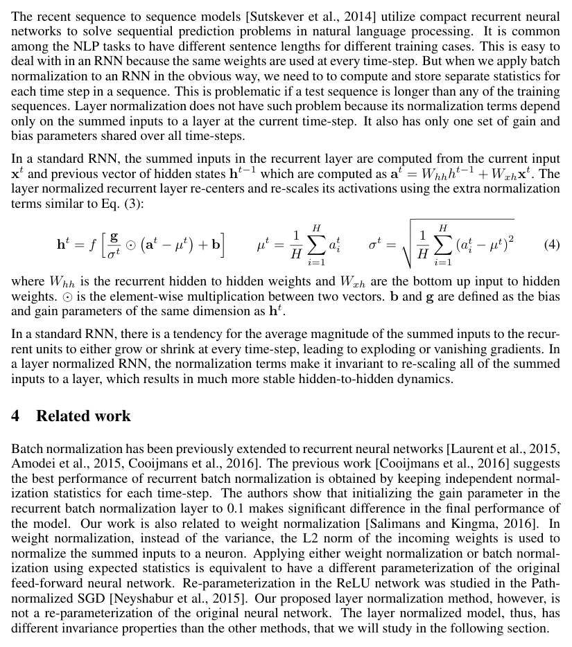
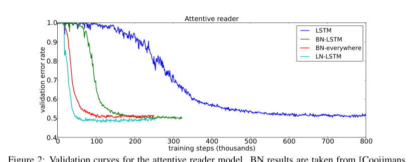
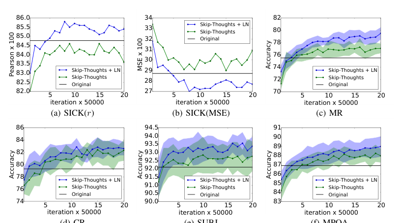
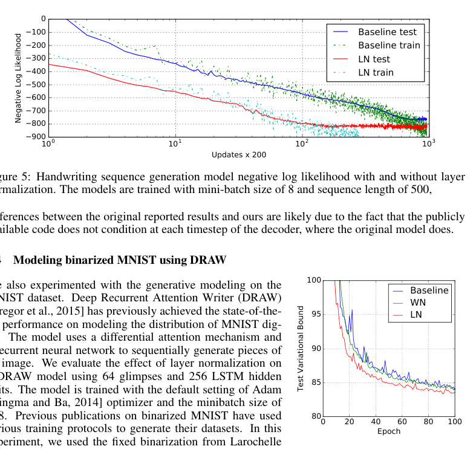
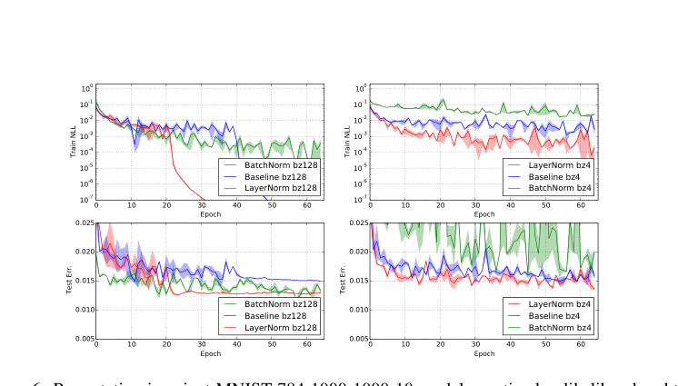

# Layer Normalization（层归一化）

> 原文出处：arXiv:1607.06450v1 [stat.ML] 21 Jul 2016

**Original:** Jimmy Lei Ba, University of Toronto, jimmy@psi.toronto.edu / Jamie Ryan Kiros, University of Toronto, rkiros@cs.toronto.edu / Geoffrey E. Hinton, University of Toronto and Google Inc., hinton@cs.toronto.edu

**中文:** 作者：Jimmy Lei Ba（多伦多大学）；Jamie Ryan Kiros（多伦多大学）；Geoffrey E. Hinton（多伦多大学与 Google Inc.）。人名、机构保留原文。

## Abstract（摘要）

**Original:** Training state-of-the-art, deep neural networks is computationally expensive. One way to reduce the training time is to normalize the activities of the neurons.

**中文:** 训练当前最优（state-of-the-art）的深度神经网络计算开销很大。缩短训练时间的一种方法是归一化神经元的激活值。

**Original:** A recently introduced technique called batch normalization uses the distribution of the summed input to a neuron over a mini-batch of training cases to compute a mean and variance which are then used to normalize the summed input to that neuron on each training case.

**中文:** 最近提出的一种称为批归一化（batch normalization）的技术，利用一个小批量（mini-batch）训练样本中某个神经元加权和输入（summed input）的分布来计算均值和方差，再用它们对每个训练样本上该神经元的加权和输入做归一化。

**Original:** This significantly reduces the training time in feed-forward neural networks. However, the effect of batch normalization is dependent on the mini-batch size and it is not obvious how to apply it to recurrent neural networks.

**中文:** 这显著缩短了前馈神经网络的训练时间。然而，批归一化的效果依赖于小批量的大小，而且如何将其应用于循环神经网络并不显然。

**Original:** In this paper, we transpose batch normalization into layer normalization by computing the mean and variance used for normalization from all of the summed inputs to the neurons in a layer on a *single* training case.

**中文:** 在本文中，我们把批归一化转化为层归一化（layer normalization）：用*单个*训练样本上某一层所有神经元的加权和输入来计算用于归一化的均值和方差。

**Original:** Like batch normalization, we also give each neuron its own adaptive bias and gain which are applied after the normalization but before the non-linearity.

**中文:** 与批归一化一样，我们也为每个神经元赋予各自的适应性偏置和增益，它们在归一化之后、非线性激活之前施加。

**Original:** Unlike batch normalization, layer normalization performs exactly the same computation at training and test times. It is also straightforward to apply to recurrent neural networks by computing the normalization statistics separately at each time step.

**中文:** 与批归一化不同，层归一化在训练和测试阶段执行完全相同的计算。通过在每一时间步分别计算归一化统计量，它也很容易直接应用于循环神经网络。

**Original:** Layer normalization is very effective at stabilizing the hidden state dynamics in recurrent networks. Empirically, we show that layer normalization can substantially reduce the training time compared with previously published techniques.

**中文:** 层归一化对稳定循环网络中的隐藏状态动态非常有效。实验表明，与之前发表的技术相比，层归一化可以大幅缩短训练时间。

## 1 Introduction（引言）

**Original:** Deep neural networks trained with some version of Stochastic Gradient Descent have been shown to substantially outperform previous approaches on various supervised learning tasks in computer vision [Krizhevsky et al., 2012] and speech processing [Hinton et al., 2012].

**中文:** 使用某种随机梯度下降（Stochastic Gradient Descent）变体训练的深度神经网络，已在计算机视觉 [Krizhevsky et al., 2012] 和语音处理 [Hinton et al., 2012] 的多种监督学习任务上被证明大幅超越以往的方法。

**Original:** But state-of-the-art deep neural networks often require many days of training. It is possible to speed-up the learning by computing gradients for different subsets of the training cases on different machines or splitting the neural network itself over many machines [Dean et al., 2012], but this can require a lot of communication and complex software. It also tends to lead to rapidly diminishing returns as the degree of parallelization increases.

**中文:** 但当前最优的深度神经网络往往需要数天的训练时间。一种加速学习的方法是在不同机器上计算不同训练样本子集的梯度，或将网络本身拆分到多台机器上 [Dean et al., 2012]，但这可能需要大量的通信和复杂的软件。随着并行化程度的提高，其收益也会迅速递减。

**Original:** An orthogonal approach is to modify the computations performed in the forward pass of the neural net to make learning easier. Recently, batch normalization [Ioffe and Szegedy, 2015] has been proposed to reduce training time by including additional normalization stages in deep neural networks.

**中文:** 另一种正交的思路是修改网络前向传播中执行的计算，让学习变得更容易。最近提出的批归一化 [Ioffe and Szegedy, 2015] 通过在深度神经网络中加入额外的归一化阶段来缩短训练时间。

**Original:** The normalization standardizes each summed input using its mean and its standard deviation across the training data. Feedforward neural networks trained using batch normalization converge faster even with simple SGD. In addition to training time improvement, the stochasticity from the batch statistics serves as a regularizer during training.

**中文:** 该归一化用每个加权和输入在整个训练数据上的均值和标准差对其进行标准化。使用批归一化训练的前馈网络即使配合简单的 SGD 也能更快收敛。除了缩短训练时间，批次统计量带来的随机性在训练期间还充当正则化器。

**Original:** Despite its simplicity, batch normalization requires running averages of the summed input statistics. In feed-forward networks with fixed depth, it is straightforward to store the statistics separately for each hidden layer. However, the summed inputs to the recurrent neurons in a recurrent neural network (RNN) often vary with the length of the sequence so applying batch normalization to RNNs appears to require different statistics for different time-steps.

**中文:** 批归一化虽然简单，却需要维护加权和输入统计量的滑动平均。在深度固定的前馈网络中，为每个隐藏层单独存储这些统计量是直接的。然而，循环神经网络（RNN）中循环神经元的加权和输入往往随序列长度变化，因此把批归一化应用于 RNN 似乎需要为不同时间步维护不同的统计量。

**Original:** Furthermore, batch normalization cannot be applied to online learning tasks or to extremely large distributed models where the minibatches have to be small.

**中文:** 此外，批归一化无法应用于在线学习任务，也无法应用于小批量必须很小的超大规模分布式模型。

**Original:** This paper introduces layer normalization, a simple normalization method to improve the training speed for various neural network models. Unlike batch normalization, the proposed method directly estimates the normalization statistics from the summed inputs to the neurons within a hidden layer so the normalization does not introduce any new dependencies between training cases. We show that layer normalization works well for RNNs and improves both the training time and the generalization performance of several existing RNN models.

**中文:** 本文提出层归一化（layer normalization），一种提升各类神经网络模型训练速度的简单归一化方法。与批归一化不同，本方法直接从隐藏层内各神经元的加权和输入估计归一化统计量，因此归一化不会在训练样本之间引入任何新的依赖。我们证明层归一化对 RNN 效果良好，并同时改善了几个现有 RNN 模型的训练时间与泛化性能。

## 2 Background（背景）

**Original:** A feed-forward neural network is a non-linear mapping from a input pattern $x$ to an output vector $y$. Consider the $l^{th}$ hidden layer in a deep feed-forward, neural network, and let $a^l$ be the vector representation of the summed inputs to the neurons in that layer. The summed inputs are computed through a linear projection with the weight matrix $W^l$ and the bottom-up inputs $h^l$ given as follows:

**中文:** 前馈神经网络是从输入模式 $x$ 到输出向量 $y$ 的非线性映射。考虑深度前馈网络中的第 $l$ 个隐藏层，令 $a^l$ 表示该层神经元加权和输入的向量表示。加权和输入通过与权重矩阵 $W^l$ 及自底向上输入 $h^l$ 的线性投影计算如下：

$$a_i^l = {w_i^l}^\top h^l \qquad h_i^{l+1} = f(a_i^l + b_i^l) \tag{1}$$

**Original:** where $f(\cdot)$ is an element-wise non-linear function and $w_i^l$ is the incoming weights to the $i^{th}$ hidden units and $b_i^l$ is the scalar bias parameter. The parameters in the neural network are learnt using gradient-based optimization algorithms with the gradients being computed by back-propagation.

**中文:** 其中 $f(\cdot)$ 是逐元素非线性函数，$w_i^l$ 是第 $i$ 个隐藏单元的输入权重，$b_i^l$ 是标量偏置参数。神经网络中的参数使用基于梯度的优化算法学习，梯度由反向传播（back-propagation）计算。

**Original:** One of the challenges of deep learning is that the gradients with respect to the weights in one layer are highly dependent on the outputs of the neurons in the previous layer especially if these outputs change in a highly correlated way. Batch normalization [Ioffe and Szegedy, 2015] was proposed to reduce such undesirable "covariate shift". The method normalizes the summed inputs to each hidden unit over the training cases. Specifically, for the $i^{th}$ summed input in the $l^{th}$ layer, the batch normalization method rescales the summed inputs according to their variances under the distribution of the data

**中文:** 深度学习的挑战之一是，某一层权重的梯度高度依赖于前一层神经元的输出，尤其当这些输出以高度相关的方式变化时更是如此。批归一化 [Ioffe and Szegedy, 2015] 正是为减少这种不良的「协变量偏移（covariate shift）」而提出的。该方法在训练样本上归一化每个隐藏单元的加权和输入。具体地，对第 $l$ 层第 $i$ 个加权和输入，批归一化根据其在数据分布下的方差重新缩放该加权和输入：

$$\bar{a}_i^l = \frac{g_i^l}{\sigma_i^l}\left(a_i^l - \mu_i^l \right) \qquad \mu_i^l = \mathbb{E}_{x \sim P(x)} \left[ a_i^l \right] \qquad \sigma_i^l = \sqrt{\mathbb{E}_{x \sim P(x)} \left[\left( a_i^l - \mu_i^l \right)^2\right]} \tag{2}$$

**Original:** where $\bar{a}_i^l$ is normalized summed inputs to the $i^{th}$ hidden unit in the $l^{th}$ layer and $g_i$ is a gain parameter scaling the normalized activation before the non-linear activation function. Note the expectation is under the whole training data distribution. It is typically impractical to compute the expectations in Eq. (2) exactly, since it would require forward passes through the whole training dataset with the current set of weights. Instead, $\mu$ and $\sigma$ are estimated using the empirical samples from the current mini-batch. This puts constraints on the size of a mini-batch and it is hard to apply to recurrent neural networks.

**中文:** 其中 $\bar{a}_i^l$ 是第 $l$ 层第 $i$ 个隐藏单元归一化后的加权和输入，$g_i$ 是在非线性激活函数之前缩放归一化激活值的增益参数（gain parameter）。注意期望是在整个训练数据分布上取的。精确计算式 (2) 中的期望通常不可行，因为这需要用当前权重对整个训练数据集做前向传播。作为替代，$\mu$ 和 $\sigma$ 用当前小批量的经验样本估计。这给小批量的大小带来了约束，并且难以应用于循环神经网络。

## 3 Layer normalization（层归一化）

**Original:** We now consider the layer normalization method which is designed to overcome the drawbacks of batch normalization.

**中文:** 现在我们讨论为克服批归一化缺点而设计的层归一化方法。

**Original:** Notice that changes in the output of one layer will tend to cause highly correlated changes in the summed inputs to the next layer, especially with ReLU units whose outputs can change by a lot. This suggests the "covariate shift" problem can be reduced by fixing the mean and the variance of the summed inputs within each layer. We, thus, compute the layer normalization statistics over all the hidden units in the same layer as follows:

**中文:** 注意，一层的输出变化往往会在下一层的加权和输入中引起高度相关的变化，ReLU 单元尤其如此，因为其输出可能大幅变化。这表明通过固定每一层内加权和输入的均值与方差，可以缓解「协变量偏移」问题。因此，我们按如下方式在同一层的所有隐藏单元上计算层归一化统计量：

$$\mu^l = \frac{1}{H}\sum_{i = 1}^H a_i^l \qquad \sigma^l = \sqrt{\frac{1}{H}\sum_{i = 1}^H \left( a_i^l - \mu^l \right)^2} \tag{3}$$

**Original:** where $H$ denotes the number of hidden units in a layer. The difference between Eq. (2) and Eq. (3) is that under layer normalization, all the hidden units in a layer share the same normalization terms $\mu$ and $\sigma$, but different training cases have different normalization terms. Unlike batch normalization, layer normaliztion does not impose any constraint on the size of a mini-batch and it can be used in the pure online regime with batch size 1.

**中文:** 其中 $H$ 表示一层中隐藏单元的个数。式 (2) 与式 (3) 的区别在于：层归一化下，一层中所有隐藏单元共享同一组归一化项 $\mu$ 和 $\sigma$，而不同的训练样本有不同的归一化项。与批归一化不同，层归一化不对小批量大小施加任何约束，可用于批量大小为 1 的纯在线模式。[译注：原文 "normaliztion" 为 "normalization" 的笔误。]

### 3.1 Layer normalized recurrent neural networks（层归一化的循环神经网络）

**Original:** The recent sequence to sequence models [Sutskever et al., 2014] utilize compact recurrent neural networks to solve sequential prediction problems in natural language processing. It is common among the NLP tasks to have different sentence lengths for different training cases. This is easy to deal with in an RNN because the same weights are used at every time-step. But when we apply batch normalization to an RNN in the obvious way, we need to to compute and store separate statistics for each time step in a sequence. This is problematic if a test sequence is longer than any of the training sequences. Layer normalization does not have such problem because its normalization terms depend only on the summed inputs to a layer at the current time-step. It also has only one set of gain and bias parameters shared over all time-steps.

**中文:** 最近的序列到序列（sequence to sequence）模型 [Sutskever et al., 2014] 使用紧凑的循环神经网络解决自然语言处理（NLP）中的序列预测问题。在 NLP 任务中，不同训练样本的句子长度不同是常见现象。这在 RNN 中容易处理，因为每个时间步使用相同的权重。但当我们以显而易见的方式把批归一化应用于 RNN 时，就需要为序列中的每个时间步计算并存储独立的统计量。[译注：原文 "need to to" 中的 "to" 重复，为笔误。] 若测试序列比任何训练序列都长，这会成为问题。层归一化没有这个问题，因为其归一化项只依赖于当前时间步该层的加权和输入。它也只有一组在所有时间步共享的增益和偏置参数。

**Original:** In a standard RNN, the summed inputs in the recurrent layer are computed from the current input $x^t$ and previous vector of hidden states $h^{t-1}$ which are computed as $a^t = W_{hh} h^{t-1} + W_{xh} x^t$. The layer normalized recurrent layer re-centers and re-scales its activations using the extra normalization terms similar to Eq. (3):

**中文:** 在标准 RNN 中，循环层的加权和输入由当前输入 $x^t$ 和上一隐藏状态向量 $h^{t-1}$ 计算得到，即 $a^t = W_{hh} h^{t-1} + W_{xh} x^t$。经层归一化的循环层使用类似式 (3) 的额外归一化项对其激活值重新定中心和重新缩放：

$$h^t = f\left[\frac{g}{\sigma^t}\odot\left(a^t - \mu^t\right) + b \right] \qquad \mu^t = \frac{1}{H}\sum_{i = 1}^H a_i^t \qquad \sigma^t = \sqrt{\frac{1}{H}\sum_{i = 1}^H \left( a_i^t - \mu^t \right)^2} \tag{4}$$

**Original:** where $W_{hh}$ is the recurrent hidden to hidden weights and $W_{xh}$ are the bottom up input to hidden weights. $\odot$ is the element-wise multiplication between two vectors. $b$ and $g$ are defined as the bias and gain parameters of the same dimension as $h^t$.

**中文:** 其中 $W_{hh}$ 是循环的隐层到隐层权重，$W_{xh}$ 是自底向上的输入到隐层权重。$\odot$ 是两个向量之间的逐元素乘法。$b$ 和 $g$ 定义为与 $h^t$ 同维度的偏置和增益参数。

**Original:** In a standard RNN, there is a tendency for the average magnitude of the summed inputs to the recurrent units to either grow or shrink at every time-step, leading to exploding or vanishing gradients. In a layer normalized RNN, the normalization terms make it invariant to re-scaling all of the summed inputs to a layer, which results in much more stable hidden-to-hidden dynamics.

**中文:** 在标准 RNN 中，循环单元加权和输入的平均幅值在每一步有增长或收缩的趋势，导致梯度爆炸（exploding gradient）或梯度消失（vanishing gradient）。在经层归一化的 RNN 中，归一化项使其对一层所有加权和输入的缩放保持不变，从而带来稳定得多的隐层到隐层动态。

## 4 Related work（相关工作）

**Original:** Batch normalization has been previously extended to recurrent neural networks [Laurent et al., 2015, Amodei et al., 2015, Cooijmans et al., 2016]. The previous work [Cooijmans et al., 2016] suggests the best performance of recurrent batch normalization is obtained by keeping independent normalization statistics for each time-step. The authors show that initializing the gain parameter in the recurrent batch normalization layer to 0.1 makes significant difference in the final performance of the model.

**中文:** 批归一化此前已被扩展到循环神经网络 [Laurent et al., 2015, Amodei et al., 2015, Cooijmans et al., 2016]。此前的工作 [Cooijmans et al., 2016] 表明，为每个时间步维护独立的归一化统计量时，循环批归一化（recurrent batch normalization）的性能最佳。作者表明，将循环批归一化层中的增益参数初始化为 0.1 会对模型最终性能产生显著影响。

**Original:** Our work is also related to weight normalization [Salimans and Kingma, 2016]. In weight normalization, instead of the variance, the L2 norm of the incoming weights is used to normalize the summed inputs to a neuron. Applying either weight normalization or batch normalization using expected statistics is equivalent to have a different parameterization of the original feed-forward neural network. Re-parameterization in the ReLU network was studied in the Path-normalized SGD [Neyshabur et al., 2015]. Our proposed layer normalization method, however, is not a re-parameterization of the original neural network. The layer normalized model, thus, has different invariance properties than the other methods, that we will study in the following section.

**中文:** 我们的工作还与权重归一化（weight normalization）[Salimans and Kingma, 2016] 相关。在权重归一化中，用输入权重的 L2 范数（而非方差）来归一化神经元的加权和输入。无论应用权重归一化，还是使用期望统计量的批归一化，都等价于对原始前馈神经网络采用不同的参数化。ReLU 网络中的重参数化在路径归一化 SGD（Path-normalized SGD）[Neyshabur et al., 2015] 中被研究过。然而，我们提出的层归一化方法并不是对原始神经网络的重参数化。因此，经层归一化的模型具有与其他方法不同的不变性性质，我们将在下一节研究这些性质。

## 5 Analysis（分析）

**Original:** In this section, we investigate the invariance properties of different normalization schemes.

**中文:** 本节研究不同归一化方案的不变性性质。

### 5.1 Invariance under weights and data transformations（权重与数据变换下的不变性）

**Original:** The proposed layer normalization is related to batch normalization and weight normalization. Although, their normalization scalars are computed differently, these methods can be summarized as normalizing the summed inputs $a_i$ to a neuron through the two scalars $\mu$ and $\sigma$. They also learn an adaptive bias $b$ and gain $g$ for each neuron after the normalization.

**中文:** 所提出的层归一化与批归一化和权重归一化相关。尽管它们的归一化标量计算方式不同，这些方法可概括为：通过两个标量 $\mu$ 和 $\sigma$ 归一化神经元的加权和输入 $a_i$。它们还在归一化之后为每个神经元学习自适应偏置 $b$ 和增益 $g$。

$$h_i = f(\frac{g_i}{\sigma_i}\left(a_i - \mu_i \right) + b_i) \tag{5}$$

**Original:** Note that for layer normalization and batch normalization, $\mu$ and $\sigma$ is computed according to Eq. 2 and 3. In weight normalization, $\mu$ is 0, and $\sigma = \|w\|_2$.

**中文:** 注意，对批归一化和层归一化，$\mu$ 和 $\sigma$ 分别按式 (2) 和式 (3) 计算。在权重归一化中，$\mu$ 为 0，$\sigma = \|w\|_2$。

> **表 1（译）**：各归一化方法下的不变性性质。（原图见 paper.pdf 第 4 页，见下方图）

| | 权重矩阵缩放 | 权重矩阵平移 | 权重向量缩放 | 数据集缩放 | 数据集平移 | 单训练样本缩放 |
|---|---|---|---|---|---|---|
| Batch norm（批归一化） | Invariant（不变） | No（否） | Invariant | Invariant | Invariant | No |
| Weight norm（权重归一化） | Invariant | No | Invariant | No | No | No |
| Layer norm（层归一化） | Invariant | Invariant | No | Invariant | No | Invariant |

**Original:** Table 1 highlights the following invariance results for three normalization methods.

**中文:** 表 1 总结了三种归一化方法的下述不变性结果。

**Original:** **Weight re-scaling and re-centering:** First, observe that under batch normalization and weight normalization, any re-scaling to the incoming weights $w_i$ of a single neuron has no effect on the normalized summed inputs to a neuron. To be precise, under batch and weight normalization, if the weight vector is scaled by $\delta$, the two scalar $\mu$ and $\sigma$ will also be scaled by $\delta$. The normalized summed inputs stays the same before and after scaling. So the batch and weight normalization are invariant to the re-scaling of the weights. Layer normalization, on the other hand, is not invariant to the individual scaling of the single weight vectors. Instead, layer normalization is invariant to scaling of the entire weight matrix and invariant to a shift to all of the incoming weights in the weight matrix.

**中文:** **权重缩放（re-scaling）与平移（re-centering）：** 首先观察到，在批归一化和权重归一化下，对单个神经元输入权重 $w_i$ 的任何缩放都不会影响该神经元归一化后的加权和输入。确切地说，在批归一化和权重归一化下，若权重向量被放大 $\delta$ 倍，两个标量 $\mu$ 和 $\sigma$ 也会被放大 $\delta$ 倍。归一化后的加权和输入在缩放前后保持不变。因此批归一化和权重归一化对权重缩放具有不变性。另一方面，层归一化对单个权重向量的独立缩放并不具有不变性。相反，层归一化对整个权重矩阵的缩放具有不变性，并且对权重矩阵中所有输入权重同时平移一个常数也具有不变性。

**Original:** Let there be two sets of model parameters $\theta$, $\theta'$ whose weight matrices $W$ and $W'$ differ by a scaling factor $\delta$ and all of the incoming weights in $W'$ are also shifted by a constant vector $\gamma$, that is $W' = \delta W + \mathbf{1}\gamma^\top$. Under layer normalization, the two models effectively compute the same output:

**中文:** 设两组模型参数 $\theta$、$\theta'$ 的权重矩阵 $W$ 与 $W'$ 相差一个缩放因子 $\delta$，且 $W'$ 中的所有输入权重还平移了常数向量 $\gamma$，即 $W' = \delta W + \mathbf{1}\gamma^\top$。在层归一化下，两个模型实际上计算相同的输出：

$$h' = f(\frac{g}{\sigma'}\left(W'x - \mu' \right) + b) = f(\frac{g}{\sigma'}\left((\delta W + \mathbf{1}\gamma^\top)x - \mu' \right) + b) = f(\frac{g}{\sigma}\left(Wx - \mu \right) + b) = h. \tag{6}$$

**Original:** Notice that if normalization is only applied to the input before the weights, the model will not be invariant to re-scaling and re-centering of the weights.

**中文:** 注意，如果只在权重之前对输入做归一化，模型就不会对权重的缩放和平移具有不变性。

**Original:** **Data re-scaling and re-centering:** We can show that all the normalization methods are invariant to re-scaling the dataset by verifying that the summed inputs of neurons stays constant under the changes. Furthermore, layer normalization is invariant to re-scaling of individual training cases, because the normalization scalars $\mu$ and $\sigma$ in Eq. (3) only depend on the current input data. Let $x'$ be a new data point obtained by re-scaling $x$ by $\delta$. Then we have,

**中文:** **数据缩放与平移：** 通过验证神经元的加权和输入在这些变化下保持不变，可以证明所有归一化方法对数据集的缩放都具有不变性。此外，层归一化对单个训练样本的缩放也具有不变性，因为式 (3) 中的归一化标量 $\mu$ 和 $\sigma$ 只依赖当前的输入数据。设 $x'$ 为将 $x$ 放大 $\delta$ 倍得到的新数据点。则有，

$$h_i' = f(\frac{g_i}{\sigma'}\left(w_i^\top x' - \mu' \right) + b_i) = f(\frac{g_i}{\delta\sigma}\left(\delta w_i^\top x - \delta\mu \right) + b_i) = h_i. \tag{7}$$

**Original:** It is easy to see re-scaling individual data points does not change the model's prediction under layer normalization. Similar to the re-centering of the weight matrix in layer normalization, we can also show that batch normalization is invariant to re-centering of the dataset.

**中文:** 容易看出，在层归一化下，缩放单个数据点不会改变模型的预测。与层归一化中权重矩阵平移的情形类似，我们也可以证明批归一化对数据集的平移具有不变性。

### 5.2 Geometry of parameter space during learning（学习过程中参数空间的几何）

**Original:** We have investigated the invariance of the model's prediction under re-centering and re-scaling of the parameters. Learning, however, can behave very differently under different parameterizations, even though the models express the same underlying function. In this section, we analyze learning behavior through the geometry and the manifold of the parameter space. We show that the normalization scalar $\sigma$ can implicitly reduce learning rate and makes learning more stable.

**中文:** 我们研究了模型预测在参数平移和缩放下的不变性。然而，即使模型表达相同的底层函数，学习在不同参数化下的行为也可能大相径庭。本节通过参数空间的几何与流形来分析学习行为。我们证明归一化标量 $\sigma$ 可以隐式地降低学习率，使学习更加稳定。

#### 5.2.1 Riemannian metric（黎曼度量）

**Original:** The learnable parameters in a statistical model form a smooth manifold that consists of all possible input-output relations of the model. For models whose output is a probability distribution, a natural way to measure the separation of two points on this manifold is the Kullback-Leibler divergence between their model output distributions. Under the KL divergence metric, the parameter space is a Riemannian manifold.

**中文:** 统计模型中的可学习参数构成一个光滑流形，它由模型所有可能的输入-输出关系组成。对于输出为概率分布的模型，度量流形上两点之间距离的一种自然方式是其模型输出分布之间的 Kullback-Leibler 散度。在 KL 散度度量下，参数空间是一个黎曼流形（Riemannian manifold）。

**Original:** The curvature of a Riemannian manifold is entirely captured by its Riemannian metric, whose quadratic form is denoted as $ds^2$. That is the infinitesimal distance in the tangent space at a point in the parameter space. Intuitively, it measures the changes in the model output from the parameter space along a tangent direction. The Riemannian metric under KL was previously studied [Amari, 1998] and was shown to be well approximated under second order Taylor expansion using the Fisher information matrix:

**中文:** 黎曼流形的曲率完全由黎曼度量（Riemannian metric）刻画，其二次型记为 $ds^2$。它是参数空间中某点处切空间上的无穷小距离。直观地说，它度量沿切方向移动参数时模型输出的变化。KL 下的黎曼度量此前已有研究 [Amari, 1998]，并已被证明可以用 Fisher 信息矩阵在二阶泰勒展开下很好地近似：

$$ds^2 = \mathrm{D}_{KL}\big[P(y \mid x;\ \theta)\| P(y \mid x ;\ \theta+\delta)\big] \approx \frac{1}{2} \delta^\top F(\theta) \delta, \tag{8}$$

$$F(\theta) = \mathbb{E}_{x \sim P(x), y \sim P(y\mid x)}\left[\frac{\partial \log P(y \mid x ;\ \theta)}{\partial \theta}\frac{\partial \log P(y \mid x ;\ \theta)}{\partial \theta}^\top\right], \tag{9}$$

**Original:** where, $\delta$ is a small change to the parameters. The Riemannian metric above presents a geometric view of parameter spaces. The following analysis of the Riemannian metric provides some insight into how normalization methods could help in training neural networks.

**中文:** 其中 $\delta$ 是参数的一个微小变化。上述黎曼度量给出了参数空间的几何视角。下面关于黎曼度量的分析为归一化方法如何帮助训练神经网络提供了一些洞见。

#### 5.2.2 The geometry of normalized generalized linear models（归一化广义线性模型的几何）

**Original:** We focus our geometric analysis on the generalized linear model. The results from the following analysis can be easily applied to understand deep neural networks with block-diagonal approximation to the Fisher information matrix, where each block corresponds to the parameters for a single neuron.

**中文:** 我们把几何分析聚焦在广义线性模型（generalized linear model）上。以下分析的结果可以容易地推广到用 Fisher 信息矩阵分块对角近似来理解深度神经网络的情形，其中每个分块对应单个神经元的参数。

**Original:** A generalized linear model (GLM) can be regarded as parameterizing an output distribution from the exponential family using a weight vector $w$ and bias scalar $b$. To be consistent with the previous sections, the log likelihood of the GLM can be written using the summed inputs $a$ as the following:

**中文:** 广义线性模型（GLM）可视为用权重向量 $w$ 和偏置标量 $b$ 参数化指数族（exponential family）中的一个输出分布。为与前文保持一致，GLM 的对数似然可用加权和输入 $a$ 写为：

$$\log P(y \mid x ;\ w, b) = \frac{(a+b) y - \eta(a+b)}{\phi} + c(y, \phi), \tag{10}$$

$$\mathbb{E}[y \mid x] = f(a + b) = f(w^\top x + b), \quad \text{Var}[y \mid x] = \phi f'(a + b), \tag{11}$$

**Original:** where, $f(\cdot)$ is the transfer function that is the analog of the non-linearity in neural networks, $f'(\cdot)$ is the derivative of the transfer function, $\eta(\cdot)$ is a real valued function and $c(\cdot)$ is the log partition function. $\phi$ is a constant that scales the output variance.

**中文:** 其中 $f(\cdot)$ 是传递函数，相当于神经网络中的非线性函数；$f'(\cdot)$ 是传递函数的导数；$\eta(\cdot)$ 是实值函数；$c(\cdot)$ 是对数配分函数。$\phi$ 是缩放输出方差的常数。

**Original:** Assume a $H$-dimensional output vector $y = [y_1, y_2, \cdots, y_H]$ is modeled using $H$ independent GLMs and $\log P(y \mid x ;\ W, b) = \sum_{i=1}^H \log P(y_i \mid x ;\ w_i, b_i)$. Let $W$ be the weight matrix whose rows are the weight vectors of the individual GLMs, $b$ denote the bias vector of length $H$ and $\text{vec}(\cdot)$ denote the Kronecker vector operator. The Fisher information matrix for the multi-dimensional GLM with respect to its parameters $\theta=[w_1^\top, b_1,\cdots,w_H^\top, b_H]^\top = \text{vec}([W, b]^\top)$ is simply the expected Kronecker product of the data features and the output covariance matrix:

**中文:** 假设 $H$ 维输出向量 $y = [y_1, y_2, \cdots, y_H]$ 用 $H$ 个独立的 GLM 建模，且 $\log P(y \mid x ;\ W, b) = \sum_{i=1}^H \log P(y_i \mid x ;\ w_i, b_i)$。令 $W$ 为权重矩阵，其行是各个 GLM 的权重向量；$b$ 为长度 $H$ 的偏置向量；$\text{vec}(\cdot)$ 为 Kronecker 向量化算子。多维 GLM 关于其参数 $\theta=[w_1^\top, b_1,\cdots,w_H^\top, b_H]^\top = \text{vec}([W, b]^\top)$ 的 Fisher 信息矩阵，正是数据特征与输出协方差矩阵的期望 Kronecker 积：

$$F(\theta) = \mathbb{E}_{x \sim P(x)}\left[\frac{\text{Cov}[y \mid x]}{\phi^2}\otimes\begin{bmatrix}xx^\top & x \\ x^\top & 1\end{bmatrix}\right]. \tag{12}$$

**Original:** We obtain normalized GLMs by applying the normalization methods to the summed inputs $a$ in the original model through $\mu$ and $\sigma$. Without loss of generality, we denote $\bar{F}$ as the Fisher information matrix under the normalized multi-dimensional GLM with the additional gain parameters $\theta=\text{vec}([W, b, g]^\top)$:

**中文:** 通过 $\mu$ 和 $\sigma$ 把归一化方法应用到原模型的加权和输入 $a$ 上，我们得到归一化的 GLM。不失一般性，记 $\bar{F}$ 为带额外增益参数的归一化多维 GLM 的 Fisher 信息矩阵，其中 $\theta=\text{vec}([W, b, g]^\top)$：

$$\bar{F}(\theta) = \begin{bmatrix} \bar{F}_{11} & \cdots & \bar{F}_{1H} \\ \vdots & \ddots & \vdots \\ \bar{F}_{H1} & \cdots & \bar{F}_{HH} \end{bmatrix}, \quad \bar{F}_{ij} = \mathbb{E}_{x \sim P(x)}\left[\frac{\text{Cov}[y_i, \ y_j \mid x]}{\phi^2}\begin{bmatrix}\frac{g_i g_j}{\sigma_i\sigma_j}\chi_i\chi_j^\top & \chi_i\frac{g_i}{\sigma_i} & \chi_i\frac{g_i(a_j-\mu_j)}{\sigma_i\sigma_j} \\ \chi_j^\top\frac{g_j}{\sigma_j} & 1 & \frac{a_j-\mu_j}{\sigma_j} \\ \chi_j^\top\frac{g_j(a_i-\mu_i)}{\sigma_i\sigma_j} & \frac{a_i-\mu_i}{\sigma_i} & \frac{(a_i-\mu_i)(a_j-\mu_j)}{\sigma_i\sigma_j}\end{bmatrix}\right] \tag{13}$$

$$\chi_i = x - \frac{\partial{\mu_i}}{\partial{w_i}} - \frac{a_i-\mu_i}{\sigma_i}\frac{\partial{\sigma_i}}{\partial{w_i}}. \tag{14}$$

**Original:** **Implicit learning rate reduction through the growth of the weight vector:** Notice that, comparing to standard GLM, the block $\bar{F}_{ij}$ along the weight vector $w_i$ direction is scaled by the gain parameters and the normalization scalar $\sigma_i$. If the norm of the weight vector $w_i$ grows twice as large, even though the model's output remains the same, the Fisher information matrix will be different. The curvature along the $w_i$ direction will change by a factor of $\frac{1}{2}$ because the $\sigma_i$ will also be twice as large. As a result, for the same parameter update in the normalized model, the norm of the weight vector effectively controls the learning rate for the weight vector. During learning, it is harder to change the orientation of the weight vector with large norm. The normalization methods, therefore, have an implicit "early stopping" effect on the weight vectors and help to stabilize learning towards convergence.

**中文:** **权重向量增长带来的隐式学习率下降：** 注意，与标准 GLM 相比，沿权重向量 $w_i$ 方向的分块 $\bar{F}_{ij}$ 被增益参数和归一化标量 $\sigma_i$ 缩放。若权重向量 $w_i$ 的范数增大为两倍，即使模型输出保持不变，Fisher 信息矩阵也会不同。沿 $w_i$ 方向的曲率将变为原来的 $\frac{1}{2}$，因为 $\sigma_i$ 也会变为两倍。结果，在归一化模型中做同样的参数更新时，权重向量的范数实际上控制着该权重向量的学习率。在学习过程中，范数大的权重向量更难改变方向。因此，归一化方法对权重向量具有隐式的「提前停止（early stopping）」效应，有助于稳定学习直至收敛。

**Original:** **Learning the magnitude of incoming weights:** In normalized models, the magnitude of the incoming weights is explicitly parameterized by the gain parameters. We compare how the model output changes between updating the gain parameters in the normalized GLM and updating the magnitude of the equivalent weights under original parameterization during learning. The direction along the gain parameters in $\bar{F}$ captures the geometry for the magnitude of the incoming weights. We show that Riemannian metric along the magnitude of the incoming weights for the standard GLM is scaled by the norm of its input, whereas learning the gain parameters for the batch normalized and layer normalized models depends only on the magnitude of the prediction error. Learning the magnitude of incoming weights in the normalized model is therefore, more robust to the scaling of the input and its parameters than in the standard model. See Appendix for detailed derivations.

**中文:** **学习输入权重的幅值：** 在归一化模型中，输入权重的幅值由增益参数显式参数化。我们比较学习过程中，更新归一化 GLM 的增益参数与更新原参数化下等价权重幅值时模型输出的变化有何不同。$\bar{F}$ 中沿增益参数的方向刻画了输入权重幅值的几何。我们证明，标准 GLM 中沿输入权重幅值方向的黎曼度量被其输入的范数所缩放；而在批归一化和层归一化模型中学习增益参数只依赖预测误差的幅值。因此，在归一化模型中学习输入权重的幅值，比在标准模型中更能抵抗输入及其参数的缩放。详细推导见附录。
## 6 Experimental results（实验结果）

**Original:** We perform experiments with layer normalization on 6 tasks, with a focus on recurrent neural networks: image-sentence ranking, question-answering, contextual language modelling, generative modelling, handwriting sequence generation and MNIST classification. Unless otherwise noted, the default initialization of layer normalization is to set the adaptive gains to $1$ and the biases to $0$ in the experiments.

**中文:** 我们在 6 个任务上对层归一化进行实验，重点关注循环神经网络：图像-句子排序、问答、上下文语言建模、生成建模、手写序列生成和 MNIST 分类。除非另有说明，实验中层归一化的默认初始化是将自适应增益设为 $1$、偏置设为 $0$。

### 6.1 Order embeddings of images and language（图像与语言的序嵌入）

> **图 1（译）**：使用序嵌入（order-embeddings）模型在加与不加层归一化两种设置下的 Recall@K 曲线。（原图见 paper.pdf 第 6 页，见下方图）

> **表 2（译）**：5 个测试划分上文本检索与图像检索的平均结果。R@K 即 Recall@K（越高越好）。Mean r 是平均排名（越低越好）。Sym 对应对称基线，OE 表示序嵌入。（原图见 paper.pdf 第 6 页，[第 6 页图](assets/figures/tab-2.png)）

| | 文本检索（Caption Retrieval） | | | | 图像检索（Image Retrieval） | | | |
|---|---|---|---|---|---|---|---|---|
| Model（模型） | R@1 | R@5 | R@10 | Mean r（平均 r） | R@1 | R@5 | R@10 | Mean r |
| Sym [Vendrov et al., 2016] | 45.4 | | 88.7 | 5.8 | 36.3 | | 85.8 | 9.0 |
| OE [Vendrov et al., 2016] | 46.7 | | 88.9 | 5.7 | 37.9 | | 85.9 | 8.1 |
| OE (ours) | 46.6 | 79.3 | 89.1 | 5.2 | 37.8 | 73.6 | 85.7 | 7.9 |
| OE + LN | **48.5** | **80.6** | **89.8** | **5.1** | **38.9** | **74.3** | **86.3** | **7.6** |

**Original:** In this experiment, we apply layer normalization to the recently proposed order-embeddings model of Vendrov et al. [2016] for learning a joint embedding space of images and sentences. We follow the same experimental protocol as Vendrov et al. [2016] and modify their publicly available code to incorporate layer normalization 1 which utilizes Theano [Team et al., 2016]. Images and sentences from the Microsoft COCO dataset [Lin et al., 2014] are embedded into a common vector space, where a GRU [Cho et al., 2014] is used to encode sentences and the outputs of a pre-trained VGG ConvNet [Simonyan and Zisserman, 2015] (10-crop) are used to encode images. The order-embedding model represents images and sentences as a 2-level partial ordering and replaces the cosine similarity scoring function used in Kiros et al. [2014] with an asymmetric one.

**中文:** 本实验中，我们将层归一化应用于 Vendrov 等人 [2016] 最近提出的序嵌入（order-embeddings）模型，用于学习图像与句子的联合嵌入空间。我们遵循 Vendrov 等人 [2016] 的实验协议，并修改他们公开的代码以加入层归一化¹，该代码使用 Theano [Team et al., 2016]。来自 Microsoft COCO 数据集 [Lin et al., 2014] 的图像和句子被嵌入到一个公共向量空间中，其中句子用 GRU [Cho et al., 2014] 编码，图像用预训练 VGG 卷积网络 [Simonyan and Zisserman, 2015]（10-crop）的输出编码。序嵌入模型将图像和句子表示为 2 层偏序关系，并用一个非对称打分函数替换 Kiros 等人 [2014] 使用的余弦相似度打分函数。

¹ https://github.com/ivendrov/order-embedding

**Original:** We trained two models: the baseline order-embedding model as well as the same model with layer normalization applied to the GRU. After every 300 iterations, we compute Recall@K (R@K) values on a held out validation set and save the model whenever R@K improves. The best performing models are then evaluated on 5 separate test sets, each containing 1000 images and 5000 captions, for which the mean results are reported. Both models use Adam [Kingma and Ba, 2014] with the same initial hyperparameters and both models are trained using the same architectural choices as used in Vendrov et al. [2016]. We refer the reader to the appendix for a description of how layer normalization is applied to GRU.

**中文:** 我们训练了两个模型：基线序嵌入模型，以及在 GRU 上应用层归一化的相同模型。每 300 次迭代后，我们在留出的验证集上计算 Recall@K（R@K）值，并在 R@K 提升时保存模型。然后在 5 个独立的测试集上评估表现最好的模型，每个测试集包含 1000 张图像和 5000 条文本描述，报告平均结果。两个模型都使用 Adam [Kingma and Ba, 2014] 优化器，初始超参数相同，且都采用与 Vendrov 等人 [2016] 相同的架构选择。关于如何将层归一化应用于 GRU 的描述，请读者参见附录。

**Original:** Figure 1 illustrates the validation curves of the models, with and without layer normalization. We plot R@1, R@5 and R@10 for the image retrieval task. We observe that layer normalization offers a per-iteration speedup across all metrics and converges to its best validation model in 60% of the time it takes the baseline model to do so. In Table 2, the test set results are reported from which we observe that layer normalization also results in improved generalization over the original model. The results we report are state-of-the-art for RNN embedding models, with only the structure-preserving model of Wang et al. [2016] reporting better results on this task. However, they evaluate under different conditions (1 test set instead of the mean over 5) and are thus not directly comparable.

**中文:** 图 1 展示了加与不加层归一化两种模型的验证曲线。我们画出图像检索任务上的 R@1、R@5 和 R@10。我们观察到，层归一化在所有指标上都带来了每次迭代层面的加速，并且只用基线模型 60% 的时间就收敛到其最佳验证模型。表 2 报告了测试集结果，从中可看到层归一化还使模型的泛化性能优于原模型。我们报告的结果是 RNN 嵌入模型的当前最优水平，只有 Wang 等人 [2016] 的结构保持模型在该任务上报告了更好的结果。但他们是在不同条件下评估的（1 个测试集而非 5 个的平均），因此不可直接比较。

### 6.2 Teaching machines to read and comprehend（教机器阅读与理解）

> **图 2（译）**：注意力阅读器模型的验证曲线。BN 结果取自 [Cooijmans et al., 2016]。（原图见 paper.pdf 第 7 页，见下方图）

**Original:** In order to compare layer normalization to the recently proposed recurrent batch normalization [Cooijmans et al., 2016], we train an unidirectional attentive reader model on the CNN corpus both introduced by Hermann et al. [2015]. This is a question-answering task where a query description about a passage must be answered by filling in a blank. The data is anonymized such that entities are given randomized tokens to prevent degenerate solutions, which are consistently permuted during training and evaluation.

**中文:** 为了将层归一化与最近提出的循环批归一化 [Cooijmans et al., 2016] 进行比较，我们在 Hermann 等人 [2015] 引入的单向注意力阅读器（attentive reader）模型和 CNN 语料库上进行训练。这是一个问答任务：给定关于一段文本的查询描述，需要通过填空来回答。数据经过匿名化处理，实体被赋予随机化词元以防止退化解，并在训练与评估期间一致地置换。

**Original:** We follow the same experimental protocol as Cooijmans et al. [2016] and modify their public code to incorporate layer normalization 2 which uses Theano [Team et al., 2016]. We obtained the pre-processed dataset used by Cooijmans et al. [2016] which differs from the original experiments of Hermann et al. [2015] in that each passage is limited to 4 sentences. In Cooijmans et al. [2016], two variants of recurrent batch normalization are used: one where BN is only applied to the LSTM while the other applies BN everywhere throughout the model. In our experiment, we only apply layer normalization within the LSTM.

**中文:** 我们遵循 Cooijmans 等人 [2016] 的实验协议，并修改他们的公开代码以加入层归一化²，该代码使用 Theano [Team et al., 2016]。我们获得了 Cooijmans 等人 [2016] 使用的预处理数据集，它与 Hermann 等人 [2015] 原实验的区别在于每段文本被限制为 4 个句子。Cooijmans 等人 [2016] 使用了循环批归一化的两种变体：一种只在 LSTM 上应用 BN，另一种在模型各处都应用 BN。在我们的实验中，只在 LSTM 内部应用层归一化。

² https://github.com/cooijmanstim/Attentive_reader/tree/bn

**Original:** The results of this experiment are shown in Figure 2. We observe that layer normalization not only trains faster but converges to a better validation result over both the baseline and BN variants. In Cooijmans et al. [2016], it is argued that the scale parameter in BN must be carefully chosen and is set to 0.1 in their experiments. We experimented with layer normalization for both 1.0 and 0.1 scale initialization and found that the former model performed significantly better. This demonstrates that layer normalization is not sensitive to the initial scale in the same way that recurrent BN is. 3

**中文:** 本实验的结果见图 2。我们观察到，层归一化不仅训练更快，而且收敛到比基线和 BN 变体都更好的验证结果。Cooijmans 等人 [2016] 认为 BN 中的尺度参数必须仔细选取，并在其实验中将其设为 0.1。我们分别以 1.0 和 0.1 的尺度初始化对层归一化做了实验，发现前者的性能明显更好。这表明层归一化不像循环 BN 那样对初始尺度敏感。³

³ 与 Cooijmans 等人 [2016] 一样，我们只报告验证集上的结果。（原文：We only produce results on the validation set, as in the case of Cooijmans et al. [2016]）

### 6.3 Skip-thought vectors（Skip-thought 向量）

> **图 3（译）**：Skip-thought 向量在加与不加层归一化两种设置下，下游任务性能随训练迭代次数的变化。Original 线是 [Kiros et al., 2015] 中报告的结果。带误差的图使用 10 折交叉验证。彩色观看效果最佳。（原图见 paper.pdf 第 8 页，见下方图）

> **表 3（译）**：Skip-thoughts 结果。前两列评估指标表示 Pearson 与 Spearman 相关系数，第三列是均方误差，其余列表示分类准确率。除 MSE 外，所有指标都是越高越好。除（†）训练了 1 个月（约 1.7M 次迭代）外，我们的模型均训练了 1M 次迭代。（原图见 paper.pdf 第 8 页，[第 8 页图](assets/figures/tab-3.png)）

| Method（方法） | SICK($r$) | SICK($\rho$) | SICK(MSE) | MR | CR | SUBJ | MPQA |
|---|---|---|---|---|---|---|---|
| Original [Kiros et al., 2015] | 0.848 | 0.778 | 0.287 | 75.5 | 79.3 | 92.1 | 86.9 |
| Ours | 0.842 | 0.767 | 0.298 | 77.3 | 81.8 | 92.6 | 87.9 |
| Ours + LN | 0.854 | 0.785 | 0.277 | **79.5** | 82.6 | 93.4 | 89.0 |
| Ours + LN $\dagger$ | **0.858** | **0.788** | **0.270** | 79.4 | **83.1** | **93.7** | **89.3** |

**Original:** Skip-thoughts [Kiros et al., 2015] is a generalization of the skip-gram model [Mikolov et al., 2013] for learning unsupervised distributed sentence representations. Given contiguous text, a sentence is encoded with a encoder RNN and decoder RNNs are used to predict the surrounding sentences. Kiros et al. [2015] showed that this model could produce generic sentence representations that perform well on several tasks without being fine-tuned. However, training this model is time-consuming, requiring several days of training in order to produce meaningful results.

**中文:** Skip-thoughts [Kiros et al., 2015] 是 Skip-gram 模型 [Mikolov et al., 2013] 的推广，用于学习无监督的分布式句子表示。给定连续文本，句子用编码器 RNN 编码，解码器 RNN 则用于预测其周围的句子。Kiros 等人 [2015] 表明，该模型能产生通用的句子表示，无需微调（fine-tuning）即可在多个任务上表现良好。但训练该模型非常耗时，需要数天的训练才能产生有意义的结果。

**Original:** In this experiment we determine to what effect layer normalization can speed up training. Using the publicly available code of Kiros et al. [2015] 4, we train two models on the BookCorpus dataset [Zhu et al., 2015]: one with and one without layer normalization. These experiments are performed with Theano [Team et al., 2016]. We adhere to the experimental setup used in Kiros et al. [2015], training a 2400-dimensional sentence encoder with the same hyperparameters. Given the size of the states used, it is conceivable layer normalization would produce slower per-iteration updates than without. However, we found that provided CNMeM 5 is used, there was no significant difference between the two models.

**中文:** 本实验考察层归一化能在多大程度上加速训练。我们使用 Kiros 等人 [2015] 的公开代码⁴，在 BookCorpus 数据集 [Zhu et al., 2015] 上训练两个模型：一个加层归一化、一个不加。这些实验使用 Theano [Team et al., 2016] 进行。我们沿用 Kiros 等人 [2015] 的实验设置，以相同的超参数训练一个 2400 维的句子编码器。考虑到所用状态的大小，可以想象层归一化会使每次迭代的更新比不加时更慢。但我们发现，只要使用 CNMeM⁵，两个模型之间没有显著差异。

⁴ https://github.com/ryankiros/skip-thoughts

⁵ https://github.com/NVIDIA/cnmem

**Original:** We checkpoint both models after every 50,000 iterations and evaluate their performance on five tasks: semantic-relatedness (SICK) [Marelli et al., 2014], movie review sentiment (MR) [Pang and Lee, 2005], customer product reviews (CR) [Hu and Liu, 2004], subjectivity/objectivity classification (SUBJ) [Pang and Lee, 2004] and opinion polarity (MPQA) [Wiebe et al., 2005]. We plot the performance of both models for each checkpoint on all tasks to determine whether the performance rate can be improved with LN.

**中文:** 每 50,000 次迭代后我们对两个模型各保存一次检查点，并在五个任务上评估其性能：语义相关性（SICK）[Marelli et al., 2014]、影评情感（MR）[Pang and Lee, 2005]、客户产品评论（CR）[Hu and Liu, 2004]、主观性/客观性分类（SUBJ）[Pang and Lee, 2004] 和观点极性（MPQA）[Wiebe et al., 2005]。我们画出两个模型在每个检查点上所有任务的表现，以确定 LN 能否提升性能提升速率。

**Original:** The experimental results are illustrated in Figure 3. We observe that applying layer normalization results both in speedup over the baseline as well as better final results after 1M iterations are performed as shown in Table 3. We also let the model with layer normalization train for a total of a month, resulting in further performance gains across all but one task. We note that the performance differences between the original reported results and ours are likely due to the fact that the publicly available code does not condition at each timestep of the decoder, where the original model does.

**中文:** 实验结果见图 3。我们观察到，应用层归一化既带来了相对基线的加速，也在 1M 次迭代后取得了更好的最终结果，见表 3。我们还让带层归一化的模型总共训练了一个月，除一个任务外，其余任务上的性能均进一步提升。我们指出，我们与原论文报告结果的差异，很可能是因为公开代码没有像原模型那样在解码器的每个时间步进行条件化。

### 6.4 Modeling binarized MNIST using DRAW（用 DRAW 对二值化 MNIST 建模）

> **图 4（译）**：DRAW 模型在加与不加层归一化两种设置下的测试负对数似然。（原图见 paper.pdf 第 9 页，见下方图）

**Original:** We also experimented with the generative modeling on the MNIST dataset. Deep Recurrent Attention Writer (DRAW) [Gregor et al., 2015] has previously achieved the state-of-the-art performance on modeling the distribution of MNIST digits. The model uses a differential attention mechanism and a recurrent neural network to sequentially generate pieces of an image. We evaluate the effect of layer normalization on a DRAW model using 64 glimpses and 256 LSTM hidden units. The model is trained with the default setting of Adam [Kingma and Ba, 2014] optimizer and the minibatch size of 128.

**中文:** 我们还在 MNIST 数据集上做了生成建模实验。深度循环注意力写手（Deep Recurrent Attention Writer，DRAW）[Gregor et al., 2015] 此前在对 MNIST 数字分布建模上取得了当前最优性能。该模型使用可微注意力机制和循环神经网络来顺序生成图像的各个部分。我们在一个使用 64 次瞥视（glimpse）和 256 个 LSTM 隐藏单元的 DRAW 模型上评估层归一化的效果。模型使用 Adam [Kingma and Ba, 2014] 优化器的默认设置和小批量大小 128 训练。

**Original:** Previous publications on binarized MNIST have used various training protocols to generate their datasets. In this experiment, we used the fixed binarization from Larochelle and Murray [2011]. The dataset has been split into 50,000 training, 10,000 validation and 10,000 test images.

**中文:** 此前关于二值化 MNIST 的文献使用了各种训练协议来生成数据集。本实验使用 Larochelle 和 Murray [2011] 的固定二值化方式。数据集被划分为 50,000 张训练图像、10,000 张验证图像和 10,000 张测试图像。

**Original:** Figure 4 shows the test variational bound for the first 100 epoch. It highlights the speedup benefit of applying layer normalization that the layer normalized DRAW converges almost twice as fast than the baseline model. After 200 epoches, the baseline model converges to a variational log likelihood of 82.36 nats on the test data and the layer normalization model obtains 82.09 nats.

**中文:** 图 4 展示了前 100 个轮次（epoch）的测试变分下界。它凸显了应用层归一化的加速收益：带层归一化的 DRAW 收敛速度几乎是基线模型的两倍。200 个轮次后，基线模型在测试数据上收敛到 82.36 nats 的变分对数似然，层归一化模型则获得 82.09 nats。

### 6.5 Handwriting sequence generation（手写序列生成）

> **图 5（译）**：手写序列生成模型在加与不加层归一化两种设置下的负对数似然。模型以小批量大小 8 和序列长度 500 训练。（原图见 paper.pdf 第 9 页，[第 9 页图](assets/figures/fig-5.png)）

**Original:** The previous experiments mostly examine RNNs on NLP tasks whose lengths are in the range of 10 to 40. To show the effectiveness of layer normalization on longer sequences, we performed handwriting generation tasks using the IAM Online Handwriting Database [Liwicki and Bunke, 2005]. IAM-OnDB consists of handwritten lines collected from 221 different writers. When given the input character string, the goal is to predict a sequence of x and y pen co-ordinates of the corresponding handwriting line on the whiteboard. There are, in total, 12179 handwriting line sequences. The input string is typically more than 25 characters and the average handwriting line has a length around 700.

**中文:** 前面的实验主要考察了长度为 10 到 40 的 NLP 任务上的 RNN。为展示层归一化在更长序列上的有效性，我们使用 IAM 在线手写数据库（IAM Online Handwriting Database）[Liwicki and Bunke, 2005] 进行了手写生成任务。IAM-OnDB 由 221 位不同书写者书写的手写行组成。给定输入字符串，目标是预测白板上相应手写行的 x 和 y 笔迹坐标序列。手写行序列总共有 12179 条。输入字符串通常超过 25 个字符，手写行的平均长度约为 700。

**Original:** We used the same model architecture as in Section (5.2) of Graves [2013]. The model architecture consists of three hidden layers of 400 LSTM cells, which produce 20 bivariate Gaussian mixture components at the output layer, and a size 3 input layer. The character sequence was encoded with one-hot vectors, and hence the window vectors were size 57. A mixture of 10 Gaussian functions was used for the window parameters, requiring a size 30 parameter vector. The total number of weights was increased to approximately 3.7M. The model is trained using mini-batches of size 8 and the Adam [Kingma and Ba, 2014] optimizer.

**中文:** 我们使用与 Graves [2013] 第 (5.2) 节相同的模型架构。该模型架构由三个各含 400 个 LSTM 单元的隐藏层组成，输出层产生 20 个双变量高斯混合（bivariate Gaussian mixture）分量，输入层大小为 3。字符序列用独热（one-hot）向量编码，因此窗口向量大小为 57。窗口参数使用 10 个高斯函数的混合，需要大小为 30 的参数向量。权重总数增加到约 3.7M。模型使用大小 8 的小批量和 Adam [Kingma and Ba, 2014] 优化器训练。

**Original:** The combination of small mini-batch size and very long sequences makes it important to have very stable hidden dynamics. Figure 5 shows that layer normalization converges to a comparable log likelihood as the baseline model but is much faster.

**中文:** 小批量大小与超长序列的组合，使得拥有非常稳定的隐藏动态变得重要。图 5 显示，层归一化收敛到与基线模型相当的对数似然，但速度快得多。

### 6.6 Permutation invariant MNIST（置换不变 MNIST）

> **图 6（译）**：置换不变 MNIST 784-1000-1000-10 模型在层归一化和批归一化下的负对数似然与测试误差。（左）模型以批次大小 128 训练。（右）模型以批次大小 4 训练。（原图见 paper.pdf 第 10 页，见下方图）

**Original:** In addition to RNNs, we investigated layer normalization in feed-forward networks. We show how layer normalization compares with batch normalization on the well-studied permutation invariant MNIST classification problem. From the previous analysis, layer normalization is invariant to input re-scaling which is desirable for the internal hidden layers. But this is unnecessary for the logit outputs where the prediction confidence is determined by the scale of the logits. We only apply layer normalization to the fully-connected hidden layers that excludes the last softmax layer.

**中文:** 除 RNN 外，我们还在前馈网络中研究了层归一化。我们展示层归一化在研究充分的置换不变（permutation invariant）MNIST 分类问题上与批归一化的对比。由前文的分析，层归一化对输入缩放具有不变性，这对内部隐藏层是可取的。但对 Logit 输出而言这并不必要，因为预测置信度由 Logit 的尺度决定。我们只对全连接隐藏层应用层归一化，不包含最后的 Softmax 层。

**Original:** All the models were trained using 55000 training data points and the Adam [Kingma and Ba, 2014] optimizer. For the smaller batch-size, the variance term for batch normalization is computed using the unbiased estimator. The experimental results from Figure 6 highlight that layer normalization is robust to the batch-sizes and exhibits a faster training convergence comparing to batch normalization that is applied to all layers.

**中文:** 所有模型都使用 55000 个训练数据点和 Adam [Kingma and Ba, 2014] 优化器训练。对于较小的批次大小，批归一化的方差项用无偏估计量计算。图 6 的实验结果凸显了层归一化对批次大小具有鲁棒性，并且与应用于所有层的批归一化相比，训练收敛更快。

### 6.7 Convolutional Networks（卷积网络）

**Original:** We have also experimented with convolutional neural networks. In our preliminary experiments, we observed that layer normalization offers a speedup over the baseline model without normalization, but batch normalization outperforms the other methods. With fully connected layers, all the hidden units in a layer tend to make similar contributions to the final prediction and re-centering and re-scaling the summed inputs to a layer works well. However, the assumption of similar contributions is no longer true for convolutional neural networks. The large number of the hidden units whose receptive fields lie near the boundary of the image are rarely turned on and thus have very different statistics from the rest of the hidden units within the same layer. We think further research is needed to make layer normalization work well in ConvNets.

**中文:** 我们也对卷积神经网络做了实验。在初步实验中，我们观察到层归一化相比不加归一化的基线模型有加速，但批归一化优于其他方法。在全连接层中，一层的所有隐藏单元对最终预测的贡献往往相似，因此对一层的加权和输入做平移与缩放效果良好。然而，「贡献相似」这一假设对卷积神经网络不再成立。大量感受野（receptive field）位于图像边界附近的隐藏单元很少被激活，因此其统计量与同一层中其余隐藏单元差异很大。我们认为，要让层归一化在卷积网络中良好工作，还需要进一步的研究。

## 7 Conclusion（结论）

**Original:** In this paper, we introduced layer normalization to speed-up the training of neural networks. We provided a theoretical analysis that compared the invariance properties of layer normalization with batch normalization and weight normalization. We showed that layer normalization is invariant to per training-case feature shifting and scaling.

**中文:** 本文提出了层归一化来加速神经网络的训练。我们给出了理论分析，比较了层归一化与批归一化、权重归一化的不变性性质。我们证明层归一化对逐训练样本的特征平移与缩放具有不变性。

**Original:** Empirically, we showed that recurrent neural networks benefit the most from the proposed method especially for long sequences and small mini-batches.

**中文:** 实验表明，循环神经网络从所提方法中受益最大，尤其是在长序列和小批量下。

## Acknowledgments（致谢）

**Original:** This research was funded by grants from NSERC, CFI, and Google.

**中文:** 本研究由 NSERC、CFI 和 Google 的资助支持。

## References（参考文献，原文保留不译）

Alex Krizhevsky, Ilya Sutskever, and Geoffrey E Hinton. Imagenet classification with deep convolutional neural networks. In NIPS, 2012.

Geoffrey Hinton, Li Deng, Dong Yu, George E Dahl, Abdel-rahman Mohamed, Navdeep Jaitly, Andrew Senior, Vincent Vanhoucke, Patrick Nguyen, Tara N Sainath, et al. Deep neural networks for acoustic modeling in speech recognition: The shared views of four research groups. IEEE, 2012.

Jeffrey Dean, Greg Corrado, Rajat Monga, Kai Chen, Matthieu Devin, Mark Mao, Andrew Senior, Paul Tucker, Ke Yang, Quoc V Le, et al. Large scale distributed deep networks. In NIPS, 2012.

Sergey Ioffe and Christian Szegedy. Batch normalization: Accelerating deep network training by reducing internal covariate shift. ICML, 2015.

Ilya Sutskever, Oriol Vinyals, and Quoc V Le. Sequence to sequence learning with neural networks. In Advances in neural information processing systems, pages 3104–3112, 2014.

César Laurent, Gabriel Pereyra, Philémon Brakel, Ying Zhang, and Yoshua Bengio. Batch normalized recurrent neural networks. arXiv preprint arXiv:1510.01378, 2015.

Dario Amodei, Rishita Anubhai, Eric Battenberg, Carl Case, Jared Casper, Bryan Catanzaro, Jingdong Chen, Mike Chrzanowski, Adam Coates, Greg Diamos, et al. Deep speech 2: End-to-end speech recognition in english and mandarin. arXiv preprint arXiv:1512.02595, 2015.

Tim Cooijmans, Nicolas Ballas, César Laurent, and Aaron Courville. Recurrent batch normalization. arXiv preprint arXiv:1603.09025, 2016.

Tim Salimans and Diederik P Kingma. Weight normalization: A simple reparameterization to accelerate training of deep neural networks. arXiv preprint arXiv:1602.07868, 2016.

Behnam Neyshabur, Ruslan R Salakhutdinov, and Nati Srebro. Path-sgd: Path-normalized optimization in deep neural networks. In Advances in Neural Information Processing Systems, pages 2413–2421, 2015.

Shun-Ichi Amari. Natural gradient works efficiently in learning. Neural computation, 1998.

Ivan Vendrov, Ryan Kiros, Sanja Fidler, and Raquel Urtasun. Order-embeddings of images and language. ICLR, 2016.

The Theano Development Team, Rami Al-Rfou, Guillaume Alain, Amjad Almahairi, Christof Angermueller, Dzmitry Bahdanau, Nicolas Ballas, Frédéric Bastien, Justin Bayer, Anatoly Belikov, et al. Theano: A python framework for fast computation of mathematical expressions. arXiv preprint arXiv:1605.02688, 2016.

Tsung-Yi Lin, Michael Maire, Serge Belongie, James Hays, Pietro Perona, Deva Ramanan, Piotr Dollár, and C Lawrence Zitnick. Microsoft coco: Common objects in context. ECCV, 2014.

Kyunghyun Cho, Bart Van Merriënboer, Caglar Gulcehre, Dzmitry Bahdanau, Fethi Bougares, Holger Schwenk, and Yoshua Bengio. Learning phrase representations using rnn encoder-decoder for statistical machine translation. EMNLP, 2014.

Karen Simonyan and Andrew Zisserman. Very deep convolutional networks for large-scale image recognition. ICLR, 2015.

Ryan Kiros, Ruslan Salakhutdinov, and Richard S Zemel. Unifying visual-semantic embeddings with multimodal neural language models. arXiv preprint arXiv:1411.2539, 2014.

D. Kingma and J. L. Ba. Adam: a method for stochastic optimization. ICLR, 2014. arXiv:1412.6980.

Liwei Wang, Yin Li, and Svetlana Lazebnik. Learning deep structure-preserving image-text embeddings. CVPR, 2016.

Karl Moritz Hermann, Tomas Kocisky, Edward Grefenstette, Lasse Espeholt, Will Kay, Mustafa Suleyman, and Phil Blunsom. Teaching machines to read and comprehend. In NIPS, 2015.

Ryan Kiros, Yukun Zhu, Ruslan R Salakhutdinov, Richard Zemel, Raquel Urtasun, Antonio Torralba, and Sanja Fidler. Skip-thought vectors. In NIPS, 2015.

Tomas Mikolov, Kai Chen, Greg Corrado, and Jeffrey Dean. Efficient estimation of word representations in vector space. arXiv preprint arXiv:1301.3781, 2013.

Yukun Zhu, Ryan Kiros, Rich Zemel, Ruslan Salakhutdinov, Raquel Urtasun, Antonio Torralba, and Sanja Fidler. Aligning books and movies: Towards story-like visual explanations by watching movies and reading books. In ICCV, 2015.

Marco Marelli, Luisa Bentivogli, Marco Baroni, Raffaella Bernardi, Stefano Menini, and Roberto Zamparelli. Semeval-2014 task 1: Evaluation of compositional distributional semantic models on full sentences through semantic relatedness and textual entailment. SemEval-2014, 2014.

Bo Pang and Lillian Lee. Seeing stars: Exploiting class relationships for sentiment categorization with respect to rating scales. In ACL, pages 115–124, 2005.

Minqing Hu and Bing Liu. Mining and summarizing customer reviews. In Proceedings of the tenth ACM SIGKDD international conference on Knowledge discovery and data mining, 2004.

Bo Pang and Lillian Lee. A sentimental education: Sentiment analysis using subjectivity summarization based on minimum cuts. In ACL, 2004.

Janyce Wiebe, Theresa Wilson, and Claire Cardie. Annotating expressions of opinions and emotions in language. Language resources and evaluation, 2005.

K. Gregor, I. Danihelka, A. Graves, and D. Wierstra. DRAW: a recurrent neural network for image generation. arXiv:1502.04623, 2015.

Hugo Larochelle and Iain Murray. The neural autoregressive distribution estimator. In AISTATS, volume 6, page 622, 2011.

Marcus Liwicki and Horst Bunke. Iam-ondb-an on-line english sentence database acquired from handwritten text on a whiteboard. In ICDAR, 2005.

Alex Graves. Generating sequences with recurrent neural networks. arXiv preprint arXiv:1308.0850, 2013.
## Supplementary Material（补充材料）

### Application of layer normalization to each experiment（层归一化在各实验中的应用）

**Original:** This section describes how layer normalization is applied to each of the papers' experiments. For notation convenience, we define layer normalization as a function mapping $LN: \mathbb{R}^D \to \mathbb{R}^D$ with two set of adaptive parameters, gains $\alpha$ and biases $\beta$:

**中文:** 本节描述层归一化如何应用于本文的各个实验。为记号方便，我们把层归一化定义为一个映射 $LN: \mathbb{R}^D \to \mathbb{R}^D$，带有两组自适应参数：增益 $\alpha$ 和偏置 $\beta$：

$$LN(z ; \alpha, \beta) = \frac{(z - \mu)}{\sigma} \odot \alpha + \beta, \tag{15}$$

$$\mu = \frac{1}{D}\sum_{i=1}^D z_i, \quad \sigma = \sqrt{\frac{1}{D}\sum_{i=1}^D (z_i-\mu)^2}, \tag{16}$$

**Original:** where, $z_i$ is the $i^{th}$ element of the vector $z$.

**中文:** 其中 $z_i$ 是向量 $z$ 的第 $i$ 个元素。

#### Teaching machines to read and comprehend and handwriting sequence generation（教机器阅读与理解、手写序列生成）

**Original:** The basic LSTM equations used for these experiment are given by:

**中文:** 这些实验使用的基本 LSTM 方程如下：

$$\begin{pmatrix}f_t\\i_t\\o_t\\g_t\end{pmatrix} = W_h h_{t-1} + W_x x_t + b \tag{17}$$

$$c_t = \sigma(f_t) \odot c_{t-1} + \sigma(i_t) \odot \tanh(g_t) \tag{18}$$

$$h_t = \sigma(o_t) \odot \tanh(c_t) \tag{19}$$

**Original:** The version that incorporates layer normalization is modified as follows:

**中文:** 加入层归一化的版本修改如下：

$$\begin{pmatrix}f_t\\i_t\\o_t\\g_t\end{pmatrix} = LN(W_h h_{t-1}; \alpha_1, \beta_1) + LN(W_x x_t; \alpha_2, \beta_2) + b \tag{20}$$

$$c_t = \sigma(f_t) \odot c_{t-1} + \sigma(i_t) \odot \tanh(g_t) \tag{21}$$

$$h_t = \sigma(o_t) \odot \tanh(LN(c_t; \alpha_3, \beta_3)) \tag{22}$$

**Original:** where $\alpha_i, \beta_i$ are the additive and multiplicative parameters, respectively. Each $\alpha_i$ is initialized to a vector of zeros and each $\beta_i$ is initialized to a vector of ones.

**中文:** 其中 $\alpha_i$、$\beta_i$ 分别是加性与乘性参数。每个 $\alpha_i$ 初始化为零向量，每个 $\beta_i$ 初始化为全 1 向量。

#### Order embeddings and skip-thoughts（序嵌入与 Skip-thoughts）

**Original:** These experiments utilize a variant of gated recurrent unit which is defined as follows:

**中文:** 这些实验使用门控循环单元的一个变体，定义如下：

$$\begin{pmatrix}z_t\\r_t\end{pmatrix} = W_h h_{t-1} + W_x x_t \tag{23}$$

$$\hat{h}_t = \tanh(W x_t + \sigma(r_t) \odot (U h_{t-1})) \tag{24}$$

$$h_t = (1 - \sigma(z_t)) h_{t-1} + \sigma(z_t) \hat{h}_t \tag{25}$$

**Original:** Layer normalization is applied as follows:

**中文:** 层归一化按如下方式应用：

$$\begin{pmatrix}z_t\\r_t\end{pmatrix} = LN(W_h h_{t-1}; \alpha_1, \beta_1) + LN(W_x x_t; \alpha_2, \beta_2) \tag{26}$$

$$\hat{h}_t = \tanh(LN(W x_t; \alpha_3, \beta_3) + \sigma(r_t) \odot LN(U h_{t-1}; \alpha_4, \beta_4)) \tag{27}$$

$$h_t = (1 - \sigma(z_t)) h_{t-1} + \sigma(z_t) \hat{h}_t \tag{28}$$

**Original:** just as before, $\alpha_i$ is initialized to a vector of zeros and each $\beta_i$ is initialized to a vector of ones.

**中文:** 与之前一样，$\alpha_i$ 初始化为零向量，每个 $\beta_i$ 初始化为全 1 向量。

#### Modeling binarized MNIST using DRAW（用 DRAW 对二值化 MNIST 建模）

**Original:** The layer norm is only applied to the output of the LSTM hidden states in this experiment:

**中文:** 本实验中，层归一化只应用于 LSTM 隐藏状态的输出：

**Original:** The version that incorporates layer normalization is modified as follows:

**中文:** 加入层归一化的版本修改如下：

$$\begin{pmatrix}f_t\\i_t\\o_t\\g_t\end{pmatrix} = W_h h_{t-1} + W_x x_t + b \tag{29}$$

$$c_t = \sigma(f_t) \odot c_{t-1} + \sigma(i_t) \odot \tanh(g_t) \tag{30}$$

$$h_t = \sigma(o_t) \odot \tanh(LN(c_t; \alpha, \beta)) \tag{31}$$

**Original:** where $\alpha, \beta$ are the additive and multiplicative parameters, respectively. $\alpha$ is initialized to a vector of zeros and $\beta$ is initialized to a vector of ones.

**中文:** 其中 $\alpha$、$\beta$ 分别是加性与乘性参数。$\alpha$ 初始化为零向量，$\beta$ 初始化为全 1 向量。

#### Learning the magnitude of incoming weights（学习输入权重的幅值）

**Original:** We now compare how gradient descent updates changing magnitude of the equivalent weights between the normalized GLM and original parameterization. The magnitude of the weights are explicitly parameterized using the gain parameter in the normalized model. Assume there is a gradient update that changes norm of the weight vectors by $\delta_g$. We can project the gradient updates to the weight vector for the normal GLM. The KL metric, ie how much the gradient update changes the model prediction, for the normalized model depends only on the magnitude of the prediction error. Specifically,

**中文:** 我们现在比较，梯度下降更新在归一化 GLM 与原参数化之间改变等价权重幅值的方式有何不同。在归一化模型中，权重的幅值用增益参数显式参数化。假设存在一个梯度更新，使权重向量的范数改变 $\delta_g$。我们可以把该梯度更新投影到普通 GLM 的权重向量上。归一化模型的 KL 度量——即梯度更新对模型预测的改变程度——只依赖预测误差的幅值。具体地，

**Original:** under batch normalization:

**中文:** 批归一化下：

$$ds^2 = \frac{1}{2}\text{vec}([0, 0, \delta_g]^\top)^\top \bar{F}(\text{vec}([W, b, g]^\top) \text{vec}([0, 0, \delta_g]^\top) = \frac{1}{2}\delta_g^\top \mathbb{E}_{x \sim P(x)}\left[\frac{\text{Cov}[y \mid x]}{\phi^2}\right] \delta_g. \tag{32}$$

[译注：原文式 (32) 中 $\bar{F}(\text{vec}([W, b, g]^\top)$ 缺少右括号，为原文笔误，此处照原样保留。]

**Original:** Under layer normalization:

**中文:** 层归一化下：

$$ds^2 = \frac{1}{2}\text{vec}([0, 0, \delta_g]^\top)^\top \bar{F}(\text{vec}([W, b, g]^\top)) \text{vec}([0, 0, \delta_g]^\top) = \frac{1}{2}\delta_g^\top \frac{1}{\phi^2}\mathbb{E}_{x \sim P(x)}\begin{bmatrix} {\text{Cov}(y_1, y_1 \mid x)}\frac{(a_1-\mu)^2}{\sigma^2} & \cdots & {\text{Cov}(y_1, y_H \mid x)}\frac{(a_1-\mu)(a_H-\mu)}{\sigma^2} \\ \vdots & \ddots & \vdots \\ \text{Cov}(y_H, y_1 \mid x)\frac{(a_H-\mu)(a_1-\mu)}{\sigma^2} & \cdots & \text{Cov}(y_H, y_H \mid x)\frac{(a_H-\mu)^2}{\sigma^2} \end{bmatrix} \delta_g \tag{33}$$

**Original:** Under weight normalization:

**中文:** 权重归一化下：

$$ds^2 = \frac{1}{2}\text{vec}([0, 0, \delta_g]^\top)^\top \bar{F}(\text{vec}([W, b, g]^\top)) \text{vec}([0, 0, \delta_g]^\top) = \frac{1}{2}\delta_g^\top \frac{1}{\phi^2}\mathbb{E}_{x \sim P(x)}\begin{bmatrix} {\text{Cov}(y_1, y_1 \mid x)}\frac{a_1^2}{\|w_1\|_2^2} & \cdots & {\text{Cov}(y_1, y_H \mid x)}\frac{a_1a_H}{\|w_1\|_2\|w_H\|_2} \\ \vdots & \ddots & \vdots \\ \text{Cov}(y_H, y_1 \mid x)\frac{a_Ha_1}{\|w_H\|_2\|w_1\|_2} & \cdots & \text{Cov}(y_H, y_H \mid x)\frac{a_H^2}{\|w_H\|^2_2} \end{bmatrix} \delta_g. \tag{34}$$

**Original:** Whereas, the KL metric in the standard GLM is related to its activities $a_i = w_i^\top x$, that is depended on both its current weights and input data. We project the gradient updates to the gain parameter $\delta_{gi}$ of the $i^{th}$ neuron to its weight vector as $\delta_{gi} \frac{w_i}{\|w_i\|_2}$ in the standard GLM model:

**中文:** 而标准 GLM 的 KL 度量与其激活值 $a_i = w_i^\top x$ 相关，即同时依赖其当前权重和输入数据。在标准 GLM 模型中，我们把第 $i$ 个神经元增益参数的梯度更新 $\delta_{gi}$ 投影到其权重向量上，即 $\delta_{gi} \frac{w_i}{\|w_i\|_2}$：

$$\frac{1}{2}\text{vec}([\delta_{gi} \frac{w_i}{\|w_i\|_2}, 0, \delta_{gj} \frac{w_j}{\|w_i\|_2}, 0]^\top)^\top {F}([w_i^\top, b_i, w_j^\top, b_j]^\top) \text{vec}([\delta_{gi} \frac{w_i}{\|w_i\|_2}, 0, \delta_{gj} \frac{w_j}{\|w_j\|_2}, 0]^\top) = \frac{\delta_{gi}\delta_{gj}}{2\phi^2} \mathbb{E}_{x \sim P(x)}\left[{\text{Cov}(y_i, y_j \mid x)}\frac{a_ia_j}{\|w_i\|_2\|w_j\|_2}\right] \tag{35}$$

[译注：原文式 (35) 第一个 vec 中第二项分母写为 $\|w_i\|_2$，按上下文应为 $\|w_j\|_2$，疑为原文笔误，照原样保留。]

**Original:** The batch normalized and layer normalized models are therefore more robust to the scaling of the input and its parameters than the standard model.

**中文:** 因此，批归一化和层归一化模型比标准模型更能抵抗输入及其参数的缩放。

---

*（全文完。公式编号与原文一致：正文 (1)–(14)，补充材料 (15)–(35)。）*
