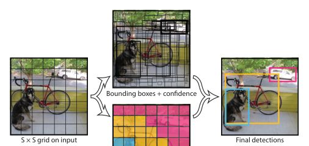
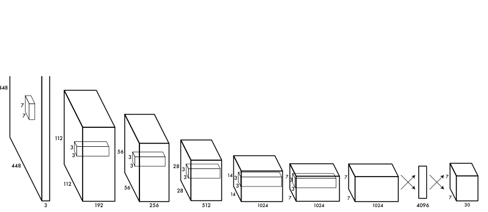
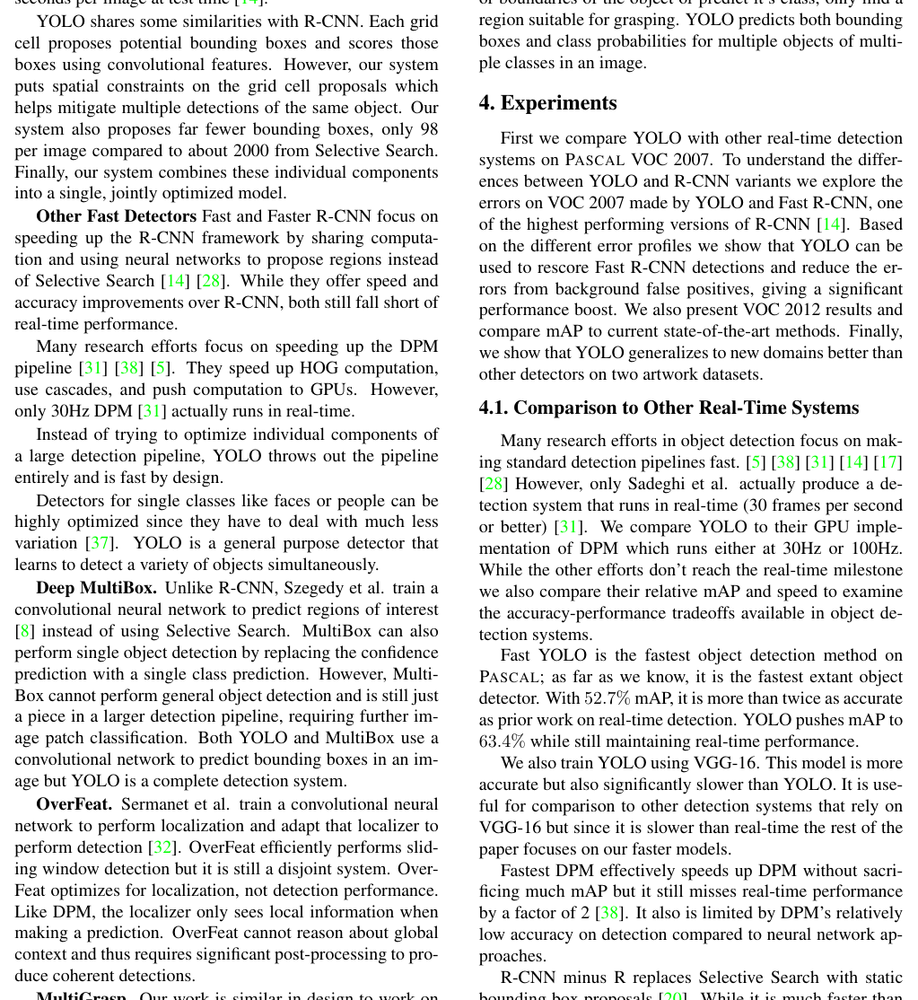
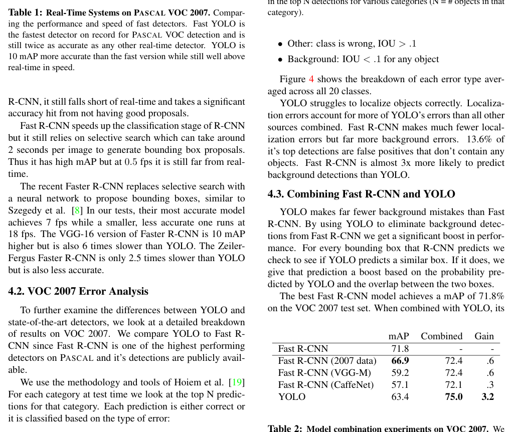
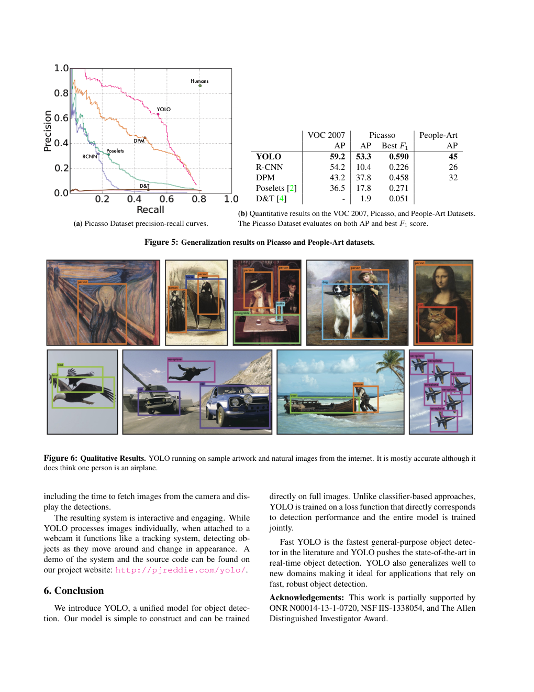

# You Only Look Once: Unified, Real-Time Object Detection（只看一次：统一的实时目标检测）

> arXiv:1506.02640v5 [cs.CV] 9 May 2016
>
> **作者（原文）**：Joseph Redmon\*, Santosh Divvala\*†, Ross Girshick¶, Ali Farhadi\*†
>
> University of Washington\*, Allen Institute for AI†, Facebook AI Research¶
>
> http://pjreddie.com/yolo/

## Abstract

**Original:** We present YOLO, a new approach to object detection. Prior work on object detection repurposes classifiers to perform detection. Instead, we frame object detection as a regression problem to spatially separated bounding boxes and associated class probabilities.

**中文:** 我们提出 YOLO，一种新的目标检测方法。以往的目标检测工作通过改造分类器来执行检测。与之不同，我们将目标检测视为一个回归问题，直接回归到空间上分离的边界框及其关联的类别概率。

**Original:** A single neural network predicts bounding boxes and class probabilities directly from full images in one evaluation. Since the whole detection pipeline is a single network, it can be optimized end-to-end directly on detection performance.

**中文:** 单个神经网络只需一次前向计算，就能直接从整幅图像预测出边界框和类别概率。由于整个检测流程就是一个网络，因此可以针对检测性能直接进行端到端优化。

**Original:** Our unified architecture is extremely fast. Our base YOLO model processes images in real-time at 45 frames per second. A smaller version of the network, Fast YOLO, processes an astounding 155 frames per second while still achieving double the mAP of other real-time detectors.

**中文:** 我们的统一架构速度极快。基础版 YOLO 模型以每秒 45 帧的速度实时处理图像。网络的一个更小版本 Fast YOLO 处理速度达到惊人的每秒 155 帧，同时其 mAP（平均精度均值）仍是其他实时检测器的两倍。

**Original:** Compared to state-of-the-art detection systems, YOLO makes more localization errors but is less likely to predict false positives on background. Finally, YOLO learns very general representations of objects. It outperforms other detection methods, including DPM and R-CNN, when generalizing from natural images to other domains like artwork.

**中文:** 与当前最优（state-of-the-art）的检测系统相比，YOLO 会犯更多的定位错误，但更不容易把背景误判为物体（假阳性）。最后，YOLO 学到了非常通用的物体表示。当从自然图像泛化到艺术画作等其他领域时，它的表现优于包括 DPM 和 R-CNN 在内的其他检测方法。

## 1. Introduction（引言）

**Original:** Humans glance at an image and instantly know what objects are in the image, where they are, and how they interact. The human visual system is fast and accurate, allowing us to perform complex tasks like driving with little conscious thought. Fast, accurate algorithms for object detection would allow computers to drive cars without specialized sensors, enable assistive devices to convey real-time scene information to human users, and unlock the potential for general purpose, responsive robotic systems.

**中文:** 人类只需瞥一眼图像，就能立刻知道图中有什么物体、物体在哪里、它们如何相互作用。人类的视觉系统又快又准，使我们几乎不需要有意识的思考就能完成驾驶这样的复杂任务。快速、准确的目标检测算法将使计算机能够在不使用专用传感器的情况下驾驶汽车，使辅助设备能够向人类用户传达实时场景信息，并释放通用、灵敏的机器人系统的潜力。

**Original:** Current detection systems repurpose classifiers to perform detection. To detect an object, these systems take a classifier for that object and evaluate it at various locations and scales in a test image. Systems like deformable parts models (DPM) use a sliding window approach where the classifier is run at evenly spaced locations over the entire image [10].

**中文:** 当前的检测系统通过改造分类器来执行检测。为了检测一个物体，这些系统会为该物体训练一个分类器，并在测试图像的各个位置和尺度上运行它。像可变形部件模型（Deformable Parts Models，DPM）这样的系统使用滑动窗口方法，在整个图像上按均匀间隔的位置运行分类器 [10]。

**Original:** More recent approaches like R-CNN use region proposal methods to first generate potential bounding boxes in an image and then run a classifier on these proposed boxes. After classification, post-processing is used to refine the bounding boxes, eliminate duplicate detections, and rescore the boxes based on other objects in the scene [13]. These complex pipelines are slow and hard to optimize because each individual component must be trained separately.

**中文:** 像 R-CNN 这样较新的方法使用候选区域（region proposal）方法，先在图像中生成潜在的边界框，再在这些候选框上运行分类器。分类之后，还要用后处理来精修边界框、消除重复检测，并根据场景中的其他物体对框重新打分 [13]。这些复杂的流程速度慢且难以优化，因为每个组件都必须单独训练。

> **图 1（译）**：YOLO 检测系统。用 YOLO 处理图像简单直接。我们的系统（1）将输入图像缩放为 448 × 448，（2）在图像上运行一个卷积网络，（3）按模型的置信度对检测结果做阈值筛选。（原图见 paper.pdf 第 1 页，见下方图）

>
> 图内文字（原文）：1. Resize image. / 2. Run convolutional network. / 3. Non-max suppression. / Dog: 0.30 / Person: 0.64 / Horse: 0.28
>
> 图内文字（译）：1. 缩放图像。/ 2. 运行卷积网络。/ 3. 非极大值抑制。/ 狗：0.30 / 人：0.64 / 马：0.28

**Original:** We reframe object detection as a single regression problem, straight from image pixels to bounding box coordinates and class probabilities. Using our system, you only look once (YOLO) at an image to predict what objects are present and where they are.

**中文:** 我们将目标检测重新定义为一个单一的回归问题，直接从图像像素回归到边界框坐标和类别概率。使用我们的系统，你只需看一眼（You Only Look Once，YOLO）图像，就能预测出图中有什么物体以及它们在哪里。

**Original:** YOLO is refreshingly simple: see Figure 1. A single convolutional network simultaneously predicts multiple bounding boxes and class probabilities for those boxes. YOLO trains on full images and directly optimizes detection performance. This unified model has several benefits over traditional methods of object detection.

**中文:** YOLO 简单得令人耳目一新：见图 1。一个卷积网络同时预测多个边界框以及这些框的类别概率。YOLO 在整幅图像上训练，并直接优化检测性能。与传统目标检测方法相比，这种统一模型有若干优点。

**Original:** First, YOLO is extremely fast. Since we frame detection as a regression problem we don't need a complex pipeline. We simply run our neural network on a new image at test time to predict detections. Our base network runs at 45 frames per second with no batch processing on a Titan X GPU and a fast version runs at more than 150 fps. This means we can process streaming video in real-time with less than 25 milliseconds of latency. Furthermore, YOLO achieves more than twice the mean average precision of other real-time systems. For a demo of our system running in real-time on a webcam please see our project webpage: http://pjreddie.com/yolo/.

**中文:** 第一，YOLO 速度极快。由于我们将检测定义为回归问题，就不需要复杂的流水线。测试时，我们只需把新图像送入神经网络即可得到检测结果。我们的基础网络在 Titan X GPU 上不做批处理就能以每秒 45 帧的速度运行，快速版本则超过 150 fps。这意味着我们可以实时处理视频流，延迟不到 25 毫秒。此外，YOLO 的平均精度均值是其他实时系统的两倍以上。想看我们的系统在网络摄像头上实时运行的演示，请访问项目主页：http://pjreddie.com/yolo/。

**Original:** Second, YOLO reasons globally about the image when making predictions. Unlike sliding window and region proposal-based techniques, YOLO sees the entire image during training and test time so it implicitly encodes contextual information about classes as well as their appearance. Fast R-CNN, a top detection method [14], mistakes background patches in an image for objects because it can't see the larger context. YOLO makes less than half the number of background errors compared to Fast R-CNN.

**中文:** 第二，YOLO 在做预测时会对图像进行全局推理。与滑动窗口和基于候选区域的技术不同，YOLO 在训练和测试时都能看到整幅图像，因此它隐式地编码了关于类别的上下文信息以及它们的表观信息。Fast R-CNN 是一种顶尖的检测方法 [14]，但它看不到更大的上下文，会把图像中的背景块误认为物体。与 Fast R-CNN 相比，YOLO 的背景错误数量不到它的一半。

**Original:** Third, YOLO learns generalizable representations of objects. When trained on natural images and tested on artwork, YOLO outperforms top detection methods like DPM and R-CNN by a wide margin. Since YOLO is highly generalizable it is less likely to break down when applied to new domains or unexpected inputs.

**中文:** 第三，YOLO 学到了可泛化的物体表示。在自然图像上训练、在艺术画作上测试时，YOLO 大幅超越 DPM 和 R-CNN 等顶尖检测方法。由于 YOLO 具有高度泛化性，它应用于新领域或意外输入时更不容易失效。

**Original:** YOLO still lags behind state-of-the-art detection systems in accuracy. While it can quickly identify objects in images it struggles to precisely localize some objects, especially small ones. We examine these tradeoffs further in our experiments.

**中文:** 在准确率方面，YOLO 仍落后于当前最优的检测系统。虽然它能快速识别图像中的物体，但难以精确定位某些物体，尤其是小物体。我们将在实验中进一步考察这些权衡。

**Original:** All of our training and testing code is open source. A variety of pretrained models are also available to download.

**中文:** 我们所有的训练和测试代码都是开源的。也提供多种预训练模型供下载。

## 2. Unified Detection（统一检测）

**Original:** We unify the separate components of object detection into a single neural network. Our network uses features from the entire image to predict each bounding box. It also predicts all bounding boxes across all classes for an image simultaneously. This means our network reasons globally about the full image and all the objects in the image. The YOLO design enables end-to-end training and real-time speeds while maintaining high average precision.

**中文:** 我们将目标检测的各个分离组件统一到单个神经网络中。我们的网络利用整幅图像的特征来预测每个边界框，并同时预测一张图像上所有类别的所有边界框。这意味着我们的网络会对整幅图像及其中的所有物体做全局推理。YOLO 的设计实现了端到端训练和实时速度，同时保持了较高的平均精度。

**Original:** Our system divides the input image into an S × S grid. If the center of an object falls into a grid cell, that grid cell is responsible for detecting that object.

**中文:** 我们的系统把输入图像划分成 $S \times S$ 的网格。如果某个物体的中心落入某个网格单元（grid cell），该网格单元就负责检测这个物体。

**Original:** Each grid cell predicts B bounding boxes and confidence scores for those boxes. These confidence scores reflect how confident the model is that the box contains an object and also how accurate it thinks the box is that it predicts. Formally we define confidence as Pr(Object) ∗ IOU^{truth}_{pred}. If no object exists in that cell, the confidence scores should be zero. Otherwise we want the confidence score to equal the intersection over union (IOU) between the predicted box and the ground truth.

**中文:** 每个网格单元预测 $B$ 个边界框以及这些框的置信度分数。这些置信度分数反映了模型对"框内含有物体"的把握，以及模型对自己所预测框的位置准确度的估计。形式上，我们把置信度定义为 $\Pr(\text{Object}) * \text{IOU}^{\text{truth}}_{\text{pred}}$。如果该单元中不存在物体，置信度分数应为零。否则，我们希望置信度分数等于预测框与真值（ground truth）之间的交并比（Intersection over Union，IOU）。

**Original:** Each bounding box consists of 5 predictions: x, y, w, h, and confidence. The (x, y) coordinates represent the center of the box relative to the bounds of the grid cell. The width and height are predicted relative to the whole image. Finally the confidence prediction represents the IOU between the predicted box and any ground truth box.

**中文:** 每个边界框由 5 个预测值组成：$x, y, w, h$ 和置信度。$(x, y)$ 坐标表示框的中心相对于网格单元边界的位置。宽度和高度是相对于整幅图像预测的。最后，置信度预测表示预测框与任意真值框之间的 IOU。

**Original:** Each grid cell also predicts C conditional class probabilities, Pr(Class_i|Object). These probabilities are conditioned on the grid cell containing an object. We only predict one set of class probabilities per grid cell, regardless of the number of boxes B.

**中文:** 每个网格单元还预测 $C$ 个条件类别概率 $\Pr(\text{Class}_i|\text{Object})$。这些概率以"该网格单元含有物体"为条件。无论框的数量 $B$ 是多少，每个网格单元只预测一组类别概率。

**Original:** At test time we multiply the conditional class probabilities and the individual box confidence predictions,

$$\Pr(\text{Class}_i|\text{Object}) * \Pr(\text{Object}) * \text{IOU}^{\text{truth}}_{\text{pred}} = \Pr(\text{Class}_i) * \text{IOU}^{\text{truth}}_{\text{pred}} \tag{1}$$

which gives us class-specific confidence scores for each box. These scores encode both the probability of that class appearing in the box and how well the predicted box fits the object.

**中文:** 测试时，我们将条件类别概率与各个框的置信度预测相乘：

$$\Pr(\text{Class}_i|\text{Object}) * \Pr(\text{Object}) * \text{IOU}^{\text{truth}}_{\text{pred}} = \Pr(\text{Class}_i) * \text{IOU}^{\text{truth}}_{\text{pred}} \tag{1}$$

这给出了每个框的类别特定置信度分数。这些分数既编码了该类别出现在框中的概率，也编码了预测框与物体的吻合程度。

> **图 2（译）**：模型。我们的系统将检测建模为回归问题。它将图像划分为 $S \times S$ 的网格，为每个网格单元预测 $B$ 个边界框、这些框的置信度以及 $C$ 个类别概率。这些预测被编码为一个 $S \times S \times (B * 5 + C)$ 的张量。（原图见 paper.pdf 第 2 页，见下方图）

>
> 图内文字（原文）：S × S grid on input / Bounding boxes + confidence / Class probability map / Final detections
>
> 图内文字（译）：输入上的 S × S 网格 / 边界框 + 置信度 / 类别概率图 / 最终检测结果

**Original:** For evaluating YOLO on PASCAL VOC, we use S = 7, B = 2. PASCAL VOC has 20 labelled classes so C = 20. Our final prediction is a 7 × 7 × 30 tensor.

**中文:** 在 PASCAL VOC 上评估 YOLO 时，我们取 $S = 7$，$B = 2$。PASCAL VOC 有 20 个标注类别，因此 $C = 20$。我们的最终预测是一个 $7 \times 7 \times 30$ 的张量。

### 2.1. Network Design（网络设计）

**Original:** We implement this model as a convolutional neural network and evaluate it on the PASCAL VOC detection dataset [9]. The initial convolutional layers of the network extract features from the image while the fully connected layers predict the output probabilities and coordinates.

**中文:** 我们将该模型实现为卷积神经网络，并在 PASCAL VOC 检测数据集上评估 [9]。网络的初始卷积层从图像中提取特征，全连接层则预测输出的概率和坐标。

**Original:** Our network architecture is inspired by the GoogLeNet model for image classification [34]. Our network has 24 convolutional layers followed by 2 fully connected layers. Instead of the inception modules used by GoogLeNet, we simply use 1 × 1 reduction layers followed by 3 × 3 convolutional layers, similar to Lin et al [22]. The full network is shown in Figure 3.

**中文:** 我们的网络架构受用于图像分类的 GoogLeNet 模型启发 [34]。我们的网络有 24 个卷积层，后接 2 个全连接层。我们没有采用 GoogLeNet 使用的 Inception 模块，而是简单地使用 $1 \times 1$ 降维层后接 $3 \times 3$ 卷积层，与 Lin 等人 [22] 的做法类似。完整网络见图 3。

**Original:** We also train a fast version of YOLO designed to push the boundaries of fast object detection. Fast YOLO uses a neural network with fewer convolutional layers (9 instead of 24) and fewer filters in those layers. Other than the size of the network, all training and testing parameters are the same between YOLO and Fast YOLO.

**中文:** 我们还训练了一个快速版本的 YOLO，旨在挑战快速目标检测的极限。Fast YOLO 使用的神经网络卷积层更少（9 层而非 24 层），且这些层中的滤波器（filter）更少。除了网络规模之外，YOLO 与 Fast YOLO 的所有训练和测试参数都相同。

> **图 3（译）**：架构。我们的检测网络有 24 个卷积层，后接 2 个全连接层。交替的 $1 \times 1$ 卷积层用于缩减前一层输出的特征空间。我们在 ImageNet 分类任务上以一半分辨率（$224 \times 224$ 输入图像）预训练卷积层，然后为检测任务将分辨率加倍。网络最终的输出是 $7 \times 7 \times 30$ 的预测张量。（原图见 paper.pdf 第 3 页，见下方图）

>
> 图内层标签（原文，按 PDF 提取顺序，图内结构以原图为准）：448 / 448 / 3 / 7 / 7 / Conv. Layer 7x7x64-s-2 / Maxpool Layer 2x2-s-2 / 112 / 112 / 192 / 56 / 56 / 256 / Conv. Layers 3x3x192 / Maxpool Layer 2x2-s-2 / Conv. Layers 1x1x128, 3x3x256, 1x1x256, 3x3x512 / Maxpool Layer 2x2-s-2 / 28 / 28 / 512 / Conv. Layers 1x1x256, 3x3x512, 1x1x512, 3x3x1024 / Maxpool Layer 2x2-s-2 / 14 / 14 / 1024 / Conv. Layers 1x1x512, 3x3x1024, 3x3x1024, 3x3x1024-s-2 / Conv. Layers 3x3x1024, 3x3x1024 / 7 / 7 / 1024 / Conn. Layer 4096 / Conn. Layer 7 / 7 / 30

### 2.2. Training（训练）

**Original:** We pretrain our convolutional layers on the ImageNet 1000-class competition dataset [30]. For pretraining we use the first 20 convolutional layers from Figure 3 followed by a average-pooling layer and a fully connected layer. We train this network for approximately a week and achieve a single crop top-5 accuracy of 88% on the ImageNet 2012 validation set, comparable to the GoogLeNet models in Caffe's Model Zoo [24]. We use the Darknet framework for all training and inference [26].

**中文:** 我们在 ImageNet 1000 类竞赛数据集上预训练卷积层 [30]。预训练时，我们使用图 3 中的前 20 个卷积层，后接一个平均池化层和一个全连接层。我们训练该网络约一周，在 ImageNet 2012 验证集上取得 88% 的单裁剪 top-5 准确率，与 Caffe 的 Model Zoo 中的 GoogLeNet 模型相当 [24]。所有训练和推理我们都使用 Darknet 框架 [26]。

**Original:** We then convert the model to perform detection. Ren et al. show that adding both convolutional and connected layers to pretrained networks can improve performance [29]. Following their example, we add four convolutional layers and two fully connected layers with randomly initialized weights. Detection often requires fine-grained visual information so we increase the input resolution of the network from 224 × 224 to 448 × 448.

**中文:** 随后我们改造该模型以执行检测。Ren 等人表明，向预训练网络中添加卷积层和连接层可以提升性能 [29]。效仿他们的做法，我们添加了 4 个卷积层和 2 个全连接层，权重随机初始化。检测通常需要细粒度的视觉信息，因此我们将网络的输入分辨率从 $224 \times 224$ 提高到 $448 \times 448$。

**Original:** Our final layer predicts both class probabilities and bounding box coordinates. We normalize the bounding box width and height by the image width and height so that they fall between 0 and 1. We parametrize the bounding box x and y coordinates to be offsets of a particular grid cell location so they are also bounded between 0 and 1.

**中文:** 我们的最后一层同时预测类别概率和边界框坐标。我们用图像宽高对边界框的宽度和高度做归一化，使它们落在 0 到 1 之间。我们将边界框的 $x$ 和 $y$ 坐标参数化为相对特定网格单元位置的偏移量，因此它们也被限制在 0 到 1 之间。

**Original:** We use a linear activation function for the final layer and all other layers use the following leaky rectified linear activation:

$$\varphi(x) = \begin{cases} x, & \text{if } x > 0 \\ 0.1x, & \text{otherwise} \end{cases} \tag{2}$$

**中文:** 最后一层使用线性激活函数，其余所有层使用以下带泄漏的线性整流激活（leaky rectified linear activation）：

$$\varphi(x) = \begin{cases} x, & \text{if } x > 0 \\ 0.1x, & \text{otherwise} \end{cases} \tag{2}$$

**Original:** We optimize for sum-squared error in the output of our model. We use sum-squared error because it is easy to optimize, however it does not perfectly align with our goal of maximizing average precision. It weights localization error equally with classification error which may not be ideal. Also, in every image many grid cells do not contain any object. This pushes the "confidence" scores of those cells towards zero, often overpowering the gradient from cells that do contain objects. This can lead to model instability, causing training to diverge early on.

**中文:** 我们对模型输出优化平方和误差（sum-squared error）。之所以使用平方和误差，是因为它易于优化；但它与我们最大化平均精度的目标并不完全一致——它把定位误差与分类误差同等加权，这可能并不理想。此外，每张图像中都有许多网格单元不含任何物体，这会把那些单元的"置信度"分数推向零，常常压过来自确实含有物体的单元的梯度。这可能导致模型不稳定，使训练在早期就发散。

**Original:** To remedy this, we increase the loss from bounding box coordinate predictions and decrease the loss from confidence predictions for boxes that don't contain objects. We use two parameters, λcoord and λnoobj to accomplish this. We set λcoord = 5 and λnoobj = .5.

**中文:** 为解决这个问题，我们增大边界框坐标预测的损失，并减小不含物体的框的置信度预测损失。我们使用两个参数 $\lambda_{\text{coord}}$ 和 $\lambda_{\text{noobj}}$ 来实现这一点，取 $\lambda_{\text{coord}} = 5$、$\lambda_{\text{noobj}} = .5$。

**Original:** Sum-squared error also equally weights errors in large boxes and small boxes. Our error metric should reflect that small deviations in large boxes matter less than in small boxes. To partially address this we predict the square root of the bounding box width and height instead of the width and height directly.

**中文:** 平方和误差对大框和小框中的误差也同等加权。我们的误差度量应该体现：大框中的小幅偏差不如小框中的小幅偏差重要。为部分解决这一问题，我们预测边界框宽度和高度的平方根，而不是直接预测宽度和高度。

**Original:** YOLO predicts multiple bounding boxes per grid cell. At training time we only want one bounding box predictor to be responsible for each object. We assign one predictor to be "responsible" for predicting an object based on which prediction has the highest current IOU with the ground truth. This leads to specialization between the bounding box predictors. Each predictor gets better at predicting certain sizes, aspect ratios, or classes of object, improving overall recall.

**中文:** YOLO 为每个网格单元预测多个边界框。训练时，我们只希望一个边界框预测器负责每个物体。我们根据哪个预测与真值具有当前最高的 IOU，来指定该预测器"负责"预测该物体。这使各边界框预测器之间形成专业化分工——每个预测器都更擅长预测特定尺寸、长宽比或类别的物体，从而提升整体召回率。

**Original:** During training we optimize the following, multi-part loss function:

$$\lambda_{\text{coord}} \sum_{i=0}^{S^2} \sum_{j=0}^{B} \mathbb{1}_{ij}^{\text{obj}} \left[(x_i - \hat{x}_i)^2 + (y_i - \hat{y}_i)^2\right] + \lambda_{\text{coord}} \sum_{i=0}^{S^2} \sum_{j=0}^{B} \mathbb{1}_{ij}^{\text{obj}} \left[\left(\sqrt{w_i} - \sqrt{\hat{w}_i}\right)^2 + \left(\sqrt{h_i} - \sqrt{\hat{h}_i}\right)^2\right] + \sum_{i=0}^{S^2} \sum_{j=0}^{B} \mathbb{1}_{ij}^{\text{obj}} \left(C_i - \hat{C}_i\right)^2 + \lambda_{\text{noobj}} \sum_{i=0}^{S^2} \sum_{j=0}^{B} \mathbb{1}_{ij}^{\text{noobj}} \left(C_i - \hat{C}_i\right)^2 + \sum_{i=0}^{S^2} \mathbb{1}_{i}^{\text{obj}} \sum_{c \in \text{classes}} \left(p_i(c) - \hat{p}_i(c)\right)^2 \tag{3}$$

**中文:** 训练期间，我们优化以下多部分损失函数：

$$\lambda_{\text{coord}} \sum_{i=0}^{S^2} \sum_{j=0}^{B} \mathbb{1}_{ij}^{\text{obj}} \left[(x_i - \hat{x}_i)^2 + (y_i - \hat{y}_i)^2\right] + \lambda_{\text{coord}} \sum_{i=0}^{S^2} \sum_{j=0}^{B} \mathbb{1}_{ij}^{\text{obj}} \left[\left(\sqrt{w_i} - \sqrt{\hat{w}_i}\right)^2 + \left(\sqrt{h_i} - \sqrt{\hat{h}_i}\right)^2\right] + \sum_{i=0}^{S^2} \sum_{j=0}^{B} \mathbb{1}_{ij}^{\text{obj}} \left(C_i - \hat{C}_i\right)^2 + \lambda_{\text{noobj}} \sum_{i=0}^{S^2} \sum_{j=0}^{B} \mathbb{1}_{ij}^{\text{noobj}} \left(C_i - \hat{C}_i\right)^2 + \sum_{i=0}^{S^2} \mathbb{1}_{i}^{\text{obj}} \sum_{c \in \text{classes}} \left(p_i(c) - \hat{p}_i(c)\right)^2 \tag{3}$$

**Original:** where 1^{obj}_i denotes if object appears in cell i and 1^{obj}_{ij} denotes that the jth bounding box predictor in cell i is "responsible" for that prediction.

**中文:** 其中 $\mathbb{1}_{i}^{\text{obj}}$ 表示物体是否出现在单元 $i$ 中，$\mathbb{1}_{ij}^{\text{obj}}$ 表示单元 $i$ 中的第 $j$ 个边界框预测器是否"负责"该预测。

**Original:** Note that the loss function only penalizes classification error if an object is present in that grid cell (hence the conditional class probability discussed earlier). It also only penalizes bounding box coordinate error if that predictor is "responsible" for the ground truth box (i.e. has the highest IOU of any predictor in that grid cell).

**中文:** 注意，只有当物体出现在该网格单元中时，损失函数才惩罚分类误差（这正是前面讨论的条件类别概率的含义）。同样，只有当某个预测器"负责"真值框（即在该网格单元的所有预测器中 IOU 最高）时，才惩罚边界框坐标误差。

**Original:** We train the network for about 135 epochs on the training and validation data sets from PASCAL VOC 2007 and 2012. When testing on 2012 we also include the VOC 2007 test data for training. Throughout training we use a batch size of 64, a momentum of 0.9 and a decay of 0.0005.

**中文:** 我们在 PASCAL VOC 2007 和 2012 的训练与验证数据集上训练网络约 135 个轮次（epoch）。在 2012 上测试时，我们还会把 VOC 2007 的测试数据加入训练。整个训练过程中，我们使用批次大小为 64、动量为 0.9、权重衰减为 0.0005。

**Original:** Our learning rate schedule is as follows: For the first epochs we slowly raise the learning rate from 10−3 to 10−2. If we start at a high learning rate our model often diverges due to unstable gradients. We continue training with 10−2 for 75 epochs, then 10−3 for 30 epochs, and finally 10−4 for 30 epochs.

**中文:** 我们的学习率调度如下：最初的几个轮次中，我们缓慢地把学习率从 $10^{-3}$ 提高到 $10^{-2}$。如果一开始就用高学习率，模型常会因梯度不稳定而发散。之后我们以 $10^{-2}$ 继续训练 75 个轮次，再以 $10^{-3}$ 训练 30 个轮次，最后以 $10^{-4}$ 训练 30 个轮次。

**Original:** To avoid overfitting we use dropout and extensive data augmentation. A dropout layer with rate = .5 after the first connected layer prevents co-adaptation between layers [18]. For data augmentation we introduce random scaling and translations of up to 20% of the original image size. We also randomly adjust the exposure and saturation of the image by up to a factor of 1.5 in the HSV color space.

**中文:** 为避免过拟合，我们使用随机失活（Dropout）和大规模数据增强。在第一个连接层之后放置一个 rate = .5 的随机失活层，可以防止层与层之间的协同适应 [18]。数据增强方面，我们引入最多为原图尺寸 20% 的随机缩放和平移。我们还在 HSV 色彩空间中随机调整图像的曝光度和饱和度，调整幅度最高为 1.5 倍。

### 2.3. Inference（推理）

**Original:** Just like in training, predicting detections for a test image only requires one network evaluation. On PASCAL VOC the network predicts 98 bounding boxes per image and class probabilities for each box. YOLO is extremely fast at test time since it only requires a single network evaluation, unlike classifier-based methods.

**中文:** 与训练时一样，对测试图像预测检测结果只需要一次网络前向计算。在 PASCAL VOC 上，网络为每张图像预测 98 个边界框以及每个框的类别概率。由于只需一次网络前向计算，YOLO 在测试时速度极快，这与基于分类器的方法不同。

**Original:** The grid design enforces spatial diversity in the bounding box predictions. Often it is clear which grid cell an object falls in to and the network only predicts one box for each object. However, some large objects or objects near the border of multiple cells can be well localized by multiple cells. Non-maximal suppression can be used to fix these multiple detections. While not critical to performance as it is for R-CNN or DPM, non-maximal suppression adds 2-3% in mAP.

**中文:** 网格设计使边界框预测具有空间多样性。通常物体落在哪个网格单元是明确的，网络只需为每个物体预测一个框。但是，一些大物体或靠近多个单元边界的物体可能被多个单元很好地定位，此时可以用非极大值抑制（Non-maximal Suppression，NMS）来消除这些重复检测。虽然 NMS 对性能的影响不像对 R-CNN 或 DPM 那样关键，但它仍能带来 2-3% 的 mAP 提升。

### 2.4. Limitations of YOLO（YOLO 的局限性）

**Original:** YOLO imposes strong spatial constraints on bounding box predictions since each grid cell only predicts two boxes and can only have one class. This spatial constraint limits the number of nearby objects that our model can predict. Our model struggles with small objects that appear in groups, such as flocks of birds.

**中文:** YOLO 对边界框预测施加了很强的空间约束，因为每个网格单元只能预测两个框，并且只能属于一个类别。这一空间约束限制了模型能预测的邻近物体数量。我们的模型难以处理成群出现的小物体，例如鸟群。

**Original:** Since our model learns to predict bounding boxes from data, it struggles to generalize to objects in new or unusual aspect ratios or configurations. Our model also uses relatively coarse features for predicting bounding boxes since our architecture has multiple downsampling layers from the input image.

**中文:** 由于我们的模型是从数据中学习预测边界框的，它难以泛化到具有新的或不寻常长宽比、形态的物体。此外，由于我们的架构从输入图像起有多个下采样层，模型用于预测边界框的特征相对粗糙。

**Original:** Finally, while we train on a loss function that approximates detection performance, our loss function treats errors the same in small bounding boxes versus large bounding boxes. A small error in a large box is generally benign but a small error in a small box has a much greater effect on IOU. Our main source of error is incorrect localizations.

**中文:** 最后，虽然我们训练所用的损失函数近似检测性能，但它对小边界框和大边界框中的误差一视同仁。大框中的小误差通常无害，但小框中的小误差对 IOU 的影响要大得多。我们主要的误差来源是不正确的定位。

## 3. Comparison to Other Detection Systems（与其他检测系统的比较）

**Original:** Object detection is a core problem in computer vision. Detection pipelines generally start by extracting a set of robust features from input images (Haar [25], SIFT [23], HOG [4], convolutional features [6]). Then, classifiers [36, 21, 13, 10] or localizers [1, 32] are used to identify objects in the feature space. These classifiers or localizers are run either in sliding window fashion over the whole image or on some subset of regions in the image [35, 15, 39]. We compare the YOLO detection system to several top detection frameworks, highlighting key similarities and differences.

**中文:** 目标检测是计算机视觉的核心问题。检测流程通常从输入图像中提取一组稳健的特征开始（Haar [25]、SIFT [23]、HOG [4]、卷积特征 [6]），然后用分类器 [36, 21, 13, 10] 或定位器 [1, 32] 在特征空间中识别物体。这些分类器或定位器要么以滑动窗口方式在整幅图像上运行，要么在图像中某个区域子集上运行 [35, 15, 39]。我们将 YOLO 检测系统与几个顶尖检测框架进行比较，突出关键的相似与差异之处。

**Original:** **Deformable parts models.** Deformable parts models (DPM) use a sliding window approach to object detection [10]. DPM uses a disjoint pipeline to extract static features, classify regions, predict bounding boxes for high scoring regions, etc. Our system replaces all of these disparate parts with a single convolutional neural network. The network performs feature extraction, bounding box prediction, non-maximal suppression, and contextual reasoning all concurrently. Instead of static features, the network trains the features in-line and optimizes them for the detection task. Our unified architecture leads to a faster, more accurate model than DPM.

**中文:** **可变形部件模型。** 可变形部件模型（DPM）使用滑动窗口方法进行目标检测 [10]。DPM 使用一条彼此分离的流水线来提取静态特征、对区域分类、为高分区域预测边界框等。我们的系统用单个卷积神经网络取代了所有这些零散的部分。该网络同时执行特征提取、边界框预测、非极大值抑制和上下文推理。网络不再使用静态特征，而是在线训练特征并针对检测任务优化它们。与 DPM 相比，我们的统一架构带来了更快、更准确的模型。

**Original:** **R-CNN.** R-CNN and its variants use region proposals instead of sliding windows to find objects in images. Selective Search [35] generates potential bounding boxes, a convolutional network extracts features, an SVM scores the boxes, a linear model adjusts the bounding boxes, and non-max suppression eliminates duplicate detections. Each stage of this complex pipeline must be precisely tuned independently and the resulting system is very slow, taking more than 40 seconds per image at test time [14].

**中文:** **R-CNN。** R-CNN 及其变体使用候选区域而非滑动窗口来寻找图像中的物体。Selective Search [35] 生成潜在的边界框，卷积网络提取特征，SVM（支持向量机）为框打分，线性模型调整边界框，非极大值抑制消除重复检测。这条复杂流水线的每个阶段都必须独立地精细调参，最终系统非常慢，测试时每张图像要花费 40 秒以上 [14]。

**Original:** YOLO shares some similarities with R-CNN. Each grid cell proposes potential bounding boxes and scores those boxes using convolutional features. However, our system puts spatial constraints on the grid cell proposals which helps mitigate multiple detections of the same object. Our system also proposes far fewer bounding boxes, only 98 per image compared to about 2000 from Selective Search. Finally, our system combines these individual components into a single, jointly optimized model.

**中文:** YOLO 与 R-CNN 有一些相似之处。每个网格单元提出潜在的边界框，并用卷积特征为这些框打分。但是，我们的系统对网格单元的提议施加了空间约束，有助于减少对同一物体的重复检测。我们的系统提出的边界框也少得多——每张图像只有 98 个，而 Selective Search 约有 2000 个。最后，我们的系统把这些独立的组件合并成单个联合优化的模型。

**Original:** **Other Fast Detectors** Fast and Faster R-CNN focus on speeding up the R-CNN framework by sharing computation and using neural networks to propose regions instead of Selective Search [14] [28]. While they offer speed and accuracy improvements over R-CNN, both still fall short of real-time performance.

**中文:** **其他快速检测器** Fast R-CNN 和 Faster R-CNN 致力于加速 R-CNN 框架：它们共享计算，并用神经网络取代 Selective Search 来提出区域 [14] [28]。虽然它们在速度和准确率上都优于 R-CNN，但两者仍达不到实时性能。

**Original:** Many research efforts focus on speeding up the DPM pipeline [31] [38] [5]. They speed up HOG computation, use cascades, and push computation to GPUs. However, only 30Hz DPM [31] actually runs in real-time.

**中文:** 许多研究工作致力于加速 DPM 流水线 [31] [38] [5]。它们加速 HOG 的计算、使用级联结构，并把计算搬到 GPU 上。然而，只有 30Hz DPM [31] 真正做到了实时运行。

**Original:** Instead of trying to optimize individual components of a large detection pipeline, YOLO throws out the pipeline entirely and is fast by design.

**中文:** YOLO 没有试图优化大型检测流水线的各个组件，而是彻底抛弃了流水线，从设计上就快。

**Original:** Detectors for single classes like faces or people can be highly optimized since they have to deal with much less variation [37]. YOLO is a general purpose detector that learns to detect a variety of objects simultaneously.

**中文:** 针对人脸或行人等单一类别的检测器可以得到高度优化，因为它们需要应对的变化少得多 [37]。YOLO 是一个通用检测器，能同时学会检测多种物体。

**Original:** **Deep MultiBox.** Unlike R-CNN, Szegedy et al. train a convolutional neural network to predict regions of interest [8] instead of using Selective Search. MultiBox can also perform single object detection by replacing the confidence prediction with a single class prediction. However, MultiBox cannot perform general object detection and is still just a piece in a larger detection pipeline, requiring further image patch classification. Both YOLO and MultiBox use a convolutional network to predict bounding boxes in an image but YOLO is a complete detection system.

**中文:** **Deep MultiBox。** 与 R-CNN 不同，Szegedy 等人训练一个卷积神经网络来预测感兴趣区域 [8]，而不是使用 Selective Search。MultiBox 还可以把置信度预测替换为单一类别预测，从而执行单物体检测。然而，MultiBox 无法执行通用目标检测，它仍然只是更大检测流水线中的一个部件，还需要进一步的图像块分类。YOLO 和 MultiBox 都用卷积网络预测图像中的边界框，但 YOLO 是一个完整的检测系统。

**Original:** **OverFeat.** Sermanet et al. train a convolutional neural network to perform localization and adapt that localizer to perform detection [32]. OverFeat efficiently performs sliding window detection but it is still a disjoint system. OverFeat optimizes for localization, not detection performance. Like DPM, the localizer only sees local information when making a prediction. OverFeat cannot reason about global context and thus requires significant post-processing to produce coherent detections.

**中文:** **OverFeat。** Sermanet 等人训练一个卷积神经网络执行定位，并把该定位器改造成检测器 [32]。OverFeat 能高效地执行滑动窗口检测，但它仍然是一个彼此分离的系统。OverFeat 优化的是定位，而不是检测性能。与 DPM 一样，定位器在预测时只能看到局部信息。OverFeat 无法进行全局上下文推理，因此需要大量后处理才能产出连贯的检测结果。

**Original:** **MultiGrasp.** Our work is similar in design to work on grasp detection by Redmon et al [27]. Our grid approach to bounding box prediction is based on the MultiGrasp system for regression to grasps. However, grasp detection is a much simpler task than object detection. MultiGrasp only needs to predict a single graspable region for an image containing one object. It doesn't have to estimate the size, location, or boundaries of the object or predict it's class, only find a region suitable for grasping. YOLO predicts both bounding boxes and class probabilities for multiple objects of multiple classes in an image.

**中文:** **MultiGrasp。** 我们的工作在设计上与 Redmon 等人 [27] 的抓取检测工作相似。我们用于边界框预测的网格方法基于回归抓取位置的 MultiGrasp 系统。然而，抓取检测比目标检测简单得多。MultiGrasp 只需为只含一个物体的图像预测单个可抓取区域——它不必估计物体的大小、位置或边界，也不必预测其类别，只需找到适合抓取的区域。而 YOLO 为图像中多个类别的多个物体同时预测边界框和类别概率。

## 4. Experiments（实验）

**Original:** First we compare YOLO with other real-time detection systems on PASCAL VOC 2007. To understand the differences between YOLO and R-CNN variants we explore the errors on VOC 2007 made by YOLO and Fast R-CNN, one of the highest performing versions of R-CNN [14]. Based on the different error profiles we show that YOLO can be used to rescore Fast R-CNN detections and reduce the errors from background false positives, giving a significant performance boost. We also present VOC 2012 results and compare mAP to current state-of-the-art methods. Finally, we show that YOLO generalizes to new domains better than other detectors on two artwork datasets.

**中文:** 首先，我们在 PASCAL VOC 2007 上将 YOLO 与其他实时检测系统进行比较。为了理解 YOLO 与 R-CNN 变体之间的差异，我们分析了 YOLO 和 Fast R-CNN（R-CNN 中性能最好的版本之一 [14]）在 VOC 2007 上所犯的错误。基于两者不同的错误分布特征，我们证明可以用 YOLO 为 Fast R-CNN 的检测结果重新打分，减少背景假阳性带来的错误，从而显著提升性能。我们还给出 VOC 2012 的结果，并将 mAP 与当前最优方法比较。最后，我们在两个艺术画作数据集上表明，YOLO 向新领域泛化的能力优于其他检测器。

### 4.1. Comparison to Other Real-Time Systems（与其他实时系统的比较）

**Original:** Many research efforts in object detection focus on making standard detection pipelines fast. [5] [38] [31] [14] [17] [28] However, only Sadeghi et al. actually produce a detection system that runs in real-time (30 frames per second or better) [31]. We compare YOLO to their GPU implementation of DPM which runs either at 30Hz or 100Hz. While the other efforts don't reach the real-time milestone we also compare their relative mAP and speed to examine the accuracy-performance tradeoffs available in object detection systems.

**中文:** 目标检测领域的许多研究工作专注于让标准检测流水线跑得更快 [5] [38] [31] [14] [17] [28]。然而，只有 Sadeghi 等人真正做出了能实时运行（每秒 30 帧或更快）的检测系统 [31]。我们将 YOLO 与他们运行在 30Hz 或 100Hz 的 DPM GPU 实现进行比较。虽然其他工作没有达到实时这一里程碑，我们也比较它们的相对 mAP 和速度，以考察目标检测系统中可获得的准确率-性能权衡。

**Original:** Fast YOLO is the fastest object detection method on PASCAL; as far as we know, it is the fastest extant object detector. With 52.7% mAP, it is more than twice as accurate as prior work on real-time detection. YOLO pushes mAP to 63.4% while still maintaining real-time performance.

**中文:** Fast YOLO 是 PASCAL 上最快的目标检测方法；据我们所知，它是现存最快的目标检测器。它以 52.7% 的 mAP，比此前实时检测工作的准确率高一倍以上。YOLO 在保持实时性能的同时，把 mAP 推到了 63.4%。

**Original:** We also train YOLO using VGG-16. This model is more accurate but also significantly slower than YOLO. It is useful for comparison to other detection systems that rely on VGG-16 but since it is slower than real-time the rest of the paper focuses on our faster models.

**中文:** 我们还用 VGG-16 训练了 YOLO。这个模型更准确，但也明显更慢。它可用于与依赖 VGG-16 的其他检测系统比较，但由于它比实时更慢，本文其余部分聚焦于我们更快的模型。

**Original:** Fastest DPM effectively speeds up DPM without sacrificing much mAP but it still misses real-time performance by a factor of 2 [38]. It also is limited by DPM's relatively low accuracy on detection compared to neural network approaches.

**中文:** Fastest DPM 在几乎不损失 mAP 的情况下有效加速了 DPM，但仍差 2 倍才达到实时性能 [38]。此外，与神经网络方法相比，它还受限于 DPM 相对较低的检测准确率。

**Original:** R-CNN minus R replaces Selective Search with static bounding box proposals [20]. While it is much faster than R-CNN, it still falls short of real-time and takes a significant accuracy hit from not having good proposals.

**中文:** R-CNN minus R 用静态边界框提议取代 Selective Search [20]。虽然它比 R-CNN 快得多，但仍达不到实时，而且由于缺少好的提议，准确率明显受损。

**Original:** Fast R-CNN speeds up the classification stage of R-CNN but it still relies on selective search which can take around 2 seconds per image to generate bounding box proposals. Thus it has high mAP but at 0.5 fps it is still far from real-time.

**中文:** Fast R-CNN 加速了 R-CNN 的分类阶段，但仍依赖 Selective Search，后者为每张图像生成边界框提议就要花约 2 秒。因此它虽然 mAP 很高，但只有 0.5 fps，离实时还很远。

**Original:** The recent Faster R-CNN replaces selective search with a neural network to propose bounding boxes, similar to Szegedy et al. [8] In our tests, their most accurate model achieves 7 fps while a smaller, less accurate one runs at 18 fps. The VGG-16 version of Faster R-CNN is 10 mAP higher but is also 6 times slower than YOLO. The Zeiler-Fergus Faster R-CNN is only 2.5 times slower than YOLO but is also less accurate.

**中文:** 最近的 Faster R-CNN 用神经网络替代 Selective Search 来提出边界框，与 Szegedy 等人 [8] 的做法类似。在我们的测试中，他们最准确的模型达到 7 fps，而一个更小、准确率略低的版本跑到 18 fps。VGG-16 版 Faster R-CNN 的 mAP 高 10 个点，但比 YOLO 慢 6 倍。Zeiler-Fergus 版 Faster R-CNN 只比 YOLO 慢 2.5 倍，但准确率也更低。

> **表 1（译）**：PASCAL VOC 2007 上的实时系统。比较快速检测器的性能与速度。Fast YOLO 是 PASCAL VOC 检测有记录以来最快的检测器，且准确率仍是其他任何实时检测器的两倍。YOLO 比快速版的 mAP 高 10 个点，同时速度仍远高于实时。（原图见 paper.pdf 第 6 页，见下方图）

>
> **Table 1: Real-Time Systems on PASCAL VOC 2007.**
>
> | 检测器（原文） | Train | mAP | FPS |
> |---|---|---|---|
> | 100Hz DPM [31] | 2007 | 16.0 | 100 |
> | 30Hz DPM [31] | 2007 | 26.1 | 30 |
> | Fast YOLO | 2007+2012 | 52.7 | 155 |
> | YOLO | 2007+2012 | 63.4 | 45 |
> | Fastest DPM [38] | 2007 | 30.4 | 15 |
> | R-CNN Minus R [20] | 2007 | 53.5 | 6 |
> | Fast R-CNN [14] | 2007+2012 | 70.0 | 0.5 |
> | Faster R-CNN VGG-16 [28] | 2007+2012 | 73.2 | 7 |
> | Faster R-CNN ZF [28] | 2007+2012 | 62.1 | 18 |
> | YOLO VGG-16 | 2007+2012 | 66.4 | 21 |
>
> （表内分组：前 4 行为实时检测器 Real-Time Detectors，后 6 行为慢于实时 Less Than Real-Time。表格数据保留原文。）

### 4.2. VOC 2007 Error Analysis（VOC 2007 错误分析）

**Original:** To further examine the differences between YOLO and state-of-the-art detectors, we look at a detailed breakdown of results on VOC 2007. We compare YOLO to Fast R-CNN since Fast R-CNN is one of the highest performing detectors on PASCAL and it's detections are publicly available.

**中文:** 为了进一步考察 YOLO 与当前最优检测器之间的差异，我们细看 VOC 2007 上结果的详细分解。我们将 YOLO 与 Fast R-CNN 比较，因为 Fast R-CNN 是 PASCAL 上性能最好的检测器之一，且其检测结果已公开。

**Original:** We use the methodology and tools of Hoiem et al. [19] For each category at test time we look at the top N predictions for that category. Each prediction is either correct or it is classified based on the type of error:

**中文:** 我们采用 Hoiem 等人 [19] 的方法和工具。测试时，对每个类别我们考察该类别的前 N 个预测。每个预测要么正确，要么按错误类型归类：

- **Original:** Correct: correct class and IOU > .5
- **中文:** 正确（Correct）：类别正确且 IOU > .5
- **Original:** Localization: correct class, .1 < IOU < .5
- **中文:** 定位错误（Localization）：类别正确，.1 < IOU < .5
- **Original:** Similar: class is similar, IOU > .1
- **中文:** 类别相似（Similar）：类别相似，IOU > .1
- **Original:** Other: class is wrong, IOU > .1
- **中文:** 其他（Other）：类别错误，IOU > .1
- **Original:** Background: IOU < .1 for any object
- **中文:** 背景（Background）：与任何物体的 IOU < .1

> **图 4（译）**：错误分析：Fast R-CNN vs. YOLO。这些图表显示了各分类别前 N 个检测（N = 该类别中物体数）中定位错误与背景错误的占比。（原图见 paper.pdf 第 6 页，[第 6 页图](assets/figures/fig-4.png)）
>
> 图内标签（原文）：Fast R-CNN：Correct: 71.6% / Loc: 8.6% / Sim: 4.3% / Other: 1.9% / Background: 13.6%；YOLO：Correct: 65.5% / Loc: 19.0% / Sim: 6.75% / Other: 4.0% / Background: 4.75%
>
> 图内标签（译）：Fast R-CNN：正确 71.6% / 定位错误 8.6% / 类别相似 4.3% / 其他 1.9% / 背景 13.6%；YOLO：正确 65.5% / 定位错误 19.0% / 类别相似 6.75% / 其他 4.0% / 背景 4.75%

**Original:** Figure 4 shows the breakdown of each error type averaged across all 20 classes.

**中文:** 图 4 展示了全部 20 个类别平均后的各类错误占比分解。

**Original:** YOLO struggles to localize objects correctly. Localization errors account for more of YOLO's errors than all other sources combined. Fast R-CNN makes much fewer localization errors but far more background errors. 13.6% of it's top detections are false positives that don't contain any objects. Fast R-CNN is almost 3x more likely to predict background detections than YOLO.

**中文:** YOLO 难以正确地对物体进行定位。定位错误在 YOLO 的错误中占比超过其余所有错误来源之和。Fast R-CNN 的定位错误少得多，但背景错误多得多——其前 N 个检测中有 13.6% 是不含任何物体的假阳性。Fast R-CNN 预测出背景检测的可能性几乎是 YOLO 的 3 倍。

### 4.3. Combining Fast R-CNN and YOLO（结合 Fast R-CNN 与 YOLO）

**Original:** YOLO makes far fewer background mistakes than Fast R-CNN. By using YOLO to eliminate background detections from Fast R-CNN we get a significant boost in performance. For every bounding box that R-CNN predicts we check to see if YOLO predicts a similar box. If it does, we give that prediction a boost based on the probability predicted by YOLO and the overlap between the two boxes.

**中文:** YOLO 的背景错误远少于 Fast R-CNN。用 YOLO 剔除 Fast R-CNN 的背景检测，我们能获得显著的性能提升。对于 R-CNN 预测的每个边界框，我们检查 YOLO 是否预测了相似的框。如果预测了，我们就根据 YOLO 预测的概率以及两个框之间的重叠程度，给该预测一个加成。

**Original:** The best Fast R-CNN model achieves a mAP of 71.8% on the VOC 2007 test set. When combined with YOLO, its mAP increases by 3.2% to 75.0%. We also tried combining the top Fast R-CNN model with several other versions of Fast R-CNN. Those ensembles produced small increases in mAP between .3 and .6%, see Table 2 for details.

**中文:** 最好的 Fast R-CNN 模型在 VOC 2007 测试集上取得 71.8% 的 mAP。与 YOLO 结合后，其 mAP 提高 3.2%，达到 75.0%。我们还尝试把顶级 Fast R-CNN 模型与其他几个版本的 Fast R-CNN 结合。那些集成只带来 .3% 到 .6% 的小幅 mAP 提升，详情见表 2。

**Original:** The boost from YOLO is not simply a byproduct of model ensembling since there is little benefit from combining different versions of Fast R-CNN. Rather, it is precisely because YOLO makes different kinds of mistakes at test time that it is so effective at boosting Fast R-CNN's performance.

**中文:** YOLO 带来的提升并不仅仅是模型集成的副产品，因为结合不同版本的 Fast R-CNN 收效甚微。恰恰相反，正是因为 YOLO 在测试时犯的是不同类型的错误，它才能如此有效地提升 Fast R-CNN 的性能。

**Original:** Unfortunately, this combination doesn't benefit from the speed of YOLO since we run each model seperately and then combine the results. However, since YOLO is so fast it doesn't add any significant computational time compared to Fast R-CNN.

**中文:** 遗憾的是，这种结合无法享受 YOLO 的速度优势，因为我们要分别运行每个模型再合并结果。不过，由于 YOLO 非常快，与 Fast R-CNN 相比它几乎不会增加显著的计算时间。

> **表 2（译）**：VOC 2007 上的模型结合实验。我们考察把各种模型与最好的 Fast R-CNN 版本结合的效果。其他版本的 Fast R-CNN 只带来很小的收益，而 YOLO 带来显著的性能提升。（原图见 paper.pdf 第 6 页，[第 6 页图](assets/figures/tab-2.png)）
>
> **Table 2: Model combination experiments on VOC 2007.**
>
> | 模型（原文） | mAP | Combined | Gain |
> |---|---|---|---|
> | Fast R-CNN | 71.8 | - | - |
> | Fast R-CNN (2007 data) | 66.9 | 72.4 | .6 |
> | Fast R-CNN (VGG-M) | 59.2 | 72.4 | .6 |
> | Fast R-CNN (CaffeNet) | 57.1 | 72.1 | .3 |
> | YOLO | 63.4 | 75.0 | 3.2 |

### 4.4. VOC 2012 Results（VOC 2012 结果）

**Original:** On the VOC 2012 test set, YOLO scores 57.9% mAP. This is lower than the current state of the art, closer to the original R-CNN using VGG-16, see Table 3. Our system struggles with small objects compared to its closest competitors. On categories like bottle, sheep, and tv/monitor YOLO scores 8-10% lower than R-CNN or Feature Edit. However, on other categories like cat and train YOLO achieves higher performance.

**中文:** 在 VOC 2012 测试集上，YOLO 取得 57.9% 的 mAP。这低于当前最优水平，与使用 VGG-16 的原始 R-CNN 接近，见表 3。与实力最接近的竞争者相比，我们的系统不擅长小物体。在 bottle、sheep 和 tv/monitor 等类别上，YOLO 比 R-CNN 或 Feature Edit 低 8-10%。但在 cat 和 train 等其他类别上，YOLO 取得了更高的性能。

**Original:** Our combined Fast R-CNN + YOLO model is one of the highest performing detection methods. Fast R-CNN gets a 2.3% improvement from the combination with YOLO, boosting it 5 spots up on the public leaderboard.

**中文:** 我们结合的 Fast R-CNN + YOLO 模型是性能最高的检测方法之一。Fast R-CNN 与 YOLO 结合后获得 2.3% 的提升，在公开排行榜上前进了 5 名。

> **表 3（译）**：PASCAL VOC 2012 排行榜。YOLO 与 2015 年 11 月 6 日的完整 comp4（允许使用外部数据）公开排行榜对比。表中列出了多种检测方法的平均精度均值与各类别平均精度。YOLO 是唯一的实时检测器。Fast R-CNN + YOLO 是得分第四高的方法[译注：原文作 "forth"，应为 "fourth"]，比 Fast R-CNN 提升 2.3%。（原图见 paper.pdf 第 7 页，见下方图）

>
> **Table 3: PASCAL VOC 2012 Leaderboard.**
>
> | 方法（原文） | mAP | aero | bike | bird | boat | bottle | bus | car | cat | chair | cow | table | dog | horse | mbike | person | plant | sheep | sofa | train | tv |
> |---|---|---|---|---|---|---|---|---|---|---|---|---|---|---|---|---|---|---|---|---|---|---|
> | MR CNN MORE DATA [11] | 73.9 | 85.5 | 82.9 | 76.6 | 57.8 | 62.7 | 79.4 | 77.2 | 86.6 | 55.0 | 79.1 | 62.2 | 87.0 | 83.4 | 84.7 | 78.9 | 45.3 | 73.4 | 65.8 | 80.3 | 74.0 |
> | HyperNet VGG | 71.4 | 84.2 | 78.5 | 73.6 | 55.6 | 53.7 | 78.7 | 79.8 | 87.7 | 49.6 | 74.9 | 52.1 | 86.0 | 81.7 | 83.3 | 81.8 | 48.6 | 73.5 | 59.4 | 79.9 | 65.7 |
> | HyperNet SP | 71.3 | 84.1 | 78.3 | 73.3 | 55.5 | 53.6 | 78.6 | 79.6 | 87.5 | 49.5 | 74.9 | 52.1 | 85.6 | 81.6 | 83.2 | 81.6 | 48.4 | 73.2 | 59.3 | 79.7 | 65.6 |
> | Fast R-CNN + YOLO | 70.7 | 83.4 | 78.5 | 73.5 | 55.8 | 43.4 | 79.1 | 73.1 | 89.4 | 49.4 | 75.5 | 57.0 | 87.5 | 80.9 | 81.0 | 74.7 | 41.8 | 71.5 | 68.5 | 82.1 | 67.2 |
> | MR CNN S CNN [11] | 70.7 | 85.0 | 79.6 | 71.5 | 55.3 | 57.7 | 76.0 | 73.9 | 84.6 | 50.5 | 74.3 | 61.7 | 85.5 | 79.9 | 81.7 | 76.4 | 41.0 | 69.0 | 61.2 | 77.7 | 72.1 |
> | Faster R-CNN [28] | 70.4 | 84.9 | 79.8 | 74.3 | 53.9 | 49.8 | 77.5 | 75.9 | 88.5 | 45.6 | 77.1 | 55.3 | 86.9 | 81.7 | 80.9 | 79.6 | 40.1 | 72.6 | 60.9 | 81.2 | 61.5 |
> | DEEP ENS COCO | 70.1 | 84.0 | 79.4 | 71.6 | 51.9 | 51.1 | 74.1 | 72.1 | 88.6 | 48.3 | 73.4 | 57.8 | 86.1 | 80.0 | 80.7 | 70.4 | 46.6 | 69.6 | 68.8 | 75.9 | 71.4 |
> | NoC [29] | 68.8 | 82.8 | 79.0 | 71.6 | 52.3 | 53.7 | 74.1 | 69.0 | 84.9 | 46.9 | 74.3 | 53.1 | 85.0 | 81.3 | 79.5 | 72.2 | 38.9 | 72.4 | 59.5 | 76.7 | 68.1 |
> | Fast R-CNN [14] | 68.4 | 82.3 | 78.4 | 70.8 | 52.3 | 38.7 | 77.8 | 71.6 | 89.3 | 44.2 | 73.0 | 55.0 | 87.5 | 80.5 | 80.8 | 72.0 | 35.1 | 68.3 | 65.7 | 80.4 | 64.2 |
> | UMICH FGS STRUCT | 66.4 | 82.9 | 76.1 | 64.1 | 44.6 | 49.4 | 70.3 | 71.2 | 84.6 | 42.7 | 68.6 | 55.8 | 82.7 | 77.1 | 79.9 | 68.7 | 41.4 | 69.0 | 60.0 | 72.0 | 66.2 |
> | NUS NIN C2000 [7] | 63.8 | 80.2 | 73.8 | 61.9 | 43.7 | 43.0 | 70.3 | 67.6 | 80.7 | 41.9 | 69.7 | 51.7 | 78.2 | 75.2 | 76.9 | 65.1 | 38.6 | 68.3 | 58.0 | 68.7 | 63.3 |
> | BabyLearning [7] | 63.2 | 78.0 | 74.2 | 61.3 | 45.7 | 42.7 | 68.2 | 66.8 | 80.2 | 40.6 | 70.0 | 49.8 | 79.0 | 74.5 | 77.9 | 64.0 | 35.3 | 67.9 | 55.7 | 68.7 | 62.6 |
> | NUS NIN | 62.4 | 77.9 | 73.1 | 62.6 | 39.5 | 43.3 | 69.1 | 66.4 | 78.9 | 39.1 | 68.1 | 50.0 | 77.2 | 71.3 | 76.1 | 64.7 | 38.4 | 66.9 | 56.2 | 66.9 | 62.7 |
> | R-CNN VGG BB [13] | 62.4 | 79.6 | 72.7 | 61.9 | 41.2 | 41.9 | 65.9 | 66.4 | 84.6 | 38.5 | 67.2 | 46.7 | 82.0 | 74.8 | 76.0 | 65.2 | 35.6 | 65.4 | 54.2 | 67.4 | 60.3 |
> | R-CNN VGG [13] | 59.2 | 76.8 | 70.9 | 56.6 | 37.5 | 36.9 | 62.9 | 63.6 | 81.1 | 35.7 | 64.3 | 43.9 | 80.4 | 71.6 | 74.0 | 60.0 | 30.8 | 63.4 | 52.0 | 63.5 | 58.7 |
> | YOLO | 57.9 | 77.0 | 67.2 | 57.7 | 38.3 | 22.7 | 68.3 | 55.9 | 81.4 | 36.2 | 60.8 | 48.5 | 77.2 | 72.3 | 71.3 | 63.5 | 28.9 | 52.2 | 54.8 | 73.9 | 50.8 |
> | Feature Edit [33] | 56.3 | 74.6 | 69.1 | 54.4 | 39.1 | 33.1 | 65.2 | 62.7 | 69.7 | 30.8 | 56.0 | 44.6 | 70.0 | 64.4 | 71.1 | 60.2 | 33.3 | 61.3 | 46.4 | 61.7 | 57.8 |
> | R-CNN BB [13] | 53.3 | 71.8 | 65.8 | 52.0 | 34.1 | 32.6 | 59.6 | 60.0 | 69.8 | 27.6 | 52.0 | 41.7 | 69.6 | 61.3 | 68.3 | 57.8 | 29.6 | 57.8 | 40.9 | 59.3 | 54.1 |
> | SDS [16] | 50.7 | 69.7 | 58.4 | 48.5 | 28.3 | 28.8 | 61.3 | 57.5 | 70.8 | 24.1 | 50.7 | 35.9 | 64.9 | 59.1 | 65.8 | 57.1 | 26.0 | 58.8 | 38.6 | 58.9 | 50.7 |
> | R-CNN [13] | 49.6 | 68.1 | 63.8 | 46.1 | 29.4 | 27.9 | 56.6 | 57.0 | 65.9 | 26.5 | 48.7 | 39.5 | 66.2 | 57.3 | 65.4 | 53.2 | 26.2 | 54.5 | 38.1 | 50.6 | 51.6 |

### 4.5. Generalizability: Person Detection in Artwork（泛化能力：艺术画作中的人物检测）

**Original:** Academic datasets for object detection draw the training and testing data from the same distribution. In real-world applications it is hard to predict all possible use cases and the test data can diverge from what the system has seen before [3]. We compare YOLO to other detection systems on the Picasso Dataset [12] and the People-Art Dataset [3], two datasets for testing person detection on artwork.

**中文:** 目标检测的学术数据集从同一分布中抽取训练和测试数据。在实际应用中，很难预知所有可能的使用场景，测试数据可能与系统之前见过的数据不同 [3]。我们在 Picasso Dataset [12] 和 People-Art Dataset [3] 这两个用于测试艺术画作人物检测的数据集上，将 YOLO 与其他检测系统比较。

**Original:** Figure 5 shows comparative performance between YOLO and other detection methods. For reference, we give VOC 2007 detection AP on person where all models are trained only on VOC 2007 data. On Picasso models are trained on VOC 2012 while on People-Art they are trained on VOC 2010.

**中文:** 图 5 展示了 YOLO 与其他检测方法的性能对比。作为参照，我们给出所有模型只在 VOC 2007 数据上训练时，VOC 2007 上 person 类别的检测 AP。在 Picasso 上模型用 VOC 2012 训练，在 People-Art 上则用 VOC 2010 训练。

**Original:** R-CNN has high AP on VOC 2007. However, R-CNN drops off considerably when applied to artwork. R-CNN uses Selective Search for bounding box proposals which is tuned for natural images. The classifier step in R-CNN only sees small regions and needs good proposals.

**中文:** R-CNN 在 VOC 2007 上有很高的 AP。然而，应用于艺术画作时，R-CNN 的表现大幅下滑。R-CNN 使用 Selective Search 生成边界框提议，而它是为自然图像调优的。R-CNN 中的分类步骤只能看到小区域，因此需要高质量的提议。

**Original:** DPM maintains its AP well when applied to artwork. Prior work theorizes that DPM performs well because it has strong spatial models of the shape and layout of objects. Though DPM doesn't degrade as much as R-CNN, it starts from a lower AP.

**中文:** DPM 应用于艺术画作时能较好地保持 AP。先前的工作推测，DPM 表现好是因为它对物体的形状和布局有很强的空间模型。虽然 DPM 不像 R-CNN 那样大幅退化，但它的起点 AP 较低。

**Original:** YOLO has good performance on VOC 2007 and its AP degrades less than other methods when applied to artwork. Like DPM, YOLO models the size and shape of objects, as well as relationships between objects and where objects commonly appear. Artwork and natural images are very different on a pixel level but they are similar in terms of the size and shape of objects, thus YOLO can still predict good bounding boxes and detections.

**中文:** YOLO 在 VOC 2007 上表现良好，应用于艺术画作时其 AP 的退化幅度小于其他方法。与 DPM 一样，YOLO 对物体的大小和形状建模，也对物体之间的关系以及物体常出现的位置建模。艺术画作与自然图像在像素层面差异很大，但在物体的大小和形状上是相似的，因此 YOLO 仍能预测出良好的边界框和检测结果。

> **图 5（译）**：在 Picasso 和 People-Art 数据集上的泛化结果。
>
> (a) Picasso Dataset 精确率-召回率曲线（图例原文：Poselets / RCNN / D&T / Humans / DPM / YOLO）。
>
> (b) 在 VOC 2007、Picasso 和 People-Art 数据集上的定量结果。Picasso Dataset 同时以 AP 和最佳 F1 分数评估。
>
> | 方法（原文） | VOC 2007 AP | Picasso AP | Best F1 | People-Art AP |
> |---|---|---|---|---|
> | YOLO | 59.2 | 53.3 | 0.590 | 45 |
> | R-CNN | 54.2 | 10.4 | 0.226 | 26 |
> | DPM | 43.2 | 37.8 | 0.458 | 32 |
> | Poselets [2] | 36.5 | 17.8 | 0.271 | - |
> | D&T [4] | - | 1.9 | 0.051 | - |
>
> （原图见 paper.pdf 第 8 页，见下方图）

## 5. Real-Time Detection In The Wild（真实场景中的实时检测）

**Original:** YOLO is a fast, accurate object detector, making it ideal for computer vision applications. We connect YOLO to a webcam and verify that it maintains real-time performance, including the time to fetch images from the camera and display the detections.

**中文:** YOLO 是一个快速、准确的目标检测器，非常适合计算机视觉应用。我们把 YOLO 接到网络摄像头上，并验证它在包含从摄像头取图和显示检测结果的时间后仍保持实时性能。

**Original:** The resulting system is interactive and engaging. While YOLO processes images individually, when attached to a webcam it functions like a tracking system, detecting objects as they move around and change in appearance. A demo of the system and the source code can be found on our project website: http://pjreddie.com/yolo/.

**中文:** 得到的系统具有交互性，引人入胜。虽然 YOLO 是逐帧处理图像的，但接到网络摄像头上后，它就像一个跟踪系统，能在物体移动和外观变化时检测它们。系统的演示和源代码可在我们的项目网站上找到：http://pjreddie.com/yolo/。

> **图 6（译）**：定性结果。YOLO 运行在来自互联网的示例艺术画作和自然图像上。它大部分是准确的，不过确实把一个人当成了飞机。（原图见 paper.pdf 第 8 页，[第 8 页图](assets/figures/fig-6.png)）

## 6. Conclusion（结论）

**Original:** We introduce YOLO, a unified model for object detection. Our model is simple to construct and can be trained directly on full images. Unlike classifier-based approaches, YOLO is trained on a loss function that directly corresponds to detection performance and the entire model is trained jointly.

**中文:** 我们提出了 YOLO，一个统一的目标检测模型。我们的模型构建简单，可以直接在整幅图像上训练。与基于分类器的方法不同，YOLO 在一个与检测性能直接对应的损失函数上训练，整个模型联合训练。

**Original:** Fast YOLO is the fastest general-purpose object detector in the literature and YOLO pushes the state-of-the-art in real-time object detection. YOLO also generalizes well to new domains making it ideal for applications that rely on fast, robust object detection.

**中文:** Fast YOLO 是文献中最快的通用目标检测器，YOLO 则推动了实时目标检测的当前最优水平。YOLO 还能很好地泛化到新领域，非常适合依赖快速、稳健目标检测的应用。

**Original:** **Acknowledgements:** This work is partially supported by ONR N00014-13-1-0720, NSF IIS-1338054, and The Allen Distinguished Investigator Award.

**中文:** **致谢：** 本工作部分由 ONR N00014-13-1-0720、NSF IIS-1338054 和 The Allen Distinguished Investigator Award 资助。

## References（参考文献，原文保留）

[1] M. B. Blaschko and C. H. Lampert. Learning to localize objects with structured output regression. In Computer Vision–ECCV 2008, pages 2–15. Springer, 2008.

[2] L. Bourdev and J. Malik. Poselets: Body part detectors trained using 3d human pose annotations. In International Conference on Computer Vision (ICCV), 2009.

[3] H. Cai, Q. Wu, T. Corradi, and P. Hall. The cross-depiction problem: Computer vision algorithms for recognising objects in artwork and in photographs. arXiv preprint arXiv:1505.00110, 2015.

[4] N. Dalal and B. Triggs. Histograms of oriented gradients for human detection. In Computer Vision and Pattern Recognition, 2005. CVPR 2005. IEEE Computer Society Conference on, volume 1, pages 886–893. IEEE, 2005.

[5] T. Dean, M. Ruzon, M. Segal, J. Shlens, S. Vijayanarasimhan, J. Yagnik, et al. Fast, accurate detection of 100,000 object classes on a single machine. In Computer Vision and Pattern Recognition (CVPR), 2013 IEEE Conference on, pages 1814–1821. IEEE, 2013.

[6] J. Donahue, Y. Jia, O. Vinyals, J. Hoffman, N. Zhang, E. Tzeng, and T. Darrell. Decaf: A deep convolutional activation feature for generic visual recognition. arXiv preprint arXiv:1310.1531, 2013.

[7] J. Dong, Q. Chen, S. Yan, and A. Yuille. Towards unified object detection and semantic segmentation. In Computer Vision–ECCV 2014, pages 299–314. Springer, 2014.

[8] D. Erhan, C. Szegedy, A. Toshev, and D. Anguelov. Scalable object detection using deep neural networks. In Computer Vision and Pattern Recognition (CVPR), 2014 IEEE Conference on, pages 2155–2162. IEEE, 2014.

[9] M. Everingham, S. M. A. Eslami, L. Van Gool, C. K. I. Williams, J. Winn, and A. Zisserman. The pascal visual object classes challenge: A retrospective. International Journal of Computer Vision, 111(1):98–136, Jan. 2015.

[10] P. F. Felzenszwalb, R. B. Girshick, D. McAllester, and D. Ramanan. Object detection with discriminatively trained part based models. IEEE Transactions on Pattern Analysis and Machine Intelligence, 32(9):1627–1645, 2010.

[11] S. Gidaris and N. Komodakis. Object detection via a multi-region & semantic segmentation-aware CNN model. CoRR, abs/1505.01749, 2015.

[12] S. Ginosar, D. Haas, T. Brown, and J. Malik. Detecting people in cubist art. In Computer Vision-ECCV 2014 Workshops, pages 101–116. Springer, 2014.

[13] R. Girshick, J. Donahue, T. Darrell, and J. Malik. Rich feature hierarchies for accurate object detection and semantic segmentation. In Computer Vision and Pattern Recognition (CVPR), 2014 IEEE Conference on, pages 580–587. IEEE, 2014.

[14] R. B. Girshick. Fast R-CNN. CoRR, abs/1504.08083, 2015.

[15] S. Gould, T. Gao, and D. Koller. Region-based segmentation and object detection. In Advances in neural information processing systems, pages 655–663, 2009.

[16] B. Hariharan, P. Arbeláez, R. Girshick, and J. Malik. Simultaneous detection and segmentation. In Computer Vision–ECCV 2014, pages 297–312. Springer, 2014.

[17] K. He, X. Zhang, S. Ren, and J. Sun. Spatial pyramid pooling in deep convolutional networks for visual recognition. arXiv preprint arXiv:1406.4729, 2014.

[18] G. E. Hinton, N. Srivastava, A. Krizhevsky, I. Sutskever, and R. R. Salakhutdinov. Improving neural networks by preventing co-adaptation of feature detectors. arXiv preprint arXiv:1207.0580, 2012.

[19] D. Hoiem, Y. Chodpathumwan, and Q. Dai. Diagnosing error in object detectors. In Computer Vision–ECCV 2012, pages 340–353. Springer, 2012.

[20] K. Lenc and A. Vedaldi. R-cnn minus r. arXiv preprint arXiv:1506.06981, 2015.

[21] R. Lienhart and J. Maydt. An extended set of haar-like features for rapid object detection. In Image Processing. 2002. Proceedings. 2002 International Conference on, volume 1, pages I–900. IEEE, 2002.

[22] M. Lin, Q. Chen, and S. Yan. Network in network. CoRR, abs/1312.4400, 2013.

[23] D. G. Lowe. Object recognition from local scale-invariant features. In Computer vision, 1999. The proceedings of the seventh IEEE international conference on, volume 2, pages 1150–1157. Ieee, 1999.

[24] D. Mishkin. Models accuracy on imagenet 2012 val. https://github.com/BVLC/caffe/wiki/Models-accuracy-on-ImageNet-2012-val. Accessed: 2015-10-2.

[25] C. P. Papageorgiou, M. Oren, and T. Poggio. A general framework for object detection. In Computer vision, 1998. sixth international conference on, pages 555–562. IEEE, 1998.

[26] J. Redmon. Darknet: Open source neural networks in c. http://pjreddie.com/darknet/, 2013–2016.

[27] J. Redmon and A. Angelova. Real-time grasp detection using convolutional neural networks. CoRR, abs/1412.3128, 2014.

[28] S. Ren, K. He, R. Girshick, and J. Sun. Faster r-cnn: Towards real-time object detection with region proposal networks. arXiv preprint arXiv:1506.01497, 2015.

[29] S. Ren, K. He, R. B. Girshick, X. Zhang, and J. Sun. Object detection networks on convolutional feature maps. CoRR, abs/1504.06066, 2015.

[30] O. Russakovsky, J. Deng, H. Su, J. Krause, S. Satheesh, S. Ma, Z. Huang, A. Karpathy, A. Khosla, M. Bernstein, A. C. Berg, and L. Fei-Fei. ImageNet Large Scale Visual Recognition Challenge. International Journal of Computer Vision (IJCV), 2015.

[31] M. A. Sadeghi and D. Forsyth. 30hz object detection with dpm v5. In Computer Vision–ECCV 2014, pages 65–79. Springer, 2014.

[32] P. Sermanet, D. Eigen, X. Zhang, M. Mathieu, R. Fergus, and Y. LeCun. Overfeat: Integrated recognition, localization and detection using convolutional networks. CoRR, abs/1312.6229, 2013.

[33] Z. Shen and X. Xue. Do more dropouts in pool5 feature maps for better object detection. arXiv preprint arXiv:1409.6911, 2014.

[34] C. Szegedy, W. Liu, Y. Jia, P. Sermanet, S. Reed, D. Anguelov, D. Erhan, V. Vanhoucke, and A. Rabinovich. Going deeper with convolutions. CoRR, abs/1409.4842, 2014.

[35] J. R. Uijlings, K. E. van de Sande, T. Gevers, and A. W. Smeulders. Selective search for object recognition. International journal of computer vision, 104(2):154–171, 2013.

[36] P. Viola and M. Jones. Robust real-time object detection. International Journal of Computer Vision, 4:34–47, 2001.

[37] P. Viola and M. J. Jones. Robust real-time face detection. International journal of computer vision, 57(2):137–154, 2004.

[38] J. Yan, Z. Lei, L. Wen, and S. Z. Li. The fastest deformable part model for object detection. In Computer Vision and Pattern Recognition (CVPR), 2014 IEEE Conference on, pages 2497–2504. IEEE, 2014.

[39] C. L. Zitnick and P. Dollár. Edge boxes: Locating object proposals from edges. In Computer Vision–ECCV 2014, pages 391–405. Springer, 2014.
