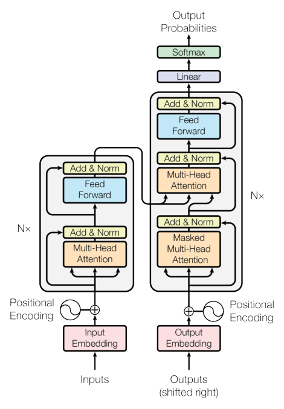
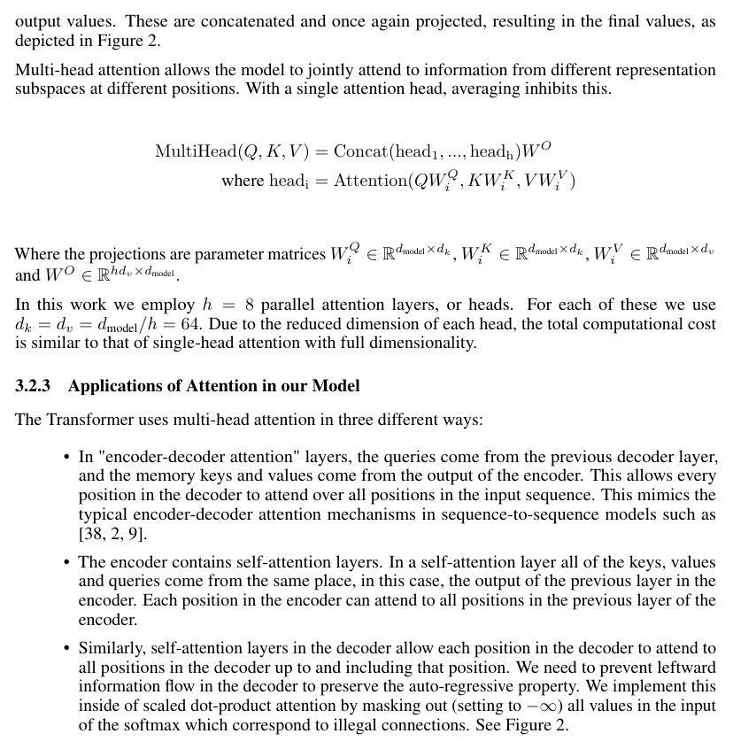
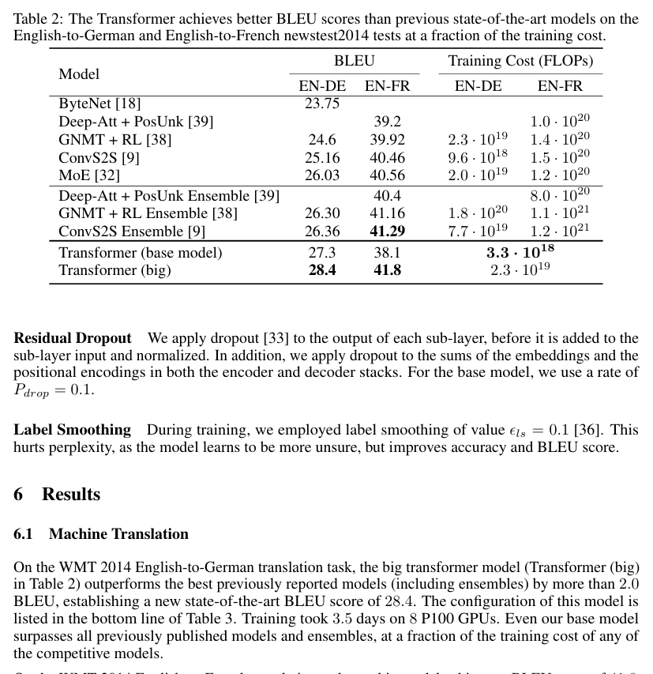
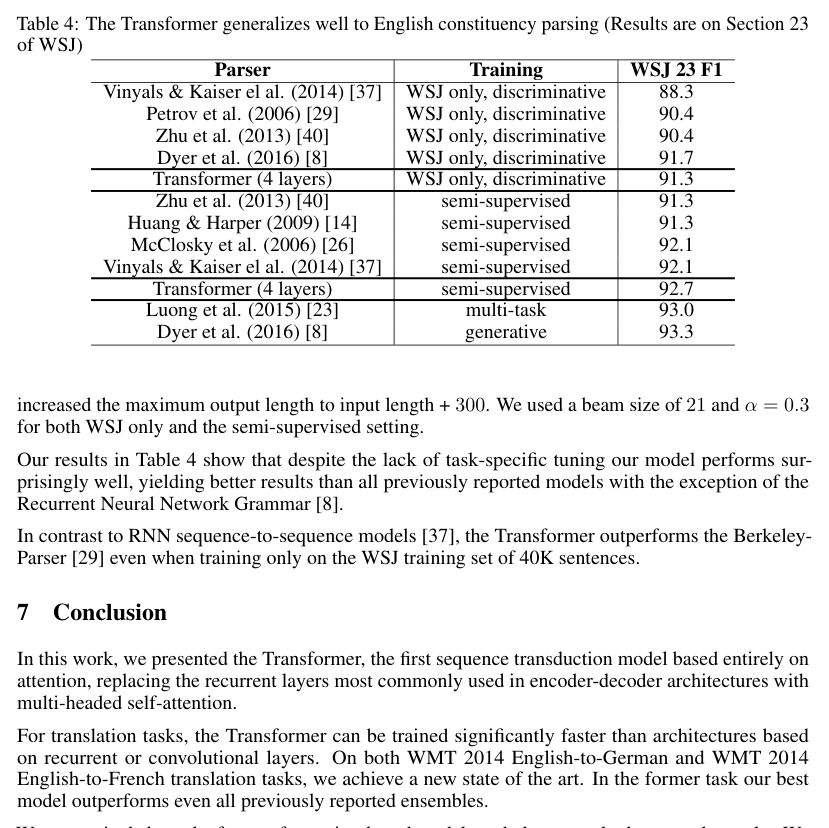
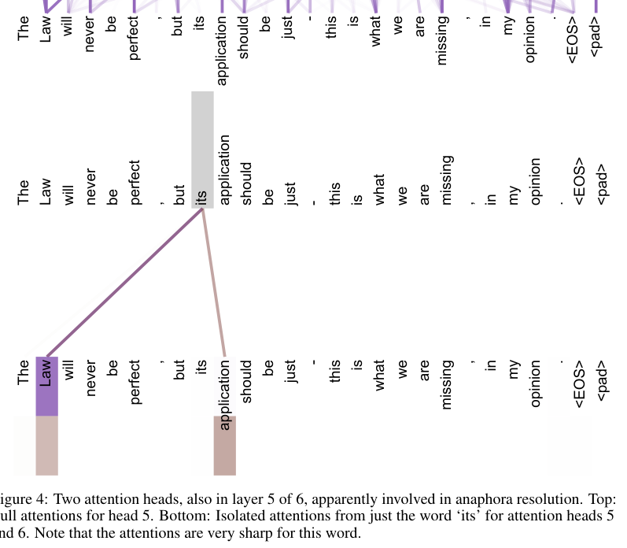
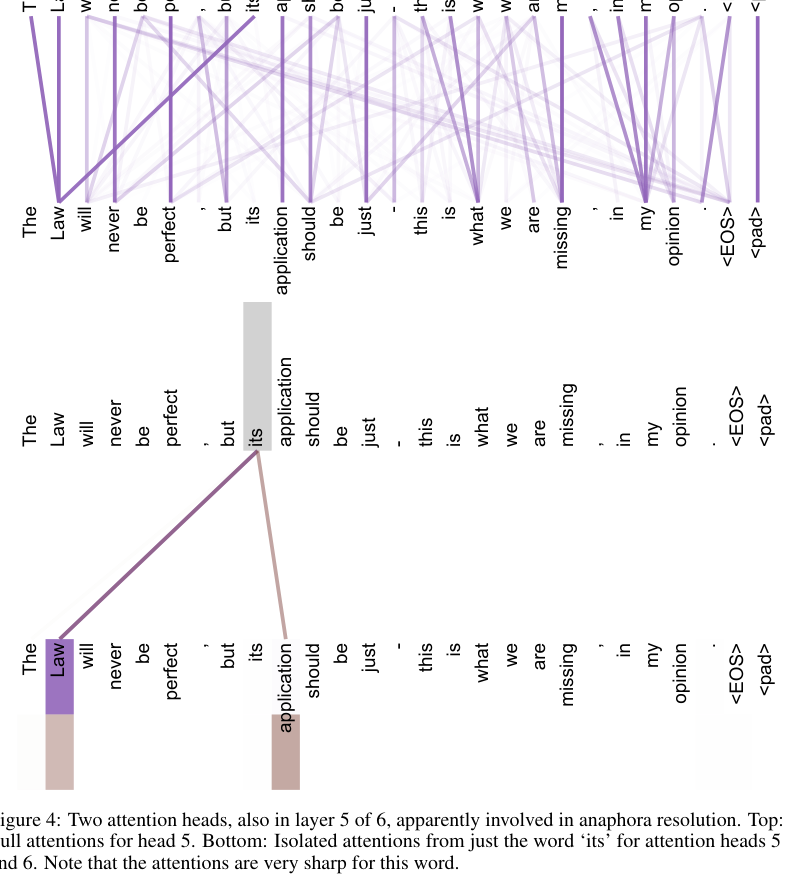

# Attention Is All You Need（注意力即一切）

> **论文信息**：Ashish Vaswani 等，Google Brain / Google Research / University of Toronto；发表于 31st Conference on Neural Information Processing Systems (NIPS 2017), Long Beach, CA, USA。arXiv:1706.03762v7 [cs.CL]。
> 本文档为全文双语对照翻译：每个段落先给 **Original:**（原文），换行后给 **中文:**（译文）。公式原样保留；图题、表题已翻译并标注原图页码。

---

## 版权声明（Copyright Notice）

**Original:** Provided proper attribution is provided, Google hereby grants permission to reproduce the tables and figures in this paper solely for use in journalistic or scholarly works.

**中文:** 在提供恰当署名的前提下，Google 特此授权：本论文中的表格与图仅可用于新闻或学术作品中的转载。

## 标题与作者（Title and Authors）

**Original:**
Attention Is All You Need

Ashish Vaswani∗ Google Brain avaswani@google.com
Noam Shazeer∗ Google Brain noam@google.com
Niki Parmar∗ Google Research nikip@google.com
Jakob Uszkoreit∗ Google Research usz@google.com
Llion Jones∗ Google Research llion@google.com
Aidan N. Gomez∗† University of Toronto aidan@cs.toronto.edu
Łukasz Kaiser∗ Google Brain lukaszkaiser@google.com
Illia Polosukhin∗‡ illia.polosukhin@gmail.com

**中文:**
注意力即一切

Ashish Vaswani∗，Google Brain，avaswani@google.com
Noam Shazeer∗，Google Brain，noam@google.com
Niki Parmar∗，Google Research，nikip@google.com
Jakob Uszkoreit∗，Google Research，usz@google.com
Llion Jones∗，Google Research，llion@google.com
Aidan N. Gomez∗†，University of Toronto，aidan@cs.toronto.edu
Łukasz Kaiser∗，Google Brain，lukaszkaiser@google.com
Illia Polosukhin∗‡，illia.polosukhin@gmail.com

**Original:**
∗Equal contribution. Listing order is random. Jakob proposed replacing RNNs with self-attention and started the effort to evaluate this idea. Ashish, with Illia, designed and implemented the first Transformer models and has been crucially involved in every aspect of this work. Noam proposed scaled dot-product attention, multi-head attention and the parameter-free position representation and became the other person involved in nearly every detail. Niki designed, implemented, tuned and evaluated countless model variants in our original codebase and tensor2tensor. Llion also experimented with novel model variants, was responsible for our initial codebase, and efficient inference and visualizations. Lukasz and Aidan spent countless long days designing various parts of and implementing tensor2tensor, replacing our earlier codebase, greatly improving results and massively accelerating our research.
†Work performed while at Google Brain.
‡Work performed while at Google Research.

**中文:**
∗贡献相同，作者按随机顺序排列。Jakob 提出用自注意力（Self-Attention）取代 RNN，并启动了评估这一想法的工作。Ashish 与 Illia 一起设计并实现了最初的 Transformer 模型，并且深入参与了这项工作的方方面面。Noam 提出了缩放点积注意力（scaled dot-product attention）、多头注意力（multi-head attention）和无参数的位置表示（position representation），是另一位几乎参与了每个细节的人。Niki 在我们的原始代码库和 tensor2tensor 中设计、实现、调参并评估了数不清的模型变体。Llion 也尝试了新颖的模型变体，负责我们最初的代码库、高效推理和可视化。Lukasz 和 Aidan 花了无数个漫长的日子设计 tensor2tensor 的各个部分并实现它，替换了我们早期的代码库，大幅改善了结果并极大加速了我们的研究。
†本工作在 Google Brain 任职期间完成。
‡本工作在 Google Research 任职期间完成。

---

## Abstract

**Original:** The dominant sequence transduction models are based on complex recurrent or convolutional neural networks that include an encoder and a decoder. The best performing models also connect the encoder and decoder through an attention mechanism. We propose a new simple network architecture, the Transformer, based solely on attention mechanisms, dispensing with recurrence and convolutions entirely.

**中文:** 主流的序列转换（sequence transduction）模型基于复杂的循环或卷积神经网络，其中包含一个编码器（encoder）和一个解码器（decoder）。性能最好的模型还通过注意力机制（attention mechanism）把编码器与解码器连接起来。我们提出一种新的简单网络架构——Transformer，它完全建立在注意力机制之上，彻底摒弃了循环（recurrence）与卷积（convolution）。

**Original:** Experiments on two machine translation tasks show these models to be superior in quality while being more parallelizable and requiring significantly less time to train. Our model achieves 28.4 BLEU on the WMT 2014 English-to-German translation task, improving over the existing best results, including ensembles, by over 2 BLEU.

**中文:** 在两个机器翻译任务上的实验表明，这些模型在质量上更优，同时并行性更强，所需训练时间显著更少。我们的模型在 WMT 2014 英语到德语翻译任务上取得了 28.4 的 BLEU 分数，比现有的最佳结果（包括集成模型（ensemble）在内）高出超过 2 个 BLEU。

**Original:** On the WMT 2014 English-to-French translation task, our model establishes a new single-model state-of-the-art BLEU score of 41.8 after training for 3.5 days on eight GPUs, a small fraction of the training costs of the best models from the literature.

**中文:** 在 WMT 2014 英语到法语翻译任务上，我们的模型在 8 块 GPU 上训练 3.5 天后，创下了单模型（single-model）当前最优（state-of-the-art）BLEU 分数 41.8，训练成本仅为文献中最佳模型的一小部分。

**Original:** We show that the Transformer generalizes well to other tasks by applying it successfully to English constituency parsing both with large and limited training data.

**中文:** 我们证明 Transformer 能够很好地泛化（generalize）到其他任务：将其应用于英语成分句法分析（English constituency parsing），无论使用大规模训练数据还是有限的训练数据，都取得了成功。

---

## 1 Introduction

**Original:** Recurrent neural networks, long short-term memory [13] and gated recurrent [7] neural networks in particular, have been firmly established as state of the art approaches in sequence modeling and transduction problems such as language modeling and machine translation [35, 2, 5]. Numerous efforts have since continued to push the boundaries of recurrent language models and encoder-decoder architectures [38, 24, 15].

**中文:** 循环神经网络（RNN）、尤其是长短期记忆网络（LSTM）[13] 与门控循环[7]神经网络，已经在序列建模和序列转换问题上被牢固确立为当前最优方法，例如语言建模和机器翻译 [35, 2, 5]。此后的大量工作不断推进循环语言模型与编码器-解码器架构的边界 [38, 24, 15]。

**Original:** Recurrent models typically factor computation along the symbol positions of the input and output sequences. Aligning the positions to steps in computation time, they generate a sequence of hidden states $h_t$, as a function of the previous hidden state $h_{t-1}$ and the input for position $t$. This inherently sequential nature precludes parallelization within training examples, which becomes critical at longer sequence lengths, as memory constraints limit batching across examples. Recent work has achieved significant improvements in computational efficiency through factorization tricks [21] and conditional computation [32], while also improving model performance in case of the latter. The fundamental constraint of sequential computation, however, remains.

**中文:** 循环模型通常把计算沿输入和输出序列的符号位置逐步展开。它们把位置与计算时间中的步对齐，生成一串隐藏状态 $h_t$，其中 $h_t$ 是前一隐藏状态 $h_{t-1}$ 与位置 $t$ 处输入的函数。这种固有的顺序性质使训练样本内部无法并行化，而这在序列长度较长时变得至关重要，因为内存限制制约了跨样本的批量（batching）处理。近期工作通过因式分解技巧 [21] 和条件计算 [32] 显著提高了计算效率，其中后者还同时改善了模型性能。然而，顺序计算这一根本性约束依然存在。

**Original:** Attention mechanisms have become an integral part of compelling sequence modeling and transduction models in various tasks, allowing modeling of dependencies without regard to their distance in the input or output sequences [2, 19]. In all but a few cases [27], however, such attention mechanisms are used in conjunction with a recurrent network.

**中文:** 注意力机制已经成为各种任务中有竞争力的序列建模与序列转换模型不可或缺的组成部分，它允许对依赖关系建模而不必顾及依赖在输入或输出序列中的距离 [2, 19]。然而，除了少数例外 [27]，此类注意力机制都是与循环网络结合使用的。

**Original:** In this work we propose the Transformer, a model architecture eschewing recurrence and instead relying entirely on an attention mechanism to draw global dependencies between input and output. The Transformer allows for significantly more parallelization and can reach a new state of the art in translation quality after being trained for as little as twelve hours on eight P100 GPUs.

**中文:** 在这项工作中，我们提出 Transformer——一种摒弃循环、完全依靠注意力机制来建立输入与输出之间全局依赖关系的模型架构。Transformer 支持显著更高的并行度，在 8 块 P100 GPU 上仅训练 12 小时即可达到翻译质量的新的当前最优水平。

## 2 Background

**Original:** The goal of reducing sequential computation also forms the foundation of the Extended Neural GPU [16], ByteNet [18] and ConvS2S [9], all of which use convolutional neural networks as basic building block, computing hidden representations in parallel for all input and output positions. In these models, the number of operations required to relate signals from two arbitrary input or output positions grows in the distance between positions, linearly for ConvS2S and logarithmically for ByteNet. This makes it more difficult to learn dependencies between distant positions [12]. In the Transformer this is reduced to a constant number of operations, albeit at the cost of reduced effective resolution due to averaging attention-weighted positions, an effect we counteract with Multi-Head Attention as described in section 3.2.

**中文:** 减少顺序计算的目标同样构成了 Extended Neural GPU [16]、ByteNet [18] 和 ConvS2S [9] 的基础，它们都以卷积神经网络为基本构件，对所有输入和输出位置并行计算隐藏表示。在这些模型中，把任意两个输入或输出位置上的信号关联起来所需的操作数随位置间距离增长——ConvS2S 呈线性增长，ByteNet 呈对数增长。这使得学习远距离位置之间的依赖关系更加困难 [12]。在 Transformer 中，这一操作数被降低到常数级别，代价是由于对注意力加权位置取平均而降低了有效分辨率，我们用 3.2 节所述的多头注意力来抵消这一影响。

**Original:** Self-attention, sometimes called intra-attention is an attention mechanism relating different positions of a single sequence in order to compute a representation of the sequence. Self-attention has been used successfully in a variety of tasks including reading comprehension, abstractive summarization, textual entailment and learning task-independent sentence representations [4, 27, 28, 22].

**中文:** 自注意力（self-attention），有时称为内部注意力（intra-attention），是一种把单一序列的不同位置关联起来、从而计算出该序列表示的注意力机制。自注意力已成功用于多种任务，包括阅读理解、抽取式与生成式摘要（abstractive summarization）、文本蕴含（textual entailment）以及学习与任务无关的句子表示 [4, 27, 28, 22]。

**Original:** End-to-end memory networks are based on a recurrent attention mechanism instead of sequence-aligned recurrence and have been shown to perform well on simple-language question answering and language modeling tasks [34].

**中文:** 端到端记忆网络（end-to-end memory networks）基于循环注意力机制而非按序列对齐的循环，并已被证明在简单语言的问答和语言建模任务上表现良好 [34]。

**Original:** To the best of our knowledge, however, the Transformer is the first transduction model relying entirely on self-attention to compute representations of its input and output without using sequence-aligned RNNs or convolution. In the following sections, we will describe the Transformer, motivate self-attention and discuss its advantages over models such as [17, 18] and [9].

**中文:** 然而据我们所知，Transformer 是第一个完全依靠自注意力、不使用按序列对齐的 RNN 或卷积来计算其输入与输出表示的转换模型。在接下来的章节中，我们将描述 Transformer、说明自注意力的动机，并讨论它相对于 [17, 18] 和 [9] 等模型的优势。

## 3 Model Architecture

**Original:** Most competitive neural sequence transduction models have an encoder-decoder structure [5, 2, 35]. Here, the encoder maps an input sequence of symbol representations $(x_1, ..., x_n)$ to a sequence of continuous representations $z = (z_1, ..., z_n)$. Given $z$, the decoder then generates an output sequence $(y_1, ..., y_m)$ of symbols one element at a time. At each step the model is auto-regressive [10], consuming the previously generated symbols as additional input when generating the next.

**中文:** 大多数有竞争力的神经序列转换模型采用编码器-解码器结构 [5, 2, 35]。其中，编码器把输入符号表示序列 $(x_1, ..., x_n)$ 映射为连续表示序列 $z = (z_1, ..., z_n)$。给定 $z$，解码器再逐元素地生成符号输出序列 $(y_1, ..., y_m)$。在每个步骤中模型都是自回归（auto-regressive）的 [10]：生成下一个符号时，把此前生成的符号作为额外输入一并使用。

**Original:** The Transformer follows this overall architecture using stacked self-attention and point-wise, fully connected layers for both the encoder and decoder, shown in the left and right halves of Figure 1, respectively.

**中文:** Transformer 遵循这一总体架构：编码器和解码器都使用堆叠的自注意力层与逐位置（point-wise）全连接层，分别如图 1 的左右两半所示。

> **图 1（译）**：Transformer——模型架构。（原图见 paper.pdf 第 3 页，见下方图）

### 3.1 Encoder and Decoder Stacks

**Original:** **Encoder:** The encoder is composed of a stack of $N = 6$ identical layers. Each layer has two sub-layers. The first is a multi-head self-attention mechanism, and the second is a simple, position-wise fully connected feed-forward network. We employ a residual connection [11] around each of the two sub-layers, followed by layer normalization [1]. That is, the output of each sub-layer is $\text{LayerNorm}(x + \text{Sublayer}(x))$, where $\text{Sublayer}(x)$ is the function implemented by the sub-layer itself. To facilitate these residual connections, all sub-layers in the model, as well as the embedding layers, produce outputs of dimension $d_{\text{model}} = 512$.

**中文:** **编码器（Encoder）：** 编码器由 $N = 6$ 个相同层的堆叠组成。每层有两个子层（sub-layer）。第一个是多头自注意力（multi-head self-attention）机制，第二个是简单的逐位置全连接前馈网络（feed-forward network）。我们在两个子层的周围各采用一个残差连接 [11]，随后接层归一化 [1]。也就是说，每个子层的输出是 $\text{LayerNorm}(x + \text{Sublayer}(x))$，其中 $\text{Sublayer}(x)$ 是子层自身实现的函数。为方便这些残差连接，模型中所有子层以及嵌入层（embedding layers）的输出维度均为 $d_{\text{model}} = 512$。

**Original:** **Decoder:** The decoder is also composed of a stack of $N = 6$ identical layers. In addition to the two sub-layers in each encoder layer, the decoder inserts a third sub-layer, which performs multi-head attention over the output of the encoder stack. Similar to the encoder, we employ residual connections around each of the sub-layers, followed by layer normalization. We also modify the self-attention sub-layer in the decoder stack to prevent positions from attending to subsequent positions. This masking, combined with fact that the output embeddings are offset by one position, ensures that the predictions for position $i$ can depend only on the known outputs at positions less than $i$.

**中文:** **解码器（Decoder）：** 解码器同样由 $N = 6$ 个相同层的堆叠组成。除了编码器每层中的两个子层之外，解码器还插入了第三个子层，它对编码器堆叠的输出执行多头注意力。与编码器类似，我们在每个子层周围采用残差连接，随后接层归一化。我们还修改了解码器堆叠中的自注意力子层，防止位置注意到后续位置。这种掩码（masking）加上输出嵌入偏移一个位置的事实，保证了位置 $i$ 的预测只能依赖于位置小于 $i$ 的已知输出。

### 3.2 Attention

**Original:** An attention function can be described as mapping a query and a set of key-value pairs to an output, where the query, keys, values, and output are all vectors. The output is computed as a weighted sum of the values, where the weight assigned to each value is computed by a compatibility function of the query with the corresponding key.

**中文:** 注意力函数可以被描述为：把一个查询（query）与一组键-值对（key-value pairs）映射为一个输出，其中查询、键、值和输出均为向量。输出被计算为值的加权和，赋给每个值的权重由查询与相应键的兼容性函数（compatibility function）计算得出。

> **图 2（译）**：（左）缩放点积注意力（Scaled Dot-Product Attention）。（右）多头注意力（Multi-Head Attention）由若干并行运行的注意力层组成。（原图见 paper.pdf 第 4 页，见下方图）

#### 3.2.1 Scaled Dot-Product Attention

**Original:** We call our particular attention "Scaled Dot-Product Attention" (Figure 2). The input consists of queries and keys of dimension $d_k$, and values of dimension $d_v$. We compute the dot products of the query with all keys, divide each by $\sqrt{d_k}$, and apply a softmax function to obtain the weights on the values.

**中文:** 我们把本文特有的注意力称为「缩放点积注意力（Scaled Dot-Product Attention）」（图 2）。输入由维度为 $d_k$ 的查询和键、以及维度为 $d_v$ 的值组成。我们计算查询与所有键的点积，将每个点积除以 $\sqrt{d_k}$，再应用 softmax 函数得到各个值的权重。

**Original:** In practice, we compute the attention function on a set of queries simultaneously, packed together into a matrix $Q$. The keys and values are also packed together into matrices $K$ and $V$. We compute the matrix of outputs as:

**中文:** 实际中，我们在一组查询上同时计算注意力函数，把它们打包进矩阵 $Q$。键和值也分别打包进矩阵 $K$ 和 $V$。输出矩阵按如下方式计算：

$$\text{Attention}(Q, K, V) = \text{softmax}\left(\frac{QK^T}{\sqrt{d_k}}\right)V \tag{1}$$

**Original:** The two most commonly used attention functions are additive attention [2], and dot-product (multiplicative) attention. Dot-product attention is identical to our algorithm, except for the scaling factor of $\frac{1}{\sqrt{d_k}}$. Additive attention computes the compatibility function using a feed-forward network with a single hidden layer. While the two are similar in theoretical complexity, dot-product attention is much faster and more space-efficient in practice, since it can be implemented using highly optimized matrix multiplication code.

**中文:** 最常用的两种注意力函数是加性注意力（additive attention）[2] 和点积（乘性）注意力。除缩放因子 $\frac{1}{\sqrt{d_k}}$ 之外，点积注意力与我们的算法完全相同。加性注意力使用带单个隐藏层的前馈网络计算兼容性函数。虽然两者在理论复杂度上相近，但点积注意力在实践中快得多、也节省得多，因为它可以用高度优化的矩阵乘法代码实现。

**Original:** While for small values of $d_k$ the two mechanisms perform similarly, additive attention outperforms dot product attention without scaling for larger values of $d_k$ [3]. We suspect that for large values of $d_k$, the dot products grow large in magnitude, pushing the softmax function into regions where it has extremely small gradients ⁴. To counteract this effect, we scale the dot products by $\frac{1}{\sqrt{d_k}}$.

**中文:** 对于较小的 $d_k$ 值，两种机制表现相近；而对于较大的 $d_k$ 值，加性注意力优于不做缩放的的点积注意力 [3]。我们怀疑：当 $d_k$ 很大时，点积的量级会变得很大，把 softmax 函数推入梯度极小的区域⁴。为抵消这一效应，我们将点积缩放 $\frac{1}{\sqrt{d_k}}$。

> **脚注 4（译）**：为说明点积为何会变大，假设 $q$ 和 $k$ 的分量是均值为 0、方差为 1 的独立随机变量。那么它们的点积 $q \cdot k = \sum_{i=1}^{d_k} q_i k_i$ 的均值为 0，方差为 $d_k$。

#### 3.2.2 Multi-Head Attention

**Original:** Instead of performing a single attention function with $d_{\text{model}}$-dimensional keys, values and queries, we found it beneficial to linearly project the queries, keys and values $h$ times with different, learned linear projections to $d_k$, $d_k$ and $d_v$ dimensions, respectively. On each of these projected versions of queries, keys and values we then perform the attention function in parallel, yielding $d_v$-dimensional output values. These are concatenated and once again projected, resulting in the final values, as depicted in Figure 2.

**中文:** 与对 $d_{\text{model}}$ 维的键、值和查询执行单次注意力函数不同，我们发现：用不同的、可学习的线性投影把查询、键和值分别线性投影 $h$ 次，映射到 $d_k$、$d_k$ 和 $d_v$ 维，是更有利的做法。然后，我们对这些投影后的查询、键和值的每个版本并行执行注意力函数，得到 $d_v$ 维的输出值。这些输出被拼接起来并再次投影，得到最终值，如图 2 所示。

**Original:** Multi-head attention allows the model to jointly attend to information from different representation subspaces at different positions. With a single attention head, averaging inhibits this.

**中文:** 多头注意力让模型能够在不同位置共同注意到来自不同表示子空间的信息。若只有一个注意力头，取平均会抑制这种能力。

$$\text{MultiHead}(Q, K, V) = \text{Concat}(\text{head}_1, ..., \text{head}_h)W^O$$
$$\text{where } \text{head}_i = \text{Attention}(QW_i^Q, KW_i^K, VW_i^V)$$

**Original:** Where the projections are parameter matrices $W_i^Q \in \mathbb{R}^{d_{\text{model}} \times d_k}$, $W_i^K \in \mathbb{R}^{d_{\text{model}} \times d_k}$, $W_i^V \in \mathbb{R}^{d_{\text{model}} \times d_v}$ and $W^O \in \mathbb{R}^{hd_v \times d_{\text{model}}}$.

**中文:** 其中投影为参数矩阵 $W_i^Q \in \mathbb{R}^{d_{\text{model}} \times d_k}$，$W_i^K \in \mathbb{R}^{d_{\text{model}} \times d_k}$，$W_i^V \in \mathbb{R}^{d_{\text{model}} \times d_v}$，$W^O \in \mathbb{R}^{hd_v \times d_{\text{model}}}$。

**Original:** In this work we employ $h = 8$ parallel attention layers, or heads. For each of these we use $d_k = d_v = d_{\text{model}}/h = 64$. Due to the reduced dimension of each head, the total computational cost is similar to that of single-head attention with full dimensionality.

**中文:** 本文采用 $h = 8$ 个并行注意力层（即注意力头）。对每个头，我们使用 $d_k = d_v = d_{\text{model}}/h = 64$。由于每个头的维度降低了，总计算代价与全维度的单头注意力相近。

#### 3.2.3 Applications of Attention in our Model

**Original:** The Transformer uses multi-head attention in three different ways:

**中文:** Transformer 以三种不同的方式使用多头注意力：

**Original:**
- In "encoder-decoder attention" layers, the queries come from the previous decoder layer, and the memory keys and values come from the output of the encoder. This allows every position in the decoder to attend over all positions in the input sequence. This mimics the typical encoder-decoder attention mechanisms in sequence-to-sequence models such as [38, 2, 9].
- The encoder contains self-attention layers. In a self-attention layer all of the keys, values and queries come from the same place, in this case, the output of the previous layer in the encoder. Each position in the encoder can attend to all positions in the previous layer of the encoder.
- Similarly, self-attention layers in the decoder allow each position in the decoder to attend to all positions in the decoder up to and including that position. We need to prevent leftward information flow in the decoder to preserve the auto-regressive property. We implement this inside of scaled dot-product attention by masking out (setting to $-\infty$) all values in the input of the softmax which correspond to illegal connections. See Figure 2.

**中文:**
- 在「编码器-解码器注意力（encoder-decoder attention）」层中，查询来自上一个解码器层，而记忆键和值来自编码器的输出。这使得解码器中的每个位置都能注意到输入序列的所有位置。这模仿了 [38, 2, 9] 等序列到序列模型中典型的编码器-解码器注意力机制。
- 编码器包含自注意力层。在自注意力层中，所有键、值和查询都来自同一处——在本例中是编码器中上一层的输出。编码器中的每个位置都可以注意到编码器上一层中的所有位置。
- 类似地，解码器中的自注意力层允许解码器中的每个位置注意到解码器中直到该位置为止（含该位置）的所有位置。为保持自回归性质，我们需要阻止解码器中的信息向左流动。我们在缩放点积注意力内部实现这一点：把 softmax 输入中对应于非法连接的所有值掩蔽掉（置为 $-\infty$）。见图 2。

### 3.3 Position-wise Feed-Forward Networks

**Original:** In addition to attention sub-layers, each of the layers in our encoder and decoder contains a fully connected feed-forward network, which is applied to each position separately and identically. This consists of two linear transformations with a ReLU activation in between.

**中文:** 除注意力子层外，我们编码器和解码器中的每一层都包含一个全连接前馈网络，它对每个位置分别且完全相同地应用。该网络由两个线性变换组成，中间夹着一个 ReLU 激活。

$$\text{FFN}(x) = \max(0, xW_1 + b_1)W_2 + b_2 \tag{2}$$

**Original:** While the linear transformations are the same across different positions, they use different parameters from layer to layer. Another way of describing this is as two convolutions with kernel size 1. The dimensionality of input and output is $d_{\text{model}} = 512$, and the inner-layer has dimensionality $d_{ff} = 2048$.

**中文:** 虽然线性变换在不同位置之间是相同的，但层与层之间使用的参数不同。另一种描述方式是：它相当于两个卷积核（kernel）大小为 1 的卷积。输入与输出的维度是 $d_{\text{model}} = 512$，内层的维度是 $d_{ff} = 2048$。

### 3.4 Embeddings and Softmax

**Original:** Similarly to other sequence transduction models, we use learned embeddings to convert the input tokens and output tokens to vectors of dimension $d_{\text{model}}$. We also use the usual learned linear transformation and softmax function to convert the decoder output to predicted next-token probabilities. In our model, we share the same weight matrix between the two embedding layers and the pre-softmax linear transformation, similar to [30]. In the embedding layers, we multiply those weights by $\sqrt{d_{\text{model}}}$.

**中文:** 与其他序列转换模型类似，我们使用学习得到的嵌入（embeddings）把输入 Token 和输出 Token 转换为维度为 $d_{\text{model}}$ 的向量。我们也使用通常的学习式线性变换与 softmax 函数，把解码器输出转换为预测的下一个 Token 概率。在我们的模型中，两个嵌入层与 pre-softmax 线性变换共享同一个权重矩阵，与 [30] 类似。在嵌入层中，我们将这些权重乘以 $\sqrt{d_{\text{model}}}$。

### 3.5 Positional Encoding

**Original:** Since our model contains no recurrence and no convolution, in order for the model to make use of the order of the sequence, we must inject some information about the relative or absolute position of the tokens in the sequence. To this end, we add "positional encodings" to the input embeddings at the bottoms of the encoder and decoder stacks. The positional encodings have the same dimension $d_{\text{model}}$ as the embeddings, so that the two can be summed. There are many choices of positional encodings, learned and fixed [9].

**中文:** 由于我们的模型既不含循环也不含卷积，为了让模型利用序列的顺序，我们必须注入一些关于 Token 在序列中相对或绝对位置的信息。为此，我们在编码器和解码器堆叠的底部，把「位置编码（positional encodings）」加到输入嵌入上。位置编码与嵌入具有相同的维度 $d_{\text{model}}$，因此两者可以相加。位置编码有许多种选择，有学习式的，也有固定的 [9]。

**Original:** In this work, we use sine and cosine functions of different frequencies:

**中文:** 本文使用不同频率的正弦和余弦函数：

$$PE_{(pos, 2i)} = \sin(pos/10000^{2i/d_{\text{model}}})$$
$$PE_{(pos, 2i+1)} = \cos(pos/10000^{2i/d_{\text{model}}})$$

**Original:** where $pos$ is the position and $i$ is the dimension. That is, each dimension of the positional encoding corresponds to a sinusoid. The wavelengths form a geometric progression from $2\pi$ to $10000 \cdot 2\pi$. We chose this function because we hypothesized it would allow the model to easily learn to attend by relative positions, since for any fixed offset $k$, $PE_{pos+k}$ can be represented as a linear function of $PE_{pos}$.

**中文:** 其中 $pos$ 是位置，$i$ 是维度。也就是说，位置编码的每个维度都对应一个正弦曲线。波长构成从 $2\pi$ 到 $10000 \cdot 2\pi$ 的几何级数。我们选择这个函数，是因为我们假设它能让模型轻松学会按相对位置进行注意：对于任何固定偏移量 $k$，$PE_{pos+k}$ 都可以表示为 $PE_{pos}$ 的线性函数。

**Original:** We also experimented with using learned positional embeddings [9] instead, and found that the two versions produced nearly identical results (see Table 3 row (E)). We chose the sinusoidal version because it may allow the model to extrapolate to sequence lengths longer than the ones encountered during training.

**中文:** 我们也尝试过改用学习式位置嵌入 [9]，发现两种版本产生几乎相同的结果（见表 3 第 (E) 行）。我们选择正弦版本，因为它可能使模型外推到比训练期间所见更长的序列长度。

## 4 Why Self-Attention

**Original:** In this section we compare various aspects of self-attention layers to the recurrent and convolutional layers commonly used for mapping one variable-length sequence of symbol representations $(x_1, ..., x_n)$ to another sequence of equal length $(z_1, ..., z_n)$, with $x_i, z_i \in \mathbb{R}^d$, such as a hidden layer in a typical sequence transduction encoder or decoder. Motivating our use of self-attention we consider three desiderata.

**中文:** 本节我们把自注意力层的各个方面与循环层、卷积层进行比较。这些层通常用于把一个变长的符号表示序列 $(x_1, ..., x_n)$ 映射为另一个等长序列 $(z_1, ..., z_n)$，其中 $x_i, z_i \in \mathbb{R}^d$，例如典型序列转换编码器或解码器中的隐藏层。为说明使用自注意力的动机，我们考虑三个诉求。

**Original:** One is the total computational complexity per layer. Another is the amount of computation that can be parallelized, as measured by the minimum number of sequential operations required.

**中文:** 其一是每层的总计算复杂度。其二是可并行化的计算量，以所需的最少顺序操作数来衡量。

**Original:** The third is the path length between long-range dependencies in the network. Learning long-range dependencies is a key challenge in many sequence transduction tasks. One key factor affecting the ability to learn such dependencies is the length of the paths forward and backward signals have to traverse in the network. The shorter these paths between any combination of positions in the input and output sequences, the easier it is to learn long-range dependencies [12]. Hence we also compare the maximum path length between any two input and output positions in networks composed of the different layer types.

**中文:** 其三是网络中长距离依赖之间的路径长度。学习长距离依赖是许多序列转换任务的关键挑战。影响学习此类依赖能力的一个关键因素，是前向信号与反向信号在网络中必须穿越的路径长度。输入和输出序列中任意位置组合之间的这些路径越短，就越容易学习长距离依赖 [12]。因此，我们还要比较由不同层类型组成的网络中任意两个输入与输出位置之间的最大路径长度。

**Original:** As noted in Table 1, a self-attention layer connects all positions with a constant number of sequentially executed operations, whereas a recurrent layer requires $O(n)$ sequential operations. In terms of computational complexity, self-attention layers are faster than recurrent layers when the sequence length $n$ is smaller than the representation dimensionality $d$, which is most often the case with sentence representations used by state-of-the-art models in machine translations, such as word-piece [38] and byte-pair [31] representations. To improve computational performance for tasks involving very long sequences, self-attention could be restricted to considering only a neighborhood of size $r$ in the input sequence centered around the respective output position. This would increase the maximum path length to $O(n/r)$. We plan to investigate this approach further in future work.

**中文:** 如表 1 所示，自注意力层用常数个顺序执行的操作连接所有位置，而循环层需要 $O(n)$ 个顺序操作。就计算复杂度而言，当序列长度 $n$ 小于表示维度 $d$ 时，自注意力层比循环层更快——机器翻译中当前最优模型使用的句子表示（如 WordPiece [38] 和字节对（byte-pair）[31] 表示）通常正是这种情况。为提升涉及超长序列的任务的计算性能，可以把自注意力限制为只考虑输入序列中以相应输出位置为中心、大小为 $r$ 的邻域。这会把最大路径长度增加到 $O(n/r)$。我们计划在未来的工作中进一步研究这种方法。

**Original:** A single convolutional layer with kernel width $k < n$ does not connect all pairs of input and output positions. Doing so requires a stack of $O(n/k)$ convolutional layers in the case of contiguous kernels, or $O(\log_k(n))$ in the case of dilated convolutions [18], increasing the length of the longest paths between any two positions in the network. Convolutional layers are generally more expensive than recurrent layers, by a factor of $k$. Separable convolutions [6], however, decrease the complexity considerably, to $O(k \cdot n \cdot d + n \cdot d^2)$. Even with $k = n$, however, the complexity of a separable convolution is equal to the combination of a self-attention layer and a point-wise feed-forward layer, the approach we take in our model.

**中文:** 卷积核宽度为 $k < n$ 的单个卷积层无法连接所有输入与输出位置对。要做到这一点，若使用连续卷积核则需要 $O(n/k)$ 个卷积层的堆叠，若使用空洞卷积（dilated convolutions）[18] 则需要 $O(\log_k(n))$ 层，这会增加网络中任意两个位置之间最长路径的长度。卷积层通常比循环层贵 $k$ 倍。不过，可分离卷积（separable convolutions）[6] 能把复杂度大幅降低到 $O(k \cdot n \cdot d + n \cdot d^2)$。然而，即使 $k = n$，可分离卷积的复杂度也等同于一个自注意力层加一个逐位置前馈层——这正是我们模型采用的做法。

**Original:** As side benefit, self-attention could yield more interpretable models. We inspect attention distributions from our models and present and discuss examples in the appendix. Not only do individual attention heads clearly learn to perform different tasks, many appear to exhibit behavior related to the syntactic and semantic structure of the sentences.

**中文:** 附带的好处是，自注意力可能产生更具可解释性的模型。我们检视了自己模型的注意力分布，并在附录中展示和讨论了示例。不仅各个注意力头明显学会了执行不同的任务，许多头还表现出与句子句法和语义结构相关的行为。

> **表 1（译）**：不同层类型的最大路径长度、每层复杂度与最少顺序操作数。$n$ 是序列长度，$d$ 是表示维度，$k$ 是卷积核大小，$r$ 是受限自注意力中的邻域大小。（原表见 paper.pdf 第 6 页，见下方图）

| 层类型（Layer Type） | 每层复杂度（Complexity per Layer） | 最少顺序操作数（Sequential Operations） | 最大路径长度（Maximum Path Length） |
|---|---|---|---|
| Self-Attention（自注意力） | $O(n^2 \cdot d)$ | $O(1)$ | $O(1)$ |
| Recurrent（循环） | $O(n \cdot d^2)$ | $O(n)$ | $O(n)$ |
| Convolutional（卷积） | $O(k \cdot n \cdot d^2)$ | $O(1)$ | $O(\log_k(n))$ |
| Self-Attention (restricted)（受限自注意力） | $O(r \cdot n \cdot d)$ | $O(1)$ | $O(n/r)$ |

## 5 Training

**Original:** This section describes the training regime for our models.

**中文:** 本节描述我们模型的训练方案。

### 5.1 Training Data and Batching

**Original:** We trained on the standard WMT 2014 English-German dataset consisting of about 4.5 million sentence pairs. Sentences were encoded using byte-pair encoding [3], which has a shared source-target vocabulary of about 37000 tokens. For English-French, we used the significantly larger WMT 2014 English-French dataset consisting of 36M sentences and split tokens into a 32000 word-piece vocabulary [38]. Sentence pairs were batched together by approximate sequence length. Each training batch contained a set of sentence pairs containing approximately 25000 source tokens and 25000 target tokens.

**中文:** 我们在标准的 WMT 2014 英语-德语数据集上训练，该数据集包含约 450 万个句子对。句子使用字节对编码（byte-pair encoding）[3] 进行编码，共享的源-目标词表（vocabulary）约含 37000 个 Token。对于英语-法语，我们使用了规模大得多的 WMT 2014 英语-法语数据集，包含 3600 万个句子，并把 Token 划分到一个 32000 大小的 WordPiece 词表中 [38]。句子对按近似序列长度分批（batched）。每个训练批次包含一组句子对，约含 25000 个源 Token 和 25000 个目标 Token。

### 5.2 Hardware and Schedule

**Original:** We trained our models on one machine with 8 NVIDIA P100 GPUs. For our base models using the hyperparameters described throughout the paper, each training step took about 0.4 seconds. We trained the base models for a total of 100,000 steps or 12 hours. For our big models, (described on the bottom line of table 3), step time was 1.0 seconds. The big models were trained for 300,000 steps (3.5 days).

**中文:** 我们在一台装有 8 块 NVIDIA P100 GPU 的机器上训练模型。对于采用全文所述超参数的基础模型（base model），每个训练步约耗时 0.4 秒。我们总共训练基础模型 100000 步，即 12 小时。对于大模型（big model，见表 3 最后一行），每步耗时 1.0 秒。大模型训练了 300000 步（3.5 天）。

### 5.3 Optimizer

**Original:** We used the Adam optimizer [20] with $\beta_1 = 0.9$, $\beta_2 = 0.98$ and $\epsilon = 10^{-9}$. We varied the learning rate over the course of training, according to the formula:

**中文:** 我们使用 Adam 优化器 [20]，参数为 $\beta_1 = 0.9$、$\beta_2 = 0.98$、$\epsilon = 10^{-9}$。我们在训练过程中按照下面的公式调整学习率：

$$lrate = d_{\text{model}}^{-0.5} \cdot \min(\text{step\_num}^{-0.5}, \text{step\_num} \cdot \text{warmup\_steps}^{-1.5}) \tag{3}$$

**Original:** This corresponds to increasing the learning rate linearly for the first `warmup_steps` training steps, and decreasing it thereafter proportionally to the inverse square root of the step number. We used `warmup_steps = 4000`.

**中文:** 这对应于在前 `warmup_steps` 个训练步内线性提高学习率，之后按步数的平方根倒数成比例地降低学习率。我们使用了 `warmup_steps = 4000`。

### 5.4 Regularization

**Original:** We employ three types of regularization during training:

**中文:** 我们在训练期间采用了三种正则化手段：

**Original:** **Residual Dropout** We apply dropout [33] to the output of each sub-layer, before it is added to the sub-layer input and normalized. In addition, we apply dropout to the sums of the embeddings and the positional encodings in both the encoder and decoder stacks. For the base model, we use a rate of $P_{drop} = 0.1$.

**中文:** **残差随机失活（Residual Dropout）** 我们对每个子层的输出应用随机失活 [33]，在其与子层输入相加并归一化之前进行。此外，我们在编码器和解码器两个堆叠中，对嵌入与位置编码之和也应用随机失活。对于基础模型，我们使用失活率 $P_{drop} = 0.1$。

**Original:** **Label Smoothing** During training, we employed label smoothing of value $\epsilon_{ls} = 0.1$ [36]. This hurts perplexity, as the model learns to be more unsure, but improves accuracy and BLEU score.

**中文:** **标签平滑（Label Smoothing）** 训练期间，我们采用了值为 $\epsilon_{ls} = 0.1$ 的标签平滑 [36]。这会损害困惑度，因为模型学会变得更加不确定，但能提升准确率和 BLEU 分数。

## 6 Results

### 6.1 Machine Translation

**Original:** On the WMT 2014 English-to-German translation task, the big transformer model (Transformer (big) in Table 2) outperforms the best previously reported models (including ensembles) by more than 2.0 BLEU, establishing a new state-of-the-art BLEU score of 28.4. The configuration of this model is listed in the bottom line of Table 3. Training took 3.5 days on 8 P100 GPUs. Even our base model surpasses all previously published models and ensembles, at a fraction of the training cost of any of the competitive models.

**中文:** 在 WMT 2014 英语到德语翻译任务上，大 Transformer 模型（表 2 中的 Transformer (big)）比此前报告的最佳模型（包括集成模型）高出 2.0 个 BLEU 以上，创下 28.4 的新的当前最优 BLEU 分数。该模型的配置列于表 3 的最后一行。训练在 8 块 P100 GPU 上耗时 3.5 天。即便是我们的基础模型，也以任何竞争模型训练成本的零头，超越了所有此前发表的模型和集成模型。

**Original:** On the WMT 2014 English-to-French translation task, our big model achieves a BLEU score of 41.0, outperforming all of the previously published single models, at less than 1/4 the training cost of the previous state-of-the-art model. The Transformer (big) model trained for English-to-French used dropout rate $P_{drop} = 0.1$, instead of 0.3.

**中文:** 在 WMT 2014 英语到法语翻译任务上，我们的大模型取得了 41.0 的 BLEU 分数，超越了所有此前发表的单模型，而训练成本不到此前当前最优模型的 1/4。[译注：此处 41.0 与 Abstract 中的 41.8 不一致，为 arXiv v7 版本原文如此。] 用于英语到法语训练的 Transformer (big) 模型使用的随机失活率为 $P_{drop} = 0.1$，而非 0.3。

**Original:** For the base models, we used a single model obtained by averaging the last 5 checkpoints, which were written at 10-minute intervals. For the big models, we averaged the last 20 checkpoints. We used beam search with a beam size of 4 and length penalty $\alpha = 0.6$ [38]. These hyperparameters were chosen after experimentation on the development set. We set the maximum output length during inference to input length + 50, but terminate early when possible [38].

**中文:** 对于基础模型，我们使用由最后 5 个检查点（checkpoint）平均得到的单一模型，这些检查点每隔 10 分钟写入一次。对于大模型，我们对最后 20 个检查点取平均。我们使用束搜索（beam search），束宽为 4，长度惩罚 $\alpha = 0.6$ [38]。这些超参数是在开发集上实验后选定的。推理期间，我们把最大输出长度设为输入长度 + 50，但尽可能提前终止 [38]。

**Original:** Table 2 summarizes our results and compares our translation quality and training costs to other model architectures from the literature. We estimate the number of floating point operations used to train a model by multiplying the training time, the number of GPUs used, and an estimate of the sustained single-precision floating-point capacity of each GPU ⁵.

**中文:** 表 2 总结了我们的结果，并把我们的翻译质量与训练成本和文献中其他模型架构进行比较。我们通过将训练时间、所用 GPU 数量以及每块 GPU 的持续单精度浮点运算能力估计值相乘，来估计训练一个模型所用的浮点运算次数⁵。

> **脚注 5（译）**：我们对 K80、K40、M40 和 P100 分别使用了 2.8、3.7、6.0 和 9.5 TFLOPS 的数值。

> **表 2（译）**：Transformer 在英语到德语与英语到法语的 newstest2014 测试集上取得了比此前当前最优模型更好的 BLEU 分数，而训练成本仅为后者的一小部分。（原表见 paper.pdf 第 8 页，见下方图）

| Model | BLEU EN-DE | BLEU EN-FR | 训练成本（FLOPs）EN-DE | 训练成本（FLOPs）EN-FR |
|---|---|---|---|---|
| ByteNet [18] | 23.75 | | | |
| Deep-Att + PosUnk [39] | | 39.2 | | $1.0 \cdot 10^{20}$ |
| GNMT + RL [38] | 24.6 | 39.92 | $2.3 \cdot 10^{19}$ | $1.4 \cdot 10^{20}$ |
| ConvS2S [9] | 25.16 | 40.46 | $9.6 \cdot 10^{18}$ | $1.5 \cdot 10^{20}$ |
| MoE [32] | 26.03 | 40.56 | $2.0 \cdot 10^{19}$ | $1.2 \cdot 10^{20}$ |
| Deep-Att + PosUnk Ensemble [39] | | 40.4 | | $8.0 \cdot 10^{20}$ |
| GNMT + RL Ensemble [38] | 26.30 | 41.16 | $1.8 \cdot 10^{20}$ | $1.1 \cdot 10^{21}$ |
| ConvS2S Ensemble [9] | 26.36 | 41.29 | $7.7 \cdot 10^{19}$ | $1.2 \cdot 10^{21}$ |
| Transformer (base model) | 27.3 | 38.1 | | $3.3 \cdot 10^{18}$ |
| Transformer (big) | 28.4 | 41.8 | | $2.3 \cdot 10^{19}$ |

### 6.2 Model Variations

**Original:** To evaluate the importance of different components of the Transformer, we varied our base model in different ways, measuring the change in performance on English-to-German translation on the development set, newstest2013. We used beam search as described in the previous section, but no checkpoint averaging. We present these results in Table 3.

**中文:** 为评估 Transformer 不同组成部分的重要性，我们以不同方式改变基础模型，在开发集 newstest2013 上测量英语到德语翻译的性能变化。我们使用上一节所述的束搜索，但不做检查点平均。结果见表 3。

**Original:** In Table 3 rows (A), we vary the number of attention heads and the attention key and value dimensions, keeping the amount of computation constant, as described in Section 3.2.2. While single-head attention is 0.9 BLEU worse than the best setting, quality also drops off with too many heads.

**中文:** 在表 3 的 (A) 行中，我们按 3.2.2 节所述，在保持计算量不变的前提下，改变注意力头的数量以及注意力键和值的维度。单头注意力比最佳设置差 0.9 个 BLEU，而头过多时质量也会下降。

**Original:** In Table 3 rows (B), we observe that reducing the attention key size $d_k$ hurts model quality. This suggests that determining compatibility is not easy and that a more sophisticated compatibility function than dot product may be beneficial. We further observe in rows (C) and (D) that, as expected, bigger models are better, and dropout is very helpful in avoiding over-fitting. In row (E) we replace our sinusoidal positional encoding with learned positional embeddings [9], and observe nearly identical results to the base model.

**中文:** 在表 3 的 (B) 行中，我们观察到减小注意力键的大小 $d_k$ 会损害模型质量。这表明确定兼容性并不容易，比点积更精细的兼容性函数可能会带来好处。我们在 (C) 和 (D) 行中进一步观察到，符合预期的是：更大的模型更好，随机失活对避免过拟合非常有帮助。在 (E) 行中，我们用学习式位置嵌入 [9] 替换正弦位置编码，观察到与基础模型几乎相同的结果。

> **表 3（译）**：Transformer 架构的变体。未列出的值均与基础模型相同。所有指标均在英语到德语翻译开发集 newstest2013 上测得。所列困惑度按我们的字节对编码为每 WordPiece 的困惑度，不应与逐词困惑度比较。（原表见 paper.pdf 第 9 页，见下方图）

| 变体 | $N$ | $d_{\text{model}}$ | $d_{ff}$ | $h$ | $d_k$ | $d_v$ | $P_{drop}$ | $\epsilon_{ls}$ | train steps | PPL (dev) | BLEU (dev) | params $\times 10^6$ |
|---|---|---|---|---|---|---|---|---|---|---|---|---|
| base（基础） | 6 | 512 | 2048 | 8 | 64 | 64 | 0.1 | 0.1 | 100K | 4.92 | 25.8 | 65 |
| (A) | | | | 1 | 512 | 512 | | | | 5.29 | 24.9 | |
| | | | | 4 | 128 | 128 | | | | 5.00 | 25.5 | |
| | | | | 16 | 32 | 32 | | | | 4.91 | 25.8 | |
| | | | | 32 | 16 | 16 | | | | 5.01 | 25.4 | |
| (B) | | | | | 16 | | | | | 5.16 | 25.1 | 58 |
| | | | | | 32 | | | | | 5.01 | 25.4 | 60 |
| (C) | 2 | | | | | | | | | 6.11 | 23.7 | 36 |
| | 4 | | | | | | | | | 5.19 | 25.3 | 50 |
| | 8 | | | | | | | | | 4.88 | 25.5 | 80 |
| | | 256 | | | 32 | 32 | | | | 5.75 | 24.5 | 28 |
| | | 1024 | | | 128 | 128 | | | | 4.66 | 26.0 | 168 |
| | | | 1024 | | | | | | | 5.12 | 25.4 | 53 |
| | | | 4096 | | | | | | | 4.75 | 26.2 | 90 |
| (D) | | | | | | | 0.0 | | | 5.77 | 24.6 | |
| | | | | | | | 0.2 | | | 4.95 | 25.5 | |
| | | | | | | | | 0.0 | | 4.67 | 25.3 | |
| | | | | | | | | 0.2 | | 5.47 | 25.7 | |
| (E) | positional embedding instead of sinusoids（学习式位置嵌入取代正弦编码） | | | | | | | | | 4.92 | 25.7 | |
| big（大） | 6 | 1024 | 4096 | 16 | | | 0.3 | | 300K | 4.33 | 26.4 | 213 |

### 6.3 English Constituency Parsing

**Original:** To evaluate if the Transformer can generalize to other tasks we performed experiments on English constituency parsing. This task presents specific challenges: the output is subject to strong structural constraints and is significantly longer than the input. Furthermore, RNN sequence-to-sequence models have not been able to attain state-of-the-art results in small-data regimes [37].

**中文:** 为评估 Transformer 能否泛化到其他任务，我们在英语成分句法分析上做了实验。该任务带来特定的挑战：输出受到很强的结构约束，且显著长于输入。此外，RNN 序列到序列模型一直未能在小数据情形下取得当前最优结果 [37]。

**Original:** We trained a 4-layer transformer with $d_{\text{model}} = 1024$ on the Wall Street Journal (WSJ) portion of the Penn Treebank [25], about 40K training sentences. We also trained it in a semi-supervised setting, using the larger high-confidence and BerkleyParser corpora from with approximately 17M sentences [37]. We used a vocabulary of 16K tokens for the WSJ only setting and a vocabulary of 32K tokens for the semi-supervised setting.

**中文:** 我们在 Penn Treebank [25] 的 Wall Street Journal（WSJ）部分上训练了一个 4 层、$d_{\text{model}} = 1024$ 的 Transformer，训练语料约 4 万句。我们还在半监督设置下训练了它，使用更大的高置信度和 BerkleyParser 语料，约 1700 万句 [37]。在仅用 WSJ 的设置中我们使用 16K Token 的词表，在半监督设置中使用 32K Token 的词表。

**Original:** We performed only a small number of experiments to select the dropout, both attention and residual (section 5.4), learning rates and beam size on the Section 22 development set, all other parameters remained unchanged from the English-to-German base translation model. During inference, we increased the maximum output length to input length + 300. We used a beam size of 21 and $\alpha = 0.3$ for both WSJ only and the semi-supervised setting.

**中文:** 我们只进行了少量实验，在 Section 22 开发集上选定随机失活（注意力失活与残差失活，见 5.4 节）、学习率和束宽，所有其他参数均与英语到德语基础翻译模型保持一致。推理期间，我们把最大输出长度增加到输入长度 + 300。在仅用 WSJ 和半监督两种设置下，我们都使用束宽 21 和 $\alpha = 0.3$。

**Original:** Our results in Table 4 show that despite the lack of task-specific tuning our model performs surprisingly well, yielding better results than all previously reported models with the exception of the Recurrent Neural Network Grammar [8].

**中文:** 表 4 中的结果表明，尽管缺乏任务特定的调参，我们的模型仍表现出奇地好，结果优于除循环神经网络文法（Recurrent Neural Network Grammar）[8] 之外的所有此前报告的模型。

**Original:** In contrast to RNN sequence-to-sequence models [37], the Transformer outperforms the Berkeley-Parser [29] even when training only on the WSJ training set of 40K sentences.

**中文:** 与 RNN 序列到序列模型 [37] 形成对照的是，Transformer 即使仅在 4 万句的 WSJ 训练集上训练，也超越了 Berkeley-Parser [29]。

> **表 4（译）**：Transformer 在英语成分句法分析上泛化良好（结果为 WSJ Section 23 上的结果）。（原表见 paper.pdf 第 10 页，见下方图）

| Parser（句法分析器） | Training（训练方式） | WSJ 23 F1 |
|---|---|---|
| Vinyals & Kaiser el al. (2014) [37] | WSJ only, discriminative（仅 WSJ，判别式） | 88.3 |
| Petrov et al. (2006) [29] | WSJ only, discriminative | 90.4 |
| Zhu et al. (2013) [40] | WSJ only, discriminative | 90.4 |
| Dyer et al. (2016) [8] | WSJ only, discriminative | 91.7 |
| Transformer (4 layers) | WSJ only, discriminative | 91.3 |
| Zhu et al. (2013) [40] | semi-supervised（半监督） | 91.3 |
| Huang & Harper (2009) [14] | semi-supervised | 91.3 |
| McClosky et al. (2006) [26] | semi-supervised | 92.1 |
| Vinyals & Kaiser el al. (2014) [37] | semi-supervised | 92.1 |
| Transformer (4 layers) | semi-supervised | 92.7 |
| Luong et al. (2015) [23] | multi-task（多任务） | 93.0 |
| Dyer et al. (2016) [8] | generative（生成式） | 93.3 |

## 7 Conclusion

**Original:** In this work, we presented the Transformer, the first sequence transduction model based entirely on attention, replacing the recurrent layers most commonly used in encoder-decoder architectures with multi-headed self-attention.

**中文:** 在这项工作中，我们提出了 Transformer——第一个完全基于注意力的序列转换模型，用多头自注意力取代了编码器-解码器架构中最常用的循环层。

**Original:** For translation tasks, the Transformer can be trained significantly faster than architectures based on recurrent or convolutional layers. On both WMT 2014 English-to-German and WMT 2014 English-to-French translation tasks, we achieve a new state of the art. In the former task our best model outperforms even all previously reported ensembles.

**中文:** 对于翻译任务，Transformer 的训练速度显著快于基于循环层或卷积层的架构。在 WMT 2014 英语到德语和 WMT 2014 英语到法语两个翻译任务上，我们都取得了新的当前最优。在前一个任务上，我们的最佳模型甚至超越了所有此前报告的集成模型。

**Original:** We are excited about the future of attention-based models and plan to apply them to other tasks. We plan to extend the Transformer to problems involving input and output modalities other than text and to investigate local, restricted attention mechanisms to efficiently handle large inputs and outputs such as images, audio and video. Making generation less sequential is another research goals of ours.

**中文:** 我们对基于注意力的模型的未来感到兴奋，并计划把它们应用到其他任务。我们计划把 Transformer 扩展到输入和输出模态不是文本的问题上，并研究局部的、受限的注意力机制，以高效处理图像、音频和视频等大型输入与输出。让生成过程少一些顺序性，是我们的另一个研究目标。[译注：原文 "another research goals" 单复数不一致，系原文笔误，按原意译出。]

**Original:** The code we used to train and evaluate our models is available at https://github.com/tensorflow/tensor2tensor.

**中文:** 我们用于训练和评估模型的代码可在 https://github.com/tensorflow/tensor2tensor 获取。

## Acknowledgements

**Original:** We are grateful to Nal Kalchbrenner and Stephan Gouws for their fruitful comments, corrections and inspiration.

**中文:** 我们感谢 Nal Kalchbrenner 和 Stephan Gouws 富有成效的意见、指正与启发。

---

## References

（按翻译规范，参考文献整体保留原文，不翻译。）

[1] Jimmy Lei Ba, Jamie Ryan Kiros, and Geoffrey E Hinton. Layer normalization. arXiv preprint arXiv:1607.06450, 2016.

[2] Dzmitry Bahdanau, Kyunghyun Cho, and Yoshua Bengio. Neural machine translation by jointly learning to align and translate. CoRR, abs/1409.0473, 2014.

[3] Denny Britz, Anna Goldie, Minh-Thang Luong, and Quoc V. Le. Massive exploration of neural machine translation architectures. CoRR, abs/1703.03906, 2017.

[4] Jianpeng Cheng, Li Dong, and Mirella Lapata. Long short-term memory-networks for machine reading. arXiv preprint arXiv:1601.06733, 2016.

[5] Kyunghyun Cho, Bart van Merrienboer, Caglar Gulcehre, Fethi Bougares, Holger Schwenk, and Yoshua Bengio. Learning phrase representations using rnn encoder-decoder for statistical machine translation. CoRR, abs/1406.1078, 2014.

[6] Francois Chollet. Xception: Deep learning with depthwise separable convolutions. arXiv preprint arXiv:1610.02357, 2016.

[7] Junyoung Chung, Çaglar Gülçehre, Kyunghyun Cho, and Yoshua Bengio. Empirical evaluation of gated recurrent neural networks on sequence modeling. CoRR, abs/1412.3555, 2014.

[8] Chris Dyer, Adhiguna Kuncoro, Miguel Ballesteros, and Noah A. Smith. Recurrent neural network grammars. In Proc. of NAACL, 2016.

[9] Jonas Gehring, Michael Auli, David Grangier, Denis Yarats, and Yann N. Dauphin. Convolutional sequence to sequence learning. arXiv preprint arXiv:1705.03122v2, 2017.

[10] Alex Graves. Generating sequences with recurrent neural networks. arXiv preprint arXiv:1308.0850, 2013.

[11] Kaiming He, Xiangyu Zhang, Shaoqing Ren, and Jian Sun. Deep residual learning for image recognition. In Proceedings of the IEEE Conference on Computer Vision and Pattern Recognition, pages 770–778, 2016.

[12] Sepp Hochreiter, Yoshua Bengio, Paolo Frasconi, and Jürgen Schmidhuber. Gradient flow in recurrent nets: the difficulty of learning long-term dependencies, 2001.

[13] Sepp Hochreiter and Jürgen Schmidhuber. Long short-term memory. Neural computation, 9(8):1735–1780, 1997.

[14] Zhongqiang Huang and Mary Harper. Self-training PCFG grammars with latent annotations across languages. In Proceedings of the 2009 Conference on Empirical Methods in Natural Language Processing, pages 832–841. ACL, August 2009.

[15] Rafal Jozefowicz, Oriol Vinyals, Mike Schuster, Noam Shazeer, and Yonghui Wu. Exploring the limits of language modeling. arXiv preprint arXiv:1602.02410, 2016.

[16] Łukasz Kaiser and Samy Bengio. Can active memory replace attention? In Advances in Neural Information Processing Systems, (NIPS), 2016.

[17] Łukasz Kaiser and Ilya Sutskever. Neural GPUs learn algorithms. In International Conference on Learning Representations (ICLR), 2016.

[18] Nal Kalchbrenner, Lasse Espeholt, Karen Simonyan, Aaron van den Oord, Alex Graves, and Koray Kavukcuoglu. Neural machine translation in linear time. arXiv preprint arXiv:1610.10099v2, 2017.

[19] Yoon Kim, Carl Denton, Luong Hoang, and Alexander M. Rush. Structured attention networks. In International Conference on Learning Representations, 2017.

[20] Diederik Kingma and Jimmy Ba. Adam: A method for stochastic optimization. In ICLR, 2015.

[21] Oleksii Kuchaiev and Boris Ginsburg. Factorization tricks for LSTM networks. arXiv preprint arXiv:1703.10722, 2017.

[22] Zhouhan Lin, Minwei Feng, Cicero Nogueira dos Santos, Mo Yu, Bing Xiang, Bowen Zhou, and Yoshua Bengio. A structured self-attentive sentence embedding. arXiv preprint arXiv:1703.03130, 2017.

[23] Minh-Thang Luong, Quoc V. Le, Ilya Sutskever, Oriol Vinyals, and Lukasz Kaiser. Multi-task sequence to sequence learning. arXiv preprint arXiv:1511.06114, 2015.

[24] Minh-Thang Luong, Hieu Pham, and Christopher D Manning. Effective approaches to attention-based neural machine translation. arXiv preprint arXiv:1508.04025, 2015.

[25] Mitchell P Marcus, Mary Ann Marcinkiewicz, and Beatrice Santorini. Building a large annotated corpus of english: The penn treebank. Computational linguistics, 19(2):313–330, 1993.

[26] David McClosky, Eugene Charniak, and Mark Johnson. Effective self-training for parsing. In Proceedings of the Human Language Technology Conference of the NAACL, Main Conference, pages 152–159. ACL, June 2006.

[27] Ankur Parikh, Oscar Täckström, Dipanjan Das, and Jakob Uszkoreit. A decomposable attention model. In Empirical Methods in Natural Language Processing, 2016.

[28] Romain Paulus, Caiming Xiong, and Richard Socher. A deep reinforced model for abstractive summarization. arXiv preprint arXiv:1705.04304, 2017.

[29] Slav Petrov, Leon Barrett, Romain Thibaux, and Dan Klein. Learning accurate, compact, and interpretable tree annotation. In Proceedings of the 21st International Conference on Computational Linguistics and 44th Annual Meeting of the ACL, pages 433–440. ACL, July 2006.

[30] Ofir Press and Lior Wolf. Using the output embedding to improve language models. arXiv preprint arXiv:1608.05859, 2016.

[31] Rico Sennrich, Barry Haddow, and Alexandra Birch. Neural machine translation of rare words with subword units. arXiv preprint arXiv:1508.07909, 2015.

[32] Noam Shazeer, Azalia Mirhoseini, Krzysztof Maziarz, Andy Davis, Quoc Le, Geoffrey Hinton, and Jeff Dean. Outrageously large neural networks: The sparsely-gated mixture-of-experts layer. arXiv preprint arXiv:1701.06538, 2017.

[33] Nitish Srivastava, Geoffrey E Hinton, Alex Krizhevsky, Ilya Sutskever, and Ruslan Salakhutdinov. Dropout: a simple way to prevent neural networks from overfitting. Journal of Machine Learning Research, 15(1):1929–1958, 2014.

[34] Sainbayar Sukhbaatar, Arthur Szlam, Jason Weston, and Rob Fergus. End-to-end memory networks. In C. Cortes, N. D. Lawrence, D. D. Lee, M. Sugiyama, and R. Garnett, editors, Advances in Neural Information Processing Systems 28, pages 2440–2448. Curran Associates, Inc., 2015.

[35] Ilya Sutskever, Oriol Vinyals, and Quoc VV Le. Sequence to sequence learning with neural networks. In Advances in Neural Information Processing Systems, pages 3104–3112, 2014.

[36] Christian Szegedy, Vincent Vanhoucke, Sergey Ioffe, Jonathon Shlens, and Zbigniew Wojna. Rethinking the inception architecture for computer vision. CoRR, abs/1512.00567, 2015.

[37] Vinyals & Kaiser, Koo, Petrov, Sutskever, and Hinton. Grammar as a foreign language. In Advances in Neural Information Processing Systems, 2015.

[38] Yonghui Wu, Mike Schuster, Zhifeng Chen, Quoc V Le, Mohammad Norouzi, Wolfgang Macherey, Maxim Krikun, Yuan Cao, Qin Gao, Klaus Macherey, et al. Google's neural machine translation system: Bridging the gap between human and machine translation. arXiv preprint arXiv:1609.08144, 2016.

[39] Jie Zhou, Ying Cao, Xuguang Wang, Peng Li, and Wei Xu. Deep recurrent models with fast-forward connections for neural machine translation. CoRR, abs/1606.04199, 2016.

[40] Muhua Zhu, Yue Zhang, Wenliang Chen, Min Zhang, and Jingbo Zhu. Fast and accurate shift-reduce constituent parsing. In Proceedings of the 51st Annual Meeting of the ACL (Volume 1: Long Papers), pages 434–443. ACL, August 2013.

---

## 附录：注意力可视化（Appendix: Attention Visualizations）

> 说明：原论文附录包含三幅注意力可视化图（图 3–图 5）。图中左右两侧是成对排列的句词列表（属于图像内容，此处不复现词表），图题为译文如下。

> **图 3（译）**：注意力机制追踪长距离依赖的一个示例：编码器第 6 层中第 5 层的自注意力（即 6 层中的第 5 层）。许多注意力头注意到了动词 "making" 的远距离依赖，补全了短语 "making...more difficult"。此处仅展示词 "making" 的注意力。不同颜色代表不同注意力头。彩色显示效果最佳。（原图见 paper.pdf 第 13 页，见下方图）

> **图 4（译）**：同样位于 6 层中的第 5 层的两个注意力头，似乎参与了指代消解。上图：头 5 的完整注意力。下图：仅词 "its" 在注意力头 5 和头 6 上的孤立注意力。注意，该词的注意力非常集中。（原图见 paper.pdf 第 14 页，见下方图）

> **图 5（译）**：许多注意力头表现出似乎与句子结构相关的行为。上方给出了两个这样的例子，来自编码器自注意力 6 层中第 5 层的两个不同注意力头。这些头明显学会了执行不同的任务。（原图见 paper.pdf 第 15 页，见下方图）

