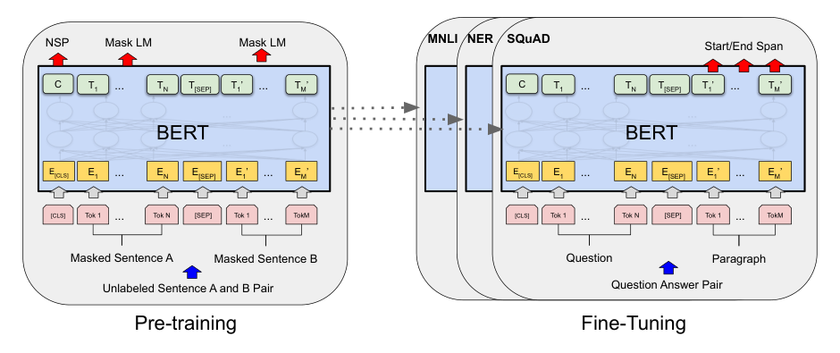
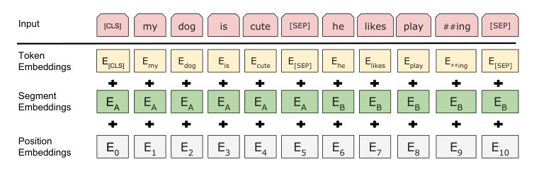
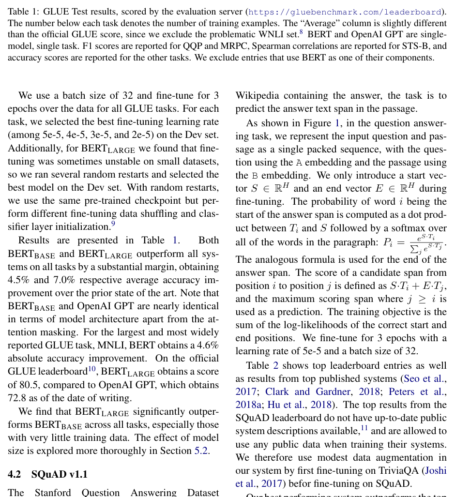
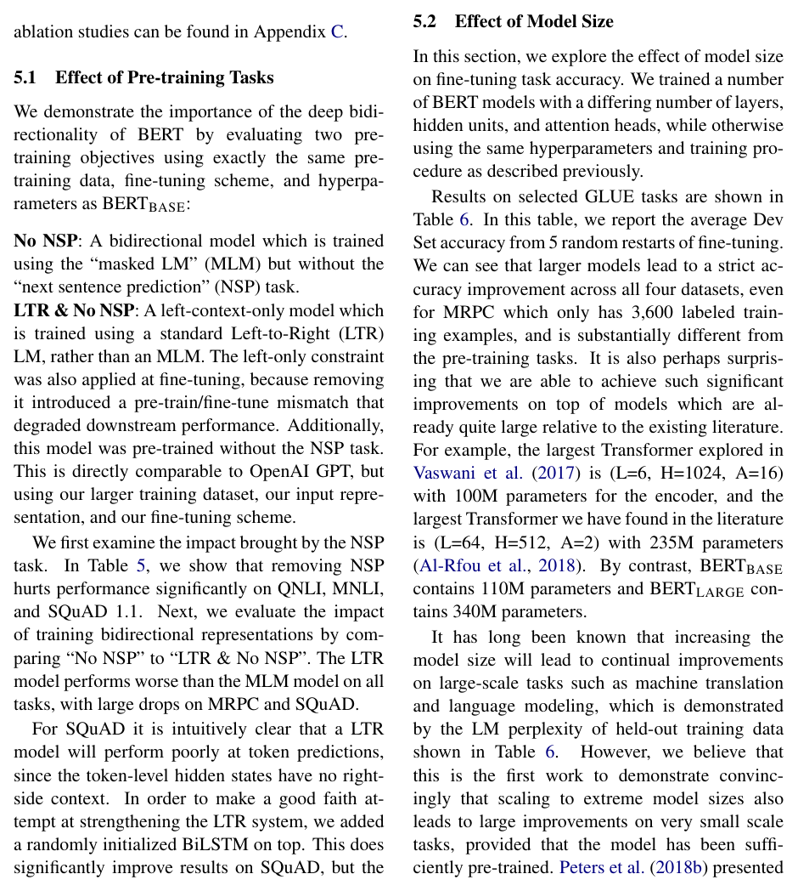
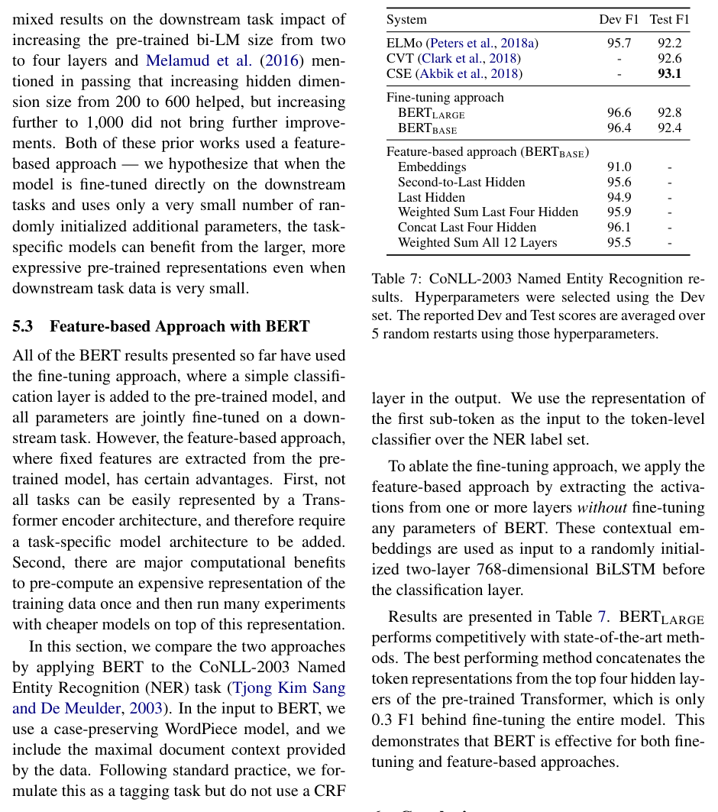
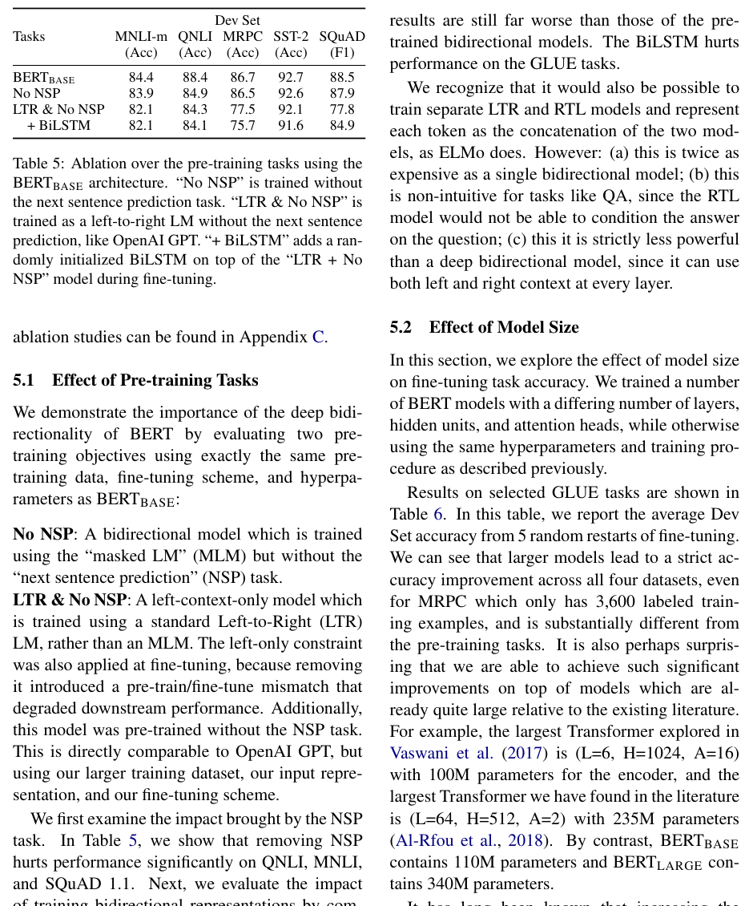
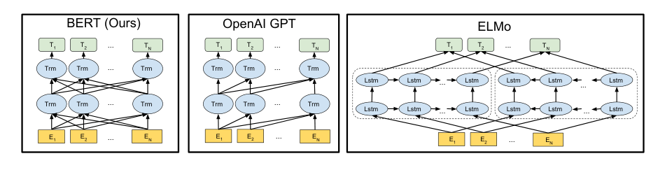
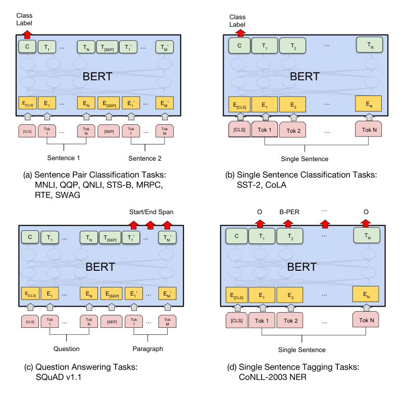

# BERT: Pre-training of Deep Bidirectional Transformers for Language Understanding

**中文译名：BERT：用于语言理解的深度双向 Transformer 预训练**

Jacob Devlin, Ming-Wei Chang, Kenton Lee, Kristina Toutanova
Google AI Language
{jacobdevlin,mingweichang,kentonl,kristout}@google.com

（arXiv:1810.04805v2 [cs.CL] 24 May 2019）

## Abstract

**Original:** We introduce a new language representation model called BERT, which stands for Bidirectional Encoder Representations from Transformers. Unlike recent language representation models (Peters et al., 2018a; Radford et al., 2018), BERT is designed to pre-train deep bidirectional representations from unlabeled text by jointly conditioning on both left and right context in all layers. As a result, the pre-trained BERT model can be fine-tuned with just one additional output layer to create state-of-the-art models for a wide range of tasks, such as question answering and language inference, without substantial task-specific architecture modifications.

**中文:** 我们提出了一种新的语言表示模型（language representation model），名为 BERT，全称是 Bidirectional Encoder Representations from Transformers（来自 Transformer 的双向编码器表示）。与近期出现的语言表示模型（Peters et al., 2018a; Radford et al., 2018）不同，BERT 旨在通过在所有层中同时联合利用左右两侧的上下文，从无标注文本中预训练（pre-train）出深度双向（bidirectional）表示。因此，预训练好的 BERT 模型只需增加一个额外的输出层进行微调（fine-tuning），即可为问答（question answering）、语言推理（language inference）等广泛任务创造出当前最优（state-of-the-art，SOTA）的模型，而无需对任务特定架构做大幅修改。

**Original:** BERT is conceptually simple and empirically powerful. It obtains new state-of-the-art results on eleven natural language processing tasks, including pushing the GLUE score to 80.5% (7.7% point absolute improvement), MultiNLI accuracy to 86.7% (4.6% absolute improvement), SQuAD v1.1 question answering Test F1 to 93.2 (1.5 point absolute improvement) and SQuAD v2.0 Test F1 to 83.1 (5.1 point absolute improvement).

**中文:** BERT 概念简单、实验效果强大。它在 11 项自然语言处理（natural language processing，NLP）任务上取得了新的当前最优结果，包括将 GLUE 分数提升到 80.5%（绝对提升 7.7 个百分点）、MultiNLI 准确率提升到 86.7%（绝对提升 4.6%）、SQuAD v1.1 问答测试集 F1 提升到 93.2（绝对提升 1.5 分），以及 SQuAD v2.0 测试集 F1 提升到 83.1（绝对提升 5.1 分）。

## 1 Introduction

**Original:** Language model pre-training has been shown to be effective for improving many natural language processing tasks (Dai and Le, 2015; Peters et al., 2018a; Radford et al., 2018; Howard and Ruder, 2018). These include sentence-level tasks such as natural language inference (Bowman et al., 2015; Williams et al., 2018) and paraphrasing (Dolan and Brockett, 2005), which aim to predict the relationships between sentences by analyzing them holistically, as well as token-level tasks such as named entity recognition and question answering, where models are required to produce fine-grained output at the token level (Tjong Kim Sang and De Meulder, 2003; Rajpurkar et al., 2016).

**中文:** 语言模型（language model）预训练已被证明能有效改进众多自然语言处理任务（Dai and Le, 2015; Peters et al., 2018a; Radford et al., 2018; Howard and Ruder, 2018）。这些任务既包括句子级任务，如自然语言推理（natural language inference）（Bowman et al., 2015; Williams et al., 2018）与复述改写（paraphrasing）（Dolan and Brockett, 2005）——它们旨在通过整体分析来预测句子之间的关系；也包括 Token 级任务，如命名实体识别（named entity recognition）与问答——在这些任务中，模型需要在 Token 级别产出细粒度输出（Tjong Kim Sang and De Meulder, 2003; Rajpurkar et al., 2016）。

**Original:** There are two existing strategies for applying pre-trained language representations to downstream tasks: feature-based and fine-tuning. The feature-based approach, such as ELMo (Peters et al., 2018a), uses task-specific architectures that include the pre-trained representations as additional features. The fine-tuning approach, such as the Generative Pre-trained Transformer (OpenAI GPT) (Radford et al., 2018), introduces minimal task-specific parameters, and is trained on the downstream tasks by simply fine-tuning all pre-trained parameters. The two approaches share the same objective function during pre-training, where they use unidirectional language models to learn general language representations.

**中文:** 目前有两种将预训练语言表示应用到下游任务（downstream task）的策略：基于特征的（feature-based）方法与微调方法。基于特征的方法（如 ELMo（Peters et al., 2018a））使用任务特定架构，把预训练表示作为额外特征加入其中。微调方法（如 Generative Pre-trained Transformer（OpenAI GPT）（Radford et al., 2018））只引入极少量的任务特定参数，通过直接微调所有预训练参数来在下游任务上进行训练。这两种方法在预训练阶段共享同一个目标函数（objective function），即使用单向（unidirectional）语言模型来学习通用语言表示。

**Original:** We argue that current techniques restrict the power of the pre-trained representations, especially for the fine-tuning approaches. The major limitation is that standard language models are unidirectional, and this limits the choice of architectures that can be used during pre-training. For example, in OpenAI GPT, the authors use a left-to-right architecture, where every token can only attend to previous tokens in the self-attention layers of the Transformer (Vaswani et al., 2017). Such restrictions are sub-optimal for sentence-level tasks, and could be very harmful when applying fine-tuning based approaches to token-level tasks such as question answering, where it is crucial to incorporate context from both directions.

**中文:** 我们认为，当前的技术限制了预训练表示的威力，对微调方法而言尤其如此。主要的局限在于：标准语言模型是单向的，这限制了预训练期间可选的架构范围。例如在 OpenAI GPT 中，作者采用的是从左到右的架构，每个 Token 在 Transformer（Vaswani et al., 2017）的自注意力（self-attention）层中只能关注到它之前的 Token。这种限制对于句子级任务并非最优，而在将基于微调的方法应用到问答这类 Token 级任务时可能非常有害——因为在那些任务中，融合两个方向的上下文至关重要。

**Original:** In this paper, we improve the fine-tuning based approaches by proposing BERT: Bidirectional Encoder Representations from Transformers. BERT alleviates the previously mentioned unidirectionality constraint by using a "masked language model" (MLM) pre-training objective, inspired by the Cloze task (Taylor, 1953). The masked language model randomly masks some of the tokens from the input, and the objective is to predict the original vocabulary id of the masked word based only on its context. Unlike left-to-right language model pre-training, the MLM objective enables the representation to fuse the left and the right context, which allows us to pre-train a deep bidirectional Transformer. In addition to the masked language model, we also use a "next sentence prediction" task that jointly pre-trains text-pair representations.

**中文:** 在本文中，我们通过提出 BERT（Bidirectional Encoder Representations from Transformers）来改进基于微调的方法。BERT 使用受完形填空任务（Cloze task）（Taylor, 1953）启发的「掩码语言模型（Masked Language Model，MLM）」预训练目标，缓解了前面提到的单向性限制。掩码语言模型随机遮蔽输入中的一部分 Token，其目标是在只依据上下文的情况下预测被遮蔽单词在原始词表中的编号（vocabulary id）。与从左到右的语言模型预训练不同，MLM 目标使表示能够融合左右两侧的上下文，从而让我们可以预训练一个深度双向 Transformer。除掩码语言模型之外，我们还使用了一个「下一句预测（Next Sentence Prediction，NSP）」任务，用于联合预训练文本对（text-pair）表示。

**Original:** The contributions of our paper are as follows:

**中文:** 本文的贡献如下：

**Original:** We demonstrate the importance of bidirectional pre-training for language representations. Unlike Radford et al. (2018), which uses unidirectional language models for pre-training, BERT uses masked language models to enable pre-trained deep bidirectional representations. This is also in contrast to Peters et al. (2018a), which uses a shallow concatenation of independently trained left-to-right and right-to-left LMs.

**中文:** 我们证明了双向预训练对语言表示的重要性。与使用单向语言模型进行预训练的 Radford et al. (2018) 不同，BERT 使用掩码语言模型来实现预训练的深度双向表示。这也与 Peters et al. (2018a) 形成对比——后者使用的是对独立训练的左到右与右到左语言模型的浅层拼接。

**Original:** We show that pre-trained representations reduce the need for many heavily-engineered task-specific architectures. BERT is the first fine-tuning based representation model that achieves state-of-the-art performance on a large suite of sentence-level and token-level tasks, outperforming many task-specific architectures.

**中文:** 我们证明了预训练表示可以大幅减少对经过繁重工程设计的任务特定架构的需求。BERT 是首个基于微调的表示模型，能在一大批句子级和 Token 级任务上取得当前最优性能，超越许多任务特定架构。

**Original:** BERT advances the state of the art for eleven NLP tasks. The code and pre-trained models are available at https://github.com/google-research/bert.

**中文:** BERT 在 11 项 NLP 任务上推进了当前最优水平。代码与预训练模型可在 https://github.com/google-research/bert 获取。

## 2 Related Work

**Original:** There is a long history of pre-training general language representations, and we briefly review the most widely-used approaches in this section.

**中文:** 通用语言表示的预训练已有很长的历史，我们在本节中简要回顾最广泛使用的方法。

### 2.1 Unsupervised Feature-based Approaches

**Original:** Learning widely applicable representations of words has been an active area of research for decades, including non-neural (Brown et al., 1992; Ando and Zhang, 2005; Blitzer et al., 2006) and neural (Mikolov et al., 2013; Pennington et al., 2014) methods. Pre-trained word embeddings are an integral part of modern NLP systems, offering significant improvements over embeddings learned from scratch (Turian et al., 2010). To pre-train word embedding vectors, left-to-right language modeling objectives have been used (Mnih and Hinton, 2009), as well as objectives to discriminate correct from incorrect words in left and right context (Mikolov et al., 2013).

**中文:** 学习可广泛适用的单词表示数十年来一直是一个活跃的研究领域，包括非神经方法（Brown et al., 1992; Ando and Zhang, 2005; Blitzer et al., 2006）与神经方法（Mikolov et al., 2013; Pennington et al., 2014）。预训练词嵌入（word embedding）是现代 NLP 系统不可或缺的组成部分，相比从零学习的嵌入有显著提升（Turian et al., 2010）。为预训练词嵌入向量，既使用过从左到右的语言建模目标（Mnih and Hinton, 2009），也使用过在左右上下文中判别正确词与错误词的目标（Mikolov et al., 2013）。

**Original:** These approaches have been generalized to coarser granularities, such as sentence embeddings (Kiros et al., 2015; Logeswaran and Lee, 2018) or paragraph embeddings (Le and Mikolov, 2014). To train sentence representations, prior work has used objectives to rank candidate next sentences (Jernite et al., 2017; Logeswaran and Lee, 2018), left-to-right generation of next sentence words given a representation of the previous sentence (Kiros et al., 2015), or denoising auto-encoder derived objectives (Hill et al., 2016).

**中文:** 这些方法已被推广到更粗的粒度，如句子嵌入（sentence embedding）（Kiros et al., 2015; Logeswaran and Lee, 2018）或段落嵌入（paragraph embedding）（Le and Mikolov, 2014）。为训练句子表示，先前的工作使用过以下目标：对候选下一句进行排序（Jernite et al., 2017; Logeswaran and Lee, 2018）、在给定前一句表示的情况下从左到右生成下一句的单词（Kiros et al., 2015），或由去噪自编码器（denoising auto-encoder）导出的目标（Hill et al., 2016）。

**Original:** ELMo and its predecessor (Peters et al., 2017, 2018a) generalize traditional word embedding research along a different dimension. They extract context-sensitive features from a left-to-right and a right-to-left language model. The contextual representation of each token is the concatenation of the left-to-right and right-to-left representations. When integrating contextual word embeddings with existing task-specific architectures, ELMo advances the state of the art for several major NLP benchmarks (Peters et al., 2018a) including question answering (Rajpurkar et al., 2016), sentiment analysis (Socher et al., 2013), and named entity recognition (Tjong Kim Sang and De Meulder, 2003).

**中文:** ELMo 及其前身（Peters et al., 2017, 2018a）沿另一个维度推广了传统的词嵌入研究。它们从一个左到右和一个右到左的语言模型中提取上下文敏感的特征。每个 Token 的上下文表示是左到右表示与右到左表示的拼接。在将上下文词嵌入与现有任务特定架构结合后，ELMo 在若干重要 NLP 基准测试（benchmark）上推进了当前最优水平（Peters et al., 2018a），包括问答（Rajpurkar et al., 2016）、情感分析（sentiment analysis）（Socher et al., 2013）和命名实体识别（Tjong Kim Sang and De Meulder, 2003）。Melamud et al. (2016) 提出了通过一个任务来学习上下文表示，即使用 LSTM 从左右两个上下文预测单个词。与 ELMo 类似，他们的模型是基于特征的，并且不是深度双向的。Fedus et al. (2018) 表明完形填空任务可用于提高文本生成模型的鲁棒性。

### 2.2 Unsupervised Fine-tuning Approaches

**Original:** As with the feature-based approaches, the first works in this direction only pre-trained word embedding parameters from unlabeled text (Collobert and Weston, 2008).

**中文:** 与基于特征的方法一样，这个方向最早的工作只从无标注文本中预训练词嵌入参数（Collobert and Weston, 2008）。

**Original:** More recently, sentence or document encoders which produce contextual token representations have been pre-trained from unlabeled text and fine-tuned for a supervised downstream task (Dai and Le, 2015; Howard and Ruder, 2018; Radford et al., 2018). The advantage of these approaches is that few parameters need to be learned from scratch. At least partly due to this advantage, OpenAI GPT (Radford et al., 2018) achieved previously state-of-the-art results on many sentence-level tasks from the GLUE benchmark (Wang et al., 2018a).

**中文:** 更近一些，能够产生上下文 Token 表示的句子或文档编码器（encoder）被从无标注文本中预训练出来，再针对有监督下游任务进行微调（Dai and Le, 2015; Howard and Ruder, 2018; Radford et al., 2018）。这些方法的优势在于只需从零学习少量参数。至少部分得益于这一优势，OpenAI GPT（Radford et al., 2018）在 GLUE 基准测试（Wang et al., 2018a）的许多句子级任务上取得了此前的最优结果。

**Original:** Left-to-right language modeling and auto-encoder objectives have been used for pre-training such models (Howard and Ruder, 2018; Radford et al., 2018; Dai and Le, 2015).

**中文:** 从左到右的语言建模目标与自编码器目标已被用于预训练这类模型（Howard and Ruder, 2018; Radford et al., 2018; Dai and Le, 2015）。

> **图 1（译）**：BERT 的整体预训练与微调流程。除输出层之外，预训练与微调使用相同的架构。相同的预训练模型参数被用于初始化不同下游任务的模型。在微调期间，所有参数都被微调。[CLS] 是加在每个输入样例最前面的特殊符号，[SEP] 是特殊的分隔 Token（例如用于分隔问题/答案）。（原图见 paper.pdf 第 3 页，见下方图）

### 2.3 Transfer Learning from Supervised Data

**Original:** There has also been work showing effective transfer from supervised tasks with large datasets, such as natural language inference (Conneau et al., 2017) and machine translation (McCann et al., 2017). Computer vision research has also demonstrated the importance of transfer learning from large pre-trained models, where an effective recipe is to fine-tune models pre-trained with ImageNet (Deng et al., 2009; Yosinski et al., 2014).

**中文:** 也有一些工作表明，从带有大规模数据集的有监督任务（如自然语言推理（Conneau et al., 2017）和机器翻译（machine translation）（McCann et al., 2017））中能够进行有效的迁移（transfer）。计算机视觉研究同样证明了从大型预训练模型进行迁移学习（transfer learning）的重要性，其中一个行之有效的配方是对用 ImageNet（Deng et al., 2009; Yosinski et al., 2014）预训练的模型进行微调。

## 3 BERT

**Original:** We introduce BERT and its detailed implementation in this section. There are two steps in our framework: pre-training and fine-tuning. During pre-training, the model is trained on unlabeled data over different pre-training tasks. For fine-tuning, the BERT model is first initialized with the pre-trained parameters, and all of the parameters are fine-tuned using labeled data from the downstream tasks. Each downstream task has separate fine-tuned models, even though they are initialized with the same pre-trained parameters. The question-answering example in Figure 1 will serve as a running example for this section.

**中文:** 我们在本节中介绍 BERT 及其详细实现。我们的框架包含两个步骤：预训练与微调。在预训练期间，模型在不同的预训练任务上、在无标注数据上进行训练。对于微调，BERT 模型首先用预训练参数初始化，然后所有参数都使用下游任务的标注数据进行微调。每个下游任务都有各自单独微调出来的模型，尽管它们是用相同的预训练参数初始化的。图 1 中的问答示例将作为本节贯穿始终的例子。

**Original:** A distinctive feature of BERT is its unified architecture across different tasks. There is minimal difference between the pre-trained architecture and the final downstream architecture.

**中文:** BERT 的一个显著特征是其跨任务的统一架构。预训练架构与最终下游架构之间的差别极小。

### Model Architecture

**Original:** BERT's model architecture is a multi-layer bidirectional Transformer encoder based on the original implementation described in Vaswani et al. (2017) and released in the tensor2tensor library.¹ Because the use of Transformers has become common and our implementation is almost identical to the original, we will omit an exhaustive background description of the model architecture and refer readers to Vaswani et al. (2017) as well as excellent guides such as "The Annotated Transformer."²

**中文:** BERT 的模型架构是一个多层双向 Transformer 编码器，基于 Vaswani et al. (2017) 中描述的原始实现，并在 tensor2tensor 库中发布。¹ 由于 Transformer 的使用已变得普遍，且我们的实现与原始实现几乎一致，我们将省略对模型架构的详尽背景描述，请读者参阅 Vaswani et al. (2017) 以及「The Annotated Transformer」这类优秀指南。²

> ¹ https://github.com/tensorflow/tensor2tensor
> ² http://nlp.seas.harvard.edu/2018/04/03/attention.html

**Original:** In this work, we denote the number of layers (i.e., Transformer blocks) as L, the hidden size as H, and the number of self-attention heads as A.³ We primarily report results on two model sizes: BERT_BASE (L=12, H=768, A=12, Total Parameters=110M) and BERT_LARGE (L=24, H=1024, A=16, Total Parameters=340M).

**中文:** 在本文中，我们用 $L$ 表示层数（即 Transformer 块的数量），用 $H$ 表示隐藏层大小（hidden size），用 $A$ 表示自注意力头的数量。³ 我们主要在两种模型规模上报告结果：BERT_BASE（$L=12$，$H=768$，$A=12$，总参数量=1.1 亿）与 BERT_LARGE（$L=24$，$H=1024$，$A=16$，总参数量=3.4 亿）。

> ³ 在所有情况下我们都将前馈网络（feed-forward）的滤波器大小设为 $4H$，即 $H = 768$ 时为 3072，$H = 1024$ 时为 4096。

**Original:** BERT_BASE was chosen to have the same model size as OpenAI GPT for comparison purposes. Critically, however, the BERT Transformer uses bidirectional self-attention, while the GPT Transformer uses constrained self-attention where every token can only attend to context to its left.⁴

**中文:** 为了便于比较，BERT_BASE 被选择为与 OpenAI GPT 具有相同的模型规模。然而关键之处在于，BERT Transformer 使用双向自注意力，而 GPT Transformer 使用的是受限的自注意力——每个 Token 只能关注其左侧的上下文。⁴

> ⁴ 我们注意到文献中通常将双向 Transformer 称为「Transformer 编码器」，而将仅限左侧上下文的版本称为「Transformer 解码器（decoder）」，因为它可用于文本生成。

### Input/Output Representations

**Original:** To make BERT handle a variety of down-stream tasks, our input representation is able to unambiguously represent both a single sentence and a pair of sentences (e.g., ⟨Question, Answer⟩) in one token sequence. Throughout this work, a "sentence" can be an arbitrary span of contiguous text, rather than an actual linguistic sentence. A "sequence" refers to the input token sequence to BERT, which may be a single sentence or two sentences packed together.

**中文:** 为了让 BERT 能够处理各种下游任务，我们的输入表示能够在一个 Token 序列中无歧义地表示单个句子和一对句子（例如 ⟨Question, Answer⟩）。在本文中，「句子」可以是任意一段连续文本，而不一定是真正的语言学意义上的句子。「序列」指的是输入给 BERT 的 Token 序列，可以是单个句子，也可以是打包在一起的两个句子。

**Original:** We use WordPiece embeddings (Wu et al., 2016) with a 30,000 token vocabulary. The first token of every sequence is always a special classification token ([CLS]). The final hidden state corresponding to this token is used as the aggregate sequence representation for classification tasks. Sentence pairs are packed together into a single sequence. We differentiate the sentences in two ways. First, we separate them with a special token ([SEP]). Second, we add a learned embedding to every token indicating whether it belongs to sentence A or sentence B. As shown in Figure 1, we denote input embedding as E, the final hidden vector of the special [CLS] token as $C \in \mathbb{R}^H$, and the final hidden vector for the $i^{th}$ input token as $T_i \in \mathbb{R}^H$.

**中文:** 我们使用词表大小为 30,000 个 Token 的 WordPiece 嵌入（Wu et al., 2016）。每个序列的第一个 Token 总是一个特殊的分类 Token（[CLS]）。与该 Token 对应的最终隐藏状态（hidden state）被用作分类任务的聚合序列表示。句子对被打包为一个单一序列。我们用两种方式区分句子：第一，用一个特殊 Token（[SEP]）将它们隔开；第二，为每个 Token 添加一个学习得到的嵌入，指示它属于句子 A 还是句子 B。如图 1 所示，我们用 $E$ 表示输入嵌入，用 $C \in \mathbb{R}^H$ 表示特殊 [CLS] Token 的最终隐藏向量，用 $T_i \in \mathbb{R}^H$ 表示第 $i$ 个输入 Token 的最终隐藏向量。

**Original:** For a given token, its input representation is constructed by summing the corresponding token, segment, and position embeddings. A visualization of this construction can be seen in Figure 2.

**中文:** 对于给定的 Token，其输入表示由相应的 Token 嵌入、分段（segment）嵌入与位置（position）嵌入相加构成。图 2 展示了这一构造过程的可视化。

### 3.1 Pre-training BERT

**Original:** Unlike Peters et al. (2018a) and Radford et al. (2018), we do not use traditional left-to-right or right-to-left language models to pre-train BERT. Instead, we pre-train BERT using two unsupervised tasks, described in this section. This step is presented in the left part of Figure 1.

**中文:** 与 Peters et al. (2018a) 和 Radford et al. (2018) 不同，我们不使用传统的左到右或右到左语言模型来预训练 BERT。相反，我们使用两个无监督任务来预训练 BERT，本节将对此进行描述。这一步骤在图 1 的左侧部分展示。

#### Task #1: Masked LM

**Original:** Intuitively, it is reasonable to believe that a deep bidirectional model is strictly more powerful than either a left-to-right model or the shallow concatenation of a left-to-right and a right-to-left model. Unfortunately, standard conditional language models can only be trained left-to-right or right-to-left, since bidirectional conditioning would allow each word to indirectly "see itself", and the model could trivially predict the target word in a multi-layered context.

**中文:** 直观上讲，有理由相信深度双向模型严格强于左到右模型，也强于左到右与右到左模型的浅层拼接。遗憾的是，标准条件语言模型只能按从左到右或从右到左的方式训练，因为双向条件化会让每个词间接地「看到它自己」，模型就能在多层的上下文中轻易地预测出目标词。

**Original:** In order to train a deep bidirectional representation, we simply mask some percentage of the input tokens at random, and then predict those masked tokens. We refer to this procedure as a "masked LM" (MLM), although it is often referred to as a Cloze task in the literature (Taylor, 1953). In this case, the final hidden vectors corresponding to the mask tokens are fed into an output softmax over the vocabulary, as in a standard LM. In all of our experiments, we mask 15% of all WordPiece tokens in each sequence at random. In contrast to denoising auto-encoders (Vincent et al., 2008), we only predict the masked words rather than reconstructing the entire input.

**中文:** 为了训练深度双向表示，我们简单地随机遮蔽一定比例的输入 Token，然后预测这些被遮蔽的 Token。我们将这一过程称为「掩码 LM」（MLM），尽管在文献中它常被称为完形填空任务（Taylor, 1953）。在这种情况下，与被遮蔽 Token 对应的最终隐藏向量被送入一个覆盖整个词表的输出 Softmax，与标准 LM 的做法相同。在我们所有的实验中，我们对每个序列中 15% 的 WordPiece Token 进行随机遮蔽。与去噪自编码器（Vincent et al., 2008）不同，我们只预测被遮蔽的词，而不是重建整个输入。

**Original:** Although this allows us to obtain a bidirectional pre-trained model, a downside is that we are creating a mismatch between pre-training and fine-tuning, since the [MASK] token does not appear during fine-tuning. To mitigate this, we do not always replace "masked" words with the actual [MASK] token. The training data generator chooses 15% of the token positions at random for prediction. If the i-th token is chosen, we replace the i-th token with (1) the [MASK] token 80% of the time (2) a random token 10% of the time (3) the unchanged i-th token 10% of the time. Then, $T_i$ will be used to predict the original token with cross entropy loss. We compare variations of this procedure in Appendix C.2.

**中文:** 尽管这让我们能够得到一个双向预训练模型，但一个缺点是：我们在预训练与微调之间制造了不匹配，因为 [MASK] Token 在微调阶段不会出现。为了缓解这一问题，我们并不总是把「被遮蔽」的词替换为真正的 [MASK] Token。训练数据生成器随机选择 15% 的 Token 位置进行预测。如果第 $i$ 个 Token 被选中，我们就用以下三种方式之一替换它：（1）80% 的概率替换为 [MASK] Token；（2）10% 的概率替换为随机 Token；（3）10% 的概率保持第 $i$ 个 Token 不变。然后，用 $T_i$ 来以交叉熵（cross entropy）损失预测原始 Token。我们在附录 C.2 中比较了这一过程的各种变体。

#### Task #2: Next Sentence Prediction (NSP)

**Original:** Many important downstream tasks such as Question Answering (QA) and Natural Language Inference (NLI) are based on understanding the relationship between two sentences, which is not directly captured by language modeling. In order to train a model that understands sentence relationships, we pre-train for a binarized next sentence prediction task that can be trivially generated from any monolingual corpus. Specifically, when choosing the sentences A and B for each pre-training example, 50% of the time B is the actual next sentence that follows A (labeled as IsNext), and 50% of the time it is a random sentence from the corpus (labeled as NotNext). As we show in Figure 1, C is used for next sentence prediction (NSP).⁵ Despite its simplicity, we demonstrate in Section 5.1 that pre-training towards this task is very beneficial to both QA and NLI.⁶

**中文:** 许多重要的下游任务，如问答（QA）与自然语言推理（NLI），都基于对两个句子之间关系的理解，而语言建模并不能直接捕捉这种关系。为了训练一个能理解句子关系的模型，我们针对一个二值化的下一句预测任务进行预训练——该任务可以从任何单语语料库（corpus）中轻而易举地生成。具体来说，在为每个预训练样例选择句子 A 和 B 时，50% 的情况下 B 是紧跟在 A 之后的真实下一句（标注为 IsNext），另外 50% 的情况下 B 是从语料库中随机抽取的一个句子（标注为 NotNext）。如图 1 所示，$C$ 被用于下一句预测（NSP）。⁵ 尽管该任务很简单，我们在第 5.1 节中证明了针对它的预训练对 QA 和 NLI 都非常有益。⁶

> ⁵ 最终模型在 NSP 上达到 97%–98% 的准确率。
> ⁶ 向量 $C$ 在不经微调时并不是一个有意义的句子表示，因为它是以 NSP 为训练目标的。

**Original:** The NSP task is closely related to representation-learning objectives used in Jernite et al. (2017) and Logeswaran and Lee (2018). However, in prior work, only sentence embeddings are transferred to down-stream tasks, where BERT transfers all parameters to initialize end-task model parameters.

**中文:** NSP 任务与 Jernite et al. (2017) 和 Logeswaran and Lee (2018) 中使用的表示学习目标密切相关。然而在先前的工作中，只有句子嵌入被迁移到下游任务；而 BERT 迁移所有参数，用来初始化端任务（end-task）的模型参数。

> **图 2（译）**：BERT 的输入表示。输入嵌入是 Token 嵌入、分段嵌入与位置嵌入之和。（原图见 paper.pdf 第 5 页，见下方图）

#### Pre-training data

**Original:** The pre-training procedure largely follows the existing literature on language model pre-training. For the pre-training corpus we use the BooksCorpus (800M words) (Zhu et al., 2015) and English Wikipedia (2,500M words). For Wikipedia we extract only the text passages and ignore lists, tables, and headers. It is critical to use a document-level corpus rather than a shuffled sentence-level corpus such as the Billion Word Benchmark (Chelba et al., 2013) in order to extract long contiguous sequences.

**中文:** 预训练流程大体遵循语言模型预训练的既有文献。对于预训练语料库，我们使用 BooksCorpus（8 亿词）（Zhu et al., 2015）和英语 Wikipedia（25 亿词）。对于 Wikipedia，我们只提取文本段落，忽略列表、表格和标题。关键在于使用文档级语料库，而不是像 Billion Word Benchmark（Chelba et al., 2013）那样的打乱后的句子级语料库，这样才能提取出长的连续序列。

### 3.2 Fine-tuning BERT

**Original:** Fine-tuning is straightforward since the self-attention mechanism in the Transformer allows BERT to model many downstream tasks—whether they involve single text or text pairs—by swapping out the appropriate inputs and outputs. For applications involving text pairs, a common pattern is to independently encode text pairs before applying bidirectional cross attention, such as Parikh et al. (2016); Seo et al. (2017). BERT instead uses the self-attention mechanism to unify these two stages, as encoding a concatenated text pair with self-attention effectively includes bidirectional cross attention between two sentences.

**中文:** 微调非常简单直接，因为 Transformer 中的自注意力机制使 BERT 能够通过替换相应的输入和输出来建模许多下游任务——无论它们涉及单个文本还是文本对。对于涉及文本对的应用，一种常见模式是先独立编码文本对，再施加双向交叉注意力，如 Parikh et al. (2016); Seo et al. (2017) 所做的那样。而 BERT 用自注意力机制统一了这两个阶段：用自注意力编码拼接后的文本对，实际上就包含了两个句子之间的双向交叉注意力。

**Original:** For each task, we simply plug in the task-specific inputs and outputs into BERT and fine-tune all the parameters end-to-end. At the input, sentence A and sentence B from pre-training are analogous to (1) sentence pairs in paraphrasing, (2) hypothesis-premise pairs in entailment, (3) question-passage pairs in question answering, and (4) a degenerate text-∅ pair in text classification or sequence tagging. At the output, the token representations are fed into an output layer for token-level tasks, such as sequence tagging or question answering, and the [CLS] representation is fed into an output layer for classification, such as entailment or sentiment analysis.

**中文:** 对于每个任务，我们只需把任务特定的输入和输出接入 BERT，并对所有参数进行端到端（end-to-end）微调。在输入端，预训练中的句子 A 和句子 B 类似于：（1）复述改写任务中的句子对；（2）蕴含（entailment）任务中的假设-前提对；（3）问答任务中的问题-段落对；（4）文本分类或序列标注（sequence tagging）任务中退化的「文本-∅」对。在输出端，Token 表示被送入输出层用于 Token 级任务，如序列标注或问答；[CLS] 表示被送入输出层用于分类，如蕴含或情感分析。

**Original:** Compared to pre-training, fine-tuning is relatively inexpensive. All of the results in the paper can be replicated in at most 1 hour on a single Cloud TPU, or a few hours on a GPU, starting from the exact same pre-trained model.⁷ We describe the task-specific details in the corresponding subsections of Section 4. More details can be found in Appendix A.5.

**中文:** 与预训练相比，微调相对廉价。从完全相同的预训练模型出发，本文中的所有结果都可以在单个 Cloud TPU 上至多 1 小时内复现，在 GPU 上则需要几个小时。⁷ 我们在第 4 节相应的子小节中描述任务特定的细节。更多细节见附录 A.5。

> ⁷ 例如，BERT SQuAD 模型可以在单个 Cloud TPU 上用约 30 分钟训练完成，达到 91.0 的 Dev F1 分数。

## 4 Experiments

**Original:** In this section, we present BERT fine-tuning results on 11 NLP tasks.

**中文:** 在本节中，我们展示 BERT 在 11 项 NLP 任务上的微调结果。

### 4.1 GLUE

**Original:** The General Language Understanding Evaluation (GLUE) benchmark (Wang et al., 2018a) is a collection of diverse natural language understanding tasks. Detailed descriptions of GLUE datasets are included in Appendix B.1.

**中文:** General Language Understanding Evaluation（GLUE）基准测试（Wang et al., 2018a）是多种自然语言理解任务的集合。GLUE 数据集的详细描述见附录 B.1。

**Original:** To fine-tune on GLUE, we represent the input sequence (for single sentence or sentence pairs) as described in Section 3, and use the final hidden vector $C \in \mathbb{R}^H$ corresponding to the first input token ([CLS]) as the aggregate representation. The only new parameters introduced during fine-tuning are classification layer weights $W \in \mathbb{R}^{K \times H}$, where $K$ is the number of labels. We compute a standard classification loss with $C$ and $W$, i.e., $\log(\mathrm{softmax}(CW^T))$.

**中文:** 为了在 GLUE 上微调，我们按第 3 节所述表示输入序列（单个句子或句子对），并使用与第一个输入 Token（[CLS]）对应的最终隐藏向量 $C \in \mathbb{R}^H$ 作为聚合表示。微调期间引入的唯一新参数是分类层权重 $W \in \mathbb{R}^{K \times H}$，其中 $K$ 是标签数量。我们用 $C$ 和 $W$ 计算标准的分类损失，即 $\log(\mathrm{softmax}(CW^T))$。

> ⁸ 见 https://gluebenchmark.com/faq 中的（10）。

**Original:** We use a batch size of 32 and fine-tune for 3 epochs over the data for all GLUE tasks. For each task, we selected the best fine-tuning learning rate (among 5e-5, 4e-5, 3e-5, and 2e-5) on the Dev set. Additionally, for BERT_LARGE we found that fine-tuning was sometimes unstable on small datasets, so we ran several random restarts and selected the best model on the Dev set. With random restarts, we use the same pre-trained checkpoint but perform different fine-tuning data shuffling and classifier layer initialization.⁹

**中文:** 对于所有 GLUE 任务，我们使用 32 的批次大小（batch size），并在数据上微调 3 个轮次（epoch）。对于每个任务，我们在 Dev 集上选择最佳的微调学习率（在 5e-5、4e-5、3e-5 和 2e-5 中挑选）。此外，对于 BERT_LARGE，我们发现它在小数据集上的微调有时不稳定，因此我们进行了多次随机重启，并在 Dev 集上选择最佳模型。随机重启时，我们使用相同的预训练检查点，但采用不同的微调数据洗牌方式与分类层初始化。⁹

> ⁹ GLUE 数据集的分发不包含 Test 标签，并且我们对 BERT_BASE 和 BERT_LARGE 各只向 GLUE 评测服务器提交了一次。

**Original:** Results are presented in Table 1. Both BERT_BASE and BERT_LARGE outperform all systems on all tasks by a substantial margin, obtaining 4.5% and 7.0% respective average accuracy improvement over the prior state of the art. Note that BERT_BASE and OpenAI GPT are nearly identical in terms of model architecture apart from the attention masking. For the largest and most widely reported GLUE task, MNLI, BERT obtains a 4.6% absolute accuracy improvement. On the official GLUE leaderboard¹⁰, BERT_LARGE obtains a score of 80.5, compared to OpenAI GPT, which obtains 72.8 as of the date of writing.

**中文:** 结果见表 1。BERT_BASE 与 BERT_LARGE 都在所有任务上以可观的优势超过了所有系统，相比先前的当前最优分别取得了 4.5% 和 7.0% 的平均准确率提升。注意，除注意力掩码外，BERT_BASE 与 OpenAI GPT 在模型架构上几乎完全相同。在规模最大、被报告最多的 GLUE 任务 MNLI 上，BERT 取得了 4.6% 的绝对准确率提升。在 GLUE 官方排行榜¹⁰上，BERT_LARGE 得到 80.5 分，而截至本文写作时 OpenAI GPT 为 72.8 分。

> ¹⁰ https://gluebenchmark.com/leaderboard

**Original:** We find that BERT_LARGE significantly outperforms BERT_BASE across all tasks, especially those with very little training data. The effect of model size is explored more thoroughly in Section 5.2.

**中文:** 我们发现 BERT_LARGE 在所有任务上都显著优于 BERT_BASE，尤其是在训练数据极少的任务上。模型规模的影响将在第 5.2 节中更深入地探讨。

> **表 1（译）**：GLUE Test 结果，由评测服务器评分（https://gluebenchmark.com/leaderboard）。每个任务下方的数字表示训练样例数。「Average」一列与官方 GLUE 分数略有不同，因为我们排除了有问题的 WNLI 集。⁸ BERT 与 OpenAI GPT 均为单模型、单任务。QQP 和 MRPC 报告 F1 分数，STS-B 报告 Spearman 相关系数，其余任务报告准确率。我们排除了以 BERT 作为其组件之一的参赛项。（原图见 paper.pdf 第 6 页，见下方图）

| System（系统） | MNLI-(m/mm) | QQP | QNLI | SST-2 | CoLA | STS-B | MRPC | RTE | Average（平均） |
|---|---|---|---|---|---|---|---|---|---|
| （训练样例数） | 392k | 363k | 108k | 67k | 8.5k | 5.7k | 3.5k | 2.5k | - |
| Pre-OpenAI SOTA | 80.6/80.1 | 66.1 | 82.3 | 93.2 | 35.0 | 81.0 | 86.0 | 61.7 | 74.0 |
| BiLSTM+ELMo+Attn | 76.4/76.1 | 64.8 | 79.8 | 90.4 | 36.0 | 73.3 | 84.9 | 56.8 | 71.0 |
| OpenAI GPT | 82.1/81.4 | 70.3 | 87.4 | 91.3 | 45.4 | 80.0 | 82.3 | 56.0 | 75.1 |
| BERT_BASE | 84.6/83.4 | 71.2 | 90.5 | 93.5 | 52.1 | 85.8 | 88.9 | 66.4 | 79.6 |
| BERT_LARGE | 86.7/85.9 | 72.1 | 92.7 | 94.9 | 60.5 | 86.5 | 89.3 | 70.1 | 82.1 |

### 4.2 SQuAD v1.1

**Original:** The Stanford Question Answering Dataset (SQuAD v1.1) is a collection of 100k crowdsourced question/answer pairs (Rajpurkar et al., 2016). Given a question and a passage from Wikipedia containing the answer, the task is to predict the answer text span in the passage.

**中文:** Stanford Question Answering Dataset（SQuAD v1.1）是 10 万条众包问答对的集合（Rajpurkar et al., 2016）。给定一个问题与一段来自 Wikipedia、包含答案的段落，任务是在段落中预测答案文本片段（span）。

**Original:** As shown in Figure 1, in the question answering task, we represent the input question and passage as a single packed sequence, with the question using the A embedding and the passage using the B embedding. We only introduce a start vector $S \in \mathbb{R}^H$ and an end vector $E \in \mathbb{R}^H$ during fine-tuning. The probability of word $i$ being the start of the answer span is computed as a dot product between $T_i$ and $S$ followed by a softmax over all of the words in the paragraph:

$$P_i = \frac{e^{S \cdot T_i}}{\sum_j e^{S \cdot T_j}}.$$

The analogous formula is used for the end of the answer span. The score of a candidate span from position $i$ to position $j$ is defined as $S \cdot T_i + E \cdot T_j$, and the maximum scoring span where $j \ge i$ is used as a prediction. The training objective is the sum of the log-likelihoods of the correct start and end positions. We fine-tune for 3 epochs with a learning rate of 5e-5 and a batch size of 32.

**中文:** 如图 1 所示，在问答任务中，我们把输入的问题与段落表示为一个单一的打包序列，问题使用 A 嵌入，段落使用 B 嵌入。微调期间我们只引入一个起始向量 $S \in \mathbb{R}^H$ 和一个结束向量 $E \in \mathbb{R}^H$。单词 $i$ 作为答案片段起点的概率计算方式为：$T_i$ 与 $S$ 的点积，再对段落中所有单词做 Softmax：

$$P_i = \frac{e^{S \cdot T_i}}{\sum_j e^{S \cdot T_j}}.$$

答案片段的终点使用类似的公式。候选片段（从位置 $i$ 到位置 $j$）的得分定义为 $S \cdot T_i + E \cdot T_j$，得分最高且满足 $j \ge i$ 的片段被用作预测。训练目标是正确起点与终点位置的对数似然之和。我们用 5e-5 的学习率、32 的批次大小微调 3 个轮次。

**Original:** Table 2 shows top leaderboard entries as well as results from top published systems (Seo et al., 2017; Clark and Gardner, 2018; Peters et al., 2018a; Hu et al., 2018). The top results from the SQuAD leaderboard do not have up-to-date public system descriptions available,¹¹ and are allowed to use any public data when training their systems. We therefore use modest data augmentation in our system by first fine-tuning on TriviaQA (Joshi et al., 2017) befor fine-tuning on SQuAD.

**中文:** 表 2 展示了排行榜前列的参赛项以及顶级已发表系统的结果（Seo et al., 2017; Clark and Gardner, 2018; Peters et al., 2018a; Hu et al., 2018）。SQuAD 排行榜的前列结果没有可用的最新公开系统描述，¹¹ 并且允许在训练系统时使用任何公开数据。因此，我们在系统中使用了适度的数据增强（data augmentation）：先对 TriviaQA（Joshi et al., 2017）进行微调，再对 SQuAD 进行微调。

> ¹¹ QANet 在 Yu et al. (2018) 中有描述，但该系统在发表后已大幅改进。

**Original:** Our best performing system outperforms the top leaderboard system by +1.5 F1 in ensembling and +1.3 F1 as a single system. In fact, our single BERT model outperforms the top ensemble system in terms of F1 score. Without TriviaQA fine-tuning data, we only lose 0.1-0.4 F1, still outperforming all existing systems by a wide margin.¹²

**中文:** 我们表现最好的系统在集成（ensembling）模式下比排行榜第一名高 +1.5 F1，作为单系统高 +1.3 F1。事实上，我们的单个 BERT 模型在 F1 分数上就超过了顶级的集成系统。不使用 TriviaQA 微调数据时，我们只损失 0.1–0.4 F1，仍然以巨大优势超过所有现有系统。¹²

> ¹² 我们使用的 TriviaQA 数据由 TriviaQA-Wiki 中的段落构成，取文档中前 400 个 Token，且至少包含所提供的候选答案之一。

> **表 2（译）**：SQuAD 1.1 结果。BERT 集成是 7 个系统的集成，这些系统使用不同的预训练检查点与微调随机种子。（原图见 paper.pdf 第 7 页，见下方图）

| System（系统） | Dev EM | Dev F1 | Test EM | Test F1 |
|---|---|---|---|---|
| Top Leaderboard Systems (Dec 10th, 2018) — Human | - | - | 82.3 | 91.2 |
| #1 Ensemble - nlnet | - | - | 86.0 | 91.7 |
| #2 Ensemble - QANet | - | - | 84.5 | 90.5 |
| Published — BiDAF+ELMo (Single) | - | 85.6 | - | 85.8 |
| Published — R.M. Reader (Ensemble) | 81.2 | 87.9 | 82.3 | 88.5 |
| Ours — BERT_BASE (Single) | 80.8 | 88.5 | - | - |
| Ours — BERT_LARGE (Single) | 84.1 | 90.9 | - | - |
| Ours — BERT_LARGE (Ensemble) | 85.8 | 91.8 | - | - |
| Ours — BERT_LARGE (Sgl.+TriviaQA) | 84.2 | 91.1 | 85.1 | 91.8 |
| Ours — BERT_LARGE (Ens.+TriviaQA) | 86.2 | 92.2 | 87.4 | 93.2 |

### 4.3 SQuAD v2.0

**Original:** The SQuAD 2.0 task extends the SQuAD 1.1 problem definition by allowing for the possibility that no short answer exists in the provided paragraph, making the problem more realistic.

**中文:** SQuAD 2.0 任务扩展了 SQuAD 1.1 的问题定义，允许所提供的段落中不存在简短答案，使问题更加贴近现实。

**Original:** We use a simple approach to extend the SQuAD v1.1 BERT model for this task. We treat questions that do not have an answer as having an answer span with start and end at the [CLS] token. The probability space for the start and end answer span positions is extended to include the position of the [CLS] token. For prediction, we compare the score of the no-answer span: $s_{\mathrm{null}} = S \cdot C + E \cdot C$ to the score of the best non-null span $\hat{s}_{i,j} = \max_{j \ge i} S \cdot T_i + E \cdot T_j$. We predict a non-null answer when $\hat{s}_{i,j} > s_{\mathrm{null}} + \tau$, where the threshold $\tau$ is selected on the dev set to maximize F1. We did not use TriviaQA data for this model. We fine-tuned for 2 epochs with a learning rate of 5e-5 and a batch size of 48.

**中文:** 我们使用一种简单的方法为这一任务扩展 SQuAD v1.1 BERT 模型：把没有答案的问题视为其答案片段的起点和终点都位于 [CLS] Token。答案片段起点与终点位置的概率空间被扩展为包含 [CLS] Token 的位置。预测时，我们把无答案片段的得分 $s_{\mathrm{null}} = S \cdot C + E \cdot C$ 与最佳非空片段的得分 $\hat{s}_{i,j} = \max_{j \ge i} S \cdot T_i + E \cdot T_j$ 进行比较。当 $\hat{s}_{i,j} > s_{\mathrm{null}} + \tau$ 时，我们预测一个非空答案，其中阈值 $\tau$ 在 Dev 集上选取以使 F1 最大化。该模型没有使用 TriviaQA 数据。我们用 5e-5 的学习率、48 的批次大小微调了 2 个轮次。

**Original:** The results compared to prior leaderboard entries and top published work (Sun et al., 2018; Wang et al., 2018b) are shown in Table 3, excluding systems that use BERT as one of their components. We observe a +5.1 F1 improvement over the previous best system.

**中文:** 与先前排行榜参赛项及顶级已发表工作（Sun et al., 2018; Wang et al., 2018b）对比的结果见表 3，其中排除了以 BERT 作为组件之一的系统。我们观察到相比此前最佳系统有 +5.1 F1 的提升。

> **表 3（译）**：SQuAD 2.0 结果。我们排除了以 BERT 作为其组件之一的参赛项。（原图见 paper.pdf 第 7 页，[第 7 页图](assets/figures/tab-3.png)）

| System（系统） | Dev EM | Dev F1 | Test EM | Test F1 |
|---|---|---|---|---|
| Top Leaderboard Systems (Dec 10th, 2018) — Human | 86.3 | 89.0 | 86.9 | 89.5 |
| #1 Single - MIR-MRC (F-Net) | - | - | 74.8 | 78.0 |
| #2 Single - nlnet | - | - | 74.2 | 77.1 |
| Published — unet (Ensemble) | - | - | 71.4 | 74.9 |
| Published — SLQA+ (Single) | - | 71.4 | - | 74.4 |
| Ours — BERT_LARGE (Single) | 78.7 | 81.9 | 80.0 | 83.1 |

### 4.4 SWAG

**Original:** The Situations With Adversarial Generations (SWAG) dataset contains 113k sentence-pair completion examples that evaluate grounded commonsense inference (Zellers et al., 2018). Given a sentence, the task is to choose the most plausible continuation among four choices.

**中文:** Situations With Adversarial Generations（SWAG）数据集包含 11.3 万个句子对补全样例，用于评估有依据的常识推理（commonsense inference）（Zellers et al., 2018）。给定一个句子，任务是在四个选项中选出最合理的接续。

**Original:** When fine-tuning on the SWAG dataset, we construct four input sequences, each containing the concatenation of the given sentence (sentence A) and a possible continuation (sentence B). The only task-specific parameters introduced is a vector whose dot product with the [CLS] token representation $C$ denotes a score for each choice which is normalized with a softmax layer.

**中文:** 在 SWAG 数据集上微调时，我们构造四个输入序列，每个都包含给定句子（句子 A）与一个候选接续（句子 B）的拼接。引入的唯一任务特定参数是一个向量，它与 [CLS] Token 表示 $C$ 的点积给出每个选项的得分，再经一个 Softmax 层归一化。

**Original:** We fine-tune the model for 3 epochs with a learning rate of 2e-5 and a batch size of 16. Results are presented in Table 4. BERT_LARGE outperforms the authors' baseline ESIM+ELMo system by +27.1% and OpenAI GPT by 8.3%.

**中文:** 我们用 2e-5 的学习率、16 的批次大小微调模型 3 个轮次。结果见表 4。BERT_LARGE 比原作者基线的 ESIM+ELMo 系统高出 +27.1%，比 OpenAI GPT 高出 8.3%。

> **表 4（译）**：SWAG Dev 与 Test 准确率。†人类表现用 100 个样本测得，如 SWAG 论文中所报告。（原图见 paper.pdf 第 7 页，[第 7 页图](assets/figures/tab-4.png)）

| System（系统） | Dev | Test |
|---|---|---|
| ESIM+GloVe | 51.9 | 52.7 |
| ESIM+ELMo | 59.1 | 59.2 |
| OpenAI GPT | - | 78.0 |
| BERT_BASE | 81.6 | - |
| BERT_LARGE | 86.6 | 86.3 |
| Human (expert)† | - | 85.0 |
| Human (5 annotations)† | - | 88.0 |

## 5 Ablation Studies

**Original:** In this section, we perform ablation experiments over a number of facets of BERT in order to better understand their relative importance. Additional ablation studies can be found in Appendix C.

**中文:** 在本节中，我们针对 BERT 的若干方面进行消融实验（ablation study），以更好地理解它们的相对重要性。更多消融实验见附录 C。

### 5.1 Effect of Pre-training Tasks

**Original:** We demonstrate the importance of the deep bidirectionality of BERT by evaluating two pre-training objectives using exactly the same pre-training data, fine-tuning scheme, and hyperparameters as BERT_BASE:

**中文:** 我们通过评估两个预训练目标来证明 BERT 深度双向性的重要性，这两个目标使用与 BERT_BASE 完全相同的预训练数据、微调方案与超参数（hyperparameter）：

**Original:** **No NSP:** A bidirectional model which is trained using the "masked LM" (MLM) but without the "next sentence prediction" (NSP) task.

**中文:** **No NSP：**一个使用「掩码 LM」（MLM）训练、但不带「下一句预测」（NSP）任务的双向模型。

**Original:** **LTR & No NSP:** A left-context-only model which is trained using a standard Left-to-Right (LTR) LM, rather than an MLM. The left-only constraint was also applied at fine-tuning, because removing it introduced a pre-train/fine-tune mismatch that degraded downstream performance. Additionally, this model was pre-trained without the NSP task. This is directly comparable to OpenAI GPT, but using our larger training dataset, our input representation, and our fine-tuning scheme.

**中文:** **LTR & No NSP：**一个仅使用左侧上下文的模型，使用标准的从左到右（Left-to-Right，LTR）LM 训练，而非 MLM。仅在左侧的约束也被应用于微调阶段，因为去掉它会引入预训练/微调的不匹配，从而降低下游性能。此外，该模型在预训练时也没有 NSP 任务。它与 OpenAI GPT 直接可比，但使用的是我们更大的训练数据集、我们的输入表示和我们的微调方案。

**Original:** We first examine the impact brought by the NSP task. In Table 5, we show that removing NSP hurts performance significantly on QNLI, MNLI, and SQuAD 1.1. Next, we evaluate the impact of training bidirectional representations by comparing "No NSP" to "LTR & No NSP". The LTR model performs worse than the MLM model on all tasks, with large drops on MRPC and SQuAD.

**中文:** 我们首先考察 NSP 任务带来的影响。在表 5 中，我们展示了去掉 NSP 会显著损害 QNLI、MNLI 和 SQuAD 1.1 上的性能。接下来，我们通过比较「No NSP」与「LTR & No NSP」来评估训练双向表示的影响。LTR 模型在所有任务上的表现都差于 MLM 模型，在 MRPC 和 SQuAD 上下降尤为明显。

**Original:** For SQuAD it is intuitively clear that a LTR model will perform poorly at token predictions, since the token-level hidden states have no right-side context. In order to make a good faith attempt at strengthening the LTR system, we added a randomly initialized BiLSTM on top. This does significantly improve results on SQuAD, but the results are still far worse than those of the pre-trained bidirectional models. The BiLSTM hurts performance on the GLUE tasks.

**中文:** 对于 SQuAD，直观上很清楚 LTR 模型在 Token 预测上会表现不佳，因为 Token 级的隐藏状态没有右侧上下文。为了诚心诚意地尝试加强 LTR 系统，我们在其上添加了一个随机初始化的 BiLSTM。这确实显著改善了 SQuAD 上的结果，但仍远逊于预训练双向模型的结果。而 BiLSTM 反而损害了 GLUE 任务上的性能。

**Original:** We recognize that it would also be possible to train separate LTR and RTL models and represent each token as the concatenation of the two models, as ELMo does. However: (a) this is twice as expensive as a single bidirectional model; (b) this is non-intuitive for tasks like QA, since the RTL model would not be able to condition the answer on the question; (c) this it is strictly less powerful than a deep bidirectional model, since it can use both left and right context at every layer.

**中文:** 我们承认，也可以像 ELMo 那样分别训练 LTR 和 RTL 模型，并把每个 Token 表示为两个模型表示的拼接。然而：（a）这比单个双向模型的成本高一倍；（b）对于 QA 这类任务这并不直观，因为 RTL 模型无法让答案以问题为条件；（c）它严格弱于深度双向模型，因为后者在每一层都能同时利用左右两个方向的上下文。

> **表 5（译）**：使用 BERT_BASE 架构对预训练任务进行的消融。「No NSP」训练时不带下一句预测任务。「LTR & No NSP」像 OpenAI GPT 那样按从左到右的 LM 训练，且不带下一句预测。「+ BiLSTM」在微调时于「LTR + No NSP」模型之上添加一个随机初始化的 BiLSTM。（原图见 paper.pdf 第 8 页，见下方图）

| Dev Set Tasks（Dev 集任务） | MNLI-m (Acc) | QNLI (Acc) | MRPC (Acc) | SST-2 (Acc) | SQuAD (F1) |
|---|---|---|---|---|---|
| BERT_BASE | 84.4 | 88.4 | 86.7 | 92.7 | 88.5 |
| No NSP | 83.9 | 84.9 | 86.5 | 92.6 | 87.9 |
| LTR & No NSP | 82.1 | 84.3 | 77.5 | 92.1 | 77.8 |
| + BiLSTM | 82.1 | 84.1 | 75.7 | 91.6 | 84.9 |

### 5.2 Effect of Model Size

**Original:** In this section, we explore the effect of model size on fine-tuning task accuracy. We trained a number of BERT models with a differing number of layers, hidden units, and attention heads, while otherwise using the same hyperparameters and training procedure as described previously.

**中文:** 在本节中，我们探究模型规模对微调任务准确率的影响。我们训练了若干 BERT 模型，其层数、隐藏单元数与注意力头数各不相同，其余均使用与前述相同的超参数和训练流程。

**Original:** Results on selected GLUE tasks are shown in Table 6. In this table, we report the average Dev Set accuracy from 5 random restarts of fine-tuning. We can see that larger models lead to a strict accuracy improvement across all four datasets, even for MRPC which only has 3,600 labeled training examples, and is substantially different from the pre-training tasks. It is also perhaps surprising that we are able to achieve such significant improvements on top of models which are already quite large relative to the existing literature. For example, the largest Transformer explored in Vaswani et al. (2017) is (L=6, H=1024, A=16) with 100M parameters for the encoder, and the largest Transformer we have found in the literature is (L=64, H=512, A=2) with 235M parameters (Al-Rfou et al., 2018). By contrast, BERT_BASE contains 110M parameters and BERT_LARGE contains 340M parameters.

**中文:** 在部分 GLUE 任务上的结果见表 6。在该表中，我们报告 5 次随机重启微调的平均 Dev 集准确率。可以看到，更大的模型在所有四个数据集上都带来了严格的准确率提升，甚至包括只有 3,600 个标注训练样例、且与预训练任务差异很大的 MRPC。或许同样令人惊讶的是：相对于现有文献中的模型（其规模已经相当大），我们仍能在其基础上取得如此显著的提升。例如，Vaswani et al. (2017) 中探索的最大 Transformer 是（$L=6$, $H=1024$, $A=16$），编码器有 1 亿参数；而我们在文献中找到的最大 Transformer 是（$L=64$, $H=512$, $A=2$），有 2.35 亿参数（Al-Rfou et al., 2018）。相比之下，BERT_BASE 包含 1.1 亿参数，BERT_LARGE 包含 3.4 亿参数。

**Original:** It has long been known that increasing the model size will lead to continual improvements on large-scale tasks such as machine translation and language modeling, which is demonstrated by the LM perplexity of held-out training data shown in Table 6. However, we believe that this is the first work to demonstrate convincingly that scaling to extreme model sizes also leads to large improvements on very small scale tasks, provided that the model has been sufficiently pre-trained. Peters et al. (2018b) presented mixed results on the downstream task impact of increasing the pre-trained bi-LM size from two to four layers and Melamud et al. (2016) mentioned in passing that increasing hidden dimension size from 200 to 600 helped, but increasing further to 1,000 did not bring further improvements. Both of these prior works used a feature-based approach — we hypothesize that when the model is fine-tuned directly on the downstream tasks and uses only a very small number of randomly initialized additional parameters, the task-specific models can benefit from the larger, more expressive pre-trained representations even when downstream task data is very small.

**中文:** 长期以来人们都知道，增大模型规模会为机器翻译、语言建模等大规模任务带来持续改进，表 6 中留出训练数据的 LM 困惑度（perplexity）也证明了这一点。然而我们相信，本文是首个令人信服地证明如下结论的工作：只要模型经过了充分的预训练，将模型扩展到极大规模同样能为极小规模的任务带来巨大改进。Peters et al. (2018b) 就「把预训练 bi-LM 从两层增加到四层对下游任务的影响」给出了好坏参半的结果，而 Melamud et al. (2016) 顺带提到：把隐藏维度从 200 增大到 600 有帮助，但进一步增大到 1,000 没有带来更多提升。这两项先前的工作都使用基于特征的方法——我们推测：当模型直接在下游任务上微调、且只使用极少量随机初始化的额外参数时，任务特定模型即使在下游任务数据很少的情况下，也能从更大、更具表达力的预训练表示中受益。

> **表 6（译）**：对 BERT 模型规模的消融。#L = 层数；#H = 隐藏层大小；#A = 注意力头数。「LM (ppl)」是留出训练数据的掩码 LM 困惑度。（原图见 paper.pdf 第 9 页，见下方图）

| Hyperparams | Dev Set Accuracy | | | | |
|---|---|---|---|---|---|
| #L | #H | #A | LM (ppl) | MNLI-m | MRPC | SST-2 |
| 3 | 768 | 12 | 5.84 | 77.9 | 79.8 | 88.4 |
| 6 | 768 | 3 | 5.24 | 80.6 | 82.2 | 90.7 |
| 6 | 768 | 12 | 4.68 | 81.9 | 84.8 | 91.3 |
| 12 | 768 | 12 | 3.99 | 84.4 | 86.7 | 92.9 |
| 12 | 1024 | 16 | 3.54 | 85.7 | 86.9 | 93.3 |
| 24 | 1024 | 16 | 3.23 | 86.6 | 87.8 | 93.7 |

### 5.3 Feature-based Approach with BERT

**Original:** All of the BERT results presented so far have used the fine-tuning approach, where a simple classification layer is added to the pre-trained model, and all parameters are jointly fine-tuned on a downstream task. However, the feature-based approach, where fixed features are extracted from the pre-trained model, has certain advantages. First, not all tasks can be easily represented by a Transformer encoder architecture, and therefore require a task-specific model architecture to be added. Second, there are major computational benefits to pre-compute an expensive representation of the training data once and then run many experiments with cheaper models on top of this representation.

**中文:** 到目前为止展示的所有 BERT 结果都使用了微调方法：在预训练模型上加一个简单的分类层，所有参数在下游任务上联合微调。然而，基于特征的方法——从预训练模型中提取固定特征——具有某些优势。第一，并非所有任务都能容易地用 Transformer 编码器架构表示，因此需要额外加入任务特定的模型架构。第二，一次性预计算出训练数据的昂贵表示，然后在此表示之上用更廉价的模型运行许多实验，在计算上有重大好处。

**Original:** In this section, we compare the two approaches by applying BERT to the CoNLL-2003 Named Entity Recognition (NER) task (Tjong Kim Sang and De Meulder, 2003). In the input to BERT, we use a case-preserving WordPiece model, and we include the maximal document context provided by the data. Following standard practice, we formulate this as a tagging task but do not use a CRF layer in the output. We use the representation of the first sub-token as the input to the token-level classifier over the NER label set.

**中文:** 在本节中，我们通过把 BERT 应用到 CoNLL-2003 命名实体识别（NER）任务（Tjong Kim Sang and De Meulder, 2003）来比较这两种方法。在 BERT 的输入中，我们使用保留大小写的 WordPiece 模型，并纳入数据所能提供的最大文档上下文。按标准做法，我们将它表述为标注任务，但不在输出中使用 CRF 层。我们用第一个子 Token 的表示作为 Token 级分类器（覆盖 NER 标签集）的输入。

**Original:** To ablate the fine-tuning approach, we apply the feature-based approach by extracting the activations from one or more layers without fine-tuning any parameters of BERT. These contextual embeddings are used as input to a randomly initialized two-layer 768-dimensional BiLSTM before the classification layer.

**中文:** 为了对微调方法进行消融，我们应用基于特征的方法：从一个或多个层中提取激活值，而不微调 BERT 的任何参数。这些上下文嵌入被用作一个随机初始化的两层、768 维 BiLSTM 的输入，再接入分类层。

**Original:** Results are presented in Table 7. BERT_LARGE performs competitively with state-of-the-art methods. The best performing method concatenates the token representations from the top four hidden layers of the pre-trained Transformer, which is only 0.3 F1 behind fine-tuning the entire model. This demonstrates that BERT is effective for both fine-tuning and feature-based approaches.

**中文:** 结果见表 7。BERT_LARGE 的表现与当前最优方法相当。表现最好的方法把预训练 Transformer 顶部四个隐藏层的 Token 表示拼接起来，仅比微调整个模型落后 0.3 F1。这表明 BERT 对微调方法与基于特征的方法都有效。

> **表 7（译）**：CoNLL-2003 命名实体识别结果。超参数使用 Dev 集选取。报告的 Dev 与 Test 分数为使用这些超参数进行 5 次随机重启后的平均。（原图见 paper.pdf 第 9 页，[第 9 页图](assets/figures/tab-7.png)）

| System（系统） | Dev F1 | Test F1 |
|---|---|---|
| ELMo (Peters et al., 2018a) | 95.7 | 92.2 |
| CVT (Clark et al., 2018) | - | 92.6 |
| CSE (Akbik et al., 2018) | - | 93.1 |
| Fine-tuning approach — BERT_LARGE | 96.6 | 92.8 |
| Fine-tuning approach — BERT_BASE | 96.4 | 92.4 |
| Feature-based approach (BERT_BASE) — Embeddings | 91.0 | - |
| Feature-based approach (BERT_BASE) — Second-to-Last Hidden | 95.6 | - |
| Feature-based approach (BERT_BASE) — Last Hidden | 94.9 | - |
| Feature-based approach (BERT_BASE) — Weighted Sum Last Four Hidden | 95.9 | - |
| Feature-based approach (BERT_BASE) — Concat Last Four Hidden | 96.1 | - |
| Feature-based approach (BERT_BASE) — Weighted Sum All 12 Layers | 95.5 | - |

## 6 Conclusion

**Original:** Recent empirical improvements due to transfer learning with language models have demonstrated that rich, unsupervised pre-training is an integral part of many language understanding systems. In particular, these results enable even low-resource tasks to benefit from deep unidirectional architectures. Our major contribution is further generalizing these findings to deep bidirectional architectures, allowing the same pre-trained model to successfully tackle a broad set of NLP tasks.

**中文:** 近期由语言模型迁移学习带来的实证改进表明：丰富的无监督预训练是许多语言理解系统不可或缺的组成部分。特别是，这些结果让即使是低资源任务也能从深度单向架构中受益。我们的主要贡献是进一步把这些发现推广到深度双向架构，使同一个预训练模型能够成功处理广泛的 NLP 任务。

## References

（以下参考文献整体保留原文，不译）

Alan Akbik, Duncan Blythe, and Roland Vollgraf. 2018. Contextual string embeddings for sequence labeling. In Proceedings of the 27th International Conference on Computational Linguistics, pages 1638–1649.

Rami Al-Rfou, Dokook Choe, Noah Constant, Mandy Guo, and Llion Jones. 2018. Character-level language modeling with deeper self-attention. arXiv preprint arXiv:1808.04444.

Rie Kubota Ando and Tong Zhang. 2005. A framework for learning predictive structures from multiple tasks and unlabeled data. Journal of Machine Learning Research, 6(Nov):1817–1853.

Luisa Bentivogli, Bernardo Magnini, Ido Dagan, Hoa Trang Dang, and Danilo Giampiccolo. 2009. The fifth PASCAL recognizing textual entailment challenge. In TAC. NIST.

John Blitzer, Ryan McDonald, and Fernando Pereira. 2006. Domain adaptation with structural correspondence learning. In Proceedings of the 2006 conference on empirical methods in natural language processing, pages 120–128. Association for Computational Linguistics.

Samuel R. Bowman, Gabor Angeli, Christopher Potts, and Christopher D. Manning. 2015. A large annotated corpus for learning natural language inference. In EMNLP. Association for Computational Linguistics.

Peter F Brown, Peter V Desouza, Robert L Mercer, Vincent J Della Pietra, and Jenifer C Lai. 1992. Class-based n-gram models of natural language. Computational linguistics, 18(4):467–479.

Daniel Cer, Mona Diab, Eneko Agirre, Inigo Lopez-Gazpio, and Lucia Specia. 2017. Semeval-2017 task 1: Semantic textual similarity multilingual and crosslingual focused evaluation. In Proceedings of the 11th International Workshop on Semantic Evaluation (SemEval-2017), pages 1–14, Vancouver, Canada. Association for Computational Linguistics.

Ciprian Chelba, Tomas Mikolov, Mike Schuster, Qi Ge, Thorsten Brants, Phillipp Koehn, and Tony Robinson. 2013. One billion word benchmark for measuring progress in statistical language modeling. arXiv preprint arXiv:1312.3005.

Z. Chen, H. Zhang, X. Zhang, and L. Zhao. 2018. Quora question pairs.

Christopher Clark and Matt Gardner. 2018. Simple and effective multi-paragraph reading comprehension. In ACL.

Kevin Clark, Minh-Thang Luong, Christopher D Manning, and Quoc Le. 2018. Semi-supervised sequence modeling with cross-view training. In Proceedings of the 2018 Conference on Empirical Methods in Natural Language Processing, pages 1914–1925.

Ronan Collobert and Jason Weston. 2008. A unified architecture for natural language processing: Deep neural networks with multitask learning. In Proceedings of the 25th international conference on Machine learning, pages 160–167. ACM.

Alexis Conneau, Douwe Kiela, Holger Schwenk, Loïc Barrault, and Antoine Bordes. 2017. Supervised learning of universal sentence representations from natural language inference data. In Proceedings of the 2017 Conference on Empirical Methods in Natural Language Processing, pages 670–680, Copenhagen, Denmark. Association for Computational Linguistics.

Andrew M Dai and Quoc V Le. 2015. Semi-supervised sequence learning. In Advances in neural information processing systems, pages 3079–3087.

J. Deng, W. Dong, R. Socher, L.-J. Li, K. Li, and L. Fei-Fei. 2009. ImageNet: A Large-Scale Hierarchical Image Database. In CVPR09.

William B Dolan and Chris Brockett. 2005. Automatically constructing a corpus of sentential paraphrases. In Proceedings of the Third International Workshop on Paraphrasing (IWP2005).

William Fedus, Ian Goodfellow, and Andrew M Dai. 2018. Maskgan: Better text generation via filling in the . arXiv preprint arXiv:1801.07736.

Dan Hendrycks and Kevin Gimpel. 2016. Bridging nonlinearities and stochastic regularizers with gaussian error linear units. CoRR, abs/1606.08415.

Felix Hill, Kyunghyun Cho, and Anna Korhonen. 2016. Learning distributed representations of sentences from unlabelled data. In Proceedings of the 2016 Conference of the North American Chapter of the Association for Computational Linguistics: Human Language Technologies. Association for Computational Linguistics.

Jeremy Howard and Sebastian Ruder. 2018. Universal language model fine-tuning for text classification. In ACL. Association for Computational Linguistics.

Minghao Hu, Yuxing Peng, Zhen Huang, Xipeng Qiu, Furu Wei, and Ming Zhou. 2018. Reinforced mnemonic reader for machine reading comprehension. In IJCAI.

Yacine Jernite, Samuel R. Bowman, and David Sontag. 2017. Discourse-based objectives for fast unsupervised sentence representation learning. CoRR, abs/1705.00557.

Mandar Joshi, Eunsol Choi, Daniel S Weld, and Luke Zettlemoyer. 2017. Triviaqa: A large scale distantly supervised challenge dataset for reading comprehension. In ACL.

Ryan Kiros, Yukun Zhu, Ruslan R Salakhutdinov, Richard Zemel, Raquel Urtasun, Antonio Torralba, and Sanja Fidler. 2015. Skip-thought vectors. In Advances in neural information processing systems, pages 3294–3302.

Quoc Le and Tomas Mikolov. 2014. Distributed representations of sentences and documents. In International Conference on Machine Learning, pages 1188–1196.

Hector J Levesque, Ernest Davis, and Leora Morgenstern. 2011. The winograd schema challenge. In Aaai spring symposium: Logical formalizations of commonsense reasoning, volume 46, page 47.

Lajanugen Logeswaran and Honglak Lee. 2018. An efficient framework for learning sentence representations. In International Conference on Learning Representations.

Bryan McCann, James Bradbury, Caiming Xiong, and Richard Socher. 2017. Learned in translation: Contextualized word vectors. In NIPS.

Oren Melamud, Jacob Goldberger, and Ido Dagan. 2016. context2vec: Learning generic context embedding with bidirectional LSTM. In CoNLL.

Tomas Mikolov, Ilya Sutskever, Kai Chen, Greg S Corrado, and Jeff Dean. 2013. Distributed representations of words and phrases and their compositionality. In Advances in Neural Information Processing Systems 26, pages 3111–3119. Curran Associates, Inc.

Andriy Mnih and Geoffrey E Hinton. 2009. A scalable hierarchical distributed language model. In D. Koller, D. Schuurmans, Y. Bengio, and L. Bottou, editors, Advances in Neural Information Processing Systems 21, pages 1081–1088. Curran Associates, Inc.

Ankur P Parikh, Oscar Täckström, Dipanjan Das, and Jakob Uszkoreit. 2016. A decomposable attention model for natural language inference. In EMNLP.

Jeffrey Pennington, Richard Socher, and Christopher D. Manning. 2014. Glove: Global vectors for word representation. In Empirical Methods in Natural Language Processing (EMNLP), pages 1532–1543.

Matthew Peters, Waleed Ammar, Chandra Bhagavatula, and Russell Power. 2017. Semi-supervised sequence tagging with bidirectional language models. In ACL.

Matthew Peters, Mark Neumann, Mohit Iyyer, Matt Gardner, Christopher Clark, Kenton Lee, and Luke Zettlemoyer. 2018a. Deep contextualized word representations. In NAACL.

Matthew Peters, Mark Neumann, Luke Zettlemoyer, and Wen-tau Yih. 2018b. Dissecting contextual word embeddings: Architecture and representation. In Proceedings of the 2018 Conference on Empirical Methods in Natural Language Processing, pages 1499–1509.

Alec Radford, Karthik Narasimhan, Tim Salimans, and Ilya Sutskever. 2018. Improving language understanding with unsupervised learning. Technical report, OpenAI.

Pranav Rajpurkar, Jian Zhang, Konstantin Lopyrev, and Percy Liang. 2016. Squad: 100,000+ questions for machine comprehension of text. In Proceedings of the 2016 Conference on Empirical Methods in Natural Language Processing, pages 2383–2392.

Minjoon Seo, Aniruddha Kembhavi, Ali Farhadi, and Hannaneh Hajishirzi. 2017. Bidirectional attention flow for machine comprehension. In ICLR.

Richard Socher, Alex Perelygin, Jean Wu, Jason Chuang, Christopher D Manning, Andrew Ng, and Christopher Potts. 2013. Recursive deep models for semantic compositionality over a sentiment treebank. In Proceedings of the 2013 conference on empirical methods in natural language processing, pages 1631–1642.

Fu Sun, Linyang Li, Xipeng Qiu, and Yang Liu. 2018. U-net: Machine reading comprehension with unanswerable questions. arXiv preprint arXiv:1810.06638.

Wilson L Taylor. 1953. Cloze procedure: A new tool for measuring readability. Journalism Bulletin, 30(4):415–433.

Erik F Tjong Kim Sang and Fien De Meulder. 2003. Introduction to the conll-2003 shared task: Language-independent named entity recognition. In CoNLL.

Joseph Turian, Lev Ratinov, and Yoshua Bengio. 2010. Word representations: A simple and general method for semi-supervised learning. In Proceedings of the 48th Annual Meeting of the Association for Computational Linguistics, ACL '10, pages 384–394.

Ashish Vaswani, Noam Shazeer, Niki Parmar, Jakob Uszkoreit, Llion Jones, Aidan N Gomez, Lukasz Kaiser, and Illia Polosukhin. 2017. Attention is all you need. In Advances in Neural Information Processing Systems, pages 6000–6010.

Pascal Vincent, Hugo Larochelle, Yoshua Bengio, and Pierre-Antoine Manzagol. 2008. Extracting and composing robust features with denoising autoencoders. In Proceedings of the 25th international conference on Machine learning, pages 1096–1103. ACM.

Alex Wang, Amanpreet Singh, Julian Michael, Felix Hill, Omer Levy, and Samuel Bowman. 2018a. Glue: A multi-task benchmark and analysis platform for natural language understanding. In Proceedings of the 2018 EMNLP Workshop BlackboxNLP: Analyzing and Interpreting Neural Networks for NLP, pages 353–355.

Wei Wang, Ming Yan, and Chen Wu. 2018b. Multi-granularity hierarchical attention fusion networks for reading comprehension and question answering. In Proceedings of the 56th Annual Meeting of the Association for Computational Linguistics (Volume 1: Long Papers). Association for Computational Linguistics.

Alex Warstadt, Amanpreet Singh, and Samuel R Bowman. 2018. Neural network acceptability judgments. arXiv preprint arXiv:1805.12471.

Adina Williams, Nikita Nangia, and Samuel R Bowman. 2018. A broad-coverage challenge corpus for sentence understanding through inference. In NAACL.

Yonghui Wu, Mike Schuster, Zhifeng Chen, Quoc V Le, Mohammad Norouzi, Wolfgang Macherey, Maxim Krikun, Yuan Cao, Qin Gao, Klaus Macherey, et al. 2016. Google's neural machine translation system: Bridging the gap between human and machine translation. arXiv preprint arXiv:1609.08144.

Jason Yosinski, Jeff Clune, Yoshua Bengio, and Hod Lipson. 2014. How transferable are features in deep neural networks? In Advances in neural information processing systems, pages 3320–3328.

Adams Wei Yu, David Dohan, Minh-Thang Luong, Rui Zhao, Kai Chen, Mohammad Norouzi, and Quoc V Le. 2018. QANet: Combining local convolution with global self-attention for reading comprehension. In ICLR.

Rowan Zellers, Yonatan Bisk, Roy Schwartz, and Yejin Choi. 2018. Swag: A large-scale adversarial dataset for grounded commonsense inference. In Proceedings of the 2018 Conference on Empirical Methods in Natural Language Processing (EMNLP).

Yukun Zhu, Ryan Kiros, Rich Zemel, Ruslan Salakhutdinov, Raquel Urtasun, Antonio Torralba, and Sanja Fidler. 2015. Aligning books and movies: Towards story-like visual explanations by watching movies and reading books. In Proceedings of the IEEE international conference on computer vision, pages 19–27.

## Appendix for "BERT: Pre-training of Deep Bidirectional Transformers for Language Understanding"

**Original:** We organize the appendix into three sections:

**中文:** 我们把附录组织为三个部分：

**Original:** Additional implementation details for BERT are presented in Appendix A;

**中文:** 附录 A 给出 BERT 的更多实现细节；

**Original:** Additional details for our experiments are presented in Appendix B; and

**中文:** 附录 B 给出我们实验的更多细节；

**Original:** Additional ablation studies are presented in Appendix C.

**中文:** 附录 C 给出更多消融实验。

**Original:** We present additional ablation studies for BERT including:

**中文:** 我们给出的 BERT 额外消融实验包括：

**Original:** – Effect of Number of Training Steps; and

**中文:** – 训练步数的影响；

**Original:** – Ablation for Different Masking Procedures.

**中文:** – 对不同掩码流程的消融。

## A Additional Details for BERT

### A.1 Illustration of the Pre-training Tasks

**Original:** We provide examples of the pre-training tasks in the following.

**中文:** 我们在下面给出预训练任务的示例。

**Original:** **Masked LM and the Masking Procedure** Assuming the unlabeled sentence is `my dog is hairy`, and during the random masking procedure we chose the 4-th token (which corresponding to `hairy`), our masking procedure can be further illustrated by

**中文:** **掩码 LM 与掩码流程** 假设无标注句子是 `my dog is hairy`，在随机掩码过程中我们选中了第 4 个 Token（对应 `hairy`），我们的掩码流程可以进一步用下面的例子说明：

**Original:** 80% of the time: Replace the word with the [MASK] token, e.g., `my dog is hairy` → `my dog is [MASK]`

**中文:** 80% 的情况：把该词替换为 [MASK] Token，例如 `my dog is hairy` → `my dog is [MASK]`

**Original:** 10% of the time: Replace the word with a random word, e.g., `my dog is hairy` → `my dog is apple`

**中文:** 10% 的情况：把该词替换为随机词，例如 `my dog is hairy` → `my dog is apple`

**Original:** 10% of the time: Keep the word unchanged, e.g., `my dog is hairy` → `my dog is hairy`. The purpose of this is to bias the representation towards the actual observed word.

**中文:** 10% 的情况：保持该词不变，例如 `my dog is hairy` → `my dog is hairy`。这样做的目的是让表示偏向实际观察到的那个词。

**Original:** The advantage of this procedure is that the Transformer encoder does not know which words it will be asked to predict or which have been replaced by random words, so it is forced to keep a distributional contextual representation of every input token. Additionally, because random replacement only occurs for 1.5% of all tokens (i.e., 10% of 15%), this does not seem to harm the model's language understanding capability. In Section C.2, we evaluate the impact this procedure.

**中文:** 这一流程的优点是：Transformer 编码器不知道哪些词会被要求预测、哪些词被随机替换过，因此它被迫为每个输入 Token 保持分布式的上下文表示。此外，由于随机替换只发生在全部 Token 的 1.5%（即 15% 的 10%）上，这似乎不会损害模型的语言理解能力。我们在第 C.2 节中评估了这一流程的影响。[译注：原文 "we evaluate the impact this procedure" 疑为笔误，应为 "we evaluate the impact of this procedure"。]

**Original:** Compared to standard langauge model training, the masked LM only make predictions on 15% of tokens in each batch, which suggests that more pre-training steps may be required for the model to converge. In Section C.1 we demonstrate that MLM does converge marginally slower than a left-to-right model (which predicts every token), but the empirical improvements of the MLM model far outweigh the increased training cost.

**中文:** 与标准语言模型训练相比，掩码 LM 在每个批次中只对 15% 的 Token 做预测，这意味着模型收敛可能需要更多的预训练步数。[译注：原文 "langauge" 疑为笔误，应为 "language"；"only make" 应为 "only makes"。] 我们在第 C.1 节中证明：MLM 的收敛速度确实略慢于从左到右的模型（后者预测每一个 Token），但 MLM 模型带来的实证改进远远超过增加的那部分训练成本。

**Original:** **Next Sentence Prediction** The next sentence prediction task can be illustrated in the following examples.

**中文:** **下一句预测** 下一句预测任务可以用下面的例子说明。

**Original:** `Input = [CLS] the man went to [MASK] store [SEP] he bought a gallon [MASK] milk [SEP]` / `Label = IsNext`

**中文:** `输入 = [CLS] the man went to [MASK] store [SEP] he bought a gallon [MASK] milk [SEP]` / `标签 = IsNext`

**Original:** `Input = [CLS] the man [MASK] to the store [SEP] penguin [MASK] are flight ##less birds [SEP]` / `Label = NotNext`

**中文:** `输入 = [CLS] the man [MASK] to the store [SEP] penguin [MASK] are flight ##less birds [SEP]` / `标签 = NotNext`

> **图 3（译）**：预训练模型架构的差异。BERT 使用双向 Transformer。OpenAI GPT 使用从左到右的 Transformer。ELMo 使用独立训练的从左到右与从右到左 LSTM 的拼接来为下游任务生成特征。三者之中，只有 BERT 的表示在所有层中都同时以左右两侧上下文为条件。除架构差异外，BERT 与 OpenAI GPT 属于微调方法，而 ELMo 是基于特征的方法。（原图见 paper.pdf 第 13 页，见下方图）

### A.2 Pre-training Procedure

**Original:** To generate each training input sequence, we sample two spans of text from the corpus, which we refer to as "sentences" even though they are typically much longer than single sentences (but can be shorter also). The first sentence receives the A embedding and the second receives the B embedding. 50% of the time B is the actual next sentence that follows A and 50% of the time it is a random sentence, which is done for the "next sentence prediction" task. They are sampled such that the combined length is ≤512 tokens. The LM masking is applied after WordPiece tokenization with a uniform masking rate of 15%, and no special consideration given to partial word pieces.

**中文:** 为了生成每个训练输入序列，我们从语料库中采样两段文本，称之为「句子」——尽管它们通常比单个句子长得多（但也可能更短）。第一段使用 A 嵌入，第二段使用 B 嵌入。50% 的情况下 B 是紧跟在 A 之后的真实下一句，另外 50% 的情况下 B 是随机句子，这服务于「下一句预测」任务。两段文本的采样保证合并长度 $\le 512$ 个 Token。LM 掩码在 WordPiece 分词（tokenization）之后施加，统一掩码率为 15%，对不完整的词片段不做特殊处理。

**Original:** We train with batch size of 256 sequences (256 sequences * 512 tokens = 128,000 tokens/batch) for 1,000,000 steps, which is approximately 40 epochs over the 3.3 billion word corpus. We use Adam with learning rate of 1e-4, β1 = 0.9, β2 = 0.999, L2 weight decay of 0.01, learning rate warmup over the first 10,000 steps, and linear decay of the learning rate. We use a dropout probability of 0.1 on all layers. We use a gelu activation (Hendrycks and Gimpel, 2016) rather than the standard relu, following OpenAI GPT. The training loss is the sum of the mean masked LM likelihood and the mean next sentence prediction likelihood.

**中文:** 我们以 256 个序列的批次大小（256 序列 × 512 Token = 128,000 Token/批次）训练 1,000,000 步，在 33 亿词规模的语料库上约合 40 个轮次。我们使用 Adam 优化器，学习率为 1e-4，$\beta_1 = 0.9$，$\beta_2 = 0.999$，L2 权重衰减（weight decay）为 0.01，学习率在前 10,000 步预热（warmup），之后线性衰减。我们在所有层上使用 0.1 的随机失活（Dropout）概率。我们沿用 OpenAI GPT 的做法，使用 gelu 激活函数（Hendrycks and Gimpel, 2016）而非标准的 relu。训练损失是平均掩码 LM 似然与平均下一句预测似然之和。

**Original:** Training of BERT_BASE was performed on 4 Cloud TPUs in Pod configuration (16 TPU chips total).¹³ Training of BERT_LARGE was performed on 16 Cloud TPUs (64 TPU chips total). Each pre-training took 4 days to complete.

**中文:** BERT_BASE 的训练在 Pod 配置的 4 个 Cloud TPU 上进行（共 16 个 TPU 芯片）。¹³ BERT_LARGE 的训练在 16 个 Cloud TPU 上进行（共 64 个 TPU 芯片）。每次预训练耗时 4 天。

> ¹³ https://cloudplatform.googleblog.com/2018/06/Cloud-TPU-now-offers-preemptible-pricing-and-global-availability.html

**Original:** Longer sequences are disproportionately expensive because attention is quadratic to the sequence length. To speed up pretraing in our experiments, we pre-train the model with sequence length of 128 for 90% of the steps. Then, we train the rest 10% of the steps of sequence of 512 to learn the positional embeddings.

**中文:** 更长的序列成本不成比例地更高，因为注意力对序列长度是二次方的。为了在我们的实验中加速预训练，我们在 90% 的步数中先以 128 的序列长度预训练模型。[译注：原文 "pretraing" 疑为笔误，应为 "pretraining"。] 然后，剩下的 10% 步数用 512 的序列长度训练，以学习位置嵌入。

### A.3 Fine-tuning Procedure

**Original:** For fine-tuning, most model hyperparameters are the same as in pre-training, with the exception of the batch size, learning rate, and number of training epochs. The dropout probability was always kept at 0.1. The optimal hyperparameter values are task-specific, but we found the following range of possible values to work well across all tasks:

**中文:** 微调时，大多数模型超参数与预训练相同，只有批次大小、学习率和训练轮次数除外。随机失活概率始终保持在 0.1。最优超参数取值因任务而异，但我们发现以下取值范围在所有任务上效果都很好：

**Original:** • Batch size: 16, 32

**中文:** • 批次大小：16, 32

**Original:** • Learning rate (Adam): 5e-5, 3e-5, 2e-5

**中文:** • 学习率（Adam）：5e-5, 3e-5, 2e-5

**Original:** • Number of epochs: 2, 3, 4

**中文:** • 轮次数：2, 3, 4

**Original:** We also observed that large data sets (e.g., 100k+ labeled training examples) were far less sensitive to hyperparameter choice than small data sets. Fine-tuning is typically very fast, so it is reasonable to simply run an exhaustive search over the above parameters and choose the model that performs best on the development set.

**中文:** 我们还观察到：大数据集（例如 10 万条以上标注训练样例）对超参数选择的敏感度远低于小数据集。微调通常非常快，因此对上述参数直接做穷举搜索、再在开发集上选择表现最好的模型，是合理的做法。

### A.4 Comparison of BERT, ELMo, and OpenAI GPT

**Original:** Here we studies the differences in recent popular representation learning models including ELMo, OpenAI GPT and BERT. The comparisons between the model architectures are shown visually in Figure 3. Note that in addition to the architecture differences, BERT and OpenAI GPT are fine-tuning approaches, while ELMo is a feature-based approach.

**中文:** 这里我们研究近期流行的表示学习模型——ELMo、OpenAI GPT 与 BERT——之间的差异。[译注：原文 "Here we studies" 疑为笔误，应为 "Here we study"。] 模型架构之间的对比见图 3。注意，除架构差异外，BERT 与 OpenAI GPT 属于微调方法，而 ELMo 是基于特征的方法。

**Original:** The most comparable existing pre-training method to BERT is OpenAI GPT, which trains a left-to-right Transformer LM on a large text corpus. In fact, many of the design decisions in BERT were intentionally made to make it as close to GPT as possible so that the two methods could be minimally compared. The core argument of this work is that the bi-directionality and the two pre-training tasks presented in Section 3.1 account for the majority of the empirical improvements, but we do note that there are several other differences between how BERT and GPT were trained:

**中文:** 与 BERT 最具可比性的现有预训练方法是 OpenAI GPT，它在一个大型文本语料库上训练从左到右的 Transformer LM。事实上，BERT 的许多设计决策是有意为之，目的是让 BERT 尽可能接近 GPT，从而使两种方法的对比把干扰降到最低。本文的核心论点是：第 3.1 节提出的双向性与两个预训练任务解释了大部分实证改进。但我们也确实注意到 BERT 与 GPT 的训练方式之间存在其他若干差异：

**Original:** GPT is trained on the BooksCorpus (800M words); BERT is trained on the BooksCorpus (800M words) and Wikipedia (2,500M words).

**中文:** GPT 在 BooksCorpus（8 亿词）上训练；BERT 在 BooksCorpus（8 亿词）和 Wikipedia（25 亿词）上训练。

**Original:** GPT uses a sentence separator ([SEP]) and classifier token ([CLS]) which are only introduced at fine-tuning time; BERT learns [SEP], [CLS] and sentence A/B embeddings during pre-training.

**中文:** GPT 使用的句子分隔符（[SEP]）与分类 Token（[CLS]）只在微调时才引入；BERT 在预训练期间就学习 [SEP]、[CLS] 以及句子 A/B 嵌入。

**Original:** GPT was trained for 1M steps with a batch size of 32,000 words; BERT was trained for 1M steps with a batch size of 128,000 words.

**中文:** GPT 以 32,000 词的批次大小训练 100 万步；BERT 以 128,000 词的批次大小训练 100 万步。

**Original:** GPT used the same learning rate of 5e-5 for all fine-tuning experiments; BERT chooses a task-specific fine-tuning learning rate which performs the best on the development set.

**中文:** GPT 在所有微调实验中统一使用 5e-5 的学习率；BERT 则为每个任务选择在开发集上表现最好的任务特定微调学习率。

**Original:** To isolate the effect of these differences, we perform ablation experiments in Section 5.1 which demonstrate that the majority of the improvements are in fact coming from the two pre-training tasks and the bidirectionality they enable.

**中文:** 为了隔离这些差异的影响，我们在第 5.1 节中进行了消融实验，证明大部分改进实际上来自两个预训练任务及其所带来的双向性。

### A.5 Illustrations of Fine-tuning on Different Tasks

**Original:** The illustration of fine-tuning BERT on different tasks can be seen in Figure 4. Our task-specific models are formed by incorporating BERT with one additional output layer, so a minimal number of parameters need to be learned from scratch. Among the tasks, (a) and (b) are sequence-level tasks while (c) and (d) are token-level tasks. In the figure, E represents the input embedding, Ti represents the contextual representation of token i, [CLS] is the special symbol for classification output, and [SEP] is the special symbol to separate non-consecutive token sequences.

**中文:** 在不同任务上微调 BERT 的示意图见图 4。我们的任务特定模型由 BERT 加一个额外的输出层构成，因此只需从零学习极少量的参数。在这些任务中，（a）和（b）是序列级任务，（c）和（d）是 Token 级任务。图中，$E$ 表示输入嵌入，$T_i$ 表示第 $i$ 个 Token 的上下文表示，[CLS] 是用于分类输出的特殊符号，[SEP] 是用于分隔不相邻 Token 序列的特殊符号。

> **图 4（译）**：BERT 在不同任务上微调的示意图。（原图见 paper.pdf 第 15 页，见下方图）

## B Detailed Experimental Setup

### B.1 Detailed Descriptions for the GLUE Benchmark Experiments

**Original:** Our GLUE results in Table 1 are obtained from https://gluebenchmark.com/leaderboard and https://blog.openai.com/language-unsupervised.

**中文:** 我们在表 1 中的 GLUE 结果取自 https://gluebenchmark.com/leaderboard 与 https://blog.openai.com/language-unsupervised。

**Original:** The GLUE benchmark includes the following datasets, the descriptions of which were originally summarized in Wang et al. (2018a):

**中文:** GLUE 基准测试包含以下数据集，其描述最初汇总于 Wang et al. (2018a)：

**Original:** **MNLI** Multi-Genre Natural Language Inference is a large-scale, crowdsourced entailment classification task (Williams et al., 2018). Given a pair of sentences, the goal is to predict whether the second sentence is an entailment, contradiction, or neutral with respect to the first one.

**中文:** **MNLI** Multi-Genre Natural Language Inference 是一个大规模、众包的蕴含分类任务（Williams et al., 2018）。给定一对句子，目标是预测第二个句子相对于第一个句子是蕴含、矛盾还是中立。

**Original:** **QQP** Quora Question Pairs is a binary classification task where the goal is to determine if two questions asked on Quora are semantically equivalent (Chen et al., 2018).

**中文:** **QQP** Quora Question Pairs 是一个二分类任务，目标是判断 Quora 上提出的两个问题在语义上是否等价（Chen et al., 2018）。

**Original:** **QNLI** Question Natural Language Inference is a version of the Stanford Question Answering Dataset (Rajpurkar et al., 2016) which has been converted to a binary classification task (Wang et al., 2018a). The positive examples are (question, sentence) pairs which do contain the correct answer, and the negative examples are (question, sentence) from the same paragraph which do not contain the answer.

**中文:** **QNLI** Question Natural Language Inference 是 Stanford Question Answering Dataset（Rajpurkar et al., 2016）的一个被转换成二分类任务的版本（Wang et al., 2018a）。正例是确实包含正确答案的（问题，句子）对，负例是来自同一段落但不包含答案的（问题，句子）。

**Original:** **SST-2** The Stanford Sentiment Treebank is a binary single-sentence classification task consisting of sentences extracted from movie reviews with human annotations of their sentiment (Socher et al., 2013).

**中文:** **SST-2** Stanford Sentiment Treebank 是一个二分类单句分类任务，由从电影评论中抽取、带有人工情感标注的句子组成（Socher et al., 2013）。

**Original:** **CoLA** The Corpus of Linguistic Acceptability is a binary single-sentence classification task, where the goal is to predict whether an English sentence is linguistically "acceptable" or not (Warstadt et al., 2018).

**中文:** **CoLA** Corpus of Linguistic Acceptability 是一个二分类单句分类任务，目标是预测一个英语句子在语言学上是否「可接受」（Warstadt et al., 2018）。

**Original:** **STS-B** The Semantic Textual Similarity Benchmark is a collection of sentence pairs drawn from news headlines and other sources (Cer et al., 2017). They were annotated with a score from 1 to 5 denoting how similar the two sentences are in terms of semantic meaning.

**中文:** **STS-B** Semantic Textual Similarity Benchmark 是从新闻标题及其他来源收集的句子对集合（Cer et al., 2017）。这些句子对被标注了 1 到 5 的分数，表示两个句子在语义上的相似程度。

**Original:** **MRPC** Microsoft Research Paraphrase Corpus consists of sentence pairs automatically extracted from online news sources, with human annotations for whether the sentences in the pair are semantically equivalent (Dolan and Brockett, 2005).

**中文:** **MRPC** Microsoft Research Paraphrase Corpus 由从在线新闻来源自动抽取的句子对组成，带有人工标注，说明句子对中的两个句子语义上是否等价（Dolan and Brockett, 2005）。

**Original:** **RTE** Recognizing Textual Entailment is a binary entailment task similar to MNLI, but with much less training data (Bentivogli et al., 2009).¹⁴

**中文:** **RTE** Recognizing Textual Entailment 是一个与 MNLI 类似的二分类蕴含任务，但训练数据少得多（Bentivogli et al., 2009）。¹⁴

> ¹⁴ 注意，本文只报告单任务微调的结果。多任务微调方法有可能进一步推动性能提升。例如，我们确实观察到与 MNLI 的多任务训练为 RTE 带来了显著改进。

**Original:** **WNLI** Winograd NLI is a small natural language inference dataset (Levesque et al., 2011). The GLUE webpage notes that there are issues with the construction of this dataset, ¹⁵ and every trained system that's been submitted to GLUE has performed worse than the 65.1 baseline accuracy of predicting the majority class. We therefore exclude this set to be fair to OpenAI GPT. For our GLUE submission, we always predicted the majority class.

**中文:** **WNLI** Winograd NLI 是一个小型的自然语言推理数据集（Levesque et al., 2011）。GLUE 网页指出该数据集的构造存在问题，¹⁵ 而且提交到 GLUE 的每一个训练系统表现都差于预测多数类的 65.1 基线准确率。因此，为了对 OpenAI GPT 公平，我们排除了这个集合。在我们提交的 GLUE 结果中，我们始终预测多数类。

> ¹⁵ https://gluebenchmark.com/faq

## C Additional Ablation Studies

### C.1 Effect of Number of Training Steps

**Original:** Figure 5 presents MNLI Dev accuracy after fine-tuning from a checkpoint that has been pre-trained for k steps. This allows us to answer the following questions:

**中文:** 图 5 展示了从已预训练 $k$ 步的检查点出发微调后得到的 MNLI Dev 准确率。这使我们能够回答以下问题：

**Original:** 1. Question: Does BERT really need such a large amount of pre-training (128,000 words/batch * 1,000,000 steps) to achieve high fine-tuning accuracy?

**中文:** 1. 问题：BERT 真的需要这么大的预训练量（128,000 词/批次 × 1,000,000 步）才能达到高微调准确率吗？

**Original:** Answer: Yes, BERT_BASE achieves almost 1.0% additional accuracy on MNLI when trained on 1M steps compared to 500k steps.

**中文:** 回答：是的。与训练 50 万步相比，BERT_BASE 训练 100 万步后在 MNLI 上能多获得近 1.0% 的准确率。

**Original:** 2. Question: Does MLM pre-training converge slower than LTR pre-training, since only 15% of words are predicted in each batch rather than every word?

**中文:** 2. 问题：由于每个批次只预测 15% 的词而非每个词，MLM 预训练的收敛是否比 LTR 预训练慢？

**Original:** Answer: The MLM model does converge slightly slower than the LTR model. However, in terms of absolute accuracy the MLM model begins to outperform the LTR model almost immediately.

**中文:** 回答：MLM 模型的收敛确实比 LTR 模型略慢。但就绝对准确率而言，MLM 模型几乎从一开始就超过了 LTR 模型。

> **图 5（译）**：对训练步数的消融。该图展示了从已预训练 $k$ 步的模型参数出发进行微调后的 MNLI 准确率。横轴为 $k$ 的取值。（原图见 paper.pdf 第 16 页，见下方图）

### C.2 Ablation for Different Masking Procedures

**Original:** In Section 3.1, we mention that BERT uses a mixed strategy for masking the target tokens when pre-training with the masked language model (MLM) objective. The following is an ablation study to evaluate the effect of different masking strategies.

**中文:** 在第 3.1 节中我们提到：用掩码语言模型（MLM）目标进行预训练时，BERT 对目标 Token 的掩码采用混合策略。下面是一项消融实验，用于评估不同掩码策略的影响。

**Original:** Note that the purpose of the masking strategies is to reduce the mismatch between pre-training and fine-tuning, as the [MASK] symbol never appears during the fine-tuning stage. We report the Dev results for both MNLI and NER. For NER, we report both fine-tuning and feature-based approaches, as we expect the mismatch will be amplified for the feature-based approach as the model will not have the chance to adjust the representations.

**中文:** 注意，掩码策略的目的是减少预训练与微调之间的不匹配，因为 [MASK] 符号在微调阶段从不出现。我们报告 MNLI 和 NER 的 Dev 结果。对于 NER，我们同时报告微调方法与基于特征的方法，因为我们预计这种不匹配在基于特征的方法中会被放大——模型没有机会调整表示。

**Original:** The results are presented in Table 8. In the table, MASK means that we replace the target token with the [MASK] symbol for MLM; SAME means that we keep the target token as is; RND means that we replace the target token with another random token.

**中文:** 结果见表 8。表中，MASK 表示我们把目标 Token 替换为 [MASK] 符号用于 MLM；SAME 表示目标 Token 保持不变；RND 表示把目标 Token 替换为另一个随机 Token。

**Original:** The numbers in the left part of the table represent the probabilities of the specific strategies used during MLM pre-training (BERT uses 80%, 10%, 10%). The right part of the paper represents the Dev set results. For the feature-based approach, we concatenate the last 4 layers of BERT as the features, which was shown to be the best approach in Section 5.3.

**中文:** 表格左侧的数字表示 MLM 预训练期间各策略被使用的概率（BERT 使用 80%、10%、10%）。表格右侧是 Dev 集结果。对于基于特征的方法，我们把 BERT 的最后 4 层拼接起来作为特征——第 5.3 节已表明这是最佳做法。

**Original:** From the table it can be seen that fine-tuning is surprisingly robust to different masking strategies. However, as expected, using only the MASK strategy was problematic when applying the feature-based approach to NER. Interestingly, using only the RND strategy performs much worse than our strategy as well.

**中文:** 从表中可以看出，微调对不同掩码策略表现出惊人的鲁棒性。然而，如预期的那样，在对 NER 应用基于特征的方法时，只使用 MASK 策略会出问题。有趣的是，只使用 RND 策略的表现也比我们的策略差得多。

> **表 8（译）**：对不同掩码策略的消融。（原图见 paper.pdf 第 16 页，[第 16 页图](assets/figures/tab-8.png)）

| Masking Rates（掩码概率） | Dev Set Results（Dev 集结果） | | | |
|---|---|---|---|---|
| MASK | SAME | RND | MNLI Fine-tune | NER Fine-tune | NER Feature-based |
| 80% | 10% | 10% | 84.2 | 95.4 | 94.9 |
| 100% | 0% | 0% | 84.3 | 94.9 | 94.0 |
| 80% | 0% | 20% | 84.1 | 95.2 | 94.6 |
| 80% | 20% | 0% | 84.4 | 95.2 | 94.7 |
| 0% | 20% | 80% | 83.7 | 94.8 | 94.6 |
| 0% | 0% | 100% | 83.6 | 94.9 | 94.6 |

