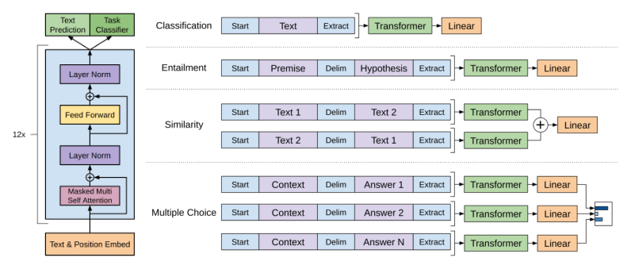
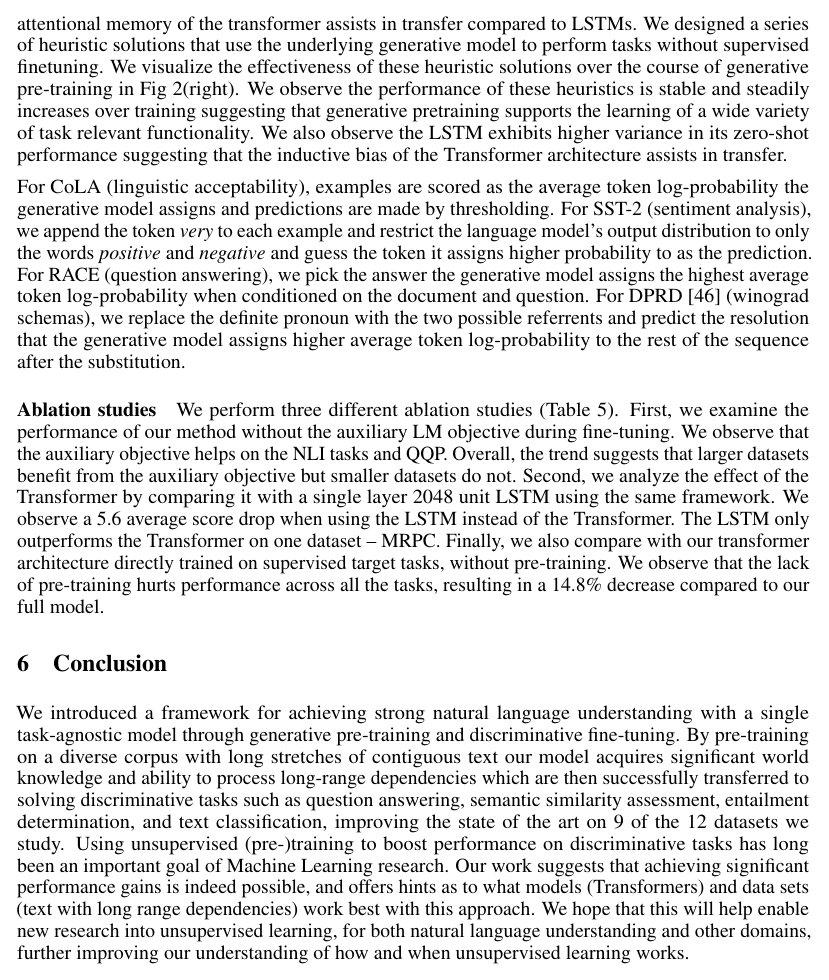
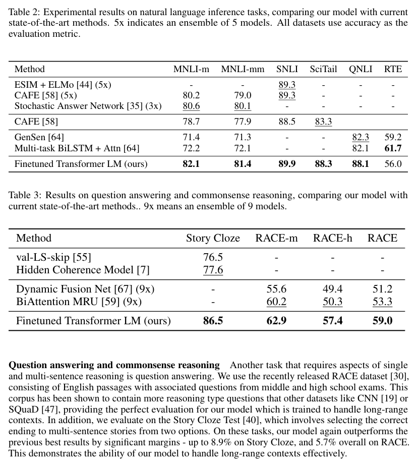
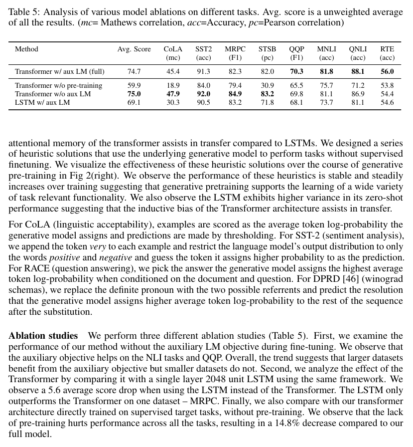

# 通过生成式预训练改善语言理解

> **Improving Language Understanding by Generative Pre-Training**

**Alec Radford, Karthik Narasimhan, Tim Salimans, Ilya Sutskever — OpenAI**

*{alec, karthikn, tim, ilyasu}@openai.com*

**Original:** Preprint. Work in progress.

**中文:** 预印本。工作仍在进行中。

---

## 摘要（Abstract）

**Original:** Natural language understanding comprises a wide range of diverse tasks such as textual entailment, question answering, semantic similarity assessment, and document classification. Although large unlabeled text corpora are abundant, labeled data for learning these specific tasks is scarce, making it challenging for discriminatively trained models to perform adequately.

**中文:** 自然语言理解（natural language understanding）涵盖多种多样的任务，如文本蕴含（textual entailment）、问答（question answering）、语义相似度（semantic similarity）评估和文档分类。尽管大规模无标注文本语料十分丰富，但用于学习这些具体任务的标注数据却很稀缺，使得判别式训练的模型难以达到令人满意的表现。

**Original:** We demonstrate that large gains on these tasks can be realized by generative pre-training of a language model on a diverse corpus of unlabeled text, followed by discriminative fine-tuning on each specific task. In contrast to previous approaches, we make use of task-aware input transformations during fine-tuning to achieve effective transfer while requiring minimal changes to the model architecture.

**中文:** 我们证明：先在多样化无标注文本语料上对语言模型（language model）进行生成式预训练，再在每个具体任务上进行判别式微调，能够在这些任务上取得巨大提升。与以往方法不同，我们在微调期间使用任务感知的输入变换来实现有效迁移，同时只需对模型架构做最小改动。

**Original:** We demonstrate the effectiveness of our approach on a wide range of benchmarks for natural language understanding. Our general task-agnostic model outperforms discriminatively trained models that use architectures specifically crafted for each task, significantly improving upon the state of the art in 9 out of the 12 tasks studied. For instance, we achieve absolute improvements of 8.9% on commonsense reasoning (Stories Cloze Test), 5.7% on question answering (RACE), and 1.5% on textual entailment (MultiNLI).

**中文:** 我们在自然语言理解的大量基准测试上证明了该方法的有效性。我们这种通用的、任务无关的模型优于那些为每个任务专门设计架构的判别式训练模型，在所研究的 12 个任务中有 9 个显著刷新了当前最优（state of the art，SOTA）。例如，我们在常识推理（Stories Cloze Test）上取得 8.9% 的绝对提升，在问答（RACE）上取得 5.7%，在文本蕴含（MultiNLI）上取得 1.5%。

---

## 1 引言（Introduction）

**Original:** The ability to learn effectively from raw text is crucial to alleviating the dependence on supervised learning in natural language processing (NLP). Most deep learning methods require substantial amounts of manually labeled data, which restricts their applicability in many domains that suffer from a dearth of annotated resources [61]. In these situations, models that can leverage linguistic information from unlabeled data provide a valuable alternative to gathering more annotation, which can be time-consuming and expensive. Further, even in cases where considerable supervision is available, learning good representations in an unsupervised fashion can provide a significant performance boost. The most compelling evidence for this so far has been the extensive use of pre-trained word embeddings [10, 39, 42] to improve performance on a range of NLP tasks [8, 11, 26, 45].

**中文:** 从原始文本中有效学习的能力，对于减轻自然语言处理（NLP）对监督学习的依赖至关重要。大多数深度学习方法都需要大量人工标注的数据，这限制了它们在许多缺乏标注资源的领域中的适用性 [61]。在这些情形下，能够从无标注数据中利用语言信息的模型，为收集更多标注（耗时且昂贵）提供了一种有价值的替代方案。此外，即使在有大量监督信号的场景中，以无监督方式学习好的表示（representation）也能带来显著的性能提升。迄今为止最有说服力的证据是：预训练词嵌入（word embedding）[10, 39, 42] 被广泛用于提升一系列 NLP 任务的性能 [8, 11, 26, 45]。

**Original:** Leveraging more than word-level information from unlabeled text, however, is challenging for two main reasons. First, it is unclear what type of optimization objectives are most effective at learning text representations that are useful for transfer. Recent research has looked at various objectives such as language modeling [44], machine translation [38], and discourse coherence [22], with each method outperforming the others on different tasks.1 Second, there is no consensus on the most effective way to transfer these learned representations to the target task. Existing techniques involve a combination of making task-specific changes to the model architecture [43, 44], using intricate learning schemes [21] and adding auxiliary learning objectives [50]. These uncertainties have made it difficult to develop effective semi-supervised learning approaches for language processing.

**中文:** 然而，从无标注文本中利用词级别以上的信息面临两个主要挑战。第一，何种优化目标对学习可迁移的文本表示最有效尚不清楚。近期研究考察了多种目标，如语言建模 [44]、机器翻译 [38] 和篇章连贯性 [22]，每种方法在不同任务上各有胜负。1 第二，对于如何最有效地把这些学到的表示迁移到目标任务，尚无共识。现有技术包括对模型架构做任务特定的改动 [43, 44]、使用复杂的学习方案 [21] 以及添加辅助学习目标 [50]。这些不确定性使得为语言处理开发有效的半监督学习方法变得困难。

（脚注 1：https://gluebenchmark.com/leaderboard）

**Original:** In this paper, we explore a semi-supervised approach for language understanding tasks using a combination of unsupervised pre-training and supervised fine-tuning. Our goal is to learn a universal representation that transfers with little adaptation to a wide range of tasks. We assume access to a large corpus of unlabeled text and several datasets with manually annotated training examples (target tasks). Our setup does not require these target tasks to be in the same domain as the unlabeled corpus. We employ a two-stage training procedure. First, we use a language modeling objective on the unlabeled data to learn the initial parameters of a neural network model. Subsequently, we adapt these parameters to a target task using the corresponding supervised objective.

**中文:** 本文探索一种用于语言理解任务的半监督方法，将无监督预训练与监督微调相结合。我们的目标是学习一个通用表示，只需很小的适配即可迁移到广泛的任务上。我们假设可以访问大规模无标注文本语料以及若干带人工标注训练样本的数据集（目标任务）。我们的设定不要求这些目标任务与无标注语料处于同一领域。我们采用两阶段的训练流程：首先，在无标注数据上使用语言建模目标来学习神经网络模型的初始参数；随后，使用相应的监督目标把这些参数适配到目标任务上。

**Original:** For our model architecture, we use the Transformer [62], which has been shown to perform strongly on various tasks such as machine translation [62], document generation [34], and syntactic parsing [29]. This model choice provides us with a more structured memory for handling long-term dependencies in text, compared to alternatives like recurrent networks, resulting in robust transfer performance across diverse tasks. During transfer, we utilize task-specific input adaptations derived from traversal-style approaches [52], which process structured text input as a single contiguous sequence of tokens. As we demonstrate in our experiments, these adaptations enable us to fine-tune effectively with minimal changes to the architecture of the pre-trained model.

**中文:** 在模型架构上，我们使用 Transformer [62]，它在机器翻译 [62]、文档生成 [34] 和句法分析 [29] 等多种任务上表现强劲。与循环网络等替代方案相比，这一模型选择为我们处理文本中的长程依赖提供了更结构化的记忆，从而在多样化任务上取得稳健的迁移性能。在迁移阶段，我们采用源自遍历式（traversal-style）方法 [52] 的任务特定输入适配，把结构化文本输入处理为单一连续的词元（token）序列。正如我们在实验中展示的那样，这些适配使我们能够在只对预训练模型架构做最小改动的情况下有效微调。

**Original:** We evaluate our approach on four types of language understanding tasks – natural language inference, question answering, semantic similarity, and text classification. Our general task-agnostic model outperforms discriminatively trained models that employ architectures specifically crafted for each task, significantly improving upon the state of the art in 9 out of the 12 tasks studied. For instance, we achieve absolute improvements of 8.9% on commonsense reasoning (Stories Cloze Test) [40], 5.7% on question answering (RACE) [30], 1.5% on textual entailment (MultiNLI) [66] and 5.5% on the recently introduced GLUE multi-task benchmark [64]. We also analyzed zero-shot behaviors of the pre-trained model on four different settings and demonstrate that it acquires useful linguistic knowledge for downstream tasks.

**中文:** 我们在四类语言理解任务上评估我们的方法——自然语言推理、问答、语义相似度和文本分类。我们这种通用的、任务无关的模型优于那些为每个任务专门设计架构的判别式训练模型，在所研究的 12 个任务中有 9 个显著刷新了当前最优。例如，我们在常识推理（Stories Cloze Test）[40] 上取得 8.9% 的绝对提升，在问答（RACE）[30] 上取得 5.7%，在文本蕴含（MultiNLI）[66] 上取得 1.5%，并在新近发布的 GLUE 多任务基准 [64] 上取得 5.5% 的提升。我们还分析了预训练模型在四种设置下的零样本（zero-shot）行为，证明它获得了对下游任务有用的语言知识。

---

## 2 相关工作（Related Work）

### 2.1 面向 NLP 的半监督学习（Semi-supervised learning for NLP）

**Original:** Our work broadly falls under the category of semi-supervised learning for natural language. This paradigm has attracted significant interest, with applications to tasks like sequence labeling [24, 33, 57] or text classification [41, 70]. The earliest approaches used unlabeled data to compute word-level or phrase-level statistics, which were then used as features in a supervised model [33]. Over the last few years, researchers have demonstrated the benefits of using word embeddings [11, 39, 42], which are trained on unlabeled corpora, to improve performance on a variety of tasks [8, 11, 26, 45]. These approaches, however, mainly transfer word-level information, whereas we aim to capture higher-level semantics.

**中文:** 我们的工作大致属于面向自然语言的半监督学习类别。这一范式吸引了大量关注，被应用于序列标注 [24, 33, 57] 和文本分类 [41, 70] 等任务。最早的方法利用无标注数据计算词级或短语级统计量，再将其作为监督模型的特征 [33]。近几年来，研究者证明了使用在无标注语料上训练的词嵌入 [11, 39, 42] 能够提升多种任务的性能 [8, 11, 26, 45]。不过，这些方法主要迁移词级信息，而我们的目标是捕捉更高层的语义。

**Original:** Recent approaches have investigated learning and utilizing more than word-level semantics from unlabeled data. Phrase-level or sentence-level embeddings, which can be trained using an unlabeled corpus, have been used to encode text into suitable vector representations for various target tasks [28, 32, 1, 36, 22, 12, 56, 31].

**中文:** 近期方法研究了从无标注数据中学习和利用词级以上的语义。短语级或句子级嵌入可以用无标注语料训练，并已被用于把文本编码为适用于各种目标任务的向量表示 [28, 32, 1, 36, 22, 12, 56, 31]。

### 2.2 无监督预训练（Unsupervised pre-training）

**Original:** Unsupervised pre-training is a special case of semi-supervised learning where the goal is to find a good initialization point instead of modifying the supervised learning objective. Early works explored the use of the technique in image classification [20, 49, 63] and regression tasks [3]. Subsequent research [15] demonstrated that pre-training acts as a regularization scheme, enabling better generalization in deep neural networks. In recent work, the method has been used to help train deep neural networks on various tasks like image classification [69], speech recognition [68], entity disambiguation [17] and machine translation [48].

**中文:** 无监督预训练是半监督学习的一种特例，其目标不是修改监督学习目标，而是找到一个好的初始化点。早期工作探索了该技术在图像分类 [20, 49, 63] 和回归任务 [3] 中的应用。后续研究 [15] 证明，预训练作为一种正则化机制，能让深度神经网络获得更好的泛化。在近期工作中，该方法已被用于帮助训练深度神经网络完成图像分类 [69]、语音识别 [68]、实体消歧 [17] 和机器翻译 [48] 等多种任务。

**Original:** The closest line of work to ours involves pre-training a neural network using a language modeling objective and then fine-tuning it on a target task with supervision. Dai et al. [13] and Howard and Ruder [21] follow this method to improve text classification. However, although the pre-training phase helps capture some linguistic information, their usage of LSTM models restricts their prediction ability to a short range. In contrast, our choice of transformer networks allows us to capture longer-range linguistic structure, as demonstrated in our experiments. Further, we also demonstrate the effectiveness of our model on a wider range of tasks including natural language inference, paraphrase detection and story completion. Other approaches [43, 44, 38] use hidden representations from a pre-trained language or machine translation model as auxiliary features while training a supervised model on the target task. This involves a substantial amount of new parameters for each separate target task, whereas we require minimal changes to our model architecture during transfer.

**中文:** 与我们的工作最接近的一类方法是：先用语言建模目标预训练一个神经网络，再在目标任务上以监督方式微调它。Dai et al. [13] 以及 Howard 和 Ruder [21] 遵循这一方法改进文本分类。然而，尽管预训练阶段有助于捕捉一些语言信息，他们使用的长短期记忆网络（LSTM）模型将其预测能力限制在较短范围内。相比之下，我们选择 Transformer 网络，能够捕捉更长范围的语言结构，这一点在我们的实验中得到了证明。此外，我们还在更广泛的任务上——包括自然语言推理、释义检测（paraphrase detection）和故事补全（story completion）——证明了模型的有效性。其他方法 [43, 44, 38] 在训练目标任务监督模型时，把预训练语言模型或机器翻译模型的隐藏表示用作辅助特征。这需要为每个独立目标任务引入大量新参数，而我们在迁移过程中只要求对模型架构做最小改动。

### 2.3 辅助训练目标（Auxiliary training objectives）

**Original:** Adding auxiliary unsupervised training objectives is an alternative form of semi-supervised learning. Early work by Collobert and Weston [10] used a wide variety of auxiliary NLP tasks such as POS tagging, chunking, named entity recognition, and language modeling to improve semantic role labeling. More recently, Rei [50] added an auxiliary language modeling objective to their target task objective and demonstrated performance gains on sequence labeling tasks. Our experiments also use an auxiliary objective, but as we show, unsupervised pre-training already learns several linguistic aspects relevant to target tasks.

**中文:** 添加辅助的无监督训练目标是半监督学习的另一种形式。Collobert 和 Weston 的早期工作 [10] 使用多种辅助 NLP 任务（如 POS 标注、组块分析、命名实体识别和语言建模）来改进语义角色标注。更近一些，Rei [50] 在其目标任务目标之上加入辅助语言建模目标，并在序列标注任务上展示了性能提升。我们的实验也使用了一个辅助目标，但正如我们所示，无监督预训练本身已经学到了若干与目标任务相关的语言方面。

---

## 3 框架（Framework）

**Original:** Our training procedure consists of two stages. The first stage is learning a high-capacity language model on a large corpus of text. This is followed by a fine-tuning stage, where we adapt the model to a discriminative task with labeled data.

**中文:** 我们的训练流程包含两个阶段。第一阶段是在大规模文本语料上学习一个高容量语言模型；随后是微调阶段，在该阶段我们用带标注的数据把模型适配到判别式任务上。

### 3.1 无监督预训练（Unsupervised pre-training）

**Original:** Given an unsupervised corpus of tokens $\mathcal{U} = \{u_1, \ldots, u_n\}$, we use a standard language modeling objective to maximize the following likelihood:

$$L_1(\mathcal{U}) = \sum_i \log P(u_i \mid u_{i-k}, \ldots, u_{i-1}; \Theta)$$

where $k$ is the size of the context window, and the conditional probability $P$ is modeled using a neural network with parameters $\Theta$. These parameters are trained using stochastic gradient descent [51].

**中文:** 给定无监督词元语料 $\mathcal{U} = \{u_1, \ldots, u_n\}$，我们使用标准语言建模目标来最大化如下似然：

$$L_1(\mathcal{U}) = \sum_i \log P(u_i \mid u_{i-k}, \ldots, u_{i-1}; \Theta)$$

其中 $k$ 是上下文窗口的大小，条件概率 $P$ 由参数为 $\Theta$ 的神经网络建模。这些参数通过随机梯度下降（stochastic gradient descent，SGD）训练 [51]。

**Original:** In our experiments, we use a multi-layer Transformer decoder [34] for the language model, which is a variant of the transformer [62]. This model applies a multi-headed self-attention operation over the input context tokens followed by position-wise feedforward layers to produce an output distribution over target tokens:

$$h_0 = U W_e + W_p$$
$$h_l = \text{transformer\_block}(h_{l-1}) \quad \forall i \in [1, n]$$
$$P(u) = \text{softmax}(h_n W_e^T)$$

where $U = (u_{-k}, \ldots, u_{-1})$ is the context vector of tokens, $n$ is the number of layers, $W_e$ is the token embedding matrix, and $W_p$ is the position embedding matrix.

**中文:** 在我们的实验中，语言模型使用多层 Transformer 解码器 [34]，它是 Transformer [62] 的一种变体。该模型对输入上下文词元施加多头自注意力（multi-headed self-attention）操作，后接逐位置前馈层，以产生目标词元上的输出分布：

$$h_0 = U W_e + W_p$$
$$h_l = \text{transformer\_block}(h_{l-1}) \quad \forall i \in [1, n]$$
$$P(u) = \text{softmax}(h_n W_e^T)$$

其中 $U = (u_{-k}, \ldots, u_{-1})$ 是词元上下文向量，$n$ 是层数，$W_e$ 是词元嵌入矩阵，$W_p$ 是位置嵌入矩阵。

### 3.2 监督微调（Supervised fine-tuning）

**Original:** After training the model with the objective in Eq. 1, we adapt the parameters to the supervised target task. We assume a labeled dataset $\mathcal{C}$, where each instance consists of a sequence of input tokens, $x^1, \ldots, x^m$, along with a label $y$. The inputs are passed through our pre-trained model to obtain the final transformer block's activation $h_l^m$, which is then fed into an added linear output layer with parameters $W_y$ to predict $y$:

$$P(y \mid x^1, \ldots, x^m) = \text{softmax}(h_l^m W_y).$$

**中文:** 在用式 1 的目标训练模型之后，我们将参数适配到监督目标任务。假设有标注数据集 $\mathcal{C}$，其中每个样本由输入词元序列 $x^1, \ldots, x^m$ 和一个标签 $y$ 组成。输入通过我们的预训练模型，得到最终 Transformer 块的激活 $h_l^m$，再将其送入新增的、参数为 $W_y$ 的线性输出层以预测 $y$：

$$P(y \mid x^1, \ldots, x^m) = \text{softmax}(h_l^m W_y).$$

**Original:** This gives us the following objective to maximize:

$$L_2(\mathcal{C}) = \sum_{(x,y)} \log P(y \mid x^1, \ldots, x^m).$$

**中文:** 由此得到如下待最大化目标：

$$L_2(\mathcal{C}) = \sum_{(x,y)} \log P(y \mid x^1, \ldots, x^m).$$

**Original:** We additionally found that including language modeling as an auxiliary objective to the fine-tuning helped learning by (a) improving generalization of the supervised model, and (b) accelerating convergence. This is in line with prior work [50, 43], who also observed improved performance with such an auxiliary objective. Specifically, we optimize the following objective (with weight $\lambda$):

$$L_3(\mathcal{C}) = L_2(\mathcal{C}) + \lambda * L_1(\mathcal{C})$$

**中文:** 我们还发现，在微调中加入语言建模作为辅助目标有助于学习：(a) 提升监督模型的泛化能力，(b) 加速收敛。这与先前工作 [50, 43] 一致，他们也观察到这种辅助目标能改善性能。具体地，我们优化如下目标（权重为 $\lambda$）：

$$L_3(\mathcal{C}) = L_2(\mathcal{C}) + \lambda * L_1(\mathcal{C})$$

**Original:** Overall, the only extra parameters we require during fine-tuning are $W_y$, and embeddings for delimiter tokens (described below in Section 3.3).

**中文:** 总体而言，微调期间我们唯一需要的额外参数是 $W_y$ 以及分隔符词元的嵌入（详见下文第 3.3 节）。

> **图 1（译）**：（左）本文使用的 Transformer 架构与训练目标。（右）用于不同任务微调的输入变换。我们将所有结构化输入转换为词元序列，交由预训练模型处理，其后接一个 linear+Softmax 层。（原图见 paper.pdf 第 4 页，见下方图）

### 3.3 任务特定的输入变换（Task-specific input transformations）

**Original:** For some tasks, like text classification, we can directly fine-tune our model as described above. Certain other tasks, like question answering or textual entailment, have structured inputs such as ordered sentence pairs, or triplets of document, question, and answers. Since our pre-trained model was trained on contiguous sequences of text, we require some modifications to apply it to these tasks. Previous work proposed learning task specific architectures on top of transferred representations [44]. Such an approach re-introduces a significant amount of task-specific customization and does not use transfer learning for these additional architectural components. Instead, we use a traversal-style approach [52], where we convert structured inputs into an ordered sequence that our pre-trained model can process. These input transformations allow us to avoid making extensive changes to the architecture across tasks. We provide a brief description of these input transformations below and Figure 1 provides a visual illustration. All transformations include adding randomly initialized start and end tokens ($\langle s \rangle$, $\langle e \rangle$).

**中文:** 对于文本分类等任务，我们可以按上述方式直接微调模型。而问答或文本蕴含等其他任务具有结构化输入，如有序句对，或文档、问题与答案构成的三元组。由于我们的预训练模型是在连续文本序列上训练的，需要一些修改才能将其应用到这些任务上。先前工作提出在迁移来的表示之上学习任务特定的架构 [44]。这种做法重新引入了大量任务特定的定制，并且这些新增架构组件没有利用迁移学习。相反，我们采用遍历式方法 [52]，把结构化输入转换为预训练模型可以处理的有序序列。这些输入变换使我们得以避免在不同任务之间对架构做大量改动。下面简要描述这些输入变换，图 1 给出了直观示意。所有变换都包括添加随机初始化的起始与结束词元（$\langle s \rangle$、$\langle e \rangle$）。

**Original:** *Textual entailment* For entailment tasks, we concatenate the premise $p$ and hypothesis $h$ token sequences, with a delimiter token (\$) in between.

**中文:** *文本蕴含* 对于蕴含任务，我们拼接前提 $p$ 与假设 $h$ 的词元序列，中间用一个分隔符词元（\$）隔开。

**Original:** *Similarity* For similarity tasks, there is no inherent ordering of the two sentences being compared. To reflect this, we modify the input sequence to contain both possible sentence orderings (with a delimiter in between) and process each independently to produce two sequence representations $h_l^m$ which are added element-wise before being fed into the linear output layer.

**中文:** *相似度* 对于相似度任务，被比较的两个句子没有固有的顺序。为反映这一点，我们修改输入序列，使其包含两种可能的句子顺序（中间用分隔符隔开），并分别处理每个序列，产生两个序列表示 $h_l^m$，两者逐元素相加后再送入线性输出层。

**Original:** *Question Answering and Commonsense Reasoning* For these tasks, we are given a context document $z$, a question $q$, and a set of possible answers $\{a_k\}$. We concatenate the document context and question with each possible answer, adding a delimiter token in between to get $[z; q; \$; a_k]$. Each of these sequences are processed independently with our model and then normalized via a softmax layer to produce an output distribution over possible answers.

**中文:** *问答与常识推理* 对于这些任务，给定上下文文档 $z$、问题 $q$ 和一组候选答案 $\{a_k\}$。我们把文档上下文和问题与每个候选答案拼接起来，中间插入分隔符词元，得到 $[z; q; \$; a_k]$。每个这样的序列都用我们的模型独立处理，然后经 Softmax 层归一化，产生候选答案上的输出分布。

---

## 4 实验（Experiments）

### 4.1 设置（Setup）

#### 无监督预训练（Unsupervised pre-training）

**Original:** We use the BooksCorpus dataset [71] for training the language model. It contains over 7,000 unique unpublished books from a variety of genres including Adventure, Fantasy, and Romance. Crucially, it contains long stretches of contiguous text, which allows the generative model to learn to condition on long-range information. An alternative dataset, the 1B Word Benchmark, which is used by a similar approach, ELMo [44], is approximately the same size but is shuffled at a sentence level - destroying long-range structure. Our language model achieves a very low token level perplexity of 18.4 on this corpus.

**中文:** 我们使用 BooksCorpus 数据集 [71] 训练语言模型。它包含 7000 多本未出版的独特书籍，涵盖冒险、奇幻、爱情等多种体裁。关键在于它包含大段连续文本，使生成模型能够学会以长程信息为条件。另一种数据集 1B Word Benchmark（被类似方法 ELMo [44] 使用）规模大致相同，但按句子级别做了打乱——破坏了长程结构。我们的语言模型在该语料上取得了非常低的词元级困惑度（perplexity）18.4。

> **表 1（译）**：实验所用的不同任务与数据集列表。（原表见 paper.pdf 第 5 页，见下方图）

| Task | Datasets |
|---|---|
| Natural language inference | SNLI [5], MultiNLI [66], Question NLI [64], RTE [4], SciTail [25] |
| Question Answering | RACE [30], Story Cloze [40] |
| Sentence similarity | MSR Paraphrase Corpus [14], Quora Question Pairs [9], STS Benchmark [6] |
| Classification | Stanford Sentiment Treebank-2 [54], CoLA [65] |

#### 模型规格（Model specifications）

**Original:** Our model largely follows the original transformer work [62]. We trained a 12-layer decoder-only transformer with masked self-attention heads (768 dimensional states and 12 attention heads). For the position-wise feed-forward networks, we used 3072 dimensional inner states. We used the Adam optimization scheme [27] with a max learning rate of 2.5e-4. The learning rate was increased linearly from zero over the first 2000 updates and annealed to 0 using a cosine schedule. We train for 100 epochs on minibatches of 64 randomly sampled, contiguous sequences of 512 tokens. Since layernorm [2] is used extensively throughout the model, a simple weight initialization of N(0, 0.02) was sufficient. We used a bytepair encoding (BPE) vocabulary with 40,000 merges [53] and residual, embedding, and attention dropouts with a rate of 0.1 for regularization. We also employed a modified version of L2 regularization proposed in [37], with w = 0.01 on all non bias or gain weights. For the activation function, we used the Gaussian Error Linear Unit (GELU) [18]. We used learned position embeddings instead of the sinusoidal version proposed in the original work. We use the ftfy library2 to clean the raw text in BooksCorpus, standardize some punctuation and whitespace, and use the spaCy tokenizer.3

**中文:** 我们的模型大体沿用最初的 Transformer 工作 [62]。我们训练了一个 12 层、仅解码器的 Transformer，带掩码自注意力头（768 维状态、12 个注意力头）。对于逐位置前馈网络，我们使用 3072 维内部状态。我们使用 Adam 优化方案 [27]，最大学习率（learning rate）为 2.5e-4。学习率在前 2000 次更新中从零线性增加，随后按余弦调度退火至 0。我们训练 100 个轮次（epoch），使用 64 个小批量（minibatch），每个小批量包含随机采样的 512 词元连续序列。由于层归一化（layer normalization）[2] 在模型中被广泛使用，简单的权重初始化 N(0, 0.02) 已经足够。我们使用 40000 次合并的字节对编码（byte-pair encoding，BPE）词表 [53]，并以 0.1 的比率应用残差、嵌入和注意力的随机失活（Dropout）进行正则化。我们还采用了 [37] 中提出的改进版 L2 正则化，对所有非偏置或非 gain 的权重设置 w = 0.01。激活函数使用高斯误差线性单元（GELU）[18]。我们使用学习得到的位置嵌入，而非原工作中提出的正弦版本。我们使用 ftfy 库2 清洗 BooksCorpus 的原始文本，标准化部分标点和空白，并使用 spaCy 分词器。3

（脚注 2：https://ftfy.readthedocs.io/en/latest/；脚注 3：https://spacy.io/）

#### 微调细节（Fine-tuning details）

**Original:** Unless specified, we reuse the hyperparameter settings from unsupervised pre-training. We add dropout to the classifier with a rate of 0.1. For most tasks, we use a learning rate of 6.25e-5 and a batchsize of 32. Our model finetunes quickly and 3 epochs of training was sufficient for most cases. We use a linear learning rate decay schedule with warmup over 0.2% of training. $\lambda$ was set to 0.5.

**中文:** 除非特别说明，我们沿用无监督预训练的超参数设置。我们对分类器添加比率为 0.1 的随机失活。对大多数任务，我们使用 6.25e-5 的学习率和 32 的批大小。我们的模型微调得很快，对大多数情况训练 3 个轮次就足够了。我们使用线性学习率衰减调度，并在前 0.2% 的训练中进行预热（warmup）。$\lambda$ 设为 0.5。

### 4.2 监督微调（Supervised fine-tuning）

**Original:** We perform experiments on a variety of supervised tasks including natural language inference, question answering, semantic similarity, and text classification. Some of these tasks are available as part of the recently released GLUE multi-task benchmark [64], which we make use of. Figure 1 provides an overview of all the tasks and datasets.

**中文:** 我们在多种监督任务上进行实验，包括自然语言推理、问答、语义相似度和文本分类。其中一些任务是新近发布的 GLUE 多任务基准 [64] 的一部分，我们使用了它们。图 1 给出了所有任务和数据集的概览。

#### 自然语言推理（Natural Language Inference）

**Original:** The task of natural language inference (NLI), also known as recognizing textual entailment, involves reading a pair of sentences and judging the relationship between them from one of entailment, contradiction or neutral. Although there has been a lot of recent interest [58, 35, 44], the task remains challenging due to the presence of a wide variety of phenomena like lexical entailment, coreference, and lexical and syntactic ambiguity. We evaluate on five datasets with diverse sources, including image captions (SNLI), transcribed speech, popular fiction, and government reports (MNLI), Wikipedia articles (QNLI), science exams (SciTail) or news articles (RTE).

**中文:** 自然语言推理（natural language inference，NLI）任务，又称识别文本蕴含，涉及阅读一对句子并判断它们之间的关系属于蕴含、矛盾或中立之一。尽管近期关注颇多 [58, 35, 44]，由于存在词汇蕴含、共指、词汇与句法歧义等多种现象，该任务仍具挑战性。我们在五个来源多样的数据集上评估：图像字幕（SNLI）、转写语音、流行小说和政府报告（MNLI）、维基百科文章（QNLI）、科学考试（SciTail）或新闻文章（RTE）。

> **表 2（译）**：自然语言推理任务上的实验结果，对比我们的模型与当前 SOTA 方法。5x 表示 5 个模型的集成。所有数据集均以准确率作为评估指标。（原表见 paper.pdf 第 6 页，见下方图）

| Method | MNLI-m | MNLI-mm | SNLI | SciTail | QNLI | RTE |
|---|---|---|---|---|---|---|
| ESIM + ELMo [44] (5x) | - | - | 89.3 | - | - | - |
| CAFE [58] (5x) | 80.2 | 79.0 | 89.3 | - | - | - |
| Stochastic Answer Network [35] (3x) | 80.6 | 80.1 | - | - | - | - |
| CAFE [58] | 78.7 | 77.9 | 88.5 | 83.3 | - | - |
| GenSen [64] | 71.4 | 71.3 | - | - | 82.3 | 59.2 |
| Multi-task BiLSTM + Attn [64] | 72.2 | 72.1 | - | - | 82.1 | 61.7 |
| Finetuned Transformer LM (ours) | 82.1 | 81.4 | 89.9 | 88.3 | 88.1 | 56.0 |

（注：CAFE [58] 行的 QNLI、RTE 两列在 PDF 文本提取中缺失，按原论文版式以 "-" 补齐。）

**Original:** Table 2 details various results on the different NLI tasks for our model and previous state-of-the-art approaches. Our method significantly outperforms the baselines on four of the five datasets, achieving absolute improvements of upto 1.5% on MNLI, 5% on SciTail, 5.8% on QNLI and 0.6% on SNLI over the previous best results. This demonstrates our model's ability to better reason over multiple sentences, and handle aspects of linguistic ambiguity. On RTE, one of the smaller datasets we evaluate on (2490 examples), we achieve an accuracy of 56%, which is below the 61.7% reported by a multi-task biLSTM model. Given the strong performance of our approach on larger NLI datasets, it is likely our model will benefit from multi-task training as well but we have not explored this currently.

**中文:** 表 2 详细列出了我们的模型与先前 SOTA 方法在不同 NLI 任务上的各种结果。我们的方法在五个数据集中的四个上显著优于基线，相比此前最佳结果取得绝对提升：MNLI 上最高 1.5%、SciTail 上 5%、QNLI 上 5.8%、SNLI 上 0.6%。这表明我们的模型能更好地对多个句子进行推理并处理语言歧义的各个方面。在 RTE——我们评估的较小数据集之一（2490 个样本）——上，我们取得 56% 的准确率，低于一个多任务 biLSTM 模型报告的 61.7%。鉴于我们的方法在更大的 NLI 数据集上的强劲表现，我们的模型很可能同样受益于多任务训练，但目前尚未探索。

> **表 3（译）**：问答与常识推理任务上的结果，对比我们的模型与当前 SOTA 方法。9x 表示 9 个模型的集成。（原表见 paper.pdf 第 6 页，[第 6 页图](assets/figures/tab-3.png)）

| Method | Story Cloze | RACE-m | RACE-h | RACE |
|---|---|---|---|---|
| val-LS-skip [55] | 76.5 | - | - | - |
| Hidden Coherence Model [7] | 77.6 | - | - | - |
| Dynamic Fusion Net [67] (9x) | - | 55.6 | 49.4 | 51.2 |
| BiAttention MRU [59] (9x) | - | 60.2 | 50.3 | 53.3 |
| Finetuned Transformer LM (ours) | 86.5 | 62.9 | 57.4 | 59.0 |

#### 问答与常识推理（Question answering and commonsense reasoning）

**Original:** Another task that requires aspects of single and multi-sentence reasoning is question answering. We use the recently released RACE dataset [30], consisting of English passages with associated questions from middle and high school exams. This corpus has been shown to contain more reasoning type questions that other datasets like CNN [19] or SQuaD [47], providing the perfect evaluation for our model which is trained to handle long-range contexts. In addition, we evaluate on the Story Cloze Test [40], which involves selecting the correct ending to multi-sentence stories from two options. On these tasks, our model again outperforms the previous best results by significant margins - up to 8.9% on Story Cloze, and 5.7% overall on RACE. This demonstrates the ability of our model to handle long-range contexts effectively.

**中文:** 另一个需要单句与多句推理的任务是问答。我们使用新近发布的 RACE 数据集 [30]，它由中学和高中考试中的英文篇章及相关问题组成。该语料已被证明比其他数据集（如 CNN [19] 或 SQuaD [47]）包含更多推理类问题 [译注：原文 "more reasoning type questions that other datasets" 中 "that" 疑为 "than" 之笔误]，为我们这种训练来处理长程上下文的模型提供了完美的评估。此外，我们还在 Story Cloze Test [40] 上评估，该任务需要从两个选项中为多句故事选择正确的结尾。在这些任务上，我们的模型再次以显著优势超过此前最佳结果——Story Cloze 上最高 8.9%，RACE 上总体 5.7%。这证明了我们的模型有效处理长程上下文的能力。

#### 语义相似度（Semantic Similarity）

**Original:** Semantic similarity (or paraphrase detection) tasks involve predicting whether two sentences are semantically equivalent or not. The challenges lie in recognizing rephrasing of concepts, understanding negation, and handling syntactic ambiguity. We use three datasets for this task – the Microsoft Paraphrase corpus (MRPC) [14] (collected from news sources), the Quora Question Pairs (QQP) dataset [9], and the Semantic Textual Similarity benchmark (STS-B) [6]. We obtain state-of-the-art results on two of the three semantic similarity tasks (Table 4) with a 1 point absolute gain on STS-B. The performance delta on QQP is significant, with a 4.2% absolute improvement over Single-task BiLSTM + ELMo + Attn.

**中文:** 语义相似度（或释义检测）任务涉及预测两个句子在语义上是否等价。挑战在于识别概念的改写、理解否定以及处理句法歧义。我们为该任务使用三个数据集——Microsoft Paraphrase 语料库（MRPC）[14]（收集自新闻来源）、Quora Question Pairs（QQP）数据集 [9] 和 Semantic Textual Similarity 基准（STS-B）[6]。我们在三个语义相似度任务中的两个上取得 SOTA 结果（表 4），STS-B 上有 1 个点的绝对提升。QQP 上的性能差距显著，相对 Single-task BiLSTM + ELMo + Attn 有 4.2% 的绝对提升。

#### 分类（Classification）

**Original:** Finally, we also evaluate on two different text classification tasks. The Corpus of Linguistic Acceptability (CoLA) [65] contains expert judgements on whether a sentence is grammatical or not, and tests the innate linguistic bias of trained models. The Stanford Sentiment Treebank (SST-2) [54], on the other hand, is a standard binary classification task. Our model obtains an score of 45.4 on CoLA, which is an especially big jump over the previous best result of 35.0, showcasing the innate linguistic bias learned by our model. The model also achieves 91.3% accuracy on SST-2, which is competitive with the state-of-the-art results. We also achieve an overall score of 72.8 on the GLUE benchmark, which is significantly better than the previous best of 68.9.

**中文:** 最后，我们还在两个不同的文本分类任务上评估。Corpus of Linguistic Acceptability（CoLA）[65] 包含专家对句子是否合乎语法的判断，测试训练模型的先天语言偏置。Stanford Sentiment Treebank（SST-2）[54] 则是一个标准的二分类任务。我们的模型在 CoLA 上取得 45.4 分 [译注：原文 "an score" 系笔误，应为 "a score"]，相比此前最佳结果 35.0 有特别大的跃升，展示了模型学到的先天语言偏置。模型在 SST-2 上还取得 91.3% 的准确率，与 SOTA 结果相当。我们在 GLUE 基准上取得 72.8 的总分，显著优于此前最佳的 68.9。

> **表 4（译）**：语义相似度与分类结果，对比我们的模型与当前 SOTA 方法。本表所有任务评估均使用 GLUE 基准测试完成。（mc=Mathews 相关系数，acc=准确率，F1=F1 分数，pc=Pearson 相关系数）（原表见 paper.pdf 第 7 页，见下方图）

| Method | Classification |  | Semantic Similarity |  |  | GLUE |
|---|---|---|---|---|---|---|
|  | CoLA (mc) | SST2 (acc) | MRPC (F1) | STSB (pc) | QQP (F1) |  |
| Sparse byte mLSTM [16] | - | 93.2 | - | - | - | - |
| TF-KLD [23] | - | - | 86.0 | - | - | - |
| ECNU (mixed ensemble) [60] | - | - | - | 81.0 | - | - |
| Single-task BiLSTM + ELMo + Attn [64] | 35.0 | 90.2 | 80.2 | 55.5 | 66.1 | 64.8 |
| Multi-task BiLSTM + ELMo + Attn [64] | 18.9 | 91.6 | 83.5 | 72.8 | 63.3 | 68.9 |
| Finetuned Transformer LM (ours) | 45.4 | 91.3 | 82.3 | 82.0 | 70.3 | 72.8 |

**Original:** Overall, our approach achieves new state-of-the-art results in 9 out of the 12 datasets we evaluate on, outperforming ensembles in many cases. Our results also indicate that our approach works well across datasets of different sizes, from smaller datasets such as STS-B (≈5.7k training examples) – to the largest one – SNLI (≈550k training examples).

**中文:** 总体而言，我们的方法在我们评估的 12 个数据集中的 9 个上取得了新的 SOTA 结果，在许多情况下优于集成（ensemble）方法。我们的结果还表明，该方法在大小不同的数据集上都表现良好，从较小的数据集（如 STS-B，约 5.7k 训练样本）到最大的数据集（SNLI，约 550k 训练样本）。

---

## 5 分析（Analysis）

### 迁移层数的影响（Impact of number of layers transferred）

**Original:** We observed the impact of transferring a variable number of layers from unsupervised pre-training to the supervised target task. Figure 2(left) illustrates the performance of our approach on MultiNLI and RACE as a function of the number of layers transferred. We observe the standard result that transferring embeddings improves performance and that each transformer layer provides further benefits up to 9% for full transfer on MultiNLI. This indicates that each layer in the pre-trained model contains useful functionality for solving target tasks.

**中文:** 我们观察了从无监督预训练向监督目标任务迁移不同层数的影响。图 2（左）展示了我们的方法在 MultiNLI 和 RACE 上随迁移层数变化的性能。我们观察到标准结论：迁移嵌入即可提升性能，且每个 Transformer 层都带来进一步增益——MultiNLI 上完整迁移的增益最高达 9%。这表明预训练模型的每一层都包含对解决目标任务有用的功能。

> **图 2（译）**：（左）从预训练语言模型迁移不同层数对 RACE 和 MultiNLI 的影响。（右）不同任务上零样本性能随语言模型预训练更新步数变化的曲线。每个任务的性能在随机猜测基线与单模型 SOTA 之间做了归一化。（原图见 paper.pdf 第 7 页，[第 7 页图](assets/figures/fig-2.png)）

### 零样本行为（Zero-shot Behaviors）

**Original:** We'd like to better understand why language model pre-training of transformers is effective. A hypothesis is that the underlying generative model learns to perform many of the tasks we evaluate on in order to improve its language modeling capability and that the more structured attentional memory of the transformer assists in transfer compared to LSTMs.

**中文:** 我们希望更好地理解为什么 Transformer 的语言模型预训练如此有效。一个假设是：底层生成模型为了提升自身的语言建模能力，学会了执行我们评估的许多任务，而且相比 LSTM，Transformer 更具结构化的注意力记忆有助于迁移。

**Original:** We designed a series of heuristic solutions that use the underlying generative model to perform tasks without supervised finetuning. We visualize the effectiveness of these heuristic solutions over the course of generative pre-training in Fig 2(right). We observe the performance of these heuristics is stable and steadily increases over training suggesting that generative pretraining supports the learning of a wide variety of task relevant functionality. We also observe the LSTM exhibits higher variance in its zero-shot performance suggesting that the inductive bias of the Transformer architecture assists in transfer.

**中文:** 我们设计了一系列启发式方案，利用底层生成模型在没有监督微调的情况下执行任务。我们在图 2（右）中可视化了这些启发式方案在生成式预训练过程中的有效性变化。我们观察到这些启发式方案的性能稳定并随训练稳步提升，表明生成式预训练支持学习多种与任务相关的功能。我们还观察到 LSTM 的零样本性能方差更大，表明 Transformer 架构的归纳偏置（inductive bias）有助于迁移。

**Original:** For CoLA (linguistic acceptability), examples are scored as the average token log-probability the generative model assigns and predictions are made by thresholding. For SST-2 (sentiment analysis), we append the token very to each example and restrict the language model's output distribution to only the words positive and negative and guess the token it assigns higher probability to as the prediction. For RACE (question answering), we pick the answer the generative model assigns the highest average token log-probability when conditioned on the document and question. For DPRD [46] (winograd schemas), we replace the definite pronoun with the two possible referrents and predict the resolution that the generative model assigns higher average token log-probability to the rest of the sequence after the substitution.

**中文:** 对于 CoLA（语言可接受性），样本按生成模型赋予的平均词元对数概率打分，并通过阈值化作出预测。对于 SST-2（情感分析），我们在每个样本后追加词元 very，把语言模型的输出分布限制在 positive 和 negative 两个词上，并预测模型赋予更高概率的那个词元。对于 RACE（问答），我们选择在文档和问题条件下生成模型赋予最高平均词元对数概率的答案。对于 DPRD [46]（winograd schemas）[译注：DPRD 疑为原文笔误，引用 [46] 对应的是 Winograd Schema Challenge，通常写作 WSC]，我们把定指代词替换为两个可能的指代对象，并预测替换后生成模型对序列剩余部分赋予更高平均词元对数概率的那种消解。

> **表 5（译）**：不同任务上各种模型消融的分析。Avg. Score 为所有结果的未加权平均。（mc=Mathews 相关系数，acc=准确率，F1=F1 分数，pc=Pearson 相关系数）（原表见 paper.pdf 第 8 页，见下方图）

| Method | Avg. Score | CoLA (mc) | SST2 (acc) | MRPC (F1) | STSB (pc) | QQP (F1) | MNLI (acc) | QNLI (acc) | RTE (acc) |
|---|---|---|---|---|---|---|---|---|---|
| Transformer w/ aux LM (full) | 74.7 | 45.4 | 91.3 | 82.3 | 82.0 | 70.3 | 81.8 | 88.1 | 56.0 |
| Transformer w/o pre-training | 59.9 | 18.9 | 84.0 | 79.4 | 30.9 | 65.5 | 75.7 | 71.2 | 53.8 |
| Transformer w/o aux LM | 75.0 | 47.9 | 92.0 | 84.9 | 83.2 | 69.8 | 81.1 | 86.9 | 54.4 |
| LSTM w/ aux LM | 69.1 | 30.3 | 90.5 | 83.2 | 71.8 | 68.1 | 73.7 | 81.1 | 54.6 |

### 消融实验（Ablation studies）

**Original:** We perform three different ablation studies (Table 5). First, we examine the performance of our method without the auxiliary LM objective during fine-tuning. We observe that the auxiliary objective helps on the NLI tasks and QQP. Overall, the trend suggests that larger datasets benefit from the auxiliary objective but smaller datasets do not. Second, we analyze the effect of the Transformer by comparing it with a single layer 2048 unit LSTM using the same framework. We observe a 5.6 average score drop when using the LSTM instead of the Transformer. The LSTM only outperforms the Transformer on one dataset – MRPC. Finally, we also compare with our transformer architecture directly trained on supervised target tasks, without pre-training. We observe that the lack of pre-training hurts performance across all the tasks, resulting in a 14.8% decrease compared to our full model.

**中文:** 我们进行三项消融实验（表 5）。第一，我们考察微调时去掉辅助语言模型目标后方法的性能。我们观察到辅助目标在 NLI 任务和 QQP 上有帮助。总体趋势表明，较大的数据集受益于辅助目标，而较小的数据集则没有。第二，我们通过在同一框架下与单层 2048 单元的 LSTM 对比，分析 Transformer 的效果。我们观察到使用 LSTM 替代 Transformer 时平均分下降 5.6。LSTM 只在一个数据集——MRPC——上优于 Transformer。第三，我们还与直接在监督目标任务上训练、不经预训练的 Transformer 架构对比。我们观察到缺少预训练损害所有任务上的性能，与完整模型相比下降 14.8%。

---

## 6 结论（Conclusion）

**Original:** We introduced a framework for achieving strong natural language understanding with a single task-agnostic model through generative pre-training and discriminative fine-tuning. By pre-training on a diverse corpus with long stretches of contiguous text our model acquires significant world knowledge and ability to process long-range dependencies which are then successfully transferred to solving discriminative tasks such as question answering, semantic similarity assessment, entailment determination, and text classification, improving the state of the art on 9 of the 12 datasets we study. Using unsupervised (pre-)training to boost performance on discriminative tasks has long been an important goal of Machine Learning research. Our work suggests that achieving significant performance gains is indeed possible, and offers hints as to what models (Transformers) and data sets (text with long range dependencies) work best with this approach. We hope that this will help enable new research into unsupervised learning, for both natural language understanding and other domains, further improving our understanding of how and when unsupervised learning works.

**中文:** 我们提出了一种框架，通过生成式预训练与判别式微调，用单一任务无关模型实现强大的自然语言理解。通过在大段连续文本的多样化语料上预训练，我们的模型获得了显著的世界知识（world knowledge）和处理长程依赖的能力，这些能力随后被成功迁移到判别式任务上，如问答、语义相似度评估、蕴含判定和文本分类，在我们研究的 12 个数据集中的 9 个上刷新了 SOTA。利用无监督（预）训练提升判别式任务性能，长期以来一直是机器学习研究的重要目标。我们的工作表明，取得显著的性能提升确实可行，并就何种模型（Transformer）与何种数据集（具有长程依赖的文本）最适合这种方法给出了提示。我们希望这将助力自然语言理解及其他领域无监督学习的新研究，进一步加深我们对无监督学习如何以及何时起作用的理解。

---

## References

（以下参考文献整体保留原文，不译。）
[1] S. Arora, Y. Liang, and T. Ma. A simple but tough-to-beat baseline for sentence embeddings. 2016.

[2] J. L. Ba, J. R. Kiros, and G. E. Hinton. Layer normalization. arXiv preprint arXiv:1607.06450, 2016.

[3] Y. Bengio, P. Lamblin, D. Popovici, and H. Larochelle. Greedy layer-wise training of deep networks. In Advances in neural information processing systems, pages 153–160, 2007.

[4] L. Bentivogli, P. Clark, I. Dagan, and D. Giampiccolo. The fifth pascal recognizing textual entailment challenge. In TAC, 2009.

[5] S. R. Bowman, G. Angeli, C. Potts, and C. D. Manning. A large annotated corpus for learning natural language inference. EMNLP, 2015.

[6] D. Cer, M. Diab, E. Agirre, I. Lopez-Gazpio, and L. Specia. Semeval-2017 task 1: Semantic textual similarity-multilingual and cross-lingual focused evaluation. arXiv preprint arXiv:1708.00055, 2017.

[7] S. Chaturvedi, H. Peng, and D. Roth. Story comprehension for predicting what happens next. In Proceedings of the 2017 Conference on Empirical Methods in Natural Language Processing, pages 1603–1614, 2017.

[8] D. Chen and C. Manning. A fast and accurate dependency parser using neural networks. In Proceedings of the 2014 conference on empirical methods in natural language processing (EMNLP), pages 740–750, 2014.

[9] Z. Chen, H. Zhang, X. Zhang, and L. Zhao. Quora question pairs. https://data.quora.com/First-Quora-Dataset-Release-Question-Pairs, 2018.

[10] R. Collobert and J. Weston. A unified architecture for natural language processing: Deep neural networks with multitask learning. In Proceedings of the 25th international conference on Machine learning, pages 160–167. ACM, 2008.

[11] R. Collobert, J. Weston, L. Bottou, M. Karlen, K. Kavukcuoglu, and P. Kuksa. Natural language processing (almost) from scratch. Journal of Machine Learning Research, 12(Aug):2493–2537, 2011.

[12] A. Conneau, D. Kiela, H. Schwenk, L. Barrault, and A. Bordes. Supervised learning of universal sentence representations from natural language inference data. EMNLP, 2017.

[13] A. M. Dai and Q. V. Le. Semi-supervised sequence learning. In Advances in Neural Information Processing Systems, pages 3079–3087, 2015.

[14] W. B. Dolan and C. Brockett. Automatically constructing a corpus of sentential paraphrases. In Proceedings of the Third International Workshop on Paraphrasing (IWP2005), 2005.

[15] D. Erhan, Y. Bengio, A. Courville, P.-A. Manzagol, P. Vincent, and S. Bengio. Why does unsupervised pre-training help deep learning? Journal of Machine Learning Research, 11(Feb):625–660, 2010.

[16] S. Gray, A. Radford, and K. P. Diederik. Gpu kernels for block-sparse weights. 2017.

[17] Z. He, S. Liu, M. Li, M. Zhou, L. Zhang, and H. Wang. Learning entity representation for entity disambiguation. In Proceedings of the 51st Annual Meeting of the Association for Computational Linguistics (Volume 2: Short Papers), volume 2, pages 30–34, 2013.

[18] D. Hendrycks and K. Gimpel. Bridging nonlinearities and stochastic regularizers with gaussian error linear units. arXiv preprint arXiv:1606.08415, 2016.

[19] K. M. Hermann, T. Kocisky, E. Grefenstette, L. Espeholt, W. Kay, M. Suleyman, and P. Blunsom. Teaching machines to read and comprehend. In Advances in Neural Information Processing Systems, pages 1693–1701, 2015.

[20] G. E. Hinton, S. Osindero, and Y.-W. Teh. A fast learning algorithm for deep belief nets. Neural computation, 18(7):1527–1554, 2006.

[21] J. Howard and S. Ruder. Universal language model fine-tuning for text classification. Association for Computational Linguistics (ACL), 2018.

[22] Y. Jernite, S. R. Bowman, and D. Sontag. Discourse-based objectives for fast unsupervised sentence representation learning. arXiv preprint arXiv:1705.00557, 2017.

[23] Y. Ji and J. Eisenstein. Discriminative improvements to distributional sentence similarity. In Proceedings of the 2013 Conference on Empirical Methods in Natural Language Processing, pages 891–896, 2013.

[24] F. Jiao, S. Wang, C.-H. Lee, R. Greiner, and D. Schuurmans. Semi-supervised conditional random fields for improved sequence segmentation and labeling. In Proceedings of the 21st International Conference on Computational Linguistics and the 44th annual meeting of the Association for Computational Linguistics, pages 209–216. Association for Computational Linguistics, 2006.

[25] T. Khot, A. Sabharwal, and P. Clark. Scitail: A textual entailment dataset from science question answering. In Proceedings of AAAI, 2018.

[26] Y. Kim. Convolutional neural networks for sentence classification. EMNLP, 2014.

[27] D. P. Kingma and J. Ba. Adam: A method for stochastic optimization. arXiv preprint arXiv:1412.6980, 2014.

[28] R. Kiros, Y. Zhu, R. R. Salakhutdinov, R. Zemel, R. Urtasun, A. Torralba, and S. Fidler. Skip-thought vectors. In Advances in neural information processing systems, pages 3294–3302, 2015.

[29] N. Kitaev and D. Klein. Constituency parsing with a self-attentive encoder. ACL, 2018.

[30] G. Lai, Q. Xie, H. Liu, Y. Yang, and E. Hovy. Race: Large-scale reading comprehension dataset from examinations. EMNLP, 2017.

[31] G. Lample, L. Denoyer, and M. Ranzato. Unsupervised machine translation using monolingual corpora only. ICLR, 2018.

[32] Q. Le and T. Mikolov. Distributed representations of sentences and documents. In International Conference on Machine Learning, pages 1188–1196, 2014.

[33] P. Liang. Semi-supervised learning for natural language. PhD thesis, Massachusetts Institute of Technology, 2005.

[34] P. J. Liu, M. Saleh, E. Pot, B. Goodrich, R. Sepassi, L. Kaiser, and N. Shazeer. Generating wikipedia by summarizing long sequences. ICLR, 2018.

[35] X. Liu, K. Duh, and J. Gao. Stochastic answer networks for natural language inference. arXiv preprint arXiv:1804.07888, 2018.

[36] L. Logeswaran and H. Lee. An efficient framework for learning sentence representations. ICLR, 2018.

[37] I. Loshchilov and F. Hutter. Fixing weight decay regularization in adam. arXiv preprint arXiv:1711.05101, 2017.

[38] B. McCann, J. Bradbury, C. Xiong, and R. Socher. Learned in translation: Contextualized word vectors. In Advances in Neural Information Processing Systems, pages 6297–6308, 2017.

[39] T. Mikolov, I. Sutskever, K. Chen, G. S. Corrado, and J. Dean. Distributed representations of words and phrases and their compositionality. In Advances in neural information processing systems, pages 3111–3119, 2013.

[40] N. Mostafazadeh, M. Roth, A. Louis, N. Chambers, and J. Allen. Lsdsem 2017 shared task: The story cloze test. In Proceedings of the 2nd Workshop on Linking Models of Lexical, Sentential and Discourse-level Semantics, pages 46–51, 2017.

[41] K. Nigam, A. McCallum, and T. Mitchell. Semi-supervised text classification using em. Semi-Supervised Learning, pages 33–56, 2006.

[42] J. Pennington, R. Socher, and C. Manning. Glove: Global vectors for word representation. In Proceedings of the 2014 conference on empirical methods in natural language processing (EMNLP), pages 1532–1543, 2014.

[43] M. E. Peters, W. Ammar, C. Bhagavatula, and R. Power. Semi-supervised sequence tagging with bidirectional language models. ACL, 2017.

[44] M. E. Peters, M. Neumann, M. Iyyer, M. Gardner, C. Clark, K. Lee, and L. Zettlemoyer. Deep contextualized word representations. NAACL, 2018.

[45] Y. Qi, D. S. Sachan, M. Felix, S. J. Padmanabhan, and G. Neubig. When and why are pre-trained word embeddings useful for neural machine translation? NAACL, 2018.

[46] A. Rahman and V. Ng. Resolving complex cases of definite pronouns: the winograd schema challenge. In Proceedings of the 2012 Joint Conference on Empirical Methods in Natural Language Processing and Computational Natural Language Learning, pages 777–789. Association for Computational Linguistics, 2012.

[47] P. Rajpurkar, J. Zhang, K. Lopyrev, and P. Liang. Squad: 100,000+ questions for machine comprehension of text. EMNLP, 2016.

[48] P. Ramachandran, P. J. Liu, and Q. V. Le. Unsupervised pretraining for sequence to sequence learning. arXiv preprint arXiv:1611.02683, 2016.

[49] M. Ranzato, C. Poultney, S. Chopra, and Y. LeCun. Efficient learning of sparse representations with an energy-based model. In Advances in neural information processing systems, pages 1137–1144, 2007.

[50] M. Rei. Semi-supervised multitask learning for sequence labeling. ACL, 2017.

[51] H. Robbins and S. Monro. A stochastic approximation method. The annals of mathematical statistics, pages 400–407, 1951.

[52] T. Rocktäschel, E. Grefenstette, K. M. Hermann, T. Kočiský, and P. Blunsom. Reasoning about entailment with neural attention. arXiv preprint arXiv:1509.06664, 2015.

[53] R. Sennrich, B. Haddow, and A. Birch. Neural machine translation of rare words with subword units. arXiv preprint arXiv:1508.07909, 2015.

[54] R. Socher, A. Perelygin, J. Wu, J. Chuang, C. D. Manning, A. Ng, and C. Potts. Recursive deep models for semantic compositionality over a sentiment treebank. In Proceedings of the 2013 conference on empirical methods in natural language processing, pages 1631–1642, 2013.

[55] S. Srinivasan, R. Arora, and M. Riedl. A simple and effective approach to the story cloze test. arXiv preprint arXiv:1803.05547, 2018.

[56] S. Subramanian, A. Trischler, Y. Bengio, and C. J. Pal. Learning general purpose distributed sentence representations via large scale multi-task learning. arXiv preprint arXiv:1804.00079, 2018.

[57] J. Suzuki and H. Isozaki. Semi-supervised sequential labeling and segmentation using giga-word scale unlabeled data. Proceedings of ACL-08: HLT, pages 665–673, 2008.

[58] Y. Tay, L. A. Tuan, and S. C. Hui. A compare-propagate architecture with alignment factorization for natural language inference. arXiv preprint arXiv:1801.00102, 2017.

[59] Y. Tay, L. A. Tuan, and S. C. Hui. Multi-range reasoning for machine comprehension. arXiv preprint arXiv:1803.09074, 2018.

[60] J. Tian, Z. Zhou, M. Lan, and Y. Wu. Ecnu at semeval-2017 task 1: Leverage kernel-based traditional nlp features and neural networks to build a universal model for multilingual and cross-lingual semantic textual similarity. In Proceedings of the 11th International Workshop on Semantic Evaluation (SemEval-2017), pages 191–197, 2017.

[61] Y. Tsvetkov. Opportunities and challenges in working with low-resource languages. CMU, 2017.

[62] A. Vaswani, N. Shazeer, N. Parmar, J. Uszkoreit, L. Jones, A. N. Gomez, Ł. Kaiser, and I. Polosukhin. Attention is all you need. In Advances in Neural Information Processing Systems, pages 6000–6010, 2017.

[63] P. Vincent, H. Larochelle, Y. Bengio, and P.-A. Manzagol. Extracting and composing robust features with denoising autoencoders. In Proceedings of the 25th international conference on Machine learning, pages 1096–1103. ACM, 2008.

[64] A. Wang, A. Singh, J. Michael, F. Hill, O. Levy, and S. R. Bowman. Glue: A multi-task benchmark and analysis platform for natural language understanding. arXiv preprint arXiv:1804.07461, 2018.

[65] A. Warstadt, A. Singh, and S. R. Bowman. Corpus of linguistic acceptability. http://nyu-mll.github.io/cola, 2018.

[66] A. Williams, N. Nangia, and S. R. Bowman. A broad-coverage challenge corpus for sentence understanding through inference. NAACL, 2018.

[67] Y. Xu, J. Liu, J. Gao, Y. Shen, and X. Liu. Towards human-level machine reading comprehension: Reasoning and inference with multiple strategies. arXiv preprint arXiv:1711.04964, 2017.

[68] D. Yu, L. Deng, and G. Dahl. Roles of pre-training and fine-tuning in context-dependent dbn-hmms for real-world speech recognition. In Proc. NIPS Workshop on Deep Learning and Unsupervised Feature Learning, 2010.

[69] R. Zhang, P. Isola, and A. A. Efros. Split-brain autoencoders: Unsupervised learning by cross-channel prediction. In CVPR, volume 1, page 6, 2017.

[70] X. Zhu. Semi-supervised learning literature survey. 2005.

[71] Y. Zhu, R. Kiros, R. Zemel, R. Salakhutdinov, R. Urtasun, A. Torralba, and S. Fidler. Aligning books and movies: Towards story-like visual explanations by watching movies and reading books. In Proceedings of the IEEE international conference on computer vision, pages 19–27, 2015.
