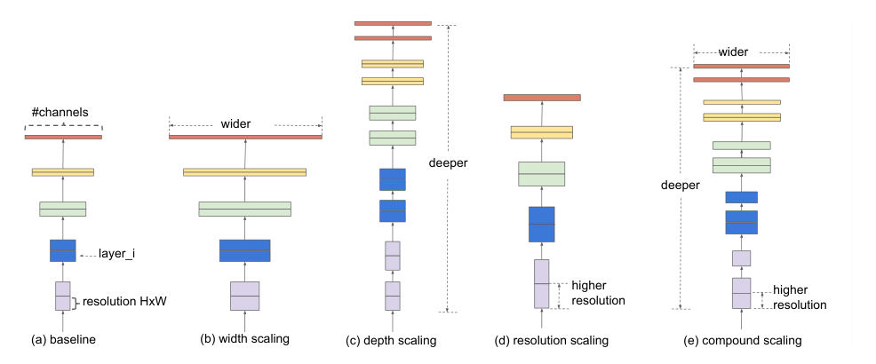
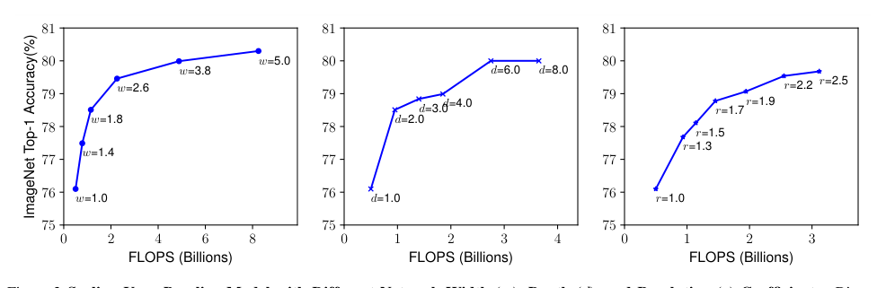
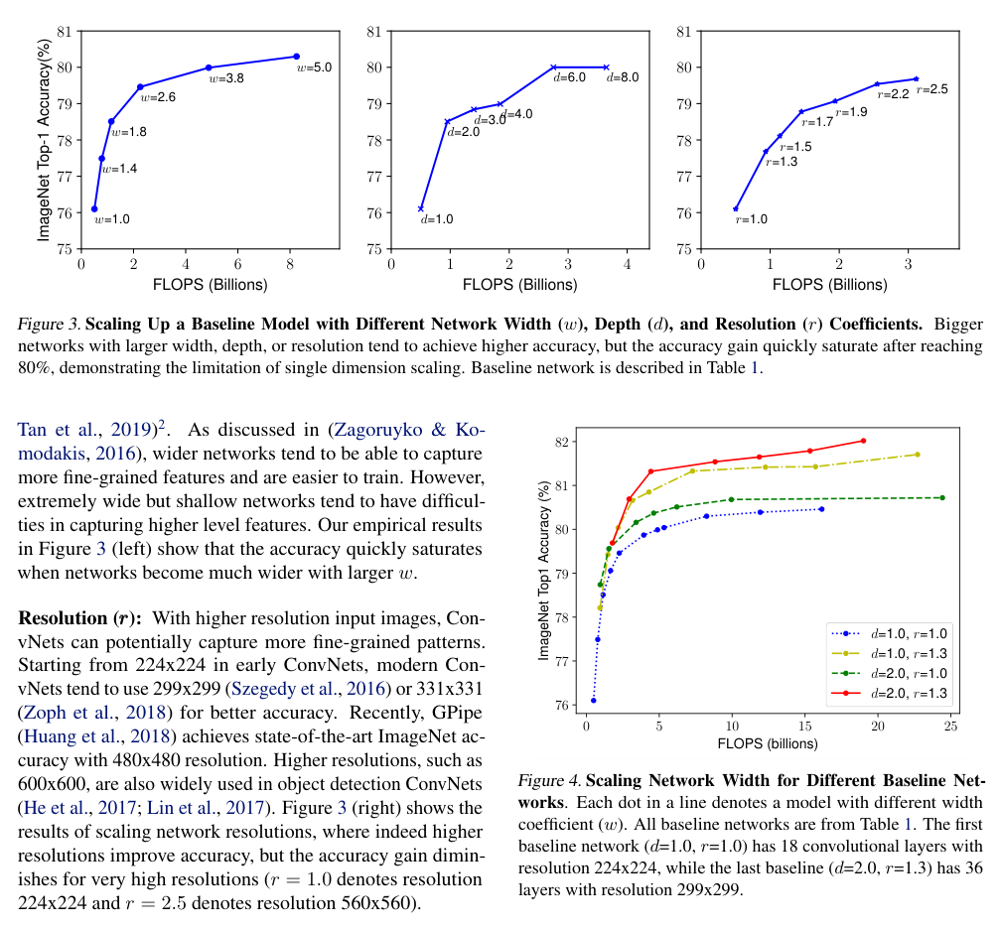
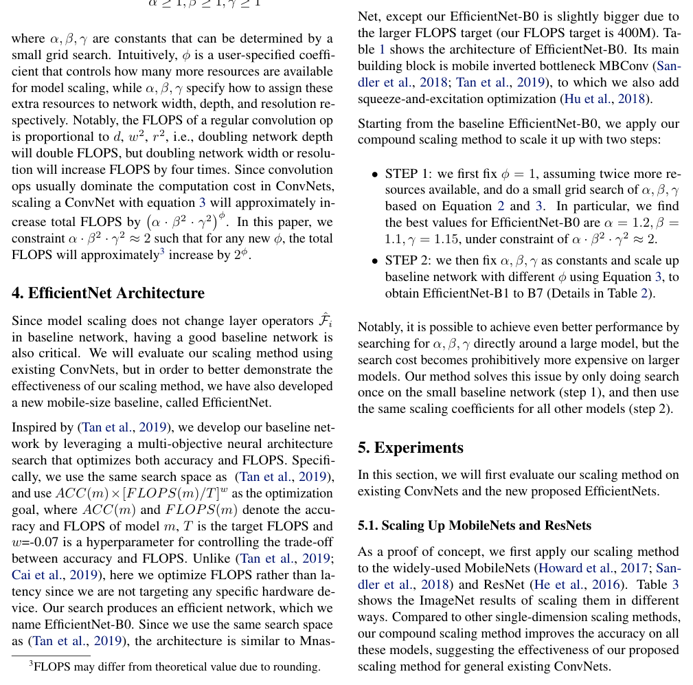
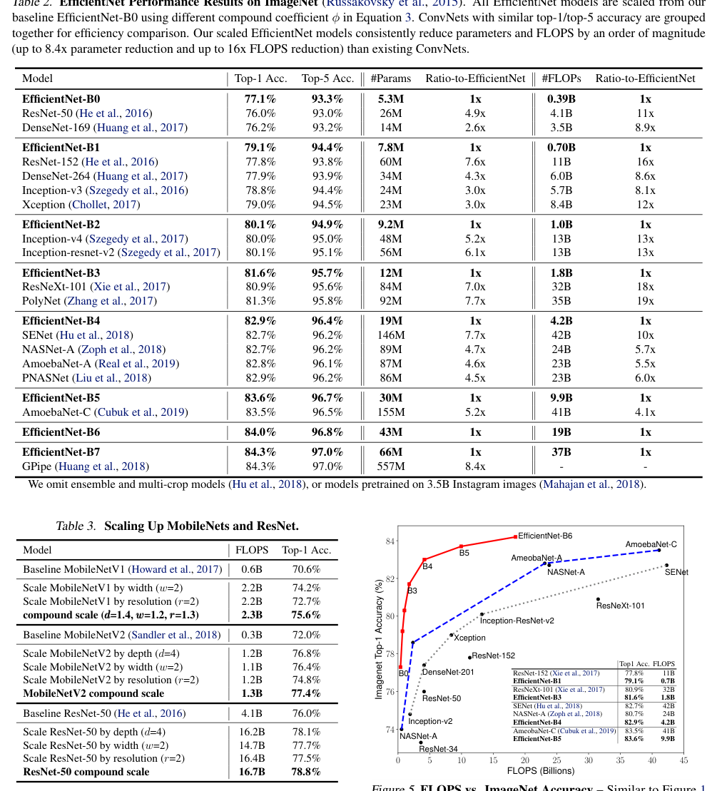
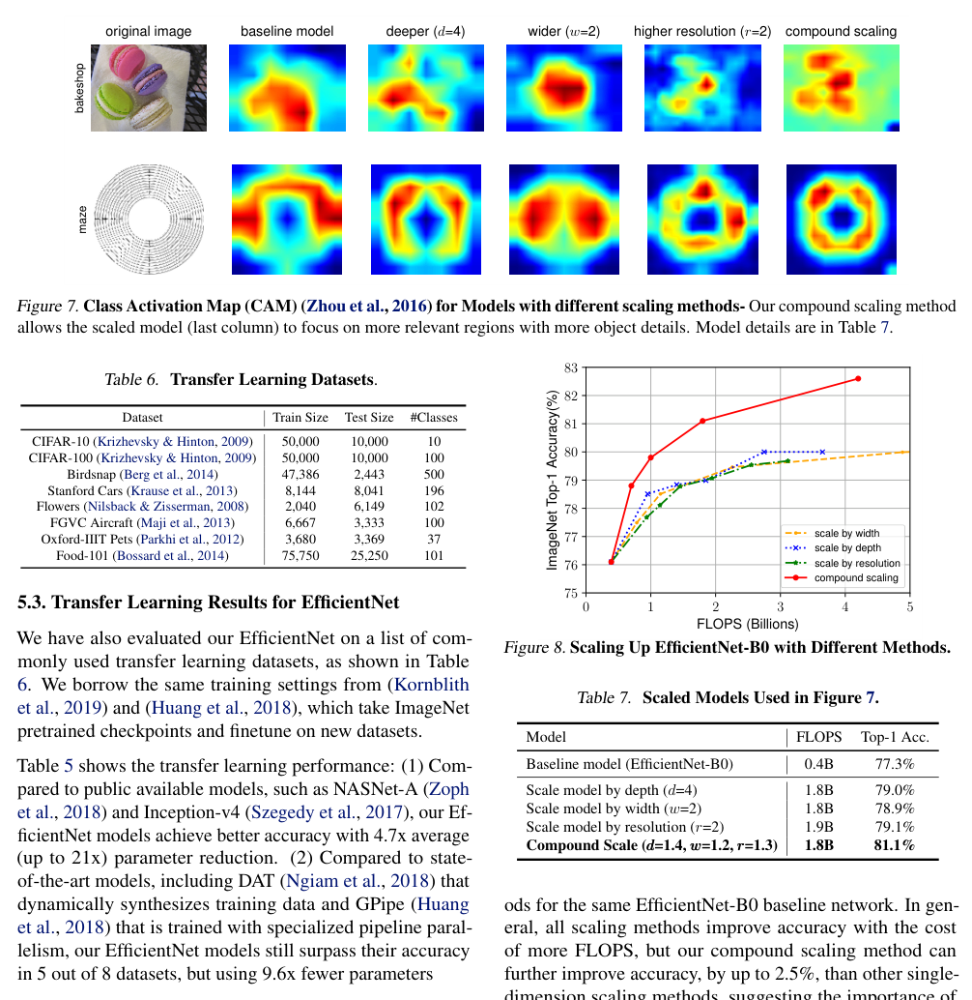

# EfficientNet: Rethinking Model Scaling for Convolutional Neural Networks

**Original:** Mingxing Tan¹ Quoc V. Le¹

**中文:** Mingxing Tan¹ Quoc V. Le¹

**Original:** ¹Google Research, Brain Team, Mountain View, CA. Correspondence to: Mingxing Tan ⟨tanmingxing@google.com⟩. Proceedings of the 36th International Conference on Machine Learning, Long Beach, California, PMLR 97, 2019.

**中文:** ¹Google Research, Brain Team（谷歌研究院大脑团队），山景城，加利福尼亚州。通讯作者：Mingxing Tan ⟨tanmingxing@google.com⟩。第 36 届国际机器学习大会（ICML）论文集，长滩，加利福尼亚州，PMLR 97，2019。

**Original:** arXiv:1905.11946v5 [cs.LG] 11 Sep 2020

**中文:** arXiv:1905.11946v5 [cs.LG]，2020 年 9 月 11 日

## Abstract

**Original:** Convolutional Neural Networks (ConvNets) are commonly developed at a fixed resource budget, and then scaled up for better accuracy if more resources are available. In this paper, we systematically study model scaling and identify that carefully balancing network depth, width, and resolution can lead to better performance. Based on this observation, we propose a new scaling method that uniformly scales all dimensions of depth/width/resolution using a simple yet highly effective compound coefficient. We demonstrate the effectiveness of this method on scaling up MobileNets and ResNet.

**中文:** 卷积神经网络（Convolutional Neural Networks，ConvNets）通常是在固定的资源预算下开发的，如果之后有更多资源可用，就会将其放大（scale up）以获得更高的准确率。本文系统性地研究了模型缩放（model scaling）这一问题，并发现：谨慎地平衡网络深度、宽度和分辨率可以带来更好的性能。基于这一观察，我们提出了一种新的缩放方法，即使用一个简单却高效的复合系数（compound coefficient）来统一缩放深度/宽度/分辨率的所有维度。我们在放大 MobileNets 和 ResNet 的任务上验证了该方法的有效性。

**Original:** To go even further, we use neural architecture search to design a new baseline network and scale it up to obtain a family of models, called EfficientNets, which achieve much better accuracy and efficiency than previous ConvNets. In particular, our EfficientNet-B7 achieves state-of-the-art 84.3% top-1 accuracy on ImageNet, while being 8.4x smaller and 6.1x faster on inference than the best existing ConvNet. Our EfficientNets also transfer well and achieve state-of-the-art accuracy on CIFAR-100 (91.7%), Flowers (98.8%), and 3 other transfer learning datasets, with an order of magnitude fewer parameters. Source code is at https://github.com/tensorflow/tpu/tree/master/models/official/efficientnet.

**中文:** 更进一步，我们使用神经架构搜索（neural architecture search）设计了一个新的基线网络（baseline network），并将其放大，得到一族模型，称为 EfficientNets。它们在准确率和效率上都远超此前的 ConvNets。具体而言，我们的 EfficientNet-B7 在 ImageNet 上取得了当前最优（state-of-the-art，SOTA）的 84.3% top-1 准确率，同时比现有最佳 ConvNet 小 8.4 倍、推理（inference）快 6.1 倍。我们的 EfficientNets 迁移能力也很好，在 CIFAR-100（91.7%）、Flowers（98.8%）以及其他 3 个迁移学习（transfer learning）数据集上均达到当前最优准确率，且参数量少一个数量级。源代码见 https://github.com/tensorflow/tpu/tree/master/models/official/efficientnet。

## 1. Introduction

**Original:** Scaling up ConvNets is widely used to achieve better accuracy. For example, ResNet (He et al., 2016) can be scaled up from ResNet-18 to ResNet-200 by using more layers; Recently, GPipe (Huang et al., 2018) achieved 84.3% ImageNet top-1 accuracy by scaling up a baseline model four time larger. However, the process of scaling up ConvNets has never been well understood and there are currently many ways to do it. The most common way is to scale up ConvNets by their depth (He et al., 2016) or width (Zagoruyko & Komodakis, 2016). Another less common, but increasingly popular, method is to scale up models by image resolution (Huang et al., 2018). In previous work, it is common to scale only one of the three dimensions – depth, width, and image size. Though it is possible to scale two or three dimensions arbitrarily, arbitrary scaling requires tedious manual tuning and still often yields sub-optimal accuracy and efficiency.

**中文:** 放大 ConvNets 是获得更高准确率的常用手段。例如，ResNet (He et al., 2016) 可以通过增加层数从 ResNet-18 一直放大到 ResNet-200；最近，GPipe (Huang et al., 2018) 将一个基线模型放大四倍，取得了 84.3% 的 ImageNet top-1 准确率。然而，放大 ConvNets 的过程从未被很好地理解，目前存在许多种做法。最常见的方式是按深度（He et al., 2016）或宽度（Zagoruyko & Komodakis, 2016）放大 ConvNets。另一种不那么常见、但日益流行的方法是按图像分辨率放大模型（Huang et al., 2018）。在以往的工作中，通常只缩放深度、宽度和图像大小这三个维度中的一个。虽然可以任意地同时缩放两个或三个维度，但任意缩放需要繁琐的人工调参，而且往往仍只能得到次优的准确率和效率。

**Original:** In this paper, we want to study and rethink the process of scaling up ConvNets. In particular, we investigate the central question: is there a principled method to scale up ConvNets that can achieve better accuracy and efficiency? Our empirical study shows that it is critical to balance all dimensions of network width/depth/resolution, and surprisingly such balance can be achieved by simply scaling each of them with constant ratio. Based on this observation, we propose a simple yet effective compound scaling method. Unlike conventional practice that arbitrary scales these factors, our method uniformly scales network width, depth, and resolution with a set of fixed scaling coefficients. For example, if we want to use $2^N$ times more computational resources, then we can simply increase the network depth by $\alpha^N$, width by $\beta^N$, and image size by $\gamma^N$, where $\alpha, \beta, \gamma$ are constant coefficients determined by a small grid search on the original small model. Figure 2 illustrates the difference between our scaling method and conventional methods.

**中文:** 在本文中，我们希望对放大 ConvNets 的过程进行研究和重新思考。具体来说，我们研究一个核心问题：是否存在一种有原则的（principled）方法来放大 ConvNets，从而获得更好的准确率和效率？我们的经验研究（empirical study）表明：平衡网络宽度/深度/分辨率的所有维度至关重要，而且令人惊讶的是，这种平衡只需以恒定的比例分别缩放每个维度即可实现。基于这一观察，我们提出了一种简单而有效的复合缩放（compound scaling）方法。与任意缩放这些因子的传统做法不同，我们的方法使用一组固定的缩放系数（scaling coefficients）来统一缩放网络的宽度、深度和分辨率。例如，如果我们想使用 $2^N$ 倍的计算资源，那么我们只需将网络深度增大 $\alpha^N$ 倍、宽度增大 $\beta^N$ 倍、图像大小增大 $\gamma^N$ 倍，其中 $\alpha, \beta, \gamma$ 是常数系数，通过在原始小模型上做一次小规模网格搜索（grid search）来确定。图 2 展示了我们的缩放方法与传统方法的区别。

> **图 2（译）**：模型缩放。(a) 是一个基线网络示例；(b)-(d) 是只增加网络宽度、深度或分辨率其中一个维度的传统缩放方式。(e) 是我们提出的复合缩放方法，它以固定比例统一缩放全部三个维度。（原图见 paper.pdf 第 2 页，见下方图）

**Original:** Intuitively, the compound scaling method makes sense because if the input image is bigger, then the network needs more layers to increase the receptive field and more channels to capture more fine-grained patterns on the bigger image. In fact, previous theoretical (Raghu et al., 2017; Lu et al., 2018) and empirical results (Zagoruyko & Komodakis, 2016) both show that there exists certain relationship between network width and depth, but to our best knowledge, we are the first to empirically quantify the relationship among all three dimensions of network width, depth, and resolution.

**中文:** 直觉上，复合缩放方法是合理的：因为如果输入图像更大，网络就需要更多的层来增大感受野（receptive field），也需要更多的通道来捕捉更大图像上更细粒度的模式。事实上，此前的理论结果（Raghu et al., 2017; Lu et al., 2018）和经验结果（Zagoruyko & Komodakis, 2016）都表明网络宽度和深度之间存在一定的关系，但据我们所知，我们是第一个对网络宽度、深度、分辨率这三个维度之间的关系进行经验量化的工作。

**Original:** We demonstrate that our scaling method work well on existing MobileNets (Howard et al., 2017; Sandler et al., 2018) and ResNet (He et al., 2016). Notably, the effectiveness of model scaling heavily depends on the baseline network; to go even further, we use neural architecture search (Zoph & Le, 2017; Tan et al., 2019) to develop a new baseline network, and scale it up to obtain a family of models, called EfficientNets. Figure 1 summarizes the ImageNet performance, where our EfficientNets significantly outperform other ConvNets. In particular, our EfficientNet-B7 surpasses the best existing GPipe accuracy (Huang et al., 2018), but using 8.4x fewer parameters and running 6.1x faster on inference. Compared to the widely used ResNet-50 (He et al., 2016), our EfficientNet-B4 improves the top-1 accuracy from 76.3% to 83.0% (+6.7%) with similar FLOPS. Besides ImageNet, EfficientNets also transfer well and achieve state-of-the-art accuracy on 5 out of 8 widely used datasets, while reducing parameters by up to 21x than existing ConvNets.

**中文:** 我们证明了我们的缩放方法在现有的 MobileNets（Howard et al., 2017; Sandler et al., 2018）和 ResNet（He et al., 2016）上都能良好工作。值得注意的是，模型缩放的效果在很大程度上取决于基线网络；为了更进一步，我们使用神经架构搜索（Zoph & Le, 2017; Tan et al., 2019）开发了一个新的基线网络，并将其放大得到一族模型，称为 EfficientNets。图 1 总结了它们在 ImageNet 上的表现，可以看到我们的 EfficientNets 明显优于其他 ConvNets。特别是，我们的 EfficientNet-B7 超越了现有最好的 GPipe 的准确率（Huang et al., 2018），但参数量少了 8.4 倍，推理速度快了 6.1 倍。与广泛使用的 ResNet-50（He et al., 2016）相比，我们的 EfficientNet-B4 在 FLOPS 相近的情况下把 top-1 准确率从 76.3% 提升到 83.0%（+6.7%）。除 ImageNet 之外，EfficientNets 的迁移表现也很好，在 8 个广泛使用的数据集中的 5 个上取得了当前最优准确率，同时参数量比现有 ConvNets 最多减少 21 倍。

> **图 1（译）**：模型大小 vs. ImageNet 准确率。所有数字均为单裁剪（single-crop）、单模型设置。我们的 EfficientNets 明显优于其他 ConvNets。特别是，EfficientNet-B7 取得了新的当前最优 84.3% top-1 准确率，同时比 GPipe 小 8.4 倍、快 6.1 倍。EfficientNet-B1 比 ResNet-152 小 7.6 倍、快 5.7 倍。细节见表 2 和表 4。（原图见 paper.pdf 第 1 页，见下方图）

## 2. Related Work

**Original:** ConvNet Accuracy: Since AlexNet (Krizhevsky et al., 2012) won the 2012 ImageNet competition, ConvNets have become increasingly more accurate by going bigger: while the 2014 ImageNet winner GoogleNet (Szegedy et al., 2015) achieves 74.8% top-1 accuracy with about 6.8M parameters, the 2017 ImageNet winner SENet (Hu et al., 2018) achieves 82.7% top-1 accuracy with 145M parameters. Recently, GPipe (Huang et al., 2018) further pushes the state-of-the-art ImageNet top-1 validation accuracy to 84.3% using 557M parameters: it is so big that it can only be trained with a specialized pipeline parallelism library by partitioning the network and spreading each part to a different accelerator. While these models are mainly designed for ImageNet, recent studies have shown better ImageNet models also perform better across a variety of transfer learning datasets (Kornblith et al., 2019), and other computer vision tasks such as object detection (He et al., 2016; Tan et al., 2019). Although higher accuracy is critical for many applications, we have already hit the hardware memory limit, and thus further accuracy gain needs better efficiency.

**中文:** ConvNet 准确率：自 AlexNet（Krizhevsky et al., 2012）赢得 2012 年 ImageNet 竞赛以来，ConvNets 通过越做越大而变得越来越准确：2014 年 ImageNet 冠军 GoogleNet（Szegedy et al., 2015）以约 680 万参数取得 74.8% 的 top-1 准确率，而 2017 年 ImageNet 冠军 SENet（Hu et al., 2018）以 1.45 亿参数取得 82.7% 的 top-1 准确率。最近，GPipe（Huang et al., 2018）用 5.57 亿参数进一步把 ImageNet top-1 验证准确率的当前最优水平推到了 84.3%：这个模型大到只能借助专门的流水线并行（pipeline parallelism）库来训练——把网络切分成若干部分，并把每一部分部署到不同的加速器（accelerator）上。虽然这些模型主要是为 ImageNet 设计的，但最近的研究表明，更好的 ImageNet 模型在一系列迁移学习数据集上（Kornblith et al., 2019）以及其他计算机视觉任务（如目标检测（object detection），He et al., 2016; Tan et al., 2019）上也表现得更好。尽管更高的准确率对许多应用至关重要，但我们已经触及硬件内存的上限，因此进一步的准确率提升需要更好的效率。

**Original:** ConvNet Efficiency: Deep ConvNets are often over-parameterized. Model compression (Han et al., 2016; He et al., 2018; Yang et al., 2018) is a common way to reduce model size by trading accuracy for efficiency. As mobile phones become ubiquitous, it is also common to hand-craft efficient mobile-size ConvNets, such as SqueezeNets (Iandola et al., 2016; Gholami et al., 2018), MobileNets (Howard et al., 2017; Sandler et al., 2018), and ShuffleNets (Zhang et al., 2018; Ma et al., 2018). Recently, neural architecture search becomes increasingly popular in designing efficient mobile-size ConvNets (Tan et al., 2019; Cai et al., 2019), and achieves even better efficiency than hand-crafted mobile ConvNets by extensively tuning the network width, depth, convolution kernel types and sizes. However, it is unclear how to apply these techniques for larger models that have much larger design space and much more expensive tuning cost. In this paper, we aim to study model efficiency for super large ConvNets that surpass state-of-the-art accuracy. To achieve this goal, we resort to model scaling.

**中文:** ConvNet 效率：深度 ConvNets 往往过度参数化（over-parameterized）。模型压缩（model compression）（Han et al., 2016; He et al., 2018; Yang et al., 2018）是一种以准确率换效率来减小模型体积的常用方法。随着手机的普及，手工设计高效的移动端尺寸 ConvNets 也很常见，例如 SqueezeNets（Iandola et al., 2016; Gholami et al., 2018）、MobileNets（Howard et al., 2017; Sandler et al., 2018）和 ShuffleNets（Zhang et al., 2018; Ma et al., 2018）。最近，神经架构搜索在设计高效移动端尺寸 ConvNets 方面越来越流行（Tan et al., 2019; Cai et al., 2019），通过大规模地调整网络宽度、深度、卷积核类型和大小，取得了比手工设计的移动端 ConvNets 更好的效率。然而，如何把这些技术应用到设计空间大得多、调参成本昂贵得多的更大模型上，仍然不清楚。在本文中，我们旨在研究超越当前最优准确率的超大型 ConvNets 的模型效率问题。为了达到这一目标，我们求助于模型缩放。

**Original:** Model Scaling: There are many ways to scale a ConvNet for different resource constraints: ResNet (He et al., 2016) can be scaled down (e.g., ResNet-18) or up (e.g., ResNet-200) by adjusting network depth (#layers), while WideResNet (Zagoruyko & Komodakis, 2016) and MobileNets (Howard et al., 2017) can be scaled by network width (#channels). It is also well-recognized that bigger input image size will help accuracy with the overhead of more FLOPS. Although prior studies (Raghu et al., 2017; Lin & Jegelka, 2018; Sharir & Shashua, 2018; Lu et al., 2018) have shown that network depth and width are both important for ConvNets' expressive power, it still remains an open question of how to effectively scale a ConvNet to achieve better efficiency and accuracy. Our work systematically and empirically studies ConvNet scaling for all three dimensions of network width, depth, and resolutions.

**中文:** 模型缩放：针对不同的资源约束，缩放 ConvNet 的方法有很多：ResNet（He et al., 2016）可以通过调整网络深度（层数 #layers）来缩小（如 ResNet-18）或放大（如 ResNet-200），而 WideResNet（Zagoruyko & Komodakis, 2016）和 MobileNets（Howard et al., 2017）则可以通过网络宽度（通道数 #channels）来缩放。人们也普遍认识到，更大的输入图像尺寸有助于准确率，但代价是更高的 FLOPS。尽管先前的研究（Raghu et al., 2017; Lin & Jegelka, 2018; Sharir & Shashua, 2018; Lu et al., 2018）表明网络深度和宽度对 ConvNets 的表达能力（expressive power）都很重要，但如何有效地缩放 ConvNet 以获得更好的效率和准确率仍然是一个未解决的问题。我们的工作系统性地、经验性地研究了 ConvNet 在网络宽度、深度和分辨率三个维度上的缩放。

## 3. Compound Model Scaling

**Original:** In this section, we will formulate the scaling problem, study different approaches, and propose our new scaling method.

**中文:** 在本节中，我们将形式化缩放问题，研究不同的方法，并提出我们新的缩放方法。

### 3.1. Problem Formulation

**Original:** A ConvNet Layer $i$ can be defined as a function: $Y_i = \mathcal{F}_i(X_i)$, where $\mathcal{F}_i$ is the operator, $Y_i$ is output tensor, $X_i$ is input tensor, with tensor shape $\langle H_i, W_i, C_i \rangle$¹, where $H_i$ and $W_i$ are spatial dimension and $C_i$ is the channel dimension. A ConvNet $\mathcal{N}$ can be represented by a list of composed layers: $\mathcal{N} = \mathcal{F}_k \odot ... \odot \mathcal{F}_2 \odot \mathcal{F}_1(X_1) = \bigodot_{j=1...k} \mathcal{F}_j(X_1)$. In practice, ConvNet layers are often partitioned into multiple stages and all layers in each stage share the same architecture: for example, ResNet (He et al., 2016) has five stages, and all layers in each stage has the same convolutional type except the first layer performs down-sampling. Therefore, we can define a ConvNet as:

**中文:** ConvNet 的第 $i$ 层可以定义为一个函数：$Y_i = \mathcal{F}_i(X_i)$，其中 $\mathcal{F}_i$ 是算子（operator），$Y_i$ 是输出张量（tensor），$X_i$ 是输入张量，张量形状为 $\langle H_i, W_i, C_i \rangle$¹，其中 $H_i$ 和 $W_i$ 是空间维度，$C_i$ 是通道维度。一个 ConvNet $\mathcal{N}$ 可以表示为一组层的复合：$\mathcal{N} = \mathcal{F}_k \odot ... \odot \mathcal{F}_2 \odot \mathcal{F}_1(X_1) = \bigodot_{j=1...k} \mathcal{F}_j(X_1)$。实践中，ConvNet 的层通常被划分为多个阶段（stage），每个阶段内的所有层共享相同的结构：例如，ResNet（He et al., 2016）有五个阶段，每个阶段中的所有层具有相同的卷积类型，只有第一层执行下采样（down-sampling）。因此，我们可以把一个 ConvNet 定义为：

**Original:**

$$\mathcal{N} = \bigodot_{i=1...s} \mathcal{F}_i^{L_i}\left(X_{\langle H_i, W_i, C_i \rangle}\right) \tag{1}$$

**中文:** （公式原文保留，不译）

**Original:** where $\mathcal{F}_i^{L_i}$ denotes layer $\mathcal{F}_i$ is repeated $L_i$ times in stage $i$, $\langle H_i, W_i, C_i \rangle$ denotes the shape of input tensor $X$ of layer $i$. Figure 2(a) illustrate a representative ConvNet, where the spatial dimension is gradually shrunk but the channel dimension is expanded over layers, for example, from initial input shape $\langle 224, 224, 3 \rangle$ to final output shape $\langle 7, 7, 512 \rangle$.

**中文:** 其中 $\mathcal{F}_i^{L_i}$ 表示层 $\mathcal{F}_i$ 在阶段 $i$ 中重复 $L_i$ 次，$\langle H_i, W_i, C_i \rangle$ 表示第 $i$ 层输入张量 $X$ 的形状。图 2(a) 展示了一个有代表性的 ConvNet：空间维度随层数逐渐缩小，而通道维度则不断扩大，例如从初始输入形状 $\langle 224, 224, 3 \rangle$ 到最终输出形状 $\langle 7, 7, 512 \rangle$。

**Original:** ¹For the sake of simplicity, we omit batch dimension.

**中文:** ¹为简单起见，我们省略了批次（batch）维度。

**Original:** Unlike regular ConvNet designs that mostly focus on finding the best layer architecture $\mathcal{F}_i$, model scaling tries to expand the network length ($L_i$), width ($C_i$), and/or resolution ($H_i, W_i$) without changing $\mathcal{F}_i$ predefined in the baseline network. By fixing $\mathcal{F}_i$, model scaling simplifies the design problem for new resource constraints, but it still remains a large design space to explore different $L_i, C_i, H_i, W_i$ for each layer. In order to further reduce the design space, we restrict that all layers must be scaled uniformly with constant ratio. Our target is to maximize the model accuracy for any given resource constraints, which can be formulated as an optimization problem:

**中文:** 与主要关注寻找最佳层结构 $\mathcal{F}_i$ 的常规 ConvNet 设计不同，模型缩放试图在不改变基线网络中预先定义好的 $\mathcal{F}_i$ 的前提下，扩展网络的长度（$L_i$）、宽度（$C_i$）和/或分辨率（$H_i, W_i$）。通过固定 $\mathcal{F}_i$，模型缩放简化了针对新资源约束的设计问题，但仍然存在一个很大的设计空间——要为每一层探索不同的 $L_i, C_i, H_i, W_i$。为了进一步缩小设计空间，我们限制所有层必须以恒定比例统一缩放。我们的目标是在任意给定的资源约束下最大化模型准确率，这可以形式化为一个优化问题：

**Original:**

$$\max_{d,w,r} \;\; \text{Accuracy}\left(\mathcal{N}(d,w,r)\right)$$

$$\text{s.t.} \;\; \mathcal{N}(d,w,r) = \bigodot_{i=1...s} \hat{\mathcal{F}}_i^{\, d \cdot \hat{L}_i}\left(X_{\langle r \cdot \hat{H}_i, \, r \cdot \hat{W}_i, \, w \cdot \hat{C}_i \rangle}\right)$$

$$\text{Memory}(\mathcal{N}) \le \text{target\_memory}; \quad \text{FLOPS}(\mathcal{N}) \le \text{target\_flops} \tag{2}$$

**中文:** （公式原文保留，不译）

**Original:** where $w, d, r$ are coefficients for scaling network width, depth, and resolution; $\hat{\mathcal{F}}_i, \hat{L}_i, \hat{H}_i, \hat{W}_i, \hat{C}_i$ are predefined parameters in baseline network (see Table 1 as an example).

**中文:** 其中 $w, d, r$ 是用于缩放网络宽度、深度和分辨率的系数；$\hat{\mathcal{F}}_i, \hat{L}_i, \hat{H}_i, \hat{W}_i, \hat{C}_i$ 是基线网络中预先定义的参数（见表 1 的例子）。

### 3.2. Scaling Dimensions

**Original:** The main difficulty of problem 2 is that the optimal $d, w, r$ depend on each other and the values change under different resource constraints. Due to this difficulty, conventional methods mostly scale ConvNets in one of these dimensions:

**中文:** 问题 (2) 的主要困难在于：最优的 $d, w, r$ 相互依赖，并且它们的取值会随不同的资源约束而改变。由于这一困难，传统方法大多只在其中一个维度上缩放 ConvNets：

> **图 3（译）**：用不同的网络宽度（$w$）、深度（$d$）和分辨率（$r$）系数放大基线模型。宽度、深度或分辨率更大的网络往往能取得更高的准确率，但准确率在达到 80% 之后收益会迅速饱和，说明单维度缩放存在局限。基线网络见表 1。（原图见 paper.pdf 第 4 页，见下方图）

**Original:** Depth ($d$): Scaling network depth is the most common way used by many ConvNets (He et al., 2016; Huang et al., 2017; Szegedy et al., 2015; 2016). The intuition is that deeper ConvNet can capture richer and more complex features, and generalize well on new tasks. However, deeper networks are also more difficult to train due to the vanishing gradient problem (Zagoruyko & Komodakis, 2016). Although several techniques, such as skip connections (He et al., 2016) and batch normalization (Ioffe & Szegedy, 2015), alleviate the training problem, the accuracy gain of very deep network diminishes: for example, ResNet-1000 has similar accuracy as ResNet-101 even though it has much more layers. Figure 3 (middle) shows our empirical study on scaling a baseline model with different depth coefficient $d$, further suggesting the diminishing accuracy return for very deep ConvNets.

**中文:** 深度（$d$）：缩放网络深度是许多 ConvNets 最常用的方式（He et al., 2016; Huang et al., 2017; Szegedy et al., 2015; 2016）。直觉是：更深的 ConvNet 可以捕捉更丰富、更复杂的特征，并在新任务上泛化（generalize）得更好。然而，由于梯度消失（vanishing gradient）问题（Zagoruyko & Komodakis, 2016），更深的网络也更难训练。尽管跳跃连接（skip connections）（He et al., 2016）和批归一化（batch normalization）（Ioffe & Szegedy, 2015）等技术缓解了训练问题，但极深网络的准确率收益仍然会递减：例如，ResNet-1000 的准确率与 ResNet-101 相近，尽管它的层数多得多。图 3（中）展示了我们用不同深度系数 $d$ 缩放基线模型的经验研究，进一步说明极深 ConvNets 的准确率收益递减。

**Original:** Width ($w$): Scaling network width is commonly used for small size models (Howard et al., 2017; Sandler et al., 2018; Tan et al., 2019)². As discussed in (Zagoruyko & Komodakis, 2016), wider networks tend to be able to capture more fine-grained features and are easier to train. However, extremely wide but shallow networks tend to have difficulties in capturing higher level features. Our empirical results in Figure 3 (left) show that the accuracy quickly saturates when networks become much wider with larger $w$.

**中文:** 宽度（$w$）：缩放网络宽度常用于小型模型（Howard et al., 2017; Sandler et al., 2018; Tan et al., 2019）²。正如（Zagoruyko & Komodakis, 2016）所讨论的，更宽的网络往往能捕捉更多细粒度特征，也更容易训练。然而，极宽但很浅的网络往往难以捕捉更高层次的特征。我们在图 3（左）中的经验结果表明，当网络随更大的 $w$ 变得宽得多时，准确率会迅速饱和。

**Original:** ²In some literature, scaling number of channels is called "depth multiplier", which means the same as our width coefficient $w$.

**中文:** ²在某些文献中，缩放通道数被称为"深度乘子（depth multiplier）"，其含义与我们的宽度系数 $w$ 相同。

**Original:** Resolution ($r$): With higher resolution input images, ConvNets can potentially capture more fine-grained patterns. Starting from 224x224 in early ConvNets, modern ConvNets tend to use 299x299 (Szegedy et al., 2016) or 331x331 (Zoph et al., 2018) for better accuracy. Recently, GPipe (Huang et al., 2018) achieves state-of-the-art ImageNet accuracy with 480x480 resolution. Higher resolutions, such as 600x600, are also widely used in object detection ConvNets (He et al., 2017; Lin et al., 2017). Figure 3 (right) shows the results of scaling network resolutions, where indeed higher resolutions improve accuracy, but the accuracy gain diminishes for very high resolutions ($r = 1.0$ denotes resolution 224x224 and $r = 2.5$ denotes resolution 560x560).

**中文:** 分辨率（$r$）：使用更高分辨率的输入图像，ConvNets 有潜力捕捉更多细粒度的模式。从早期 ConvNets 的 224x224 开始，现代 ConvNets 为了更好的准确率倾向于使用 299x299（Szegedy et al., 2016）或 331x331（Zoph et al., 2018）。最近，GPipe（Huang et al., 2018）以 480x480 分辨率取得了当前最优的 ImageNet 准确率。更高的分辨率（如 600x600）也广泛用于目标检测 ConvNets（He et al., 2017; Lin et al., 2017）。图 3（右）展示了缩放网络分辨率的结果：更高的分辨率确实能提高准确率，但对于非常高的分辨率，准确率收益会递减（$r = 1.0$ 表示分辨率 224x224，$r = 2.5$ 表示分辨率 560x560）。

**Original:** The above analyses lead us to the first observation:

**中文:** 以上分析引出了我们的第一个观察：

**Original:** Observation 1 – Scaling up any dimension of network width, depth, or resolution improves accuracy, but the accuracy gain diminishes for bigger models.

**中文:** 观察 1——放大网络宽度、深度或分辨率中的任何一个维度都能提高准确率，但对于更大的模型，准确率收益会递减。

### 3.3. Compound Scaling

**Original:** We empirically observe that different scaling dimensions are not independent. Intuitively, for higher resolution images, we should increase network depth, such that the larger receptive fields can help capture similar features that include more pixels in bigger images. Correspondingly, we should also increase network width when resolution is higher, in order to capture more fine-grained patterns with more pixels in high resolution images. These intuitions suggest that we need to coordinate and balance different scaling dimensions rather than conventional single-dimension scaling.

**中文:** 我们通过经验观察到，不同的缩放维度并不是相互独立的。直觉上，对于更高分辨率的图像，我们应该增加网络深度，这样更大的感受野就能帮助捕捉在大图中包含更多像素的相似特征。相应地，当分辨率更高时，我们也应该增加网络宽度，以便在高分辨率图像中捕捉像素更多、更细粒度的模式。这些直觉表明，我们需要协调和平衡不同的缩放维度，而不是传统的单维度缩放。

**Original:** To validate our intuitions, we compare width scaling under different network depths and resolutions, as shown in Figure 4. If we only scale network width $w$ without changing depth ($d=1.0$) and resolution ($r=1.0$), the accuracy saturates quickly. With deeper ($d=2.0$) and higher resolution ($r=2.0$), width scaling achieves much better accuracy under the same FLOPS cost. These results lead us to the second observation:

**中文:** 为了验证我们的直觉，我们在不同的网络深度和分辨率下比较宽度缩放的效果，如图 4 所示。如果我们只缩放网络宽度 $w$ 而不改变深度（$d=1.0$）和分辨率（$r=1.0$），准确率会很快饱和。在更深（$d=2.0$）和更高分辨率（$r=2.0$）的条件下，宽度缩放在相同 FLOPS 开销下取得了好得多的准确率。这些结果引出了我们的第二个观察：

> **图 4（译）**：为不同基线网络缩放网络宽度。一条线上的每个点代表一个具有不同宽度系数（$w$）的模型。所有基线网络均来自表 1。第一个基线网络（$d=1.0, r=1.0$）有 18 个卷积层，分辨率 224x224；最后一个基线（$d=2.0, r=1.3$）有 36 层，分辨率 299x299。（原图见 paper.pdf 第 4 页，[第 4 页图](assets/figures/fig-4.png)）

**Original:** Observation 2 – In order to pursue better accuracy and efficiency, it is critical to balance all dimensions of network width, depth, and resolution during ConvNet scaling.

**中文:** 观察 2——为了追求更好的准确率和效率，在 ConvNet 缩放过程中平衡网络宽度、深度和分辨率的所有维度至关重要。

**Original:** In fact, a few prior work (Zoph et al., 2018; Real et al., 2019) have already tried to arbitrarily balance network width and depth, but they all require tedious manual tuning.

**中文:** 事实上，一些先前的工作（Zoph et al., 2018; Real et al., 2019）已经尝试过任意地平衡网络宽度和深度，但它们都需要繁琐的人工调参。

**Original:** In this paper, we propose a new compound scaling method, which use a compound coefficient $\phi$ to uniformly scales network width, depth, and resolution in a principled way:

**中文:** 在本文中，我们提出了一种新的复合缩放方法，它使用一个复合系数 $\phi$，以有原则的方式统一缩放网络宽度、深度和分辨率：

**Original:**

$$\text{depth: } d = \alpha^{\phi}$$

$$\text{width: } w = \beta^{\phi}$$

$$\text{resolution: } r = \gamma^{\phi}$$

$$\text{s.t. } \alpha \cdot \beta^{2} \cdot \gamma^{2} \approx 2$$

$$\alpha \ge 1, \;\; \beta \ge 1, \;\; \gamma \ge 1 \tag{3}$$

**中文:** （公式原文保留，不译）

**Original:** where $\alpha, \beta, \gamma$ are constants that can be determined by a small grid search. Intuitively, $\phi$ is a user-specified coefficient that controls how many more resources are available for model scaling, while $\alpha, \beta, \gamma$ specify how to assign these extra resources to network width, depth, and resolution respectively. Notably, the FLOPS of a regular convolution op is proportional to $d, w^2, r^2$, i.e., doubling network depth will double FLOPS, but doubling network width or resolution will increase FLOPS by four times. Since convolution ops usually dominate the computation cost in ConvNets, scaling a ConvNet with equation 3 will approximately increase total FLOPS by $\left(\alpha \cdot \beta^{2} \cdot \gamma^{2}\right)^{\phi}$. In this paper, we constraint $\alpha \cdot \beta^{2} \cdot \gamma^{2} \approx 2$ such that for any new $\phi$, the total FLOPS will approximately³ increase by $2^{\phi}$.

**中文:** 其中 $\alpha, \beta, \gamma$ 是可以通过小规模网格搜索确定的常数。直观地说，$\phi$ 是一个由用户指定的系数，控制模型缩放可获得的额外资源量；而 $\alpha, \beta, \gamma$ 则分别规定如何把这些额外资源分配给网络宽度、深度和分辨率。值得注意的是，普通卷积运算的 FLOPS 与 $d, w^2, r^2$ 成正比，也就是说，网络深度加倍会使 FLOPS 加倍，但网络宽度或分辨率加倍会使 FLOPS 增加四倍。由于卷积运算通常主导 ConvNets 的计算开销，用公式 (3) 缩放 ConvNet 会使总 FLOPS 大约增加 $\left(\alpha \cdot \beta^{2} \cdot \gamma^{2}\right)^{\phi}$ 倍。在本文中，我们约束 $\alpha \cdot \beta^{2} \cdot \gamma^{2} \approx 2$ [译注：原文此处为 constraint，应为 constrain]，这样对于任意新的 $\phi$，总 FLOPS 将大约³增加 $2^{\phi}$ 倍。

**Original:** ³FLOPS may differ from theoretical value due to rounding.

**中文:** ³由于取整，FLOPS 可能与理论值略有差异。

## 4. EfficientNet Architecture

**Original:** Since model scaling does not change layer operators $\hat{\mathcal{F}}_i$ in baseline network, having a good baseline network is also critical. We will evaluate our scaling method using existing ConvNets, but in order to better demonstrate the effectiveness of our scaling method, we have also developed a new mobile-size baseline, called EfficientNet.

**中文:** 由于模型缩放不改变基线网络中的层算子 $\hat{\mathcal{F}}_i$，拥有一个好的基线网络也至关重要。我们将使用现有的 ConvNets 来评估我们的缩放方法，但为了更好地展示我们缩放方法的有效性，我们还开发了一个新的移动端尺寸基线网络，称为 EfficientNet。

**Original:** Inspired by (Tan et al., 2019), we develop our baseline network by leveraging a multi-objective neural architecture search that optimizes both accuracy and FLOPS. Specifically, we use the same search space as (Tan et al., 2019), and use $\text{ACC}(m) \times \left[\text{FLOPS}(m)/T\right]^{w}$ as the optimization goal, where $\text{ACC}(m)$ and $\text{FLOPS}(m)$ denote the accuracy and FLOPS of model $m$, $T$ is the target FLOPS and $w=-0.07$ is a hyperparameter for controlling the trade-off between accuracy and FLOPS. Unlike (Tan et al., 2019; Cai et al., 2019), here we optimize FLOPS rather than latency since we are not targeting any specific hardware device. Our search produces an efficient network, which we name EfficientNet-B0. Since we use the same search space as (Tan et al., 2019), the architecture is similar to MnasNet, except our EfficientNet-B0 is slightly bigger due to the larger FLOPS target (our FLOPS target is 400M). Table 1 shows the architecture of EfficientNet-B0. Its main building block is mobile inverted bottleneck MBConv (Sandler et al., 2018; Tan et al., 2019), to which we also add squeeze-and-excitation optimization (Hu et al., 2018).

**中文:** 受（Tan et al., 2019）启发，我们利用一个同时优化准确率和 FLOPS 的多目标神经架构搜索来开发基线网络。具体来说，我们使用与（Tan et al., 2019）相同的搜索空间，并以 $\text{ACC}(m) \times \left[\text{FLOPS}(m)/T\right]^{w}$ 作为优化目标，其中 $\text{ACC}(m)$ 和 $\text{FLOPS}(m)$ 分别表示模型 $m$ 的准确率和 FLOPS，$T$ 是目标 FLOPS，$w=-0.07$ 是控制准确率与 FLOPS 之间权衡的超参数（hyperparameter）。与（Tan et al., 2019; Cai et al., 2019）不同，这里我们优化 FLOPS 而非延迟（latency），因为我们不针对任何特定的硬件设备。我们的搜索产出了一个高效的网络，我们将其命名为 EfficientNet-B0。由于我们使用与（Tan et al., 2019）相同的搜索空间，其架构与 MnasNet 相似，只不过我们的 EfficientNet-B0 因 FLOPS 目标更大（我们的 FLOPS 目标是 400M）而略大。表 1 展示了 EfficientNet-B0 的架构。它的主要构建块是移动倒置瓶颈（mobile inverted bottleneck）MBConv（Sandler et al., 2018; Tan et al., 2019），我们还为其加入了压缩-激励（squeeze-and-excitation）优化（Hu et al., 2018）。

> **表 1（译）**：EfficientNet-B0 基线网络——每一行描述一个阶段 $i$，含 $\hat{L}_i$ 层，输入分辨率为 $\langle \hat{H}_i, \hat{W}_i \rangle$，输出通道为 $\hat{C}_i$。记号沿用公式 (2)。（原图见 paper.pdf 第 5 页，见下方图）

| Stage（阶段）$i$ | Operator（算子）$\hat{\mathcal{F}}_i$ | Resolution（分辨率）$\hat{H}_i \times \hat{W}_i$ | #Channels（通道数）$\hat{C}_i$ | #Layers（层数）$\hat{L}_i$ |
|---|---|---|---|---|
| 1 | Conv3x3 | 224 × 224 | 32 | 1 |
| 2 | MBConv1, k3x3 | 112 × 112 | 16 | 1 |
| 3 | MBConv6, k3x3 | 112 × 112 | 24 | 2 |
| 4 | MBConv6, k5x5 | 56 × 56 | 40 | 2 |
| 5 | MBConv6, k3x3 | 28 × 28 | 80 | 3 |
| 6 | MBConv6, k5x5 | 14 × 14 | 112 | 3 |
| 7 | MBConv6, k5x5 | 14 × 14 | 192 | 4 |
| 8 | MBConv6, k3x3 | 7 × 7 | 320 | 1 |
| 9 | Conv1x1 & Pooling & FC | 7 × 7 | 1280 | 1 |

**Original:** Starting from the baseline EfficientNet-B0, we apply our compound scaling method to scale it up with two steps:

**中文:** 从基线 EfficientNet-B0 出发，我们分两步应用我们的复合缩放方法将其放大：

**Original:** • STEP 1: we first fix $\phi = 1$, assuming twice more resources available, and do a small grid search of $\alpha, \beta, \gamma$ based on Equation 2 and 3. In particular, we find the best values for EfficientNet-B0 are $\alpha = 1.2$, $\beta = 1.1$, $\gamma = 1.15$, under constraint of $\alpha \cdot \beta^{2} \cdot \gamma^{2} \approx 2$.

**中文:** • 步骤 1：我们首先固定 $\phi = 1$，假设可用资源变为两倍，然后根据公式 (2) 和 (3) 对 $\alpha, \beta, \gamma$ 做小规模网格搜索。具体来说，在 $\alpha \cdot \beta^{2} \cdot \gamma^{2} \approx 2$ 的约束下，我们找到 EfficientNet-B0 的最佳取值为 $\alpha = 1.2$，$\beta = 1.1$，$\gamma = 1.15$。

**Original:** • STEP 2: we then fix $\alpha, \beta, \gamma$ as constants and scale up baseline network with different $\phi$ using Equation 3, to obtain EfficientNet-B1 to B7 (Details in Table 2).

**中文:** • 步骤 2：然后我们把 $\alpha, \beta, \gamma$ 固定为常数，用公式 (3) 以不同的 $\phi$ 放大基线网络，得到 EfficientNet-B1 到 B7（细节见表 2）。

**Original:** Notably, it is possible to achieve even better performance by searching for $\alpha, \beta, \gamma$ directly around a large model, but the search cost becomes prohibitively more expensive on larger models. Our method solves this issue by only doing search once on the small baseline network (step 1), and then use the same scaling coefficients for all other models (step 2).

**中文:** 值得注意的是，直接围绕一个大模型搜索 $\alpha, \beta, \gamma$ 有可能取得更好的性能，但在更大的模型上，搜索成本会变得极其昂贵。我们的方法解决了这个问题：只在小基线网络上做一次搜索（步骤 1），然后将相同的缩放系数用于所有其他模型（步骤 2）。

## 5. Experiments

**Original:** In this section, we will first evaluate our scaling method on existing ConvNets and the new proposed EfficientNets.

**中文:** 在本节中，我们将先在现有 ConvNets 和新提出的 EfficientNets 上评估我们的缩放方法。

### 5.1. Scaling Up MobileNets and ResNets

**Original:** As a proof of concept, we first apply our scaling method to the widely-used MobileNets (Howard et al., 2017; Sandler et al., 2018) and ResNet (He et al., 2016). Table 3 shows the ImageNet results of scaling them in different ways. Compared to other single-dimension scaling methods, our compound scaling method improves the accuracy on all these models, suggesting the effectiveness of our proposed scaling method for general existing ConvNets.

**中文:** 作为概念验证，我们首先把缩放方法应用到广泛使用的 MobileNets（Howard et al., 2017; Sandler et al., 2018）和 ResNet（He et al., 2016）上。表 3 展示了以不同方式缩放它们所得到的 ImageNet 结果。与其他单维度缩放方法相比，我们的复合缩放方法在所有模型上都提高了准确率，这表明我们提出的缩放方法对一般的现有 ConvNets 是有效的。

> **表 3（译）**：放大 MobileNets 和 ResNet。（原图见 paper.pdf 第 6 页，见下方图）

| Model（模型） | FLOPS | Top-1 Acc.（top-1 准确率） |
|---|---|---|
| Baseline MobileNetV1 (Howard et al., 2017) | 0.6B | 70.6% |
| Scale MobileNetV1 by width (w=2) | 2.2B | 74.2% |
| Scale MobileNetV1 by resolution (r=2) | 2.2B | 72.7% |
| compound scale (d=1.4, w=1.2, r=1.3) | 2.3B | 75.6% |
| Baseline MobileNetV2 (Sandler et al., 2018) | 0.3B | 72.0% |
| Scale MobileNetV2 by depth (d=4) | 1.2B | 76.8% |
| Scale MobileNetV2 by width (w=2) | 1.1B | 76.4% |
| Scale MobileNetV2 by resolution (r=2) | 1.2B | 74.8% |
| MobileNetV2 compound scale | 1.3B | 77.4% |
| Baseline ResNet-50 (He et al., 2016) | 4.1B | 76.0% |
| Scale ResNet-50 by depth (d=4) | 16.2B | 78.1% |
| Scale ResNet-50 by width (w=2) | 14.7B | 77.7% |
| Scale ResNet-50 by resolution (r=2) | 16.4B | 77.5% |
| ResNet-50 compound scale | 16.7B | 78.8% |

### 5.2. ImageNet Results for EfficientNet

**Original:** We train our EfficientNet models on ImageNet using similar settings as (Tan et al., 2019): RMSProp optimizer with decay 0.9 and momentum 0.9; batch norm momentum 0.99; weight decay 1e-5; initial learning rate 0.256 that decays by 0.97 every 2.4 epochs. We also use SiLU (Swish-1) activation (Ramachandran et al., 2018; Elfwing et al., 2018; Hendrycks & Gimpel, 2016), AutoAugment (Cubuk et al., 2019), and stochastic depth (Huang et al., 2016) with survival probability 0.8. As commonly known that bigger models need more regularization, we linearly increase dropout (Srivastava et al., 2014) ratio from 0.2 for EfficientNet-B0 to 0.5 for B7. We reserve 25K randomly picked images from the training set as a minival set, and perform early stopping on this minival; we then evaluate the early-stopped checkpoint on the original validation set to report the final validation accuracy.

**中文:** 我们在 ImageNet 上训练 EfficientNet 模型，设置与（Tan et al., 2019）类似：RMSProp 优化器（optimizer），衰减（decay）0.9，动量（momentum）0.9；批归一化动量 0.99；权重衰减（weight decay）1e-5；初始学习率（learning rate）0.256，每 2.4 个轮次（epoch）衰减 0.97 倍。我们还使用了 SiLU（Swish-1）激活函数（Ramachandran et al., 2018; Elfwing et al., 2018; Hendrycks & Gimpel, 2016）、AutoAugment（Cubuk et al., 2019）以及存活概率（survival probability）为 0.8 的随机深度（stochastic depth）（Huang et al., 2016）。众所周知，更大的模型需要更强的正则化（regularization），因此我们把随机失活（Dropout）（Srivastava et al., 2014）比例从 EfficientNet-B0 的 0.2 线性增加到 B7 的 0.5。我们从训练集中随机挑出 25K 张图像留作 minival 集（小验证集），并在该 minival 集上执行早停（early stopping）；随后我们在原始验证集上评估早停得到的检查点（checkpoint），以报告最终的验证准确率。

**Original:** Table 2 shows the performance of all EfficientNet models that are scaled from the same baseline EfficientNet-B0. Our EfficientNet models generally use an order of magnitude fewer parameters and FLOPS than other ConvNets with similar accuracy. In particular, our EfficientNet-B7 achieves 84.3% top1 accuracy with 66M parameters and 37B FLOPS, being more accurate but 8.4x smaller than the previous best GPipe (Huang et al., 2018). These gains come from both better architectures, better scaling, and better training settings that are customized for EfficientNet.

**中文:** 表 2 展示了所有从同一基线 EfficientNet-B0 缩放而来的 EfficientNet 模型的性能。与准确率相近的其他 ConvNets 相比，我们的 EfficientNet 模型通常参数量和 FLOPS 都要少一个数量级。特别是，我们的 EfficientNet-B7 以 66M 参数和 37B FLOPS 取得了 84.3% 的 top-1 准确率，比此前最好的 GPipe（Huang et al., 2018）更准确，同时小 8.4 倍。这些收益既来自更好的架构，也来自更好的缩放和为 EfficientNet 定制的更好训练设置。

> **表 2（译）**：EfficientNet 在 ImageNet 上的性能结果（Russakovsky et al., 2015）。所有 EfficientNet 模型都使用公式 (3) 中不同的复合系数 $\phi$ 从我们的基线 EfficientNet-B0 缩放而来。top-1/top-5 准确率相近的 ConvNets 被分在一组以便进行效率比较。我们的缩放 EfficientNet 模型一致地把参数量和 FLOPS 比现有 ConvNets 减少了一个数量级（参数量最多减少 8.4 倍，FLOPS 最多减少 16 倍）。（原图见 paper.pdf 第 6 页，[第 6 页图](assets/figures/tab-2.png)）

| Model（模型） | Top-1 Acc. | Top-5 Acc. | #Params（参数量） | Ratio-to-EfficientNet（相对 EfficientNet 倍数） | #FLOPs | Ratio-to-EfficientNet（相对 EfficientNet 倍数） |
|---|---|---|---|---|---|---|
| EfficientNet-B0 | 77.1% | 93.3% | 5.3M | 1x | 0.39B | 1x |
| ResNet-50 (He et al., 2016) | 76.0% | 93.0% | 26M | 4.9x | 4.1B | 11x |
| DenseNet-169 (Huang et al., 2017) | 76.2% | 93.2% | 14M | 2.6x | 3.5B | 8.9x |
| EfficientNet-B1 | 79.1% | 94.4% | 7.8M | 1x | 0.70B | 1x |
| ResNet-152 (He et al., 2016) | 77.8% | 93.8% | 60M | 7.6x | 11B | 16x |
| DenseNet-264 (Huang et al., 2017) | 77.9% | 93.9% | 34M | 4.3x | 6.0B | 8.6x |
| Inception-v3 (Szegedy et al., 2016) | 78.8% | 94.4% | 24M | 3.0x | 5.7B | 8.1x |
| Xception (Chollet, 2017) | 79.0% | 94.5% | 23M | 3.0x | 8.4B | 12x |
| EfficientNet-B2 | 80.1% | 94.9% | 9.2M | 1x | 1.0B | 1x |
| Inception-v4 (Szegedy et al., 2017) | 80.0% | 95.0% | 48M | 5.2x | 13B | 13x |
| Inception-resnet-v2 (Szegedy et al., 2017) | 80.1% | 95.1% | 56M | 6.1x | 13B | 13x |
| EfficientNet-B3 | 81.6% | 95.7% | 12M | 1x | 1.8B | 1x |
| ResNeXt-101 (Xie et al., 2017) | 80.9% | 95.6% | 84M | 7.0x | 32B | 18x |
| PolyNet (Zhang et al., 2017) | 81.3% | 95.8% | 92M | 7.7x | 35B | 19x |
| EfficientNet-B4 | 82.9% | 96.4% | 19M | 1x | 4.2B | 1x |
| SENet (Hu et al., 2018) | 82.7% | 96.2% | 146M | 7.7x | 42B | 10x |
| NASNet-A (Zoph et al., 2018) | 82.7% | 96.2% | 89M | 4.7x | 24B | 5.7x |
| AmoebaNet-A (Real et al., 2019) | 82.8% | 96.1% | 87M | 4.6x | 23B | 5.5x |
| PNASNet (Liu et al., 2018) | 82.9% | 96.2% | 86M | 4.5x | 23B | 6.0x |
| EfficientNet-B5 | 83.6% | 96.7% | 30M | 1x | 9.9B | 1x |
| AmoebaNet-C (Cubuk et al., 2019) | 83.5% | 96.5% | 155M | 5.2x | 41B | 4.1x |
| EfficientNet-B6 | 84.0% | 96.8% | 43M | 1x | 19B | 1x |
| EfficientNet-B7 | 84.3% | 97.0% | 66M | 1x | 37B | 1x |
| GPipe (Huang et al., 2018) | 84.3% | 97.0% | 557M | 8.4x | - | - |

**Original:** We omit ensemble and multi-crop models (Hu et al., 2018), or models pretrained on 3.5B Instagram images (Mahajan et al., 2018).

**中文:** 我们省略了集成（ensemble）与多裁剪（multi-crop）模型（Hu et al., 2018），以及在 3.5B 张 Instagram 图像上预训练的模型（Mahajan et al., 2018）。

**Original:** Figure 1 and Figure 5 illustrates the parameters-accuracy and FLOPS-accuracy curve for representative ConvNets, where our scaled EfficientNet models achieve better accuracy with much fewer parameters and FLOPS than other ConvNets. Notably, our EfficientNet models are not only small, but also computational cheaper. For example, our EfficientNet-B3 achieves higher accuracy than ResNeXt-101 (Xie et al., 2017) using 18x fewer FLOPS.

**中文:** 图 1 和图 5 展示了代表性 ConvNets 的「参数量-准确率」曲线和「FLOPS-准确率」曲线，可以看到我们的缩放 EfficientNet 模型以远少于其他 ConvNets 的参数量和 FLOPS 取得了更好的准确率。值得注意的是，我们的 EfficientNet 模型不仅体积小，计算开销也更低。例如，我们的 EfficientNet-B3 以少 18 倍的 FLOPS 取得了比 ResNeXt-101（Xie et al., 2017）更高的准确率。

> **图 5（译）**：FLOPS vs. ImageNet 准确率——与图 1 类似，只是对比的是 FLOPS 而非模型大小。（原图见 paper.pdf 第 6 页，[第 6 页图](assets/figures/fig-5.png)）

**Original:** To validate the latency, we have also measured the inference latency for a few representative CovNets on a real CPU as shown in Table 4, where we report average latency over 20 runs. Our EfficientNet-B1 runs 5.7x faster than the widely used ResNet-152, while EfficientNet-B7 runs about 6.1x faster than GPipe (Huang et al., 2018), suggesting our EfficientNets are indeed fast on real hardware.

**中文:** 为了验证延迟，我们还在真实 CPU 上测量了几个代表性 ConvNets 的推理延迟，如表 4 所示，其中报告的是 20 次运行的平均延迟。我们的 EfficientNet-B1 比广泛使用的 ResNet-152 快 5.7 倍，而 EfficientNet-B7 比 GPipe（Huang et al., 2018）快约 6.1 倍，说明我们的 EfficientNets 在真实硬件上确实很快。

> **表 4（译）**：推理延迟对比——延迟在 Intel Xeon CPU E5-2690 的单核上以批大小 1 测量。（原图见 paper.pdf 第 6 页，[第 6 页图](assets/figures/tab-4.png)）

| | Acc.（准确率） @ Latency（延迟） | | Acc.（准确率） @ Latency（延迟） |
|---|---|---|---|
| ResNet-152 | 77.8% @ 0.554s | GPipe | 84.3% @ 19.0s |
| EfficientNet-B1 | 78.8% @ 0.098s | EfficientNet-B7 | 84.4% @ 3.1s |
| Speedup（加速比） | 5.7x | Speedup（加速比） | 6.1x |

### 5.3. Transfer Learning Results for EfficientNet

**Original:** We have also evaluated our EfficientNet on a list of commonly used transfer learning datasets, as shown in Table 6. We borrow the same training settings from (Kornblith et al., 2019) and (Huang et al., 2018), which take ImageNet pretrained checkpoints and finetune on new datasets.

**中文:** 我们还在表 6 所示的一系列常用迁移学习数据集上评估了我们的 EfficientNet。我们沿用（Kornblith et al., 2019）和（Huang et al., 2018）中相同的训练设置：取 ImageNet 预训练（pretrained）检查点，在新数据集上微调（finetune）。

**Original:** Table 5 shows the transfer learning performance: (1) Compared to public available models, such as NASNet-A (Zoph et al., 2018) and Inception-v4 (Szegedy et al., 2017), our EfficientNet models achieve better accuracy with 4.7x average (up to 21x) parameter reduction. (2) Compared to state-of-the-art models, including DAT (Ngiam et al., 2018) that dynamically synthesizes training data and GPipe (Huang et al., 2018) that is trained with specialized pipeline parallelism, our EfficientNet models still surpass their accuracy in 5 out of 8 datasets, but using 9.6x fewer parameters.

**中文:** 表 5 展示了迁移学习的表现：(1) 与公开可用的模型（如 NASNet-A（Zoph et al., 2018）和 Inception-v4（Szegedy et al., 2017））相比，我们的 EfficientNet 模型以平均 4.7 倍（最多 21 倍）的参数量缩减取得了更好的准确率。(2) 与当前最优模型相比——包括动态合成训练数据的 DAT（Ngiam et al., 2018）和使用专门流水线并行训练的 GPipe（Huang et al., 2018）——我们的 EfficientNet 模型在 8 个数据集中的 5 个上仍超越了它们的准确率，而参数量少 9.6 倍。

> **表 5（译）**：EfficientNet 在迁移学习数据集上的性能结果。我们的缩放 EfficientNet 模型在 8 个数据集中的 5 个上取得了新的当前最优准确率，平均参数量少 9.6 倍。（原图见 paper.pdf 第 7 页，见下方图）

| 与最佳公开结果对比 | | | | 与最佳报告结果对比 | | | |
|---|---|---|---|---|---|---|---|
| Model（模型） | Acc. | #Param | Our Model（我们的模型） | Acc. | #Param(ratio) | Model（模型） | Acc. | #Param | Our Model（我们的模型） | Acc. | #Param(ratio) |
| CIFAR-10 | NASNet-A | 98.0% | 85M | EfficientNet-B0 | 98.1% | 4M (21x) | †Gpipe | 99.0% | 556M | EfficientNet-B7 | 98.9% | 64M (8.7x) |
| CIFAR-100 | NASNet-A | 87.5% | 85M | EfficientNet-B0 | 88.1% | 4M (21x) | Gpipe | 91.3% | 556M | EfficientNet-B7 | 91.7% | 64M (8.7x) |
| Birdsnap | Inception-v4 | 81.8% | 41M | EfficientNet-B5 | 82.0% | 28M (1.5x) | GPipe | 83.6% | 556M | EfficientNet-B7 | 84.3% | 64M (8.7x) |
| Stanford Cars | Inception-v4 | 93.4% | 41M | EfficientNet-B3 | 93.6% | 10M (4.1x) | ‡DAT | 94.8% | - | EfficientNet-B7 | 94.7% | - |
| Flowers | Inception-v4 | 98.5% | 41M | EfficientNet-B5 | 98.5% | 28M (1.5x) | DAT | 97.7% | - | EfficientNet-B7 | 98.8% | - |
| FGVC Aircraft | Inception-v4 | 90.9% | 41M | EfficientNet-B3 | 90.7% | 10M (4.1x) | DAT | 92.9% | - | EfficientNet-B7 | 92.9% | - |
| Oxford-IIIT Pets | ResNet-152 | 94.5% | 58M | EfficientNet-B4 | 94.8% | 17M (5.6x) | GPipe | 95.9% | 556M | EfficientNet-B6 | 95.4% | 41M (14x) |
| Food-101 | Inception-v4 | 90.8% | 41M | EfficientNet-B4 | 91.5% | 17M (2.4x) | GPipe | 93.0% | 556M | EfficientNet-B7 | 93.0% | 64M (8.7x) |
| Geo-Mean（几何平均） | | | (4.7x) | | | | | | (9.6x) | | |

**Original:** †GPipe (Huang et al., 2018) trains giant models with specialized pipeline parallelism library. ‡DAT denotes domain adaptive transfer learning (Ngiam et al., 2018). Here we only compare ImageNet-based transfer learning results. Transfer accuracy and #params for NASNet (Zoph et al., 2018), Inception-v4 (Szegedy et al., 2017), ResNet-152 (He et al., 2016) are from (Kornblith et al., 2019).

**中文:** †GPipe（Huang et al., 2018）使用专门的流水线并行库训练巨型模型。‡DAT 表示域自适应迁移学习（domain adaptive transfer learning）（Ngiam et al., 2018）。这里我们只比较基于 ImageNet 的迁移学习结果。NASNet（Zoph et al., 2018）、Inception-v4（Szegedy et al., 2017）、ResNet-152（He et al., 2016）的迁移准确率和参数量取自（Kornblith et al., 2019）。

**Original:** Figure 6 compares the accuracy-parameters curve for a variety of models. In general, our EfficientNets consistently achieve better accuracy with an order of magnitude fewer parameters than existing models, including ResNet (He et al., 2016), DenseNet (Huang et al., 2017), Inception (Szegedy et al., 2017), and NASNet (Zoph et al., 2018).

**中文:** 图 6 比较了各种模型的「准确率-参数量」曲线。总体而言，我们的 EfficientNets 始终以比现有模型（包括 ResNet（He et al., 2016）、DenseNet（Huang et al., 2017）、Inception（Szegedy et al., 2017）和 NASNet（Zoph et al., 2018））少一个数量级的参数量取得更好的准确率。

> **图 6（译）**：模型参数量 vs. 迁移学习准确率——所有模型都在 ImageNet 上预训练，并在新数据集上微调。（原图见 paper.pdf 第 7 页，[第 7 页图](assets/figures/fig-6.png)）

> **表 6（译）**：迁移学习数据集。（原图见 paper.pdf 第 8 页，见下方图）

| Dataset（数据集） | Train Size（训练集大小） | Test Size（测试集大小） | #Classes（类别数） |
|---|---|---|---|
| CIFAR-10 (Krizhevsky & Hinton, 2009) | 50,000 | 10,000 | 10 |
| CIFAR-100 (Krizhevsky & Hinton, 2009) | 50,000 | 10,000 | 100 |
| Birdsnap (Berg et al., 2014) | 47,386 | 2,443 | 500 |
| Stanford Cars (Krause et al., 2013) | 8,144 | 8,041 | 196 |
| Flowers (Nilsback & Zisserman, 2008) | 2,040 | 6,149 | 102 |
| FGVC Aircraft (Maji et al., 2013) | 6,667 | 3,333 | 100 |
| Oxford-IIIT Pets (Parkhi et al., 2012) | 3,680 | 3,369 | 37 |
| Food-101 (Bossard et al., 2014) | 75,750 | 25,250 | 101 |

## 6. Discussion

**Original:** To disentangle the contribution of our proposed scaling method from the EfficientNet architecture, Figure 8 compares the ImageNet performance of different scaling methods for the same EfficientNet-B0 baseline network. In general, all scaling methods improve accuracy with the cost of more FLOPS, but our compound scaling method can further improve accuracy, by up to 2.5%, than other single-dimension scaling methods, suggesting the importance of our proposed compound scaling.

**中文:** 为了把我们提出的缩放方法的贡献与 EfficientNet 架构本身的贡献分离开来，图 8 在同一个 EfficientNet-B0 基线网络上比较了不同缩放方法的 ImageNet 表现。总体而言，所有缩放方法都以更多 FLOPS 为代价提高了准确率，但我们的复合缩放方法能比其他单维度缩放方法进一步提高准确率，最多达 2.5%，这表明我们提出的复合缩放十分重要。

> **图 8（译）**：用不同方法放大 EfficientNet-B0。（原图见 paper.pdf 第 8 页，[第 8 页图](assets/figures/fig-8.png)）

**Original:** In order to further understand why our compound scaling method is better than others, Figure 7 compares the class activation map (Zhou et al., 2016) for a few representative models with different scaling methods. All these models are scaled from the same baseline, and their statistics are shown in Table 7. Images are randomly picked from ImageNet validation set. As shown in the figure, the model with compound scaling tends to focus on more relevant regions with more object details, while other models are either lack of object details or unable to capture all objects in the images.

**中文:** 为了进一步理解为什么我们的复合缩放方法优于其他方法，图 7 比较了采用不同缩放方法的几个代表性模型的类激活图（class activation map）（Zhou et al., 2016）。这些模型都从同一个基线缩放而来，其统计数据见表 7。图像从 ImageNet 验证集中随机挑选。如图所示，采用复合缩放的模型倾向于关注更相关的区域，并且带有更多物体细节；而其他模型要么缺乏物体细节，要么无法捕捉图像中的所有物体。

> **图 7（译）**：采用不同缩放方法的模型的类激活图（CAM）（Zhou et al., 2016）——我们的复合缩放方法使缩放后的模型（最后一列）关注更相关的区域并带有更多物体细节。模型细节见表 7。（原图见 paper.pdf 第 8 页，[第 8 页图](assets/figures/fig-7.png)）

> **表 7（译）**：图 7 中使用的缩放模型。（原图见 paper.pdf 第 8 页，[第 8 页图](assets/figures/tab-7.png)）

| Model（模型） | FLOPS | Top-1 Acc.（top-1 准确率） |
|---|---|---|
| Baseline model (EfficientNet-B0) | 0.4B | 77.3% |
| Scale model by depth (d=4) | 1.8B | 79.0% |
| Scale model by width (w=2) | 1.8B | 78.9% |
| Scale model by resolution (r=2) | 1.9B | 79.1% |
| Compound Scale (d=1.4, w=1.2, r=1.3) | 1.8B | 81.1% |

## 7. Conclusion

**Original:** In this paper, we systematically study ConvNet scaling and identify that carefully balancing network width, depth, and resolution is an important but missing piece, preventing us from better accuracy and efficiency. To address this issue, we propose a simple and highly effective compound scaling method, which enables us to easily scale up a baseline ConvNet to any target resource constraints in a more principled way, while maintaining model efficiency. Powered by this compound scaling method, we demonstrate that a mobile-size EfficientNet model can be scaled up very effectively, surpassing state-of-the-art accuracy with an order of magnitude fewer parameters and FLOPS, on both ImageNet and five commonly used transfer learning datasets.

**中文:** 在本文中，我们系统性地研究了 ConvNet 缩放，并发现：谨慎地平衡网络宽度、深度和分辨率是一块重要却缺失的拼图，正是它的缺失阻碍了我们获得更好的准确率和效率。为了解决这一问题，我们提出了一种简单而高效的复合缩放方法，它使我们能够以一种更有原则的方式，轻松地把一个基线 ConvNet 放大到任意目标资源约束下，同时保持模型效率。借助这种复合缩放方法，我们证明了移动端尺寸的 EfficientNet 模型可以被非常有效地放大，在 ImageNet 和五个常用迁移学习数据集上，都以少一个数量级的参数量和 FLOPS 超越了当前最优准确率。

## Acknowledgements

**Original:** We thank Ruoming Pang, Vijay Vasudevan, Alok Aggarwal, Barret Zoph, Hongkun Yu, Jonathon Shlens, Raphael Gontijo Lopes, Yifeng Lu, Daiyi Peng, Xiaodan Song, Samy Bengio, Jeff Dean, and the Google Brain team for their help.

**中文:** 我们感谢 Ruoming Pang、Vijay Vasudevan、Alok Aggarwal、Barret Zoph、Hongkun Yu、Jonathon Shlens、Raphael Gontijo Lopes、Yifeng Lu、Daiyi Peng、Xiaodan Song、Samy Bengio、Jeff Dean 以及 Google Brain 团队给予的帮助。

## Appendix

**Original:** Since 2017, most research papers only report and compare ImageNet validation accuracy; this paper also follows this convention for better comparison. In addition, we have also verified the test accuracy by submitting our predictions on the 100k test set images to http://image-net.org; results are in Table 8. As expected, the test accuracy is very close to the validation accuracy.

**中文:** 自 2017 年以来，大多数研究论文只报告和比较 ImageNet 验证准确率；为了便于比较，本文也遵循这一惯例。此外，我们还将模型对 10 万张测试集图像的预测提交到 http://image-net.org，验证了测试准确率；结果见表 8。与预期一致，测试准确率与验证准确率非常接近。

> **表 8（译）**：ImageNet 验证集 vs. 测试集 Top-1/5 准确率。（原图见 paper.pdf 第 9 页，见下方图）

| | B0 | B1 | B2 | B3 | B4 | B5 | B6 | B7 |
|---|---|---|---|---|---|---|---|---|
| Val top1（验证集 top-1） | 77.11 | 79.13 | 80.07 | 81.59 | 82.89 | 83.60 | 83.95 | 84.26 |
| Test top1（测试集 top-1） | 77.23 | 79.17 | 80.16 | 81.72 | 82.94 | 83.69 | 84.04 | 84.33 |
| Val top5（验证集 top-5） | 93.35 | 94.47 | 94.90 | 95.67 | 96.37 | 96.71 | 96.76 | 96.97 |
| Test top5（测试集 top-5） | 93.45 | 94.43 | 94.98 | 95.70 | 96.27 | 96.64 | 96.86 | 96.94 |

## References

（参考文献整体保留原文，不译）

Berg, T., Liu, J., Woo Lee, S., Alexander, M. L., Jacobs, D. W., and Belhumeur, P. N. Birdsnap: Large-scale fine-grained visual categorization of birds. CVPR, pp. 2011–2018, 2014.

Bossard, L., Guillaumin, M., and Van Gool, L. Food-101–mining discriminative components with random forests. ECCV, pp. 446–461, 2014.

Cai, H., Zhu, L., and Han, S. Proxylessnas: Direct neural architecture search on target task and hardware. ICLR, 2019.

Chollet, F. Xception: Deep learning with depthwise separable convolutions. CVPR, pp. 1610–02357, 2017.

Cubuk, E. D., Zoph, B., Mane, D., Vasudevan, V., and Le, Q. V. Autoaugment: Learning augmentation policies from data. CVPR, 2019.

Elfwing, S., Uchibe, E., and Doya, K. Sigmoid-weighted linear units for neural network function approximation in reinforcement learning. Neural Networks, 107:3–11, 2018.

Gholami, A., Kwon, K., Wu, B., Tai, Z., Yue, X., Jin, P., Zhao, S., and Keutzer, K. Squeezenext: Hardware-aware neural network design. ECV Workshop at CVPR'18, 2018.

Han, S., Mao, H., and Dally, W. J. Deep compression: Compressing deep neural networks with pruning, trained quantization and huffman coding. ICLR, 2016.

He, K., Zhang, X., Ren, S., and Sun, J. Deep residual learning for image recognition. CVPR, pp. 770–778, 2016.

He, K., Gkioxari, G., Dollár, P., and Girshick, R. Mask r-cnn. ICCV, pp. 2980–2988, 2017.

He, Y., Lin, J., Liu, Z., Wang, H., Li, L.-J., and Han, S. Amc: Automl for model compression and acceleration on mobile devices. ECCV, 2018.

Hendrycks, D. and Gimpel, K. Gaussian error linear units (gelus). arXiv preprint arXiv:1606.08415, 2016.

Howard, A. G., Zhu, M., Chen, B., Kalenichenko, D., Wang, W., Weyand, T., Andreetto, M., and Adam, H. Mobilenets: Efficient convolutional neural networks for mobile vision applications. arXiv preprint arXiv:1704.04861, 2017.

Hu, J., Shen, L., and Sun, G. Squeeze-and-excitation networks. CVPR, 2018.

Huang, G., Sun, Y., Liu, Z., Sedra, D., and Weinberger, K. Q. Deep networks with stochastic depth. ECCV, pp. 646–661, 2016.

Huang, G., Liu, Z., Van Der Maaten, L., and Weinberger, K. Q. Densely connected convolutional networks. CVPR, 2017.

Huang, Y., Cheng, Y., Chen, D., Lee, H., Ngiam, J., Le, Q. V., and Chen, Z. Gpipe: Efficient training of giant neural networks using pipeline parallelism. arXiv preprint arXiv:1808.07233, 2018.

Iandola, F. N., Han, S., Moskewicz, M. W., Ashraf, K., Dally, W. J., and Keutzer, K. Squeezenet: Alexnet-level accuracy with 50x fewer parameters and <0.5 mb model size. arXiv preprint arXiv:1602.07360, 2016.

Ioffe, S. and Szegedy, C. Batch normalization: Accelerating deep network training by reducing internal covariate shift. ICML, pp. 448–456, 2015.

Kornblith, S., Shlens, J., and Le, Q. V. Do better imagenet models transfer better? CVPR, 2019.

Krause, J., Deng, J., Stark, M., and Fei-Fei, L. Collecting a large-scale dataset of fine-grained cars. Second Workshop on Fine-Grained Visual Categorizatio, 2013.

Krizhevsky, A. and Hinton, G. Learning multiple layers of features from tiny images. Technical Report, 2009.

Krizhevsky, A., Sutskever, I., and Hinton, G. E. Imagenet classification with deep convolutional neural networks. In NIPS, pp. 1097–1105, 2012.

Lin, H. and Jegelka, S. Resnet with one-neuron hidden layers is a universal approximator. NeurIPS, pp. 6172–6181, 2018.

Lin, T.-Y., Dollár, P., Girshick, R., He, K., Hariharan, B., and Belongie, S. Feature pyramid networks for object detection. CVPR, 2017.

Liu, C., Zoph, B., Shlens, J., Hua, W., Li, L.-J., Fei-Fei, L., Yuille, A., Huang, J., and Murphy, K. Progressive neural architecture search. ECCV, 2018.

Lu, Z., Pu, H., Wang, F., Hu, Z., and Wang, L. The expressive power of neural networks: A view from the width. NeurIPS, 2018.

Ma, N., Zhang, X., Zheng, H.-T., and Sun, J. Shufflenet v2: Practical guidelines for efficient cnn architecture design. ECCV, 2018.

Mahajan, D., Girshick, R., Ramanathan, V., He, K., Paluri, M., Li, Y., Bharambe, A., and van der Maaten, L. Exploring the limits of weakly supervised pretraining. arXiv preprint arXiv:1805.00932, 2018.

Maji, S., Rahtu, E., Kannala, J., Blaschko, M., and Vedaldi, A. Fine-grained visual classification of aircraft. arXiv preprint arXiv:1306.5151, 2013.

Ngiam, J., Peng, D., Vasudevan, V., Kornblith, S., Le, Q. V., and Pang, R. Domain adaptive transfer learning with specialist models. arXiv preprint arXiv:1811.07056, 2018.

Nilsback, M.-E. and Zisserman, A. Automated flower classification over a large number of classes. ICVGIP, pp. 722–729, 2008.

Parkhi, O. M., Vedaldi, A., Zisserman, A., and Jawahar, C. Cats and dogs. CVPR, pp. 3498–3505, 2012.

Raghu, M., Poole, B., Kleinberg, J., Ganguli, S., and Sohl-Dickstein, J. On the expressive power of deep neural networks. ICML, 2017.

Ramachandran, P., Zoph, B., and Le, Q. V. Searching for activation functions. arXiv preprint arXiv:1710.05941, 2018.

Real, E., Aggarwal, A., Huang, Y., and Le, Q. V. Regularized evolution for image classifier architecture search. AAAI, 2019.

Russakovsky, O., Deng, J., Su, H., Krause, J., Satheesh, S., Ma, S., Huang, Z., Karpathy, A., Khosla, A., Bernstein, M., et al. Imagenet large scale visual recognition challenge. International Journal of Computer Vision, 115(3):211–252, 2015.

Sandler, M., Howard, A., Zhu, M., Zhmoginov, A., and Chen, L.-C. Mobilenetv2: Inverted residuals and linear bottlenecks. CVPR, 2018.

Sharir, O. and Shashua, A. On the expressive power of overlapping architectures of deep learning. ICLR, 2018.

Srivastava, N., Hinton, G., Krizhevsky, A., Sutskever, I., and Salakhutdinov, R. Dropout: a simple way to prevent neural networks from overfitting. The Journal of Machine Learning Research, 15(1):1929–1958, 2014.

Szegedy, C., Liu, W., Jia, Y., Sermanet, P., Reed, S., Anguelov, D., Erhan, D., Vanhoucke, V., and Rabinovich, A. Going deeper with convolutions. CVPR, pp. 1–9, 2015.

Szegedy, C., Vanhoucke, V., Ioffe, S., Shlens, J., and Wojna, Z. Rethinking the inception architecture for computer vision. CVPR, pp. 2818–2826, 2016.

Szegedy, C., Ioffe, S., Vanhoucke, V., and Alemi, A. A. Inception-v4, inception-resnet and the impact of residual connections on learning. AAAI, 4:12, 2017.

Tan, M., Chen, B., Pang, R., Vasudevan, V., Sandler, M., Howard, A., and Le, Q. V. MnasNet: Platform-aware neural architecture search for mobile. CVPR, 2019.

Xie, S., Girshick, R., Dollár, P., Tu, Z., and He, K. Aggregated residual transformations for deep neural networks. CVPR, pp. 5987–5995, 2017.

Yang, T.-J., Howard, A., Chen, B., Zhang, X., Go, A., Sze, V., and Adam, H. Netadapt: Platform-aware neural network adaptation for mobile applications. ECCV, 2018.

Zagoruyko, S. and Komodakis, N. Wide residual networks. BMVC, 2016.

Zhang, X., Li, Z., Loy, C. C., and Lin, D. Polynet: A pursuit of structural diversity in very deep networks. CVPR, pp. 3900–3908, 2017.

Zhang, X., Zhou, X., Lin, M., and Sun, J. Shufflenet: An extremely efficient convolutional neural network for mobile devices. CVPR, 2018.

Zhou, B., Khosla, A., Lapedriza, A., Oliva, A., and Torralba, A. Learning deep features for discriminative localization. CVPR, pp. 2921–2929, 2016.

Zoph, B. and Le, Q. V. Neural architecture search with reinforcement learning. ICLR, 2017.

Zoph, B., Vasudevan, V., Shlens, J., and Le, Q. V. Learning transferable architectures for scalable image recognition. CVPR, 2018.

