# Denoising Diffusion Probabilistic Models（去噪扩散概率模型）

**Original:** Jonathan Ho, UC Berkeley, jonathanho@berkeley.edu
Ajay Jain, UC Berkeley, ajayj@berkeley.edu
Pieter Abbeel, UC Berkeley, pabbeel@cs.berkeley.edu

**中文:** 作者：Jonathan Ho（加州大学伯克利分校）；Ajay Jain（加州大学伯克利分校）；Pieter Abbeel（加州大学伯克利分校）。人名与机构保留英文。

（发表于 34th Conference on Neural Information Processing Systems (NeurIPS 2020), Vancouver, Canada。arXiv:2006.11239v2 [cs.LG] 16 Dec 2020）

## Abstract

**Original:** We present high quality image synthesis results using diffusion probabilistic models, a class of latent variable models inspired by considerations from nonequilibrium thermodynamics. Our best results are obtained by training on a weighted variational bound designed according to a novel connection between diffusion probabilistic models and denoising score matching with Langevin dynamics, and our models naturally admit a progressive lossy decompression scheme that can be interpreted as a generalization of autoregressive decoding. On the unconditional CIFAR10 dataset, we obtain an Inception score of 9.46 and a state-of-the-art FID score of 3.17. On 256x256 LSUN, we obtain sample quality similar to ProgressiveGAN. Our implementation is available at https://github.com/hojonathanho/diffusion.

**中文:** 我们展示了使用扩散概率模型（diffusion probabilistic model）——一类受非平衡热力学思想启发的隐变量模型——实现的高质量图像合成结果。我们最好的结果是通过在一个加权变分下界（variational bound）上训练得到的，该下界的设计基于扩散概率模型与去噪分数匹配（denoising score matching）加 Langevin 动力学之间的一种新颖联系；此外，我们的模型自然地支持一种渐进式有损解压缩方案，该方案可被解释为自回归解码的推广。在无条件 CIFAR10 数据集上，我们取得了 9.46 的 Inception 分数和 3.17 的当前最优（state-of-the-art）FID 分数。在 256×256 LSUN 上，我们取得的样本质量与 ProgressiveGAN 相当。我们的实现代码见 https://github.com/hojonathanho/diffusion。

## 1 Introduction

**Original:** Deep generative models of all kinds have recently exhibited high quality samples in a wide variety of data modalities. Generative adversarial networks (GANs), autoregressive models, flows, and variational autoencoders (VAEs) have synthesized striking image and audio samples [14, 27, 3, 58, 38, 25, 10, 32, 44, 57, 26, 33, 45], and there have been remarkable advances in energy-based modeling and score matching that have produced images comparable to those of GANs [11, 55].

**中文:** 各类深度生成模型最近都在各种各样的数据模态上展现出了高质量的样本。生成对抗网络（GAN）、自回归模型、流模型（flow）和变分自编码器（VAE）已经合成了令人瞩目的图像和音频样本 [14, 27, 3, 58, 38, 25, 10, 32, 44, 57, 26, 33, 45]；基于能量的建模与分数匹配（score matching）也取得了显著进展，产出了可与 GAN 媲美的图像 [11, 55]。

> **图 1（译）**：CelebA-HQ 256 × 256（左）与无条件 CIFAR10（右）上的生成样本。（原图见 paper.pdf 第 1 页，见下方图）


**Original:** This paper presents progress in diffusion probabilistic models [53]. A diffusion probabilistic model (which we will call a "diffusion model" for brevity) is a parameterized Markov chain trained using variational inference to produce samples matching the data after finite time. Transitions of this chain are learned to reverse a diffusion process, which is a Markov chain that gradually adds noise to the data in the opposite direction of sampling until signal is destroyed. When the diffusion consists of small amounts of Gaussian noise, it is sufficient to set the sampling chain transitions to conditional Gaussians too, allowing for a particularly simple neural network parameterization.

**中文:** 本文展示了扩散概率模型 [53] 方面的进展。扩散概率模型（为简洁起见我们称之为"扩散模型"）是一个参数化的马尔可夫链（Markov chain），通过变分推断训练，使其在经过有限时间后产生与数据匹配的样本。该链的转移是被学习用来反转扩散过程的——所谓扩散过程，是一个沿与采样相反的方向逐步给数据添加噪声、直到信号被破坏的马尔可夫链。当扩散由少量高斯噪声构成时，把采样链的转移也设为条件高斯分布就足够了，从而可以使用一种特别简单的神经网络参数化方式。

**Original:** Diffusion models are straightforward to define and efficient to train, but to the best of our knowledge, there has been no demonstration that they are capable of generating high quality samples. We show that diffusion models actually are capable of generating high quality samples, sometimes better than the published results on other types of generative models (Section 4). In addition, we show that a certain parameterization of diffusion models reveals an equivalence with denoising score matching over multiple noise levels during training and with annealed Langevin dynamics during sampling (Section 3.2) [55, 61]. We obtained our best sample quality results using this parameterization (Section 4.2), so we consider this equivalence to be one of our primary contributions.

**中文:** 扩散模型定义直接、训练高效，但据我们所知，此前从未有人证明它们能够生成高质量样本。我们证明扩散模型实际上有能力生成高质量样本，有时甚至优于其他类型生成模型已发表的结果（第 4 节）。此外，我们证明扩散模型的某种参数化揭示了它在训练阶段与多噪声水平上的去噪分数匹配、在采样阶段与退火 Langevin 动力学之间的等价性（第 3.2 节）[55, 61]。我们最好的样本质量结果正是用这种参数化取得的（第 4.2 节），因此我们认为这种等价性是我们的主要贡献之一。

**Original:** Despite their sample quality, our models do not have competitive log likelihoods compared to other likelihood-based models (our models do, however, have log likelihoods better than the large estimates annealed importance sampling has been reported to produce for energy based models and score matching [11, 55]). We find that the majority of our models' lossless codelengths are consumed to describe imperceptible image details (Section 4.3). We present a more refined analysis of this phenomenon in the language of lossy compression, and we show that the sampling procedure of diffusion models is a type of progressive decoding that resembles autoregressive decoding along a bit ordering that vastly generalizes what is normally possible with autoregressive models.

**中文:** 尽管样本质量很高，与其他基于似然的模型相比，我们的模型在对数似然上并不具有竞争力（不过，我们的模型的对数似然优于文献报道中退火重要性采样为基于能量的模型和分数匹配给出的较大估计值 [11, 55]）。我们发现，模型无损码长的大部分被消耗在描述人眼不可察觉的图像细节上（第 4.3 节）。我们用有损压缩的语言对这一现象给出了更精细的分析，并证明扩散模型的采样过程是一种渐进式解码，类似于沿某种比特顺序进行的自回归解码——这种比特顺序极大地推广了自回归模型通常所能做到的事情。

## 2 Background

> **图 2（译）**：本文所考虑的有向图模型。图上方从左到右依次为 $x_T \to \cdots \to x_t \to x_{t-1} \to \cdots \to x_0$（反向过程 $p_\theta(x_{t-1}|x_t)$），下方为 $x_0 \to \cdots \to x_{t-1} \to x_t \to \cdots \to x_T$（前向过程 $q(x_t|x_{t-1})$）。（原图见 paper.pdf 第 2 页，见下方图）

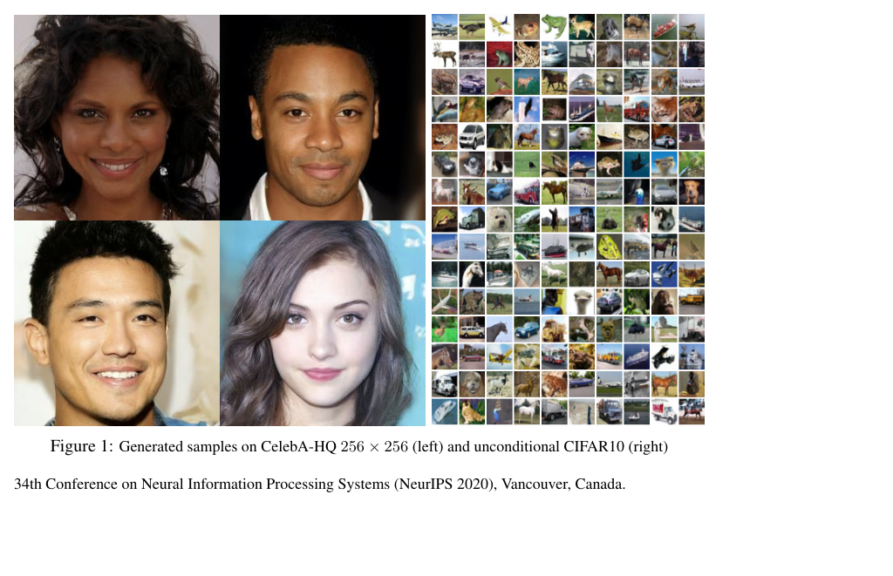

**Original:** Diffusion models [53] are latent variable models of the form $p_\theta(x_0) := \int p_\theta(x_{0:T})\,dx_{1:T}$, where $x_1, \dots, x_T$ are latents of the same dimensionality as the data $x_0 \sim q(x_0)$. The joint distribution $p_\theta(x_{0:T})$ is called the reverse process, and it is defined as a Markov chain with learned Gaussian transitions starting at $p(x_T) = \mathcal{N}(x_T; 0, I)$:

$$p_\theta(x_{0:T}) := p(x_T)\prod_{t=1}^{T}p_\theta(x_{t-1}|x_t), \qquad p_\theta(x_{t-1}|x_t) := \mathcal{N}(x_{t-1}; \mu_\theta(x_t, t), \Sigma_\theta(x_t, t)) \tag{1}$$

**中文:** 扩散模型 [53] 是形如 $p_\theta(x_0) := \int p_\theta(x_{0:T})\,dx_{1:T}$ 的隐变量模型，其中 $x_1, \dots, x_T$ 是与数据 $x_0 \sim q(x_0)$ 同维度的隐变量。联合分布 $p_\theta(x_{0:T})$ 称为反向过程，它被定义为一个马尔可夫链，其转移为从 $p(x_T) = \mathcal{N}(x_T; 0, I)$ 出发的、学习得到的高斯转移：

$$p_\theta(x_{0:T}) := p(x_T)\prod_{t=1}^{T}p_\theta(x_{t-1}|x_t), \qquad p_\theta(x_{t-1}|x_t) := \mathcal{N}(x_{t-1}; \mu_\theta(x_t, t), \Sigma_\theta(x_t, t)) \tag{1}$$

**Original:** What distinguishes diffusion models from other types of latent variable models is that the approximate posterior $q(x_{1:T}|x_0)$, called the forward process or diffusion process, is fixed to a Markov chain that gradually adds Gaussian noise to the data according to a variance schedule $\beta_1, \dots, \beta_T$:

$$q(x_{1:T}|x_0) := \prod_{t=1}^{T} q(x_t|x_{t-1}), \qquad q(x_t|x_{t-1}) := \mathcal{N}(x_t; \sqrt{1-\beta_t}\,x_{t-1}, \beta_t I) \tag{2}$$

**中文:** 扩散模型区别于其他类型隐变量模型之处在于：近似后验 $q(x_{1:T}|x_0)$（称为前向过程或扩散过程）被固定为一个马尔可夫链，它按照方差调度（variance schedule）$\beta_1, \dots, \beta_T$ 逐步向数据添加高斯噪声：

$$q(x_{1:T}|x_0) := \prod_{t=1}^{T} q(x_t|x_{t-1}), \qquad q(x_t|x_{t-1}) := \mathcal{N}(x_t; \sqrt{1-\beta_t}\,x_{t-1}, \beta_t I) \tag{2}$$

**Original:** Training is performed by optimizing the usual variational bound on negative log likelihood:

$$\mathbb{E}[-\log p_\theta(x_0)] \le \mathbb{E}_q\left[-\log \frac{p_\theta(x_{0:T})}{q(x_{1:T}|x_0)}\right] = \mathbb{E}_q\left[-\log p(x_T) - \sum_{t\ge 1}\log\frac{p_\theta(x_{t-1}|x_t)}{q(x_t|x_{t-1})}\right] =: L \tag{3}$$

**中文:** 训练通过优化负对数似然上通常的变分下界来完成：

$$\mathbb{E}[-\log p_\theta(x_0)] \le \mathbb{E}_q\left[-\log \frac{p_\theta(x_{0:T})}{q(x_{1:T}|x_0)}\right] = \mathbb{E}_q\left[-\log p(x_T) - \sum_{t\ge 1}\log\frac{p_\theta(x_{t-1}|x_t)}{q(x_t|x_{t-1})}\right] =: L \tag{3}$$

**Original:** The forward process variances $\beta_t$ can be learned by reparameterization [33] or held constant as hyperparameters, and expressiveness of the reverse process is ensured in part by the choice of Gaussian conditionals in $p_\theta(x_{t-1}|x_t)$, because both processes have the same functional form when $\beta_t$ are small [53]. A notable property of the forward process is that it admits sampling $x_t$ at an arbitrary timestep $t$ in closed form: using the notation $\alpha_t := 1-\beta_t$ and $\bar\alpha_t := \prod_{s=1}^{t}\alpha_s$, we have

$$q(x_t|x_0) = \mathcal{N}(x_t; \sqrt{\bar\alpha_t}\,x_0, (1-\bar\alpha_t)I) \tag{4}$$

**中文:** 前向过程的方差 $\beta_t$ 可以通过重参数化学习 [33]，也可以作为超参数保持不变；反向过程的表达能力部分地由 $p_\theta(x_{t-1}|x_t)$ 中选择高斯条件分布来保证，因为当 $\beta_t$ 很小时，两个过程具有相同的函数形式 [53]。前向过程的一个显著性质是：它允许在任意时间步 $t$ 以闭式解采样 $x_t$。使用记号 $\alpha_t := 1-\beta_t$ 与 $\bar\alpha_t := \prod_{s=1}^{t}\alpha_s$，我们有

$$q(x_t|x_0) = \mathcal{N}(x_t; \sqrt{\bar\alpha_t}\,x_0, (1-\bar\alpha_t)I) \tag{4}$$

**Original:** Efficient training is therefore possible by optimizing random terms of $L$ with stochastic gradient descent. Further improvements come from variance reduction by rewriting $L$ (3) as:

$$\mathbb{E}_q\left[\underbrace{D_{\mathrm{KL}}(q(x_T|x_0)\,\|\,p(x_T))}_{L_T} + \sum_{t>1}\underbrace{D_{\mathrm{KL}}(q(x_{t-1}|x_t, x_0)\,\|\,p_\theta(x_{t-1}|x_t))}_{L_{t-1}} \underbrace{-\log p_\theta(x_0|x_1)}_{L_0}\right] \tag{5}$$

**中文:** 因此，可以用随机梯度下降优化 $L$ 的随机项来实现高效训练。进一步的改进来自方差缩减：把 $L$（式 (3)）改写为：

$$\mathbb{E}_q\left[\underbrace{D_{\mathrm{KL}}(q(x_T|x_0)\,\|\,p(x_T))}_{L_T} + \sum_{t>1}\underbrace{D_{\mathrm{KL}}(q(x_{t-1}|x_t, x_0)\,\|\,p_\theta(x_{t-1}|x_t))}_{L_{t-1}} \underbrace{-\log p_\theta(x_0|x_1)}_{L_0}\right] \tag{5}$$

**Original:** (See Appendix A for details. The labels on the terms are used in Section 3.) Equation (5) uses KL divergence to directly compare $p_\theta(x_{t-1}|x_t)$ against forward process posteriors, which are tractable when conditioned on $x_0$:

$$q(x_{t-1}|x_t, x_0) = \mathcal{N}(x_{t-1}; \tilde\mu_t(x_t, x_0), \tilde\beta_t I), \tag{6}$$

where

$$\tilde\mu_t(x_t, x_0) := \frac{\sqrt{\bar\alpha_{t-1}}\,\beta_t}{1-\bar\alpha_t}x_0 + \frac{\sqrt{\alpha_t}\,(1-\bar\alpha_{t-1})}{1-\bar\alpha_t}x_t \qquad \text{and} \qquad \tilde\beta_t := \frac{1-\bar\alpha_{t-1}}{1-\bar\alpha_t}\beta_t \tag{7}$$

**中文:** （细节见附录 A。各项的标签在第 3 节中使用。）式 (5) 用 KL 散度把 $p_\theta(x_{t-1}|x_t)$ 直接与前向过程后验进行比较；以 $x_0$ 为条件时，这些后验是易于处理的：

$$q(x_{t-1}|x_t, x_0) = \mathcal{N}(x_{t-1}; \tilde\mu_t(x_t, x_0), \tilde\beta_t I), \tag{6}$$

其中

$$\tilde\mu_t(x_t, x_0) := \frac{\sqrt{\bar\alpha_{t-1}}\,\beta_t}{1-\bar\alpha_t}x_0 + \frac{\sqrt{\alpha_t}\,(1-\bar\alpha_{t-1})}{1-\bar\alpha_t}x_t \qquad \text{且} \qquad \tilde\beta_t := \frac{1-\bar\alpha_{t-1}}{1-\bar\alpha_t}\beta_t \tag{7}$$

**Original:** Consequently, all KL divergences in Eq. (5) are comparisons between Gaussians, so they can be calculated in a Rao-Blackwellized fashion with closed form expressions instead of high variance Monte Carlo estimates.

**中文:** 因此，式 (5) 中的所有 KL 散度都是高斯分布之间的比较，可以用闭式表达式以 Rao-Blackwell 化的方式计算，而不必使用高方差的 Monte Carlo 估计。

## 3 Diffusion models and denoising autoencoders

**Original:** Diffusion models might appear to be a restricted class of latent variable models, but they allow a large number of degrees of freedom in implementation. One must choose the variances $\beta_t$ of the forward process and the model architecture and Gaussian distribution parameterization of the reverse process. To guide our choices, we establish a new explicit connection between diffusion models and denoising score matching (Section 3.2) that leads to a simplified, weighted variational bound objective for diffusion models (Section 3.4). Ultimately, our model design is justified by simplicity and empirical results (Section 4). Our discussion is categorized by the terms of Eq. (5).

**中文:** 扩散模型乍看可能是一类受限的隐变量模型，但它们在实现上允许很大的自由度。人们需要选择前向过程的方差 $\beta_t$，以及反向过程的模型架构和高斯分布参数化。为了指导我们的选择，我们在扩散模型与去噪分数匹配之间建立了一种新的显式联系（第 3.2 节），由此为扩散模型导出一个简化的加权变分下界目标（第 3.4 节）。最终，我们的模型设计由简洁性和实验结果来证明其合理性（第 4 节）。我们的讨论按式 (5) 的各项来组织。

### 3.1 Forward process and $L_T$

**Original:** We ignore the fact that the forward process variances $\beta_t$ are learnable by reparameterization and instead fix them to constants (see Section 4 for details). Thus, in our implementation, the approximate posterior $q$ has no learnable parameters, so $L_T$ is a constant during training and can be ignored.

**中文:** 我们忽略前向过程方差 $\beta_t$ 可通过重参数化学习这一点，而把它们固定为常数（细节见第 4 节）。因此，在我们的实现中，近似后验 $q$ 没有可学习参数，所以 $L_T$ 在训练期间是常数，可以忽略。

### 3.2 Reverse process and $L_{1:T-1}$

**Original:** Now we discuss our choices in $p_\theta(x_{t-1}|x_t) = \mathcal{N}(x_{t-1}; \mu_\theta(x_t, t), \Sigma_\theta(x_t, t))$ for $1 < t \le T$. First, we set $\Sigma_\theta(x_t, t) = \sigma_t^2 I$ to untrained time dependent constants. Experimentally, both $\sigma_t^2 = \beta_t$ and $\sigma_t^2 = \tilde\beta_t = \frac{1-\bar\alpha_{t-1}}{1-\bar\alpha_t}\beta_t$ had similar results. The first choice is optimal for $x_0 \sim \mathcal{N}(0, I)$, and the second is optimal for $x_0$ deterministically set to one point. These are the two extreme choices corresponding to upper and lower bounds on reverse process entropy for data with coordinatewise unit variance [53].

**中文:** 现在讨论我们对 $p_\theta(x_{t-1}|x_t) = \mathcal{N}(x_{t-1}; \mu_\theta(x_t, t), \Sigma_\theta(x_t, t))$（其中 $1 < t \le T$）所做的选择。首先，我们把 $\Sigma_\theta(x_t, t) = \sigma_t^2 I$ 设为不参与训练的、依赖于时间的常数。实验上，$\sigma_t^2 = \beta_t$ 与 $\sigma_t^2 = \tilde\beta_t = \frac{1-\bar\alpha_{t-1}}{1-\bar\alpha_t}\beta_t$ 两种选择结果相近。第一种选择对 $x_0 \sim \mathcal{N}(0, I)$ 是最优的，第二种选择对 $x_0$ 被确定性地设为单点的情况是最优的。这是两个极端选择，分别对应着逐坐标单位方差数据上反向过程熵的上界与下界 [53]。

**Original:** Second, to represent the mean $\mu_\theta(x_t, t)$, we propose a specific parameterization motivated by the following analysis of $L_t$. With $p_\theta(x_{t-1}|x_t) = \mathcal{N}(x_{t-1}; \mu_\theta(x_t, t), \sigma_t^2 I)$, we can write:

$$L_{t-1} = \mathbb{E}_q\left[\frac{1}{2\sigma_t^2}\left\|\tilde\mu_t(x_t, x_0) - \mu_\theta(x_t, t)\right\|^2\right] + C \tag{8}$$

where $C$ is a constant that does not depend on $\theta$.

**中文:** 其次，为了表示均值 $\mu_\theta(x_t, t)$，我们基于对 $L_t$ 的如下分析提出一种特定的参数化。在 $p_\theta(x_{t-1}|x_t) = \mathcal{N}(x_{t-1}; \mu_\theta(x_t, t), \sigma_t^2 I)$ 的条件下，我们可以写出：

$$L_{t-1} = \mathbb{E}_q\left[\frac{1}{2\sigma_t^2}\left\|\tilde\mu_t(x_t, x_0) - \mu_\theta(x_t, t)\right\|^2\right] + C \tag{8}$$

其中 $C$ 是一个与 $\theta$ 无关的常数。

**Original:** So, we see that the most straightforward parameterization of $\mu_\theta$ is a model that predicts $\tilde\mu_t$, the forward process posterior mean. However, we can expand Eq. (8) further by reparameterizing Eq. (4) as $x_t(x_0, \epsilon) = \sqrt{\bar\alpha_t}\,x_0 + \sqrt{1-\bar\alpha_t}\,\epsilon$ for $\epsilon \sim \mathcal{N}(0, I)$ and applying the forward process posterior formula (7):

$$L_{t-1} - C = \mathbb{E}_{x_0,\epsilon}\left[\frac{1}{2\sigma_t^2}\left\|\tilde\mu_t\!\left(x_t(x_0, \epsilon), \frac{1}{\sqrt{\bar\alpha_t}}\bigl(x_t(x_0, \epsilon) - \sqrt{1-\bar\alpha_t}\,\epsilon\bigr)\right) - \mu_\theta(x_t(x_0, \epsilon), t)\right\|^2\right] \tag{9}$$

$$= \mathbb{E}_{x_0,\epsilon}\left[\frac{1}{2\sigma_t^2}\left\|\frac{1}{\sqrt{\alpha_t}}\left(x_t(x_0, \epsilon) - \frac{\beta_t}{\sqrt{1-\bar\alpha_t}}\,\epsilon\right) - \mu_\theta(x_t(x_0, \epsilon), t)\right\|^2\right] \tag{10}$$

**中文:** 由此可见，$\mu_\theta$ 最直接的参数化是一个预测前向过程后验均值 $\tilde\mu_t$ 的模型。不过，我们可以进一步展开式 (8)：把式 (4) 重参数化为 $x_t(x_0, \epsilon) = \sqrt{\bar\alpha_t}\,x_0 + \sqrt{1-\bar\alpha_t}\,\epsilon$（其中 $\epsilon \sim \mathcal{N}(0, I)$），并代入前向过程后验公式 (7)：

$$L_{t-1} - C = \mathbb{E}_{x_0,\epsilon}\left[\frac{1}{2\sigma_t^2}\left\|\tilde\mu_t\!\left(x_t(x_0, \epsilon), \frac{1}{\sqrt{\bar\alpha_t}}\bigl(x_t(x_0, \epsilon) - \sqrt{1-\bar\alpha_t}\,\epsilon\bigr)\right) - \mu_\theta(x_t(x_0, \epsilon), t)\right\|^2\right] \tag{9}$$

$$= \mathbb{E}_{x_0,\epsilon}\left[\frac{1}{2\sigma_t^2}\left\|\frac{1}{\sqrt{\alpha_t}}\left(x_t(x_0, \epsilon) - \frac{\beta_t}{\sqrt{1-\bar\alpha_t}}\,\epsilon\right) - \mu_\theta(x_t(x_0, \epsilon), t)\right\|^2\right] \tag{10}$$

**Original:** Equation (10) reveals that $\mu_\theta$ must predict $\frac{1}{\sqrt{\alpha_t}}\left(x_t - \frac{\beta_t}{\sqrt{1-\bar\alpha_t}}\,\epsilon\right)$ given $x_t$. Since $x_t$ is available as input to the model, we may choose the parameterization

$$\mu_\theta(x_t, t) = \tilde\mu_t\!\left(x_t, \frac{1}{\sqrt{\bar\alpha_t}}\bigl(x_t - \sqrt{1-\bar\alpha_t}\,\epsilon_\theta(x_t)\bigr)\right) = \frac{1}{\sqrt{\alpha_t}}\left(x_t - \frac{\beta_t}{\sqrt{1-\bar\alpha_t}}\,\epsilon_\theta(x_t, t)\right) \tag{11}$$

where $\epsilon_\theta$ is a function approximator intended to predict $\epsilon$ from $x_t$.

**中文:** 式 (10) 表明，给定 $x_t$ 时，$\mu_\theta$ 必须预测 $\frac{1}{\sqrt{\alpha_t}}\left(x_t - \frac{\beta_t}{\sqrt{1-\bar\alpha_t}}\,\epsilon\right)$。由于 $x_t$ 可以作为模型输入直接获得，我们可以选择如下参数化：

$$\mu_\theta(x_t, t) = \tilde\mu_t\!\left(x_t, \frac{1}{\sqrt{\bar\alpha_t}}\bigl(x_t - \sqrt{1-\bar\alpha_t}\,\epsilon_\theta(x_t)\bigr)\right) = \frac{1}{\sqrt{\alpha_t}}\left(x_t - \frac{\beta_t}{\sqrt{1-\bar\alpha_t}}\,\epsilon_\theta(x_t, t)\right) \tag{11}$$

其中 $\epsilon_\theta$ 是一个函数逼近器，目的是从 $x_t$ 预测 $\epsilon$。

**Original:** To sample $x_{t-1} \sim p_\theta(x_{t-1}|x_t)$ is to compute $x_{t-1} = \frac{1}{\sqrt{\alpha_t}}\left(x_t - \frac{\beta_t}{\sqrt{1-\bar\alpha_t}}\,\epsilon_\theta(x_t, t)\right) + \sigma_t z$, where $z \sim \mathcal{N}(0, I)$. The complete sampling procedure, Algorithm 2, resembles Langevin dynamics with $\epsilon_\theta$ as a learned gradient of the data density. Furthermore, with the parameterization (11), Eq. (10) simplifies to:

$$\mathbb{E}_{x_0,\epsilon}\left[\frac{\beta_t^2}{2\sigma_t^2\,\alpha_t\,(1-\bar\alpha_t)}\left\|\epsilon - \epsilon_\theta(\sqrt{\bar\alpha_t}\,x_0 + \sqrt{1-\bar\alpha_t}\,\epsilon, t)\right\|^2\right] \tag{12}$$

**中文:** 从 $p_\theta(x_{t-1}|x_t)$ 采样 $x_{t-1}$ 等价于计算 $x_{t-1} = \frac{1}{\sqrt{\alpha_t}}\left(x_t - \frac{\beta_t}{\sqrt{1-\bar\alpha_t}}\,\epsilon_\theta(x_t, t)\right) + \sigma_t z$，其中 $z \sim \mathcal{N}(0, I)$。完整的采样过程（算法 2）类似于 Langevin 动力学，其中 $\epsilon_\theta$ 扮演数据密度学习梯度的角色。此外，采用参数化 (11) 后，式 (10) 化简为：

$$\mathbb{E}_{x_0,\epsilon}\left[\frac{\beta_t^2}{2\sigma_t^2\,\alpha_t\,(1-\bar\alpha_t)}\left\|\epsilon - \epsilon_\theta(\sqrt{\bar\alpha_t}\,x_0 + \sqrt{1-\bar\alpha_t}\,\epsilon, t)\right\|^2\right] \tag{12}$$

**Original:** which resembles denoising score matching over multiple noise scales indexed by $t$ [55]. As Eq. (12) is equal to (one term of) the variational bound for the Langevin-like reverse process (11), we see that optimizing an objective resembling denoising score matching is equivalent to using variational inference to fit the finite-time marginal of a sampling chain resembling Langevin dynamics.

**中文:** 这类似于以 $t$ 为索引的、多噪声尺度上的去噪分数匹配 [55]。由于式 (12) 等于 Langevin 式反向过程 (11) 的变分下界（的其中一项），我们看到：优化一个类似于去噪分数匹配的目标，等价于用变分推断去拟合一条类似于 Langevin 动力学的采样链的有限时间边缘分布。

**Original:** To summarize, we can train the reverse process mean function approximator $\mu_\theta$ to predict $\tilde\mu_t$, or by modifying its parameterization, we can train it to predict $\epsilon$. (There is also the possibility of predicting $x_0$, but we found this to lead to worse sample quality early in our experiments.) We have shown that the $\epsilon$-prediction parameterization both resembles Langevin dynamics and simplifies the diffusion model's variational bound to an objective that resembles denoising score matching. Nonetheless, it is just another parameterization of $p_\theta(x_{t-1}|x_t)$, so we verify its effectiveness in Section 4 in an ablation where we compare predicting $\epsilon$ against predicting $\tilde\mu_t$.

**中文:** 总结一下：我们可以训练反向过程均值函数逼近器 $\mu_\theta$ 去预测 $\tilde\mu_t$，或者修改其参数化，训练它去预测 $\epsilon$。（还存在预测 $x_0$ 的可能性，但我们在早期实验中发现这会导致样本质量变差。）我们已经证明：$\epsilon$ 预测参数化既类似于 Langevin 动力学，又把扩散模型的变分下界化简为一个类似于去噪分数匹配的目标。尽管如此，它只是 $p_\theta(x_{t-1}|x_t)$ 的另一种参数化，因此我们在第 4 节通过消融实验验证其有效性——将预测 $\epsilon$ 与预测 $\tilde\mu_t$ 进行对比。

### 3.3 Data scaling, reverse process decoder, and $L_0$

**Original:** We assume that image data consists of integers in $\{0, 1, \ldots, 255\}$ scaled linearly to $[-1, 1]$. This ensures that the neural network reverse process operates on consistently scaled inputs starting from the standard normal prior $p(x_T)$. To obtain discrete log likelihoods, we set the last term of the reverse process to an independent discrete decoder derived from the Gaussian $\mathcal{N}(x_0; \mu_\theta(x_1, 1), \sigma_1^2 I)$:

$$p_\theta(x_0|x_1) = \prod_{i=1}^{D}\int_{\delta_-(x_0^i)}^{\delta_+(x_0^i)} \mathcal{N}(x; \mu_\theta^i(x_1, 1), \sigma_1^2)\,dx$$

$$\delta_+(x) = \begin{cases} \infty & \text{if } x = 1 \\ x + \frac{1}{255} & \text{if } x < 1 \end{cases} \qquad \delta_-(x) = \begin{cases} -\infty & \text{if } x = -1 \\ x - \frac{1}{255} & \text{if } x > -1 \end{cases} \tag{13}$$

where $D$ is the data dimensionality and the $i$ superscript indicates extraction of one coordinate.

**中文:** 我们假设图像数据由 $\{0, 1, \ldots, 255\}$ 中的整数线性缩放到 $[-1, 1]$ 组成。这保证了神经网络反向过程从标准正态先验 $p(x_T)$ 出发，始终处理尺度一致的输入。为了得到离散的对数似然，我们把反向过程的最后一项设为一个独立的离散解码器，它由高斯分布 $\mathcal{N}(x_0; \mu_\theta(x_1, 1), \sigma_1^2 I)$ 导出：

$$p_\theta(x_0|x_1) = \prod_{i=1}^{D}\int_{\delta_-(x_0^i)}^{\delta_+(x_0^i)} \mathcal{N}(x; \mu_\theta^i(x_1, 1), \sigma_1^2)\,dx$$

$$\delta_+(x) = \begin{cases} \infty & \text{若 } x = 1 \\ x + \frac{1}{255} & \text{若 } x < 1 \end{cases} \qquad \delta_-(x) = \begin{cases} -\infty & \text{若 } x = -1 \\ x - \frac{1}{255} & \text{若 } x > -1 \end{cases} \tag{13}$$

其中 $D$ 是数据维度，上标 $i$ 表示取出某一个坐标。

**Original:** (It would be straightforward to instead incorporate a more powerful decoder like a conditional autoregressive model, but we leave that to future work.) Similar to the discretized continuous distributions used in VAE decoders and autoregressive models [34, 52], our choice here ensures that the variational bound is a lossless codelength of discrete data, without need of adding noise to the data or incorporating the Jacobian of the scaling operation into the log likelihood. At the end of sampling, we display $\mu_\theta(x_1, 1)$ noiselessly.

**中文:** （换成更强的解码器（例如条件自回归模型）会是一件直接了当的事，但我们把它留给未来工作。）与 VAE 解码器和自回归模型中所用的离散化连续分布类似 [34, 52]，我们这里的选择保证了变分下界是离散数据的无损码长，无需向数据添加噪声，也无需把缩放操作的 Jacobian 计入对数似然。采样结束时，我们无噪地输出 $\mu_\theta(x_1, 1)$。

### 3.4 Simplified training objective

**Original:** With the reverse process and decoder defined above, the variational bound, consisting of terms derived from Eqs. (12) and (13), is clearly differentiable with respect to $\theta$ and is ready to be employed for training. However, we found it beneficial to sample quality (and simpler to implement) to train on the following variant of the variational bound:

$$L_{\mathrm{simple}}(\theta) := \mathbb{E}_{t,x_0,\epsilon}\left[\left\|\epsilon - \epsilon_\theta(\sqrt{\bar\alpha_t}\,x_0 + \sqrt{1-\bar\alpha_t}\,\epsilon, t)\right\|^2\right] \tag{14}$$

where $t$ is uniform between $1$ and $T$.

**中文:** 有了上面定义的反向过程与解码器，由式 (12) 和式 (13) 导出的各项组成的变分下界对 $\theta$ 显然可微，可以直接用于训练。然而，我们发现训练如下这个变分下界的变体对样本质量有益（且实现更简单）：

$$L_{\mathrm{simple}}(\theta) := \mathbb{E}_{t,x_0,\epsilon}\left[\left\|\epsilon - \epsilon_\theta(\sqrt{\bar\alpha_t}\,x_0 + \sqrt{1-\bar\alpha_t}\,\epsilon, t)\right\|^2\right] \tag{14}$$

其中 $t$ 在 $1$ 到 $T$ 之间均匀取值。

**Original:** The $t = 1$ case corresponds to $L_0$ with the integral in the discrete decoder definition (13) approximated by the Gaussian probability density function times the bin width, ignoring $\sigma_1^2$ and edge effects. The $t > 1$ cases correspond to an unweighted version of Eq. (12), analogous to the loss weighting used by the NCSN denoising score matching model [55]. ($L_T$ does not appear because the forward process variances $\beta_t$ are fixed.) Algorithm 1 displays the complete training procedure with this simplified objective.

**中文:** $t = 1$ 的情形对应 $L_0$，其中离散解码器定义 (13) 中的积分由高斯概率密度函数乘以区间宽度来近似，忽略 $\sigma_1^2$ 和边缘效应。$t > 1$ 的情形对应式 (12) 的无加权版本，与 NCSN 去噪分数匹配模型所用的损失加权方式类似 [55]。（$L_T$ 不出现，因为前向过程方差 $\beta_t$ 是固定的。）算法 1 展示了用这个简化目标训练时的完整流程。

```
Algorithm 1 Training
1: repeat
2:   x0 ~ q(x0)
3:   t ~ Uniform({1, ..., T})
4:   ε ~ N(0, I)
5:   Take gradient descent step on
     ∇θ ‖ε − εθ(√ᾱt x0 + √(1−ᾱt) ε, t)‖²
6: until converged
```

**中文（算法 1，训练）:** 重复执行：第 2 行从数据分布采样 $x_0 \sim q(x_0)$；第 3 行采样时间步 $t \sim \mathrm{Uniform}(\{1, \dots, T\})$；第 4 行采样噪声 $\epsilon \sim \mathcal{N}(0, I)$；第 5 行对 $\nabla_\theta \|\epsilon - \epsilon_\theta(\sqrt{\bar\alpha_t}\,x_0 + \sqrt{1-\bar\alpha_t}\,\epsilon, t)\|^2$ 执行一步梯度下降；直到收敛。（变量名保留英文，注释已译）

**Original:** Since our simplified objective (14) discards the weighting in Eq. (12), it is a weighted variational bound that emphasizes different aspects of reconstruction compared to the standard variational bound [18, 22]. In particular, our diffusion process setup in Section 4 causes the simplified objective to down-weight loss terms corresponding to small $t$. These terms train the network to denoise data with very small amounts of noise, so it is beneficial to down-weight them so that the network can focus on more difficult denoising tasks at larger $t$ terms. We will see in our experiments that this reweighting leads to better sample quality.

**中文:** 由于我们的简化目标 (14) 丢弃了式 (12) 中的加权，与标准变分下界相比，它是一个加权变分下界，强调重建的不同方面 [18, 22]。特别地，第 4 节的扩散过程设置使得简化目标对小的 $t$ 对应的损失项降权。这些损失项训练网络对噪声量极小的数据去噪，因此对它们降权是有益的，可以让网络专注于更大 $t$ 项上更困难的去噪任务。我们将在实验中看到，这种重新加权带来了更好的样本质量。
```
Algorithm 2 Sampling
1: xT ~ N(0, I)
2: for t = T, ..., 1 do
3:   z ~ N(0, I) if t > 1, else z = 0
4:   xt−1 = (1/√αt) (xt − ((1−αt)/√(1−ᾱt)) εθ(xt, t)) + σt z
5: end for
6: return x0
```

**中文（算法 2，采样）:** 第 1 行从标准正态先验采样 $x_T \sim \mathcal{N}(0, I)$；对 $t = T, \dots, 1$ 循环：第 3 行若 $t > 1$ 则采样 $z \sim \mathcal{N}(0, I)$，否则 $z = 0$；第 4 行计算 $x_{t-1} = \frac{1}{\sqrt{\alpha_t}}\left(x_t - \frac{1-\alpha_t}{\sqrt{1-\bar\alpha_t}}\,\epsilon_\theta(x_t, t)\right) + \sigma_t z$；循环结束后返回 $x_0$。（变量名保留英文，注释已译）

## 4 Experiments

**Original:** We set $T = 1000$ for all experiments so that the number of neural network evaluations needed during sampling matches previous work [53, 55]. We set the forward process variances to constants increasing linearly from $\beta_1 = 10^{-4}$ to $\beta_T = 0.02$. These constants were chosen to be small relative to data scaled to $[-1, 1]$, ensuring that reverse and forward processes have approximately the same functional form while keeping the signal-to-noise ratio at $x_T$ as small as possible ($L_T = D_{\mathrm{KL}}(q(x_T|x_0)\,\|\,\mathcal{N}(0, I)) \approx 10^{-5}$ bits per dimension in our experiments).

**中文:** 所有实验我们都设 $T = 1000$，使采样所需的神经网络评估次数与先前工作一致 [53, 55]。我们把前向过程方差设为常数，从 $\beta_1 = 10^{-4}$ 线性增加到 $\beta_T = 0.02$。这些常数相对缩放到 $[-1, 1]$ 的数据来说选得足够小，以保证反向过程与前向过程具有大致相同的函数形式，同时使 $x_T$ 处的信噪比尽可能小（在我们的实验中 $L_T = D_{\mathrm{KL}}(q(x_T|x_0)\,\|\,\mathcal{N}(0, I)) \approx 10^{-5}$ 比特/维度）。

**Original:** To represent the reverse process, we use a U-Net backbone similar to an unmasked PixelCNN++ [52, 48] with group normalization throughout [66]. Parameters are shared across time, which is specified to the network using the Transformer sinusoidal position embedding [60]. We use self-attention at the 16 × 16 feature map resolution [63, 60]. Details are in Appendix B.

**中文:** 为了表示反向过程，我们使用一个与无掩码的 PixelCNN++ [52, 48] 类似的 U-Net 主干网络，并全程使用组归一化 [66]。参数在所有时间步上共享，时间信息通过 Transformer 正弦位置嵌入提供给网络 [60]。我们在 16 × 16 特征图分辨率上使用自注意力 [63, 60]。细节见附录 B。

### 4.1 Sample quality

**Original:** Table 1 shows Inception scores, FID scores, and negative log likelihoods (lossless codelengths) on CIFAR10. With our FID score of 3.17, our unconditional model achieves better sample quality than most models in the literature, including class conditional models. Our FID score is computed with respect to the training set, as is standard practice; when we compute it with respect to the test set, the score is 5.24, which is still better than many of the training set FID scores in the literature.

**中文:** 表 1 展示了 CIFAR10 上的 Inception 分数、FID 分数与负对数似然（无损码长）。我们的 FID 分数为 3.17，无条件模型取得了优于文献中大多数模型（包括类别条件模型）的样本质量。我们的 FID 分数按惯例相对训练集计算；当相对测试集计算时，分数为 5.24，仍然优于文献中许多训练集 FID 分数。

> **表 1（译）**：CIFAR10 结果。NLL 以比特/维度（bits/dim）计。（原图见 paper.pdf 第 5 页，见下方图）

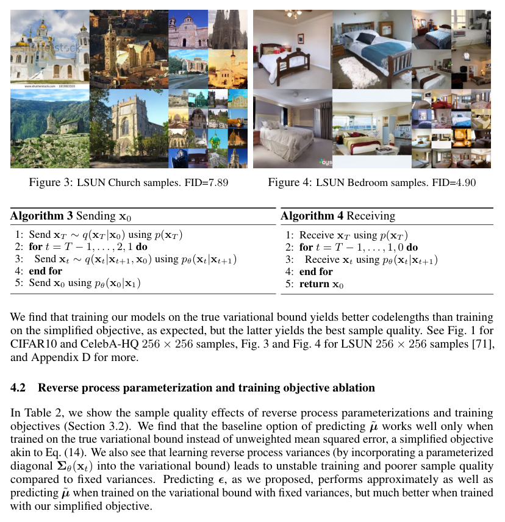

| 模型 | IS | FID | NLL Test (Train) |
|---|---|---|---|
| **Conditional（条件）** | | | |
| EBM [11] | 8.30 | 37.9 | – |
| JEM [17] | 8.76 | 38.4 | – |
| BigGAN [3] | 9.22 | 14.73 | – |
| StyleGAN2 + ADA (v1) [29] | 10.06 | 2.67 | – |
| **Unconditional（无条件）** | | | |
| Diffusion (original) [53] | – | ≤5.40 | – |
| Gated PixelCNN [59] | 4.60 | 65.93 | 3.03 (2.90) |
| Sparse Transformer [7] | – | – | 2.80 |
| PixelIQN [43] | 5.29 | 49.46 | – |
| EBM [11] | 6.78 | 38.2 | – |
| NCSNv2 [56] | – | 31.75 | – |
| NCSN [55] | 8.87±0.12 | 25.32 | – |
| SNGAN [39] | 8.22±0.05 | 21.7 | – |
| SNGAN-DDLS [4] | 9.09±0.10 | 15.42 | – |
| StyleGAN2 + ADA (v1) [29] | 9.74±0.05 | 3.26 | – |
| Ours (L, fixed isotropic Σ) | 7.67±0.13 | 13.51 | ≤3.70 (3.69) |
| Ours (Lsimple) | 9.46±0.11 | 3.17 | ≤3.75 (3.72) |

> **图 3（译）**：LSUN Church 样本。FID=7.89。（原图见 paper.pdf 第 6 页，见下方图）


>
> **图 4（译）**：LSUN Bedroom 样本。FID=4.90。（原图见 paper.pdf 第 6 页，[第 6 页图](assets/figures/fig-4.png)）

**Original:** We find that training our models on the true variational bound yields better codelengths than training on the simplified objective, as expected, but the latter yields the best sample quality. See Fig. 1 for CIFAR10 and CelebA-HQ 256 × 256 samples, Fig. 3 and Fig. 4 for LSUN 256 × 256 samples [71], and Appendix D for more.

**中文:** 我们发现，如预期那样，在真实变分下界上训练模型得到的码长优于在简化目标上训练，但后者取得最好的样本质量。CIFAR10 与 CelebA-HQ 256 × 256 样本见图 1，LSUN 256 × 256 样本见图 3 与图 4 [71]，更多样本见附录 D。

### 4.2 Reverse process parameterization and training objective ablation

**Original:** In Table 2, we show the sample quality effects of reverse process parameterizations and training objectives (Section 3.2). We find that the baseline option of predicting $\tilde\mu$ works well only when trained on the true variational bound instead of unweighted mean squared error, a simplified objective akin to Eq. (14). We also see that learning reverse process variances (by incorporating a parameterized diagonal $\Sigma_\theta(x_t)$ into the variational bound) leads to unstable training and poorer sample quality compared to fixed variances. Predicting $\epsilon$, as we proposed, performs approximately as well as predicting $\tilde\mu$ when trained on the variational bound with fixed variances, but much better when trained with our simplified objective.

**中文:** 表 2 展示了反向过程参数化与训练目标（第 3.2 节）对样本质量的影响。我们发现：基线方案——预测 $\tilde\mu$——只有在真实变分下界（而非类似于式 (14) 的简化目标、无加权的均方误差）上训练时才表现良好。我们还看到：学习反向过程方差（把参数化的对角 $\Sigma_\theta(x_t)$ 纳入变分下界）会导致训练不稳定，样本质量也比固定方差时差。我们提出的预测 $\epsilon$ 方案，在固定方差的变分下界上训练时与预测 $\tilde\mu$ 表现相当，但在我们的简化目标上训练时表现好得多。

> **表 2（译）**：无条件 CIFAR10 上反向过程参数化与训练目标的消融实验。空白项表示训练不稳定，生成样本质量差且分数超出范围。（原图见 paper.pdf 第 5 页，[第 5 页图](assets/figures/tab-2.png)）

| 目标 | IS | FID |
|---|---|---|
| **$\tilde\mu$ prediction (baseline)（预测 $\tilde\mu$，基线）** | | |
| L, learned diagonal Σ | 7.28±0.10 | 23.69 |
| L, fixed isotropic Σ | 8.06±0.09 | 13.22 |
| $\|\tilde\mu - \tilde\mu_\theta\|^2$ | – | – |
| **$\epsilon$ prediction (ours)（预测 $\epsilon$，本文）** | | |
| L, learned diagonal Σ | – | – |
| L, fixed isotropic Σ | 7.67±0.13 | 13.51 |
| $\|\epsilon - \epsilon_\theta\|^2$ (Lsimple) | 9.46±0.11 | 3.17 |

### 4.3 Progressive coding

**Original:** Table 1 also shows the codelengths of our CIFAR10 models. The gap between train and test is at most 0.03 bits per dimension, which is comparable to the gaps reported with other likelihood-based models and indicates that our diffusion model is not overfitting (see Appendix D for nearest neighbor visualizations). Still, while our lossless codelengths are better than the large estimates reported for energy based models and score matching using annealed importance sampling [11], they are not competitive with other types of likelihood-based generative models [7].

**中文:** 表 1 还展示了我们 CIFAR10 模型的码长。训练集与测试集之间的差距至多为每维度 0.03 比特，与其他基于似然的模型报告的差距相当，表明我们的扩散模型没有过拟合（最近邻可视化见附录 D）。尽管如此，虽然我们的无损码长优于文献中基于能量的模型和分数匹配用退火重要性采样报告的大估计值 [11]，它们与其他类型的基于似然的生成模型相比仍不具有竞争力 [7]。

**Original:** Since our samples are nonetheless of high quality, we conclude that diffusion models have an inductive bias that makes them excellent lossy compressors. Treating the variational bound terms $L_1 + \cdots + L_T$ as rate and $L_0$ as distortion, our CIFAR10 model with the highest quality samples has a rate of 1.78 bits/dim and a distortion of 1.97 bits/dim, which amounts to a root mean squared error of 0.95 on a scale from 0 to 255. More than half of the lossless codelength describes imperceptible distortions.

**中文:** 由于我们的样本质量仍然很高，我们得出结论：扩散模型具有一种归纳偏置，使它成为出色的有损压缩器。把变分下界的各项 $L_1 + \cdots + L_T$ 视为码率、$L_0$ 视为失真，我们样本质量最高的 CIFAR10 模型码率为 1.78 比特/维度，失真为 1.97 比特/维度，相当于在 0 到 255 的尺度上均方根误差为 0.95。无损码长的一半以上都在描述不可察觉的失真。

**Progressive lossy compression（渐进式有损压缩）**

**Original:** We can probe further into the rate-distortion behavior of our model by introducing a progressive lossy code that mirrors the form of Eq. (5): see Algorithms 3 and 4, which assume access to a procedure, such as minimal random coding [19, 20], that can transmit a sample $x \sim q(x)$ using approximately $D_{\mathrm{KL}}(q(x)\,\|\,p(x))$ bits on average for any distributions $p$ and $q$, for which only $p$ is available to the receiver beforehand. When applied to $x_0 \sim q(x_0)$, Algorithms 3 and 4 transmit $x_T, \ldots, x_0$ in sequence using a total expected codelength equal to Eq. (5). The receiver, at any time $t$, has the partial information $x_t$ fully available and can progressively estimate:

$$\hat x_0 = \left(x_t - \sqrt{1-\bar\alpha_t}\,\epsilon_\theta(x_t)\right)/\sqrt{\bar\alpha_t} \tag{15}$$

due to Eq. (4). (A stochastic reconstruction $x_0 \sim p_\theta(x_0|x_t)$ is also valid, but we do not consider it here because it makes distortion more difficult to evaluate.)

**中文:** 我们可以通过引入一个与式 (5) 形式对应的渐进式有损编码来进一步探究模型的率失真行为：见算法 3 与算法 4。它们假定可以访问某个过程（例如最小随机编码 [19, 20]）：对任意分布 $p$ 和 $q$（其中接收方事先只知道 $p$），它能用平均约 $D_{\mathrm{KL}}(q(x)\,\|\,p(x))$ 比特传输一个样本 $x \sim q(x)$。应用于 $x_0 \sim q(x_0)$ 时，算法 3 与算法 4 依次传输 $x_T, \ldots, x_0$，总期望码长等于式 (5)。接收方在任意时刻 $t$ 都完整拥有部分信息 $x_t$，并可以渐进地估计：

$$\hat x_0 = \left(x_t - \sqrt{1-\bar\alpha_t}\,\epsilon_\theta(x_t)\right)/\sqrt{\bar\alpha_t} \tag{15}$$

这是由式 (4) 得出的。（随机重建 $x_0 \sim p_\theta(x_0|x_t)$ 同样有效，但这里不予考虑，因为它使失真更难评估。）

**Original:** Figure 5 shows the resulting rate-distortion plot on the CIFAR10 test set. At each time $t$, the distortion is calculated as the root mean squared error $\sqrt{\|x_0 - \hat x_0\|^2/D}$, and the rate is calculated as the cumulative number of bits received so far at time $t$. The distortion decreases steeply in the low-rate region of the rate-distortion plot, indicating that the majority of the bits are indeed allocated to imperceptible distortions.

**中文:** 图 5 展示了 CIFAR10 测试集上相应的率失真曲线。在每个时刻 $t$，失真按均方根误差 $\sqrt{\|x_0 - \hat x_0\|^2/D}$ 计算，码率按到时刻 $t$ 为止累计接收的比特数计算。在率失真曲线的低码率区，失真急剧下降，表明大部分比特确实被分配给了不可察觉的失真。

> **图 5（译）**：无条件 CIFAR10 测试集的率失真随反向过程时间的变化。失真以 [0, 255] 尺度上的均方根误差度量。细节见表 4。（原图见 paper.pdf 第 7 页，见下方图）

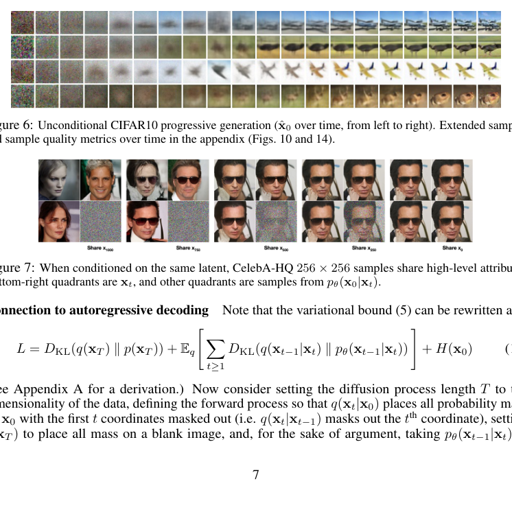

**Progressive generation（渐进式生成）**

**Original:** We also run a progressive unconditional generation process given by progressive decompression from random bits. In other words, we predict the result of the reverse process, $\hat x_0$, while sampling from the reverse process using Algorithm 2. Figures 6 and 10 show the resulting sample quality of $\hat x_0$ over the course of the reverse process. Large scale image features appear first and details appear last. Figure 7 shows stochastic predictions $x_0 \sim p_\theta(x_0|x_t)$ with $x_t$ frozen for various $t$. When $t$ is small, all but fine details are preserved, and when $t$ is large, only large scale features are preserved. Perhaps these are hints of conceptual compression [18].

**中文:** 我们还运行了一个渐进式无条件生成过程，即从随机比特出发的渐进式解压缩。换句话说，我们在用算法 2 从反向过程采样的同时预测反向过程的结果 $\hat x_0$。图 6 和图 10 展示了 $\hat x_0$ 的样本质量随反向过程推进的变化。大尺度图像特征先出现，细节最后出现。图 7 展示了固定不同 $t$ 的 $x_t$ 时随机预测 $x_0 \sim p_\theta(x_0|x_t)$ 的结果。当 $t$ 较小时，除细节外几乎全部保留；当 $t$ 较大时，只有大尺度特征得以保留。也许这些正是概念压缩 [18] 的迹象。

> **图 6（译）**：无条件 CIFAR10 渐进式生成（$\hat x_0$ 随时间变化，从左到右）。扩展样本与随时间变化的样本质量指标见附录（图 10 和图 14）。（原图见 paper.pdf 第 7 页，[第 7 页图](assets/figures/fig-6.png)）
>
> **图 7（译）**：以同一隐变量为条件时，CelebA-HQ 256 × 256 样本共享高层属性。右下象限是 $x_t$，其余象限是从 $p_\theta(x_0|x_t)$ 采样的样本。（原图见 paper.pdf 第 7 页，[第 7 页图](assets/figures/fig-7.png)）

**Connection to autoregressive decoding（与自回归解码的联系）**

**Original:** Note that the variational bound (5) can be rewritten as:

$$L = D_{\mathrm{KL}}(q(x_T)\,\|\,p(x_T)) + \mathbb{E}_q\left[\sum_{t\ge 1} D_{\mathrm{KL}}(q(x_{t-1}|x_t)\,\|\,p_\theta(x_{t-1}|x_t))\right] + H(x_0) \tag{16}$$

(See Appendix A for a derivation.)

**中文:** 注意，变分下界 (5) 可以改写为：

$$L = D_{\mathrm{KL}}(q(x_T)\,\|\,p(x_T)) + \mathbb{E}_q\left[\sum_{t\ge 1} D_{\mathrm{KL}}(q(x_{t-1}|x_t)\,\|\,p_\theta(x_{t-1}|x_t))\right] + H(x_0) \tag{16}$$

（推导见附录 A。）

**Original:** Now consider setting the diffusion process length $T$ to the dimensionality of the data, defining the forward process so that $q(x_t|x_0)$ places all probability mass on $x_0$ with the first $t$ coordinates masked out (i.e. $q(x_t|x_{t-1})$ masks out the $t$th coordinate), setting $p(x_T)$ to place all mass on a blank image, and, for the sake of argument, taking $p_\theta(x_{t-1}|x_t)$ to be a fully expressive conditional distribution. With these choices, $D_{\mathrm{KL}}(q(x_T)\,\|\,p(x_T)) = 0$, and minimizing $D_{\mathrm{KL}}(q(x_{t-1}|x_t)\,\|\,p_\theta(x_{t-1}|x_t))$ trains $p_\theta$ to copy coordinates $t + 1, \ldots, T$ unchanged and to predict the $t$th coordinate given $t + 1, \ldots, T$. Thus, training $p_\theta$ with this particular diffusion is training an autoregressive model.

**中文:** 现在考虑：把扩散过程长度 $T$ 设为数据的维度；定义前向过程使 $q(x_t|x_0)$ 把全部概率质量放在"前 $t$ 个坐标被屏蔽掉的 $x_0$"上（即 $q(x_t|x_{t-1})$ 屏蔽第 $t$ 个坐标）；令 $p(x_T)$ 把全部质量放在一张空白图像上；并且（为了论证）取 $p_\theta(x_{t-1}|x_t)$ 为完全表达力的条件分布。在这些选择下，$D_{\mathrm{KL}}(q(x_T)\,\|\,p(x_T)) = 0$，最小化 $D_{\mathrm{KL}}(q(x_{t-1}|x_t)\,\|\,p_\theta(x_{t-1}|x_t))$ 就是在训练 $p_\theta$ 原样复制坐标 $t + 1, \ldots, T$、并给定 $t + 1, \ldots, T$ 预测第 $t$ 个坐标。因此，用这种特定扩散训练 $p_\theta$ 就是在训练一个自回归模型。

**Original:** We can therefore interpret the Gaussian diffusion model (2) as a kind of autoregressive model with a generalized bit ordering that cannot be expressed by reordering data coordinates. Prior work has shown that such reorderings introduce inductive biases that have an impact on sample quality [38], so we speculate that the Gaussian diffusion serves a similar purpose, perhaps to greater effect since Gaussian noise might be more natural to add to images compared to masking noise. Moreover, the Gaussian diffusion length is not restricted to equal the data dimension; for instance, we use $T = 1000$, which is less than the dimension of the 32 × 32 × 3 or 256 × 256 × 3 images in our experiments. Gaussian diffusions can be made shorter for fast sampling or longer for model expressiveness.

**中文:** 因此，我们可以把高斯扩散模型 (2) 解释为一种具有广义比特顺序的自回归模型——这种比特顺序无法通过重排数据坐标来表达。先前工作已经表明，这类重排会引入影响样本质量的归纳偏置 [38]，所以我们推测高斯扩散起到了类似的作用，而且效果可能更大，因为相对屏蔽噪声，高斯噪声加到图像上或许更自然。此外，高斯扩散的长度不必等于数据维度；例如我们使用 $T = 1000$，小于实验中 32 × 32 × 3 或 256 × 256 × 3 图像的维度。高斯扩散可以缩短以加快采样，也可以加长以增强模型表达能力。

### 4.4 Interpolation

**Original:** We can interpolate source images $x_0, x_0' \sim q(x_0)$ in latent space using $q$ as a stochastic encoder, $x_t, x_t' \sim q(x_t|x_0)$, then decoding the linearly interpolated latent $\bar x_t = (1 - \lambda)x_0 + \lambda x_0'$ into image space by the reverse process, $\bar x_0 \sim p(x_0|\bar x_t)$. In effect, we use the reverse process to remove artifacts from linearly interpolating corrupted versions of the source images, as depicted in Fig. 8 (left). We fixed the noise for different values of $\lambda$ so $x_t$ and $x_t'$ remain the same. Fig. 8 (right) shows interpolations and reconstructions of original CelebA-HQ 256 × 256 images ($t = 500$). The reverse process produces high-quality reconstructions, and plausible interpolations that smoothly vary attributes such as pose, skin tone, hairstyle, expression and background, but not eyewear. Larger $t$ results in coarser and more varied interpolations, with novel samples at $t = 1000$ (Appendix Fig. 9).

**中文:** 我们可以对源图像 $x_0, x_0' \sim q(x_0)$ 在隐空间中进行插值：把 $q$ 用作随机编码器，取 $x_t, x_t' \sim q(x_t|x_0)$，然后通过反向过程把线性插值的隐变量 $\bar x_t = (1 - \lambda)x_0 + \lambda x_0'$ 解码回图像空间：$\bar x_0 \sim p(x_0|\bar x_t)$。实际上，我们是用反向过程去除"对源图像的被破坏版本做线性插值"所产生的伪影，如图 8（左）所示。对不同 $\lambda$ 值我们固定了噪声，使 $x_t$ 与 $x_t'$ 保持不变。图 8（右）展示了原始 CelebA-HQ 256 × 256 图像的插值与重建（$t = 500$）。反向过程产生高质量的重建，以及合理的插值结果——姿态、肤色、发型、表情和背景等属性平滑变化，但眼镜不变。更大的 $t$ 产生更粗糙、更多样的插值，$t = 1000$ 时得到全新样本（附录图 9）。

> **图 8（译）**：CelebA-HQ 256x256 图像的插值，扩散步数为 500。（原图见 paper.pdf 第 8 页，见下方图）

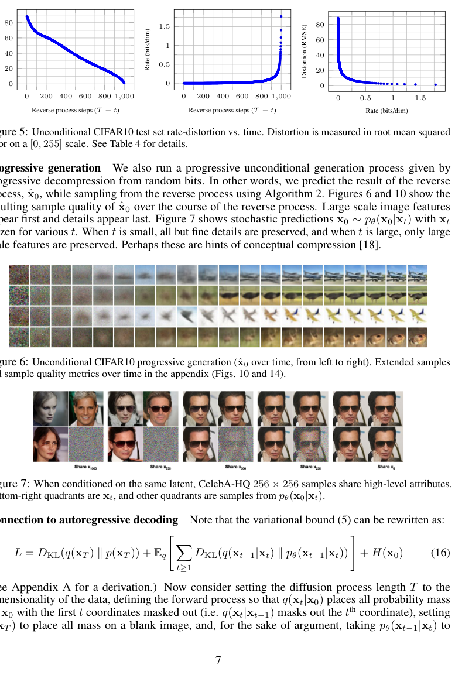

## 5 Related Work

**Original:** While diffusion models might resemble flows [9, 46, 10, 32, 5, 16, 23] and VAEs [33, 47, 37], diffusion models are designed so that $q$ has no parameters and the top-level latent $x_T$ has nearly zero mutual information with the data $x_0$. Our $\epsilon$-prediction reverse process parameterization establishes a connection between diffusion models and denoising score matching over multiple noise levels with annealed Langevin dynamics for sampling [55, 56]. Diffusion models, however, admit straightforward log likelihood evaluation, and the training procedure explicitly trains the Langevin dynamics sampler using variational inference (see Appendix C for details). The connection also has the reverse implication that a certain weighted form of denoising score matching is the same as variational inference to train a Langevin-like sampler. Other methods for learning transition operators of Markov chains include infusion training [2], variational walkback [15], generative stochastic networks [1], and others [50, 54, 36, 42, 35, 65].

**中文:** 虽然扩散模型可能与流模型 [9, 46, 10, 32, 5, 16, 23] 和 VAE [33, 47, 37] 相似，但扩散模型的设计使得 $q$ 没有参数，且顶层隐变量 $x_T$ 与数据 $x_0$ 的互信息几乎为零。我们的 $\epsilon$ 预测反向过程参数化建立了扩散模型与"多噪声水平去噪分数匹配 + 退火 Langevin 动力学采样"之间的联系 [55, 56]。不过，扩散模型可以直接进行对数似然评估，而且其训练过程用变分推断显式地训练 Langevin 动力学采样器（细节见附录 C）。这一联系还有反向的含义：某种加权形式的去噪分数匹配，等价于用变分推断训练一个 Langevin 式采样器。其他学习马尔可夫链转移算子的方法包括注入训练（infusion training）[2]、variational walkback [15]、生成随机网络 [1] 及其他 [50, 54, 36, 42, 35, 65]。

**Original:** By the known connection between score matching and energy-based modeling, our work could have implications for other recent work on energy-based models [67–69, 12, 70, 13, 11, 41, 17, 8]. Our rate-distortion curves are computed over time in one evaluation of the variational bound, reminiscent of how rate-distortion curves can be computed over distortion penalties in one run of annealed importance sampling [24]. Our progressive decoding argument can be seen in convolutional DRAW and related models [18, 40] and may also lead to more general designs for subscale orderings or sampling strategies for autoregressive models [38, 64].

**中文:** 借助分数匹配与基于能量的建模之间的已知联系，我们的工作可能对近期其他关于基于能量的模型的研究有所启示 [67–69, 12, 70, 13, 11, 41, 17, 8]。我们的率失真曲线是在一次变分下界评估中随时间计算出来的，这让人联想到退火重要性采样中一次运行即可在失真惩罚上计算出率失真曲线 [24]。我们的渐进式解码论点可见于卷积 DRAW 及相关模型 [18, 40]，也可能为自回归模型的子尺度排序或采样策略带来更通用的设计 [38, 64]。

## 6 Conclusion

**Original:** We have presented high quality image samples using diffusion models, and we have found connections among diffusion models and variational inference for training Markov chains, denoising score matching and annealed Langevin dynamics (and energy-based models by extension), autoregressive models, and progressive lossy compression. Since diffusion models seem to have excellent inductive biases for image data, we look forward to investigating their utility in other data modalities and as components in other types of generative models and machine learning systems.

**中文:** 我们展示了使用扩散模型生成的高质量图像样本，并发现了扩散模型与以下事物之间的联系：用于训练马尔可夫链的变分推断、去噪分数匹配与退火 Langevin 动力学（进而扩展到基于能量的模型）、自回归模型以及渐进式有损压缩。由于扩散模型对图像数据似乎具有出色的归纳偏置，我们期待研究它们在其他数据模态中的用途，以及它们作为组件用于其他类型生成模型和机器学习系统的可能性。

## Broader Impact

**Original:** Our work on diffusion models takes on a similar scope as existing work on other types of deep generative models, such as efforts to improve the sample quality of GANs, flows, autoregressive models, and so forth. Our paper represents progress in making diffusion models a generally useful tool in this family of techniques, so it may serve to amplify any impacts that generative models have had (and will have) on the broader world.

**中文:** 我们对扩散模型的研究，与其他类型深度生成模型（如提升 GAN、流模型、自回归模型样本质量的工作）的现有研究范围相近。本文代表了使扩散模型成为这一技术家族中通用工具的一项进展，因此它可能放大生成模型已经（和将要）对更广阔世界产生的任何影响。

**Original:** Unfortunately, there are numerous well-known malicious uses of generative models. Sample generation techniques can be employed to produce fake images and videos of high profile figures for political purposes. While fake images were manually created long before software tools were available, generative models such as ours make the process easier. Fortunately, CNN-generated images currently have subtle flaws that allow detection [62], but improvements in generative models may make this more difficult. Generative models also reflect the biases in the datasets on which they are trained. As many large datasets are collected from the internet by automated systems, it can be difficult to remove these biases, especially when the images are unlabeled. If samples from generative models trained on these datasets proliferate throughout the internet, then these biases will only be reinforced further.

**中文:** 遗憾的是，生成模型存在许多众所周知的恶意用途。样本生成技术可被用于为政治目的制作知名人物的虚假图像和视频。虽然在软件工具出现之前很久，虚假图像就是靠手工制作的，但像我们这样的生成模型让这一过程变得更容易。所幸，CNN 生成的图像目前存在可被检测的细微缺陷 [62]，但生成模型的改进可能使检测更加困难。生成模型还会反映其训练数据集中的偏见。由于许多大型数据集由自动化系统从互联网上收集，去除这些偏见可能很困难，尤其是当图像没有标注时。如果由这些数据集训练的生成模型产出的样本在互联网上大量扩散，这些偏见只会被进一步强化。

**Original:** On the other hand, diffusion models may be useful for data compression, which, as data becomes higher resolution and as global internet traffic increases, might be crucial to ensure accessibility of the internet to wide audiences. Our work might contribute to representation learning on unlabeled raw data for a large range of downstream tasks, from image classification to reinforcement learning, and diffusion models might also become viable for creative uses in art, photography, and music.

**中文:** 另一方面，扩散模型可能对数据压缩有用——随着数据分辨率越来越高、全球互联网流量不断增长，数据压缩对于保障广大受众能接入互联网可能至关重要。我们的工作可能有助于在无标注原始数据上进行表征学习，服务于从图像分类到强化学习的大量下游任务；扩散模型也可能适用于艺术、摄影和音乐等创意用途。

## Acknowledgments and Disclosure of Funding

**Original:** This work was supported by ONR PECASE and the NSF Graduate Research Fellowship under grant number DGE-1752814. Google's TensorFlow Research Cloud (TFRC) provided Cloud TPUs.

**中文:** 本工作得到 ONR PECASE 与 NSF 研究生研究奖学金（资助编号 DGE-1752814）的支持。Google 的 TensorFlow Research Cloud (TFRC) 提供了 Cloud TPU。

## References

以下参考文献整体保留原文，不翻译：

[1] Guillaume Alain, Yoshua Bengio, Li Yao, Jason Yosinski, Eric Thibodeau-Laufer, Saizheng Zhang, and Pascal Vincent. GSNs: generative stochastic networks. Information and Inference: A Journal of the IMA, 5(2):210–249, 2016.

[2] Florian Bordes, Sina Honari, and Pascal Vincent. Learning to generate samples from noise through infusion training. In International Conference on Learning Representations, 2017.

[3] Andrew Brock, Jeff Donahue, and Karen Simonyan. Large scale GAN training for high fidelity natural image synthesis. In International Conference on Learning Representations, 2019.

[4] Tong Che, Ruixiang Zhang, Jascha Sohl-Dickstein, Hugo Larochelle, Liam Paull, Yuan Cao, and Yoshua Bengio. Your GAN is secretly an energy-based model and you should use discriminator driven latent sampling. arXiv preprint arXiv:2003.06060, 2020.

[5] Tian Qi Chen, Yulia Rubanova, Jesse Bettencourt, and David K Duvenaud. Neural ordinary differential equations. In Advances in Neural Information Processing Systems, pages 6571–6583, 2018.

[6] Xi Chen, Nikhil Mishra, Mostafa Rohaninejad, and Pieter Abbeel. PixelSNAIL: An improved autoregressive generative model. In International Conference on Machine Learning, pages 863–871, 2018.

[7] Rewon Child, Scott Gray, Alec Radford, and Ilya Sutskever. Generating long sequences with sparse transformers. arXiv preprint arXiv:1904.10509, 2019.

[8] Yuntian Deng, Anton Bakhtin, Myle Ott, Arthur Szlam, and Marc'Aurelio Ranzato. Residual energy-based models for text generation. arXiv preprint arXiv:2004.11714, 2020.

[9] Laurent Dinh, David Krueger, and Yoshua Bengio. NICE: Non-linear independent components estimation. arXiv preprint arXiv:1410.8516, 2014.

[10] Laurent Dinh, Jascha Sohl-Dickstein, and Samy Bengio. Density estimation using Real NVP. arXiv preprint arXiv:1605.08803, 2016.

[11] Yilun Du and Igor Mordatch. Implicit generation and modeling with energy based models. In Advances in Neural Information Processing Systems, pages 3603–3613, 2019.

[12] Ruiqi Gao, Yang Lu, Junpei Zhou, Song-Chun Zhu, and Ying Nian Wu. Learning generative ConvNets via multi-grid modeling and sampling. In Proceedings of the IEEE Conference on Computer Vision and Pattern Recognition, pages 9155–9164, 2018.

[13] Ruiqi Gao, Erik Nijkamp, Diederik P Kingma, Zhen Xu, Andrew M Dai, and Ying Nian Wu. Flow contrastive estimation of energy-based models. In Proceedings of the IEEE/CVF Conference on Computer Vision and Pattern Recognition, pages 7518–7528, 2020.

[14] Ian Goodfellow, Jean Pouget-Abadie, Mehdi Mirza, Bing Xu, David Warde-Farley, Sherjil Ozair, Aaron Courville, and Yoshua Bengio. Generative adversarial nets. In Advances in Neural Information Processing Systems, pages 2672–2680, 2014.

[15] Anirudh Goyal, Nan Rosemary Ke, Surya Ganguli, and Yoshua Bengio. Variational walkback: Learning a transition operator as a stochastic recurrent net. In Advances in Neural Information Processing Systems, pages 4392–4402, 2017.

[16] Will Grathwohl, Ricky T. Q. Chen, Jesse Bettencourt, and David Duvenaud. FFJORD: Free-form continuous dynamics for scalable reversible generative models. In International Conference on Learning Representations, 2019.

[17] Will Grathwohl, Kuan-Chieh Wang, Joern-Henrik Jacobsen, David Duvenaud, Mohammad Norouzi, and Kevin Swersky. Your classifier is secretly an energy based model and you should treat it like one. In International Conference on Learning Representations, 2020.

[18] Karol Gregor, Frederic Besse, Danilo Jimenez Rezende, Ivo Danihelka, and Daan Wierstra. Towards conceptual compression. In Advances In Neural Information Processing Systems, pages 3549–3557, 2016.

[19] Prahladh Harsha, Rahul Jain, David McAllester, and Jaikumar Radhakrishnan. The communication complexity of correlation. In Twenty-Second Annual IEEE Conference on Computational Complexity (CCC'07), pages 10–23. IEEE, 2007.

[20] Marton Havasi, Robert Peharz, and José Miguel Hernández-Lobato. Minimal random code learning: Getting bits back from compressed model parameters. In International Conference on Learning Representations, 2019.

[21] Martin Heusel, Hubert Ramsauer, Thomas Unterthiner, Bernhard Nessler, and Sepp Hochreiter. GANs trained by a two time-scale update rule converge to a local Nash equilibrium. In Advances in Neural Information Processing Systems, pages 6626–6637, 2017.

[22] Irina Higgins, Loic Matthey, Arka Pal, Christopher Burgess, Xavier Glorot, Matthew Botvinick, Shakir Mohamed, and Alexander Lerchner. beta-VAE: Learning basic visual concepts with a constrained variational framework. In International Conference on Learning Representations, 2017.

[23] Jonathan Ho, Xi Chen, Aravind Srinivas, Yan Duan, and Pieter Abbeel. Flow++: Improving flow-based generative models with variational dequantization and architecture design. In International Conference on Machine Learning, 2019.

[24] Sicong Huang, Alireza Makhzani, Yanshuai Cao, and Roger Grosse. Evaluating lossy compression rates of deep generative models. In International Conference on Machine Learning, 2020.

[25] Nal Kalchbrenner, Aaron van den Oord, Karen Simonyan, Ivo Danihelka, Oriol Vinyals, Alex Graves, and Koray Kavukcuoglu. Video pixel networks. In International Conference on Machine Learning, pages 1771–1779, 2017.

[26] Nal Kalchbrenner, Erich Elsen, Karen Simonyan, Seb Noury, Norman Casagrande, Edward Lockhart, Florian Stimberg, Aaron van den Oord, Sander Dieleman, and Koray Kavukcuoglu. Efficient neural audio synthesis. In International Conference on Machine Learning, pages 2410–2419, 2018.

[27] Tero Karras, Timo Aila, Samuli Laine, and Jaakko Lehtinen. Progressive growing of GANs for improved quality, stability, and variation. In International Conference on Learning Representations, 2018.

[28] Tero Karras, Samuli Laine, and Timo Aila. A style-based generator architecture for generative adversarial networks. In Proceedings of the IEEE Conference on Computer Vision and Pattern Recognition, pages 4401–4410, 2019.

[29] Tero Karras, Miika Aittala, Janne Hellsten, Samuli Laine, Jaakko Lehtinen, and Timo Aila. Training generative adversarial networks with limited data. arXiv preprint arXiv:2006.06676v1, 2020.

[30] Tero Karras, Samuli Laine, Miika Aittala, Janne Hellsten, Jaakko Lehtinen, and Timo Aila. Analyzing and improving the image quality of StyleGAN. In Proceedings of the IEEE/CVF Conference on Computer Vision and Pattern Recognition, pages 8110–8119, 2020.

[31] Diederik P Kingma and Jimmy Ba. Adam: A method for stochastic optimization. In International Conference on Learning Representations, 2015.

[32] Diederik P Kingma and Prafulla Dhariwal. Glow: Generative flow with invertible 1x1 convolutions. In Advances in Neural Information Processing Systems, pages 10215–10224, 2018.

[33] Diederik P Kingma and Max Welling. Auto-encoding variational Bayes. arXiv preprint arXiv:1312.6114, 2013.

[34] Diederik P Kingma, Tim Salimans, Rafal Jozefowicz, Xi Chen, Ilya Sutskever, and Max Welling. Improved variational inference with inverse autoregressive flow. In Advances in Neural Information Processing Systems, pages 4743–4751, 2016.

[35] John Lawson, George Tucker, Bo Dai, and Rajesh Ranganath. Energy-inspired models: Learning with sampler-induced distributions. In Advances in Neural Information Processing Systems, pages 8501–8513, 2019.

[36] Daniel Levy, Matt D. Hoffman, and Jascha Sohl-Dickstein. Generalizing Hamiltonian Monte Carlo with neural networks. In International Conference on Learning Representations, 2018.

[37] Lars Maaløe, Marco Fraccaro, Valentin Liévin, and Ole Winther. BIVA: A very deep hierarchy of latent variables for generative modeling. In Advances in Neural Information Processing Systems, pages 6548–6558, 2019.

[38] Jacob Menick and Nal Kalchbrenner. Generating high fidelity images with subscale pixel networks and multidimensional upscaling. In International Conference on Learning Representations, 2019.

[39] Takeru Miyato, Toshiki Kataoka, Masanori Koyama, and Yuichi Yoshida. Spectral normalization for generative adversarial networks. In International Conference on Learning Representations, 2018.

[40] Alex Nichol. VQ-DRAW: A sequential discrete VAE. arXiv preprint arXiv:2003.01599, 2020.

[41] Erik Nijkamp, Mitch Hill, Tian Han, Song-Chun Zhu, and Ying Nian Wu. On the anatomy of MCMC-based maximum likelihood learning of energy-based models. arXiv preprint arXiv:1903.12370, 2019.

[42] Erik Nijkamp, Mitch Hill, Song-Chun Zhu, and Ying Nian Wu. Learning non-convergent non-persistent short-run MCMC toward energy-based model. In Advances in Neural Information Processing Systems, pages 5233–5243, 2019.

[43] Georg Ostrovski, Will Dabney, and Remi Munos. Autoregressive quantile networks for generative modeling. In International Conference on Machine Learning, pages 3936–3945, 2018.

[44] Ryan Prenger, Rafael Valle, and Bryan Catanzaro. WaveGlow: A flow-based generative network for speech synthesis. In ICASSP 2019-2019 IEEE International Conference on Acoustics, Speech and Signal Processing (ICASSP), pages 3617–3621. IEEE, 2019.

[45] Ali Razavi, Aaron van den Oord, and Oriol Vinyals. Generating diverse high-fidelity images with VQ-VAE-2. In Advances in Neural Information Processing Systems, pages 14837–14847, 2019.

[46] Danilo Rezende and Shakir Mohamed. Variational inference with normalizing flows. In International Conference on Machine Learning, pages 1530–1538, 2015.

[47] Danilo Jimenez Rezende, Shakir Mohamed, and Daan Wierstra. Stochastic backpropagation and approximate inference in deep generative models. In International Conference on Machine Learning, pages 1278–1286, 2014.

[48] Olaf Ronneberger, Philipp Fischer, and Thomas Brox. U-Net: Convolutional networks for biomedical image segmentation. In International Conference on Medical Image Computing and Computer-Assisted Intervention, pages 234–241. Springer, 2015.

[49] Tim Salimans and Durk P Kingma. Weight normalization: A simple reparameterization to accelerate training of deep neural networks. In Advances in Neural Information Processing Systems, pages 901–909, 2016.

[50] Tim Salimans, Diederik Kingma, and Max Welling. Markov Chain Monte Carlo and variational inference: Bridging the gap. In International Conference on Machine Learning, pages 1218–1226, 2015.

[51] Tim Salimans, Ian Goodfellow, Wojciech Zaremba, Vicki Cheung, Alec Radford, and Xi Chen. Improved techniques for training gans. In Advances in Neural Information Processing Systems, pages 2234–2242, 2016.

[52] Tim Salimans, Andrej Karpathy, Xi Chen, and Diederik P Kingma. PixelCNN++: Improving the PixelCNN with discretized logistic mixture likelihood and other modifications. In International Conference on Learning Representations, 2017.

[53] Jascha Sohl-Dickstein, Eric Weiss, Niru Maheswaranathan, and Surya Ganguli. Deep unsupervised learning using nonequilibrium thermodynamics. In International Conference on Machine Learning, pages 2256–2265, 2015.

[54] Jiaming Song, Shengjia Zhao, and Stefano Ermon. A-NICE-MC: Adversarial training for MCMC. In Advances in Neural Information Processing Systems, pages 5140–5150, 2017.

[55] Yang Song and Stefano Ermon. Generative modeling by estimating gradients of the data distribution. In Advances in Neural Information Processing Systems, pages 11895–11907, 2019.

[56] Yang Song and Stefano Ermon. Improved techniques for training score-based generative models. arXiv preprint arXiv:2006.09011, 2020.

[57] Aaron van den Oord, Sander Dieleman, Heiga Zen, Karen Simonyan, Oriol Vinyals, Alex Graves, Nal Kalchbrenner, Andrew Senior, and Koray Kavukcuoglu. WaveNet: A generative model for raw audio. arXiv preprint arXiv:1609.03499, 2016.

[58] Aaron van den Oord, Nal Kalchbrenner, and Koray Kavukcuoglu. Pixel recurrent neural networks. International Conference on Machine Learning, 2016.

[59] Aaron van den Oord, Nal Kalchbrenner, Oriol Vinyals, Lasse Espeholt, Alex Graves, and Koray Kavukcuoglu. Conditional image generation with PixelCNN decoders. In Advances in Neural Information Processing Systems, pages 4790–4798, 2016.

[60] Ashish Vaswani, Noam Shazeer, Niki Parmar, Jakob Uszkoreit, Llion Jones, Aidan N Gomez, Łukasz Kaiser, and Illia Polosukhin. Attention is all you need. In Advances in Neural Information Processing Systems, pages 5998–6008, 2017.

[61] Pascal Vincent. A connection between score matching and denoising autoencoders. Neural Computation, 23(7):1661–1674, 2011.

[62] Sheng-Yu Wang, Oliver Wang, Richard Zhang, Andrew Owens, and Alexei A Efros. Cnn-generated images are surprisingly easy to spot...for now. In Proceedings of the IEEE Conference on Computer Vision and Pattern Recognition, 2020.

[63] Xiaolong Wang, Ross Girshick, Abhinav Gupta, and Kaiming He. Non-local neural networks. In Proceedings of the IEEE Conference on Computer Vision and Pattern Recognition, pages 7794–7803, 2018.

[64] Auke J Wiggers and Emiel Hoogeboom. Predictive sampling with forecasting autoregressive models. arXiv preprint arXiv:2002.09928, 2020.

[65] Hao Wu, Jonas Köhler, and Frank Noé. Stochastic normalizing flows. arXiv preprint arXiv:2002.06707, 2020.

[66] Yuxin Wu and Kaiming He. Group normalization. In Proceedings of the European Conference on Computer Vision (ECCV), pages 3–19, 2018.

[67] Jianwen Xie, Yang Lu, Song-Chun Zhu, and Yingnian Wu. A theory of generative convnet. In International Conference on Machine Learning, pages 2635–2644, 2016.

[68] Jianwen Xie, Song-Chun Zhu, and Ying Nian Wu. Synthesizing dynamic patterns by spatial-temporal generative convnet. In Proceedings of the IEEE Conference on Computer Vision and Pattern Recognition, pages 7093–7101, 2017.

[69] Jianwen Xie, Zilong Zheng, Ruiqi Gao, Wenguan Wang, Song-Chun Zhu, and Ying Nian Wu. Learning descriptor networks for 3d shape synthesis and analysis. In Proceedings of the IEEE Conference on Computer Vision and Pattern Recognition, pages 8629–8638, 2018.

[70] Jianwen Xie, Song-Chun Zhu, and Ying Nian Wu. Learning energy-based spatial-temporal generative convnets for dynamic patterns. IEEE Transactions on Pattern Analysis and Machine Intelligence, 2019.

[71] Fisher Yu, Yinda Zhang, Shuran Song, Ari Seff, and Jianxiong Xiao. LSUN: Construction of a large-scale image dataset using deep learning with humans in the loop. arXiv preprint arXiv:1506.03365, 2015.

[72] Sergey Zagoruyko and Nikos Komodakis. Wide residual networks. arXiv preprint arXiv:1605.07146, 2016.
## Extra information（补充信息）

### LSUN

**Original:** FID scores for LSUN datasets are included in Table 3. Scores marked with ∗ are reported by StyleGAN2 as baselines, and other scores are reported by their respective authors.

**中文:** LSUN 数据集的 FID 分数见表 3。带 ∗ 的分数由 StyleGAN2 作为基线报告，其余分数由各自作者报告。

> **表 3（译）**：LSUN 256 × 256 数据集的 FID 分数。（原图见 paper.pdf 第 13 页，见下方图）

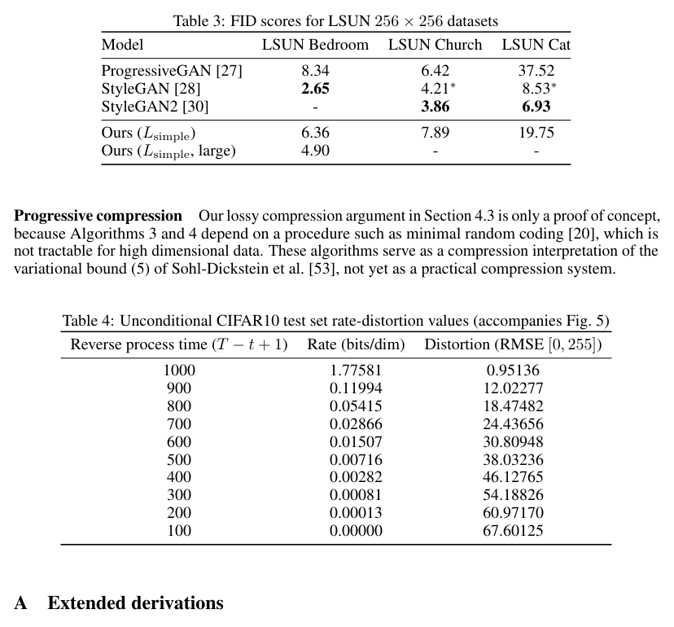

| 模型 | LSUN Bedroom | LSUN Church | LSUN Cat |
|---|---|---|---|
| ProgressiveGAN [27] | 8.34 | 6.42 | 37.52 |
| StyleGAN [28] | 2.65 | 4.21∗ | 8.53∗ |
| StyleGAN2 [30] | - | 3.86 | 6.93 |
| Ours (Lsimple) | 6.36 | 7.89 | 19.75 |
| Ours (Lsimple, large) | 4.90 | - | - |

### Progressive compression（渐进压缩）

**Original:** Our lossy compression argument in Section 4.3 is only a proof of concept, because Algorithms 3 and 4 depend on a procedure such as minimal random coding [20], which is not tractable for high dimensional data. These algorithms serve as a compression interpretation of the variational bound (5) of Sohl-Dickstein et al. [53], not yet as a practical compression system.

**中文:** 第 4.3 节中关于有损压缩的论证只是一个概念验证，因为算法 3 和算法 4 依赖于最小随机编码 [20] 之类的过程，而这对高维数据来说尚不可行。这些算法作为 Sohl-Dickstein 等人 [53] 的变分下界 (5) 的压缩解释，还不是一个实用的压缩系统。

```
Algorithm 3 Sending x0
1: Send xT ~ q(xT|x0) using p(xT)
2: for t = T−1, ..., 2, 1 do
3:   Send xt ~ q(xt|xt+1, x0) using pθ(xt|xt+1)
4: end for
5: Send x0 using pθ(x0|x1)
```

**中文（算法 3，发送 x0）:** 第 1 行用 $p(x_T)$ 发送 $x_T \sim q(x_T|x_0)$；对 $t = T-1, \dots, 2, 1$ 循环：用 $p_\theta(x_t|x_{t+1})$ 发送 $x_t \sim q(x_t|x_{t+1}, x_0)$；最后用 $p_\theta(x_0|x_1)$ 发送 $x_0$。（变量名保留英文，注释已译）

```
Algorithm 4 Receiving
1: Receive xT using p(xT)
2: for t = T−1, ..., 1, 0 do
3:   Receive xt using pθ(xt|xt+1)
4: end for
5: return x0
```

**中文（算法 4，接收）:** 第 1 行用 $p(x_T)$ 接收 $x_T$；对 $t = T-1, \dots, 1, 0$ 循环：用 $p_\theta(x_t|x_{t+1})$ 接收 $x_t$；返回 $x_0$。（变量名保留英文，注释已译）

> **表 4（译）**：无条件 CIFAR10 测试集率失真数值（配合图 5）。（原图见 paper.pdf 第 13 页，[第 13 页图](assets/figures/tab-4.png)）

| 反向过程时间 (T − t + 1) | 码率 (比特/维度) | 失真 (RMSE [0, 255]) |
|---|---|---|
| 1000 | 1.77581 | 0.95136 |
| 900 | 0.11994 | 12.02277 |
| 800 | 0.05415 | 18.47482 |
| 700 | 0.02866 | 24.43656 |
| 600 | 0.01507 | 30.80948 |
| 500 | 0.00716 | 38.03236 |
| 400 | 0.00282 | 46.12765 |
| 300 | 0.00081 | 54.18826 |
| 200 | 0.00013 | 60.97170 |
| 100 | 0.00000 | 67.60125 |

## A Extended derivations

**Original:** Below is a derivation of Eq. (5), the reduced variance variational bound for diffusion models. This material is from Sohl-Dickstein et al. [53]; we include it here only for completeness.

**中文:** 下面是式 (5)——扩散模型的降方差变分下界——的推导。这部分材料来自 Sohl-Dickstein 等人 [53]，此处仅为完整性而收录。

$$L = \mathbb{E}_q\left[-\log \frac{p_\theta(x_{0:T})}{q(x_{1:T}|x_0)}\right] \tag{17}$$

$$= \mathbb{E}_q\left[-\log p(x_T) - \sum_{t\ge 1}\log\frac{p_\theta(x_{t-1}|x_t)}{q(x_t|x_{t-1})}\right] \tag{18}$$

$$= \mathbb{E}_q\left[-\log p(x_T) - \sum_{t>1}\log\frac{p_\theta(x_{t-1}|x_t)}{q(x_t|x_{t-1})} - \log\frac{p_\theta(x_0|x_1)}{q(x_1|x_0)}\right] \tag{19}$$

$$= \mathbb{E}_q\left[-\log p(x_T) - \sum_{t>1}\log\frac{p_\theta(x_{t-1}|x_t)}{q(x_{t-1}|x_t, x_0)}\cdot\frac{q(x_{t-1}|x_0)}{q(x_t|x_0)} - \log\frac{p_\theta(x_0|x_1)}{q(x_1|x_0)}\right] \tag{20}$$

$$= \mathbb{E}_q\left[-\log\frac{p(x_T)}{q(x_T|x_0)} - \sum_{t>1}\log\frac{p_\theta(x_{t-1}|x_t)}{q(x_{t-1}|x_t, x_0)} - \log p_\theta(x_0|x_1)\right] \tag{21}$$

$$= \mathbb{E}_q\left[D_{\mathrm{KL}}(q(x_T|x_0)\,\|\,p(x_T)) + \sum_{t>1}D_{\mathrm{KL}}(q(x_{t-1}|x_t, x_0)\,\|\,p_\theta(x_{t-1}|x_t)) - \log p_\theta(x_0|x_1)\right] \tag{22}$$

**Original:** The following is an alternate version of $L$. It is not tractable to estimate, but it is useful for our discussion in Section 4.3.

**中文:** 下面是 $L$ 的另一个版本。它无法实际估计，但对第 4.3 节的讨论有用。

$$L = \mathbb{E}_q\left[-\log p(x_T) - \sum_{t\ge 1}\log\frac{p_\theta(x_{t-1}|x_t)}{q(x_t|x_{t-1})}\right] \tag{23}$$

$$= \mathbb{E}_q\left[-\log p(x_T) - \sum_{t\ge 1}\log\frac{p_\theta(x_{t-1}|x_t)}{q(x_{t-1}|x_t)}\cdot\frac{q(x_{t-1})}{q(x_t)}\right] \tag{24}$$

$$= \mathbb{E}_q\left[-\log\frac{p(x_T)}{q(x_T)} - \sum_{t\ge 1}\log\frac{p_\theta(x_{t-1}|x_t)}{q(x_{t-1}|x_t)} - \log q(x_0)\right] \tag{25}$$

$$= D_{\mathrm{KL}}(q(x_T)\,\|\,p(x_T)) + \mathbb{E}_q\left[\sum_{t\ge 1}D_{\mathrm{KL}}(q(x_{t-1}|x_t)\,\|\,p_\theta(x_{t-1}|x_t))\right] + H(x_0) \tag{26}$$

## B Experimental details

**Original:** Our neural network architecture follows the backbone of PixelCNN++ [52], which is a U-Net [48] based on a Wide ResNet [72]. We replaced weight normalization [49] with group normalization [66] to make the implementation simpler. Our 32 × 32 models use four feature map resolutions (32 × 32 to 4 × 4), and our 256 × 256 models use six. All models have two convolutional residual blocks per resolution level and self-attention blocks at the 16 × 16 resolution between the convolutional blocks [6]. Diffusion time $t$ is specified by adding the Transformer sinusoidal position embedding [60] into each residual block. Our CIFAR10 model has 35.7 million parameters, and our LSUN and CelebA-HQ models have 114 million parameters. We also trained a larger variant of the LSUN Bedroom model with approximately 256 million parameters by increasing filter count.

**中文:** 我们的神经网络架构沿用 PixelCNN++ [52] 的主干，即基于 Wide ResNet [72] 的 U-Net [48]。我们把权重归一化 [49] 替换为组归一化 [66] 以简化实现。我们的 32 × 32 模型使用四种特征图分辨率（32 × 32 到 4 × 4），256 × 256 模型使用六种。所有模型在每个分辨率层级都有两个卷积残差块，并在 16 × 16 分辨率处、卷积块之间使用自注意力块 [6]。扩散时间 $t$ 通过把 Transformer 正弦位置嵌入 [60] 加进每个残差块来指定。我们的 CIFAR10 模型有 3570 万参数，LSUN 和 CelebA-HQ 模型有 1.14 亿参数。我们还通过增加滤波器数量，训练了一个约 2.56 亿参数的更大的 LSUN Bedroom 模型变体。

**Original:** We used TPU v3-8 (similar to 8 V100 GPUs) for all experiments. Our CIFAR model trains at 21 steps per second at batch size 128 (10.6 hours to train to completion at 800k steps), and sampling a batch of 256 images takes 17 seconds. Our CelebA-HQ/LSUN (256²) models train at 2.2 steps per second at batch size 64, and sampling a batch of 128 images takes 300 seconds. We trained on CelebA-HQ for 0.5M steps, LSUN Bedroom for 2.4M steps, LSUN Cat for 1.8M steps, and LSUN Church for 1.2M steps. The larger LSUN Bedroom model was trained for 1.15M steps.

**中文:** 所有实验都使用 TPU v3-8（约相当于 8 块 V100 GPU）。我们的 CIFAR 模型在批次大小为 128 时以每秒 21 步的速度训练（80 万步训练至收敛需 10.6 小时），采样一批 256 张图像需 17 秒。我们的 CelebA-HQ/LSUN（256²）模型在批次大小为 64 时以每秒 2.2 步的速度训练，采样一批 128 张图像需 300 秒。我们训练 CelebA-HQ 50 万步，LSUN Bedroom 240 万步，LSUN Cat 180 万步，LSUN Church 120 万步。更大的 LSUN Bedroom 模型训练了 115 万步。

**Original:** Apart from an initial choice of hyperparameters early on to make network size fit within memory constraints, we performed the majority of our hyperparameter search to optimize for CIFAR10 sample quality, then transferred the resulting settings over to the other datasets:

**中文:** 除了早期为了让网络规模适应内存限制而做的初始超参数选择之外，我们的大部分超参数搜索都以优化 CIFAR10 样本质量为目标，然后把所得设置迁移到其他数据集：

**Original:** • We chose the $\beta_t$ schedule from a set of constant, linear, and quadratic schedules, all constrained so that $L_T \approx 0$. We set $T = 1000$ without a sweep, and we chose a linear schedule from $\beta_1 = 10^{-4}$ to $\beta_T = 0.02$.

**中文:** • 我们从恒定、线性、二次三类调度中选择 $\beta_t$ 调度，均约束 $L_T \approx 0$。我们未做网格搜索即设 $T = 1000$，并选择了从 $\beta_1 = 10^{-4}$ 到 $\beta_T = 0.02$ 的线性调度。

**Original:** • We set the dropout rate on CIFAR10 to 0.1 by sweeping over the values {0.1, 0.2, 0.3, 0.4}. Without dropout on CIFAR10, we obtained poorer samples reminiscent of the overfitting artifacts in an unregularized PixelCNN++ [52]. We set dropout rate on the other datasets to zero without sweeping.

**中文:** • 通过在 {0.1, 0.2, 0.3, 0.4} 上做网格搜索，我们把 CIFAR10 上的随机失活率设为 0.1。CIFAR10 上不使用随机失活时，我们得到的样本更差，让人联想到未正则化的 PixelCNN++ [52] 中的过拟合伪影。其他数据集上的随机失活率未经搜索直接设为零。

**Original:** • We used random horizontal flips during training for CIFAR10; we tried training both with and without flips, and found flips to improve sample quality slightly. We also used random horizontal flips for all other datasets except LSUN Bedroom.

**中文:** • CIFAR10 训练时我们使用随机水平翻转；我们试过有翻转和无翻转两种训练方式，发现翻转能略微改善样本质量。除 LSUN Bedroom 外，其他所有数据集我们也使用随机水平翻转。

**Original:** • We tried Adam [31] and RMSProp early on in our experimentation process and chose the former. We left the hyperparameters to their standard values. We set the learning rate to $2 \times 10^{-4}$ without any sweeping, and we lowered it to $2 \times 10^{-5}$ for the 256 × 256 images, which seemed unstable to train with the larger learning rate.

**中文:** • 实验早期我们尝试了 Adam [31] 和 RMSProp，最终选择了前者。超参数保持其标准值。学习率未经搜索设为 $2 \times 10^{-4}$；对 256 × 256 图像我们将其降至 $2 \times 10^{-5}$，因为用较大学习率训练似乎不稳定。

**Original:** • We set the batch size to 128 for CIFAR10 and 64 for larger images. We did not sweep over these values.

**中文:** • CIFAR10 批次大小设为 128，更大图像设为 64。这些值未做网格搜索。

**Original:** • We used EMA on model parameters with a decay factor of 0.9999. We did not sweep over this value.

**中文:** • 我们在模型参数上使用衰减因子为 0.9999 的 EMA（指数滑动平均）。该值未做网格搜索。

**Original:** Final experiments were trained once and evaluated throughout training for sample quality. Sample quality scores and log likelihood are reported on the minimum FID value over the course of training. On CIFAR10, we calculated Inception and FID scores on 50000 samples using the original code from the OpenAI [51] and TTUR [21] repositories, respectively. On LSUN, we calculated FID scores on 50000 samples using code from the StyleGAN2 [30] repository. CIFAR10 and CelebA-HQ were loaded as provided by TensorFlow Datasets (https://www.tensorflow.org/datasets), and LSUN was prepared using code from StyleGAN. Dataset splits (or lack thereof) are standard from the papers that introduced their usage in a generative modeling context. All details can be found in the source code release.

**中文:** 最终实验只训练一次，并在整个训练过程中评估样本质量。样本质量分数和对数似然按训练过程中最小的 FID 值报告。在 CIFAR10 上，我们分别使用 OpenAI [51] 与 TTUR [21] 仓库的原始代码在 50000 个样本上计算 Inception 和 FID 分数。在 LSUN 上，我们用 StyleGAN2 [30] 仓库的代码在 50000 个样本上计算 FID 分数。CIFAR10 和 CelebA-HQ 按 TensorFlow Datasets（https://www.tensorflow.org/datasets）提供的形式加载，LSUN 用 StyleGAN 的代码准备。数据集划分（或不做划分）沿用首次在生成建模场景中引入它们的论文的标准做法。所有细节见源代码发布。

## C Discussion on related work

**Original:** Our model architecture, forward process definition, and prior differ from NCSN [55, 56] in subtle but important ways that improve sample quality, and, notably, we directly train our sampler as a latent variable model rather than adding it after training post-hoc. In greater detail:

**中文:** 我们的模型架构、前向过程定义和先验与 NCSN [55, 56] 存在细微但重要的差异，这些差异提升了样本质量；特别值得注意的是，我们把采样器作为隐变量模型直接训练，而不是训练后再事后添加。详细来说：

**Original:** 1. We use a U-Net with self-attention; NCSN uses a RefineNet with dilated convolutions. We condition all layers on $t$ by adding in the Transformer sinusoidal position embedding, rather than only in normalization layers (NCSNv1) or only at the output (v2).

**中文:** 1. 我们使用带自注意力的 U-Net；NCSN 使用带空洞卷积的 RefineNet。我们通过加入 Transformer 正弦位置嵌入使所有层都以 $t$ 为条件，而不是只在归一化层（NCSNv1）或只在输出处（v2）做条件化。

**Original:** 2. Diffusion models scale down the data with each forward process step (by a $\sqrt{1-\beta_t}$ factor) so that variance does not grow when adding noise, thus providing consistently scaled inputs to the neural net reverse process. NCSN omits this scaling factor.

**中文:** 2. 扩散模型在每一步前向过程中把数据缩小（乘以 $\sqrt{1-\beta_t}$ 因子），使加噪后方差不会增长，从而为神经网络反向过程提供尺度一致的输入。NCSN 省略了这一缩放因子。

**Original:** 3. Unlike NCSN, our forward process destroys signal ($D_{\mathrm{KL}}(q(x_T|x_0)\,\|\,\mathcal{N}(0, I)) \approx 0$), ensuring a close match between the prior and aggregate posterior of $x_T$. Also unlike NCSN, our $\beta_t$ are very small, which ensures that the forward process is reversible by a Markov chain with conditional Gaussians. Both of these factors prevent distribution shift when sampling.

**中文:** 3. 与 NCSN 不同，我们的前向过程会破坏信号（$D_{\mathrm{KL}}(q(x_T|x_0)\,\|\,\mathcal{N}(0, I)) \approx 0$），确保先验与 $x_T$ 的聚合后验紧密匹配。同样与 NCSN 不同，我们的 $\beta_t$ 非常小，这保证了前向过程可以被一个条件高斯马尔可夫链反转。这两个因素都避免了采样时的分布偏移。

**Original:** 4. Our Langevin-like sampler has coefficients (learning rate, noise scale, etc.) derived rigorously from $\beta_t$ in the forward process. Thus, our training procedure directly trains our sampler to match the data distribution after $T$ steps: it trains the sampler as a latent variable model using variational inference. In contrast, NCSN's sampler coefficients are set by hand post-hoc, and their training procedure is not guaranteed to directly optimize a quality metric of their sampler.

**中文:** 4. 我们的 Langevin 式采样器的系数（学习率、噪声尺度等）从前向过程的 $\beta_t$ 严格推导而来。因此，我们的训练过程直接训练采样器在 $T$ 步后匹配数据分布：它把采样器当作隐变量模型、用变分推断来训练。相比之下，NCSN 的采样器系数是事后手工设定的，其训练过程并不能保证直接优化采样器的某个质量指标。

## D Samples

### Additional samples（更多样本）

**Original:** Figure 11, 13, 16, 17, 18, and 19 show uncurated samples from the diffusion models trained on CelebA-HQ, CIFAR10 and LSUN datasets.

**中文:** 图 11、13、16、17、18 和 19 展示了在 CelebA-HQ、CIFAR10 和 LSUN 数据集上训练的扩散模型生成的未经筛选的样本。

> **图 11（译）**：CelebA-HQ 256 × 256 生成样本。（原图见 paper.pdf 第 17 页，见下方图）

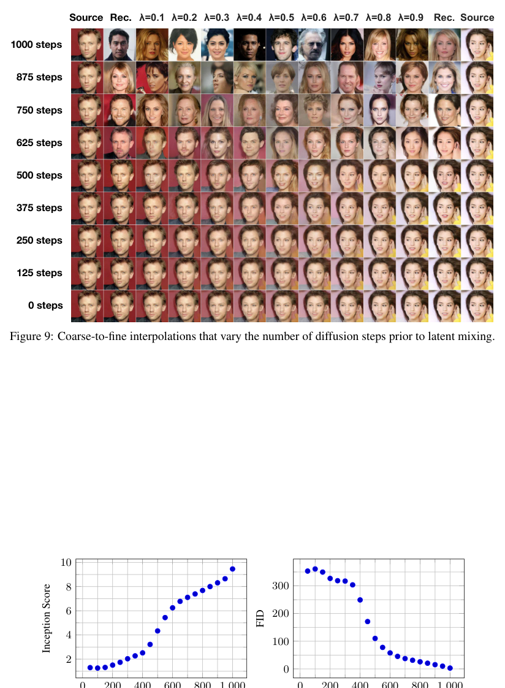

>
> **图 13（译）**：无条件 CIFAR10 生成样本。（原图见 paper.pdf 第 19 页，见下方图）

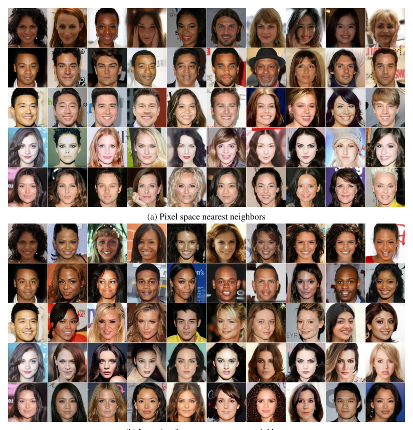

>
> **图 16（译）**：LSUN Church 生成样本。FID=7.89。（原图见 paper.pdf 第 22 页，见下方图）


>
> **图 17（译）**：LSUN Bedroom 生成样本，大模型。FID=4.90。（原图见 paper.pdf 第 23 页，见下方图）

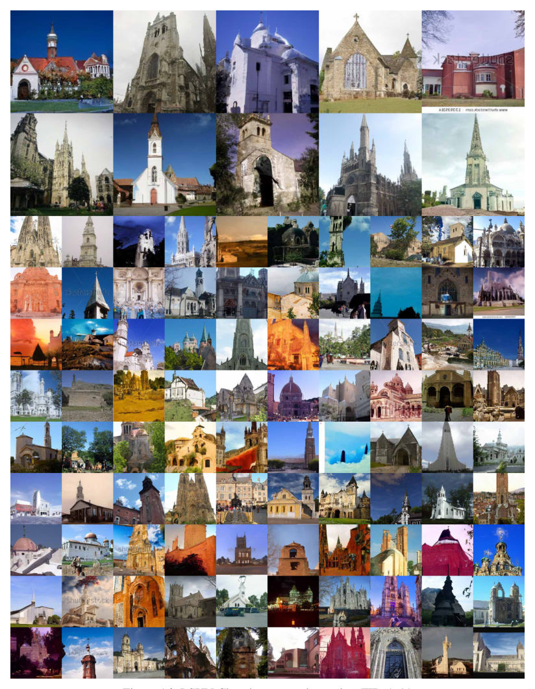

>
> **图 18（译）**：LSUN Bedroom 生成样本，小模型。FID=6.36。（原图见 paper.pdf 第 24 页，见下方图）

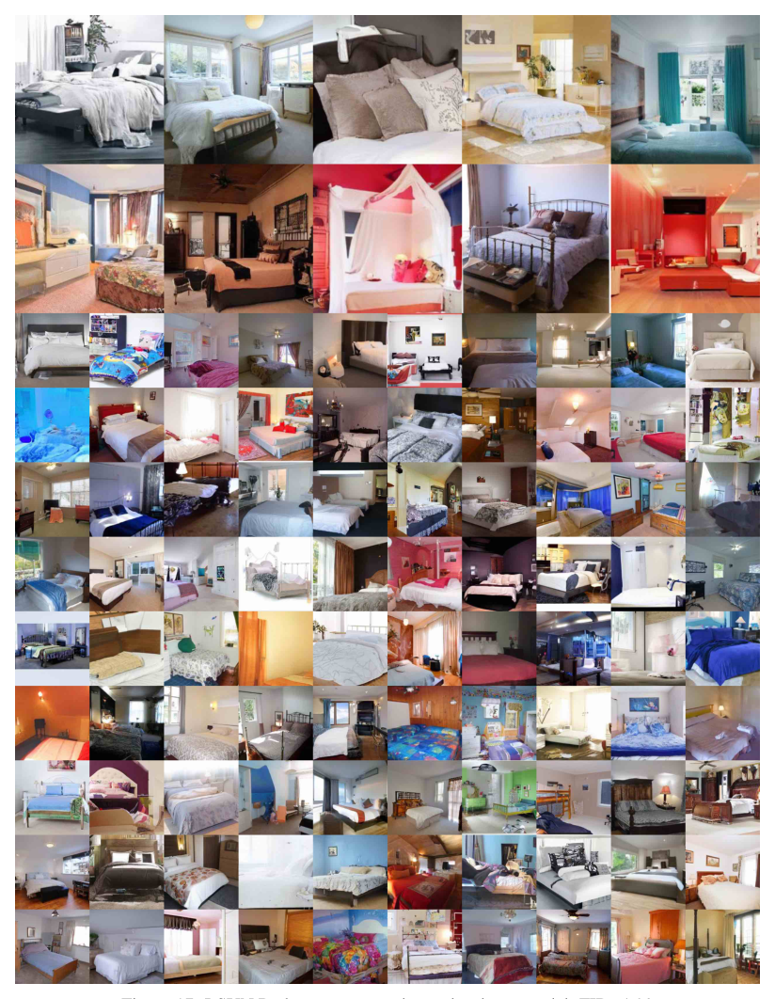

>
> **图 19（译）**：LSUN Cat 生成样本。FID=19.75。（原图见 paper.pdf 第 25 页，见下方图）

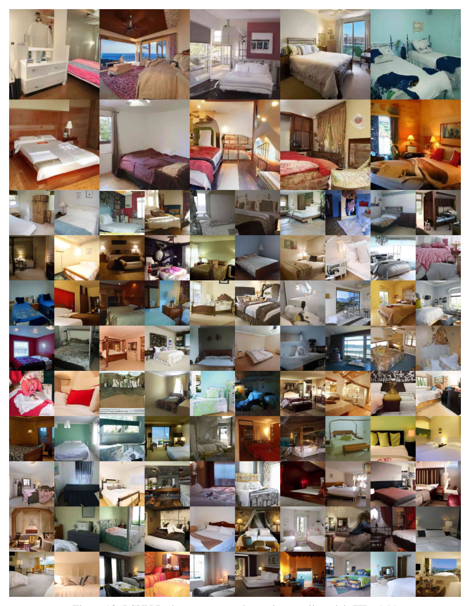

### Latent structure and reverse process stochasticity（隐变量结构与反向过程的随机性）

**Original:** During sampling, both the prior $x_T \sim \mathcal{N}(0, I)$ and Langevin dynamics are stochastic. To understand the significance of the second source of noise, we sampled multiple images conditioned on the same intermediate latent for the CelebA 256 × 256 dataset. Figure 7 shows multiple draws from the reverse process $x_0 \sim p_\theta(x_0|x_t)$ that share the latent $x_t$ for $t \in \{1000, 750, 500, 250\}$. To accomplish this, we run a single reverse chain from an initial draw from the prior. At the intermediate timesteps, the chain is split to sample multiple images. When the chain is split after the prior draw at $x_{T=1000}$, the samples differ significantly. However, when the chain is split after more steps, samples share high-level attributes like gender, hair color, eyewear, saturation, pose and facial expression. This indicates that intermediate latents like $x_{750}$ encode these attributes, despite their imperceptibility.

**中文:** 采样过程中，先验 $x_T \sim \mathcal{N}(0, I)$ 和 Langevin 动力学都是随机的。为了理解第二种噪声来源的意义，我们在 CelebA 256 × 256 数据集上以同一中间隐变量为条件采样多张图像。图 7 展示了反向过程 $x_0 \sim p_\theta(x_0|x_t)$ 的多次采样，它们在 $t \in \{1000, 750, 500, 250\}$ 处共享隐变量 $x_t$。为此，我们从先验的一次初始采样出发运行单条反向链；在中间时间步把链分叉以采样多张图像。当链在先验采样（$x_{T=1000}$）之后立即分叉时，样本差异显著。而当链运行更多步之后再分叉时，样本共享性别、发色、眼镜、饱和度、姿态和面部表情等高层属性。这表明 $x_{750}$ 这样的中间隐变量尽管不可察觉，却编码了这些属性。

### Coarse-to-fine interpolation（从粗到细的插值）

**Original:** Figure 9 shows interpolations between a pair of source CelebA 256 × 256 images as we vary the number of diffusion steps prior to latent space interpolation. Increasing the number of diffusion steps destroys more structure in the source images, which the model completes during the reverse process. This allows us to interpolate at both fine granularities and coarse granularities. In the limiting case of 0 diffusion steps, the interpolation mixes source images in pixel space. On the other hand, after 1000 diffusion steps, source information is lost and interpolations are novel samples.

**中文:** 图 9 展示了一对源 CelebA 256 × 256 图像之间的插值，其中我们改变隐空间插值之前的扩散步数。增加扩散步数会破坏源图像中更多结构，模型在反向过程中将其补全。这让我们既能在细粒度上也能在粗粒度上插值。在 0 个扩散步的极限情况下，插值在像素空间中混合源图像。另一方面，经过 1000 个扩散步后，源信息丢失，插值结果成为全新样本。

> **图 9（译）**：从粗到细的插值，改变隐变量混合之前的扩散步数。图左列标注 Source（源图）、Rec.（重建）、λ=0.1 到 λ=0.9 的插值列、Rec.、Source；从上到下按 1000、875、750、625、500、375、250、125、0 steps 排列。（原图见 paper.pdf 第 16 页，见下方图）

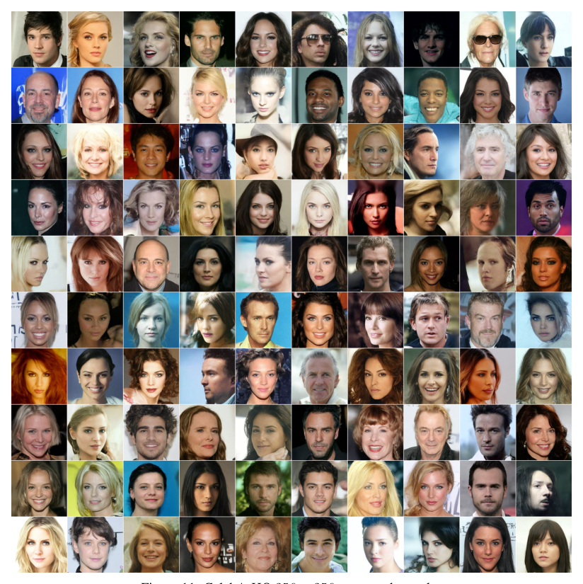

>
> **图 10（译）**：无条件 CIFAR10 渐进采样质量随时间变化。左图为 Inception Score 随反向过程步数（T − t）的变化，右图为 FID 随反向过程步数的变化。（原图见 paper.pdf 第 16 页，[第 16 页图](assets/figures/fig-10.png)）
>
> **图 12（译）**：CelebA-HQ 256 × 256 最近邻，在包围人脸区域的 100 × 100 裁剪上计算。(a) 像素空间最近邻；(b) Inception 特征空间最近邻。生成样本位于最左列，其余列为训练集最近邻。（原图见 paper.pdf 第 18 页，见下方图）


>
> **图 14（译）**：无条件 CIFAR10 渐进式生成。（原图见 paper.pdf 第 20 页，见下方图）

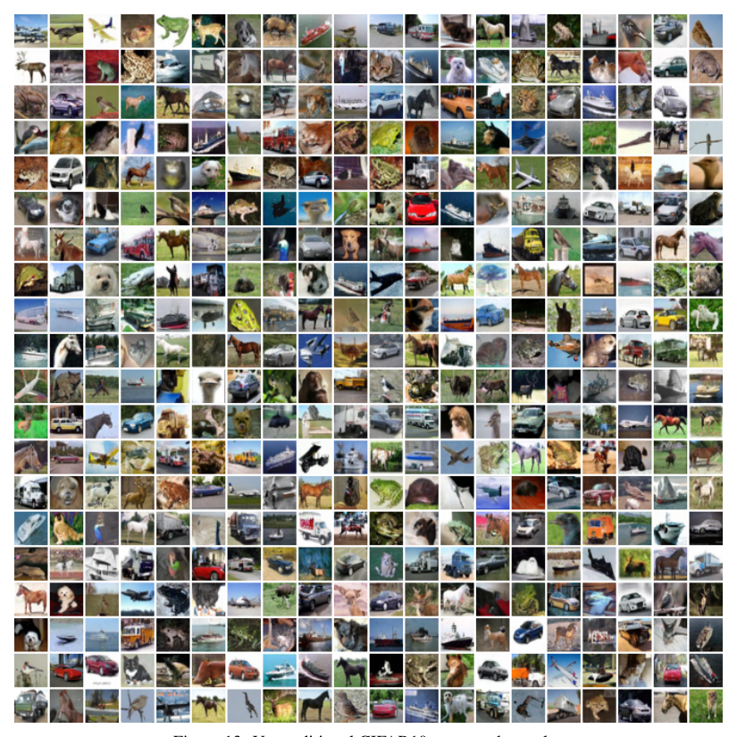

>
> **图 15（译）**：无条件 CIFAR10 最近邻。生成样本位于最左列，其余列为训练集最近邻。(a) 像素空间最近邻；(b) Inception 特征空间最近邻。（原图见 paper.pdf 第 21 页，见下方图）


