# 《An Image is Worth 16x16 Words: Transformers for Image Recognition at Scale》中英对照全文翻译

**论文信息**

- **原标题**：An Image is Worth 16x16 Words: Transformers for Image Recognition at Scale
- **中文译名**：一张图值 16×16 个词：大规模图像识别中的 Transformer
- **作者**：Alexey Dosovitskiy*,†, Lucas Beyer*, Alexander Kolesnikov*, Dirk Weissenborn*, Xiaohua Zhai*, Thomas Unterthiner, Mostafa Dehghani, Matthias Minderer, Georg Heigold, Sylvain Gelly, Jakob Uszkoreit, Neil Houlsby*,†（*equal technical contribution 同等技术贡献，†equal advising 同等指导）
- **机构**：Google Research, Brain Team
- **发表**：ICLR 2021（arXiv:2010.11929v2）
- **原文 PDF**：C:/Users/13054/mclearning/papers/2020-vit/paper.pdf（共 22 页）

---

## Abstract

**Original:**

While the Transformer architecture has become the de-facto standard for natural language processing tasks, its applications to computer vision remain limited. In vision, attention is either applied in conjunction with convolutional networks, or used to replace certain components of convolutional networks while keeping their overall structure in place. We show that this reliance on CNNs is not necessary and a pure transformer applied directly to sequences of image patches can perform very well on image classification tasks. When pre-trained on large amounts of data and transferred to multiple mid-sized or small image recognition benchmarks (ImageNet, CIFAR-100, VTAB, etc.), Vision Transformer (ViT) attains excellent results compared to state-of-the-art convolutional networks while requiring substantially fewer computational resources to train.

**中文:**

虽然 Transformer 架构已经成为自然语言处理任务的事实标准，但它在计算机视觉中的应用仍然有限。在视觉领域，注意力（attention）要么与卷积网络结合使用，要么被用来替换卷积网络的某些组件，同时保留其整体结构不变。我们证明，这种对 CNN 的依赖并非必要：把一个纯 Transformer 直接应用于图像块（patch）序列，就能在图像分类任务上表现得非常好。当在大规模数据上进行预训练，并迁移到多个中型或小型图像识别基准测试（benchmark）（ImageNet、CIFAR-100、VTAB 等）上时，视觉 Transformer（Vision Transformer，ViT）取得了优异的成绩，与当前最优（state-of-the-art，SOTA）的卷积网络相比毫不逊色，且训练所需的计算资源大幅减少。

---

## 1 Introduction

**Original:**

Self-attention-based architectures, in particular Transformers (Vaswani et al., 2017), have become the model of choice in natural language processing (NLP). The dominant approach is to pre-train on a large text corpus and then fine-tune on a smaller task-specific dataset (Devlin et al., 2019). Thanks to Transformers' computational efficiency and scalability, it has become possible to train models of unprecedented size, with over 100B parameters (Brown et al., 2020; Lepikhin et al., 2020). With the models and datasets growing, there is still no sign of saturating performance.

**中文:**

基于自注意力（Self-Attention）的架构，尤其是 Transformer（Vaswani et al., 2017），已经成为自然语言处理（NLP）领域的首选模型。主流做法是先在大规模文本语料上进行预训练，再在较小的任务特定数据集上微调（Devlin et al., 2019）。得益于 Transformer 的计算效率和可扩展性，如今已能训练规模空前的模型——参数量超过 1000 亿（Brown et al., 2020; Lepikhin et al., 2020）。随着模型和数据集不断增长，性能仍未见饱和迹象。

**Original:**

In computer vision, however, convolutional architectures remain dominant (LeCun et al., 1989; Krizhevsky et al., 2012; He et al., 2016). Inspired by NLP successes, multiple works try combining CNN-like architectures with self-attention (Wang et al., 2018; Carion et al., 2020), some replacing the convolutions entirely (Ramachandran et al., 2019; Wang et al., 2020a). The latter models, while theoretically efficient, have not yet been scaled effectively on modern hardware accelerators due to the use of specialized attention patterns. Therefore, in large-scale image recognition, classic ResNet-like architectures are still state of the art (Mahajan et al., 2018; Xie et al., 2020; Kolesnikov et al., 2020).

**中文:**

然而，在计算机视觉领域，卷积架构仍然占据主导地位（LeCun et al., 1989; Krizhevsky et al., 2012; He et al., 2016）。受 NLP 成功的启发，许多工作尝试把类 CNN 的架构与自注意力结合起来（Wang et al., 2018; Carion et al., 2020），有的则完全取代卷积（Ramachandran et al., 2019; Wang et al., 2020a）。后一类模型虽然在理论上高效，但由于使用了专用的注意力模式，尚未能在现代硬件加速器上有效地扩展规模。因此，在大规模图像识别中，经典的类 ResNet 架构仍然是当前最优（Mahajan et al., 2018; Xie et al., 2020; Kolesnikov et al., 2020）。

**Original:**

Inspired by the Transformer scaling successes in NLP, we experiment with applying a standard Transformer directly to images, with the fewest possible modifications. To do so, we split an image into patches and provide the sequence of linear embeddings of these patches as an input to a Transformer. Image patches are treated the same way as tokens (words) in an NLP application. We train the model on image classification in supervised fashion.

**中文:**

受 Transformer 在 NLP 中扩展规模成功的启发，我们尝试以尽可能少的修改，把一个标准 Transformer 直接应用于图像。为此，我们把图像切分成图像块，并将这些图像块的线性嵌入（embedding）序列作为 Transformer 的输入。图像块的处理方式与 NLP 应用中的词元（token，即词）完全相同。我们以监督方式在图像分类任务上训练该模型。

**Original:**

When trained on mid-sized datasets such as ImageNet without strong regularization, these models yield modest accuracies of a few percentage points below ResNets of comparable size. This seemingly discouraging outcome may be expected: Transformers lack some of the inductive biases inherent to CNNs, such as translation equivariance and locality, and therefore do not generalize well when trained on insufficient amounts of data.

**中文:**

当在没有强正则化的情况下、在 ImageNet 这样的中型数据集上训练时，这些模型的准确率平平，比同等规模的 ResNet 低几个百分点。这个看似令人沮丧的结果其实在意料之中：Transformer 缺少 CNN 固有的某些归纳偏置（inductive bias），例如平移等变性（translation equivariance）和局部性（locality），因此在数据量不足时泛化能力不佳。

**Original:**

However, the picture changes if the models are trained on larger datasets (14M-300M images). We find that large scale training trumps inductive bias. Our Vision Transformer (ViT) attains excellent results when pre-trained at sufficient scale and transferred to tasks with fewer datapoints. When pre-trained on the public ImageNet-21k dataset or the in-house JFT-300M dataset, ViT approaches or beats state of the art on multiple image recognition benchmarks. In particular, the best model reaches the accuracy of 88.55% on ImageNet, 90.72% on ImageNet-ReaL, 94.55% on CIFAR-100, and 77.63% on the VTAB suite of 19 tasks.

**中文:**

然而，如果模型在更大的数据集（1400 万至 3 亿张图像）上训练，情况就不同了。我们发现：大规模训练胜过归纳偏置。当预训练规模足够大、并迁移到数据点较少的任务上时，我们的视觉 Transformer（Vision Transformer，ViT）取得了优异的成绩。当在公开的 ImageNet-21k 数据集或内部的 JFT-300M 数据集上预训练后，ViT 在多个图像识别基准测试上接近或超越了当前最优水平。具体而言，最佳模型在 ImageNet 上达到 88.55% 的准确率，在 ImageNet-ReaL 上达到 90.72%，在 CIFAR-100 上达到 94.55%，在 VTAB 的 19 个任务组合上达到 77.63%。

> 脚注 1：Fine-tuning code and pre-trained models are available at https://github.com/google-research/vision_transformer
>
> 译：微调代码与预训练模型已发布于 https://github.com/google-research/vision_transformer

---

## 2 Related Work

**Original:**

Transformers were proposed by Vaswani et al. (2017) for machine translation, and have since become the state of the art method in many NLP tasks. Large Transformer-based models are often pre-trained on large corpora and then fine-tuned for the task at hand: BERT (Devlin et al., 2019) uses a denoising self-supervised pre-training task, while the GPT line of work uses language modeling as its pre-training task (Radford et al., 2018; 2019; Brown et al., 2020).

**中文:**

Transformer 由 Vaswani et al. (2017) 为机器翻译而提出，此后成为众多 NLP 任务中的当前最优方法。大型的基于 Transformer 的模型通常先在大规模语料上预训练，再针对手头任务微调：BERT（Devlin et al., 2019）使用去噪自监督预训练任务，而 GPT 系列工作则以语言建模作为预训练任务（Radford et al., 2018; 2019; Brown et al., 2020）。

**Original:**

Naive application of self-attention to images would require that each pixel attends to every other pixel. With quadratic cost in the number of pixels, this does not scale to realistic input sizes. Thus, to apply Transformers in the context of image processing, several approximations have been tried in the past. Parmar et al. (2018) applied the self-attention only in local neighborhoods for each query pixel instead of globally. Such local multi-head dot-product self attention blocks can completely replace convolutions (Hu et al., 2019; Ramachandran et al., 2019; Zhao et al., 2020). In a different line of work, Sparse Transformers (Child et al., 2019) employ scalable approximations to global self-attention in order to be applicable to images. An alternative way to scale attention is to apply it in blocks of varying sizes (Weissenborn et al., 2019), in the extreme case only along individual axes (Ho et al., 2019; Wang et al., 2020a). Many of these specialized attention architectures demonstrate promising results on computer vision tasks, but require complex engineering to be implemented efficiently on hardware accelerators.

**中文:**

把自注意力朴素地应用到图像上，会要求每个像素都关注所有其他像素。由于代价随像素数呈平方增长，这无法扩展到现实规模的输入。因此，为了在图像处理场景中使用 Transformer，过去人们尝试了多种近似方案。Parmar et al. (2018) 只为每个查询（query）像素在局部邻域内应用自注意力，而不是全局应用。这种局部多头点积自注意力块可以完全取代卷积（Hu et al., 2019; Ramachandran et al., 2019; Zhao et al., 2020）。在另一条工作路线上，Sparse Transformers（Child et al., 2019）采用可扩展的全局自注意力近似，使其适用于图像。另一种扩展注意力的方式是在不同大小的块上应用注意力（Weissenborn et al., 2019），极端情况下只沿单个轴应用（Ho et al., 2019; Wang et al., 2020a）。这些专用注意力架构中，许多在计算机视觉任务上表现出喜人的结果，但要在硬件加速器上高效实现则需要复杂的工程。

**Original:**

Most related to ours is the model of Cordonnier et al. (2020), which extracts patches of size 2 × 2 from the input image and applies full self-attention on top. This model is very similar to ViT, but our work goes further to demonstrate that large scale pre-training makes vanilla transformers competitive with (or even better than) state-of-the-art CNNs. Moreover, Cordonnier et al. (2020) use a small patch size of 2 × 2 pixels, which makes the model applicable only to small-resolution images, while we handle medium-resolution images as well.

**中文:**

与我们的工作最接近的是 Cordonnier et al. (2020) 的模型，它从输入图像中提取 2 × 2 大小的图像块，并在其上应用完整自注意力。该模型与 ViT 非常相似，但我们的工作更进一步，证明了大规模预训练能让普通 Transformer 与当前最优 CNN 相抗衡（甚至更好）。此外，Cordonnier et al. (2020) 使用 2 × 2 像素的小图像块，使模型只适用于低分辨率图像，而我们也能处理中等分辨率的图像。

**Original:**

There has also been a lot of interest in combining convolutional neural networks (CNNs) with forms of self-attention, e.g. by augmenting feature maps for image classification (Bello et al., 2019) or by further processing the output of a CNN using self-attention, e.g. for object detection (Hu et al., 2018; Carion et al., 2020), video processing (Wang et al., 2018; Sun et al., 2019), image classification (Wu et al., 2020), unsupervised object discovery (Locatello et al., 2020), or unified text-vision tasks (Chen et al., 2020c; Lu et al., 2019; Li et al., 2019).

**中文:**

此外，把卷积神经网络（CNN）与各种形式的自注意力结合起来也引起了广泛关注，例如通过增强特征图（feature map）来做图像分类（Bello et al., 2019），或使用自注意力进一步处理 CNN 的输出，例如用于目标检测（Hu et al., 2018; Carion et al., 2020）、视频处理（Wang et al., 2018; Sun et al., 2019）、图像分类（Wu et al., 2020）、无监督目标发现（Locatello et al., 2020），或统一的文本-视觉任务（Chen et al., 2020c; Lu et al., 2019; Li et al., 2019）。

**Original:**

Another recent related model is image GPT (iGPT) (Chen et al., 2020a), which applies Transformers to image pixels after reducing image resolution and color space. The model is trained in an unsupervised fashion as a generative model, and the resulting representation can then be fine-tuned or probed linearly for classification performance, achieving a maximal accuracy of 72% on ImageNet.

**中文:**

另一个近期相关模型是 image GPT（iGPT）（Chen et al., 2020a），它在降低图像分辨率和缩减颜色空间之后，把 Transformer 应用于图像像素。该模型以无监督方式作为生成模型训练，得到的表示随后可被微调或线性探测用于分类，在 ImageNet 上最高达到 72% 的准确率。

**Original:**

Our work adds to the increasing collection of papers that explore image recognition at larger scales than the standard ImageNet dataset. The use of additional data sources allows to achieve state-of-the-art results on standard benchmarks (Mahajan et al., 2018; Touvron et al., 2019; Xie et al., 2020). Moreover, Sun et al. (2017) study how CNN performance scales with dataset size, and Kolesnikov et al. (2020); Djolonga et al. (2020) perform an empirical exploration of CNN transfer learning from large scale datasets such as ImageNet-21k and JFT-300M. We focus on these two latter datasets as well, but train Transformers instead of ResNet-based models used in prior works.

**中文:**

我们的工作加入了日益增多的、在比标准 ImageNet 更大的规模上探索图像识别的论文行列。使用额外的数据源可以在标准基准测试上取得当前最优结果（Mahajan et al., 2018; Touvron et al., 2019; Xie et al., 2020）。此外，Sun et al. (2017) 研究了 CNN 性能随数据集规模的扩展规律，Kolesnikov et al. (2020); Djolonga et al. (2020) 对从 ImageNet-21k 和 JFT-300M 等大规模数据集出发的 CNN 迁移学习进行了实证探索。我们也聚焦于后两个数据集，但训练的是 Transformer，而非先前工作使用的基于 ResNet 的模型。

---

## 3 Method

**Original:**

In model design we follow the original Transformer (Vaswani et al., 2017) as closely as possible. An advantage of this intentionally simple setup is that scalable NLP Transformer architectures – and their efficient implementations – can be used almost out of the box.

**中文:**

在模型设计上，我们尽可能严格地遵循原始 Transformer（Vaswani et al., 2017）。这种刻意保持简单的设计有一个优点：可扩展的 NLP Transformer 架构——及其高效实现——几乎可以开箱即用。

### 3.1 Vision Transformer (ViT)

**Original:**

An overview of the model is depicted in Figure 1. The standard Transformer receives as input a 1D sequence of token embeddings. To handle 2D images, we reshape the image $x \in \mathbb{R}^{H \times W \times C}$ into a sequence of flattened 2D patches $x_p \in \mathbb{R}^{N \times (P^2 \cdot C)}$, where $(H, W)$ is the resolution of the original image, $C$ is the number of channels, $(P, P)$ is the resolution of each image patch, and $N = HW/P^2$ is the resulting number of patches, which also serves as the effective input sequence length for the Transformer. The Transformer uses constant latent vector size $D$ through all of its layers, so we flatten the patches and map to $D$ dimensions with a trainable linear projection (Eq. 1). We refer to the output of this projection as the patch embeddings.

**中文:**

模型概览如图 1 所示。标准 Transformer 接收一维的词元嵌入序列作为输入。为了处理 2D 图像，我们把图像 $x \in \mathbb{R}^{H \times W \times C}$ 重塑为展平后的 2D 图像块序列 $x_p \in \mathbb{R}^{N \times (P^2 \cdot C)}$，其中 $(H, W)$ 是原始图像的分辨率，$C$ 是通道数，$(P, P)$ 是每个图像块的分辨率，$N = HW/P^2$ 是最终得到的图像块数量，同时也作为 Transformer 的有效输入序列长度。Transformer 在其所有层中使用恒定的隐向量维度 $D$，因此我们把图像块展平，并用可训练的线性投影映射到 $D$ 维（式 1）。我们把该投影的输出称为图像块嵌入（patch embedding）。

> **图 1（译）**：模型概览。我们把图像切分成固定大小的图像块，对每个块做线性嵌入，加上位置嵌入，再把得到的向量序列送入标准 Transformer 编码器。为了进行分类，我们采用标准做法：在序列中加入一个额外的可学习「分类词元」。（原图见 paper.pdf 第 3 页，见下方图）

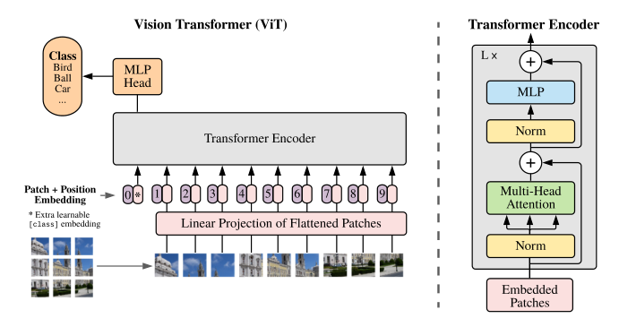

**Original:**

Similar to BERT's [class] token, we prepend a learnable embedding to the sequence of embedded patches ($z_0^0 = x_{class}$), whose state at the output of the Transformer encoder ($z_L^0$) serves as the image representation $y$ (Eq. 4). Both during pre-training and fine-tuning, a classification head is attached to $z_L^0$. The classification head is implemented by a MLP with one hidden layer at pre-training time and by a single linear layer at fine-tuning time.

**中文:**

与 BERT 的 [class] 词元类似，我们在嵌入后的图像块序列前添加一个可学习的嵌入（$z_0^0 = x_{class}$），它在 Transformer 编码器输出端的状态（$z_L^0$）就作为图像表示 $y$（式 4）。无论在预训练还是微调阶段，都在 $z_L^0$ 上接一个分类头。分类头在预训练时由一个含一个隐藏层的 MLP（多层感知机）实现，在微调时则由一个线性层实现。

**Original:**

Position embeddings are added to the patch embeddings to retain positional information. We use standard learnable 1D position embeddings, since we have not observed significant performance gains from using more advanced 2D-aware position embeddings (Appendix D.4). The resulting sequence of embedding vectors serves as input to the encoder.

**中文:**

位置嵌入被加到图像块嵌入上，以保留位置信息。我们使用标准的可学习 1D 位置嵌入，因为我们没有观察到使用更高级的 2D 感知位置嵌入能带来显著的性能提升（附录 D.4）。最终得到的嵌入向量序列作为编码器的输入。

**Original:**

The Transformer encoder (Vaswani et al., 2017) consists of alternating layers of multiheaded self-attention (MSA, see Appendix A) and MLP blocks (Eq. 2, 3). Layernorm (LN) is applied before every block, and residual connections after every block (Wang et al., 2019; Baevski & Auli, 2019).

**中文:**

Transformer 编码器（Vaswani et al., 2017）由交替的多头自注意力（MSA，见附录 A）层和 MLP 块组成（式 2、3）。在每个块之前应用层归一化（Layernorm，LN），在每个块之后应用残差连接（Wang et al., 2019; Baevski & Auli, 2019）。

**Original:**

The MLP contains two layers with a GELU non-linearity.

**中文:**

MLP 包含两层，中间使用 GELU 非线性激活。

$$
\begin{aligned}
z_0 &= [x_{class};\, x_p^1 E;\, x_p^2 E;\, \cdots;\, x_p^N E] + E_{pos}, & E &\in \mathbb{R}^{(P^2 \cdot C) \times D},\; E_{pos} \in \mathbb{R}^{(N+1) \times D} & (1) \\
z'_{\ell} &= \mathrm{MSA}(\mathrm{LN}(z_{\ell-1})) + z_{\ell-1}, & \ell &= 1 \dots L & (2) \\
z_{\ell} &= \mathrm{MLP}(\mathrm{LN}(z'_{\ell})) + z'_{\ell}, & \ell &= 1 \dots L & (3) \\
y &= \mathrm{LN}(z_L^0) & & & (4)
\end{aligned}
$$

**Inductive bias.**

**Original:**

We note that Vision Transformer has much less image-specific inductive bias than CNNs. In CNNs, locality, two-dimensional neighborhood structure, and translation equivariance are baked into each layer throughout the whole model. In ViT, only MLP layers are local and translationally equivariant, while the self-attention layers are global. The two-dimensional neighborhood structure is used very sparingly: in the beginning of the model by cutting the image into patches and at fine-tuning time for adjusting the position embeddings for images of different resolution (as described below). Other than that, the position embeddings at initialization time carry no information about the 2D positions of the patches and all spatial relations between the patches have to be learned from scratch.

**中文:**

**归纳偏置。** 我们注意到，视觉 Transformer 与 CNN 相比，图像特有的归纳偏置要少得多。在 CNN 中，局部性、二维邻域结构和平移等变性被固化在贯穿整个模型的每一层中。在 ViT 中，只有 MLP 层是局部的、平移等变的，而自注意力层是全局的。二维邻域结构的使用非常克制：仅在模型开头通过把图像切成图像块时使用，以及在微调阶段为不同分辨率的图像调整位置嵌入时使用（如下文所述）。除此之外，位置嵌入在初始化时并不携带任何关于图像块二维位置的信息，图像块之间的所有空间关系都必须从头学习。

**Hybrid Architecture.**

**Original:**

As an alternative to raw image patches, the input sequence can be formed from feature maps of a CNN (LeCun et al., 1989). In this hybrid model, the patch embedding projection E (Eq. 1) is applied to patches extracted from a CNN feature map. As a special case, the patches can have spatial size 1x1, which means that the input sequence is obtained by simply flattening the spatial dimensions of the feature map and projecting to the Transformer dimension. The classification input embedding and position embeddings are added as described above.

**中文:**

**混合架构。** 作为原始图像块的替代方案，输入序列可以由 CNN 的特征图构成（LeCun et al., 1989）。在这种混合模型中，图像块嵌入投影 E（式 1）被应用于从 CNN 特征图中提取的图像块。作为一种特殊情况，图像块的空间尺寸可以是 1x1，这意味着输入序列只需把特征图的空间维度展平并投影到 Transformer 维度即可得到。分类输入嵌入与位置嵌入按上文所述方式加入。

### 3.2 Fine-tuning and Higher Resolution

**Original:**

Typically, we pre-train ViT on large datasets, and fine-tune to (smaller) downstream tasks. For this, we remove the pre-trained prediction head and attach a zero-initialized $D \times K$ feedforward layer, where $K$ is the number of downstream classes. It is often beneficial to fine-tune at higher resolution than pre-training (Touvron et al., 2019; Kolesnikov et al., 2020). When feeding images of higher resolution, we keep the patch size the same, which results in a larger effective sequence length. The Vision Transformer can handle arbitrary sequence lengths (up to memory constraints), however, the pre-trained position embeddings may no longer be meaningful. We therefore perform 2D interpolation of the pre-trained position embeddings, according to their location in the original image. Note that this resolution adjustment and patch extraction are the only points at which an inductive bias about the 2D structure of the images is manually injected into the Vision Transformer.

**中文:**

通常，我们在大数据集上预训练 ViT，再微调用于（规模较小的）下游任务。为此，我们移除预训练的预测头，接上一个零初始化的 $D \times K$ 前馈层，其中 $K$ 是下游任务的类别数。以高于预训练的分辨率进行微调通常是有益的（Touvron et al., 2019; Kolesnikov et al., 2020）。当输入更高分辨率的图像时，我们保持图像块大小不变，这会使有效序列长度变长。视觉 Transformer 可以处理任意序列长度（受限于内存），但预训练的位置嵌入可能不再有意义。因此，我们根据预训练位置嵌入在原始图像中的位置，对其进行 2D 插值。请注意，这一分辨率调整与图像块提取，是仅有的两处向视觉 Transformer 手动注入关于图像 2D 结构归纳偏置的地方。

---

## 4 Experiments

**Original:**

We evaluate the representation learning capabilities of ResNet, Vision Transformer (ViT), and the hybrid. To understand the data requirements of each model, we pre-train on datasets of varying size and evaluate many benchmark tasks. When considering the computational cost of pre-training the model, ViT performs very favourably, attaining state of the art on most recognition benchmarks at a lower pre-training cost. Lastly, we perform a small experiment using self-supervision, and show that self-supervised ViT holds promise for the future.

**中文:**

我们评估 ResNet、视觉 Transformer（ViT）和混合模型的表示学习能力。为了理解各模型对数据的需求，我们在不同规模的数据集上预训练，并在多个基准任务上评估。从预训练的计算成本来看，ViT 表现非常出色：以更低的预训练成本在大多数识别基准上达到了当前最优。最后，我们用自监督做了一项小实验，表明自监督 ViT 未来可期。

### 4.1 Setup

**Datasets.**

**Original:**

To explore model scalability, we use the ILSVRC-2012 ImageNet dataset with 1k classes and 1.3M images (we refer to it as ImageNet in what follows), its superset ImageNet-21k with 21k classes and 14M images (Deng et al., 2009), and JFT (Sun et al., 2017) with 18k classes and 303M high-resolution images. We de-duplicate the pre-training datasets w.r.t. the test sets of the downstream tasks following Kolesnikov et al. (2020). We transfer the models trained on these dataset to several benchmark tasks: ImageNet on the original validation labels and the cleaned-up ReaL labels (Beyer et al., 2020), CIFAR-10/100 (Krizhevsky, 2009), Oxford-IIIT Pets (Parkhi et al., 2012), and Oxford Flowers-102 (Nilsback & Zisserman, 2008). For these datasets, pre-processing follows Kolesnikov et al. (2020).

**中文:**

**数据集。** 为了探索模型的可扩展性，我们使用包含 1000 个类别、130 万张图像的 ILSVRC-2012 ImageNet 数据集（下文简称 ImageNet），它的超集 ImageNet-21k（21000 个类别、1400 万张图像）（Deng et al., 2009），以及 JFT（18000 个类别、3.03 亿张高分辨率图像）（Sun et al., 2017）。我们按照 Kolesnikov et al. (2020) 的做法，对预训练数据集相对于下游任务测试集做了去重。我们把在这些数据集上训练的模型迁移到多个基准任务上：使用原始验证标签和清洗后的 ReaL 标签的 ImageNet（Beyer et al., 2020）、CIFAR-10/100（Krizhevsky, 2009）、Oxford-IIIT Pets（Parkhi et al., 2012）和 Oxford Flowers-102（Nilsback & Zisserman, 2008）。这些数据集的预处理遵循 Kolesnikov et al. (2020)。

**Original:**

We also evaluate on the 19-task VTAB classification suite (Zhai et al., 2019b). VTAB evaluates low-data transfer to diverse tasks, using 1 000 training examples per task. The tasks are divided into three groups: Natural – tasks like the above, Pets, CIFAR, etc. Specialized – medical and satellite imagery, and Structured – tasks that require geometric understanding like localization.

**中文:**

我们还在包含 19 个任务的 VTAB 分类套件上进行了评估（Zhai et al., 2019b）。VTAB 评估模型向多样化任务的低数据量迁移能力，每个任务只使用 1000 个训练样本。任务分为三组：Natural（自然）——如上所述的 Pets、CIFAR 等任务；Specialized（专用）——医学影像和卫星影像；Structured（结构化）——需要几何理解的定位类任务。

**Model Variants.**

**Original:**

We base ViT configurations on those used for BERT (Devlin et al., 2019), as summarized in Table 1. The "Base" and "Large" models are directly adopted from BERT and we add the larger "Huge" model. In what follows we use brief notation to indicate the model size and the input patch size: for instance, ViT-L/16 means the "Large" variant with 16×16 input patch size. Note that the Transformer's sequence length is inversely proportional to the square of the patch size, thus models with smaller patch size are computationally more expensive.

**中文:**

**模型变体。** 我们以 BERT 的配置为基础构建 ViT 配置（Devlin et al., 2019），如表 1 所示。「Base」和「Large」模型直接沿用 BERT，此外我们加入了更大的「Huge」模型。下文我们用简写表示模型规模和输入图像块大小：例如 ViT-L/16 表示使用 16×16 输入图像块的「Large」变体。注意，Transformer 的序列长度与图像块大小的平方成反比，因此图像块更小的模型计算开销更大。

> **表 1（译）**：视觉 Transformer 模型变体的详细信息。（原图见 paper.pdf 第 5 页，见下方图）

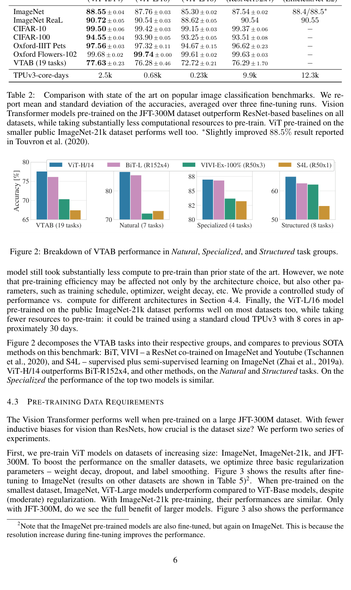

| 模型（Model） | 层数（Layers） | 隐藏维度 D（Hidden size D） | MLP 尺寸（MLP size） | 头数（Heads） | 参数量（Params） |
|---|---|---|---|---|---|
| ViT-Base | 12 | 768 | 3072 | 12 | 86M |
| ViT-Large | 24 | 1024 | 4096 | 16 | 307M |
| ViT-Huge | 32 | 1280 | 5120 | 16 | 632M |

**Original:**

For the baseline CNNs, we use ResNet (He et al., 2016), but replace the Batch Normalization layers (Ioffe & Szegedy, 2015) with Group Normalization (Wu & He, 2018), and used standardized convolutions (Qiao et al., 2019). These modifications improve transfer (Kolesnikov et al., 2020), and we denote the modified model "ResNet (BiT)". For the hybrids, we feed the intermediate feature maps into ViT with patch size of one "pixel". To experiment with different sequence lengths, we either (i) take the output of stage 4 of a regular ResNet50 or (ii) remove stage 4, place the same number of layers in stage 3 (keeping the total number of layers), and take the output of this extended stage 3. Option (ii) results in a 4x longer sequence length, and a more expensive ViT model.

**中文:**

对于基线 CNN，我们使用 ResNet（He et al., 2016），但把批归一化（Batch Normalization）层（Ioffe & Szegedy, 2015）替换为组归一化（Group Normalization）（Wu & He, 2018），并使用标准化卷积（Qiao et al., 2019）。这些修改改善了迁移性能（Kolesnikov et al., 2020），我们把修改后的模型记为「ResNet (BiT)」。对于混合模型，我们把中间特征图以「像素」大小为 1 的图像块送入 ViT。为了实验不同的序列长度，我们有两种做法：(i) 取常规 ResNet50 第 4 阶段的输出；或 (ii) 去掉第 4 阶段，把相同数量的层放入第 3 阶段（保持总层数不变），取这个延长后第 3 阶段的输出。做法 (ii) 得到的序列长度是 4 倍，ViT 模型也更昂贵。

**Training & Fine-tuning.**

**Original:**

We train all models, including ResNets, using Adam (Kingma & Ba, 2015) with β1 = 0.9, β2 = 0.999, a batch size of 4096 and apply a high weight decay of 0.1, which we found to be useful for transfer of all models (Appendix D.1 shows that, in contrast to common practices, Adam works slightly better than SGD for ResNets in our setting). We use a linear learning rate warmup and decay, see Appendix B.1 for details. For fine-tuning we use SGD with momentum, batch size 512, for all models, see Appendix B.1.1. For ImageNet results in Table 2, we fine-tuned at higher resolution: 512 for ViT-L/16 and 518 for ViT-H/14, and also used Polyak & Juditsky (1992) averaging with a factor of 0.9999 (Ramachandran et al., 2019; Wang et al., 2020b).

**中文:**

**训练与微调。** 我们训练所有模型（包括 ResNet）都使用 Adam（Kingma & Ba, 2015），参数为 β1 = 0.9、β2 = 0.999，批次大小（batch size）4096，并施加 0.1 的高权重衰减（weight decay），我们发现这对所有模型的迁移都有益（附录 D.1 表明，与常规做法相反，在我们的设置中 Adam 对 ResNet 的效果略优于 SGD）。我们采用线性学习率预热（warmup）和衰减，详见附录 B.1。微调时，所有模型都使用带动量的 SGD、批次大小 512，详见附录 B.1.1。对于表 2 中的 ImageNet 结果，我们在更高分辨率下微调：ViT-L/16 用 512，ViT-H/14 用 518，并使用了系数 0.9999 的 Polyak & Juditsky (1992) 平均（Ramachandran et al., 2019; Wang et al., 2020b）。

**Metrics.**

**Original:**

We report results on downstream datasets either through few-shot or fine-tuning accuracy. Fine-tuning accuracies capture the performance of each model after fine-tuning it on the respective dataset. Few-shot accuracies are obtained by solving a regularized least-squares regression problem that maps the (frozen) representation of a subset of training images to {−1, 1}^K target vectors. This formulation allows us to recover the exact solution in closed form. Though we mainly focus on fine-tuning performance, we sometimes use linear few-shot accuracies for fast on-the-fly evaluation where fine-tuning would be too costly.

**中文:**

**评估指标。** 我们通过少样本（few-shot）准确率或微调准确率报告下游数据集上的结果。微调准确率反映各模型在相应数据集上微调后的性能。少样本准确率通过求解一个正则化最小二乘回归问题获得：把训练图像子集的（冻结的）表示映射到 {−1, 1}^K 目标向量。该形式允许我们以闭式解精确求解。虽然我们主要关注微调性能，但有时也会用线性少样本准确率做快速的即时评估，以应对微调成本过高的情况。

### 4.2 Comparison to State of the Art

**Original:**

We first compare our largest models – ViT-H/14 and ViT-L/16 – to state-of-the-art CNNs from the literature. The first comparison point is Big Transfer (BiT) (Kolesnikov et al., 2020), which performs supervised transfer learning with large ResNets. The second is Noisy Student (Xie et al., 2020), which is a large EfficientNet trained using semi-supervised learning on ImageNet and JFT-300M with the labels removed. Currently, Noisy Student is the state of the art on ImageNet and BiT-L on the other datasets reported here. All models were trained on TPUv3 hardware, and we report the number of TPUv3-core-days taken to pre-train each of them, that is, the number of TPU v3 cores (2 per chip) used for training multiplied by the training time in days.

**中文:**

我们首先把最大的两个模型——ViT-H/14 和 ViT-L/16——与文献中的当前最优 CNN 对比。第一个对比对象是 Big Transfer（BiT）（Kolesnikov et al., 2020），它使用大型 ResNet 做监督迁移学习。第二个是 Noisy Student（Xie et al., 2020），它是在去掉标签的 ImageNet 和 JFT-300M 上、用半监督学习训练的大型 EfficientNet。目前，Noisy Student 在 ImageNet 上是当前最优，BiT-L 在本文报告的其他数据集上是当前最优。所有模型都在 TPUv3 硬件上训练，我们报告每个模型预训练所用的 TPUv3-core-days 数量，即用于训练的 TPU v3 核心数（每芯片 2 个核心）乘以训练天数。

**Original:**

Table 2 shows the results. The smaller ViT-L/16 model pre-trained on JFT-300M outperforms BiT-L (which is pre-trained on the same dataset) on all tasks, while requiring substantially less computational resources to train. The larger model, ViT-H/14, further improves the performance, especially on the more challenging datasets – ImageNet, CIFAR-100, and the VTAB suite. Interestingly, this model still took substantially less compute to pre-train than prior state of the art. However, we note that pre-training efficiency may be affected not only by the architecture choice, but also other parameters, such as training schedule, optimizer, weight decay, etc. We provide a controlled study of performance vs. compute for different architectures in Section 4.4. Finally, the ViT-L/16 model pre-trained on the public ImageNet-21k dataset performs well on most datasets too, while taking fewer resources to pre-train: it could be trained using a standard cloud TPUv3 with 8 cores in approximately 30 days.

**中文:**

表 2 展示了结果。较小的 ViT-L/16 模型在 JFT-300M 上预训练后，在所有任务上都优于 BiT-L（在同一数据集上预训练），而训练所需的计算资源却大幅减少。更大的 ViT-H/14 模型进一步提升了性能，尤其是在更具挑战性的数据集上——ImageNet、CIFAR-100 和 VTAB 套件。有趣的是，这个模型预训练所用的算力仍远少于先前的当前最优模型。不过我们指出，预训练效率不仅受架构选择影响，还受其他参数影响，例如训练计划、优化器、权重衰减等。我们在 4.4 节对不同架构的性能与算力关系做了受控研究。最后，在公开的 ImageNet-21k 数据集上预训练的 ViT-L/16 模型在大多数数据集上也表现良好，且预训练资源更少：用标准的 8 核心云 TPUv3 大约 30 天即可训练完成。

> **表 2（译）**：在常用图像分类基准上与当前最优方法的比较。我们报告三次微调运行的平均准确率及其标准差。在 JFT-300M 数据集上预训练的视觉 Transformer 模型在所有数据集上都优于基于 ResNet 的基线，且预训练所需的计算资源大幅减少。在较小的公开 ImageNet-21k 数据集上预训练的 ViT 同样表现良好。∗ Touvron et al. (2020) 报告的略有提升的 88.5% 结果。（原图见 paper.pdf 第 6 页，见下方图）

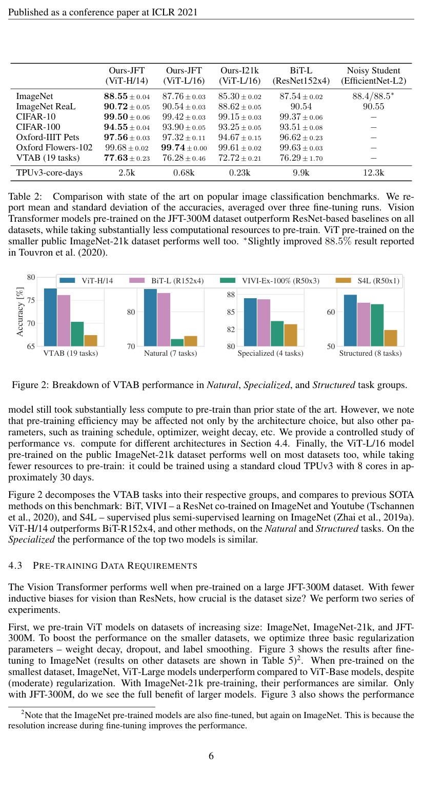

| 基准（Benchmark） | Ours-JFT (ViT-H/14) | Ours-JFT (ViT-L/16) | Ours-I21k (ViT-L/16) | BiT-L (ResNet152x4) | Noisy Student (EfficientNet-L2) |
|---|---|---|---|---|---|
| ImageNet | 88.55 ± 0.04 | 87.76 ± 0.03 | 85.30 ± 0.02 | 87.54 ± 0.02 | 88.4/88.5∗ |
| ImageNet ReaL | 90.72 ± 0.05 | 90.54 ± 0.03 | 88.62 ± 0.05 | 90.54 | 90.55 |
| CIFAR-10 | 99.50 ± 0.06 | 99.42 ± 0.03 | 99.15 ± 0.03 | 99.37 ± 0.06 | − |
| CIFAR-100 | 94.55 ± 0.04 | 93.90 ± 0.05 | 93.25 ± 0.05 | 93.51 ± 0.08 | − |
| Oxford-IIIT Pets | 97.56 ± 0.03 | 97.32 ± 0.11 | 94.67 ± 0.15 | 96.62 ± 0.23 | − |
| Oxford Flowers-102 | 99.68 ± 0.02 | 99.74 ± 0.00 | 99.61 ± 0.02 | 99.63 ± 0.03 | − |
| VTAB（19 个任务） | 77.63 ± 0.23 | 76.28 ± 0.46 | 72.72 ± 0.21 | 76.29 ± 1.70 | − |
| TPUv3-core-days | 2.5k | 0.68k | 0.23k | 9.9k | 12.3k |

**Original:**

Figure 2 decomposes the VTAB tasks into their respective groups, and compares to previous SOTA methods on this benchmark: BiT, VIVI – a ResNet co-trained on ImageNet and Youtube (Tschannen et al., 2020), and S4L – supervised plus semi-supervised learning on ImageNet (Zhai et al., 2019a). ViT-H/14 outperforms BiT-R152x4, and other methods, on the Natural and Structured tasks. On the Specialized the performance of the top two models is similar.

**中文:**

图 2 把 VTAB 任务分解到各自的组中，并与该基准上先前的 SOTA 方法对比：BiT、VIVI——在 ImageNet 和 YouTube 上联合训练的 ResNet（Tschannen et al., 2020），以及 S4L——在 ImageNet 上的监督加半监督学习（Zhai et al., 2019a）。ViT-H/14 在 Natural 和 Structured 任务组上优于 BiT-R152x4 及其他方法。在 Specialized 组上，前两名模型的性能相近。

> **图 2（译）**：VTAB 性能在 Natural、Specialized 和 Structured 任务组上的分解。（原图见 paper.pdf 第 6 页，[第 6 页图](assets/figures/fig-2.png)）
### 4.3 Pre-training Data Requirements

**Original:**

The Vision Transformer performs well when pre-trained on a large JFT-300M dataset. With fewer inductive biases for vision than ResNets, how crucial is the dataset size? We perform two series of experiments.

**中文:**

视觉 Transformer 在大型 JFT-300M 数据集上预训练后表现良好。既然它比 ResNet 具有更少的视觉归纳偏置，那么数据集规模究竟有多关键？我们进行了两组实验。

**Original:**

First, we pre-train ViT models on datasets of increasing size: ImageNet, ImageNet-21k, and JFT-300M. To boost the performance on the smaller datasets, we optimize three basic regularization parameters – weight decay, dropout, and label smoothing. Figure 3 shows the results after fine-tuning to ImageNet (results on other datasets are shown in Table 5). When pre-trained on the smallest dataset, ImageNet, ViT-Large models underperform compared to ViT-Base models, despite (moderate) regularization. With ImageNet-21k pre-training, their performances are similar. Only with JFT-300M, do we see the full benefit of larger models. Figure 3 also shows the performance region spanned by BiT models of different sizes. The BiT CNNs outperform ViT on ImageNet, but with the larger datasets, ViT overtakes.

**中文:**

首先，我们在规模递增的数据集上预训练 ViT 模型：ImageNet、ImageNet-21k 和 JFT-300M。为了提升在较小数据集上的性能，我们调优三个基本正则化参数——权重衰减、随机失活（Dropout）和标签平滑（label smoothing）。图 3 展示了微调到 ImageNet 后的结果（其他数据集上的结果见表 5）。当在最小的 ImageNet 数据集上预训练时，尽管有（适度的）正则化，ViT-Large 模型的表现仍不如 ViT-Base 模型。使用 ImageNet-21k 预训练时，两者性能相近。只有使用 JFT-300M 时，我们才能看到更大模型带来的全部收益。图 3 还展示了不同规模的 BiT 模型所覆盖的性能区域。BiT CNN 在 ImageNet 上优于 ViT，但在更大的数据集上，ViT 实现了反超。

> 脚注 2：Note that the ImageNet pre-trained models are also fine-tuned, but again on ImageNet. This is because the resolution increase during fine-tuning improves the performance.
>
> 译：注意，ImageNet 预训练的模型同样经过了微调，而且也是在 ImageNet 上。这是因为微调时提高分辨率能改善性能。

> **图 3（译）**：迁移到 ImageNet。虽然大型 ViT 模型在小数据集上预训练时表现不如 BiT ResNet（阴影区域），但在更大的数据集上预训练时则大放异彩。同样，随着数据集增大，更大的 ViT 变体会反超较小的变体。（原图见 paper.pdf 第 7 页，见下方图）

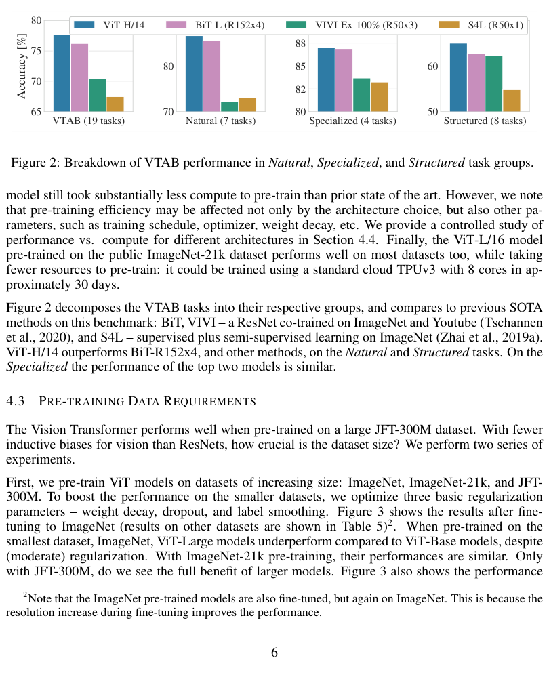

**Original:**

Second, we train our models on random subsets of 9M, 30M, and 90M as well as the full JFT-300M dataset. We do not perform additional regularization on the smaller subsets and use the same hyper-parameters for all settings. This way, we assess the intrinsic model properties, and not the effect of regularization. We do, however, use early-stopping, and report the best validation accuracy achieved during training. To save compute, we report few-shot linear accuracy instead of full fine-tuning accuracy. Figure 4 contains the results. Vision Transformers overfit more than ResNets with comparable computational cost on smaller datasets. For example, ViT-B/32 is slightly faster than ResNet50; it performs much worse on the 9M subset, but better on 90M+ subsets. The same is true for ResNet152x2 and ViT-L/16. This result reinforces the intuition that the convolutional inductive bias is useful for smaller datasets, but for larger ones, learning the relevant patterns directly from data is sufficient, even beneficial.

**中文:**

其次，我们在 900 万、3000 万和 9000 万的随机子集以及完整的 JFT-300M 数据集上训练模型。在较小的子集上我们不做额外正则化，所有设置使用相同的超参数。这样我们评估的是模型的内在属性，而非正则化的效果。不过，我们确实使用了早停（early-stopping），并报告训练过程中取得的最佳验证准确率。为节省算力，我们报告少样本线性准确率而非完整的微调准确率。图 4 展示了结果。在较小的数据集上，视觉 Transformer 比计算成本相当的 ResNet 更容易过拟合。例如，ViT-B/32 比 ResNet50 略快；它在 900 万子集上表现差得多，但在 9000 万以上的子集上表现更好。ResNet152x2 和 ViT-L/16 之间也是如此。这一结果强化了这样的直觉：卷积归纳偏置对较小的数据集有用，但对较大的数据集而言，直接从数据中学习相关模式就足够了，甚至更有益。

> **图 4（译）**：ImageNet 上的线性少样本评估与预训练规模的关系。ResNet 在较小的预训练数据集上表现更好，但比 ViT 更早进入平台期；ViT 在更大的预训练规模下表现更好。ViT-b 是所有隐藏维度减半的 ViT-B。（原图见 paper.pdf 第 7 页，[第 7 页图](assets/figures/fig-4.png)）

**Original:**

Overall, the few-shot results on ImageNet (Figure 4), as well as the low-data results on VTAB (Table 2) seem promising for very low-data transfer. Further analysis of few-shot properties of ViT is an exciting direction of future work.

**中文:**

总体而言，ImageNet 上的少样本结果（图 4）以及 VTAB 上的低数据量结果（表 2）表明，ViT 在极低数据量迁移上很有前景。进一步分析 ViT 的少样本性质是未来一个令人兴奋的方向。

### 4.4 Scaling Study

**Original:**

We perform a controlled scaling study of different models by evaluating transfer performance from JFT-300M. In this setting data size does not bottleneck the models' performances, and we assess performance versus pre-training cost of each model. The model set includes: 7 ResNets, R50x1, R50x2 R101x1, R152x1, R152x2, pre-trained for 7 epochs, plus R152x2 and R200x3 pre-trained for 14 epochs; 6 Vision Transformers, ViT-B/32, B/16, L/32, L/16, pre-trained for 7 epochs, plus L/16 and H/14 pre-trained for 14 epochs; and 5 hybrids, R50+ViT-B/32, B/16, L/32, L/16 pre-trained for 7 epochs, plus R50+ViT-L/16 pre-trained for 14 epochs (for hybrids, the number at the end of the model name stands not for the patch size, but for the total dowsampling ratio in the ResNet backbone).

**中文:**

我们通过在 JFT-300M 上评估迁移性能，对不同模型进行受控的扩展研究。在这一设置下，数据规模不再构成模型性能的瓶颈，我们评估每个模型的性能与其预训练成本之间的关系。模型集合包括：7 个 ResNet——R50x1、R50x2、R101x1、R152x1、R152x2，预训练 7 个轮次（epoch），另有 R152x2 和 R200x3 预训练 14 个轮次；6 个视觉 Transformer——ViT-B/32、B/16、L/32、L/16 预训练 7 个轮次，另有 L/16 和 H/14 预训练 14 个轮次；以及 5 个混合模型——R50+ViT-B/32、B/16、L/32、L/16 预训练 7 个轮次，另有 R50+ViT-L/16 预训练 14 个轮次（对混合模型而言，模型名末尾的数字不代表图像块大小，而是 ResNet 主干的总下采样比率）。

**Original:**

Figure 5 contains the transfer performance versus total pre-training compute (see Appendix D.5 for details on computational costs). Detailed results per model are provided in Table 6 in the Appendix. A few patterns can be observed. First, Vision Transformers dominate ResNets on the performance/compute trade-off. ViT uses approximately 2 − 4× less compute to attain the same performance (average over 5 datasets). Second, hybrids slightly outperform ViT at small computational budgets, but the difference vanishes for larger models. This result is somewhat surprising, since one might expect convolutional local feature processing to assist ViT at any size. Third, Vision Transformers appear not to saturate within the range tried, motivating future scaling efforts.

**中文:**

图 5 展示了迁移性能与总预训练算力的关系（计算成本的细节见附录 D.5）。每个模型的详细结果见附录表 6。可以观察到几个规律。第一，视觉 Transformer 在性能/算力权衡上全面压过 ResNet。达到相同性能，ViT 所用的算力大约少 2–4 倍（5 个数据集上的平均）。第二，在较小的计算预算下，混合模型略优于 ViT，但模型变大后差距消失。这一结果有些出人意料，因为人们可能会预期卷积的局部特征处理在任何规模下都能帮助 ViT。第三，在尝试的范围内，视觉 Transformer 似乎没有饱和，这激励了未来的扩展努力。

> **图 5（译）**：不同架构的性能与预训练算力对比：视觉 Transformer、ResNet 和混合模型。在相同计算预算下，视觉 Transformer 通常优于 ResNet。混合模型在小模型规模下优于纯 Transformer，但模型变大后差距消失。（原图见 paper.pdf 第 7 页，[第 7 页图](assets/figures/fig-5.png)）

### 4.5 Inspecting Vision Transformer

**Original:**

To begin to understand how the Vision Transformer processes image data, we analyze its internal representations. The first layer of the Vision Transformer linearly projects the flattened patches into a lower-dimensional space (Eq. 1). Figure 7 (left) shows the top principal components of the the learned embedding filters. The components resemble plausible basis functions for a low-dimensional representation of the fine structure within each patch.

**中文:**

为了开始理解视觉 Transformer 如何处理图像数据，我们分析它的内部表示。视觉 Transformer 的第一层把展平的图像块线性投影到低维空间（式 1）。图 7（左）展示了学习到的嵌入滤波器的主要主成分。这些成分像是每个图像块内部细粒度结构的低维表示的合理基函数。

**Original:**

After the projection, a learned position embedding is added to the patch representations. Figure 7 (center) shows that the model learns to encode distance within the image in the similarity of position embeddings, i.e. closer patches tend to have more similar position embeddings. Further, the row-column structure appears; patches in the same row/column have similar embeddings. Finally, a sinusoidal structure is sometimes apparent for larger grids (Appendix D). That the position embeddings learn to represent 2D image topology explains why hand-crafted 2D-aware embedding variants do not yield improvements (Appendix D.4).

**中文:**

投影之后，学习到的位置嵌入被加到图像块表示上。图 7（中）显示，模型学会了在位置嵌入的相似性中编码图像内的距离，即距离越近的图像块，其位置嵌入往往越相似。此外还出现了行列结构：同一行/列的图像块具有相似的嵌入。最后，对更大的网格，有时能观察到正弦结构（附录 D）。位置嵌入学会了表示 2D 图像拓扑，这解释了为什么手工设计的 2D 感知嵌入变体不能带来提升（附录 D.4）。

**Original:**

Self-attention allows ViT to integrate information across the entire image even in the lowest layers. We investigate to what degree the network makes use of this capability. Specifically, we compute the average distance in image space across which information is integrated, based on the attention weights (Figure 7, right). This "attention distance" is analogous to receptive field size in CNNs. We find that some heads attend to most of the image already in the lowest layers, showing that the ability to integrate information globally is indeed used by the model. Other attention heads have consistently small attention distances in the low layers. This highly localized attention is less pronounced in hybrid models that apply a ResNet before the Transformer (Figure 7, right), suggesting that it may serve a similar function as early convolutional layers in CNNs. Further, the attention distance increases with network depth. Globally, we find that the model attends to image regions that are semantically relevant for classification (Figure 6).

**中文:**

自注意力使 ViT 即使在最低层也能整合整个图像的信息。我们研究了网络在多大程度上利用了这种能力。具体来说，我们基于注意力权重计算了信息整合所跨越的图像空间平均距离（图 7，右）。这个「注意力距离」（attention distance）类似于 CNN 中的感受野（receptive field）大小。我们发现，一些注意力头在最低层就已关注了图像的大部分区域，说明模型确实使用了全局整合信息的能力。另一些注意力头在低层一直保持很小的注意力距离。这种高度局部化的注意力，在 Transformer 之前应用了 ResNet 的混合模型中不那么明显（图 7，右），说明它可能起着与 CNN 早期卷积层类似的作用。此外，注意力距离随网络深度增加而增大。总体上，我们发现模型会关注对分类有语义意义的图像区域（图 6）。

> **图 6（译）**：从输出词元到输入空间的注意力的代表性示例。详见附录 D.7。（原图见 paper.pdf 第 8 页，见下方图）

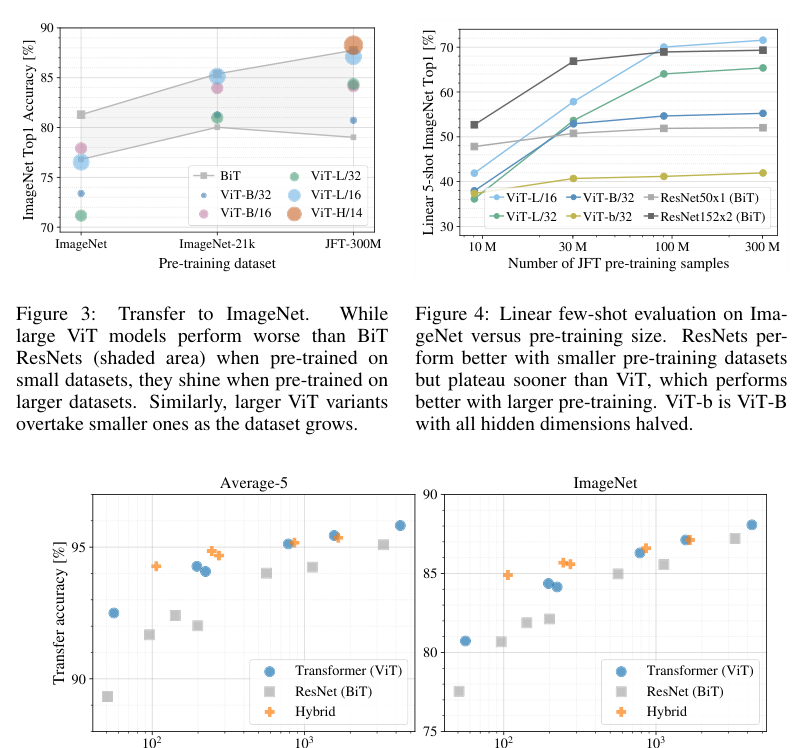

> **图 7（译）**：左：ViT-L/32 初始 RGB 值线性嵌入的滤波器。中：ViT-L/32 位置嵌入的相似性。每个小格展示了指定行列图像块的位置嵌入与所有其他图像块位置嵌入之间的余弦相似度。右：按注意力头和网络深度划分的被关注区域大小。每个点表示某一层 16 个头之一在所有图像上的平均注意力距离。详见附录 D.7。（原图见 paper.pdf 第 9 页，见下方图）

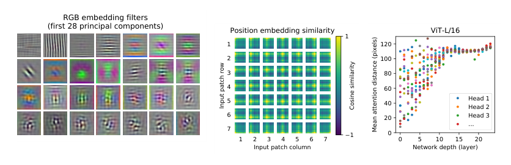

### 4.6 Self-supervision

**Original:**

Transformers show impressive performance on NLP tasks. However, much of their success stems not only from their excellent scalability but also from large scale self-supervised pre-training (Devlin et al., 2019; Radford et al., 2018). We also perform a preliminary exploration on masked patch prediction for self-supervision, mimicking the masked language modeling task used in BERT. With self-supervised pre-training, our smaller ViT-B/16 model achieves 79.9% accuracy on ImageNet, a significant improvement of 2% to training from scratch, but still 4% behind supervised pre-training. Appendix B.1.2 contains further details. We leave exploration of contrastive pre-training (Chen et al., 2020b; He et al., 2020; Bachman et al., 2019; Hénaff et al., 2020) to future work.

**中文:**

Transformer 在 NLP 任务上表现出令人瞩目的性能。然而，它们的成功在很大程度上不仅来自出色的可扩展性，还来自大规模自监督预训练（Devlin et al., 2019; Radford et al., 2018）。我们也对自监督的掩码图像块预测（masked patch prediction）做了初步探索，模仿 BERT 使用的掩码语言建模任务。通过自监督预训练，我们较小的 ViT-B/16 模型在 ImageNet 上达到 79.9% 的准确率，比从零开始训练有 2% 的显著提升，但仍比监督预训练低 4%。更多细节见附录 B.1.2。我们把对比式预训练的探索（Chen et al., 2020b; He et al., 2020; Bachman et al., 2019; Hénaff et al., 2020）留作未来工作。

---

## 5 Conclusion

**Original:**

We have explored the direct application of Transformers to image recognition. Unlike prior works using self-attention in computer vision, we do not introduce image-specific inductive biases into the architecture apart from the initial patch extraction step. Instead, we interpret an image as a sequence of patches and process it by a standard Transformer encoder as used in NLP. This simple, yet scalable, strategy works surprisingly well when coupled with pre-training on large datasets. Thus, Vision Transformer matches or exceeds the state of the art on many image classification datasets, whilst being relatively cheap to pre-train.

**中文:**

我们探索了 Transformer 在图像识别中的直接应用。与先前在计算机视觉中使用自注意力的工作不同，除了最初的图像块提取步骤之外，我们没有在架构中引入任何图像特有的归纳偏置。相反，我们把图像解释为一个图像块序列，并用 NLP 中使用的标准 Transformer 编码器来处理它。这一简单而可扩展的策略，在大数据集预训练的配合下，效果好得惊人。因此，视觉 Transformer 在许多图像分类数据集上达到或超越了当前最优水平，同时预训练成本相对低廉。

**Original:**

While these initial results are encouraging, many challenges remain. One is to apply ViT to other computer vision tasks, such as detection and segmentation. Our results, coupled with those in Carion et al. (2020), indicate the promise of this approach. Another challenge is to continue exploring self-supervised pre-training methods. Our initial experiments show improvement from self-supervised pre-training, but there is still large gap between self-supervised and large-scale supervised pre-training. Finally, further scaling of ViT would likely lead to improved performance.

**中文:**

虽然这些初步结果令人鼓舞，但许多挑战仍然存在。其一是把 ViT 应用到其他计算机视觉任务上，例如检测和分割。我们的结果，加上 Carion et al. (2020) 的结果，表明这一方法大有可为。另一个挑战是继续探索自监督预训练方法。我们的初步实验显示自监督预训练带来了提升，但自监督与大规模监督预训练之间仍存在巨大差距。最后，进一步扩大 ViT 的规模很可能带来性能的提升。

---

## Acknowledgements

**Original:**

The work was performed in Berlin, Zürich, and Amsterdam. We thank many colleagues at Google for their help, in particular Andreas Steiner for crucial help with the infrastructure and the open-source release of the code; Joan Puigcerver and Maxim Neumann for help with the large-scale training infrastructure; Dmitry Lepikhin, Aravindh Mahendran, Daniel Keysers, Mario Lučić, Noam Shazeer, Ashish Vaswani, and Colin Raffel for useful discussions.

**中文:**

这项工作在柏林、苏黎世和阿姆斯特丹完成。我们感谢 Google 的众多同事的帮助，特别是 Andreas Steiner 在基础设施和代码开源发布上的关键帮助；Joan Puigcerver 和 Maxim Neumann 在大规模训练基础设施上的帮助；以及 Dmitry Lepikhin、Aravindh Mahendran、Daniel Keysers、Mario Lučić、Noam Shazeer、Ashish Vaswani 和 Colin Raffel 富有成效的讨论。

---

## References

（参考文献整体保留原文，不翻译）

Samira Abnar and Willem Zuidema. Quantifying attention flow in transformers. In ACL, 2020.

Philip Bachman, R Devon Hjelm, and William Buchwalter. Learning representations by maximizing mutual information across views. In NeurIPS, 2019.

Alexei Baevski and Michael Auli. Adaptive input representations for neural language modeling. In ICLR, 2019.

I. Bello, B. Zoph, Q. Le, A. Vaswani, and J. Shlens. Attention augmented convolutional networks. In ICCV, 2019.

Lucas Beyer, Olivier J. Hénaff, Alexander Kolesnikov, Xiaohua Zhai, and Aäron van den Oord. Are we done with imagenet? arXiv, 2020.

Tom B Brown, Benjamin Mann, Nick Ryder, Melanie Subbiah, Jared Kaplan, Prafulla Dhariwal, Arvind Neelakantan, Pranav Shyam, Girish Sastry, Amanda Askell, et al. Language models are few-shot learners. arXiv, 2020.

Nicolas Carion, Francisco Massa, Gabriel Synnaeve, Nicolas Usunier, Alexander Kirillov, and Sergey Zagoruyko. End-to-end object detection with transformers. In ECCV, 2020.

Mark Chen, Alec Radford, Rewon Child, Jeff Wu, and Heewoo Jun. Generative pretraining from pixels. In ICML, 2020a.

Ting Chen, Simon Kornblith, Mohammad Norouzi, and Geoffrey E. Hinton. A simple framework for contrastive learning of visual representations. In ICML, 2020b.

Yen-Chun Chen, Linjie Li, Licheng Yu, Ahmed El Kholy, Faisal Ahmed, Zhe Gan, Yu Cheng, and Jingjing Liu. UNITER: UNiversal Image-TExt Representation Learning. In ECCV, 2020c.

Rewon Child, Scott Gray, Alec Radford, and Ilya Sutskever. Generating long sequences with sparse transformers. arXiv, 2019.

Jean-Baptiste Cordonnier, Andreas Loukas, and Martin Jaggi. On the relationship between self-attention and convolutional layers. In ICLR, 2020.

J. Deng, W. Dong, R. Socher, L. Li, Kai Li, and Li Fei-Fei. Imagenet: A large-scale hierarchical image database. In CVPR, 2009.

Jacob Devlin, Ming-Wei Chang, Kenton Lee, and Kristina Toutanova. BERT: Pre-training of deep bidirectional transformers for language understanding. In NAACL, 2019.

Josip Djolonga, Jessica Yung, Michael Tschannen, Rob Romijnders, Lucas Beyer, Alexander Kolesnikov, Joan Puigcerver, Matthias Minderer, Alexander D'Amour, Dan Moldovan, Sylvan Gelly, Neil Houlsby, Xiaohua Zhai, and Mario Lucic. On robustness and transferability of convolutional neural networks. arXiv, 2020.

Kaiming He, Xiangyu Zhang, Shaoqing Ren, and Jian Sun. Deep residual learning for image recognition. In CVPR, 2016.

Kaiming He, Haoqi Fan, Yuxin Wu, Saining Xie, and Ross Girshick. Momentum contrast for unsupervised visual representation learning. In CVPR, 2020.

Jonathan Ho, Nal Kalchbrenner, Dirk Weissenborn, and Tim Salimans. Axial attention in multidimensional transformers. arXiv, 2019.

Han Hu, Jiayuan Gu, Zheng Zhang, Jifeng Dai, and Yichen Wei. Relation networks for object detection. In CVPR, 2018.

Han Hu, Zheng Zhang, Zhenda Xie, and Stephen Lin. Local relation networks for image recognition. In ICCV, 2019.

Zilong Huang, Xinggang Wang, Yunchao Wei, Lichao Huang, Humphrey Shi, Wenyu Liu, and Thomas S. Huang. Ccnet: Criss-cross attention for semantic segmentation. In ICCV, 2020.

Olivier J. Hénaff, Aravind Srinivas, Jeffrey De Fauw, Ali Razavi, Carl Doersch, S. M. Ali Eslami, and Aaron van den Oord. Data-efficient image recognition with contrastive predictive coding. In ICML, 2020.

Sergey Ioffe and Christian Szegedy. Batch normalization: Accelerating deep network training by reducing internal covariate shift. 2015.

Diederik P. Kingma and Jimmy Ba. Adam: A method for stochastic optimization. In ICLR, 2015.

Alexander Kolesnikov, Lucas Beyer, Xiaohua Zhai, Joan Puigcerver, Jessica Yung, Sylvain Gelly, and Neil Houlsby. Big transfer (BiT): General visual representation learning. In ECCV, 2020.

Alex Krizhevsky. Learning multiple layers of features from tiny images. Technical report, 2009.

Alex Krizhevsky, Ilya Sutskever, and Geoffrey E. Hinton. Imagenet classification with deep convolutional neural networks. In NIPS, 2012.

Y. LeCun, B. Boser, J. Denker, D. Henderson, R. Howard, W. Hubbard, and L. Jackel. Backpropagation applied to handwritten zip code recognition. Neural Computation, 1:541–551, 1989.

Dmitry Lepikhin, HyoukJoong Lee, Yuanzhong Xu, Dehao Chen, Orhan Firat, Yanping Huang, Maxim Krikun, Noam Shazeer, and Zhifeng Chen. Gshard: Scaling giant models with conditional computation and automatic sharding. arXiv, 2020.

Liunian Harold Li, Mark Yatskar, Da Yin, Cho-Jui Hsieh, and Kai-Wei Chang. VisualBERT: A Simple and Performant Baseline for Vision and Language. In Arxiv, 2019.

Francesco Locatello, Dirk Weissenborn, Thomas Unterthiner, Aravindh Mahendran, Georg Heigold, Jakob Uszkoreit, Alexey Dosovitskiy, and Thomas Kipf. Object-centric learning with slot attention. arXiv, 2020.

Jiasen Lu, Dhruv Batra, Devi Parikh, and Stefan Lee. ViLBERT: Pretraining Task-Agnostic Visiolinguistic Representations for Vision-and-Language Tasks. In NeurIPS. 2019.

Dhruv Mahajan, Ross Girshick, Vignesh Ramanathan, Kaiming He, Manohar Paluri, Yixuan Li, Ashwin Bharambe, and Laurens van der Maaten. Exploring the limits of weakly supervised pretraining. In ECCV, 2018.

M. Nilsback and A. Zisserman. Automated flower classification over a large number of classes. In ICVGIP, 2008.

Omkar M. Parkhi, Andrea Vedaldi, Andrew Zisserman, and C. V. Jawahar. Cats and dogs. In CVPR, 2012.

Niki Parmar, Ashish Vaswani, Jakob Uszkoreit, Lukasz Kaiser, Noam Shazeer, Alexander Ku, and Dustin Tran. Image transformer. In ICML, 2018.

B. T. Polyak and A. B. Juditsky. Acceleration of stochastic approximation by averaging. SIAM Journal on Control and Optimization, 30(4):838–855, 1992. doi: 10.1137/0330046. URL https://doi.org/10.1137/0330046.

Siyuan Qiao, Huiyu Wang, Chenxi Liu, Wei Shen, and Alan Yuille. Weight standardization. arXiv preprint arXiv:1903.10520, 2019.

Alec Radford, Karthik Narasimhan, Tim Salimans, and Ilya Sutskever. Improving language understanding with unsupervised learning. Technical Report, 2018.

Alec Radford, Jeff Wu, Rewon Child, David Luan, Dario Amodei, and Ilya Sutskever. Language models are unsupervised multitask learners. Technical Report, 2019.

Prajit Ramachandran, Niki Parmar, Ashish Vaswani, Irwan Bello, Anselm Levskaya, and Jon Shlens. Stand-alone self-attention in vision models. In NeurIPS, 2019.

Chen Sun, Abhinav Shrivastava, Saurabh Singh, and Abhinav Gupta. Revisiting unreasonable effectiveness of data in deep learning era. In ICCV, 2017.

Chen Sun, Austin Myers, Carl Vondrick, Kevin Murphy, and Cordelia Schmid. Videobert: A joint model for video and language representation learning. In ICCV, 2019.

Hugo Touvron, Andrea Vedaldi, Matthijs Douze, and Herve Jegou. Fixing the train-test resolution discrepancy. In NeurIPS. 2019.

Hugo Touvron, Andrea Vedaldi, Matthijs Douze, and Herve Jegou. Fixing the train-test resolution discrepancy: Fixefficientnet. arXiv preprint arXiv:2003.08237, 2020.

Michael Tschannen, Josip Djolonga, Marvin Ritter, Aravindh Mahendran, Neil Houlsby, Sylvain Gelly, and Mario Lucic. Self-supervised learning of video-induced visual invariances. In Proceedings of the IEEE/CVF Conference on Computer Vision and Pattern Recognition (CVPR), June 2020.

Ashish Vaswani, Noam Shazeer, Niki Parmar, Jakob Uszkoreit, Llion Jones, Aidan N Gomez, Łukasz Kaiser, and Illia Polosukhin. Attention is all you need. In NIPS, 2017.

Huiyu Wang, Yukun Zhu, Bradley Green, Hartwig Adam, Alan Yuille, and Liang-Chieh Chen. Axial-deeplab: Stand-alone axial-attention for panoptic segmentation. In ECCV, 2020a.

Huiyu Wang, Yukun Zhu, Bradley Green, Hartwig Adam, Alan Yuille, and Liang-Chieh Chen. Axial-deeplab: Stand-alone axial-attention for panoptic segmentation. arXiv preprint arXiv:2003.07853, 2020b.

Qiang Wang, Bei Li, Tong Xiao, Jingbo Zhu, Changliang Li, Derek F. Wong, and Lidia S. Chao. Learning deep transformer models for machine translation. In ACL, 2019.

Xiaolong Wang, Ross Girshick, Abhinav Gupta, and Kaiming He. Non-local neural networks. In CVPR, 2018.

Dirk Weissenborn, Oscar Täckström, and Jakob Uszkoreit. Scaling autoregressive video models. In ICLR, 2019.

Bichen Wu, Chenfeng Xu, Xiaoliang Dai, Alvin Wan, Peizhao Zhang, Masayoshi Tomizuka, Kurt Keutzer, and Peter Vajda. Visual transformers: Token-based image representation and processing for computer vision. arxiv, 2020.

Yuxin Wu and Kaiming He. Group normalization. In ECCV, 2018.

Qizhe Xie, Minh-Thang Luong, Eduard Hovy, and Quoc V. Le. Self-training with noisy student improves imagenet classification. In CVPR, 2020.

Xiaohua Zhai, Avital Oliver, Alexander Kolesnikov, and Lucas Beyer. S4L: Self-Supervised Semi-Supervised Learning. In ICCV, 2019a.

Xiaohua Zhai, Joan Puigcerver, Alexander Kolesnikov, Pierre Ruyssen, Carlos Riquelme, Mario Lucic, Josip Djolonga, Andre Susano Pinto, Maxim Neumann, Alexey Dosovitskiy, et al. A large-scale study of representation learning with the visual task adaptation benchmark. arXiv preprint arXiv:1910.04867, 2019b.

Hengshuang Zhao, Jiaya Jia, and Vladlen Koltun. Exploring self-attention for image recognition. In CVPR, 2020.
---

## Appendix

### A Multihead Self-Attention

**Original:**

Standard qkv self-attention (SA, Vaswani et al. (2017)) is a popular building block for neural architectures. For each element in an input sequence $z \in \mathbb{R}^{N \times D}$, we compute a weighted sum over all values $v$ in the sequence. The attention weights $A_{ij}$ are based on the pairwise similarity between two elements of the sequence and their respective query $q_i$ and key $k_j$ representations.

**中文:**

标准的 qkv 自注意力（SA，Vaswani et al. (2017)）是神经架构中常用的一种构建块。对于输入序列 $z \in \mathbb{R}^{N \times D}$ 中的每个元素，我们计算序列中所有值 $v$ 的加权和。注意力权重 $A_{ij}$ 基于序列中两个元素之间的两两相似性，以及它们各自的查询 $q_i$ 和键 $k_j$ 表示。

$$
[q, k, v] = z U_{qkv} \qquad U_{qkv} \in \mathbb{R}^{D \times 3D_h} \tag{5}
$$

$$
A = \mathrm{softmax}\left(qk^{\top}/\sqrt{D_h}\right) \qquad A \in \mathbb{R}^{N \times N} \tag{6}
$$

$$
\mathrm{SA}(z) = Av \tag{7}
$$

**Original:**

Multihead self-attention (MSA) is an extension of SA in which we run $k$ self-attention operations, called "heads", in parallel, and project their concatenated outputs. To keep compute and number of parameters constant when changing $k$, $D_h$ (Eq. 5) is typically set to $D/k$.

**中文:**

多头自注意力（MSA）是 SA 的扩展：并行运行 $k$ 个称为「头」的自注意力操作，并把它们的拼接输出做投影。为了在改变 $k$ 时保持计算量和参数量不变，$D_h$（式 5）通常取 $D/k$。

$$
\mathrm{MSA}(z) = [\mathrm{SA}_1(z);\, \mathrm{SA}_2(z);\, \cdots;\, \mathrm{SA}_k(z)]\, U_{msa} \qquad U_{msa} \in \mathbb{R}^{k \cdot D_h \times D} \tag{8}
$$

---

### B Experiment Details

#### B.1 Training

**Original:**

Table 3 summarizes our training setups for our different models. We found strong regularization to be key when training models from scratch on ImageNet. Dropout, when used, is applied after every dense layer except for the the qkv-projections and directly after adding positional- to patch embeddings. Hybrid models are trained with the exact setup as their ViT counterparts. Finally, all training is done on resolution 224.

**中文:**

表 3 汇总了不同模型的训练设置。我们发现，在 ImageNet 上从零开始训练模型时，强正则化是关键。使用随机失活（Dropout）时，它被应用在每个全连接层之后（qkv 投影除外），以及在把位置嵌入加到图像块嵌入之后立即应用。混合模型的训练设置与对应的 ViT 完全相同。最后，所有训练都在 224 分辨率下进行。

> **表 3（译）**：训练超参数。所有模型都用批次大小 4096 训练，学习率预热 1 万步。对于 ImageNet，我们发现额外在全局范数 1 处做梯度裁剪（gradient clipping）是有益的。训练分辨率为 224。（原图见 paper.pdf 第 13 页，见下方图）

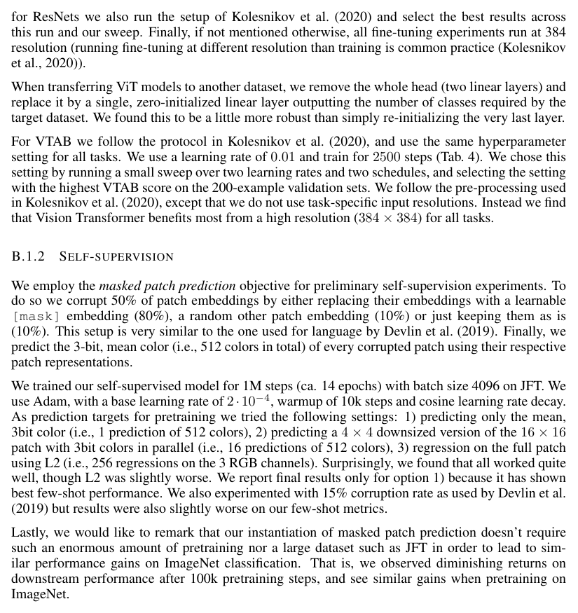

| 模型（Models） | 数据集（Dataset） | 轮次（Epochs） | 基础学习率（Base LR） | 学习率衰减（LR decay） | 权重衰减（Weight decay） | 随机失活（Dropout） |
|---|---|---|---|---|---|---|
| ViT-B/{16,32} | JFT-300M | 7 | 8·10⁻⁴ | linear | 0.1 | 0.0 |
| ViT-L/32 | JFT-300M | 7 | 6·10⁻⁴ | linear | 0.1 | 0.0 |
| ViT-L/16 | JFT-300M | 7/14 | 4·10⁻⁴ | linear | 0.1 | 0.0 |
| ViT-H/14 | JFT-300M | 14 | 3·10⁻⁴ | linear | 0.1 | 0.0 |
| R50x{1,2} | JFT-300M | 7 | 10⁻³ | linear | 0.1 | 0.0 |
| R101x1 | JFT-300M | 7 | 8·10⁻⁴ | linear | 0.1 | 0.0 |
| R152x{1,2} | JFT-300M | 7 | 6·10⁻⁴ | linear | 0.1 | 0.0 |
| R50+ViT-B/{16,32} | JFT-300M | 7 | 8·10⁻⁴ | linear | 0.1 | 0.0 |
| R50+ViT-L/32 | JFT-300M | 7 | 2·10⁻⁴ | linear | 0.1 | 0.0 |
| R50+ViT-L/16 | JFT-300M | 7/14 | 4·10⁻⁴ | linear | 0.1 | 0.0 |
| ViT-B/{16,32} | ImageNet-21k | 90 | 10⁻³ | linear | 0.03 | 0.1 |
| ViT-L/{16,32} | ImageNet-21k | 30/90 | 10⁻³ | linear | 0.03 | 0.1 |
| ViT-∗ | ImageNet | 300 | 3·10⁻³ | cosine | 0.3 | 0.1 |

#### B.1.1 Fine-tuning

**Original:**

We fine-tune all ViT models using SGD with a momentum of 0.9. We run a small grid search over learning rates, see learning rate ranges in Table 4. To do so, we use small sub-splits from the training set (10% for Pets and Flowers, 2% for CIFAR, 1% ImageNet) as development set and train on the remaining data. For final results we train on the entire training set and evaluate on the respective test data. For fine-tuning ResNets and hybrid models we use the exact same setup, with the only exception of ImageNet where we add another value 0.06 to the learning rate sweep. Additionally, for ResNets we also run the setup of Kolesnikov et al. (2020) and select the best results across this run and our sweep. Finally, if not mentioned otherwise, all fine-tuning experiments run at 384 resolution (running fine-tuning at different resolution than training is common practice (Kolesnikov et al., 2020)).

**中文:**

我们使用动量为 0.9 的 SGD 微调所有 ViT 模型。我们对学习率做了小范围网格搜索（grid search），学习率范围见表 4。为此，我们从训练集中划出小子集作为开发集（development set）（Pets 和 Flowers 用 10%，CIFAR 用 2%，ImageNet 用 1%），并在剩余数据上训练。最终结果在完整训练集上训练、在相应测试数据上评估。ResNet 和混合模型的微调使用完全相同的设置，唯一例外是 ImageNet：我们在学习率搜索中额外加入了 0.06 这个值。此外，对 ResNet 我们还运行了 Kolesnikov et al. (2020) 的设置，并在该运行与我们的搜索之间选取最佳结果。最后，除非另有说明，所有微调实验都在 384 分辨率下运行（以不同于训练的分辨率进行微调是常见做法（Kolesnikov et al., 2020））。

> **表 4（译）**：微调超参数。所有模型都以余弦学习率衰减、批次大小 512、无权重衰减、全局范数 1 处的梯度裁剪进行微调。除非另有说明，微调分辨率为 384。（原图见 paper.pdf 第 14 页，见下方图）

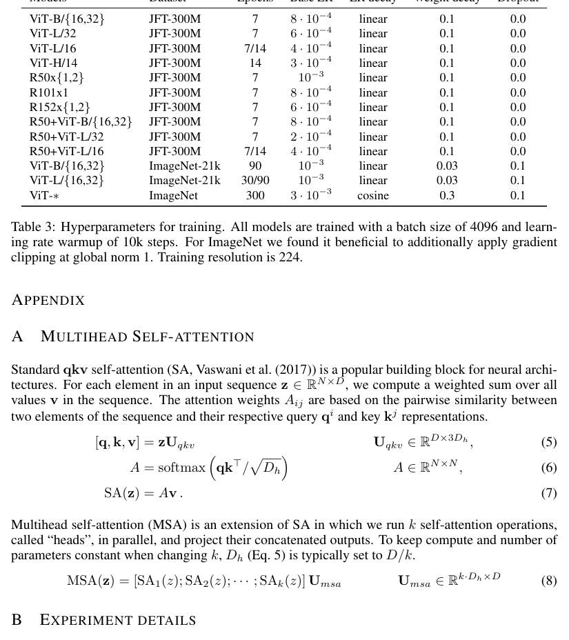

| 数据集（Dataset） | 步数（Steps） | 基础学习率（Base LR） |
|---|---|---|
| ImageNet | 20 000 | {0.003, 0.01, 0.03, 0.06} |
| CIFAR100 | 10 000 | {0.001, 0.003, 0.01, 0.03} |
| CIFAR10 | 10 000 | {0.001, 0.003, 0.01, 0.03} |
| Oxford-IIIT Pets | 500 | {0.001, 0.003, 0.01, 0.03} |
| Oxford Flowers-102 | 500 | {0.001, 0.003, 0.01, 0.03} |
| VTAB（19 个任务） | 2 500 | 0.01 |

**Original:**

When transferring ViT models to another dataset, we remove the whole head (two linear layers) and replace it by a single, zero-initialized linear layer outputting the number of classes required by the target dataset. We found this to be a little more robust than simply re-initializing the very last layer. For VTAB we follow the protocol in Kolesnikov et al. (2020), and use the same hyperparameter setting for all tasks. We use a learning rate of 0.01 and train for 2500 steps (Tab. 4). We chose this setting by running a small sweep over two learning rates and two schedules, and selecting the setting with the highest VTAB score on the 200-example validation sets. We follow the pre-processing used in Kolesnikov et al. (2020), except that we do not use task-specific input resolutions. Instead we find that Vision Transformer benefits most from a high resolution (384 × 384) for all tasks.

**中文:**

当把 ViT 模型迁移到其他数据集时，我们移除整个头部（两个线性层），替换为一个零初始化的单线性层，输出目标数据集所需类别数的预测。我们发现这比仅仅重新初始化最后一层略为稳健。对 VTAB，我们遵循 Kolesnikov et al. (2020) 的协议，所有任务使用相同的超参数设置。我们使用 0.01 的学习率，训练 2500 步（表 4）。该设置是这样选定的：在两个学习率和两个训练计划上做小范围搜索，选出在 200 样本验证集上 VTAB 得分最高的设置。预处理遵循 Kolesnikov et al. (2020)，但我们不使用任务特定的输入分辨率。相反，我们发现视觉 Transformer 在所有任务上都能从高分辨率（384 × 384）中获得最大收益。

#### B.1.2 Self-supervision

**Original:**

We employ the masked patch prediction objective for preliminary self-supervision experiments. To do so we corrupt 50% of patch embeddings by either replacing their embeddings with a learnable [mask] embedding (80%), a random other patch embedding (10%) or just keeping them as is (10%). This setup is very similar to the one used for language by Devlin et al. (2019). Finally, we predict the 3-bit, mean color (i.e., 512 colors in total) of every corrupted patch using their respective patch representations.

**中文:**

在初步的自监督实验中，我们使用掩码图像块预测目标。具体做法是破坏 50% 的图像块嵌入：要么把它们的嵌入替换为可学习的 [mask] 嵌入（80%），要么替换为另一个随机图像块的嵌入（10%），要么原样保留（10%）。这一设置与 Devlin et al. (2019) 用于语言的设置非常相似。最后，我们使用各被破坏图像块的表示，预测每个图像块的 3 比特平均颜色（即共 512 种颜色）。

**Original:**

We trained our self-supervised model for 1M steps (ca. 14 epochs) with batch size 4096 on JFT. We use Adam, with a base learning rate of 2·10⁻⁴, warmup of 10k steps and cosine learning rate decay. As prediction targets for pretraining we tried the following settings: 1) predicting only the mean, 3bit color (i.e., 1 prediction of 512 colors), 2) predicting a 4 × 4 downsized version of the 16 × 16 patch with 3bit colors in parallel (i.e., 16 predictions of 512 colors), 3) regression on the full patch using L2 (i.e., 256 regressions on the 3 RGB channels). Surprisingly, we found that all worked quite well, though L2 was slightly worse. We report final results only for option 1) because it has shown best few-shot performance. We also experimented with 15% corruption rate as used by Devlin et al. (2019) but results were also slightly worse on our few-shot metrics.

**中文:**

我们在 JFT 上用批次大小 4096 训练自监督模型 100 万步（约 14 个轮次）。使用 Adam，基础学习率 2·10⁻⁴，预热 1 万步，余弦学习率衰减。作为预训练的预测目标，我们尝试了以下设置：1) 只预测平均 3 比特颜色（即 1 个 512 选 1 的预测）；2) 并行预测 16 × 16 图像块的 4 × 4 下采样版本的 3 比特颜色（即 16 个 512 选 1 的预测）；3) 使用 L2 对整个图像块做回归（即对 3 个 RGB 通道做 256 个回归）。令人惊讶的是，我们发现这些设置效果都相当好，尽管 L2 略差。我们只报告选项 1) 的最终结果，因为它的少样本性能最好。我们还试验了 Devlin et al. (2019) 使用的 15% 破坏率，但在我们的少样本指标上结果也略差。

**Original:**

Lastly, we would like to remark that our instantiation of masked patch prediction doesn't require such an enormous amount of pretraining nor a large dataset such as JFT in order to lead to similar performance gains on ImageNet classification. That is, we observed diminishing returns on downstream performance after 100k pretraining steps, and see similar gains when pretraining on ImageNet.

**中文:**

最后，我们想指出：我们的掩码图像块预测实现并不需要如此巨量的预训练、也不需要 JFT 这样的大型数据集，就能在 ImageNet 分类上带来相似的性能提升。也就是说，我们观察到预训练超过 10 万步后，下游性能收益递减；在 ImageNet 上预训练也能看到相似的提升。

---

### C Additional Results

**Original:**

We report detailed results corresponding to the figures presented in the paper. Table 5 corresponds to Figure 3 from the paper and shows transfer performance of different ViT models pre-trained on datasets of increasing size: ImageNet, ImageNet-21k, and JFT-300M. Table 6 corresponds to Figure 5 from the paper and shows the transfer performance of ViT, ResNet, and hybrid models of varying size, as well as the estimated computational cost of their pre-training.

**中文:**

我们报告与论文中图对应的详细结果。表 5 对应论文图 3，展示了不同 ViT 模型在规模递增的数据集（ImageNet、ImageNet-21k 和 JFT-300M）上预训练后的迁移性能。表 6 对应论文图 5，展示了不同规模的 ViT、ResNet 和混合模型的迁移性能，以及它们预训练的估计计算成本。

> **表 5（译）**：视觉 Transformer 在 ImageNet、ImageNet-21k 或 JFT300M 上预训练后，在各数据集上的 Top1 准确率（%）。这些数值对应正文图 3。模型在 384 分辨率下微调。注意，ImageNet 结果没有使用达成表 2 结果所用的额外技巧（Polyak 平均和 512 分辨率图像）。（原图见 paper.pdf 第 15 页，见下方图）

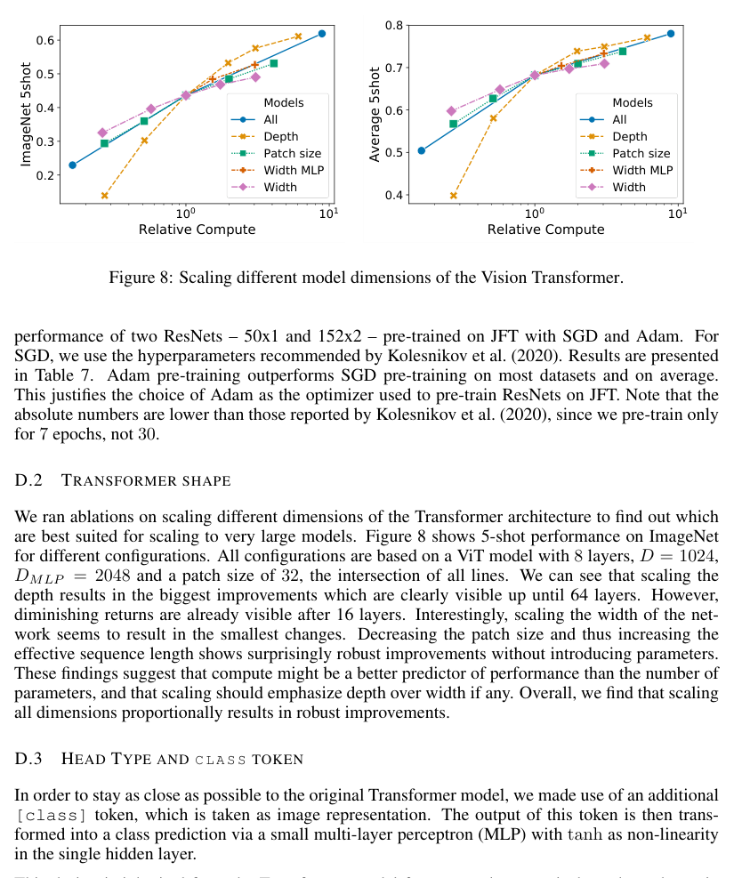

| 预训练数据集 | 指标 | ViT-B/16 | ViT-B/32 | ViT-L/16 | ViT-L/32 | ViT-H/14 |
|---|---|---|---|---|---|---|
| ImageNet | CIFAR-10 | 98.13 | 97.77 | 97.86 | 97.94 | – |
| | CIFAR-100 | 87.13 | 86.31 | 86.35 | 87.07 | – |
| | ImageNet | 77.91 | 73.38 | 76.53 | 71.16 | – |
| | ImageNet ReaL | 83.57 | 79.56 | 82.19 | 77.83 | – |
| | Oxford Flowers-102 | 89.49 | 85.43 | 89.66 | 86.36 | – |
| | Oxford-IIIT-Pets | 93.81 | 92.04 | 93.64 | 91.35 | – |
| ImageNet-21k | CIFAR-10 | 98.95 | 98.79 | 99.16 | 99.13 | 99.27 |
| | CIFAR-100 | 91.67 | 91.97 | 93.44 | 93.04 | 93.82 |
| | ImageNet | 83.97 | 81.28 | 85.15 | 80.99 | 85.13 |
| | ImageNet ReaL | 88.35 | 86.63 | 88.40 | 85.65 | 88.70 |
| | Oxford Flowers-102 | 99.38 | 99.11 | 99.61 | 99.19 | 99.51 |
| | Oxford-IIIT-Pets | 94.43 | 93.02 | 94.73 | 93.09 | 94.82 |
| JFT-300M | CIFAR-10 | 99.00 | 98.61 | 99.38 | 99.19 | 99.50 |
| | CIFAR-100 | 91.87 | 90.49 | 94.04 | 92.52 | 94.55 |
| | ImageNet | 84.15 | 80.73 | 87.12 | 84.37 | 88.04 |
| | ImageNet ReaL | 88.85 | 86.27 | 89.99 | 88.28 | 90.33 |
| | Oxford Flowers-102 | 99.56 | 99.27 | 99.56 | 99.45 | 99.68 |
| | Oxford-IIIT-Pets | 95.80 | 93.40 | 97.11 | 95.83 | 97.56 |

> **表 6（译）**：模型扩展实验的详细结果。这些结果对应正文图 5。我们展示了在多个数据集上的迁移准确率，以及预训练算力（单位 exaFLOPs）。（原图见 paper.pdf 第 15 页，[第 15 页图](assets/figures/tab-6.png)）

| 名称（name） | 轮次（Epochs） | ImageNet | ImageNet ReaL | CIFAR-10 | CIFAR-100 | Pets | Flowers | exaFLOPs |
|---|---|---|---|---|---|---|---|---|
| ViT-B/32 | 7 | 80.73 | 86.27 | 98.61 | 90.49 | 93.40 | 99.27 | 55 |
| ViT-B/16 | 7 | 84.15 | 88.85 | 99.00 | 91.87 | 95.80 | 99.56 | 224 |
| ViT-L/32 | 7 | 84.37 | 88.28 | 99.19 | 92.52 | 95.83 | 99.45 | 196 |
| ViT-L/16 | 7 | 86.30 | 89.43 | 99.38 | 93.46 | 96.81 | 99.66 | 783 |
| ViT-L/16 | 14 | 87.12 | 89.99 | 99.38 | 94.04 | 97.11 | 99.56 | 1567 |
| ViT-H/14 | 14 | 88.08 | 90.36 | 99.50 | 94.71 | 97.11 | 99.71 | 4262 |
| ResNet50x1 | 7 | 77.54 | 84.56 | 97.67 | 86.07 | 91.11 | 94.26 | 50 |
| ResNet50x2 | 7 | 82.12 | 87.94 | 98.29 | 89.20 | 93.43 | 97.02 | 199 |
| ResNet101x1 | 7 | 80.67 | 87.07 | 98.48 | 89.17 | 94.08 | 95.95 | 96 |
| ResNet152x1 | 7 | 81.88 | 87.96 | 98.82 | 90.22 | 94.17 | 96.94 | 141 |
| ResNet152x2 | 7 | 84.97 | 89.69 | 99.06 | 92.05 | 95.37 | 98.62 | 563 |
| ResNet152x2 | 14 | 85.56 | 89.89 | 99.24 | 91.92 | 95.75 | 98.75 | 1126 |
| ResNet200x3 | 14 | 87.22 | 90.15 | 99.34 | 93.53 | 96.32 | 99.04 | 3306 |
| R50x1+ViT-B/32 | 7 | 84.90 | 89.15 | 99.01 | 92.24 | 95.75 | 99.46 | 106 |
| R50x1+ViT-B/16 | 7 | 85.58 | 89.65 | 99.14 | 92.63 | 96.65 | 99.40 | 274 |
| R50x1+ViT-L/32 | 7 | 85.68 | 89.04 | 99.24 | 92.93 | 96.97 | 99.43 | 246 |
| R50x1+ViT-L/16 | 7 | 86.60 | 89.72 | 99.18 | 93.64 | 97.03 | 99.40 | 859 |
| R50x1+ViT-L/16 | 14 | 87.12 | 89.76 | 99.31 | 93.89 | 97.36 | 99.11 | 1668 |

---

### D Additional Analyses

#### D.1 SGD vs. Adam for ResNets

**Original:**

ResNets are typically trained with SGD and our use of Adam as optimizer is quite unconventional. Here we show the experiments that motivated this choice. Namely, we compare the fine-tuning performance of two ResNets – 50x1 and 152x2 – pre-trained on JFT with SGD and Adam. For SGD, we use the hyperparameters recommended by Kolesnikov et al. (2020). Results are presented in Table 7. Adam pre-training outperforms SGD pre-training on most datasets and on average. This justifies the choice of Adam as the optimizer used to pre-train ResNets on JFT. Note that the absolute numbers are lower than those reported by Kolesnikov et al. (2020), since we pre-train only for 7 epochs, not 30.

**中文:**

ResNet 通常用 SGD 训练，而我们使用 Adam 作为优化器是相当不寻常的。这里我们展示促成这一选择的实验。具体来说，我们比较两个 ResNet——50x1 和 152x2——在 JFT 上分别用 SGD 和 Adam 预训练后的微调性能。对 SGD，我们使用 Kolesnikov et al. (2020) 推荐的超参数。结果见表 7。Adam 预训练在大多数数据集上以及平均而言都优于 SGD 预训练。这证明选择 Adam 作为在 JFT 上预训练 ResNet 的优化器是合理的。注意，这些绝对数值低于 Kolesnikov et al. (2020) 报告的结果，因为我们只预训练了 7 个轮次而不是 30 个。

> **表 7（译）**：用 Adam 和 SGD 预训练的 ResNet 模型的微调结果。（原图见 paper.pdf 第 16 页，见下方图）

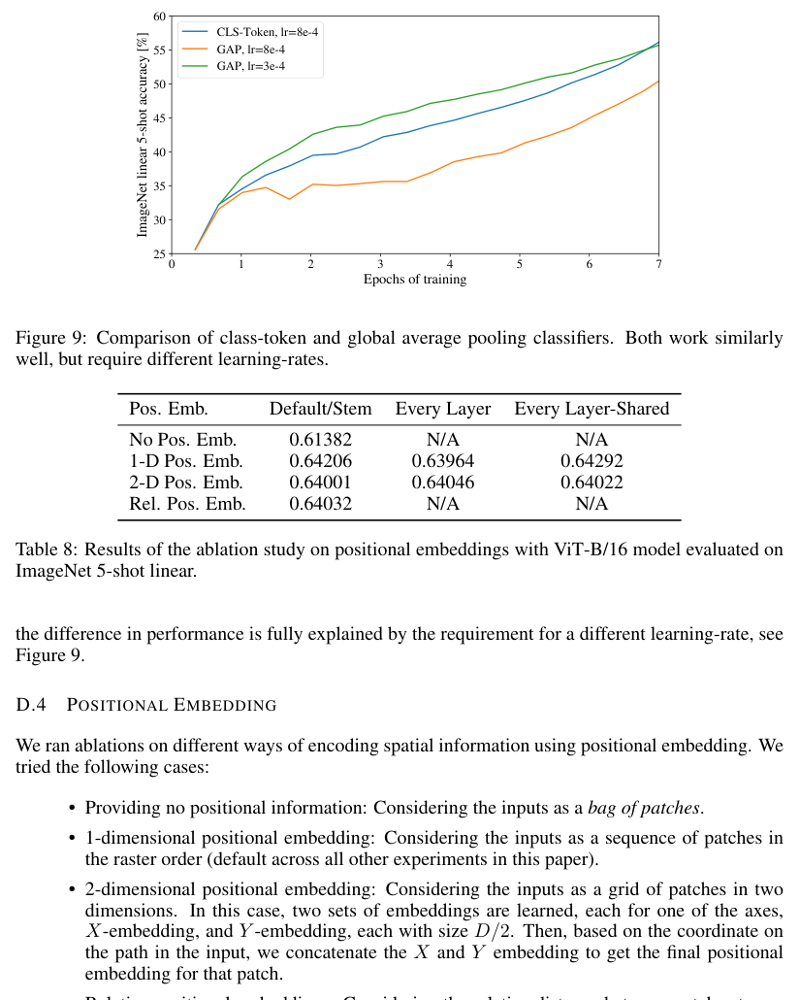

| 数据集（Dataset） | ResNet50 Adam | ResNet50 SGD | ResNet152x2 Adam | ResNet152x2 SGD |
|---|---|---|---|---|
| ImageNet | 77.54 | 78.24 | 84.97 | 84.37 |
| CIFAR10 | 97.67 | 97.46 | 99.06 | 99.07 |
| CIFAR100 | 86.07 | 85.17 | 92.05 | 91.06 |
| Oxford-IIIT Pets | 91.11 | 91.00 | 95.37 | 94.79 |
| Oxford Flowers-102 | 94.26 | 92.06 | 98.62 | 99.32 |
| 平均（Average） | 89.33 | 88.79 | 94.01 | 93.72 |

#### D.2 Transformer Shape

**Original:**

We ran ablations on scaling different dimensions of the Transformer architecture to find out which are best suited for scaling to very large models. Figure 8 shows 5-shot performance on ImageNet for different configurations. All configurations are based on a ViT model with 8 layers, D = 1024, D_MLP = 2048 and a patch size of 32, the intersection of all lines. We can see that scaling the depth results in the biggest improvements which are clearly visible up until 64 layers. However, diminishing returns are already visible after 16 layers. Interestingly, scaling the width of the network seems to result in the smallest changes. Decreasing the patch size and thus increasing the effective sequence length shows surprisingly robust improvements without introducing parameters. These findings suggest that compute might be a better predictor of performance than the number of parameters, and that scaling should emphasize depth over width if any. Overall, we find that scaling all dimensions proportionally results in robust improvements.

**中文:**

我们对 Transformer 架构不同维度的扩展做了消融实验（ablation study），以找出哪些维度最适合扩展到非常大的模型。图 8 展示了不同配置在 ImageNet 上的 5-shot 性能。所有配置都以一个有 8 层、D = 1024、D_MLP = 2048、图像块大小 32 的 ViT 模型为基准（即所有曲线的交点）。可以看到，加深深度带来的提升最大，且一直到 64 层都清晰可见。不过，16 层之后收益已经开始递减。有趣的是，加宽网络宽度似乎带来的变化最小。减小图像块大小、从而增加有效序列长度，在不引入参数的情况下带来了出人意料的稳健提升。这些发现表明，算力可能比参数量更能预测性能，且若要扩展，应优先加深而非加宽。总体而言，我们发现按比例扩展所有维度能带来稳健的提升。

> **图 8（译）**：扩展视觉 Transformer 不同模型维度的效果。（原图见 paper.pdf 第 16 页，[第 16 页图](assets/figures/fig-8.png)）

#### D.3 Head Type and Class Token

**Original:**

In order to stay as close as possible to the original Transformer model, we made use of an additional [class] token, which is taken as image representation. The output of this token is then transformed into a class prediction via a small multi-layer perceptron (MLP) with tanh as non-linearity in the single hidden layer.

**中文:**

为了尽可能接近原始 Transformer 模型，我们使用了一个额外的 [class] 词元作为图像表示。该词元的输出随后通过一个小型多层感知机（MLP）转换为类别预测，其单个隐藏层使用 tanh 作为非线性激活。

**Original:**

This design is inherited from the Transformer model for text, and we use it throughout the main paper. An initial attempt at using only image-patch embeddings, globally average-pooling (GAP) them, followed by a linear classifier—just like ResNet's final feature map—performed very poorly. However, we found that this is neither due to the extra token, nor to the GAP operation. Instead, the difference in performance is fully explained by the requirement for a different learning-rate, see Figure 9.

**中文:**

这一设计继承自文本 Transformer 模型，我们在正文中一直使用它。最初尝试只使用图像块嵌入、对其做全局平均池化（GAP）再接线性分类器——就像 ResNet 的最终特征图那样——表现非常差。然而，我们发现这既不是额外词元造成的，也不是 GAP 操作造成的。相反，性能差异完全可以用学习率需要不同来解释，见图 9。

> **图 9（译）**：class-token 与全局平均池化分类器的对比。两者效果相近，但需要不同的学习率。（原图见 paper.pdf 第 17 页，见下方图）

#### D.4 Positional Embedding

**Original:**

We ran ablations on different ways of encoding spatial information using positional embedding. We tried the following cases:

**中文:**

我们针对使用位置嵌入编码空间信息的不同方式做了消融实验。我们尝试了以下情形：

**Original:**

- Providing no positional information: Considering the inputs as a bag of patches.
- 1-dimensional positional embedding: Considering the inputs as a sequence of patches in the raster order (default across all other experiments in this paper).
- 2-dimensional positional embedding: Considering the inputs as a grid of patches in two dimensions. In this case, two sets of embeddings are learned, each for one of the axes, X-embedding, and Y-embedding, each with size D/2. Then, based on the coordinate on the path in the input, we concatenate the X and Y embedding to get the final positional embedding for that patch.
- Relative positional embeddings: Considering the relative distance between patches to encode the spatial information as instead of their absolute position. To do so, we use 1-dimensional Relative Attention, in which we define the relative distance all possible pairs of patches. Thus, for every given pair (one as query, and the other as key/value in the attention mechanism), we have an offset p_q − p_k, where each offset is associated with an embedding. Then, we simply run extra attention, where we use the original query (the content of query), but use relative positional embeddings as keys. We then use the logits from the relative attention as a bias term and add it to the logits of the main attention (content-based attention) before applying the softmax.

**中文:**

- **不提供位置信息**：把输入视为一堆无序的图像块（bag of patches）。
- **1 维位置嵌入**：把输入视为按光栅顺序排列的图像块序列（本文其他所有实验的默认设置）。
- **2 维位置嵌入**：把输入视为二维的图像块网格。此时学习两组嵌入，分别对应两个轴，X 嵌入和 Y 嵌入，各为 D/2 维。然后根据图像块在输入中的坐标，拼接 X 和 Y 嵌入，得到该图像块最终的位置嵌入。
- **相对位置嵌入**：用图像块之间的相对距离而非绝对位置来编码空间信息。为此，我们使用 1 维相对注意力（Relative Attention），在其中定义所有可能图像块对的相对距离。于是，对每一对（一个作为查询，另一个作为注意力机制中的键/值），都有一个偏移量 p_q − p_k，每个偏移量关联一个嵌入。然后我们简单地再运行一次额外的注意力：使用原始查询（查询的内容），但用相对位置嵌入作为键。之后，我们把相对注意力得到的 logits 作为偏置项，在应用 softmax 之前加到主注意力（基于内容的注意力）的 logits 上。

**Original:**

In addition to different ways of encoding spatial information, we also tried different ways of incorporating this information in our model. For the 1-dimensional and 2-dimensional positional embeddings, we tried three different cases: (1) add positional embeddings to the inputs right after the stem of them model and before feeding the inputs to the Transformer encoder (default across all other experiments in this paper); (2) learn and add positional embeddings to the inputs at the beginning of each layer; (3) add a learned positional embeddings to the inputs at the beginning of each layer (shared between layers).

**中文:**

除了编码空间信息的不同方式外，我们还尝试了把这一信息融入模型的不同方式。对于 1 维和 2 维位置嵌入，我们尝试了三种情形：(1) 在模型的起始部分之后、把输入送入 Transformer 编码器之前，把位置嵌入加到输入上（本文其他所有实验的默认设置）；(2) 在每一层开头学习并添加位置嵌入；(3) 在每一层开头添加学习到的位置嵌入（层间共享）。

**Original:**

Table 8 summarizes the results from this ablation study on a ViT-B/16 model. As we can see, while there is a large gap between the performances of the model with no positional embedding and models with positional embedding, there is little to no difference between different ways of encoding positional information. We speculate that since our Transformer encoder operates on patch-level inputs, as opposed to pixel-level, the differences in how to encode spatial information is less important. More precisely, in patch-level inputs, the spatial dimensions are much smaller than the original pixel-level inputs, e.g., 14 × 14 as opposed to 224 × 224, and learning to represent the spatial relations in this resolution is equally easy for these different positional encoding strategies. Even so, the specific pattern of position embedding similarity learned by the network depends on the training hyperparameters (Figure 10).

**中文:**

表 8 汇总了在 ViT-B/16 模型上这一消融实验的结果。可以看到，没有位置嵌入的模型与有位置嵌入的模型之间性能差距很大，但不同位置信息编码方式之间几乎没有差别。我们推测，由于我们的 Transformer 编码器在图像块级别（而非像素级别）的输入上运行，空间信息编码方式的差异就变得不那么重要了。更确切地说，在图像块级输入中，空间维度远小于原始像素级输入，例如 14 × 14 对比 224 × 224，在这种分辨率下学习表示空间关系，对这些不同的位置编码策略来说同样容易。即便如此，网络学习到的位置嵌入相似性的具体模式仍取决于训练超参数（图 10）。

> **表 8（译）**：用 ViT-B/16 模型在 ImageNet 5-shot linear 上评估的位置嵌入消融实验结果。（原图见 paper.pdf 第 17 页，[第 17 页图](assets/figures/tab-8.png)）

| 位置嵌入（Pos. Emb.） | 默认/起始处（Default/Stem） | 每层（Every Layer） | 每层共享（Every Layer-Shared） | 无位置嵌入（No Pos. Emb.） |
|---|---|---|---|---|
| 1-D 位置嵌入（1-D Pos. Emb.） | 0.64206 | 0.63964 | 0.64292 | 0.61382 |
| 2-D 位置嵌入（2-D Pos. Emb.） | 0.64001 | 0.64046 | 0.64022 | N/A |
| 相对位置嵌入（Rel. Pos. Emb.） | 0.64032 | N/A | N/A | N/A |

> **图 10（译）**：用不同超参数训练的模型的位置嵌入。（原图见 paper.pdf 第 18 页，见下方图）

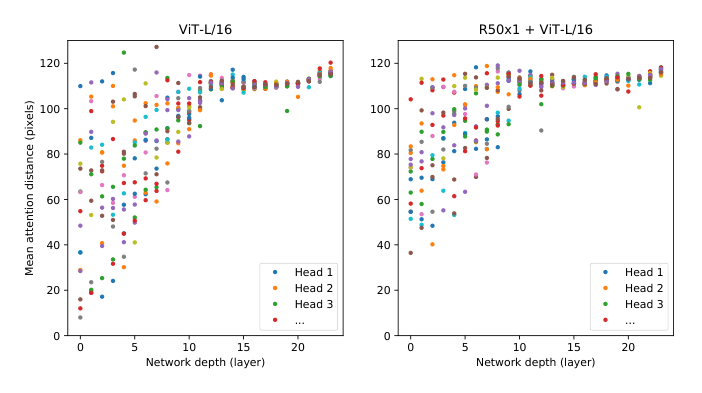

#### D.5 Empirical Computational Costs

**Original:**

We are also interested in real-world speed of the architectures on our hardware, which is not always well predicted by theoretical FLOPs due to details like lane widths and cache sizes. For this purpose, we perform timing of inference speed for the main models of interest, on a TPUv3 accelerator; the difference between inference and backprop speed is a constant model-independent factor.

**中文:**

我们还关心这些架构在我们硬件上的实际速度。由于通道宽度和缓存大小等细节，理论 FLOPs 往往不能很好地预测实际速度。为此，我们在 TPUv3 加速器上对主要模型的推理速度进行计时；推理速度与反向传播速度之间的差异是一个与模型无关的常数因子。

**Original:**

Figure 12 (left) shows how many images one core can handle per second, across various input sizes. Every single point refers to the peak performance measured across a wide range of batch-sizes. As can be seen, the theoretical bi-quadratic scaling of ViT with image size only barely starts happening for the largest models at the largest resolutions.

**中文:**

图 12（左）展示了在不同输入尺寸下，单个核心每秒能处理的图像数。每个点都是在广泛的批次大小范围内测得的最佳性能。可以看到，ViT 随图像尺寸的理论双二次增长，只在最大模型、最大分辨率下刚刚开始显现。

**Original:**

Another quantity of interest is the largest batch-size each model can fit onto a core, larger being better for scaling to large datasets. Figure 12 (right) shows this quantity for the same set of models. This shows that large ViT models have a clear advantage in terms of memory-efficiency over ResNet models.

**中文:**

另一个值得关注的量是每个模型能装入单个核心的最大批次大小，越大越有利于扩展到大型数据集。图 12（右）展示了同一组模型的这一数量。这表明，大型 ViT 模型在内存效率上明显优于 ResNet 模型。

> **图 12（译）**：左：各种架构在不同输入尺寸下的实际墙钟计时。ViT 模型的速度与相近规模的 ResNet 相当。右：各架构在不同输入尺寸下能装入设备的最大单核批次大小。ViT 模型的内存效率明显更高。（原图见 paper.pdf 第 19 页，见下方图）

#### D.6 Axial Attention

**Original:**

Axial Attention (Huang et al., 2020; Ho et al., 2019) is a simple, yet effective technique to run self-attention on large inputs that are organized as multidimensional tensors. The general idea of axial attention is to perform multiple attention operations, each along a single axis of the input tensor, instead of applying 1-dimensional attention to the flattened version of the input. In axial attention, each attention mixes information along a particular axis, while keeping information along the other axes independent. Along this line, Wang et al. (2020b) proposed the AxialResNet model in which all the convolutions with kernel size 3 × 3 in a ResNet50 are replaced by axial self-attention, i.e. a row and column attention, augmented by relative positional encoding. We have implemented AxialResNet as a baseline model.

**中文:**

轴向注意力（Axial Attention）（Huang et al., 2020; Ho et al., 2019）是一种简单而有效的技术，用于在组织为多维张量的大型输入上运行自注意力。轴向注意力的总体思想是执行多次注意力操作，每次只沿输入张量的单个轴进行，而不是对展平后的输入应用 1 维注意力。在轴向注意力中，每次注意力沿特定轴混合信息，同时保持沿其他轴的信息相互独立。沿这一思路，Wang et al. (2020b) 提出了 AxialResNet 模型，把 ResNet50 中所有卷积核为 3 × 3 的卷积替换为轴向自注意力，即行注意力和列注意力，并辅以相对位置编码。我们已把 AxialResNet 实现为基线模型。

> 脚注 3：Our implementation is based on the open-sourced PyTorch implementation in https://github.com/csrhddlam/axial-deeplab. In our experiments, we reproduced the scores reported in (Wang et al., 2020b) in terms of accuracy, however, our implementation, similar to the open-source implementation, is very slow on TPUs. Therefore, we were not able to use it for extensive large-scale experiments. These may be unlocked by a carefully optimized implementation.
>
> 译：我们的实现基于开源的 PyTorch 实现 https://github.com/csrhddlam/axial-deeplab。在我们的实验中，我们在准确率上复现了（Wang et al., 2020b）报告的分数，但我们的实现（与开源实现一样）在 TPU 上非常慢。因此，我们无法用它进行大规模实验。精心优化的实现也许能解锁这些实验。

**Original:**

Moreover, we have modified ViT to process inputs in the 2-dimensional shape, instead of a 1-dimensional sequence of patches, and incorporate Axial Transformer blocks, in which instead of a self-attention followed by an MLP, we have a a row-self-attention plus an MLP followed by a column-self-attention plus an MLP.

**中文:**

此外，我们修改了 ViT，使其以 2 维形状（而非 1 维图像块序列）处理输入，并引入 Axial Transformer 块：在其中，不再是「自注意力 + MLP」，而是「行自注意力 + MLP，之后是列自注意力 + MLP」。

**Original:**

Figure 13, present the performance of Axial ResNet, Axial-ViT-B/32 and Axial-ViT-B/16 on ImageNet 5shot linear, when pretrained on JFT dataset, verses the pretraining compute, both in terms of number of FLOPs and inference time (example per seconds). As we can see, both Axial-ViT-B/32 and Axial-ViT-B/16 do better than their ViT-B counterpart in terms of performance, but it comes at the cost of more compute. This is because in Axial-ViT models, each Transformer block with global self-attention is replaced by two Axial Transformer blocks, one with row and one with column self-attention and although the sequence length that self-attention operates on is smaller in axial case, there is a extra MLP per Axial-ViT block. For the AxialResNet, although it looks reasonable in terms of accuracy/compute trade-off (Figure 13, left), the naive implementation is extremely slow on TPUs (Figure 13, right).

**中文:**

图 13 展示了在 JFT 数据集上预训练后，AxialResNet、Axial-ViT-B/32 和 Axial-ViT-B/16 在 ImageNet 5-shot linear 上的性能与预训练算力的关系，算力分别以 FLOPs 数量和推理时间（每秒样本数）衡量。可以看到，Axial-ViT-B/32 和 Axial-ViT-B/16 在性能上都优于对应的 ViT-B，但代价是更多的计算量。这是因为在 Axial-ViT 模型中，每个带全局自注意力的 Transformer 块被替换为两个 Axial Transformer 块（一个行自注意力、一个列自注意力）；虽然轴向情形下自注意力作用的序列长度更小，但每个 Axial-ViT 块多了一个 MLP。对于 AxialResNet，尽管其准确率/算力权衡看起来合理（图 13，左），朴素的实现在 TPU 上极慢（图 13，右）。

> **图 13（译）**：基于轴向注意力的模型在 ImageNet 5-shot linear 上的 top-1 准确率与速度的对比，速度分别以 FLOPs 数量（左）和推理时间（右）衡量。（原图见 paper.pdf 第 20 页，见下方图）

#### D.7 Attention Distance

**Original:**

To understand how ViT uses self-attention to integrate information across the image, we analyzed the average distance spanned by attention weights at different layers (Figure 11). This "attention distance" is analogous to receptive field size in CNNs. Average attention distance is highly variable across heads in lower layers, with some heads attending to much of the image, while others attend to small regions at or near the query location. As depth increases, attention distance increases for all heads. In the second half of the network, most heads attend widely across tokens.

**中文:**

为了理解 ViT 如何用自注意力整合图像中的信息，我们分析了不同层中注意力权重所跨越的平均距离（图 11）。这个「注意力距离」类似于 CNN 中的感受野大小。在较低层中，各注意力头的平均注意力距离差异很大：有些头关注图像的大部分区域，而另一些头只关注查询位置处或其附近的小区域。随着深度增加，所有头的注意力距离都在增大。在网络的后半部分，大多数头广泛地关注各个词元。

> **图 11（译）**：按注意力头和网络深度划分的被关注区域大小。注意力距离是在 128 张示例图像上计算的：对每张图像，把查询像素与所有其他像素之间的距离按注意力权重加权平均。每个点表示某一层 16 个头之一在所有图像上的平均注意力距离。图像宽度为 224 像素。（原图见 paper.pdf 第 18 页，[第 18 页图](assets/figures/fig-11.png)）

#### D.8 Attention Maps

**Original:**

To compute maps of the attention from the output token to the input space (Figures 6 and 14), we used Attention Rollout (Abnar & Zuidema, 2020). Briefly, we averaged attention weights of ViT-L/16 across all heads and then recursively multiplied the weight matrices of all layers. This accounts for the mixing of attention across tokens through all layers.

**中文:**

为了计算从输出词元到输入空间的注意力图（图 6 和图 14），我们使用了 Attention Rollout（Abnar & Zuidema, 2020）。简要地说，我们对 ViT-L/16 的所有注意力头的注意力权重取平均，然后递归地乘上所有层的权重矩阵。这考虑了注意力在各词元之间、跨所有层的混合效应。

#### D.9 ObjectNet Results

**Original:**

We also evaluate our flagship ViT-H/14 model on the ObjectNet benchmark following the evaluation setup in Kolesnikov et al. (2020), resulting in 82.1% top-5 accuracy and 61.7% top-1 accuracy.

**中文:**

我们还按照 Kolesnikov et al. (2020) 的评估设置，在 ObjectNet 基准上评估了旗舰模型 ViT-H/14，得到 82.1% 的 top-5 准确率和 61.7% 的 top-1 准确率。

#### D.10 VTAB Breakdown

**Original:**

Table 9 shows the scores attained on each of the VTAB-1k tasks.

**中文:**

表 9 展示了在 VTAB-1k 每个任务上取得的分数。

> **表 9（译）**：VTAB-1k 各任务性能分解。（原图见 paper.pdf 第 22 页，见下方图）

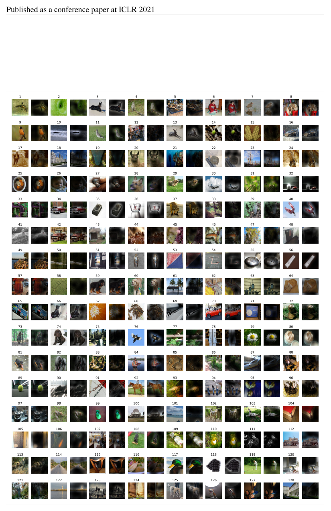

| 模型 | Caltech101 | CIFAR-100 | DTD | Flowers102 | Pets | Sun397 | SVHN | Camelyon | EuroSAT | Resisc45 | Retinopathy | Clevr-Count | Clevr-Dist | DMLab | dSpr-Loc | dSpr-Ori | KITTI-Dist | sNORB-Azim | sNORB-Elev | Mean |
|---|---|---|---|---|---|---|---|---|---|---|---|---|---|---|---|---|---|---|---|---|
| ViT-H/14 (JFT) | 95.3 | 85.5 | 75.2 | 99.7 | 97.2 | 65.0 | 88.9 | 83.3 | 96.7 | 91.4 | 76.6 | 91.7 | 63.8 | 53.1 | 79.4 | 63.3 | 84.5 | 33.2 | 51.2 | 77.6 |
| ViT-L/16 (JFT) | 95.4 | 81.9 | 74.3 | 99.7 | 96.7 | 63.5 | 87.4 | 83.6 | 96.5 | 89.7 | 77.1 | 86.4 | 63.1 | 49.7 | 74.5 | 60.5 | 82.2 | 36.2 | 51.1 | 76.3 |
| ViT-L/16 (I21k) | 90.8 | 84.1 | 74.1 | 99.3 | 92.7 | 61.0 | 80.9 | 82.5 | 95.6 | 85.2 | 75.3 | 70.3 | 56.1 | 41.9 | 74.7 | 64.9 | 79.9 | 30.5 | 41.7 | 72.7 |

> **图 14（译）**：与图 6 相同的更多注意力图示例（随机选取）。（原图见 paper.pdf 第 21 页，见下方图）

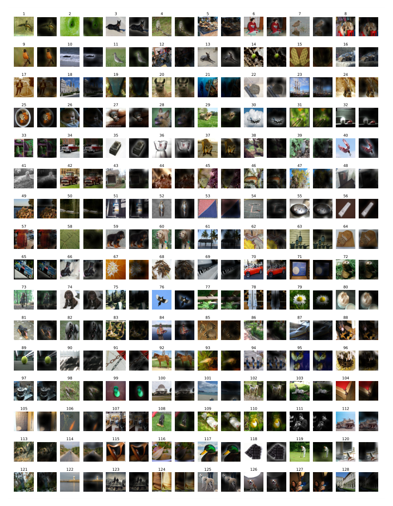
