# Learning Transferable Visual Models From Natural Language Supervision / 从自然语言监督中学习可迁移的视觉模型

**Original:** Alec Radford \*¹ Jong Wook Kim \*¹ Chris Hallacy¹ Aditya Ramesh¹ Gabriel Goh¹ Sandhini Agarwal¹ Girish Sastry¹ Amanda Askell¹ Pamela Mishkin¹ Jack Clark¹ Gretchen Krueger¹ Ilya Sutskever¹

**中文:** Alec Radford *¹ Jong Wook Kim *¹ Chris Hallacy¹ Aditya Ramesh¹ Gabriel Goh¹ Sandhini Agarwal¹ Girish Sastry¹ Amanda Askell¹ Pamela Mishkin¹ Jack Clark¹ Gretchen Krueger¹ Ilya Sutskever¹

**Original:** \*Equal contribution ¹OpenAI, San Francisco, CA 94110, USA. Correspondence to: <{alec, jongwook}@openai.com>.

**中文:** \*共同第一作者。¹OpenAI，美国加利福尼亚州旧金山市，邮编 94110。通讯邮箱：<{alec, jongwook}@openai.com>。

arXiv:2103.00020v1 [cs.CV] 26 Feb 2021

## Abstract / 摘要

**Original:** State-of-the-art computer vision systems are trained to predict a fixed set of predetermined object categories. This restricted form of supervision limits their generality and usability since additional labeled data is needed to specify any other visual concept. Learning directly from raw text about images is a promising alternative which leverages a much broader source of supervision. We demonstrate that the simple pre-training task of predicting which caption goes with which image is an efficient and scalable way to learn SOTA image representations from scratch on a dataset of 400 million (image, text) pairs collected from the internet.

**中文:** 当前最优（state-of-the-art，简称 SOTA）的计算机视觉系统被训练来预测一组固定的、预先确定的物体类别。这种受限的监督形式限制了它们的通用性和可用性，因为指定任何其他视觉概念都需要额外的标注数据。直接从关于图像的原始文本中学习是一种有前景的替代方案，它利用了范围广得多的监督来源。我们证明：在从互联网收集的 4 亿个（图像，文本）对上，预测哪个图像说明文字（caption）与哪张图像相匹配这一简单的预训练任务，是从零开始高效且可扩展地学习 SOTA 图像表示的方法。

**Original:** After pre-training, natural language is used to reference learned visual concepts (or describe new ones) enabling zero-shot transfer of the model to downstream tasks. We study the performance of this approach by benchmarking on over 30 different existing computer vision datasets, spanning tasks such as OCR, action recognition in videos, geo-localization, and many types of fine-grained object classification. The model transfers non-trivially to most tasks and is often competitive with a fully supervised baseline without the need for any dataset specific training. For instance, we match the accuracy of the original ResNet-50 on ImageNet zero-shot without needing to use any of the 1.28 million training examples it was trained on. We release our code and pre-trained model weights at https://github.com/OpenAI/CLIP.

**中文:** 预训练之后，自然语言被用来指代学到的视觉概念（或描述新概念），从而使模型能够零样本迁移（zero-shot transfer）到下游任务。我们通过在超过 30 个不同的现有计算机视觉数据集上进行基准测试来研究这一方法的性能，这些数据集涵盖光学字符识别（OCR）、视频中的动作识别（action recognition）、地理定位（geo-localization）以及多种类型的细粒度物体分类等任务。该模型在大多数任务上都能有效迁移，且往往无需任何数据集特定的训练即可与全监督基线（baseline）相媲美。例如，我们在 ImageNet 上零样本匹配了原始 ResNet-50 的准确率，而无需使用它训练时所用的任何一张训练图像（共 128 万张）。我们在 https://github.com/OpenAI/CLIP 发布代码与预训练模型权重。

## 1. Introduction and Motivating Work / 1. 引言与前期工作

**Original:** Pre-training methods which learn directly from raw text have revolutionized NLP over the last few years (Dai & Le, 2015; Peters et al., 2018; Howard & Ruder, 2018; Radford et al., 2018; Devlin et al., 2018; Raffel et al., 2019). Task-agnostic objectives such as autoregressive and masked language modeling have scaled across many orders of magnitude in compute, model capacity, and data, steadily improving capabilities. The development of "text-to-text" as a standardized input-output interface (McCann et al., 2018; Radford et al., 2019; Raffel et al., 2019) has enabled task-agnostic architectures to zero-shot transfer to downstream datasets removing the need for specialized output heads or dataset specific customization. Flagship systems like GPT-3 (Brown et al., 2020) are now competitive across many tasks with bespoke models while requiring little to no dataset specific training data.

**中文:** 过去几年里，直接从原始文本学习的预训练方法彻底改变了自然语言处理（NLP）领域（Dai & Le, 2015; Peters et al., 2018; Howard & Ruder, 2018; Radford et al., 2018; Devlin et al., 2018; Raffel et al., 2019）。自回归（autoregressive）和掩码语言建模（masked language modeling）这类与任务无关的目标函数，已经在计算量、模型容量和数据规模上跨越多个数量级扩展，能力稳步提升。"文本到文本"（text-to-text）作为标准化输入输出接口的发展（McCann et al., 2018; Radford et al., 2019; Raffel et al., 2019），使得与任务无关的架构能够零样本迁移到下游数据集，无需专门的输出头或数据集特定的定制。像 GPT-3（Brown et al., 2020）这样的旗舰系统现在在许多任务上已能与定制模型竞争，而只需很少甚至不需要数据集特定的训练数据。

**Original:** These results suggest that the aggregate supervision accessible to modern pre-training methods within web-scale collections of text surpasses that of high-quality crowd-labeled NLP datasets. However, in other fields such as computer vision it is still standard practice to pre-train models on crowd-labeled datasets such as ImageNet (Deng et al., 2009). Could scalable pre-training methods which learn directly from web text result in a similar breakthrough in computer vision? Prior work is encouraging.

**中文:** 这些结果表明，现代预训练方法在网络规模的文本集合中所能获得的总监督量，超过了高质量众包标注的 NLP 数据集。然而，在计算机视觉等其他领域，在 ImageNet（Deng et al., 2009）这类众包标注数据集上预训练模型仍然是标准做法。可扩展的、直接从网络文本学习的预训练方法能否在计算机视觉领域带来类似的突破？前期工作令人鼓舞。

**Original:** Over 20 years ago Mori et al. (1999) explored improving content based image retrieval by training a model to predict the nouns and adjectives in text documents paired with images. Quattoni et al. (2007) demonstrated it was possible to learn more data efficient image representations via manifold learning in the weight space of classifiers trained to predict words in captions associated with images. Srivastava & Salakhutdinov (2012) explored deep representation learning by training multimodal Deep Boltzmann Machines on top of low-level image and text tag features. Joulin et al. (2016) modernized this line of work and demonstrated that CNNs trained to predict words in image captions learn useful image representations. They converted the title, description, and hashtag metadata of images in the YFCC100M dataset (Thomee et al., 2016) into a bag-of-words multi-label classification task and showed that pre-training AlexNet (Krizhevsky et al., 2012) to predict these labels learned representations which preformed similarly to ImageNet-based pre-training on transfer tasks. Li et al. (2017) then extended this approach to predicting phrase n-grams in addition to individual words and demonstrated the ability of their system to zero-shot transfer to other image classification datasets by scoring target classes based on their dictionary of learned visual n-grams and predicting the one with the highest score.

**中文:** 20 多年前，Mori et al. (1999) 探索了通过训练模型预测与图像配对的文本文档中的名词和形容词来改进基于内容的图像检索。Quattoni et al. (2007) 证明了通过在预测图像说明文字中单词的分类器的权重空间中进行流形学习，可以学到数据效率更高的图像表示。Srivastava & Salakhutdinov (2012) 通过在低层图像与文本标签特征之上训练多模态深度玻尔兹曼机来探索深度表示学习。Joulin et al. (2016) 将这一研究方向现代化，证明了训练来预测图像说明文字中单词的 CNN 能学到有用的图像表示。他们把 YFCC100M 数据集（Thomee et al., 2016）中图像的标题、描述和 hashtag 元数据转化为词袋（bag-of-words）多标签分类任务，并表明预训练 AlexNet（Krizhevsky et al., 2012）来预测这些标签所学的表示，在迁移任务上的表现与基于 ImageNet 的预训练相似。Li et al. (2017) 随后将这一方法扩展到预测短语 n-gram 而不仅是个别单词，并证明了他们的系统能够零样本迁移到其他图像分类数据集：根据其学到的视觉 n-gram 词典为目标类别打分，并预测得分最高的类别。

**Original:** Adopting more recent architectures and pre-training approaches, VirTex (Desai & Johnson, 2020), ICMLM (Bulent Sariyildiz et al., 2020), and ConVIRT (Zhang et al., 2020) have recently demonstrated the potential of transformer-based language modeling, masked language modeling, and contrastive objectives to learn image representations from text.

**中文:** 采用更新的架构与预训练方法，VirTex（Desai & Johnson, 2020）、ICMLM（Bulent Sariyildiz et al., 2020）和 ConVIRT（Zhang et al., 2020）最近证明了基于 Transformer 的语言建模、掩码语言建模以及对比（contrastive）目标函数从文本中学习图像表示的潜力。

**Original:** While exciting as proofs of concept, using natural language supervision for image representation learning is still rare. This is likely because demonstrated performance on common benchmarks is much lower than alternative approaches. For example, Li et al. (2017) reach only 11.5% accuracy on ImageNet in a zero-shot setting. This is well below the 88.4% accuracy of the current state of the art (Xie et al., 2020). It is even below the 50% accuracy of classic computer vision approaches (Deng et al., 2012). Instead, more narrowly scoped but well-targeted uses of weak supervision have improved performance. Mahajan et al. (2018) showed that predicting ImageNet-related hashtags on Instagram images is an effective pre-training task. When fine-tuned to ImageNet these pre-trained models increased accuracy by over 5% and improved the overall state of the art at the time. Kolesnikov et al. (2019) and Dosovitskiy et al. (2020) have also demonstrated large gains on a broader set of transfer benchmarks by pre-training models to predict the classes of the noisily labeled JFT-300M dataset.

**中文:** 虽然作为概念验证令人兴奋，但用自然语言监督进行图像表示学习仍然很少见。这可能是因为其在常见基准测试上的表现远低于其他方法。例如，Li et al. (2017) 在零样本设定下在 ImageNet 上仅达到 11.5% 的准确率，远低于当时 88.4% 的当前最优水平（Xie et al., 2020），甚至低于经典计算机视觉方法 50% 的准确率（Deng et al., 2012）。相反，范围更窄但目标明确的弱监督用法提升了性能。Mahajan et al. (2018) 表明，在 Instagram 图像上预测与 ImageNet 相关的 hashtag 是一项有效的预训练任务。微调（fine-tuning）到 ImageNet 后，这些预训练模型的准确率提高了 5% 以上，并提升了当时的整体最优水平。Kolesnikov et al. (2019) 和 Dosovitskiy et al. (2020) 也通过在噪声标注的 JFT-300M 数据集上预训练模型来预测类别，在更广泛的迁移基准测试上展示了大幅提升。

**Original:** This line of work represents the current pragmatic middle ground between learning from a limited amount of supervised "gold-labels" and learning from practically unlimited amounts of raw text. However, it is not without compromises. Both works carefully design, and in the process limit, their supervision to 1000 and 18291 classes respectively. Natural language is able to express, and therefore supervise, a much wider set of visual concepts through its generality. Both approaches also use static softmax classifiers to perform prediction and lack a mechanism for dynamic outputs. This severely curtails their flexibility and limits their "zero-shot" capabilities.

**中文:** 这一研究方向代表了当前在"从有限的监督金标签学习"与"从几乎无限的原始文本学习"之间的务实中间地带。然而它并非没有妥协。两项工作都精心设计了它们的监督信号，并在此过程中将其分别限制为 1000 和 18291 个类别。自然语言凭借其通用性，能够表达并因此监督范围广泛得多的视觉概念。这两种方法还都使用静态 Softmax 分类器进行预测，缺乏动态输出的机制。这严重削弱了它们的灵活性，并限制了它们的"零样本"能力。

**Original:** A crucial difference between these weakly supervised models and recent explorations of learning image representations directly from natural language is scale. While Mahajan et al. (2018) and Kolesnikov et al. (2019) trained their models for accelerator years on millions to billions of images, VirTex, ICMLM, and ConVIRT trained for accelerator days on one to two hundred thousand images. In this work, we close this gap and study the behaviors of image classifiers trained with natural language supervision at large scale. Enabled by the large amounts of publicly available data of this form on the internet, we create a new dataset of 400 million (image, text) pairs and demonstrate that a simplified version of ConVIRT trained from scratch, which we call CLIP, for Contrastive Language-Image Pre-training, is an efficient method of learning from natural language supervision. We study the scalability of CLIP by training a series of eight models spanning almost 2 orders of magnitude of compute and observe that transfer performance is a smoothly predictable function of compute (Hestness et al., 2017; Kaplan et al., 2020). We find that CLIP, similar to the GPT family, learns to perform a wide set of tasks during pre-training including OCR, geo-localization, action recognition, and many others. We measure this by benchmarking the zero-shot transfer performance of CLIP on over 30 existing datasets and find it can be competitive with prior task-specific supervised models.

**中文:** 这些弱监督模型与近期直接从自然语言学习图像表示的探索之间的关键区别在于规模。Mahajan et al. (2018) 和 Kolesnikov et al. (2019) 在数百万到数十亿张图像上训练了模型数个加速器年，而 VirTex、ICMLM 和 ConVIRT 只在一二十万张图像上训练了数个加速器天。在这项工作中，我们弥补了这一差距，研究在大规模上用自然语言监督训练的图像分类器的行为。借助互联网上这类形式的海量公开数据，我们创建了一个包含 4 亿个（图像，文本）对的新数据集，并证明从零开始训练的 ConVIRT 简化版——我们称之为 CLIP，即对比语言-图像预训练（Contrastive Language-Image Pre-training）——是一种从自然语言监督中学习的高效方法。我们通过训练一系列跨越近两个数量级计算量的八个模型来研究 CLIP 的可扩展性，并观察到迁移性能是计算量的平滑可预测函数（Hestness et al., 2017; Kaplan et al., 2020）。我们发现 CLIP 与 GPT 系列类似，在预训练期间学会执行广泛的任务，包括 OCR、地理定位、动作识别等许多任务。我们通过在超过 30 个现有数据集上对 CLIP 的零样本迁移性能进行基准测试来衡量这一点，发现它可以与先前任务特定的监督模型相媲美。

**Original:** We also confirm these findings with linear-probe representation learning analysis and show that CLIP outperforms the best publicly available ImageNet model while also being more computationally efficient. We additionally find that zero-shot CLIP models are much more robust than equivalent accuracy supervised ImageNet models which suggests that zero-shot evaluation of task-agnostic models is much more representative of a model's capability. These results have significant policy and ethical implications, which we consider in Section 7.

**中文:** 我们还通过线性探针（linear probe）的表示学习分析确认了这些发现，并表明 CLIP 优于最好的公开可用 ImageNet 模型，同时计算效率也更高。我们还发现，零样本 CLIP 模型比同等准确率的监督 ImageNet 模型鲁棒性（robustness）强得多，这表明对任务无关模型进行零样本评估更能代表模型的能力。这些结果具有重大的政策与伦理意义，我们将在第 7 节中讨论。

## 2. Approach / 2. 方法

### 2.1. Natural Language Supervision / 2.1. 自然语言监督

**Original:** At the core of our approach is the idea of learning perception from supervision contained in natural language. As discussed in the introduction, this is not at all a new idea, however terminology used to describe work in this space is varied, even seemingly contradictory, and stated motivations are diverse. Zhang et al. (2020), Gomez et al. (2017), Joulin et al. (2016), and Desai & Johnson (2020) all introduce methods which learn visual representations from text paired with images but describe their approaches as unsupervised, self-supervised, weakly supervised, and supervised respectively.

**中文:** 我们方法的核心思想是：从自然语言所含的监督信号中学习感知。如引言中所讨论的，这绝非新想法，但描述这一领域工作的术语五花八门，甚至看似相互矛盾，所宣称的动机也各不相同。Zhang et al. (2020)、Gomez et al. (2017)、Joulin et al. (2016) 和 Desai & Johnson (2020) 都提出了从与图像配对的文本中学习视觉表示的方法，却分别把自己的方法描述为无监督、自监督、弱监督和监督的。

**Original:** We emphasize that what is common across this line of work is not any of the details of the particular methods used but the appreciation of natural language as a training signal. All these approaches are learning from natural language supervision. Although early work wrestled with the complexity of natural language when using topic model and n-gram representations, improvements in deep contextual representation learning suggest we now have the tools to effectively leverage this abundant source of supervision (McCann et al., 2017).

**中文:** 我们强调，这一系列工作的共同点不在于所用具体方法的任何细节，而在于把自然语言视为一种训练信号。所有这些方法都是在从自然语言监督中学习。尽管早期工作在采用主题模型和 n-gram 表示时与自然语言的复杂性搏斗，深度上下文表示学习的进步表明我们现在已拥有有效利用这一丰富监督来源的工具（McCann et al., 2017）。

**Original:** Learning from natural language has several potential strengths over other training methods. It's much easier to scale natural language supervision compared to standard crowd-sourced labeling for image classification since it does not require annotations to be in a classic "machine learning compatible format" such as the canonical 1-of-N majority vote "gold label". Instead, methods which work on natural language can learn passively from the supervision contained in the vast amount of text on the internet. Learning from natural language also has an important advantage over most unsupervised or self-supervised learning approaches in that it doesn't "just" learn a representation but also connects that representation to language which enables flexible zero-shot transfer. In the following subsections, we detail the specific approach we settled on.

**中文:** 与其他训练方法相比，从自然语言中学习有几个潜在优势。与图像分类的标准众包标注相比，自然语言监督的规模扩展要容易得多，因为它不要求标注采用经典的"机器学习兼容格式"，比如规范的 1-of-N 多数投票"金标签"。相反，处理自然语言的方法可以从互联网上海量文本所含的监督中被动地学习。与大多数无监督或自监督学习方法相比，从自然语言中学习还有一个重要优势：它不"仅仅"学习一个表示，还把该表示与语言连接起来，从而实现灵活的零样本迁移。在下面的小节中，我们详细说明最终采用的具体方法。

### 2.2. Creating a Sufficiently Large Dataset / 2.2. 构建足够大的数据集

**Original:** Existing work has mainly used three datasets, MS-COCO (Lin et al., 2014), Visual Genome (Krishna et al., 2017), and YFCC100M (Thomee et al., 2016). While MS-COCO and Visual Genome are high quality crowd-labeled datasets, they are small by modern standards with approximately 100,000 training photos each. By comparison, other computer vision systems are trained on up to 3.5 billion Instagram photos (Mahajan et al., 2018). YFCC100M, at 100 million photos, is a possible alternative, but the metadata for each image is sparse and of varying quality. Many images use automatically generated filenames like 20160716 113957.JPG as "titles" or contain "descriptions" of camera exposure settings. After filtering to keep only images with natural language titles and/or descriptions in English, the dataset shrunk by a factor of 6 to only 15 million photos. This is approximately the same size as ImageNet.

**中文:** 现有工作主要使用三个数据集：MS-COCO（Lin et al., 2014）、Visual Genome（Krishna et al., 2017）和 YFCC100M（Thomee et al., 2016）。MS-COCO 和 Visual Genome 虽然是高质量的众包标注数据集，但按现代标准来看规模很小，各只有约 10 万张训练照片。相比之下，其他计算机视觉系统最多在 35 亿张 Instagram 照片上训练（Mahajan et al., 2018）。拥有 1 亿张照片的 YFCC100M 是一个可能的替代方案，但每张图像的元数据稀疏且质量参差不齐。许多图像使用自动生成的文件名（如 20160716 113957.JPG）作为"标题"，或包含相机曝光设置的"描述"。经过筛选，只保留带有英文自然语言标题和/或描述的图像后，数据集缩水为原来的六分之一，仅剩 1500 万张照片，与 ImageNet 的规模大致相当。

**Original:** A major motivation for natural language supervision is the large quantities of data of this form available publicly on the internet. Since existing datasets do not adequately reflect this possibility, considering results only on them would underestimate the potential of this line of research. To address this, we constructed a new dataset of 400 million (image, text) pairs collected form a variety of publicly available sources on the Internet. To attempt to cover as broad a set of visual concepts as possible, we search for (image, text) pairs as part of the construction process whose text includes one of a set of 500,000 queries.¹ We approximately class balance the results by including up to 20,000 (image, text) pairs per query. The resulting dataset has a similar total word count as the WebText dataset used to train GPT-2. We refer to this dataset as WIT for WebImageText.

**中文:** 自然语言监督的一大动机，是互联网上公开可用的这类形式的数据数量巨大。由于现有数据集不能充分体现这种可能性，只在它们上面考虑结果会低估这一研究方向的潜力。为解决这一问题，我们构建了一个包含 4 亿个（图像，文本）对的新数据集，收集自互联网上各种公开来源。为了尽量覆盖尽可能广泛的视觉概念，我们在构建过程中搜索文本包含 50 万个查询词之一的（图像，文本）对。¹我们通过每个查询最多收录 20,000 个（图像，文本）对来近似平衡各类别。所得数据集的总词数与训练 GPT-2 所用的 WebText 数据集相当。我们把该数据集称为 WIT（WebImageText）。

**Original:** ¹The base query list is all words occurring at least 100 times in the English version of Wikipedia. This is augmented with bi-grams with high pointwise mutual information as well as the names of all Wikipedia articles above a certain search volume. Finally all WordNet synsets not already in the query list are added.

**中文:** ¹基础查询词列表是英文版维基百科中出现至少 100 次的所有单词。在此基础上补充了点互信息高的双词组合（bi-gram），以及搜索量超过一定阈值的所有维基百科词条名称。最后，所有尚未在查询词列表中的 WordNet 同义词集也被加入。

### 2.3. Selecting an Efficient Pre-Training Method / 2.3. 选择高效的预训练方法

**Original:** State-of-the-art computer vision systems use very large amounts of compute. Mahajan et al. (2018) required 19 GPU years to train their ResNeXt101-32x48d and Xie et al. (2020) required 33 TPUv3 core-years to train their Noisy Student EfficientNet-L2. When considering that both these systems were trained to predict only 1000 ImageNet classes, the task of learning an open set of visual concepts from natural language seems daunting. In the course of our efforts, we found training efficiency was key to successfully scaling natural language supervision and we selected our final pre-training method based on this metric.

**中文:** 当前最优的计算机视觉系统使用非常庞大的计算量。Mahajan et al. (2018) 训练 ResNeXt101-32x48d 需要 19 GPU 年，Xie et al. (2020) 训练 Noisy Student EfficientNet-L2 需要 33 TPUv3 核心年。考虑到这两个系统都只是被训练来预测 1000 个 ImageNet 类别，从自然语言中学习开放视觉概念集合的任务就显得十分艰巨。在我们的努力过程中，我们发现训练效率是成功扩展自然语言监督的关键，并据此选择了最终的预训练方法。

**Original:** Our initial approach, similar to VirTex, jointly trained an image CNN and text transformer from scratch to predict the caption of an image. However, we encountered difficulties efficiently scaling this method. In Figure 2 we show that a 63 million parameter transformer language model, which already uses twice the compute of its ResNet-50 image encoder, learns to recognize ImageNet classes three times slower than a much simpler baseline that predicts a bag-of-words encoding of the same text.

**中文:** 我们最初的方法与 VirTex 类似，从零开始联合训练图像 CNN 和文本 Transformer 来预测图像的说明文字。然而，我们在高效扩展该方法时遇到了困难。如图 2 所示，一个 6300 万参数的 Transformer 语言模型——其计算量已经是其 ResNet-50 图像编码器的两倍——学习识别 ImageNet 类别的速度，比预测同一文本词袋编码的简单得多的基线慢三倍。

**Original:** Both these approaches share a key similarity. They try to predict the exact words of the text accompanying each image. This is a difficult task due to the wide variety of descriptions, comments, and related text that co-occur with images. Recent work in contrastive representation learning for images has found that contrastive objectives can learn better representations than their equivalent predictive objective (Tian et al., 2019). Other work has found that although generative models of images can learn high quality image representations, they require over an order of magnitude more compute than contrastive models with the same performance (Chen et al., 2020a). Noting these findings, we explored training a system to solve the potentially easier proxy task of predicting only which text as a whole is paired with which image and not the exact words of that text. Starting with the same bag-of-words encoding baseline, we swapped the predictive objective for a contrastive objective in Figure 2 and observed a further 4x efficiency improvement in the rate of zero-shot transfer to ImageNet.

**中文:** 这两种方法有一个关键的相似之处：它们都试图预测与每张图像配对的文本中的确切单词。由于与图像共现的描述、评论和相关文本种类繁多，这是一项困难的任务。近期图像对比表示学习的研究发现，对比目标函数能学到比同等预测目标函数更好的表示（Tian et al., 2019）。另有研究发现，尽管图像生成模型能学到高质量的图像表示，但达到相同性能所需的计算量比对比模型高出一个数量级以上（Chen et al., 2020a）。注意到这些发现，我们探索训练一个系统来解决可能更简单的代理任务：只预测哪段文本整体上与哪张图像配对，而不预测该文本的确切单词。从同样的词袋编码基线出发，我们在图 2 中把预测目标函数换成对比目标函数，观察到零样本迁移到 ImageNet 的速度又提升了 4 倍效率。

**Original:** Given a batch of N (image, text) pairs, CLIP is trained to predict which of the N × N possible (image, text) pairings across a batch actually occurred. To do this, CLIP learns a multi-modal embedding space by jointly training an image encoder and text encoder to maximize the cosine similarity of the image and text embeddings of the N real pairs in the batch while minimizing the cosine similarity of the embeddings of the N² − N incorrect pairings. We optimize a symmetric cross entropy loss over these similarity scores. In Figure 3 we include pseudocode of the core of an implementation of CLIP. To our knowledge this batch construction technique and objective was first introduced in the area of deep metric learning as the multi-class N-pair loss Sohn (2016), was popularized for contrastive representation learning by Oord et al. (2018) as the InfoNCE loss, and was recently adapted for contrastive (text, image) representation learning in the domain of medical imaging by Zhang et al. (2020).

**中文:** 给定一个包含 N 个（图像，文本）对的批次，CLIP 被训练来预测批次内 N × N 种可能的（图像，文本）配对中哪些真实发生过。为此，CLIP 通过联合训练一个图像编码器和一个文本编码器来学习多模态嵌入空间：最大化批次内 N 个真实对的图像与文本嵌入的余弦相似度（cosine similarity），同时最小化 N² − N 个错误配对的嵌入的余弦相似度。我们在这些相似度分数上优化对称的交叉熵损失。图 3 中给出了 CLIP 实现核心的伪代码。据我们所知，这种批次构建技术与目标函数最早由 Sohn (2016) 在深度度量学习领域以多类 N-pair 损失的形式提出，被 Oord et al. (2018) 以 InfoNCE 损失之名在对比表示学习中推广，最近由 Zhang et al. (2020) 在医学成像领域改编用于对比（文本，图像）表示学习。

**Original:** Due to the large size of our pre-training dataset, over-fitting is not a major concern and the details of training CLIP are simplified compared to the implementation of Zhang et al. (2020). We train CLIP from scratch without initializing the image encoder with ImageNet weights or the text encoder with pre-trained weights. We do not use the non-linear projection between the representation and the contrastive embedding space, a change which was introduced by Bachman et al. (2019) and popularized by Chen et al. (2020b). We instead use only a linear projection to map from each encoder's representation to the multi-modal embedding space. We did not notice a difference in training efficiency between the two versions and speculate that non-linear projections may be co-adapted with details of current image only in self-supervised representation learning methods. We also remove the text transformation function t_u from Zhang et al. (2020) which samples a single sentence at uniform from the text since many of the (image, text) pairs in CLIP's pre-training dataset are only a single sentence. We also simplify the image transformation function t_v. A random square crop from resized images is the only data augmentation used during training. Finally, the temperature parameter which controls the range of the logits in the softmax, τ, is directly optimized during training as a log-parameterized multiplicative scalar to avoid turning as a hyper-parameter.

**中文:** 由于我们的预训练数据集规模庞大，过拟合不是主要顾虑，与 Zhang et al. (2020) 的实现相比，CLIP 的训练细节得以简化。我们从零开始训练 CLIP：图像编码器不用 ImageNet 权重初始化，文本编码器也不用预训练权重初始化。我们不使用表示与对比嵌入空间之间的非线性投影——这一改动由 Bachman et al. (2019) 引入、由 Chen et al. (2020b) 推广。我们只用一个线性投影把每个编码器的表示映射到多模态嵌入空间。我们没有观察到两个版本在训练效率上有差异，并推测非线性投影可能只与自监督表示学习方法中当前图像相关的细节协同适应。我们还去掉了 Zhang et al. (2020) 中的文本变换函数 t_u（从文本中均匀采样单个句子），因为 CLIP 预训练数据集中许多（图像，文本）对只有单个句子。我们还简化了图像变换函数 t_v。训练中唯一使用的数据增强是调整图像大小后的随机正方形裁剪。最后，控制 Softmax 中 logit 范围的温度参数 τ 在训练中作为对数参数化的乘法标量直接优化，以避免变成超参数。

### 2.4. Choosing and Scaling a Model / 2.4. 选择与扩展模型

**Original:** We consider two different architectures for the image encoder. For the first, we use ResNet-50 (He et al., 2016a) as the base architecture for the image encoder due to its widespread adoption and proven performance. We make several modifications to the original version using the ResNet-D improvements from He et al. (2019) and the antialiased rect-2 blur pooling from Zhang (2019). We also replace the global average pooling layer with an attention pooling mechanism. The attention pooling is implemented as a single layer of "transformer-style" multi-head QKV attention where the query is conditioned on the global average-pooled representation of the image. For the second architecture, we experiment with the recently introduced Vision Transformer (ViT) (Dosovitskiy et al., 2020). We closely follow their implementation with only the minor modification of adding an additional layer normalization to the combined patch and position embeddings before the transformer and use a slightly different initialization scheme.

**中文:** 图像编码器我们考虑两种不同架构。第一种，我们用 ResNet-50（He et al., 2016a）作为图像编码器的基础架构，因为它被广泛采用且性能得到验证。我们使用 He et al. (2019) 的 ResNet-D 改进和 Zhang (2019) 的抗锯齿 rect-2 模糊池化对原始版本做了几处修改。我们还将全局平均池化层替换为注意力池化（attention pooling）机制。注意力池化实现为单层"Transformer 风格"的多头 QKV 注意力，其中查询以图像的全局平均池化表示为条件。第二种架构，我们实验了近期提出的 Vision Transformer（ViT）（Dosovitskiy et al., 2020）。我们严格遵循其实现，只做了一处小修改：在 Transformer 之前对合并的 patch 与位置嵌入额外加一层归一化，并使用略微不同的初始化方案。

**Original:** The text encoder is a Transformer (Vaswani et al., 2017) with the architecture modifications described in Radford et al. (2019). As a base size we use a 63M-parameter 12-layer 512-wide model with 8 attention heads. The transformer operates on a lower-cased byte pair encoding (BPE) representation of the text with a 49,152 vocab size (Sennrich et al., 2015). For computational efficiency, the max sequence length was capped at 76. The text sequence is bracketed with [SOS] and [EOS] tokens and the activations of the highest layer of the transformer at the [EOS] token are treated as the feature representation of the text which is layer normalized and then linearly projected into the multi-modal embedding space. Masked self-attention was used in the text encoder to preserve the ability to initialize with a pre-trained language model or add language modeling as an auxiliary objective, though exploration of this is left as future work.

**中文:** 文本编码器是一个 Transformer（Vaswani et al., 2017），采用 Radford et al. (2019) 中描述的架构修改。基础规模为 6300 万参数、12 层、宽度 512、8 个注意力头的模型。该 Transformer 处理文本的小写字节对编码（byte pair encoding，BPE）表示，词表大小为 49,152（Sennrich et al., 2015）。为计算效率起见，最大序列长度被限制为 76。文本序列两端加上 [SOS] 和 [EOS] 标记，Transformer 最高层在 [EOS] 标记处的激活值被当作文本的特征表示，经层归一化后线性投影到多模态嵌入空间。文本编码器使用掩码自注意力，以保留用预训练语言模型初始化或将语言建模作为辅助目标的能力，不过这方面的探索留作未来工作。

**Original:** While previous computer vision research has often scaled models by increasing the width (Mahajan et al., 2018) or depth (He et al., 2016a) in isolation, for the ResNet image encoders we adapt the approach of Tan & Le (2019) which found that allocating additional compute across all of width, depth, and resolution outperforms only allocating it to only one dimension of the model. While Tan & Le (2019) tune the ratio of compute allocated to each dimension for their EfficientNet architecture, we use a simple baseline of allocating additional compute equally to increasing the width, depth, and resolution of the model. For the text encoder, we only scale the width of the model to be proportional to the calculated increase in width of the ResNet and do not scale the depth at all, as we found CLIP's performance to be less sensitive to the capacity of the text encoder.

**中文:** 以往的计算机视觉研究往往单独通过增加宽度（Mahajan et al., 2018）或深度（He et al., 2016a）来扩展模型，而对于 ResNet 图像编码器，我们采用 Tan & Le (2019) 的方法——他们发现把额外计算量同时分配给宽度、深度和分辨率，优于只分配给模型的单一维度。Tan & Le (2019) 为其 EfficientNet 架构调优了各维度计算量的分配比例，我们则采用简单基线：把额外计算量平均分配给模型的宽度、深度和分辨率的增加。对于文本编码器，我们只按 ResNet 宽度计算出的增加量等比例扩展模型宽度，完全不做深度扩展，因为我们发现 CLIP 的性能对文本编码器容量不那么敏感。

### 2.5. Training / 2.5. 训练

**Original:** We train a series of 5 ResNets and 3 Vision Transformers. For the ResNets we train a ResNet-50, a ResNet-101, and then 3 more which follow EfficientNet-style model scaling and use approximately 4x, 16x, and 64x the compute of a ResNet-50. They are denoted as RN50x4, RN50x16, and RN50x64 respectively. For the Vision Transformers we train a ViT-B/32, a ViT-B/16, and a ViT-L/14. We train all models for 32 epochs. We use the Adam optimizer (Kingma & Ba, 2014) with decoupled weight decay regularization (Loshchilov & Hutter, 2017) applied to all weights that are not gains or biases, and decay the learning rate using a cosine schedule (Loshchilov & Hutter, 2016). Initial hyper-parameters were set using a combination of grid searches, random search, and manual tuning on the baseline ResNet-50 model when trained for 1 epoch. Hyper-parameters were then adapted heuristically for larger models due to computational constraints. The learnable temperature parameter τ was initialized to the equivalent of 0.07 from (Wu et al., 2018) and clipped to prevent scaling the logits by more than 100 which we found necessary to prevent training instability. We use a very large minibatch size of 32,768. Mixed-precision (Micikevicius et al., 2017) was used to accelerate training and save memory. To save additional memory, gradient checkpointing (Griewank & Walther, 2000; Chen et al., 2016), half-precision Adam statistics (Dhariwal et al., 2020), and half-precision stochastically rounded text encoder weights were used. The calculation of embedding similarities was also sharded with individual GPUs computing only the subset of the pairwise similarities necessary for their local batch of embeddings. The largest ResNet model, RN50x64, took 18 days to train on 592 V100 GPUs while the largest Vision Transformer took 12 days on 256 V100 GPUs. For the ViT-L/14 we also pre-train at a higher 336 pixel resolution for one additional epoch to boost performance similar to FixRes (Touvron et al., 2019). We denote this model as ViT-L/14@336px. Unless otherwise specified, all results reported in this paper as "CLIP" use this model which we found to perform best.

**中文:** 我们训练了 5 个 ResNet 和 3 个 Vision Transformer 组成的系列。ResNet 方面，我们训练了一个 ResNet-50、一个 ResNet-101，以及另外 3 个遵循 EfficientNet 风格模型扩展、计算量约为 ResNet-50 的 4 倍、16 倍和 64 倍的模型，分别记为 RN50x4、RN50x16 和 RN50x64。Vision Transformer 方面，我们训练了 ViT-B/32、ViT-B/16 和 ViT-L/14。所有模型都训练 32 个轮次（epoch）。我们使用 Adam 优化器（Kingma & Ba, 2014），配合解耦权重衰减正则化（Loshchilov & Hutter, 2017），施加于除 gain 和 bias 之外的所有权重，并用余弦调度衰减学习率（Loshchilov & Hutter, 2016）。初始超参数通过在基线 ResNet-50 模型上训练 1 个轮次，综合网格搜索、随机搜索与人工调参来设定。由于计算资源的限制，更大模型的超参数随后以启发式方式调整。可学习的温度参数 τ 初始化为与（Wu et al., 2018）中 0.07 等价的值，并被裁剪以防止 logit 的缩放超过 100 倍——我们发现这对防止训练不稳定是必要的。我们使用高达 32,768 的极小批量（minibatch）规模。训练中采用混合精度（mixed-precision）（Micikevicius et al., 2017）来加速训练并节省内存。为节省更多内存，还使用了梯度检查点（gradient checkpointing）（Griewank & Walther, 2000; Chen et al., 2016）、半精度 Adam 统计量（Dhariwal et al., 2020）以及半精度随机舍入的文本编码器权重。嵌入相似度的计算也做了分片，每块 GPU 只计算其本地嵌入批次所需的成对相似度子集。最大的 ResNet 模型 RN50x64 在 592 块 V100 GPU 上训练了 18 天，最大的 Vision Transformer 则在 256 块 V100 GPU 上训练了 12 天。对于 ViT-L/14，我们还以更高的 336 像素分辨率多预训练一个轮次以提升性能，与 FixRes（Touvron et al., 2019）类似。我们将该模型记为 ViT-L/14@336px。除非另有说明，本文中作为"CLIP"报告的所有结果都使用这个我们发现的性能最好的模型。

## 3. Experiments / 3. 实验

### 3.1. Zero-Shot Transfer / 3.1. 零样本迁移

#### 3.1.1. MOTIVATION / 3.1.1. 动机

**Original:** In computer vision, zero-shot learning usually refers to the study of generalizing to unseen object categories in image classification (Lampert et al., 2009). We instead use the term in a broader sense and study generalization to unseen datasets. We motivate this as a proxy for performing unseen tasks, as aspired to in the zero-data learning paper of Larochelle et al. (2008). While much research in the field of unsupervised learning focuses on the representation learning capabilities of machine learning systems, we motivate studying zero-shot transfer as a way of measuring the task-learning capabilities of machine learning systems. In this view, a dataset evaluates performance on a task on a specific distribution. However, many popular computer vision datasets were created by the research community primarily as benchmarks to guide the development of generic image classification methods rather than measuring performance on a specific task. While it is reasonable to say that the SVHN dataset measures the task of street number transcription on the distribution of Google Street View photos, it is unclear what "real" task the CIFAR-10 dataset measures. It is clear, however, what distribution CIFAR-10 is drawn from - TinyImages (Torralba et al., 2008). On these kinds of datasets, zero-shot transfer is more an evaluation of CLIP's robustness to distribution shift and domain generalization rather than task generalization. Please see Section 3.3 for analysis focused on this.

**中文:** 在计算机视觉中，零样本学习通常指研究在图像分类中对未见过的物体类别的泛化（Lampert et al., 2009）。我们则从更宽泛的意义上使用该术语，研究对未见过的数据集的泛化。我们把这一点作为执行未见任务的代理来论证，正如 Larochelle et al. (2008) 的零数据学习论文所期望的那样。无监督学习领域的大量研究聚焦于机器学习系统的表示学习能力，而我们论证研究零样本迁移是衡量机器学习系统任务学习能力的一种方式。按照这种观点，一个数据集评估的是某个任务在特定分布上的性能。然而，许多流行的计算机视觉数据集主要是研究界创建的基准，用于指导通用图像分类方法的发展，而不是衡量特定任务上的性能。说 SVHN 数据集衡量的是 Google 街景照片分布上的街道门牌号转录任务，这还算合理；但 CIFAR-10 数据集衡量的究竟是什么样的"真实"任务就不清楚了。不过，CIFAR-10 抽取自什么分布是清楚的——TinyImages（Torralba et al., 2008）。在这类数据集上，零样本迁移更多是对 CLIP 在分布偏移（distribution shift）和领域泛化方面鲁棒性的评估，而非任务泛化。请参见第 3.3 节中针对这一点的分析。

**Original:** To our knowledge, Visual N-Grams (Li et al., 2017) first studied zero-shot transfer to existing image classification datasets in the manner described above. It is also the only other work we are aware of that has studied zero-shot transfer to standard image classification datasets using a generically pre-trained model and serves as the best reference point for contextualizing CLIP. Their approach learns the parameters of a dictionary of 142,806 visual n-grams (spanning 1- to 5- grams) and optimizes these n-grams using a differential version of Jelinek-Mercer smoothing to maximize the probability of all text n-grams for a given image. In order to perform zero-shot transfer, they first convert the text of each of the dataset's class names into its n-gram representation and then compute its probability according to their model, predicting the one with the highest score.

**中文:** 据我们所知，Visual N-Grams（Li et al., 2017）最先以上述方式研究了向现有图像分类数据集的零样本迁移。它也是我们知道的唯一另一项使用通用预训练模型研究向标准图像分类数据集零样本迁移的工作，为定位 CLIP 的性能提供了最佳参照点。他们的方法学习一个包含 142,806 个视觉 n-gram（跨度从 1-gram 到 5-gram）的词典的参数，并用 Jelinek-Mercer 平滑的可微版本优化这些 n-gram，以最大化给定图像的所有文本 n-gram 的概率。为了执行零样本迁移，他们先把数据集每个类别名称的文本转换为 n-gram 表示，再根据其模型计算概率，预测得分最高的类别。

**Original:** Our focus on studying zero-shot transfer as an evaluation of task learning is inspired by work demonstrating task learning in the field of NLP. To our knowledge Liu et al. (2018) first identified task learning as an "unexpected side-effect" when a language model trained to generate Wikipedia articles learned to reliably transliterate names between languages. While GPT-1 (Radford et al., 2018) focused on pre-training as a transfer learning method to improve supervised fine-tuning, it also included an ablation study demonstrating that the performance of four heuristic zero-shot transfer methods improved steadily over the course of pre-training, without any supervised adaption. This analysis served as the basis for GPT-2 (Radford et al., 2019) which focused exclusively on studying the task-learning capabilities of language models via zero-shot transfer.

**中文:** 我们把零样本迁移作为任务学习评估来研究的做法，受到 NLP 领域证明任务学习的工作的启发。据我们所知，Liu et al. (2018) 最先发现任务学习是一种"意外副作用"：一个被训练来生成维基百科文章的语言模型学会了可靠地在语言之间转写名字。GPT-1（Radford et al., 2018）虽然聚焦于把预训练作为改进监督微调的迁移学习方法，但也包含一个消融实验，证明四种启发式零样本迁移方法的性能在预训练过程中稳步提升，无需任何监督适配。该分析成为 GPT-2（Radford et al., 2019）的基础，后者专注于通过零样本迁移研究语言模型的任务学习能力。

#### 3.1.2. USING CLIP FOR ZERO-SHOT TRANSFER / 3.1.2. 用 CLIP 进行零样本迁移

**Original:** CLIP is pre-trained to predict if an image and a text snippet are paired together in its dataset. To perform zero-shot classification, we reuse this capability. For each dataset, we use the names of all the classes in the dataset as the set of potential text pairings and predict the most probable (image, text) pair according to CLIP. In a bit more detail, we first compute the feature embedding of the image and the feature embedding of the set of possible texts by their respective encoders. The cosine similarity of these embeddings is then calculated, scaled by a temperature parameter τ, and normalized into a probability distribution via a softmax. Note that this prediction layer is a multinomial logistic regression classifier with L2-normalized inputs, L2-normalized weights, no bias, and temperature scaling. When interpreted this way, the image encoder is the computer vision backbone which computes a feature representation for the image and the text encoder is a hypernetwork (Ha et al., 2016) which generates the weights of a linear classifier based on the text specifying the visual concepts that the classes represent. Lei Ba et al. (2015) first introduced a zero-shot image classifier of this form while the idea of generating a classifier from natural language dates back to at least Elhoseiny et al. (2013). Continuing with this interpretation, every step of CLIP pre-training can be viewed as optimizing the performance of a randomly created proxy to a computer vision dataset which contains 1 example per class and has 32,768 total classes defined via natural language descriptions. For zero-shot evaluation, we cache the zero-shot classifier once it has been computed by the text encoder and reuse it for all subsequent predictions. This allows the cost of generating it to be amortized across all the predictions in a dataset.

**中文:** CLIP 被预训练来预测一幅图像和一段文本是否在其数据集中配对出现。为了执行零样本分类，我们复用这一能力。对每个数据集，我们使用数据集中所有类别的名称作为潜在文本配对的集合，并根据 CLIP 预测最可能的（图像，文本）对。更具体地说，我们先用各自的编码器计算图像的特征嵌入和可能文本集合的特征嵌入。然后计算这些嵌入的余弦相似度，乘以温度参数 τ 缩放，再通过 Softmax 归一化为概率分布。注意，这一预测层是一个多项逻辑回归（logistic regression）分类器：输入经 L2 归一化、权重经 L2 归一化、无偏置、带温度缩放。这样解读时，图像编码器是计算机视觉主干网络（backbone），负责为图像计算特征表示；文本编码器则是一个超网络（hypernetwork）（Ha et al., 2016），基于描述类别所代表视觉概念的文本生成线性分类器的权重。Lei Ba et al. (2015) 最先提出这种形式的零样本图像分类器，而从自然语言生成分类器的想法至少可以追溯到 Elhoseiny et al. (2013)。继续按这种解读，CLIP 预训练的每一步都可以看作是在优化一个随机创建的计算机视觉数据集的代理性能：该数据集每类 1 个样本，共 32,768 个由自然语言描述定义的类别。零样本评估时，零样本分类器一经文本编码器计算出来便缓存复用，用于之后的所有预测。这样生成它的成本可以在数据集的全部预测上摊销。

#### 3.1.3. INITIAL COMPARISON TO VISUAL N-GRAMS / 3.1.3. 与 Visual N-Grams 的初步比较

**Original:** In Table 1 we compare Visual N-Grams to CLIP. The best CLIP model improves accuracy on ImageNet from a proof of concept 11.5% to 76.2% and matches the performance of the original ResNet-50 despite using none of the 1.28 million crowd-labeled training examples available for this dataset. Additionally, the top-5 accuracy of CLIP models are noticeably higher than their top-1, and this model has a 95% top-5 accuracy, matching Inception-V4 (Szegedy et al., 2016). The ability to match the performance of a strong, fully supervised baselines in a zero-shot setting suggests CLIP is a significant step towards flexible and practical zero-shot computer vision classifiers. As mentioned above, the comparison to Visual N-Grams is meant for contextualizing the performance of CLIP and should not be interpreted as a direct methods comparison between CLIP and Visual N-Grams as many performance relevant differences between the two systems were not controlled for. For instance, we train on a dataset that is 10x larger, use a vision model that requires nearly 100x more compute per prediction, likely used over 1000x their training compute, and use a transformer-based model which did not exist when Visual N-Grams was published. As a closer comparison, we trained a CLIP ResNet-50 on the same YFCC100M dataset that Visual N-Grams was trained on and found it matched their reported ImageNet performance within a V100 GPU day. This baseline was also trained from scratch instead of being initialized from pre-trained ImageNet weights as in Visual N-Grams.

**中文:** 在表 1 中我们将 Visual N-Grams 与 CLIP 进行比较。最好的 CLIP 模型把 ImageNet 上的准确率从概念验证的 11.5% 提高到 76.2%，并且在没有使用该数据集任何一张众包标注训练图像（共 128 万张）的情况下追平了原始 ResNet-50 的性能。此外，CLIP 模型的 top-5 准确率明显高于其 top-1，该模型的 top-5 准确率达 95%，与 Inception-V4（Szegedy et al., 2016）相当。能在零样本设定下追平强大的全监督基线，表明 CLIP 是迈向灵活实用的零样本计算机视觉分类器的重要一步。如上所述，与 Visual N-Grams 的比较是为了定位 CLIP 的性能，不应解读为 CLIP 与 Visual N-Grams 之间的直接方法比较，因为两个系统之间许多与性能相关的差异没有被控制。例如，我们的训练数据集大 10 倍，视觉模型每次预测所需的计算量多近 100 倍，使用的训练计算量可能超过其 1000 倍，且使用了 Visual N-Grams 发表时尚不存在的基于 Transformer 的模型。作为更接近的比较，我们在 Visual N-Grams 所训练的同一 YFCC100M 数据集上训练了一个 CLIP ResNet-50，发现它在 1 个 V100 GPU 日内追平了他们报告的 ImageNet 性能。这个基线也是从零开始训练的，而不是像 Visual N-Grams 那样用预训练的 ImageNet 权重初始化。

**Original:** CLIP also outperforms Visual N-Grams on the other 2 reported datasets. On aYahoo, CLIP achieves a 95% reduction in the number of errors, and on SUN, CLIP more than doubles the accuracy of Visual N-Grams. To conduct a more comprehensive analysis and stress test, we implement a much larger evaluation suite detailed in Appendix A. In total we expand from the 3 datasets reported in Visual N-Grams to include over 30 datasets and compare to over 50 existing computer vision systems to contextualize results.

**中文:** CLIP 在另外两个报告的数据集上也优于 Visual N-Grams。在 aYahoo 上，CLIP 的错误数减少了 95%；在 SUN 上，CLIP 的准确率是 Visual N-Grams 的两倍以上。为了进行更全面的分析和压力测试，我们实现了一套大得多的评估套件，详见附录 A。总体而言，我们从 Visual N-Grams 报告的 3 个数据集扩展到超过 30 个数据集，并与超过 50 个现有计算机视觉系统比较以定位结果。

#### 3.1.4. PROMPT ENGINEERING AND ENSEMBLING / 3.1.4. 提示工程与集成

**Original:** Most standard image classification datasets treat the information naming or describing classes which enables natural language based zero-shot transfer as an afterthought. The vast majority of datasets annotate images with just a numeric id of the label and contain a file mapping these ids back to their names in English. Some datasets, such as Flowers102 and GTSRB, don't appear to include this mapping at all in their released versions preventing zero-shot transfer entirely.² For many datasets, we observed these labels may be chosen somewhat haphazardly and do not anticipate issues related to zero-shot transfer which relies on task description in order to transfer successfully.

**中文:** 大多数标准图像分类数据集把命名或描述类别的信息——也就是使基于自然语言的零样本迁移成为可能的信息——当作次要之物。绝大多数数据集只用标签的数字 id 标注图像，并附带一个把这些 id 映射回英文名称的文件。有些数据集，如 Flowers102 和 GTSRB，其发布版本似乎完全没有包含这种映射，使零样本迁移完全无法进行。²在许多数据集上，我们观察到这些标签的选择相当随意，没有预见到与零样本迁移相关的问题——而零样本迁移恰恰依赖任务描述才能成功迁移。

**Original:** ²Alec learned much more about flower species and German traffic signs over the course of this project than he originally anticipated.

**中文:** ²在项目过程中，Alec 对花卉品种和德国交通标志的了解远超他最初的预期。

**Original:** A common issue is polysemy. When the name of a class is the only information provided to CLIP's text encoder it is unable to differentiate which word sense is meant due to the lack of context. In some cases multiple meanings of the same word might be included as different classes in the same dataset! This happens in ImageNet which contains both construction cranes and cranes that fly. Another example is found in classes of the Oxford-IIIT Pet dataset where the word boxer is, from context, clearly referring to a breed of dog, but to a text encoder lacking context could just as likely refer to a type of athlete.

**中文:** 一个常见问题是多义性。当类别名称是提供给 CLIP 文本编码器的唯一信息时，由于缺少上下文，它无法区分指的是哪个词义。有些情况下，同一个词的多个含义可能作为不同类别出现在同一数据集中！ImageNet 就是如此：它同时包含建筑用起重机（construction cranes）和会飞的鹤（cranes that fly）。另一个例子是 Oxford-IIIT Pet 数据集的类别：单词 boxer 从上下文看显然指一种狗（拳师犬），但对缺少上下文的文本编码器来说，它同样可能指一类运动员（拳击手）。

**Original:** Another issue we encountered is that it's relatively rare in our pre-training dataset for the text paired with the image to be just a single word. Usually the text is a full sentence describing the image in some way. To help bridge this distribution gap, we found that using the prompt template "A photo of a {label}." to be a good default that helps specify the text is about the content of the image. This often improves performance over the baseline of using only the label text. For instance, just using this prompt improves accuracy on ImageNet by 1.3%.

**中文:** 我们遇到的另一个问题是：在我们的预训练数据集中，与图像配对的文本只是单个词的情况相对罕见，文本通常是以某种方式描述图像的完整句子。为了弥合这一分布差距，我们发现使用提示模板 "A photo of a {label}."（一张 {label} 的照片。）是一个好的默认选择，有助于表明文本是关于图像内容的。与只用标签文本的基线相比，这通常能提升性能。例如，仅使用这个提示就把 ImageNet 准确率提高了 1.3%。

**Original:** Similar to the "prompt engineering" discussion around GPT-3 (Brown et al., 2020; Gao et al., 2020), we have also observed that zero-shot performance can be significantly improved by customizing the prompt text to each task. A few, non exhaustive, examples follow. We found on several fine-grained image classification datasets that it helped to specify the category. For example on Oxford-IIIT Pets, using "A photo of a {label}, a type of pet." to help provide context worked well. Likewise, on Food101 specifying a type of food and on FGVC Aircraft a type of aircraft helped too. For OCR datasets, we found that putting quotes around the text or number to be recognized improved performance. Finally, we found that on satellite image classification datasets it helped to specify that the images were of this form and we use variants of "a satellite photo of a {label}.".

**中文:** 与围绕 GPT-3（Brown et al., 2020; Gao et al., 2020）的"提示工程"讨论类似，我们也观察到，为每个任务定制提示文本可以显著提升零样本性能。下面举几个不完全的例子。我们发现，在几个细粒度图像分类数据集上，指明类别所属的种类有帮助。例如在 Oxford-IIIT Pets 上，使用 "A photo of a {label}, a type of pet."（一张 {label} 的照片，一种宠物。）来提供上下文效果很好。同样，在 Food101 上指明"一种食物"、在 FGVC Aircraft 上指明"一种飞机"也有帮助。对于 OCR 数据集，我们发现给要识别的文本或数字加上引号能提升性能。最后，我们发现在卫星图像分类数据集上，指明图像是这种形式有帮助，我们使用 "a satellite photo of a {label}."（一张 {label} 的卫星照片。）的各种变体。

**Original:** We also experimented with ensembling over multiple zero-shot classifiers as another way of improving performance. These classifiers are computed by using different context prompts such as 'A photo of a big {label}" and "A photo of a small {label}". We construct the ensemble over the embedding space instead of probability space. This allows us to cache a single set of averaged text embeddings so that the compute cost of the ensemble is the same as using a single classifier when amortized over many predictions. We've observed ensembling across many generated zero-shot classifiers to reliably improve performance and use it for the majority of datasets. On ImageNet, we ensemble 80 different context prompts and this improves performance by an additional 3.5% over the single default prompt discussed above. When considered together, prompt engineering and ensembling improve ImageNet accuracy by almost 5%. In Figure 4 we visualize how prompt engineering and ensembling change the performance of a set of CLIP models compared to the contextless baseline approach of directly embedding the class name as done in Li et al. (2017).

**中文:** 我们还实验了在多个零样本分类器上做集成（ensembling），作为另一种提升性能的方式。这些分类器通过使用不同的上下文提示计算得到，如 'A photo of a big {label}'（一张大的 {label} 的照片）和 "A photo of a small {label}"（一张小的 {label} 的照片）。我们在嵌入空间而非概率空间上构建集成。这样我们只需缓存一组平均后的文本嵌入，在多次预测上摊销后，集成的计算成本与使用单个分类器相同。我们观察到，在多个生成的零样本分类器上做集成能可靠地提升性能，并在大多数数据集上使用它。在 ImageNet 上，我们集成了 80 个不同的上下文提示，在上述单个默认提示的基础上又提升了 3.5%。两者合计，提示工程和集成把 ImageNet 准确率提高了近 5%。图 4 可视化了与 Li et al. (2017) 中直接嵌入类别名称的无上下文基线方法相比，提示工程和集成如何改变一组 CLIP 模型的性能。

#### 3.1.5. ANALYSIS OF ZERO-SHOT CLIP PERFORMANCE / 3.1.5. 零样本 CLIP 性能分析

**Original:** Since task-agnostic zero-shot classifiers for computer vision have been understudied, CLIP provides a promising opportunity to gain a better understanding of this type of model. In this section, we conduct a study of various properties of CLIP's zero-shot classifiers. As a first question, we look simply at how well zero-shot classifiers perform. To contextualize this, we compare to the performance of a simple off-the-shelf baseline: fitting a fully supervised, regularized, logistic regression classifier on the features of the canonical ResNet-50. In Figure 5 we show this comparison across 27 datasets. Please see Appendix A for details of datasets and setup.

**中文:** 由于计算机视觉领域对任务无关的零样本分类器研究不足，CLIP 为更好地理解这类模型提供了难得的机会。在本节中，我们对 CLIP 零样本分类器的各种性质进行研究。第一个问题，我们先简单看看零样本分类器的表现如何。为了定位这一表现，我们与一个简单的现成基线做比较：在经典 ResNet-50 的特征上拟合一个全监督、带正则化的逻辑回归分类器。图 5 展示了在 27 个数据集上的这一比较。数据集与设置的细节请见附录 A。

**Original:** Zero-shot CLIP outperforms this baseline slightly more often than not and wins on 16 of the 27 datasets. Looking at individual datasets reveals some interesting behavior. On fine-grained classification tasks, we observe a wide spread in performance. On two of these datasets, Stanford Cars and Food101, zero-shot CLIP outperforms logistic regression on ResNet-50 features by over 20% while on two others, Flowers102 and FGVCAircraft, zero-shot CLIP underperforms by over 10%. On OxfordPets and Birdsnap, performance is much closer. We suspect these difference are primarily due to varying amounts of per-task supervision between WIT and ImageNet. On "general" object classification datasets such as ImageNet, CIFAR10/100, STL10, and PascalVOC2007 performance is relatively similar with a slight advantage for zero-shot CLIP in all cases. On STL10, CLIP achieves 99.3% overall which appears to be a new state of the art despite not using any training examples. Zero-shot CLIP significantly outperforms a ResNet-50 on two datasets measuring action recognition in videos. On Kinetics700, CLIP outperforms a ResNet-50 by 14.5%. Zero-shot CLIP also outperforms a ResNet-50's features by 7.7% on UCF101. We speculate this is due to natural language providing wider supervision for visual concepts involving verbs, compared to the noun-centric object supervision in ImageNet.

**中文:** 零样本 CLIP 略多于一半的情况下优于该基线，在 27 个数据集中的 16 个上获胜。观察各个数据集能发现一些有趣的现象。在细粒度分类任务上，我们观察到性能差异很大。其中两个数据集——Stanford Cars 和 Food101——上，零样本 CLIP 比 ResNet-50 特征上的逻辑回归高出 20% 以上；而在另外两个——Flowers102 和 FGVCAircraft——上，零样本 CLIP 低了 10% 以上。在 OxfordPets 和 Birdsnap 上，性能则接近得多。我们怀疑这些差异主要源于 WIT 与 ImageNet 之间各任务监督量的不同。在 ImageNet、CIFAR10/100、STL10 和 PascalVOC2007 这类"通用"物体分类数据集上，性能相对接近，零样本 CLIP 在所有情况下都略有优势。在 STL10 上，CLIP 总体达到 99.3%，尽管没有使用任何训练样本，这似乎是一个新的当前最优水平。零样本 CLIP 在两个衡量视频动作识别的数据集上显著优于 ResNet-50：在 Kinetics700 上高出 14.5%，在 UCF101 上高出 7.7%。我们推测这是因为自然语言为涉及动词的视觉概念提供了比 ImageNet 以名词为中心的物体监督更广泛的监督。

**Original:** Looking at where zero-shot CLIP notably underperforms, we see that zero-shot CLIP is quite weak on several specialized, complex, or abstract tasks such as satellite image classification (EuroSAT and RESISC45), lymph node tumor detection (PatchCamelyon), counting objects in synthetic scenes (CLEVRCounts), self-driving related tasks such as German traffic sign recognition (GTSRB), recognizing distance to the nearest car (KITTI Distance). These results highlight the poor capability of zero-shot CLIP on more complex tasks. By contrast, non-expert humans can robustly perform several of these tasks, such as counting, satellite image classification, and traffic sign recognition, suggesting significant room for improvement. However, we caution that it is unclear whether measuring zero-shot transfer, as opposed to few-shot transfer, is a meaningful evaluation for difficult tasks that a learner has no prior experience with, such as lymph node tumor classification for almost all humans (and possibly CLIP).

**中文:** 再看零样本 CLIP 明显表现不佳的地方：它在几类专门化、复杂或抽象的任务上相当弱，例如卫星图像分类（EuroSAT 和 RESISC45）、淋巴结肿瘤检测（PatchCamelyon）、合成场景中的物体计数（CLEVRCounts），以及自动驾驶相关任务，如德国交通标志识别（GTSRB）、识别与最近车辆的距离（KITTI Distance）。这些结果凸显了零样本 CLIP 在更复杂任务上的能力不足。相比之下，非专家人类能够稳健地完成其中几项任务，如计数、卫星图像分类和交通标志识别，这表明还有很大的提升空间。不过我们要提醒：对于一个学习者毫无先验经验的困难任务——例如对几乎所有人类（可能也包括 CLIP）而言的淋巴结肿瘤分类——衡量零样本迁移（而非少样本迁移）是否是有意义的评估，尚不清楚。

**Original:** While comparing zero-shot performance to fully supervised models contextualizes the task-learning capabilities of CLIP, comparing to few-shot methods is a more direct comparison, since zero-shot is its limit. In Figure 6, we visualize how zero-shot CLIP compares to few-shot logistic regression on the features of many image models including the best publicly available ImageNet models, self-supervised learning methods, and CLIP itself. While it is intuitive to expect zero-shot to underperform one-shot, we instead find that zero-shot CLIP matches the performance of 4-shot logistic regression on the same feature space. This is likely due to an important difference between the zero-shot and few-shot approach. First, CLIP's zero-shot classifier is generated via natural language which allows for visual concepts to be directly specified ("communicated"). By contrast, "normal" supervised learning must infer concepts indirectly from training examples. Context-less example-based learning has the drawback that many different hypotheses can be consistent with the data, especially in the one-shot case. A single image often contains many different visual concepts. Although a capable learner is able to exploit visual cues and heuristics, such as assuming that the concept being demonstrated is the primary object in an image, there is no guarantee.

**中文:** 与全监督模型比较可以定位 CLIP 的任务学习能力，而与少样本（few-shot）方法的比较则更直接，因为零样本是它的极限。在图 6 中，我们可视化零样本 CLIP 与许多图像模型特征上的少样本逻辑回归的比较，这些模型包括最好的公开可用 ImageNet 模型、自监督学习方法以及 CLIP 自身。直觉上人们会预期零样本不如单样本（one-shot），但我们却发现零样本 CLIP 追平了同一特征空间上 4 样本（4-shot）逻辑回归的性能。这很可能源于零样本与少样本方法之间的一个重要差异。首先，CLIP 的零样本分类器是通过自然语言生成的，视觉概念可以被直接指定（"传达"）。相比之下，"正常"的监督学习必须从训练样本中间接推断概念。基于样本的无上下文学习有一个缺点：许多不同的假设都能与数据一致，尤其是在单样本的情况下。单张图像往往包含许多不同的视觉概念。尽管有能力的学习者可以利用视觉线索和启发式，例如假设所演示的概念是图像中的主要物体，但这并无保证。

**Original:** A potential resolution of this discrepancy between zero-shot and few-shot performance is to use CLIP's zero-shot classifier as a prior for the weights of the few-shot classifier. While adding an L2 penalty towards the generated weights is a straightforward implementation of this idea, we found that hyperparameter optimization would often select for such a large value of this regularizer that the resulting few-shot classifier was "just" the zero-shot classifier. Research into better methods of combining the strength of zero-shot transfer with flexibility of few-shot learning is a promising direction for future work.

**中文:** 解决零样本与少样本性能之间这种差异的一个潜在办法，是把 CLIP 的零样本分类器用作少样本分类器权重的先验。虽然向生成的权重加 L2 惩罚是这一想法的直接实现，但我们发现超参数优化往往选出如此之大的正则化值，以至于得到的少样本分类器"就是"零样本分类器。研究更好的方法，把零样本迁移的长处与少样本学习的灵活性结合起来，是未来工作中一个有前景的方向。

**Original:** When comparing zero-shot CLIP to few-shot logistic regression on the features of other models, zero-shot CLIP roughly matches the performance of the best performing 16-shot classifier in our evaluation suite, which uses the features of a BiT-M ResNet-152x2 trained on ImageNet-21K. We are certain that a BiT-L model trained on JFT-300M would perform even better but these models have not been publicly released. That a BiT-M ResNet-152x2 performs best in a 16-shot setting is somewhat surprising since, as analyzed in Section 3.2, the Noisy Student EfficientNet-L2 outperforms it in a fully supervised setting by almost 5% on average across 27 datasets.

**中文:** 当把零样本 CLIP 与其他模型特征上的少样本逻辑回归比较时，零样本 CLIP 大致追平了我们评估套件中表现最好的 16 样本分类器——它使用在 ImageNet-21K 上训练的 BiT-M ResNet-152x2 的特征。我们确信在 JFT-300M 上训练的 BiT-L 模型会表现得更好，但这些模型尚未公开发布。BiT-M ResNet-152x2 在 16 样本设定下表现最佳多少有些出人意料，因为如第 3.2 节所分析的，Noisy Student EfficientNet-L2 在全监督设定下平均超出它近 5%（27 个数据集平均）。

**Original:** In addition to studying the average performance of zero-shot CLIP and few-shot logistic regression, we also examine performance on individual datasets. In Figure 7, we show estimates for the number of labeled examples per class that a logistic regression classifier on the same feature space requires to match the performance of zero-shot CLIP. Since zero-shot CLIP is also a linear classifier, this estimates the effective data efficiency of zero-shot transfer in this setting. In order to avoid training thousands of linear classifiers, we estimate the effective data efficiency based on a log-linear interpolation of the performance of a 1, 2, 4, 8, 16-shot (when possible), and a fully supervised linear classifier trained on each dataset. We find that zero-shot transfer can have widely varying efficiency per dataset from less than 1 labeled example per class to 184. Two datasets, Flowers102 and EuroSAT underperform one-shot models. Half of the datasets require less than 5 examples per class with a median of 5.4. However, the mean estimated data efficiency is 20.8 examples per class. This is due to the 20% of datasets where supervised classifiers require many labeled examples per class in order to match performance. On ImageNet, zero-shot CLIP matches the performance of a 16-shot linear classifier trained on the same feature space.

**中文:** 除了研究零样本 CLIP 与少样本逻辑回归的平均性能，我们还考察了各个数据集上的性能。图 7 展示了我们的估计：同一特征空间上的逻辑回归分类器需要多少每类标注样本才能追平零样本 CLIP 的性能。由于零样本 CLIP 也是线性分类器，这估计了该设定下零样本迁移的有效数据效率。为了避免训练数千个线性分类器，我们基于 1、2、4、8、16 样本（可能时）以及每个数据集上全监督线性分类器性能的对数线性插值来估计有效数据效率。我们发现零样本迁移在每个数据集上的效率差异极大：从每类不足 1 个标注样本到 184 个。Flowers102 和 EuroSAT 两个数据集表现不如单样本模型。一半的数据集每类所需样本不足 5 个，中位数为 5.4。然而，估计的平均数据效率是每类 20.8 个样本。这是因为在 20% 的数据集上，监督分类器需要大量每类标注样本才能追平性能。在 ImageNet 上，零样本 CLIP 追平了同一特征空间上训练的 16 样本线性分类器的性能。

**Original:** If we assume that evaluation datasets are large enough that the parameters of linear classifiers trained on them are well estimated, then, because CLIP's zero-shot classifier is also a linear classifier, the performance of the fully supervised classifiers roughly sets an upper bound for what zero-shot transfer can achieve. In Figure 8 we compare CLIP's zero-shot performance with fully supervised linear classifiers across datasets. The dashed, y = x line represents an "optimal" zero-shot classifier that matches the performance of its fully supervised equivalent. For most datasets, the performance of zero-shot classifiers still underperform fully supervised classifiers by 10% to 25%, suggesting that there is still plenty of headroom for improving CLIP's task-learning and zero-shot transfer capabilities.

**中文:** 如果我们假设评估数据集足够大，其上训练的线性分类器的参数得到了良好估计，那么由于 CLIP 的零样本分类器也是线性分类器，全监督分类器的性能就大致为零样本迁移所能达到的水平设定了上界。图 8 中我们在各数据集上比较 CLIP 的零样本性能与全监督线性分类器。虚线 y = x 代表一个"最优"零样本分类器——性能追平其全监督对应版本。对大多数数据集，零样本分类器的性能仍比全监督分类器低 10% 到 25%，表明提升 CLIP 任务学习与零样本迁移能力仍有充足空间。

**Original:** There is a positive correlation of 0.82 (p-value < 10⁻⁶) between zero-shot performance and fully supervised performance, suggesting that CLIP is relatively consistent at connecting underlying representation and task learning to zero-shot transfer. However, zero-shot CLIP only approaches fully supervised performance on 5 datasets: STL10, CIFAR10, Food101, OxfordPets, and Caltech101. On all 5 datasets, both zero-shot accuracy and fully supervised accuracy are over 90%. This suggests that CLIP may be more effective at zero-shot transfer for tasks where its underlying representations are also high quality. The slope of a linear regression model predicting zero-shot performance as a function of fully supervised performance estimates that for every 1% improvement in fully supervised performance, zero-shot performance improves by 1.28%. However, the 95th-percentile confidence intervals still include values of less than 1 (0.93-1.79).

**中文:** 零样本性能与全监督性能之间存在 0.82 的正相关（p 值 < 10⁻⁶），表明 CLIP 在把底层表示和任务学习连接到零样本迁移上相对一致。然而，零样本 CLIP 只在 5 个数据集上接近全监督性能：STL10、CIFAR10、Food101、OxfordPets 和 Caltech101。在这 5 个数据集上，零样本准确率与全监督准确率都超过 90%。这表明在底层表示质量也高的任务上，CLIP 的零样本迁移可能更有效。以全监督性能为自变量预测零样本性能的线性回归模型的斜率估计为：全监督性能每提高 1%，零样本性能提高 1.28%。不过，第 95 百分位置信区间仍包含小于 1 的值（0.93-1.79）。

**Original:** Over the past few years, empirical studies of deep learning systems have documented that performance is predictable as a function of important quantities such as training compute and dataset size (Hestness et al., 2017; Kaplan et al., 2020). The GPT family of models has so far demonstrated consistent improvements in zero-shot performance across a 1000x increase in training compute. In Figure 9, we check whether the zero-shot performance of CLIP follows a similar scaling pattern. We plot the average error rate of the 5 ResNet CLIP models across 39 evaluations on 36 different datasets and find that a similar log-log linear scaling trend holds for CLIP across a 44x increase in model compute. While the overall trend is smooth, we found that performance on individual evaluations can be much noisier. We are unsure whether this is caused by high variance between individual training runs on sub-tasks (as documented in D'Amour et al. (2020)) masking a steadily improving trend or whether performance is actually non-monotonic as a function of compute on some tasks.

**中文:** 过去几年，对深度学习系统的实证研究记录了性能可以预测为训练计算量和数据集大小等重要量的函数（Hestness et al., 2017; Kaplan et al., 2020）。GPT 系列模型迄今已在训练计算量提升 1000 倍的过程中展示了零样本性能的一致改进。在图 9 中，我们检验 CLIP 的零样本性能是否遵循类似的扩展规律。我们绘制 5 个 ResNet CLIP 模型在 36 个不同数据集上 39 项评估的平均错误率，发现在模型计算量 44 倍的跨度内，CLIP 同样符合对数-对数线性扩展趋势。虽然总体趋势平滑，但我们发现单项评估的性能可能嘈杂得多。我们不确定这是由子任务上各次训练运行之间的高方差（如 D'Amour et al. (2020) 所记录的）掩盖了稳步提升的趋势所致，还是某些任务的性能作为计算量的函数实际上并非单调。

### 3.2. Representation Learning / 3.2. 表示学习

**Original:** While we have extensively analyzed the task-learning capabilities of CLIP through zero-shot transfer in the previous section, it is more common to study the representation learning capabilities of a model. There exist many ways to evaluate the quality of representations as well as disagreements over what properties an "ideal" representation should have (Locatello et al., 2020). Fitting a linear classifier on a representation extracted from the model and measuring its performance on various datasets is a common approach. An alternative is measuring the performance of end-to-end fine-tuning of the model. This increases flexibility, and prior work has convincingly demonstrated that fine-tuning outperforms linear classification on most image classification datasets (Kornblith et al., 2019; Zhai et al., 2019). While the high performance of fine-tuning motivates its study for practical reasons, we still opt for linear classifier based evaluation for several reasons. Our work is focused on developing a high-performing task and dataset-agnostic pre-training approach. Fine-tuning, because it adapts representations to each dataset during the fine-tuning phase, can compensate for and potentially mask failures to learn general and robust representations during the pre-training phase. Linear classifiers, because of their limited flexibility, instead highlight these failures and provide clear feedback during development. For CLIP, training supervised linear classifiers has the added benefit of being very similar to the approach used for its zero-shot classifiers which enables extensive comparisons and analysis in Section 3.1. Finally, we aim to compare CLIP to a comprehensive set of existing models across many tasks. Studying 66 different models on 27 different datasets requires tuning 1782 different evaluations. Fine-tuning opens up a much larger design and hyper-parameter space, which makes it difficult to fairly evaluate and computationally expensive to compare a diverse set of techniques as discussed in other large scale empirical studies (Lucic et al., 2018; Choi et al., 2019). By comparison, linear classifiers require minimal hyper-parameter tuning and have standardized implementations and evaluation procedures. Please see Appendix A for further details on evaluation.

**中文:** 我们在上一节通过零样本迁移对 CLIP 的任务学习能力做了大量分析，但更常见的做法是研究模型的表示学习能力。评估表示质量的方法有很多，对"理想"表示应具备哪些性质也存在分歧（Locatello et al., 2020）。在从模型提取的表示上拟合线性分类器、并在多个数据集上测量其性能是一种常见做法。另一种做法是测量模型端到端微调的性能。这更灵活，且先前工作令人信服地证明，在大多数图像分类数据集上微调优于线性分类（Kornblith et al., 2019; Zhai et al., 2019）。虽然微调的高性能从实用角度支持研究它，我们仍出于几个原因选择基于线性分类器的评估。我们的工作聚焦于开发高性能的、任务与数据集无关的预训练方法。微调在微调阶段把表示适配到每个数据集，可能补偿甚至掩盖预训练阶段未能学到通用且鲁棒表示的问题。线性分类器由于灵活性有限，反而能凸显这些问题，在开发过程中提供清晰的反馈。对 CLIP 而言，训练监督线性分类器还有个额外好处：它与零样本分类器所用的方法非常相似，从而支持第 3.1 节中的大量比较与分析。最后，我们的目标是在许多任务上把 CLIP 与一整套现有模型做比较。在 27 个数据集上研究 66 个不同模型需要调优 1782 项不同的评估。微调打开了大得多的设计与超参数空间，使得难以公平评估、且计算成本高昂地比较各种技术，正如其他大规模实证研究所讨论的（Lucic et al., 2018; Choi et al., 2019）。相比之下，线性分类器只需极少的超参数调优，且具有标准化的实现与评估流程。评估的进一步细节请见附录 A。

**Original:** Figure 10 summarizes our findings. To minimize selection effects that could raise concerns of confirmation or reporting bias, we first study performance on the 12 dataset evaluation suite from Kornblith et al. (2019). While small CLIP models such as a ResNet-50 and ResNet-101 outperform other ResNets trained on ImageNet-1K (BiT-S and the originals), they underperform ResNets trained on ImageNet-21K (BiT-M). These small CLIP models also underperform models in the EfficientNet family with similar compute requirements. However, models trained with CLIP scale very well and the largest model we trained (ResNet-50x64) slightly outperforms the best performing existing model (a Noisy Student EfficientNet-L2) on both overall score and compute efficiency. We also find that CLIP vision transformers are about 3x more compute efficient than CLIP ResNets, which allows us to reach higher overall performance within our compute budget. These results qualitatively replicate the findings of Dosovitskiy et al. (2020) which reported that vision transformers are more compute efficient than convnets when trained on sufficiently large datasets. Our best overall model is a ViT-L/14 that is fine-tuned at a higher resolution of 336 pixels on our dataset for 1 additional epoch. This model outperforms the best existing model across this evaluation suite by an average of 2.6%.

**中文:** 图 10 总结了我们的发现。为了尽量减少可能引发确认偏差或报告偏差担忧的选择效应，我们首先研究 Kornblith et al. (2019) 的 12 数据集评估套件上的性能。虽然 ResNet-50、ResNet-101 这类小 CLIP 模型优于在 ImageNet-1K 上训练的其他 ResNet（BiT-S 及原始版本），它们不及在 ImageNet-21K 上训练的 ResNet（BiT-M）。这些小 CLIP 模型也不及计算量需求相近的 EfficientNet 系列模型。然而，用 CLIP 训练的模型扩展性非常好，我们训练的最大模型（ResNet-50x64）在总分和计算效率上都略优于表现最好的现有模型（Noisy Student EfficientNet-L2）。我们还发现 CLIP 视觉 Transformer 的计算效率约为 CLIP ResNet 的 3 倍，这使我们能在计算预算内达到更高的总体性能。这些结果定性地复现了 Dosovitskiy et al. (2020) 的发现：在足够大的数据集上训练时，视觉 Transformer 比卷积网络计算效率更高。我们最好的总体模型是 ViT-L/14，它在我们的数据集上以更高的 336 像素分辨率额外微调了 1 个轮次。该模型在整个评估套件上平均比最好的现有模型高 2.6%。

**Original:** As Figure 21 qualitatively shows, CLIP models learn a wider set of tasks than has previously been demonstrated in a single computer vision model trained end-to-end from random initialization. These tasks include geo-localization, optical character recognition, facial emotion recognition, and action recognition. None of these tasks are measured in the evaluation suite of Kornblith et al. (2019). This could be argued to be a form of selection bias in Kornblith et al. (2019)'s study towards tasks that overlap with ImageNet. To address this, we also measure performance on a broader 27 dataset evaluation suite. This evaluation suite, detailed in Appendix A includes datasets representing the aforementioned tasks, German Traffic Signs Recognition Benchmark (Stallkamp et al., 2011), as well as several other datasets adapted from VTAB (Zhai et al., 2019).

**中文:** 如图 21 定性所示，CLIP 模型学到的任务范围，比此前任何一个从随机初始化端到端训练的单一计算机视觉模型所展示的都要广。这些任务包括地理定位、光学字符识别、面部情绪识别和动作识别。这些任务在 Kornblith et al. (2019) 的评估套件中都没有测量。可以说，这是 Kornblith et al. (2019) 的研究对与 ImageNet 重叠的任务存在选择偏差的一种表现。为解决这一问题，我们还在更广的 27 数据集评估套件上测量性能。该评估套件（详见附录 A）包括代表上述任务的数据集、德国交通标志识别基准（German Traffic Signs Recognition Benchmark）（Stallkamp et al., 2011），以及从 VTAB（Zhai et al., 2019）改编的其他几个数据集。

**Original:** On this broader evaluation suite, the benefits of CLIP are more clear. All CLIP models, regardless of scale, outperform all evaluated systems in terms of compute efficiency. The improvement in average score of the best model over previous systems increases from 2.6% to 5%. We also find that self-supervised systems do noticeably better on our broader evaluation suite. For instance, while SimCLRv2 still underperforms BiT-M on average on the 12 datasets of Kornblith et al. (2019), SimCLRv2 outperforms BiT-M on our 27 dataset evaluation suite. These findings suggest continuing to expand task diversity and coverage in order to better understand the "general" performance of systems. We suspect additional evaluation efforts along the lines of VTAB to be valuable.

**中文:** 在这个更广的评估套件上，CLIP 的优势更加明显。所有 CLIP 模型，无论规模大小，在计算效率上都优于所有被评估的系统。最佳模型相对此前系统的平均分提升从 2.6% 扩大到 5%。我们还发现自监督系统在我们更广的评估套件上表现明显更好。例如，SimCLRv2 在 Kornblith et al. (2019) 的 12 个数据集上平均仍不及 BiT-M，但在我们 27 数据集的评估套件上却超过了 BiT-M。这些发现表明，应继续扩大任务的多样性与覆盖面，以更好地理解系统的"通用"性能。我们猜想，沿 VTAB 思路的更多评估工作是很有价值的。

**Original:** In addition to the aggregate analysis above, we visualize per-dataset differences in the performance of the best CLIP model and the best model in our evaluation suite across all 27 datasets in Figure 11. CLIP outperforms the Noisy Student EfficientNet-L2 on 21 of the 27 datasets. CLIP improves the most on tasks which require OCR (SST2 and HatefulMemes), geo-localization and scene recognition (Country211, SUN397), and activity recognition in videos (Kinetics700 and UCF101). In addition CLIP also does much better on fine-grained car and traffic sign recognition (Stanford Cars and GTSRB). This may reflect a problem with overly narrow supervision in ImageNet. A result such as the 14.7% improvement on GTSRB could be indicative of an issue with ImageNet-1K, which has only a single label for all traffic and street signs. This could encourage a supervised representation to collapse intra-class details and hurt accuracy on a fine-grained downstream task. As mentioned, CLIP still underperforms the EfficientNet on several datasets. Unsurprisingly, the dataset that the EfficientNet does best relative to CLIP on is the one it was trained on: ImageNet. The EfficientNet also slightly outperforms CLIP on low-resolution datasets such as CIFAR10 and CIFAR100. We suspect this is at least partly due to the lack of scale-based data augmentation in CLIP. The EfficientNet also does slightly better on PatchCamelyon and CLEVRCounts, datasets where overall performance is still low for both approaches.

**中文:** 除了上述聚合分析，我们在图 11 中可视化最佳 CLIP 模型与我们评估套件中最佳模型在全部 27 个数据集上逐数据集的性能差异。CLIP 在 27 个数据集中的 21 个上优于 Noisy Student EfficientNet-L2。CLIP 提升最大的是需要 OCR 的任务（SST2 和 HatefulMemes）、地理定位与场景识别（Country211、SUN397）以及视频中的活动识别（Kinetics700 和 UCF101）。此外，CLIP 在细粒度汽车与交通标志识别（Stanford Cars 和 GTSRB）上也表现出色。这可能反映了 ImageNet 监督范围过窄的问题。GTSRB 上 14.7% 的提升这一结果可能暗示 ImageNet-1K 存在问题：它对所有交通和街道标志只有一个标签。这可能促使监督表示坍缩类内细节，损害细粒度下游任务的准确率。如前所述，CLIP 在几个数据集上仍不及 EfficientNet。不出所料，EfficientNet 相对 CLIP 表现最好的数据集正是它训练所用的 ImageNet。EfficientNet 在 CIFAR10 和 CIFAR100 这类低分辨率数据集上也略优于 CLIP。我们怀疑这至少部分是因为 CLIP 缺少基于尺度的数据增强。EfficientNet 在 PatchCamelyon 和 CLEVRCounts 上也略好，这两个数据集上两种方法的总体性能都还很低。

### 3.3. Robustness to Natural Distribution Shift / 3.3. 对自然分布偏移的鲁棒性

**Original:** In 2015, it was announced that a deep learning model exceeded human performance on the ImageNet test set (He et al., 2015). However, research in the subsequent years has repeatedly found that these models still make many simple mistakes (Dodge & Karam, 2017; Geirhos et al., 2018; Alcorn et al., 2019), and new benchmarks testing these systems has often found their performance to be much lower than both their ImageNet accuracy and human accuracy (Recht et al., 2019; Barbu et al., 2019). What explains this discrepancy? Various ideas have been suggested and studied (Ilyas et al., 2019; Geirhos et al., 2020). A common theme of proposed explanations is that deep learning models are exceedingly adept at finding correlations and patterns which hold across their training dataset and thus improve in-distribution performance. However many of these correlations and patterns are actually spurious and do not hold for other distributions and result in large drops in performance on other datasets.

**中文:** 2015 年，有消息宣布一个深度学习模型在 ImageNet 测试集上超过了人类表现（He et al., 2015）。然而，随后几年的研究一再发现，这些模型仍会犯许多简单错误（Dodge & Karam, 2017; Geirhos et al., 2018; Alcorn et al., 2019），而测试这些系统的新基准常常发现，它们的性能远低于其 ImageNet 准确率，也远低于人类准确率（Recht et al., 2019; Barbu et al., 2019）。如何解释这种差距？人们提出并研究了各种想法（Ilyas et al., 2019; Geirhos et al., 2020）。所提解释的一个共同主题是：深度学习模型极其擅长寻找在训练数据集上成立的关联和模式，从而提高分布内性能。然而，其中许多关联和模式实际上是虚假的（spurious），对其他分布并不成立，导致在其他数据集上性能大幅下降。

**Original:** We caution that, to date, most of these studies limit their evaluation to models trained on ImageNet. Recalling the topic of discussion, it may be a mistake to generalize too far from these initial findings. To what degree are these failures attributable to deep learning, ImageNet, or some combination of the two? CLIP models, which are trained via natural language supervision on a very large dataset and are capable of high zero-shot performance, are an opportunity to investigate this question from a different angle.

**中文:** 我们提醒：迄今为止，这些研究大多只评估在 ImageNet 上训练的模型。回到讨论的主题，从这些初步发现过度推广可能是错误的。这些失败在多大程度上归因于深度学习、ImageNet 或两者的某种组合？CLIP 模型在非常大的数据集上通过自然语言监督训练，具有很高的零样本性能，是从不同角度研究这个问题的机会。

**Original:** Taori et al. (2020) is a recent comprehensive study moving towards quantifying and understanding these behaviors for ImageNet models. Taori et al. (2020) study how the performance of ImageNet models change when evaluated on natural distribution shifts. They measure performance on a set of 7 distribution shifts: ImageNetV2 (Recht et al., 2019), ImageNet Sketch (Wang et al., 2019), Youtube-BB and ImageNet-Vid (Shankar et al., 2019), ObjectNet (Barbu et al., 2019), ImageNet Adversarial (Hendrycks et al., 2019), and ImageNet Rendition (Hendrycks et al., 2020a). They distinguish these datasets, which all consist of novel images collected from a variety of sources, from synthetic distribution shifts such as ImageNet-C (Hendrycks & Dietterich, 2019), Stylized ImageNet (Geirhos et al., 2018), or adversarial attacks (Goodfellow et al., 2014) which are created by perturbing existing images in various ways. They propose this distinction because in part because they find that while several techniques have been demonstrated to improve performance on synthetic distribution shifts, they often fail to yield consistent improvements on natural distributions.³

**中文:** Taori et al. (2020) 是近期一项全面研究，朝着量化并理解 ImageNet 模型的这些行为迈进。Taori et al. (2020) 研究 ImageNet 模型在自然分布偏移上评估时性能如何变化。他们在一组 7 个分布偏移上测量性能：ImageNetV2（Recht et al., 2019）、ImageNet Sketch（Wang et al., 2019）、Youtube-BB 和 ImageNet-Vid（Shankar et al., 2019）、ObjectNet（Barbu et al., 2019）、ImageNet Adversarial（Hendrycks et al., 2019）以及 ImageNet Rendition（Hendrycks et al., 2020a）。他们把这些数据集——均由从各种来源收集的新图像组成——与合成分布偏移区分开来，后者如 ImageNet-C（Hendrycks & Dietterich, 2019）、Stylized ImageNet（Geirhos et al., 2018）或对抗攻击（Goodfellow et al., 2014），是通过各种方式扰动现有图像创建的。他们提出这种区分的部分原因是：他们发现虽然已有若干技术被证明能提升合成分布偏移上的性能，但这些技术往往无法在自然分布上带来一致的改进。³

**Original:** ³We refer readers to Hendrycks et al. (2020a) for additional experiments and discussion on this claim.

**中文:** ³关于这一论断的更多实验与讨论，我们请读者参考 Hendrycks et al. (2020a)。

**Original:** Across these collected datasets, the accuracy of ImageNet models drop well below the expectation set by the ImageNet validation set. For the following summary discussion we report average accuracy across all 7 natural distribution shift datasets and average accuracy across the corresponding class subsets of ImageNet unless otherwise specified. Additionally, for Youtube-BB and ImageNet-Vid, which have two different evaluation settings, we use the average of pm-0 and pm-10 accuracy.

**中文:** 在这些收集的数据集上，ImageNet 模型的准确率远低于 ImageNet 验证集所设定的预期。除非另有说明，在下面的总结性讨论中，我们报告全部 7 个自然分布偏移数据集上的平均准确率，以及 ImageNet 相应类别子集上的平均准确率。此外，对有两种不同评估设定的 Youtube-BB 和 ImageNet-Vid，我们使用 pm-0 与 pm-10 准确率的平均值。

**Original:** A ResNet-101 makes 5 times as many mistakes when evaluated on these natural distribution shifts compared to the ImageNet validation set. Encouragingly however, Taori et al. (2020) find that accuracy under distribution shift increases predictably with ImageNet accuracy and is well modeled as a linear function of logit-transformed accuracy. Taori et al. (2020) use this finding to propose that robustness analysis should distinguish between effective and relative robustness. Effective robustness measures improvements in accuracy under distribution shift above what is predicted by the documented relationship between in-distribution and out-of-distribution accuracy. Relative robustness captures any improvement in out-of-distribution accuracy. Taori et al. (2020) argue that robustness techniques should aim to improve both effective robustness and relative robustness.

**中文:** 一个 ResNet-101 在这些自然分布偏移上评估时的错误数，是其在 ImageNet 验证集上的 5 倍。不过令人鼓舞的是，Taori et al. (2020) 发现分布偏移下的准确率随 ImageNet 准确率可预测地上升，并且可以很好地建模为 logit 变换后准确率的线性函数。Taori et al. (2020) 利用这一发现提出：鲁棒性分析应区分有效鲁棒性（effective robustness）与相对鲁棒性（relative robustness）。有效鲁棒性衡量分布偏移下准确率的提升中，超出由已记录的分布内-分布外准确率关系所预测的部分。相对鲁棒性则涵盖分布外准确率的任何提升。Taori et al. (2020) 主张，鲁棒性技术应以同时提升有效鲁棒性与相对鲁棒性为目标。

**Original:** Almost all models studied in Taori et al. (2020) are trained or fine-tuned on the ImageNet dataset. Returning to the discussion in the introduction to this section - is training or adapting to the ImageNet dataset distribution the cause of the observed robustness gap? Intuitively, a zero-shot model should not be able to exploit spurious correlations or patterns that hold only on a specific distribution, since it is not trained on that distribution.⁴ Thus it is reasonable to expect zero-shot models to have much higher effective robustness. In Figure 13, we compare the performance of zero-shot CLIP with existing ImageNet models on natural distribution shifts. All zero-shot CLIP models improve effective robustness by a large amount and reduce the size of the gap between ImageNet accuracy and accuracy under distribution shift by up to 75%.

**中文:** Taori et al. (2020) 研究的几乎所有模型都在 ImageNet 数据集上训练或微调。回到本节开头的讨论——在 ImageNet 数据集分布上训练或适配，是不是所观察到的鲁棒性差距的原因？直观上，零样本模型不应该能够利用只在特定分布上成立的虚假关联或模式，因为它没有在该分布上训练。⁴因此，合理预期零样本模型的有效鲁棒性会高得多。图 13 中，我们比较零样本 CLIP 与现有 ImageNet 模型在自然分布偏移上的性能。所有零样本 CLIP 模型都大幅提升了有效鲁棒性，把 ImageNet 准确率与分布偏移下准确率之间的差距缩小了最多 75%。

**Original:** ⁴We caution that a zero-shot model can still exploit spurious correlations that are shared between the pre-training and evaluation distributions.

**中文:** ⁴我们提醒：零样本模型仍然可能利用预训练分布与评估分布之间共有的虚假关联。

**Original:** While these results show that zero-shot models can be much more robust, they do not necessarily mean that supervised learning on ImageNet causes a robustness gap. Other details of CLIP, such as its large and diverse pre-training dataset or use of natural language supervision could also result in much more robust models regardless of whether they are zero-shot or fine-tuned. As an initial experiment to potentially begin narrowing this down, we also measure how the performance of CLIP models change after adapting to the ImageNet distribution via a L2 regularized logistic regression classifier fit to CLIP features on the ImageNet training set. We visualize how performance changes from the zero-shot classifier in Figure 14. Although adapting CLIP to the ImageNet distribution increases its ImageNet accuracy by 9.2% to 85.4% overall, and ties the accuracy of the 2018 SOTA from Mahajan et al. (2018), average accuracy under distribution shift slightly decreases.

**中文:** 虽然这些结果表明零样本模型可以鲁棒得多，但这未必意味着在 ImageNet 上的监督学习造成了鲁棒性差距。CLIP 的其他细节——比如其庞大且多样的预训练数据集，或对自然语言监督的使用——也可能造就鲁棒得多的模型，无论它们是零样本还是微调的。作为缩小这一问题的初步实验，我们还测量了 CLIP 模型在通过 ImageNet 训练集上拟合的 L2 正则化逻辑回归分类器适配 ImageNet 分布后，性能如何变化。图 14 可视化了相对零样本分类器的性能变化。虽然把 CLIP 适配到 ImageNet 分布使 ImageNet 准确率提高 9.2%、总体达到 85.4%，追平了 Mahajan et al. (2018) 的 2018 年 SOTA，但分布偏移下的平均准确率却略有下降。

**Original:** It is surprising to see a 9.2% increase in accuracy, which corresponds to roughly 3 years of improvement in SOTA, fail to translate into any improvement in average performance under distribution shift. We also break down the differences between zero-shot accuracy and linear classifier accuracy per dataset in Figure 14 and find performance still increases significantly on one dataset, ImageNetV2. ImageNetV2 closely followed the creation process of the original ImageNet dataset which suggests that gains in accuracy from supervised adaptation are closely concentrated around the ImageNet distribution. Performance decreases by 4.7% on ImageNet-R, 3.8% on ObjectNet, 2.8% on ImageNet Sketch, and 1.9% on ImageNet-A. The change in accuracy on the two other datasets, Youtube-BB and ImageNet Vid, is insignificant.

**中文:** 9.2% 的准确率提升——大约相当于 SOTA 三年的进步——竟然没有转化为分布偏移下平均性能的任何提升，这令人惊讶。我们还在图 14 中按数据集拆解零样本准确率与线性分类器准确率的差异，发现只有一个数据集 ImageNetV2 上性能仍显著提升。ImageNetV2 严格沿袭了原始 ImageNet 数据集的创建流程，这表明监督适配带来的准确率增益紧密集中在 ImageNet 分布附近。性能在 ImageNet-R 上下降 4.7%，在 ObjectNet 上下降 3.8%，在 ImageNet Sketch 上下降 2.8%，在 ImageNet-A 上下降 1.9%。在另外两个数据集 Youtube-BB 和 ImageNet Vid 上的准确率变化不显著。

**Original:** How is it possible to improve accuracy by 9.2% on the ImageNet dataset with little to no increase in accuracy under distribution shift? Is the gain primarily from "exploiting spurious correlations"? Is this behavior unique to some combination of CLIP, the ImageNet datatset, and the distribution shifts studied, or a more general phenomena? Does it hold for end-to-end finetuning as well as linear classifiers? We do not have confident answers to these questions at this time.

**中文:** 怎么可能在 ImageNet 数据集上把准确率提高 9.2%，而分布偏移下的准确率几乎不升？增益主要来自"利用虚假关联"吗？这种行为是 CLIP、ImageNet 数据集与所研究的分布偏移的某种组合所独有的，还是一种更普遍的现象？它对端到端微调和线性分类器都成立吗？我们目前对这些问题还没有确定的答案。

**Original:** Prior work has also pre-trained models on distributions other than ImageNet, but it is common to study and release models only after they have been fine-tuned to ImageNet. As a step towards understanding whether pre-trained zero-shot models consistently have higher effective robustness than fine-tuned models, we encourage the authors of Mahajan et al. (2018), Kolesnikov et al. (2019), and Dosovitskiy et al. (2020) to, if possible, study these questions on their models as well.

**中文:** 先前工作也有在 ImageNet 之外的分布上预训练模型的，但常见做法是只在模型被微调到 ImageNet 之后才研究和发布它们。为了理解预训练的零样本模型是否一贯比微调模型具有更高的有效鲁棒性，我们鼓励 Mahajan et al. (2018)、Kolesnikov et al. (2019) 和 Dosovitskiy et al. (2020) 的作者在可能的情况下也在他们的模型上研究这些问题。

**Original:** We also investigate another robustness intervention enabled by flexible zero-shot natural-language-based image classifiers. The target classes across the 7 transfer datasets are not always perfectly aligned with those of ImageNet. Two datasets, Youtube-BB and ImageNet-Vid, consist of superclasses of ImageNet. This presents a problem when trying to use the fixed 1000-way classifier of an ImageNet model to make predictions. Taori et al. (2020) handle this by max-pooling predictions across all sub-classes according to the ImageNet class hierarchy. Sometimes this mapping is much less than perfect. For the person class in Youtube-BB, predictions are made by pooling over the ImageNet classes for a baseball player, a bridegroom, and a scuba diver. With CLIP we can instead generate a custom zero-shot classifier for each dataset directly based on its class names. In Figure 14 we see that this improves average effective robustness by 5% but is concentrated in large improvements on only a few datasets. Curiously, accuracy on ObjectNet also increases by 2.3%. Although the dataset was designed to closely overlap with ImageNet classes, using the names provided for each class by ObjectNet's creators still helps a small amount compared to using ImageNet class names and pooling predictions when necessary.

**中文:** 我们还研究了由灵活的零样本基于自然语言的图像分类器所支持的另一种鲁棒性干预。7 个迁移数据集的目标类别并不总是与 ImageNet 的类别完全对齐。Youtube-BB 和 ImageNet-Vid 两个数据集由 ImageNet 的超类组成。这在使用 ImageNet 模型固定的 1000 路分类器进行预测时带来问题。Taori et al. (2020) 通过按 ImageNet 类层级对所有子类做最大池化来处理。有时这种映射远非完美。对 Youtube-BB 中的 person（人）类，预测是通过池化 ImageNet 中棒球运动员、新郎和水肺潜水员的类别得到的。而用 CLIP，我们可以直接基于每个数据集自己的类别名称生成定制零样本分类器。图 14 中我们看到，这把平均有效鲁棒性提高了 5%，但集中表现为少数几个数据集上的大幅提升。奇怪的是，ObjectNet 上的准确率也提高了 2.3%。尽管该数据集被设计为与 ImageNet 类别高度重叠，使用 ObjectNet 创建者为每个类别提供的名称，相比使用 ImageNet 类别名称并在必要时池化预测，仍有少量帮助。

**Original:** While zero-shot CLIP improves effective robustness, Figure 14 shows that the benefit is almost entirely gone in a fully supervised setting. To better understand this difference, we investigate how effective robustness changes on the continuum from zero-shot to fully supervised. In Figure 15 we visualize the performance of 0-shot, 1-shot, 2-shot, 4-shot ..., 128-shot, and fully supervised logistic regression classifiers on the best CLIP model's features. We see that while few-shot models also show higher effective robustness than existing models, this benefit fades as in-distribution performance increases with more training data and is mostly, though not entirely, gone for the fully supervised model. Additionally, zero-shot CLIP is notably more robust than a few-shot model with equivalent ImageNet performance.

**中文:** 虽然零样本 CLIP 提升了有效鲁棒性，但图 14 显示，在全监督设定下这一优势几乎完全消失。为了更好地理解这种差异，我们研究有效鲁棒性在从零样本到全监督的连续谱上如何变化。图 15 可视化了在最佳 CLIP 模型特征上的 0 样本、1 样本、2 样本、4 样本……128 样本及全监督逻辑回归分类器的性能。我们看到，虽然少样本模型也比现有模型表现出更高的有效鲁棒性，但随着训练数据增多、分布内性能提升，这一优势逐渐消退，对全监督模型而言虽未完全消失但已基本消失。此外，零样本 CLIP 明显比 ImageNet 性能相当的少样本模型更鲁棒。

**Original:** Across our experiments, high effective robustness seems to result from minimizing the amount of distribution specific training data a model has access to, but this comes at a cost of reducing dataset-specific performance. Taken together, these results suggest that the recent shift towards large-scale task and dataset agnostic pre-training combined with a reorientation towards zero-shot and few-shot benchmarking on broad evaluation suites (as advocated by Yogatama et al. (2019) and Linzen (2020)) promotes the development of more robust systems and provides a more accurate assessment of performance. We are curious to see if the same results hold for zero-shot models in the field of NLP such as the GPT family. While Hendrycks et al. (2020b) has reported that pre-training improves relative robustness on sentiment analysis, Miller et al. (2020)'s study of the robustness of question answering models under natural distribution shift finds, similar to Taori et al. (2020), little evidence of effective robustness improvements to date.

**中文:** 纵观我们的实验，高有效鲁棒性似乎源于尽量减少模型所能接触的分布特定训练数据，但代价是降低数据集特定性能。综合来看，这些结果表明：近期向大规模、任务与数据集无关的预训练的转向，加上向广泛评估套件上零样本与少样本基准测试的重新定位（如 Yogatama et al. (2019) 和 Linzen (2020) 所倡导的），促进了更鲁棒系统的发展，并提供了对性能更准确的评估。我们很好奇同样的结果是否适用于 NLP 领域的零样本模型，如 GPT 系列。Hendrycks et al. (2020b) 报告预训练提升了情感分析上的相对鲁棒性，而 Miller et al. (2020) 对自然分布偏移下问答模型鲁棒性的研究则发现——与 Taori et al. (2020) 类似——迄今几乎没有有效鲁棒性提升的证据。

## 4. Comparison to Human Performance / 4. 与人类表现的比较

**Original:** How does CLIP compare to human performance and human learning? To get a better understanding of how well humans perform in similar evaluation settings to CLIP, we evaluated humans on one of our tasks. We wanted to get a sense of how strong human zero-shot performance is at these tasks, and how much human performance is improved if they are shown one or two image samples. This can help us to compare task difficulty for humans and CLIP, and identify correlations and differences between them.

**中文:** CLIP 与人类表现和人类学习相比如何？为了更好地理解人类在与 CLIP 相似的评估设定下的表现，我们在其中一个任务上对人类进行了评估。我们想了解人类在这些任务上的零样本表现有多强，以及给他们看一两张图像样本后人类表现能提高多少。这有助于我们比较人类与 CLIP 的任务难度，并找出两者之间的相关性与差异。

**Original:** We had five different humans look at each of 3669 images in the test split of the Oxford IIT Pets dataset (Parkhi et al., 2012) and select which of the 37 cat or dog breeds best matched the image (or 'I don't know' if they were completely uncertain). In the zero-shot case the humans were given no examples of the breeds and asked to label them to the best of their ability without an internet search. In the one-shot experiment the humans were given one sample image of each breed and in the two-shot experiment they were given two sample images of each breed.⁵

**中文:** 我们让 5 名不同的人类查看 Oxford IIT Pets 数据集（Parkhi et al., 2012）测试划分中的全部 3669 张图像，选出 37 个猫狗品种中最匹配该图像的一个（如果完全不确定就选"I don't know"）。零样本情形下，人类没有获得任何品种示例，被要求在不联网搜索的前提下尽最大能力标注。单样本实验中，人类获得每个品种的一张样本图像；双样本实验中，获得每个品种的两张样本图像。⁵

**Original:** ⁵There is not a perfect correspondence between the human few-shot tasks and the model's few-shot performance since the model cannot refer to sample images in the way that the humans can.

**中文:** ⁵人类的少样本任务与模型的少样本性能之间并不完全对应，因为模型无法像人类那样参照样本图像。

**Original:** One possible concern was that the human workers were not sufficiently motivated in the zero-shot task. High human accuracy of 94% on the STL-10 dataset (Coates et al., 2011) and 97-100% accuracy on the subset of attention check images increased our trust in the human workers.

**中文:** 一个可能的顾虑是，人类工作者在零样本任务中积极性不足。人类在 STL-10 数据集（Coates et al., 2011）上高达 94% 的准确率，以及注意力检查图像子集上 97-100% 的准确率，增强了我们对人类工作者的信任。

**Original:** Interestingly, humans went from a performance average of 54% to 76% with just one training example per class, and the marginal gain from an additional training example is minimal. The gain in accuracy going from zero to one shot is almost entirely on images that humans were uncertain about. This suggests that humans "know what they don't know" and are able to update their priors on the images they are most uncertain in based on a single example. Given this, it seems that while CLIP is a promising training strategy for zero-shot performance (Figure 5) and does well on tests of natural distribution shift (Figure 13), there is a large difference between how humans learn from a few examples and the few-shot methods in this paper.

**中文:** 有趣的是，仅仅每类一个训练样本，人类的平均表现就从 54% 提升到 76%，而额外训练样本的边际增益很小。从零样本到单样本的准确率提升几乎全部发生在人类原本不确定的图像上。这表明人类"知道自己不知道什么"，并能基于单个样本更新他们最不确定的图像的先验。由此看来，虽然 CLIP 是零样本性能（图 5）上一种有前景的训练策略，且在自然分布偏移测试（图 13）上表现出色，但人类从少量样本学习的方式与本文中的少样本方法之间存在巨大差异。

**Original:** This suggests that there are still algorithmic improvements waiting to be made to decrease the gap between machine and human sample efficiency, as noted by Lake et al. (2016) and others. Because these few-shot evaluations of CLIP don't make effective use of prior knowledge and the humans do, we speculate that finding a method to properly integrate prior knowledge into few-shot learning is an important step in algorithmic improvements to CLIP. To our knowledge, using a linear classifier on top of the features of a high-quality pre-trained model is near state-of-the-art for few shot learning (Tian et al., 2020), which suggests that there is a gap between the best few-shot machine learning methods and human few-shot learning.

**中文:** 这表明，要缩小机器与人类样本效率之间的差距，仍有算法改进可做，正如 Lake et al. (2016) 等人所指出的。由于这些 CLIP 的少样本评估没有有效利用先验知识，而人类利用了，我们推测：找到一种把先验知识恰当地融入少样本学习的方法，是 CLIP 算法改进的重要一步。据我们所知，在高质量预训练模型的特征之上使用线性分类器已接近少样本学习的当前最优水平（Tian et al., 2020），这表明最好的少样本机器学习方法与人类少样本学习之间仍有差距。

**Original:** If we plot human accuracy vs CLIP's zero shot accuracy (Figure 16), we see that the hardest problems for CLIP are also hard for humans. To the extent that errors are consistent, our hypothesis is that this is due to at least a two factors: noise in the dataset (including mislabeled images) and out of distribution images being hard for both humans and models.

**中文:** 如果把人类准确率与 CLIP 的零样本准确率画在一起（图 16），我们看到对 CLIP 最难的问题对人类也难。就错误一致的程度而言，我们的假设是这至少由两个因素造成：数据集中的噪声（包括标注错误的图像），以及分布外图像对人类和模型都难。

## 5. Data Overlap Analysis / 5. 数据重叠分析

**Original:** A concern with pre-training on a very large internet dataset is unintentional overlap with downstream evals. This is important to investigate since, in a worst-case scenario, a complete copy of an evaluation dataset could leak into the pre-training dataset and invalidate the evaluation as a meaningful test of generalization. One option to prevent this is to identify and remove all duplicates before training a model. While this guarantees reporting true hold-out performance, it requires knowing all possible data which a model might be evaluated on ahead of time. This has the downside of limiting the scope of benchmarking and analysis. Adding a new evaluation would require an expensive re-train or risk reporting an un-quantified benefit due to overlap.

**中文:** 在非常大的互联网数据集上预训练的一个顾虑，是与下游评估的无意重叠。这值得调查，因为在最坏的情况下，评估数据集的完整副本可能泄漏进预训练数据集，使评估作为有意义的泛化测试失效。防止这一点的一个选项是：在训练模型之前识别并删除所有重复。虽然这保证了报告真正的保留集（hold-out）性能，但需要提前知道模型可能被评估的全部数据。其缺点是限制了基准测试与分析的范围。添加新评估要么需要昂贵的重新训练，要么冒着报告因重叠而产生的未量化收益的风险。

**Original:** Instead, we document how much overlap occurs and how performance changes due to these overlaps. To do this, we use the following procedure: 1) For each evaluation dataset, we run a duplicate detector (see Appendix C) on its examples. We then manually inspect the found nearest neighbors and set a per dataset threshold to keep high precision while maximizing recall. Using this threshold, we then create two new subsets, Overlap, which contains all examples which have a similarity to a training example above the threshold, and Clean, which contains all examples that are below this threshold. We denote the unaltered full dataset All for reference. From this we first record the degree of data contamination as the ratio of the number of examples in Overlap to the size of All. 2) We then compute the zero-shot accuracy of CLIP RN50x64 on the three splits and report All - Clean as our main metric. This is the difference in accuracy due to contamination. When positive it is our estimate of how much the overall reported accuracy on the dataset was inflated by over-fitting to overlapping data. 3) The amount of overlap is often small so we also run a binomial significance test where we use the accuracy on Clean as the null hypothesis and compute the one-tailed (greater) p-value for the Overlap subset. We also calculate 99.5% Clopper-Pearson confidence intervals on Dirty as another check.

**中文:** 相反，我们记录发生了多少重叠，以及性能因这些重叠如何变化。为此我们采用如下流程：1）对每个评估数据集，我们在其样本上运行重复检测器（见附录 C）。然后人工检查找到的最近邻，并为每个数据集设定阈值，在最大化召回率的同时保持高精确率。利用该阈值，我们创建两个新子集：Overlap（重叠）——包含与某个训练样本相似度高于阈值的所有样本；Clean（干净）——包含低于该阈值的所有样本。未改动的完整数据集记为 All 以供参照。由此我们首先记录数据污染程度：Overlap 中的样本数与 All 大小的比值。2）然后我们计算 CLIP RN50x64 在三个划分上的零样本准确率，并把 All - Clean 作为主要指标报告。这是由污染造成的准确率差异。为正值时，即我们对数据集总体报告准确率因对重叠数据过拟合而被抬高多少的估计。3）重叠量通常很小，因此我们还运行二项显著性检验：以 Clean 上的准确率为零假设，计算 Overlap 子集的单尾（大于）p 值。我们还计算 Dirty（即 Overlap）上 99.5% 的 Clopper-Pearson 置信区间作为另一项检查。

**Original:** A summary of this analysis is presented in Figure 17. Out of 35 datasets studied, 9 datasets have no detected overlap at all. Most of these datasets are synthetic or specialized making them unlikely to be posted as normal images on the internet (for instance MNIST, CLEVR, and GTSRB) or are guaranteed to have no overlap due to containing novel data from after the date our dataset was created (ObjectNet and Hateful Memes). This demonstrates our detector has a low-false positive rate which is important as false positives would under-estimate the effect of contamination in our analysis. There is a median overlap of 2.2% and an average overlap of 3.2%. Due to this small amount of overlap, overall accuracy is rarely shifted by more than 0.1% with only 7 datasets above this threshold. Of these, only 2 are statistically significant after Bonferroni correction. The max detected improvement is only 0.6% on Birdsnap which has the second largest overlap at 12.1%. The largest overlap is for Country211 at 21.5%. This is due to it being constructed out of YFCC100M, which our pre-training dataset contains a filtered subset of. Despite this large overlap there is only a 0.2% increase in accuracy on Country211. This may be because the training text accompanying an example is often not related to the specific task a downstream eval measures. Country211 measures geo-localization ability, but inspecting the training text for these duplicates showed they often do not mention the location of the image.

**中文:** 该分析的总结见图 17。在所研究的 35 个数据集中，9 个数据集完全没有检测到重叠。这些数据集大多是合成或专门化的，不太可能作为普通图像发布在互联网上（例如 MNIST、CLEVR 和 GTSRB），或者因为包含我们数据集创建日期之后的新数据而保证无重叠（ObjectNet 和 Hateful Memes）。这表明我们的检测器误报率低——这一点很重要，因为误报会在我们的分析中低估污染的影响。重叠中位数为 2.2%，平均为 3.2%。由于重叠量很小，总体准确率很少偏移超过 0.1%，只有 7 个数据集超过该阈值。其中只有 2 个在 Bonferroni 校正后仍统计显著。检测到的最大提升仅为 Birdsnap 上的 0.6%，其重叠率 12.1%，位居第二。重叠最大的是 Country211，达 21.5%。这是因为该数据集由 YFCC100M 构建而成，而我们的预训练数据集包含其一个筛选子集。尽管重叠很大，Country211 上的准确率只提高了 0.2%。这可能是因为样本附带的训练文本往往与下游评估所测量的特定任务无关。Country211 测量的是地理定位能力，但检查这些重复样本的训练文本发现，它们往往并不提及图像的位置。

**Original:** We are aware of two potential concerns with our analysis. First our detector is not perfect. While it achieves near 100% accuracy on its proxy training task and manual inspection + threshold tuning results in very high precision with good recall among the found nearest-neighbors, we can not tractably check its recall across 400 million examples. Another potential confounder of our analysis is that the underlying data distribution may shift between the Overlap and Clean subsets. For example, on Kinetics-700 many "overlaps" are in fact all black transition frames. This explains why Kinetics-700 has an apparent 20% accuracy drop on Overlap. We suspect more subtle distribution shifts likely exist. One possibility we noticed on CIFAR-100 is that, due to the very low resolution of its images, many duplicates were false positives of small objects such as birds or planes. Changes in accuracy could instead be due to changes in the class distribution or difficulty of the duplicates. Unfortunately, these distribution and difficulty shifts could also mask the effects of over-fitting.

**中文:** 我们意识到我们的分析有两个潜在顾虑。第一，我们的检测器并不完美。虽然它在代理训练任务上达到近 100% 的准确率，且人工检查加阈值调优在所找到的最近邻中带来了极高精确率和良好召回率，但我们无法在 4 亿个样本上可操作地检查其召回率。我们分析的另一个潜在混淆因素是：Overlap 与 Clean 子集之间的底层数据分布可能发生偏移。例如在 Kinetics-700 上，许多"重叠"实际上都是全黑的转场帧。这解释了 Kinetics-700 在 Overlap 上出现明显 20% 准确率下降的原因。我们怀疑还存在更微妙的分布偏移。我们在 CIFAR-100 上注意到的一种可能性是：由于其图像分辨率极低，许多重复检测是把鸟类或飞机等小物体误判为重复。准确率的变化也可能是由重复样本的类别分布或难度变化造成的。不幸的是，这些分布与难度偏移也可能掩盖过拟合的影响。

**Original:** However, these results closely follow the findings of similar duplicate analysis in previous work on large scale pre-training. Mahajan et al. (2018) and Kolesnikov et al. (2019) detected similar overlap rates and found minimal changes in overall performance. Importantly, Kolesnikov et al. (2019) also compared the alternative de-duplication strategy discussed in the introduction to this section with the approach we settled on and observed little difference between the two approaches.

**中文:** 然而，这些结果与此前大规模预训练工作中类似重复分析的发现高度一致。Mahajan et al. (2018) 和 Kolesnikov et al. (2019) 检测到相似的重叠率，并发现总体性能变化极小。重要的是，Kolesnikov et al. (2019) 还比较了本节引言中讨论的另一种去重策略与我们最终采用的方法，观察到两种方法之间差异很小。

## 6. Limitations / 6. 局限性

**Original:** There are still many limitations to CLIP. While several of these are discussed as part of analysis in various sections, we summarize and collect them here. On datasets with training splits, the performance of zero-shot CLIP is on average competitive with the simple supervised baseline of a linear classifier on top of ResNet-50 features. On most of these datasets, the performance of this baseline is now well below the overall state of the art. Significant work is still needed to improve the task learning and transfer capabilities of CLIP. While scaling has so far steadily improved performance and suggests a route for continued improvement, we estimate around a 1000x increase in compute is required for zero-shot CLIP to reach overall state-of-the-art performance. This is infeasible to train with current hardware. Further research into improving upon the computational and data efficiency of CLIP will be necessary.

**中文:** CLIP 仍有许多局限。其中一些已在各节的分析中讨论，这里我们做总结与汇总。在有训练划分的数据集上，零样本 CLIP 的性能平均而言与简单监督基线——ResNet-50 特征上的线性分类器——相当。而在这些数据集的大多数上，该基线的性能如今已远低于总体当前最优水平。要提升 CLIP 的任务学习与迁移能力，仍有大量工作要做。虽然扩展迄今已稳步提升性能并指出了持续改进的路线，我们估计零样本 CLIP 要达到总体当前最优性能需要约 1000 倍的计算量增长。用现有硬件训练是不现实的。进一步研究提升 CLIP 的计算与数据效率将是必要的。

**Original:** Analysis in Section 3.1 found that CLIP's zero-shot performance is still quite weak on several kinds of tasks. When compared to task-specific models, the performance of CLIP is poor on several types of fine-grained classification such as differentiating models of cars, species of flowers, and variants of aircraft. CLIP also struggles with more abstract and systematic tasks such as counting the number of objects in an image. Finally for novel tasks which are unlikely to be included in CLIP's pre-training dataset, such as classifying the distance to the nearest car in a photo, CLIP's performance can be near random. We are confident that there are still many, many, tasks where CLIP's zero-shot performance is near chance level.

**中文:** 第 3.1 节的分析发现，CLIP 的零样本性能在几类任务上仍然相当弱。与任务特定模型相比，CLIP 在几类细粒度分类上表现不佳，如区分汽车型号、花卉品种和飞机变体。CLIP 在更抽象和系统性的任务上也挣扎，例如计数图像中的物体数量。最后，对于不太可能出现在 CLIP 预训练数据集中的新任务——例如分类照片中与最近车辆的距离——CLIP 的性能可能接近随机。我们确信仍有很多很多任务上 CLIP 的零样本性能接近机会水平。

**Original:** While zero-shot CLIP generalizes well to many natural image distributions as investigated in Section 3.3, we've observed that zero-shot CLIP still generalizes poorly to data that is truly out-of-distribution for it. An illustrative example occurs for the task of OCR as reported in Appendix E. CLIP learns a high quality semantic OCR representation that performs well on digitally rendered text, which is common in its pre-training dataset, as evidenced by performance on Rendered SST2. However, CLIP only achieves 88% accuracy on the handwritten digits of MNIST. An embarrassingly simple baseline of logistic regression on raw pixels outperforms zero-shot CLIP. Both semantic and near-duplicate nearest-neighbor retrieval verify that there are almost no images that resemble MNIST digits in our pre-training dataset. This suggests CLIP does little to address the underlying problem of brittle generalization of deep learning models. Instead CLIP tries to circumvent the problem and hopes that by training on such a large and varied dataset that all data will be effectively in-distribution. This is a naive assumption that, as MNIST demonstrates, is easy to violate.

**中文:** 虽然零样本 CLIP 对许多自然图像分布泛化良好（如第 3.3 节所研究的），我们观察到零样本 CLIP 对真正处于其分布之外的数据仍泛化不佳。一个说明性例子是附录 E 中报告的 OCR 任务。CLIP 学到了高质量的语义 OCR 表示，在数字渲染文本上表现良好——这类文本在其预训练数据集中很常见，Rendered SST2 上的表现即为证据。然而，CLIP 在 MNIST 的手写数字上只达到 88% 的准确率。原始像素上的逻辑回归这一简单到令人尴尬的基线都超过了零样本 CLIP。语义与近重复最近邻检索都证实，我们的预训练数据集中几乎没有类似 MNIST 数字的图像。这表明 CLIP 几乎没有解决深度学习模型泛化脆弱的底层问题。相反，CLIP 试图绕过该问题，寄望于在如此庞大且多样的数据集上训练后，所有数据都实际上处于分布内。这是一个天真的假设，正如 MNIST 所证明的，很容易被违反。

**Original:** Although CLIP can flexibly generate zero-shot classifiers for a wide variety of tasks and datasets, CLIP is still limited to choosing from only those concepts in a given zero-shot classifier. This is a significant restriction compared to a truly flexible approach like image captioning which could generate novel outputs. Unfortunately, as described in Section 2.3 we found the computational efficiency of the image caption baseline we tried to be much lower than CLIP. A simple idea worth trying is joint training of a contrastive and generative objective with the hope of combining the efficiency of CLIP with the flexibility of a caption model. As another alternative, search could be performed at inference time over many natural language explanations of a given image, similar to approach proposed in Learning with Latent Language Andreas et al. (2017).

**中文:** 虽然 CLIP 可以为各种各样的任务和数据集灵活生成零样本分类器，但 CLIP 仍只能从给定零样本分类器中的那些概念里选择。与图像说明文字生成（image captioning）这类能生成新输出的真正灵活的方法相比，这是一个显著限制。遗憾的是，如第 2.3 节所述，我们发现所尝试的图像说明文字基线的计算效率远低于 CLIP。一个值得尝试的简单想法是：联合训练对比目标与生成目标，以期把 CLIP 的效率与说明文字模型的灵活性结合起来。另一个替代方案是：在推理时对给定图像的许多自然语言解释执行搜索，类似于 Learning with Latent Language（Andreas et al., 2017）中提出的方法。

**Original:** CLIP also does not address the poor data efficiency of deep learning. Instead CLIP compensates by using a source of supervision that can be scaled to hundreds of millions of training examples. If every image seen during training of a CLIP model was presented at a rate of one per second, it would take 405 years to iterate through the 12.8 billion images seen over 32 training epochs. Combining CLIP with self-supervision (Henaff, 2020; Chen et al., 2020c) and self-training (Lee; Xie et al., 2020) methods is a promising direction given their demonstrated ability to improve data efficiency over standard supervised learning.

**中文:** CLIP 同样没有解决深度学习数据效率低下的问题。相反，CLIP 通过使用一种可以扩展到数亿训练样本的监督来源来弥补。如果把 CLIP 模型训练期间见到的每张图像以每秒一张的速度呈现，遍历 32 个训练轮次中见过的 128 亿张图像需要 405 年。把 CLIP 与自监督（Henaff, 2020; Chen et al., 2020c）和自训练（Lee; Xie et al., 2020）方法结合起来是一个有前景的方向，因为这些方法已被证明能相对标准监督学习提升数据效率。

**Original:** Our methodology has several significant limitations. Despite our focus on zero-shot transfer, we repeatedly queried performance on full validation sets to guide the development of CLIP. These validation sets often have thousands of examples, which is unrealistic for true zero-shot scenarios. Similar concerns have been raised in the field of semi-supervised learning (Oliver et al., 2018). Another potential issue is our selection of evaluation datasets. While we have reported results on Kornblith et al. (2019)'s 12 dataset evaluation suite as a standardized collection, our main results use a somewhat haphazardly assembled collection of 27 datasets that is undeniably co-adapted with the development and capabilities of CLIP. Creating a new benchmark of tasks designed explicitly to evaluate broad zero-shot transfer capabilities, rather than re-using existing supervised datasets, would help address these issues.

**中文:** 我们的方法论有几个显著局限。尽管我们聚焦于零样本迁移，却反复查询完整验证集上的性能来指导 CLIP 的开发。这些验证集往往有数千个样本，这对真正的零样本场景而言并不现实。半监督学习领域也有人提出过类似顾虑（Oliver et al., 2018）。另一个潜在问题是我们对评估数据集的选择。虽然我们报告了 Kornblith et al. (2019) 的 12 数据集评估套件这一标准化集合上的结果，但我们的主要结果使用的是拼凑得有些随意的 27 个数据集集合，它无疑与 CLIP 的开发与能力共同适配。创建一个专门为评估广泛零样本迁移能力而设计的任务新基准，而不是复用现有监督数据集，将有助于解决这些问题。

**Original:** CLIP is trained on text paired with images on the internet. These image-text pairs are unfiltered and uncurated and result in CLIP models learning many social biases. This has been previously demonstrated for image caption models (Bhargava & Forsyth, 2019). We refer readers to Section 7 for detailed analysis and quantification of these behaviors for CLIP as well as discussion of potential mitigation strategies. While we have emphasized throughout this work that specifying image classifiers through natural language is a flexible and general interface, it has its own limitations. Many complex tasks and visual concepts can be difficult to specify just through text. Actual training examples are undeniably useful but CLIP does not optimize for few-shot performance directly. In our work, we fall back to fitting linear classifiers on top of CLIP's features. This results in a counter-intuitive drop in performance when transitioning from a zero-shot to a few-shot setting. As discussed in Section 4, this is notably different from human performance which shows a large increase from a zero to a one shot setting. Future work is needed to develop methods that combine CLIP's strong zero-shot performance with efficient few-shot learning.

**中文:** CLIP 在互联网上与图像配对的文本上训练。这些图像-文本对未经过滤与整理，导致 CLIP 模型学到许多社会偏见。这一点此前已在图像说明文字模型上得到证明（Bhargava & Forsyth, 2019）。对 CLIP 这些行为的详细分析与量化，以及潜在缓解策略的讨论，我们请读者参见第 7 节。虽然我们在全文中一直强调，通过自然语言指定图像分类器是一种灵活通用的接口，但它也有自身的局限。许多复杂任务和视觉概念很难仅通过文本指定。真实训练样本无疑是有用的，但 CLIP 并不直接为少样本性能优化。在我们的工作中，我们退而求其次，在 CLIP 的特征之上拟合线性分类器。这导致从零样本设定过渡到少样本设定时性能出现反直觉的下降。如第 4 节所讨论的，这与人类表现明显不同——人类从零样本到单样本设定有大幅提升。需要未来工作来开发结合 CLIP 强大零样本性能与高效少样本学习的方法。

## 7. Broader Impacts / 7. 更广泛的影响

**Original:** CLIP has a wide range of capabilities due to its ability to carry out arbitrary image classification tasks. One can give it images of cats and dogs and ask it to classify cats, or give it images taken in a department store and ask it to classify shoplifters–a task with significant social implications and for which AI may be unfit. Like any image classification system, CLIP's performance and fitness for purpose need to be evaluated, and its broader impacts analyzed in context. CLIP also introduces a capability that will magnify and alter such issues: CLIP makes it possible to easily create your own classes for categorization (to 'roll your own classifier') without a need for re-training. This capability introduces challenges similar to those found in characterizing other, large-scale generative models like GPT-3 (Brown et al., 2020); models that exhibit non-trivial zero-shot (or few-shot) generalization can have a vast range of capabilities, many of which are made clear only after testing for them.

**中文:** 由于能够执行任意的图像分类任务，CLIP 拥有广泛的能力。人们可以给它猫和狗的图像，让它分类出猫；也可以给它百货商店拍摄的图像，让它分类扒手——后者是一项具有重大社会影响、且 AI 可能并不适合的任务。与任何图像分类系统一样，CLIP 的性能与用途适配性需要被评估，其更广泛的影响需要在具体情境中分析。CLIP 还引入了一种会放大并改变这类问题的能力：CLIP 使得人们无需重新训练就可以轻松为自己的分类创建类别（"自己动手做分类器"）。这一能力带来的挑战，与刻画 GPT-3（Brown et al., 2020）等其他大规模生成模型时所遇到的类似：展现出非平凡零样本（或少样本）泛化能力的模型可能拥有极为广泛的能力，其中许多能力只有在专门测试之后才变得清晰。

**Original:** Our studies of CLIP in a zero-shot setting show that the model displays significant promise for widely-applicable tasks like image retrieval or search. For example, it can find relevant images in a database given text, or relevant text given an image. Further, the relative ease of steering CLIP toward bespoke applications with little or no additional data or training could unlock a variety of novel applications that are hard for us to envision today, as has occurred with large language models over the past few years. In addition to the more than 30 datasets studied in earlier sections of this paper, we evaluate CLIP's performance on the FairFace benchmark and undertake exploratory bias probes. We then characterize the model's performance in a downstream task, surveillance, and discuss its usefulness as compared with other available systems. Many of CLIP's capabilities are omni-use in nature (e.g. OCR can be used to make scanned documents searchable, to power screen reading technologies, or to read license plates). Several of the capabilities measured, from action recognition, object classification, and geo-localization, to facial emotion recognition, can be used in surveillance. Given its social implications, we address this domain of use specifically in the Surveillance section.

**中文:** 我们对零样本设定下 CLIP 的研究表明，该模型在图像检索或搜索这类广泛适用的任务上显示出巨大前景。例如，给定文本它可以在数据库中查找相关图像，给定图像也可以查找相关文本。此外，用很少甚至不用额外数据或训练就能相对容易地把 CLIP 引向定制应用，这可能解锁我们今天难以设想的各种新应用，正如过去几年大语言模型所发生的那样。除了本文前面各节研究的 30 多个数据集，我们还在 FairFace 基准上评估 CLIP 的性能，并进行探索性的偏见探测。然后，我们刻画该模型在一项下游任务——监控（surveillance）——中的性能，并讨论它与其他可用系统相比的用处。CLIP 的许多能力本质上是通用型的（例如 OCR 可用于让扫描文档可搜索、驱动屏幕阅读技术或读取车牌）。所测量的若干能力——从动作识别、物体分类、地理定位到面部情绪识别——都可以用于监控。鉴于其社会影响，我们在"监控"一节专门讨论这一使用领域。

**Original:** We have also sought to characterize the social biases inherent to the model. Our bias tests represent our initial efforts to probe aspects of how the model responds in different scenarios, and are by nature limited in scope. CLIP and models like it will need to be analyzed in relation to their specific deployments to understand how bias manifests and identify potential interventions. Further community exploration will be required to develop broader, more contextual, and more robust testing schemes so that AI developers can better characterize biases in general purpose computer vision models.

**中文:** 我们还试图刻画模型固有的社会偏见。我们的偏见测试代表了初步尝试，探测模型在不同场景下如何反应的各个方面，本质上范围有限。CLIP 及类似模型需要结合其具体部署来分析，以理解偏见如何显现并识别潜在的干预措施。需要社区的进一步探索来开发更广泛、更贴合情境、更稳健的测试方案，使 AI 开发者能更好地刻画通用计算机视觉模型中的偏见。

### 7.1. Bias / 7.1. 偏见

**Original:** Algorithmic decisions, training data, and choices about how classes are defined and taxonomized (which we refer to informally as "class design") can all contribute to and amplify social biases and inequalities resulting from the use of AI systems (Noble, 2018; Bechmann & Bowker, 2019; Bowker & Star, 2000). Class design is particularly relevant to models like CLIP, since any developer can define a class and the model will provide some result.

**中文:** 算法决策、训练数据，以及关于类别如何定义和分类的种种选择（我们非正式地称之为"类别设计"（class design）），都可能促成并放大因使用 AI 系统而产生的社会偏见与不平等（Noble, 2018; Bechmann & Bowker, 2019; Bowker & Star, 2000）。类别设计对 CLIP 这类模型尤为相关，因为任何开发者都可以定义一个类别，模型就会给出某种结果。

**Original:** In this section, we provide preliminary analysis of some of the biases in CLIP, using bias probes inspired by those outlined in Buolamwini & Gebru (2018) and Kärkkäinen & Joo (2019). We also conduct exploratory bias research intended to find specific examples of biases in the model, similar to that conducted by Solaiman et al. (2019).

**中文:** 在本节中，我们使用受 Buolamwini & Gebru (2018) 和 Kärkkäinen & Joo (2019) 所述方案启发的偏见探测器，对 CLIP 中的一些偏见进行初步分析。我们还进行探索性的偏见研究，旨在找到模型中偏见的具体实例，与 Solaiman et al. (2019) 所做的类似。

**Original:** We start by analyzing the performance of Zero-Shot CLIP on the face image dataset FairFace (Kärkkäinen & Joo, 2019)⁶ as an initial bias probe, then probe the model further to surface additional biases and sources of biases, including class design.

**中文:** 我们首先分析零样本 CLIP 在人脸图像数据集 FairFace（Kärkkäinen & Joo, 2019）⁶上的性能，作为最初的偏见探测，然后进一步探测模型，以暴露更多偏见及其来源，包括类别设计。

**Original:** ⁶FairFace is a face image dataset designed to balance age, gender, and race, in order to reduce asymmetries common in previous face datasets. It categorizes gender into 2 groups: female and male and race into 7 groups: White, Black, Indian, East Asian, Southeast Asian, Middle Eastern, and Latino. There are inherent problems with race and gender classifications, as e.g. Bowker & Star (2000) and Keyes (2018) have shown. While FairFace's dataset reduces the proportion of White faces, it still lacks representation of entire large demographic groups, effectively erasing such categories. We use the 2 gender categories and 7 race categories defined in the FairFace dataset in a number of our experiments not in order to reinforce or endorse the use of such reductive categories, but in order to enable us to make comparisons to prior work.

**中文:** ⁶FairFace 是一个为平衡年龄、性别和种族而设计的人脸图像数据集，以减少以往人脸数据集中常见的不对称。它把性别分为 2 类：女性和男性；把种族分为 7 类：白人（White）、黑人（Black）、印度人（Indian）、东亚人（East Asian）、东南亚人（Southeast Asian）、中东人（Middle Eastern）和拉丁裔（Latino）。种族与性别分类存在固有问题，例如 Bowker & Star (2000) 和 Keyes (2018) 已经指出的。虽然 FairFace 数据集降低了白人面孔的比例，但它仍然缺少整个大型人口群体的代表性，实际上抹去了这些类别。我们在若干实验中使用 FairFace 数据集定义的 2 个性别类别和 7 个种族类别，不是为了强化或认可使用这种简化类别，而是为了能与先前工作做比较。

**Original:** We evaluated two versions of CLIP on the FairFace dataset: a zero-shot CLIP model ("ZS CLIP"), and a logistic regression classifier fitted to FairFace's dataset on top of CLIP's features ("LR CLIP"). We find that LR CLIP gets higher accuracy on the FairFace dataset than both the ResNext-101 32x48d Instagram model ("Linear Probe Instagram") (Mahajan et al., 2018) and FairFace's own model on most of the classification tests we ran⁷. ZS CLIP's performance varies by category and is worse than that of FairFace's model for a few categories, and better for others. (See Table 3 and Table 4).

**中文:** 我们在 FairFace 数据集上评估了两个版本的 CLIP：零样本 CLIP 模型（"ZS CLIP"），以及在 CLIP 特征之上拟合 FairFace 数据集的逻辑回归分类器（"LR CLIP"）。我们发现，在我们运行的大多数分类测试中，LR CLIP 在 FairFace 数据集上的准确率高于 ResNext-101 32x48d Instagram 模型（"Linear Probe Instagram"）（Mahajan et al., 2018），也高于 FairFace 自己的模型⁷。ZS CLIP 的性能因类别而异：在少数类别上不如 FairFace 的模型，在其他类别上更好。（见表 3 和表 4。）

**Original:** ⁷One challenge with this comparison is that the FairFace model uses binary classes for race ("White" and "Non-White"), instead of breaking down races into finer-grained sub-groups.

**中文:** ⁷这一比较的一个困难在于：FairFace 模型对种族使用二分类（"White"和"Non-White"），而不是把种族拆分为更细的子群。

**Original:** Additionally, we test the performance of the LR CLIP and ZS CLIP models across intersectional race and gender categories as they are defined in the FairFace dataset. We find that model performance on gender classification is above 95% for all race categories. Table 5 summarizes these results.

**中文:** 此外，我们按 FairFace 数据集中定义的交叉种族与性别类别，测试 LR CLIP 和 ZS CLIP 模型的性能。我们发现，所有种族类别上性别分类的模型性能都在 95% 以上。表 5 汇总了这些结果。

**Original:** While LR CLIP achieves higher accuracy than the Linear Probe Instagram model on the FairFace benchmark dataset for gender, race and age classification of images by intersectional categories, accuracy on benchmarks offers only one approximation of algorithmic fairness, as Raji et al. (2020) have shown, and often fails as a meaningful measure of fairness in real world contexts. Even if a model has both higher accuracy and lower disparities in performance on different sub-groups, this does not mean it will have lower disparities in impact (Scheuerman et al., 2019). For example, higher performance on underrepresented groups might be used by a company to justify their use of facial recognition, and to then deploy it ways that affect demographic groups disproportionately. Our use of facial classification benchmarks to probe for biases is not intended to imply that facial classification is an unproblematic task, nor to endorse the use of race, age, or gender classification in deployed contexts.

**中文:** 虽然 LR CLIP 在 FairFace 基准数据集上按交叉类别做图像性别、种族和年龄分类的准确率高于 Linear Probe Instagram 模型，但如 Raji et al. (2020) 所示，基准上的准确率只是算法公平性的一种近似，在现实世界情境中往往不能作为有意义的公平性度量。即使一个模型在不同子群上既有更高的准确率又有更小的性能差异，也并不意味着它在影响上的差异更小（Scheuerman et al., 2019）。例如，公司在代表性不足群体上的更高性能可能被用来为其使用人脸识别辩护，并随后以不成比例地影响某些人口群体的方式部署。我们使用人脸分类基准来探测偏见，无意暗示人脸分类是一项没有问题的任务，也不认可在部署情境中使用种族、年龄或性别分类。

**Original:** We also probed the model using classification terms with high potential to cause representational harm, focusing on denigration harms in particular (Crawford, 2017). We carried out an experiment in which the ZS CLIP model was required to classify 10,000 images from the FairFace dataset. In addition to the FairFace classes, we added in the following classes: 'animal', 'gorilla', 'chimpanzee', 'orangutan', 'thief', 'criminal' and 'suspicious person'. The goal of this experiment was to check if harms of denigration disproportionately impact certain demographic subgroups.

**中文:** 我们还使用很可能造成代表性伤害（representational harm）的分类词来探测模型，特别聚焦于贬损伤害（denigration harm）（Crawford, 2017）。我们进行了一项实验：要求 ZS CLIP 模型对 FairFace 数据集的 10,000 张图像进行分类。除了 FairFace 类别，我们还加入以下类别：'animal'（动物）、'gorilla'（大猩猩）、'chimpanzee'（黑猩猩）、'orangutan'（猩猩）、'thief'（小偷）、'criminal'（罪犯）和 'suspicious person'（可疑人员）。该实验的目标是检查贬损伤害是否不成比例地影响某些人口子群。

**Original:** We found that 4.9% (confidence intervals between 4.6% and 5.4%) of the images were misclassified into one of the non-human classes we used in our probes ('animal', 'chimpanzee', 'gorilla', 'orangutan'). Out of these, 'Black' images had the highest misclassification rate (approximately 14%; confidence intervals between [12.6% and 16.4%]) while all other races had misclassification rates under 8%. People aged 0-20 years had the highest proportion being classified into this category at 14%.

**中文:** 我们发现 4.9%（置信区间介于 4.6% 与 5.4% 之间）的图像被错误分类到我们探测所用的某个非人类类别（'animal'、'chimpanzee'、'gorilla'、'orangutan'）中。其中，'Black'（黑人）图像的误分类率最高（约 14%；置信区间介于 [12.6%, 16.4%]），而所有其他种族的误分类率都在 8% 以下。0-20 岁人群被分入该类别的比例最高，为 14%。

**Original:** We also found that 16.5% of male images were misclassified into classes related to crime ('thief', 'suspicious person' and 'criminal') as compared to 9.8% of female images. Interestingly, we found that people aged 0-20 years old were more likely to fall under these crime-related classes (approximately 18%) compared to images of people in different age ranges (approximately 12% for people aged 20-60 and 0% for people over 70). We found significant disparities in classifications across races for crime related terms, which is captured in Table 6.

**中文:** 我们还发现，16.5% 的男性图像被误分类到与犯罪相关的类别（'thief'、'suspicious person' 和 'criminal'），而女性图像为 9.8%。有趣的是，我们发现 0-20 岁人群比处于其他年龄段的图像更可能落入这些犯罪相关类别（约 18%），相比之下 20-60 岁人群约 12%，70 岁以上人群为 0%。我们发现犯罪相关词汇的分类在种族之间存在显著差异，见表 6。

**Original:** Given that we observed that people under 20 were the most likely to be classified in both the crime-related and non-human animal categories, we carried out classification for the images with the same classes but with an additional category 'child' added to the categories. Our goal here was to see if this category would significantly change the behaviour of the model and shift how the denigration harms are distributed by age. We found that this drastically reduced the number of images of people under 20 classified in either crime-related categories or non-human animal categories (Table 7). This points to how class design has the potential to be a key factor determining both the model performance and the unwanted biases or behaviour the model may exhibit while also asks overarching questions about the use of face images to automatically classify people along such lines (y Arcas et al., 2017).

**中文:** 鉴于我们观察到 20 岁以下人群最可能被分入犯罪相关和非人类动物两类类别，我们用相同的类别对该图像集再做分类，但额外增加了一个类别 'child'（儿童）。我们的目的是看看这个类别是否会显著改变模型行为，并改变贬损伤害按年龄分布的方式。我们发现这大幅减少了 20 岁以下人群的图像被分入犯罪相关类别或非人类动物类别的数量（表 7）。这指向了类别设计可能成为决定模型性能和模型可能展现的不当偏见或行为的关键因素，同时也引出了用面部图像沿这些界线自动分类人群的全局性问题（y Arcas et al., 2017）。

**Original:** The results of these probes can change based on the class categories one chooses to include as well as the specific language one uses to describe each class. Poor class design can lead to poor real world performance; this concern is particularly relevant to a model like CLIP, given how easily developers can design their own classes.

**中文:** 这些探测的结果会随所选择纳入的类别以及描述每个类别的具体用语而改变。糟糕的类别设计可能导致糟糕的现实世界表现；考虑到开发者设计自己的类别有多么容易，这一顾虑对 CLIP 这样的模型尤为相关。

**Original:** We also carried out experiments similar to those outlined by Schwemmer et al. (2020) to test how CLIP treated images of men and women differently using images of Members of Congress. As part of these experiments, we studied how certain additional design decisions such as deciding thresholds for labels can impact the labels output by CLIP and how biases manifest.

**中文:** 我们还进行了与 Schwemmer et al. (2020) 所述类似的实验，用美国国会议员的图像测试 CLIP 如何区别对待男性和女性图像。作为这些实验的一部分，我们研究了某些额外的设计决策——如标签阈值的设定——如何影响 CLIP 输出的标签以及偏见如何显现。

**Original:** We carried out three experiments - we tested for accuracy on gender classification and we tested for how labels were differentially distributed across two different label sets. For our first label set, we used a label set of 300 occupations and for our second label set we used a combined set of labels that Google Cloud Vision, Amazon Rekognition and Microsoft Azure Computer Vision returned for all the images.

**中文:** 我们进行了三项实验——测试性别分类的准确率，并测试标签在两个不同标签集上如何差异化分布。第一个标签集使用 300 个职业构成的标签集；第二个标签集使用 Google Cloud Vision、Amazon Rekognition 和 Microsoft Azure Computer Vision 为所有图像返回的合并标签集。

**Original:** We first simply looked into gender prediction performance of the model on the images of Members of Congress, in order to check to see if the model correctly recognized men as men and women as women given the image of a person who appeared to be in an official setting/position of power. We found that the model got 100% accuracy on the images. This is slightly better performance than the model's performance on the FairFace dataset. We hypothesize that one of the reasons for this is that all the images in the Members of Congress dataset were high-quality and clear, with the people clearly centered, unlike those in the FairFace dataset.

**中文:** 我们首先简单考察模型在国会议员图像上的性别预测性能，以检查：给定一个看起来处于正式场合/权力位置的人的图像，模型能否正确地把男性识别为男性、女性识别为女性。我们发现模型在这些图像上达到 100% 准确率，略好于其在 FairFace 数据集上的表现。我们假设原因之一是：国会议员数据集中的所有图像都高质量且清晰、人物居中，与 FairFace 数据集不同。

**Original:** In order to study how the biases in returned labels depend on the thresholds set for label probability, we did an experiment in which we set threshold values at 0.5% and 4.0%. We found that the lower threshold led to lower quality of labels. However, even the differing distributions of labels under this threshold can hold signals for bias. For example, we find that under the 0.5% threshold labels such as 'nanny' and 'housekeeper' start appearing for women whereas labels such as 'prisoner' and 'mobster' start appearing for men. This points to gendered associations similar to those that have previously been found for occupations (Schwemmer et al., 2020) (Nosek et al., 2002) (Bolukbasi et al., 2016).

**中文:** 为了研究返回标签中的偏见如何依赖于标签概率阈值的设定，我们做了一个实验，把阈值分别设为 0.5% 和 4.0%。我们发现较低阈值导致标签质量较低。然而，即使该阈值下标签分布的不同也能透出偏见信号。例如，我们发现在 0.5% 阈值下，'nanny'（保姆）和 'housekeeper'（管家）等标签开始出现在女性身上，而 'prisoner'（囚犯）和 'mobster'（匪徒）等标签开始出现在男性身上。这指向与先前在职业上发现的类似的性别关联（Schwemmer et al., 2020）（Nosek et al., 2002）（Bolukbasi et al., 2016）。

**Original:** At the higher 4% threshold, the labels with the highest probability across both genders include "lawmaker", "legislator" and "congressman". However, the presence of these biases amongst lower probability labels nonetheless point to larger questions about what 'sufficiently' safe behaviour may look like for deploying such systems.

**中文:** 在较高的 4% 阈值下，两种性别中概率最高的标签包括 "lawmaker"（立法者）、"legislator"（议员）和 "congressman"（国会议员）。然而，低概率标签中这些偏见的存在，仍指向更大的问题：部署此类系统时，"足够"安全的行为应当是什么样子。

**Original:** When given the combined set of labels that Google Cloud Vision (GCV), Amazon Rekognition and Microsoft returned for all the images, similar to the biases Schwemmer et al. (2020) found in GCV systems, we found our system also disproportionately attached labels to do with hair and appearance in general to women more than men. For example, labels such as 'brown hair', 'blonde' and 'blond' appeared significantly more often for women. Additionally, CLIP attached some labels that described high status occupations disproportionately more often to men such as 'executive' and 'doctor'. Out of the only four occupations that it attached more often to women, three were 'newscaster', 'television presenter' and 'newsreader' and the fourth was 'Judge'. This is again similar to the biases found in GCV and points to historical gendered differences (Schwemmer et al., 2020).

**中文:** 当给出 Google Cloud Vision（GCV）、Amazon Rekognition 和 Microsoft 为所有图像返回的合并标签集时，与 Schwemmer et al. (2020) 在 GCV 系统中发现的偏见类似，我们发现我们的系统同样不成比例地把与头发和总体外貌相关的标签更多地贴在女性身上。例如，'brown hair'（棕发）、'blonde'（金发）和 'blond'（金发）等标签在女性身上出现得明显更多。此外，CLIP 把一些描述高地位职业的标签不成比例地更多贴在男性身上，如 'executive'（高管）和 'doctor'（医生）。在 CLIP 更常贴在女性身上的仅有的四个职业中，三个是 'newscaster'（新闻播音员）、'television presenter'（电视主持人）和 'newsreader'（新闻主播），第四个是 'Judge'（法官）。这又与 GCV 中发现的偏见相似，指向历史性的性别差异（Schwemmer et al., 2020）。

**Original:** Interestingly, when we lowered the threshold to 0.5% for this set of labels, we found that the labels disproportionately describing men also shifted to appearance oriented words such as 'suit', 'tie' and 'necktie' (Figure 18). Many occupation oriented words such as 'military person' and 'executive' - which were not used to describe images of women at the higher 4% threshold - were used for both men and women at the lower 0.5% threshold, which could have caused the change in labels for men. The reverse was not true. Descriptive words used to describe women were still uncommon amongst men.

**中文:** 有趣的是，当我们把这组标签的阈值降低到 0.5% 时，我们发现不成比例描述男性的标签也转向了外观导向的词汇，如 'suit'（西装）、'tie'（领带）和 'necktie'（领带）（图 18）。许多职业导向词汇——如 'military person'（军人）和 'executive'（高管），它们在较高的 4% 阈值下未被用于描述女性图像——在较低的 0.5% 阈值下被同时用于男性和女性，这可能造成了男性标签的变化。反过来则不成立：用于描述女性的描述性词汇在男性中仍然少见。

**Original:** Design decisions at every stage of building a model impact how biases manifest and this is especially true for CLIP given the flexibility it offers. In addition to choices about training data and model architecture, decisions about things like class designs and thresholding values can alter the labels a model outputs and as a result heighten or lower certain kinds of harm, such as those described by Crawford (2017). People designing and developing models and AI systems have considerable power. Decisions about things like class design are a key determiner not only of model performance, but also of how and in what contexts model biases manifest. These experiments are not comprehensive. They illustrate potential issues stemming from class design and other sources of bias, and are intended to spark inquiry.

**中文:** 构建模型每个阶段的设计决策都会影响偏见如何显现，鉴于 CLIP 提供的灵活性，这一点对 CLIP 尤其成立。除了训练数据和模型架构的选择，类别设计和阈值设定等决策也会改变模型输出的标签，从而加重或减轻 Crawford (2017) 所述的那类伤害。设计和开发模型与 AI 系统的人拥有相当大的权力。类别设计等决策不仅是模型性能的关键决定因素，也是模型偏见如何、在何种情境下显现的关键决定因素。这些实验并不全面。它们说明了源于类别设计和其他偏见来源的潜在问题，旨在引发探究。

### 7.2. Surveillance / 7.2. 监控

**Original:** We next sought to characterize model performance in relation to a downstream task for which there is significant societal sensitivity: surveillance. Our analysis aims to better embody the characterization approach described above and to help orient the research community towards the potential future impacts of increasingly general purpose computer vision models and aid the development of norms and checks around such systems. Our inclusion of surveillance is not intended to indicate enthusiasm for this domain - rather, we think surveillance is an important domain to try to make predictions about given its societal implications (Zuboff, 2015; Browne, 2015).

**中文:** 接下来，我们试图刻画模型在一项具有重大社会敏感性的下游任务中的性能：监控。我们的分析旨在更好地体现上文所述的刻画方法，帮助研究界面向日益通用的计算机视觉模型的潜在未来影响，并协助围绕此类系统发展规范与制衡。我们纳入监控并非表示对这一领域的热情——相反，我们认为鉴于其社会影响，监控是一个值得尝试做出预测的重要领域（Zuboff, 2015; Browne, 2015）。

**Original:** We measure the model's performance on classification of images from CCTV cameras and zero-shot celebrity identification. We first tested model performance on low-resolution images captured from surveillance cameras (e.g. CCTV cameras). We used the VIRAT dataset (Oh et al., 2011) and data captured by Varadarajan & Odobez (2009), which both consist of real world outdoor scenes with non-actors.

**中文:** 我们测量模型在 CCTV 摄像头图像分类和零样本名人识别上的性能。我们首先测试模型在监控摄像头（如 CCTV 摄像头）拍摄的低分辨率图像上的性能。我们使用 VIRAT 数据集（Oh et al., 2011）和 Varadarajan & Odobez (2009) 采集的数据，两者都由真实世界户外场景、非演员人员组成。

**Original:** Given CLIP's flexible class construction, we tested 515 surveillance images captured from 12 different video sequences on self-constructed general classes for coarse and fine grained classification. Coarse classification required the model to correctly identify the main subject of the image (i.e. determine if the image was a picture of an empty parking lot, school campus, etc.). For fine-grained classification, the model had to choose between two options constructed to determine if the model could identify the presence/absence of smaller features in the image such as a person standing in the corner.

**中文:** 借助 CLIP 灵活的类别构造，我们在自建的通用类别上测试了从 12 个不同视频序列捕获的 515 张监控图像，进行粗粒度和细粒度分类。粗粒度分类要求模型正确识别图像的主要对象（即判断图像是空停车场、校园等）。细粒度分类要求模型在两个选项之间选择，以确定模型能否识别图像中较小特征的存在/缺失，例如站在角落里的人。

**Original:** For coarse classification, we constructed the classes by hand-captioning the images ourselves to describe the contents of the image and there were always at least 6 options for the model to choose from. Additionally, we carried out a 'stress test' where the class set included at least one more caption for something that was 'close' to the image (for example, 'parking lot with white car' vs. 'parking lot with red car'). We found that the model had a top-1 accuracy of 91.8% on the CCTV images for the initial evaluation. The accuracy dropped significantly to 51.1% for the second evaluation, with the model incorrectly choosing the 'close' answer 40.7% of the time.

**中文:** 对于粗粒度分类，我们通过人工为图像撰写说明文字来描述图像内容来构造类别，模型总是至少有 6 个选项可选。此外，我们还进行了一项"压力测试"：类别集包含至少一个与图像"接近"的事物的额外说明（例如 'parking lot with white car'（停着白车的停车场）对 'parking lot with red car'（停着红车的停车场））。我们发现模型在初次评估中对 CCTV 图像达到 91.8% 的 top-1 准确率。第二次评估中准确率大幅降至 51.1%，模型有 40.7% 的概率错误选择了"接近"的答案。

**Original:** For fine-grained detection, the zero-shot model performed poorly, with results near random. Note that this experiment was targeted only towards detecting the presence or absence of small objects in image sequences.

**中文:** 在细粒度检测上，零样本模型表现不佳，结果接近随机。注意该实验仅针对检测图像序列中小物体的存在或缺失。

**Original:** We also tested CLIP's zero-shot performance for 'in the wild' identity detection using the CelebA dataset⁸. We did this to evaluate the model's performance for identity detection using just the publicly available data it was pre-trained on. While we tested this on a dataset of celebrities who have a larger number of images on the internet, we hypothesize that the number of images in the pre-training data needed for the model to associate faces with names will keep decreasing as models get more powerful (see Table 8), which has significant societal implications (Garvie, 2019). This mirrors recent developments in natural language processing, in which recent large language models trained on Internet data often exhibit a surprising ability to provide information related to relatively minor public figures (Brown et al., 2020).

**中文:** 我们还用 CelebA 数据集测试了 CLIP 在"自然场景"（in the wild）身份识别上的零样本性能⁸。我们这样做是为了评估模型仅凭其预训练所用的公开数据做身份识别的性能。虽然我们在一个互联网上图像较多的名人数据集上测试，但我们假设：随着模型越来越强大，预训练数据中让模型把面孔与姓名关联起来所需的图像数量将持续下降（见表 8），而这具有重大社会影响（Garvie, 2019）。这与自然语言处理领域的近期发展相呼应：近期在互联网数据上训练的大语言模型往往展现出惊人的能力，提供与较次要公众人物相关的信息（Brown et al., 2020）。

**Original:** ⁸Note: The CelebA dataset is more representative of faces with lighter skin tones. Due to the nature of the dataset, we were not able to control for race, gender, age, etc.

**中文:** ⁸注：CelebA 数据集对浅肤色面孔的代表性更高。由于数据集的特性，我们无法控制种族、性别、年龄等变量。

**Original:** We found that the model had 59.2% top-1 accuracy out of 100 possible classes for 'in the wild' 8k celebrity images. However, this performance dropped to 43.3% when we increased our class sizes to 1k celebrity names. This performance is not competitive when compared to production level models such as Google's Celebrity Recognition (Google). However, what makes these results noteworthy is that this analysis was done using only zero-shot identification capabilities based on names inferred from pre-training data - we didn't use any additional task-specific dataset, and so the (relatively) strong results further indicate that before deploying multimodal models, people will need to carefully study them for behaviors in a given context and domain.

**中文:** 我们发现，对 8k 名人自然场景图像，模型在 100 个可能类别中达到 59.2% 的 top-1 准确率。然而，当把类别数增加到 1k 个名人姓名时，性能降至 43.3%。与 Google Celebrity Recognition（Google）等生产级模型相比，这一性能没有竞争力。然而，这些结果值得注意之处在于：这一分析仅使用了基于预训练数据推断出的姓名的零样本识别能力——我们没有使用任何额外的任务特定数据集，因此（相对）强劲的结果进一步表明，在部署多模态模型之前，人们需要仔细研究它们在特定情境和领域中的行为。

**Original:** CLIP offers significant benefit for tasks that have relatively little data given its zero-shot capabilities. However, large datasets and high performing supervised models exist for many in-demand surveillance tasks such as facial recognition. As a result, CLIP's comparative appeal for such uses is low. Additionally, CLIP is not designed for common surveillance-relevant tasks like object detection and semantic segmentation. This means it has limited use for certain surveillance tasks when models that are designed with these uses in mind such as Detectron2 (Wu et al., 2019) are widely available.

**中文:** 凭借零样本能力，CLIP 为数据相对较少的任务提供了显著好处。然而，对许多人脸识别等高需求监控任务，已有大型数据集和高性能监督模型存在。因此，CLIP 在这些用途上的相对吸引力较低。此外，CLIP 不是为目标检测和语义分割这类常见监控相关任务设计的。这意味着，在 Detectron2（Wu et al., 2019）这类专为这些用途设计的模型广泛可用的情况下，CLIP 对某些监控任务的用处有限。

**Original:** However, CLIP does unlock a certain aspect of usability given how it removes the need for training data. Thus, CLIP and similar models could enable bespoke, niche surveillance use cases for which no well-tailored models or datasets exist, and could lower the skill requirements to build such applications. As our experiments show, ZS CLIP displays non-trivial, but not exceptional, performance on a few surveillance relevant tasks today.

**中文:** 然而，CLIP 确实解锁了可用性的某个方面：它消除了对训练数据的需求。因此，CLIP 及类似模型可以支持定制化、小众的监控用例——这些用例没有量身定做的模型或数据集存在——并可能降低构建此类应用的技能门槛。正如我们的实验所示，ZS CLIP 目前在少数监控相关任务上展现出非平凡但不出众的性能。

### 7.3. Future Work / 7.3. 未来工作

**Original:** This preliminary analysis is intended to illustrate some of the challenges that general purpose computer vision models pose and to give a glimpse into their biases and impacts. We hope that this work motivates future research on the characterization of the capabilities, shortcomings, and biases of such models, and we are excited to engage with the research community on such questions.

**中文:** 这一初步分析旨在说明通用计算机视觉模型带来的一些挑战，并一瞥其偏见与影响。我们希望这项工作能激励未来对此类模型的能力、缺陷与偏见的刻画研究，我们也很期待与研究界就这些问题展开交流。

**Original:** We believe one good step forward is community exploration to further characterize the capabilities of models like CLIP and - crucially - identify application areas where they have promising performance and areas where they may have reduced performance⁹. This process of characterization can help researchers increase the likelihood models are used beneficially by: • Identifying potentially beneficial downstream uses of models early in the research process, enabling other researchers to think about applications. • Surfacing tasks with significant sensitivity and a large set of societal stakeholders, which may call for intervention by policymakers. • Better characterizing biases in models, alerting other researchers to areas of concern and areas for interventions. • Creating suites of tests to evaluate systems like CLIP on, so we can better characterize model capabilities earlier in the development cycle. • Identifying potential failure modes and areas for further work.

**中文:** 我们相信向前迈进的好一步是社区探索：进一步刻画 CLIP 这类模型的能力，并且——至关重要的是——识别出它们性能有前景的应用领域以及性能可能降低的领域⁹。这一刻画过程可以通过以下方式帮助研究者提高模型被有益使用的可能性：• 在研究过程早期识别模型的潜在有益下游用途，使其他研究者能思考应用。• 暴露具有重大敏感性、牵涉大量社会利益相关者的任务，这些任务可能需要政策制定者干预。• 更好地刻画模型中的偏见，提醒其他研究者关注和干预的领域。• 创建测试套件来评估 CLIP 这类系统，使我们能在开发周期更早阶段更好地刻画模型能力。• 识别潜在失效模式与进一步工作的领域。

**Original:** ⁹A model could be unfit for use due to inadequate performance or due to the inappropriateness of AI use in the application area itself.

**中文:** ⁹模型可能因性能不足或因在该应用领域本身使用 AI 不适当而不适合使用。

**Original:** We plan to contribute to this work, and hope this analysis provides some motivating examples for subsequent research.

**中文:** 我们计划为这项工作做出贡献，并希望本分析能为后续研究提供一些激励性示例。

## 8. Related Work / 8. 相关工作

**Original:** Any model that leverages written, spoken, signed or any other form of human language as part of its training signal is arguably using natural language as a source of supervision. This is an admittedly extremely broad area and covers most work in the field of distributional semantics including topic models (Blei et al., 2003), word, sentence, and paragraph vectors (Mikolov et al., 2013; Kiros et al., 2015; Le & Mikolov, 2014), and language models (Bengio et al., 2003). It also includes much of the broader field of NLP that deals with predicting or modeling sequences of natural language in some way. Work in NLP intentionally leveraging natural language supervision in the form of explanations, feedback, instructions, and advice for tasks such as classification (as opposed to the commonly used representation of supervision as a set of arbitrarily encoded discrete category labels) has been explored in many creative and advanced ways. Dialog based learning (Weston, 2016; Li et al., 2016; Hancock et al., 2019) develops techniques to learn from interactive natural language feedback in dialog. Several papers have leveraged semantic parsing to convert natural language explanations into features (Srivastava et al., 2017) or additional training labels (Hancock et al., 2018). More recently, ExpBERT (Murty et al., 2020) uses feature representations produced by conditioning a deep contextual language model on natural language explanations and descriptions of relations to improve performance on the task of relation extraction.

**中文:** 任何模型，只要利用书面、口头、手语或任何其他形式的人类语言作为其训练信号的一部分，都可以说是在把自然语言用作监督来源。诚然这是一个极广的领域，涵盖分布语义学的大部分工作，包括主题模型（Blei et al., 2003）、词、句、段落向量（Mikolov et al., 2013; Kiros et al., 2015; Le & Mikolov, 2014）和语言模型（Bengio et al., 2003）。它还包括 NLP 这个更广领域中大量以某种方式预测或建模自然语言序列的工作。NLP 中有意以解释、反馈、指令和建议的形式为分类等任务利用自然语言监督（而非把监督表示为任意编码的离散类别标签这一常用做法）的工作，已以许多富有创意和先进的方式被探索。基于对话的学习（Weston, 2016; Li et al., 2016; Hancock et al., 2019）发展了从对话中的交互式自然语言反馈中学习的技术。若干论文利用语义解析把自然语言解释转化为特征（Srivastava et al., 2017）或额外的训练标签（Hancock et al., 2018）。更近期，ExpBERT（Murty et al., 2020）使用以自然语言解释和关系描述为条件来调节深度上下文语言模型所产生的特征表示，以提升关系抽取任务的性能。

**Original:** CLIP is an example of using natural language as a training signal for learning about a domain other than language. In this context, the earliest use of the term natural language supervision that we are aware of is the work of Ramanathan et al. (2013) which showed that natural language descriptions could be used along side other sources of supervision to improve performance on the task of video event understanding. However, as mentioned in the introduction and approach section, methods of leveraging natural language descriptions in computer vision well predate the use of this specific term, especially for image retrieval (Mori et al., 1999) and object classification (Wang et al., 2009). Other early work leveraged tags (but not natural language) associated with images for the task of semantic segmentation (Barnard et al., 2003). More recently, He & Peng (2017) and Liang et al. (2020) demonstrated using natural language descriptions and explanations to improve fine-grained visual classification of birds. Others have investigated how grounded language can be used to improve visual representations and classifiers on the ShapeWorld dataset (Kuhnle & Copestake, 2017; Andreas et al., 2017; Mu et al., 2019). Finally, techniques which combine natural language with reinforcement learning environments (Narasimhan et al., 2015) have demonstrated exciting emergent behaviors such as systematically accomplishing zero-shot tasks (Hill et al., 2019).

**中文:** CLIP 是把自然语言用作训练信号来学习语言之外领域的一个例子。在这一语境下，据我们所知最早使用"自然语言监督"这一术语的是 Ramanathan et al. (2013) 的工作，它表明自然语言描述可以与其他监督来源一起使用，提升视频事件理解任务的性能。然而，如引言和方法部分所述，在计算机视觉中利用自然语言描述的方法远早于这一特定术语的使用，尤其是图像检索（Mori et al., 1999）和物体分类（Wang et al., 2009）。其他早期工作利用与图像关联的标签（而非自然语言）做语义分割（Barnard et al., 2003）。更近期，He & Peng (2017) 和 Liang et al. (2020) 展示了使用自然语言描述和解释来改进鸟类的细粒度视觉分类。还有研究者探究了如何利用接地语言（grounded language）在 ShapeWorld 数据集上改进视觉表示和分类器（Kuhnle & Copestake, 2017; Andreas et al., 2017; Mu et al., 2019）。最后，把自然语言与强化学习环境结合的技术（Narasimhan et al., 2015）展示了令人兴奋的涌现行为，例如系统性地完成零样本任务（Hill et al., 2019）。

**Original:** CLIP's pre-training task optimizes for text-image retrieval. This areas of research dates back to the mid-90s with the previously mentioned Mori et al. (1999) as representative of early work. While initial efforts focused primarily on predictive objectives over time research shifted towards learning joint multi-modal embedding spaces with techniques like kernel Canonical Correlation Analysis and various ranking objectives (Weston et al., 2010; Socher & Fei-Fei, 2010; Hodosh et al., 2013). Over time work explored many combinations of training objective, transfer, and more expressive models and steadily improved performance (Frome et al., 2013; Socher et al., 2014; Karpathy et al., 2014; Kiros et al., 2014; Faghri et al., 2017).

**中文:** CLIP 的预训练任务为文本-图像检索而优化。这一研究领域可追溯到 90 年代中期，前述 Mori et al. (1999) 即早期工作的代表。最初的努力主要聚焦于预测目标，随着时间推移，研究转向用核典型相关分析（kernel Canonical Correlation Analysis）和各种排序目标学习联合多模态嵌入空间（Weston et al., 2010; Socher & Fei-Fei, 2010; Hodosh et al., 2013）。此后，工作探索了训练目标、迁移方式与更具表达力的模型的多种组合，并稳步提升性能（Frome et al., 2013; Socher et al., 2014; Karpathy et al., 2014; Kiros et al., 2014; Faghri et al., 2017）。

**Original:** Other work has leveraged natural language supervision for domains other than images. Stroud et al. (2020) explores large scale representation learning by training a system to pair descriptive text with videos instead of images. Several works have explored using dense spoken natural language supervision for videos (Miech et al., 2019; 2020b). When considered together with CLIP, these works suggest that large scale natural language supervision is a promising way to learn high quality perceptual systems for many domains. Alayrac et al. (2020) extended this line of work to an additional modality by adding raw audio as an additional supervision source and demonstrated benefits from combining all three sources of supervision.

**中文:** 其他工作把自然语言监督用于图像以外的领域。Stroud et al. (2020) 探索大规模表示学习：训练一个系统把描述性文本与视频而非图像配对。若干工作探索了为视频使用密集的语音自然语言监督（Miech et al., 2019; 2020b）。与 CLIP 放在一起考虑，这些工作表明大规模自然语言监督是为许多领域学习高质量感知系统的有前景途径。Alayrac et al. (2020) 把这一研究方向扩展到一个额外模态：加入原始音频作为额外的监督来源，并展示了结合三种监督来源的收益。

**Original:** As part of our work on CLIP we also construct a new dataset of image-text pairs. Modern work on image-text retrieval has relied on a set of crowd-sourced sentence level image caption evaluation datasets like Pascal1K (Rashtchian et al., 2010), Flickr8K (Hodosh et al., 2013), and Flickr30K (Young et al., 2014). However, these datasets are still relatively small and limit achievable performance. Several methods have been proposed to create larger datasets automatically with Ordonez et al. (2011) as a notable early example. In the deep learning era, Mithun et al. (2018) demonstrated an additional set of (image, text) pairs collected from the internet could improve retrieval performance and several new automatically constructed datasets such as Conceptual Captions (Sharma et al., 2018), LAIT (Qi et al., 2020), and OCR-CC (Yang et al., 2020) have been created. However, these datasets still use significantly more aggressive filtering or are designed for a specific task such as OCR and as a result are still much smaller than WIT with between 1 and 10 million training examples.

**中文:** 作为 CLIP 工作的一部分，我们还构建了一个新的图像-文本对数据集。现代图像-文本检索工作一直依赖一组众包的句子级图像说明文字评估数据集，如 Pascal1K（Rashtchian et al., 2010）、Flickr8K（Hodosh et al., 2013）和 Flickr30K（Young et al., 2014）。然而，这些数据集仍然相对较小，限制了可达到的性能。已有人提出若干自动创建更大数据集的方法，Ordonez et al. (2011) 是早期的一个显著例子。在深度学习时代，Mithun et al. (2018) 证明从互联网收集的额外（图像，文本）对集合能提升检索性能，且若干新的自动构建数据集已被创建，如 Conceptual Captions（Sharma et al., 2018）、LAIT（Qi et al., 2020）和 OCR-CC（Yang et al., 2020）。然而，这些数据集要么使用了明显更激进的过滤，要么为 OCR 等特定任务设计，因此仍远小于 WIT，训练样本在 100 万到 1000 万之间。

**Original:** A related idea to CLIP is webly supervised learning. This line of work queries image search engines to build image datasets by querying for terms and uses the queries as the labels for the returned images (Fergus et al., 2005). Classifiers trained on these large but noisily labeled datasets can be competitive with those trained on smaller carefully labeled datasets. These image-query pairs are also often used to improve performance on standard datasets as additional training data (Chen & Gupta, 2015). CLIP also uses search queries as part of its dataset creation process. However CLIP only uses full text sequences co-occuring with images as supervision rather than just the queries, which are often only a single word or short n-gram. We also restrict this step in CLIP to text only querying for sub-string matches while most webly supervised work uses standard image search engines which have their own complex retrieval and filtering pipelines that often involve computer vision systems. Of this line of work, Learning Everything about Anything: Webly-Supervised Visual Concept Learning (Divvala et al., 2014) has a notably similar ambition and goal as CLIP.

**中文:** 与 CLIP 相关的一个想法是网络监督学习（webly supervised learning）。这一研究方向查询图像搜索引擎，通过检索词来构建图像数据集，并把查询词用作返回图像的标签（Fergus et al., 2005）。在这些庞大但噪声标注的数据集上训练的分类器，可以与在较小而精心标注的数据集上训练的分类器竞争。这些图像-查询对也常作为额外训练数据用于提升标准数据集上的性能（Chen & Gupta, 2015）。CLIP 在其数据集创建过程中也使用搜索查询。然而，CLIP 只用与图像共现的完整文本序列作为监督，而非只用查询词——后者往往只是单个词或短 n-gram。我们还将 CLIP 中的这一步骤限制为纯文本的子串匹配查询，而大多数网络监督工作使用标准图像搜索引擎，其自身具有复杂的检索与过滤流水线，往往涉及计算机视觉系统。在这一系列工作中，Learning Everything about Anything: Webly-Supervised Visual Concept Learning（Divvala et al., 2014）的抱负与目标与 CLIP 明显相似。

**Original:** Finally, CLIP is related to a recent burst of activity on learning joint models of vision and language (Lu et al., 2019; Tan & Bansal, 2019; Chen et al., 2019; Li et al., 2020b; Yu et al., 2020). This line of work focuses on richly connecting vision and language in order to solve complex downstream tasks such as visual question answering, visual commonsense reasoning, or multimodal entailment. These approaches leverage impressively engineered models which combine 3 (or more) pre-trained subsystems, typically an image feature model, a region proposal / object detection model, and a pre-trained masked language model such as BERT. These systems are then jointly fine-tuned via various training objectives on image-text pairs and applied to the aforementioned tasks and achieve impressive results. CLIP is instead focused on learning visual models from scratch via natural language supervision and does not densely connect the two domains with a joint attention model. The only interaction in a CLIP model between the image and text domain is a single dot product in a learned joint embedding space. We are excited to see CLIP hybridized with this line of work.

**中文:** 最后，CLIP 与近期学习视觉与语言联合模型的一波活动相关（Lu et al., 2019; Tan & Bansal, 2019; Chen et al., 2019; Li et al., 2020b; Yu et al., 2020）。这一研究方向聚焦于丰富地连接视觉与语言，以解决视觉问答、视觉常识推理或多模态蕴含等复杂下游任务。这些方法利用工程上令人印象深刻的模型，组合 3 个（或更多）预训练子系统：通常是图像特征模型、候选区域/目标检测模型，以及 BERT 这类预训练掩码语言模型。这些系统随后通过图像-文本对上的各种训练目标联合微调，应用于上述任务并取得令人印象深刻的成果。相比之下，CLIP 专注于通过自然语言监督从零学习视觉模型，不用联合注意力模型密集连接两个领域。CLIP 模型中图像与文本领域之间的唯一交互，是所学联合嵌入空间中的一次点积。我们很期待看到 CLIP 与这一研究方向的杂交。

## 9. Conclusion / 9. 结论

**Original:** We have investigated whether it is possible to transfer the success of task-agnostic web-scale pre-training in NLP to another domain. We find that adopting this formula results in similar behaviors emerging in the field of computer vision and discuss the social implications of this line of research. In order to optimize their training objective, CLIP models learn to perform a wide variety of tasks during pre-training. This task learning can then be leveraged via natural language prompting to enable zero-shot transfer to many existing datasets. At sufficient scale, the performance of this approach can be competitive with task-specific supervised models although there is still room for much improvement.

**中文:** 我们研究了能否把 NLP 中任务无关的网络规模预训练的成功迁移到另一个领域。我们发现，采用这一配方在计算机视觉领域带来了类似行为的涌现，并讨论了这一研究方向的社会影响。为了优化其训练目标，CLIP 模型在预训练期间学会执行各种各样的任务。随后，可以借助自然语言提示利用这种任务学习，实现对许多现有数据集的零样本迁移。在足够的规模下，这一方法的性能可以与任务特定的监督模型竞争，尽管仍有很大改进空间。

## ACKNOWLEDGMENTS / 致谢

**Original:** We'd like to thank the millions of people involved in creating the data CLIP is trained on. We'd also like to thank Susan Zhang for her work on image conditional language models while at OpenAI, Ishaan Gulrajani for catching an error in the pseudocode, and Irene Solaiman, Miles Brundage, and Gillian Hadfield for their thoughtful feedback on the broader impacts section of the paper. We are also grateful to the Acceleration and Supercomputing teams at OpenAI for their critical work on software and hardware infrastructure this project used. Finally, we'd also like to thank the developers of the many software packages used throughout this project including, but not limited, to Numpy (Harris et al., 2020), SciPy (Virtanen et al., 2020), ftfy (Speer, 2019), TensorFlow (Abadi et al., 2016), PyTorch (Paszke et al., 2019), pandas (pandas development team, 2020), and scikit-learn (Pedregosa et al., 2011).

**中文:** 我们要感谢参与创建 CLIP 训练数据的数百万人。我们还要感谢 Susan Zhang 在 OpenAI 期间对图像条件语言模型所做的工作，感谢 Ishaan Gulrajani 指出伪代码中的一处错误，感谢 Irene Solaiman、Miles Brundage 和 Gillian Hadfield 对本文更广泛影响部分提出的深思熟虑的反馈。我们也感谢 OpenAI 的加速与超算团队在本项目所使用的软硬件基础设施上的关键工作。最后，我们还要感谢本项目全程使用的众多软件包的开发者，包括但不限于 Numpy（Harris et al., 2020）、SciPy（Virtanen et al., 2020）、ftfy（Speer, 2019）、TensorFlow（Abadi et al., 2016）、PyTorch（Paszke et al., 2019）、pandas（pandas development team, 2020）和 scikit-learn（Pedregosa et al., 2011）。

## 图表清单（Figure and Table Captions，译文与页码标注）

> **图 1（译）**：我们方法的概述。标准图像模型联合训练一个图像特征提取器和一个线性分类器来预测某个标签，而 CLIP 联合训练一个图像编码器和一个文本编码器来预测一批（图像，文本）训练样本中的正确配对。测试时，学到的文本编码器通过嵌入目标数据集类别的名称或描述来合成零样本线性分类器。（原图见 paper.pdf 第 2 页，见下方图）


> **图 2（译）**：CLIP 的零样本迁移效率远高于我们的图像说明文字基线。虽然极具表达力，我们发现基于 Transformer 的语言模型在零样本 ImageNet 分类上相对较弱。图中可见，它比预测文本词袋（BoW）编码的基线（Joulin et al., 2016）学习慢 3 倍。把预测目标换成 CLIP 的对比目标又使效率提升了 4 倍。（原图见 paper.pdf 第 3 页，见下方图）

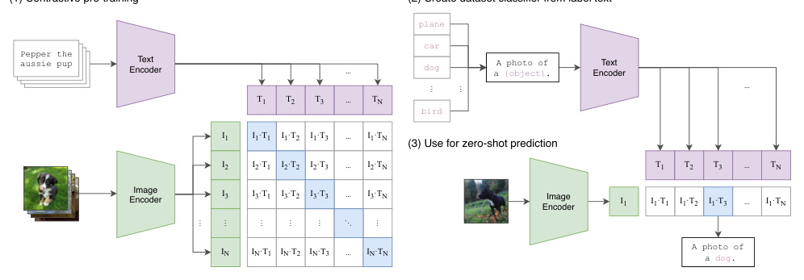

> **图 3（译）**：CLIP 实现核心的类 Numpy 伪代码。（原图见 paper.pdf 第 5 页，见下方图）

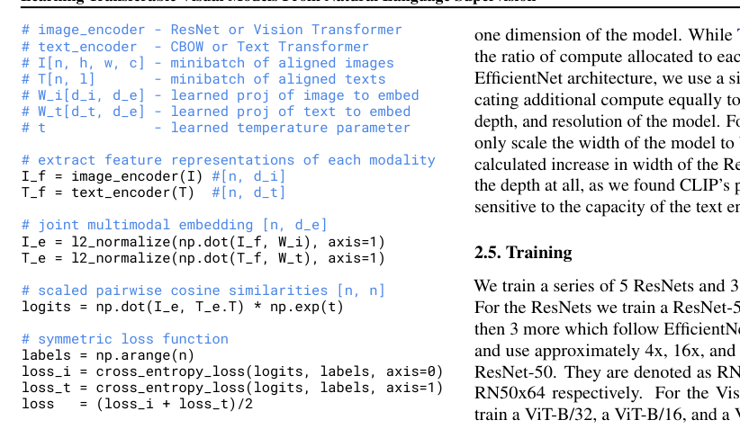

>
> 伪代码原文（注释行可译，代码不译）：
>
> ```
> # image_encoder - ResNet or Vision Transformer       # 图像编码器——ResNet 或 Vision Transformer
> # text_encoder  - CBOW or Text Transformer           # 文本编码器——CBOW 或文本 Transformer
> # I[n, h, w, c] - minibatch of aligned images        # 对齐图像的小批量
> # T[n, l]       - minibatch of aligned texts         # 对齐文本的小批量
> # W_i[d_i, d_e] - learned proj of image to embed     # 学到的图像到嵌入的投影
> # W_t[d_t, d_e] - learned proj of text to embed      # 学到的文本到嵌入的投影
> # t             - learned temperature parameter      # 学到的温度参数
> # extract feature representations of each modality   # 提取每种模态的特征表示
> I_f = image_encoder(I) #[n, d_i]
> T_f = text_encoder(T)  #[n, d_t]
> # joint multimodal embedding [n, d_e]                # 联合多模态嵌入
> I_e = l2_normalize(np.dot(I_f, W_i), axis=1)
> T_e = l2_normalize(np.dot(T_f, W_t), axis=1)
> # scaled pairwise cosine similarities [n, n]         # 缩放后的成对余弦相似度
> logits = np.dot(I_e, T_e.T) * np.exp(t)
> # symmetric loss function                            # 对称损失函数
> labels = np.arange(n)
> loss_i = cross_entropy_loss(logits, labels, axis=0)
> loss_t = cross_entropy_loss(logits, labels, axis=1)
> loss   = (loss_i + loss_t)/2
> ```

> **图 4（译）**：提示工程与集成提升零样本性能。与使用无上下文类别名称的基线相比，提示工程和集成把 36 个数据集上的零样本分类性能平均提升近 5 个点。这一提升与用基线零样本方法多花 4 倍计算量的收益相似，但在多次预测上摊销后是"免费"的。（原图见 paper.pdf 第 7 页，见下方图）


> **图 5（译）**：零样本 CLIP 可与全监督基线匹敌。在 27 数据集的评估套件中，零样本 CLIP 分类器在 16 个数据集上优于在 ResNet-50 特征上拟合的全监督线性分类器，包括 ImageNet。（原图见 paper.pdf 第 8 页，见下方图）

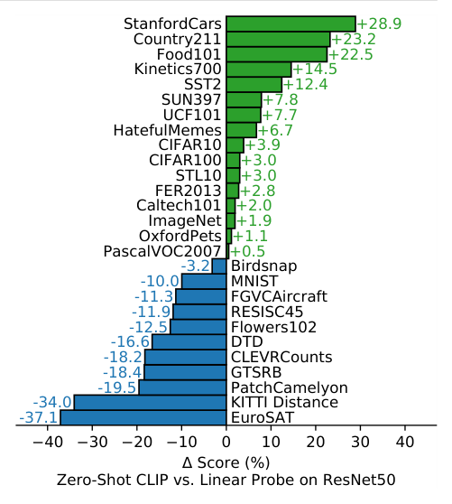

> **图 6（译）**：零样本 CLIP 优于少样本线性探针。零样本 CLIP 追平同一特征空间上训练的 4 样本线性分类器的平均性能，并几乎追平公开可用模型中 16 样本线性分类器的最佳结果。BiT-M 和 SimCLRv2 的最佳模型被高亮。浅灰线是评估套件中的其他模型。本分析使用每类至少 16 个样本的 20 个数据集。（原图见 paper.pdf 第 9 页，见下方图）

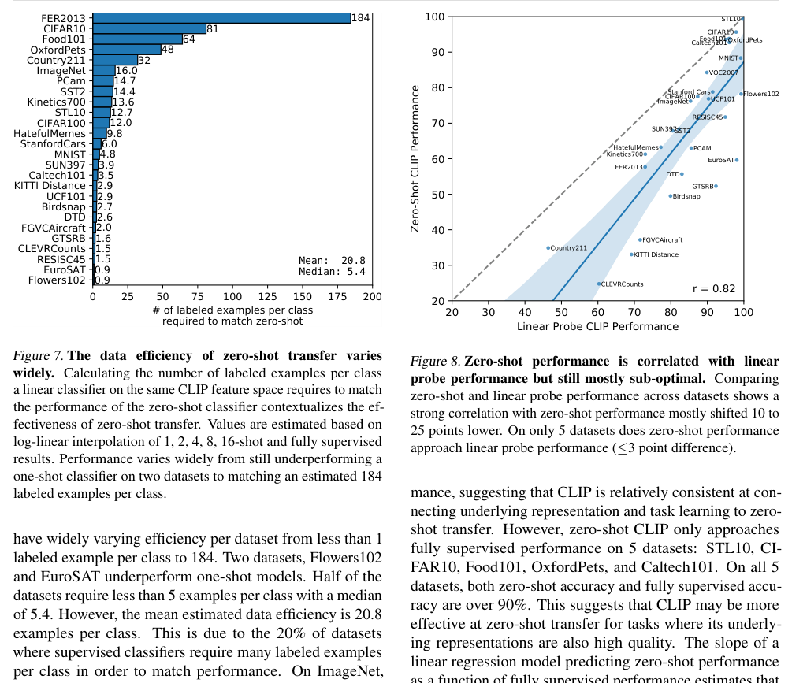

> **图 7（译）**：零样本迁移的数据效率差异巨大。计算同一 CLIP 特征空间上的线性分类器需要多少每类标注样本才能追平零样本分类器的性能，可以定位零样本迁移的有效性。数值基于 1、2、4、8、16 样本与全监督结果的对数线性插值估计。性能差异巨大：从在两个数据集上仍不及单样本分类器，到相当于每类 184 个标注样本。（原图见 paper.pdf 第 10 页，见下方图）


> **图 8（译）**：零样本性能与线性探针性能相关，但仍大多未达最优。跨数据集比较零样本与线性探针性能显示出强相关性，零样本性能大多低 10 到 25 个点。只有 5 个数据集上零样本性能接近线性探针性能（差距 ≤3 点）。（原图见 paper.pdf 第 10 页，[第 10 页图](assets/figures/fig-8.png)）

> **图 9（译）**：零样本 CLIP 性能作为模型计算量的函数平滑扩展。在 36 个不同数据集上的 39 项评估中，平均零样本错误率在 5 个不同 CLIP 模型 44 倍计算量跨度内很好地符合对数-对数线性趋势。浅色线是单项评估的性能，显示尽管总体趋势平滑，性能变化仍大得多。（原图见 paper.pdf 第 11 页，见下方图）


> **图 10（译）**：CLIP 模型的线性探针性能与当前最优计算机视觉模型的比较，包括 EfficientNet（Tan & Le, 2019; Xie et al., 2020）、MoCo（Chen et al., 2020d）、Instagram 预训练 ResNeXt 模型（Mahajan et al., 2018; Touvron et al., 2019）、BiT（Kolesnikov et al., 2019）、ViT（Dosovitskiy et al., 2020）、SimCLRv2（Chen et al., 2020c）、BYOL（Grill et al., 2020）和原始 ResNet 模型（He et al., 2016b）。（左）分数在 Kornblith et al. (2019) 研究的 12 个数据集上平均。（右）分数在包含更多样分布的 27 个数据集上平均。虚线表示在比预训练更高分辨率图像上微调或评估的模型。各数据集分数见表 10，各数据集绘图见图 20。（原图见 paper.pdf 第 12 页，见下方图）


> **图 11（译）**：CLIP 的特征在各种数据集上优于最佳 ImageNet 模型的特征。在 CLIP 特征上拟合线性分类器，在 27 个数据集中的 21 个上优于使用 Noisy Student EfficientNet-L2。（原图见 paper.pdf 第 13 页，见下方图）

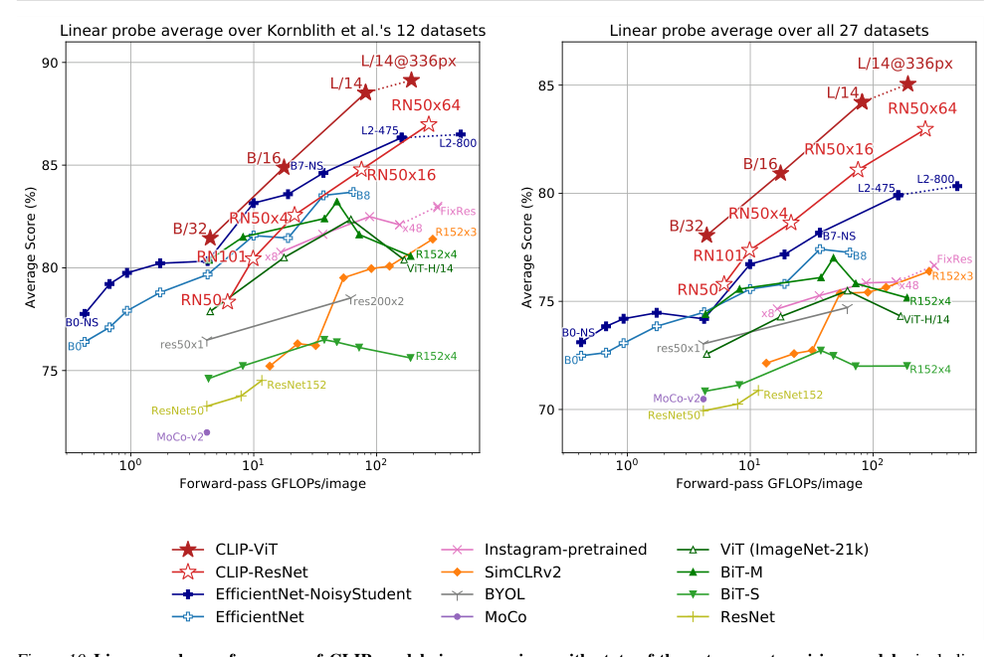

> **图 12（译）**：与在 ImageNet 上预训练的模型相比，CLIP 的特征对任务偏移更鲁棒。对两个数据集划分，在 CLIP 模型表示上训练的线性探针的迁移分数都高于 ImageNet 性能相近的其他模型。这表明在 ImageNet 上训练的模型的表示在某种程度上对任务过拟合。（原图见 paper.pdf 第 14 页，见下方图）

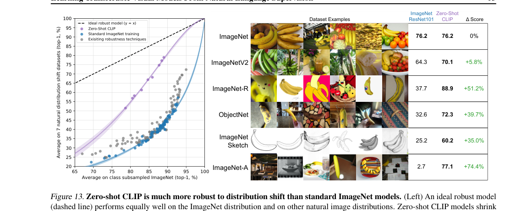

> **图 13（译）**：零样本 CLIP 对分布偏移的鲁棒性远强于标准 ImageNet 模型。（左）理想鲁棒模型（虚线）在 ImageNet 分布和其他自然图像分布上表现相同。零样本 CLIP 模型把这一"鲁棒性差距"缩小了最多 75%。logit 变换值上的线性拟合带 bootstrap 估计的 95% 置信区间。（右）可视化香蕉这一在 7 个自然分布偏移数据集中 5 个共享的类别的分布偏移。最佳零样本 CLIP 模型 ViT-L/14@336px 与在 ImageNet 验证集上性能相同的模型 ResNet-101 进行比较。（原图见 paper.pdf 第 15 页，见下方图）


> **图 14（译）**：虽然对 ImageNet 的监督适配使 ImageNet 准确率提高 9.2%，但平均鲁棒性略有下降。（左）与使用单个静态零样本 ImageNet 分类器并像 Taori et al. (2020) 那样跨相似类别池化预测相比，为每个数据集定制零样本 CLIP 提升了鲁棒性。适配到 ImageNet 的 CLIP 模型与最佳既有 ImageNet 模型具有相似的有效鲁棒性。（右）两种鲁棒性干预下各数据集准确率变化的细节。适配 ImageNet 使 ImageNetV2 上的准确率明显提升，但牺牲了其他几个分布上的准确率。数据集特定的零样本分类器可以大幅提升准确率，但仅限于少数类别与 ImageNet 类别不完全对齐的数据集。（原图见 paper.pdf 第 16 页，见下方图）

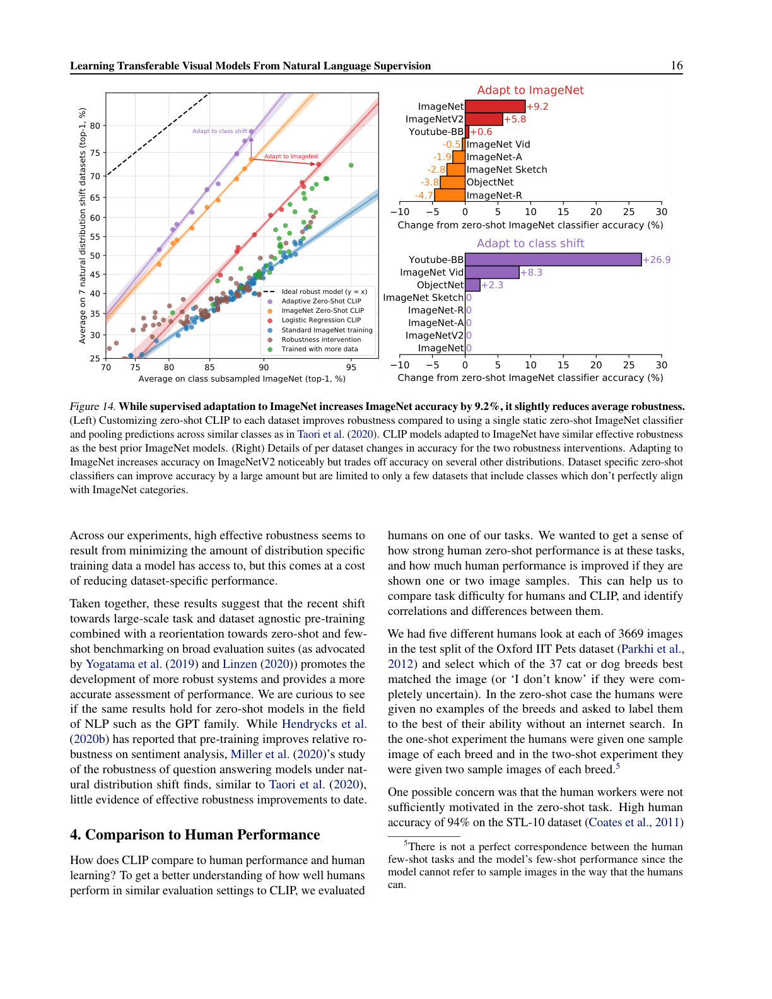

> **图 15（译）**：少样本 CLIP 相比现有 ImageNet 模型也提升了有效鲁棒性，但不如零样本 CLIP 鲁棒。最小化用于适配的 ImageNet 训练数据量会以降低相对鲁棒性为代价提升有效鲁棒性。16 样本逻辑回归 CLIP 在 ImageNet 上追平零样本 CLIP（如图 7 所报告），但鲁棒性更低。（原图见 paper.pdf 第 17 页，见下方图）


> **图 16（译）**：对 CLIP 最难的问题往往也对人类最难。这里我们按 CLIP 的难度（以正确标签概率衡量）对图像类别排序。（原图见 paper.pdf 第 18 页，见下方图）

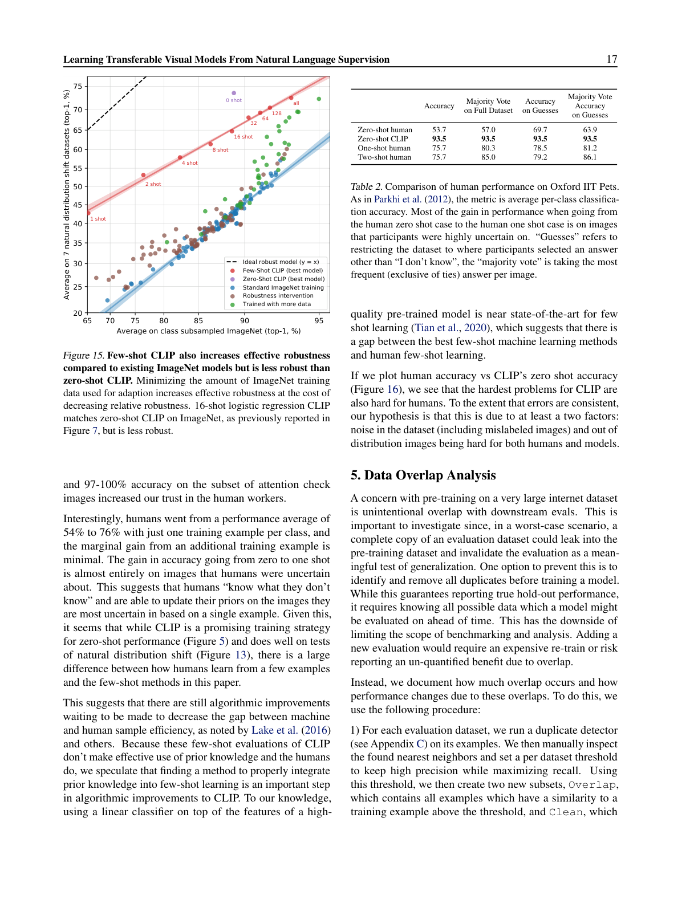

> **图 17（译）**：检测到的数据重叠造成的准确率提升很少具有统计显著性。（左）虽然若干数据集在检测到的重叠样本与干净样本上的零样本准确率有明显差异（最高 ±20%），35 个数据集中只有 5 个的 99.5% Clopper-Pearson 置信区间排除了 0% 的准确率差异。其中 2 个数据集在重叠数据上表现更差。（右）由于检测到的重叠样本比例几乎总在个位数，重叠造成的总体测试准确率增益小得多，最大的估计提升仅为 Birdsnap 上的 0.6%。同样，只有 6 个数据集的准确率提升在单侧二项检验下统计显著。（原图见 paper.pdf 第 19 页，见下方图）

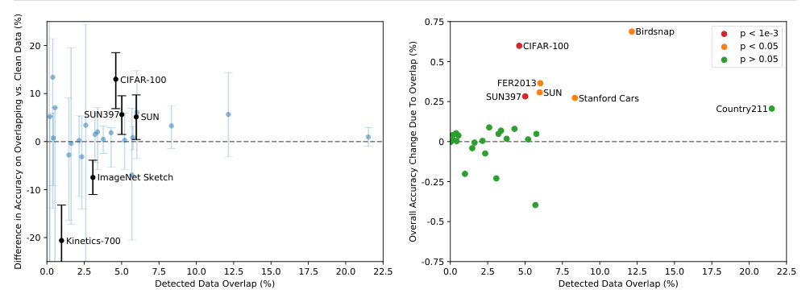

> **图 18（译）**：给定 Google Cloud Vision、Amazon Rekognition 和 Microsoft Azure Computer Vision 为图像返回的合并标签集时，CLIP 在国会议员图像上的表现。对男性和女性最具性别差异的 20 个标签用阈值 0.5% 的 χ² 检验识别。标签按绝对频率排序。柱条表示某一标签下按性别划分的图像百分比。（原图见 paper.pdf 第 24 页，见下方图）

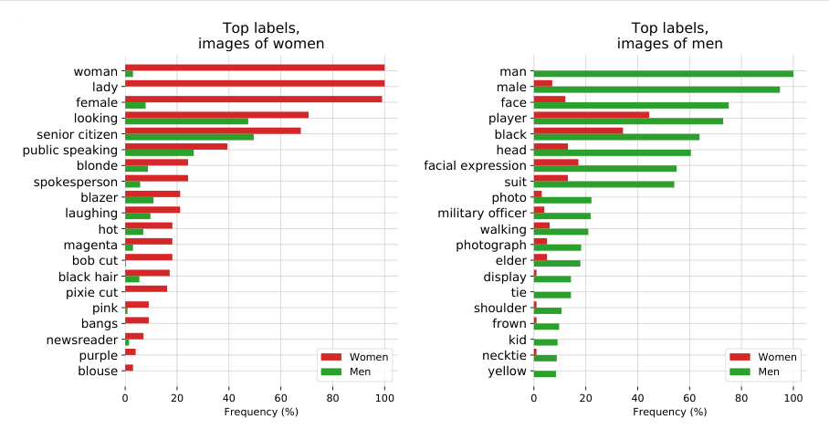

> **图 19（译）**：Rendered SST2 数据集的两个示例图像。（原图见 paper.pdf 第 38 页，见下方图）

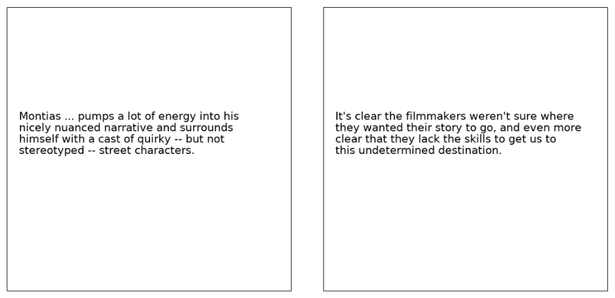

> **图 20（译）**：使用表 10 的数据，为 27 个数据集分别绘制的线性探针性能。（原图见 paper.pdf 第 41 页，见下方图）

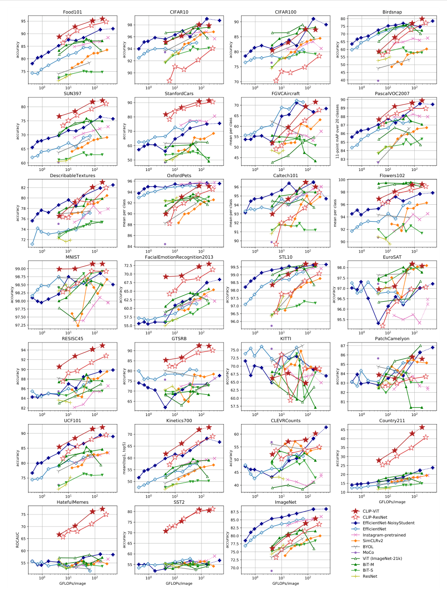

> **图 21（译）**：36 个 CLIP 零样本分类器预测的可视化。所有样本均为随机选取，除了重新选择 Hateful Memes 以避免冒犯性内容。图中显示 top 5 类别的预测概率及用于表示该类别的文本。使用多个模板时显示第一个模板。真实标签为绿色，错误预测为橙色。（原图见 paper.pdf 第 42 页。注：图中 36 个分类器的逐样本预测文本属图内元素，本批简化模式未逐条翻译。，见下方图）


> **图 22（译）**：CLIP 的零样本性能与线性探针 ResNet 性能的比较。（原图见 paper.pdf 第 43 页，见下方图）

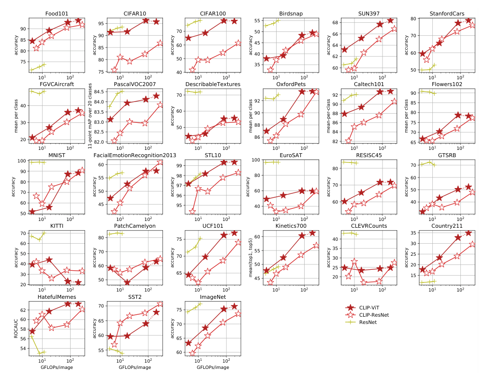

> **表 1（译）**：CLIP 与先前的零样本迁移图像分类结果的比较。CLIP 在全部三个数据集上大幅提升性能。这一提升反映了 Visual N-Grams（Li et al., 2017）问世 4 年间的诸多差异。（原表见 paper.pdf 第 7 页，[第 7 页图](assets/figures/tab-1.png)）

> **表 2（译）**：人类在 Oxford IIT Pets 上表现的比较。与 Parkhi et al. (2012) 一致，指标为每类平均分类准确率。从人类零样本情形到人类单样本情形的大部分性能增益，发生在参与者高度不确定的图像上。"Guesses"指把数据集限制在参与者选择了"I don't know"以外答案的样本；"majority vote"指每张图像取最频繁的答案（平票除外）。（原表见 paper.pdf 第 17 页，[第 17 页图](assets/figures/tab-2.png)）

> **表 3（译）**：FairFace 类别 'White' 中图像的种族、性别和年龄分类的百分比准确率。（原表见 paper.pdf 第 21 页，见下方图）

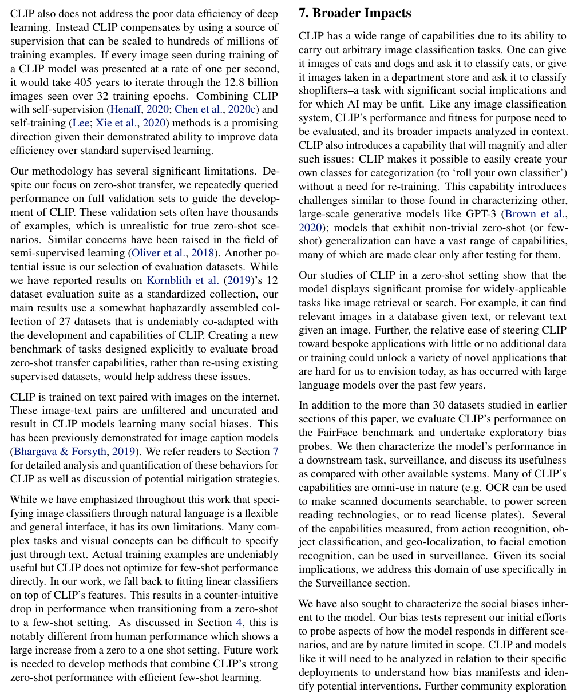

> **表 4（译）**：FairFace 类别 'Black'、'Indian'、'East Asian'、'Southeast Asian'、'Middle Eastern' 和 'Latino'（合并为 FairFace 类别 'Non-White'）中图像的种族、性别和年龄分类的百分比准确率。（原表见 paper.pdf 第 21 页，[第 21 页图](assets/figures/tab-4.png)）

> **表 5（译）**：按 FairFace 种族类别划分的图像性别分类的百分比准确率。（原表见 paper.pdf 第 21 页。注：每个模型组第三行无标签数据为男性与女性合并后的总体值，原文如此。，[第 21 页图](assets/figures/tab-5.png)）

> **表 6（译）**：按 FairFace 种族类别划分、被分类进犯罪相关与非人类类别的图像百分比。标签集包括男女各 7 个 FairFace 种族类别（共 14 个），以及 3 个犯罪相关类别和 4 个非人类类别。（原表见 paper.pdf 第 22 页，见下方图）

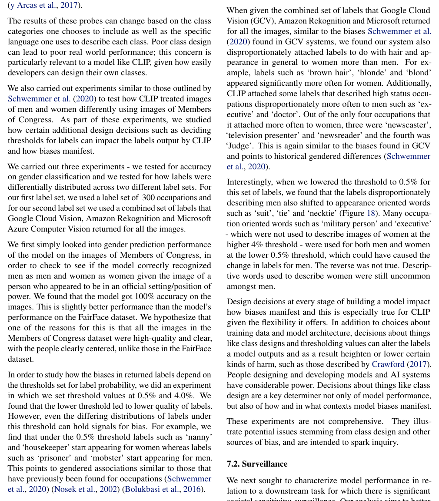

> **表 7（译）**：按 FairFace 年龄类别划分、被分类进犯罪相关与非人类类别的图像百分比，对比默认标签集与加入 'child' 标签的标签集所得结果。默认标签集包括男女各 7 个 FairFace 种族类别（共 14 个）、3 个犯罪相关类别和 4 个非人类类别。（原表见 paper.pdf 第 22 页，[第 22 页图](assets/figures/tab-7.png)）

> **表 8（译）**：CelebA 零样本 Top-1 身份识别准确率。（原表见 paper.pdf 第 25 页，见下方图）

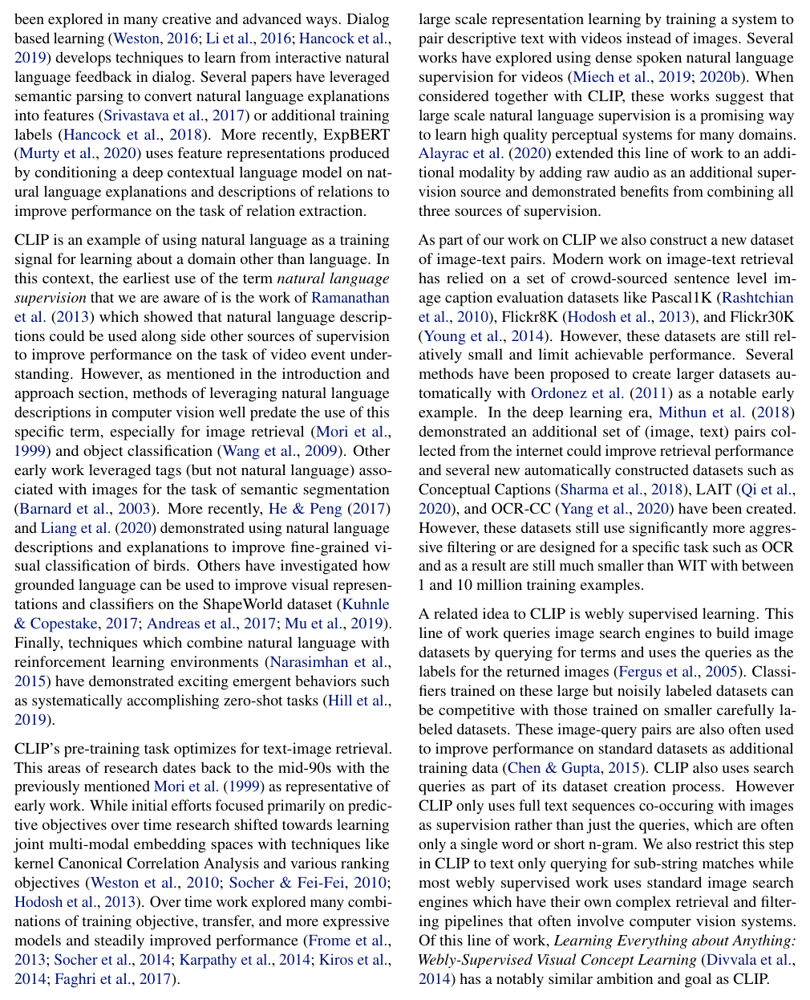

> **表 9（译）**：线性探针所考察的数据集。我们注意到，对 Birdsnap 和 Kinetics700 数据集，我们使用了撰写本文时网上可用的资源。（原表见 paper.pdf 第 39 页，见下方图）

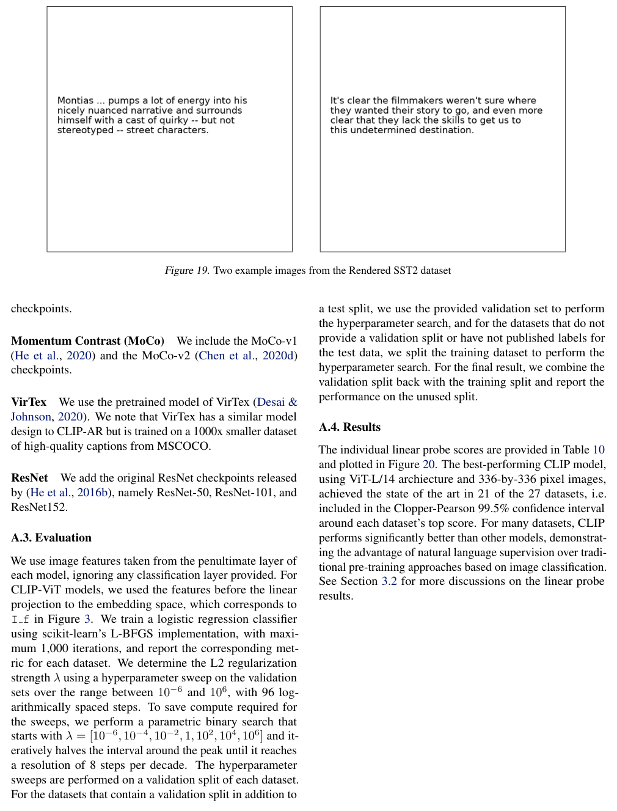

> **表 10（译）**：各种预训练模型在 27 个数据集上的线性探针性能。落入每个数据集最高分 99.5% Clopper-Pearson 置信区间的分数以粗体显示。⋆我们在修复一个 CUDA 相关的错误后，更新了本文先前版本的 STL10 分数。（原表见 paper.pdf 第 40 页，见下方图）

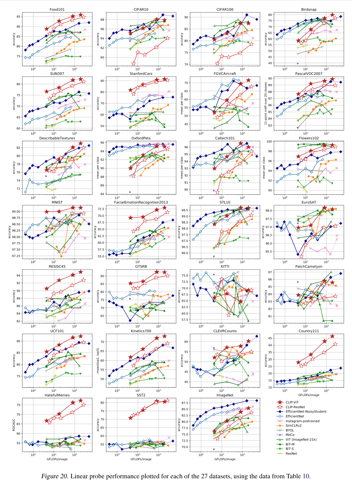

> **表 11（译）**：CLIP 模型在 27 个数据集上的零样本性能。（原表见 paper.pdf 第 43 页，[第 43 页图](assets/figures/tab-11.png)）

> **表 12（译）**：CLIP 只在 YFCC100M 上训练时表现相似。比较只在 YFCC100M 上训练的 ResNet-50 与在相同规模的 WIT 子集上训练的模型，零样本和线性分类器评估的平均性能与获胜次数相似。但数据集特定的性能存在巨大差异。我们收录了线性探针下 YFCC 相对 WIT 表现最好与最差的 3 个数据集的性能以凸显这一点，并给出全部线性与零样本评估及经典 ImageNet 数据集的聚合性能。（原表见 paper.pdf 第 44 页，见下方图）

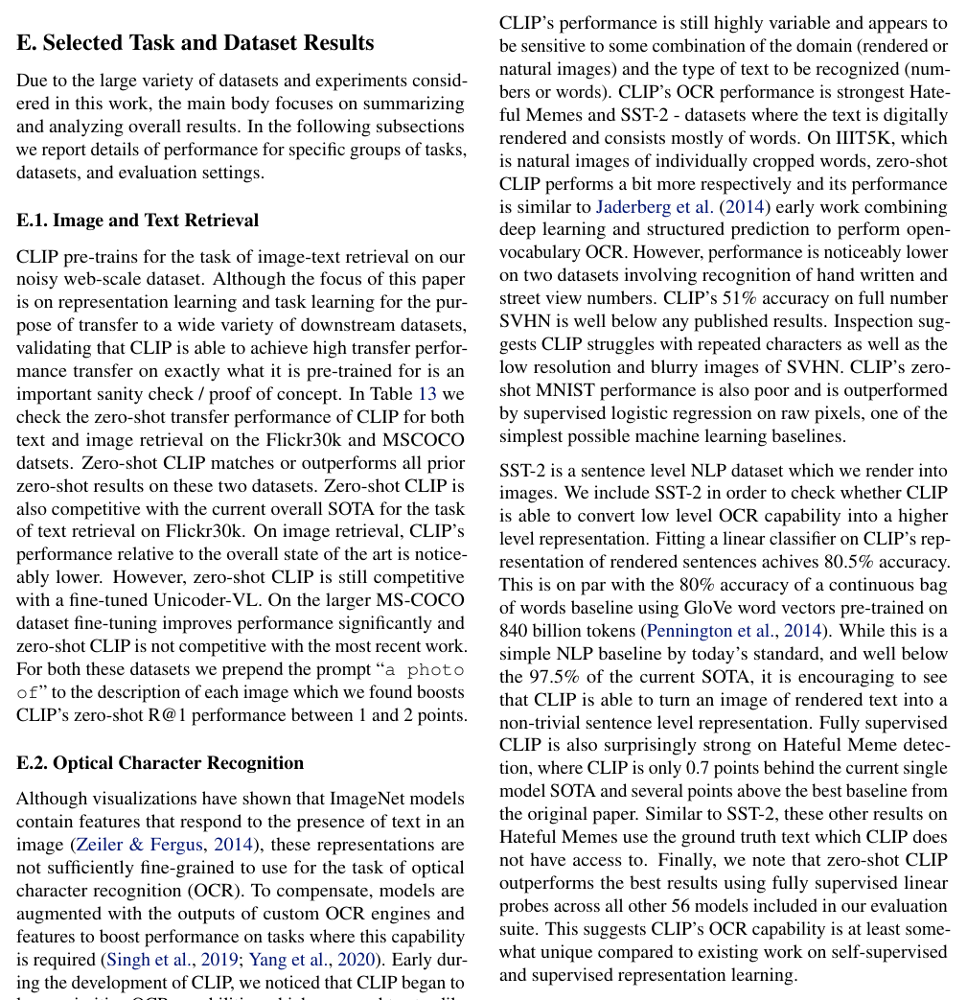

> **表 13（译）**：CLIP 提升了零样本检索，并在 Flickr30k 文本检索上与最佳微调结果竞争。粗体表示总体最佳性能，下划线表示类别内最佳性能（零样本或微调）。其他模型均报告其论文中的最佳结果（不论模型规模/变体）。MSCOCO 性能在 5k 测试集上报告。脚注 a-g 对应相关引用。（原表见 paper.pdf 第 46 页，见下方图）

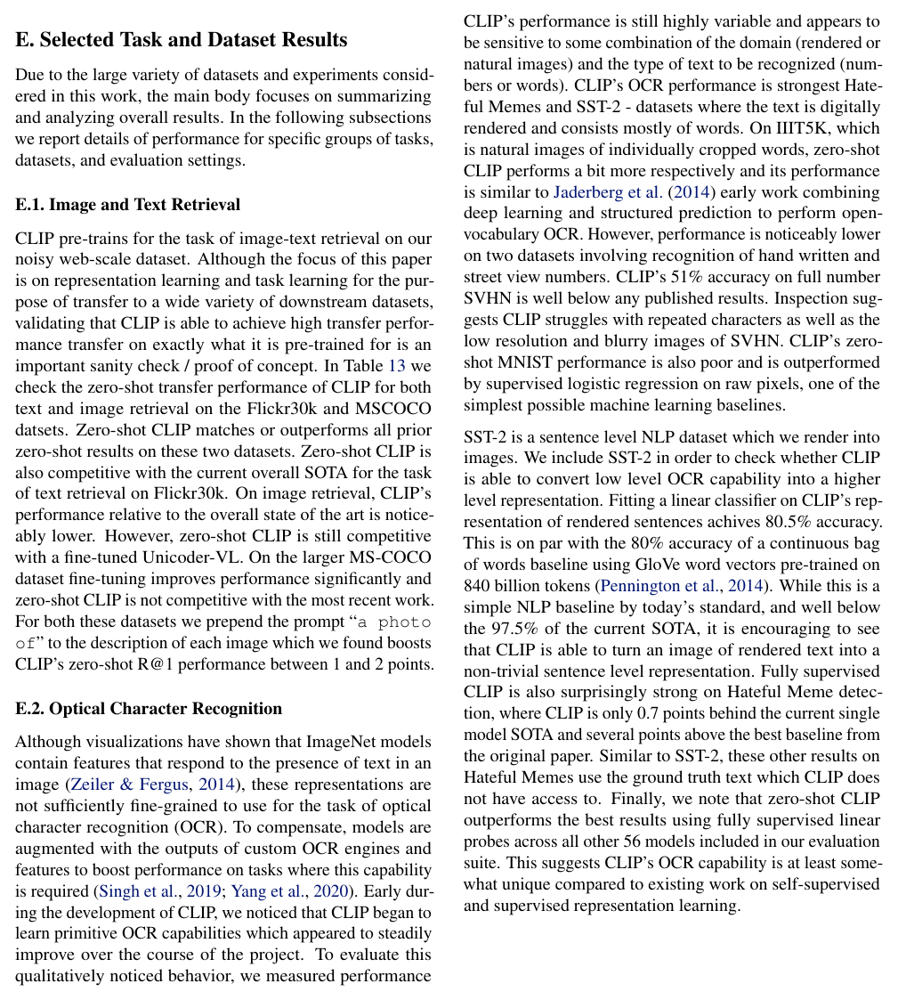

> **表 14（译）**：5 个数据集上的 OCR 性能。除 Hateful Memes 报告开发集上的 ROC AUC 外，所有指标均为测试集准确率。单模型 SOTA 为据我们所知的最优。ES Best 报告我们评估套件中 56 个非 CLIP 模型的最佳性能。（原表见 paper.pdf 第 46 页，[第 46 页图](assets/figures/tab-14.png)）

> **表 15（译）**：3 个视频数据集上的动作识别性能。单模型 SOTA 为据我们所知的最优。注意线性 CLIP 与线性 NS ENet-L2 是在每个数据集的单帧子采样版本上训练和评估的，与先前工作不直接可比。在 Kinetics-700 上，我们报告 ActivityNet 竞赛指标，即 top-1 与 top-5 性能的平均。（原表见 paper.pdf 第 46 页，[第 46 页图](assets/figures/tab-15.png)）

> **表 16（译）**：详细的 ImageNet 鲁棒性性能。IN 是 ImageNet 的缩写。（原表见 paper.pdf 第 47 页，见下方图）

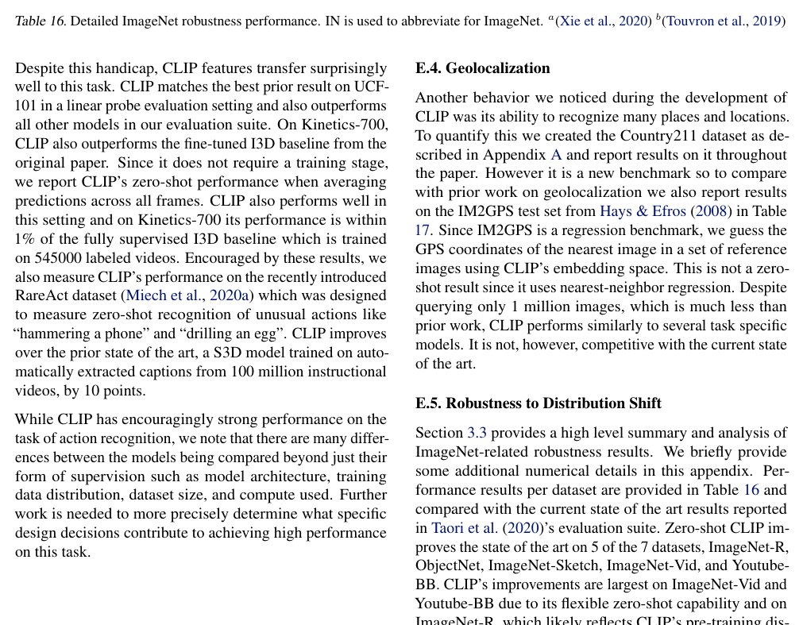

> **表 17（译）**：IM2GPS 测试集上的地理定位性能。指标为在给定半径内定位成功的图像百分比。模型按平均性能排序。（原表见 paper.pdf 第 47 页，[第 47 页图](assets/figures/tab-17.png)）

> **表 18（译）**：CLIP 通用超参数。（原表见 paper.pdf 第 48 页，见下方图）

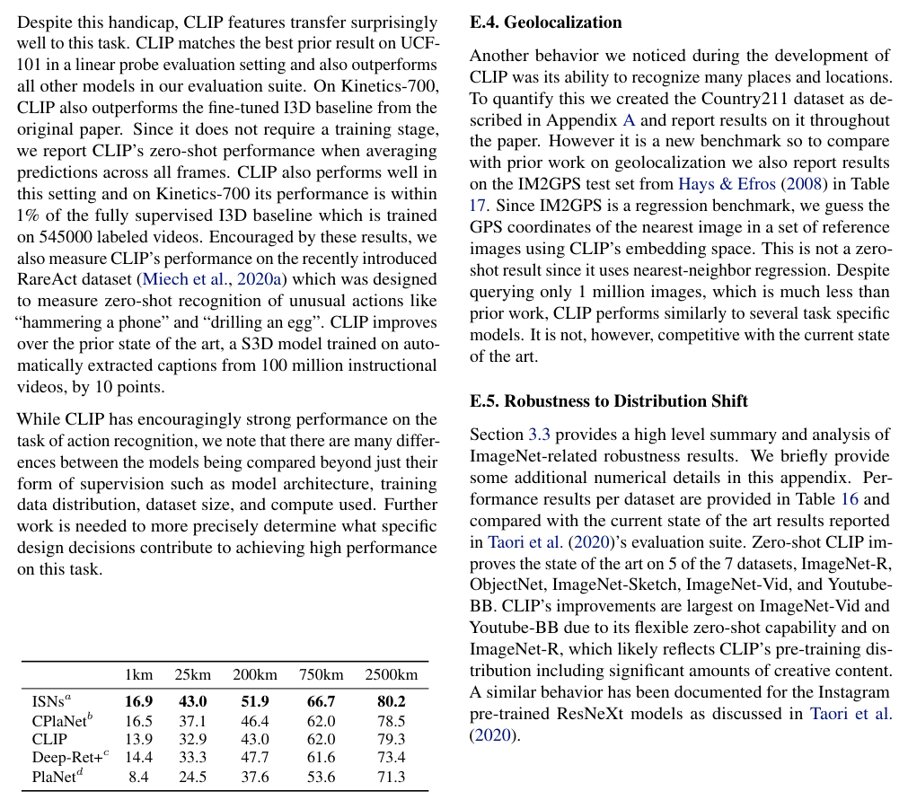

> **表 19（译）**：CLIP-ResNet 超参数。（原表见 paper.pdf 第 48 页，[第 48 页图](assets/figures/tab-19.png)）

> **表 20（译）**：CLIP-ViT 超参数。（原表见 paper.pdf 第 48 页，[第 48 页图](assets/figures/tab-20.png)）

|  | aYahoo | ImageNet | SUN |
|---|---|---|---|
| Visual N-Grams | 72.4 | 11.5 | 23.0 |
| CLIP | **98.4** | **76.2** | **58.5** |

|  | Accuracy | Majority Vote on Full Dataset | Accuracy on Guesses | Majority Vote Accuracy on Guesses |
|---|---|---|---|---|
| Zero-shot human | 53.7 | 57.0 | 69.7 | 63.9 |
| Zero-shot CLIP | **93.5** | **93.5** | **93.5** | **93.5** |
| One-shot human | 75.7 | 80.3 | 78.5 | 81.2 |
| Two-shot human | 75.7 | 85.0 | 79.2 | 86.1 |

| Model | Race | Gender | Age |
|---|---|---|---|
| FairFace Model | **93.7** | 94.2 | 59.7 |
| Linear Probe CLIP | 93.4 | **96.5** | **63.8** |
| Zero-Shot CLIP | 58.3 | 95.9 | 57.1 |
| Linear Probe Instagram | 90.8 | 93.2 | 54.2 |

| Model | Race | Gender | Age |
|---|---|---|---|
| FairFace Model | 75.4 | 94.4 | 60.7 |
| Linear Probe CLIP | **92.8** | **97.7** | **63.1** |
| Zero-Shot CLIP | 91.3 | 97.2 | 54.3 |
| Linear Probe Instagram | 87.2 | 93.9 | 54.1 |

|  |  |  |  |  |  | Middle | Southeast | East |  |
|---|---|---|---|---|---|---|---|---|---|
| Model | Gender | Black | White | Indian | Latino | Eastern | Asian | Asian | Average |
|  | Male | 96.9 | 96.4 | 98.7 | 96.5 | 98.9 | 96.2 | 96.9 | 97.2 |
| Linear Probe CLIP | Female | 97.9 | 96.7 | 97.9 | 99.2 | 97.2 | 98.5 | 97.3 | 97.8 |
|  |  | 97.4 | 96.5 | 98.3 | 97.8 | 98.4 | 97.3 | 97.1 | 97.5 |
|  | Male | 96.3 | 96.4 | 97.7 | 97.2 | 98.3 | 95.5 | 96.8 | 96.9 |
| Zero-Shot CLIP | Female | 97.1 | 95.3 | 98.3 | 97.8 | 97.5 | 97.2 | 96.4 | 97.0 |
|  |  | 96.7 | 95.9 | 98.0 | 97.5 | 98.0 | 96.3 | 96.6 |  |
|  | Male | 92.5 | 94.8 | 96.2 | 93.1 | 96.0 | 92.7 | 93.4 | 94.1 |
| Linear Probe Instagram | Female | 90.1 | 91.4 | 95.0 | 94.8 | 95.0 | 94.1 | 94.3 | 93.4 |
|  |  | 91.3 | 93.2 | 95.6 | 94.0 | 95.6 | 93.4 | 93.9 |  |

|  |  |  |  |  | Middle | Southeast | East |
|---|---|---|---|---|---|---|---|
| Category | Black | White | Indian | Latino | Eastern | Asian | Asian |
| Crime-related Categories | 16.4 | 24.9 | 24.4 | 10.8 | 19.7 | 4.4 | 1.3 |
| Non-human Categories | 14.4 | 5.5 | 7.6 | 3.7 | 2.0 | 1.9 | 0.0 |

|  |  |  |  |  |  |  |  |  |  |
|---|---|---|---|---|---|---|---|---|---|
| Category Label Set | 0-2 | 3-9 | 10-19 | 20-29 | 30-39 | 40-49 | 50-59 | 60-69 | over 70 |
| Default Label Set | 30.3 | 35.0 | 29.5 | 16.3 | 13.9 | 18.5 | 19.1 | 16.2 | 10.4 |
| Default Label Set + ‘child’ category | 2.3 | 4.3 | 14.7 | 15.0 | 13.4 | 18.2 | 18.6 | 15.5 | 9.4 |

| Model | 100 Classes | 1k Classes | 2k Classes |
|---|---|---|---|
| CLIP L/14 | 59.2 | 43.3 | 42.2 |
| CLIP RN50x64 | 56.4 | 39.5 | 38.4 |
| CLIP RN50x16 | 52.7 | 37.4 | 36.3 |
| CLIP RN50x4 | 52.8 | 38.1 | 37.3 |

| Dataset | Classes | Train size | Test size | Evaluation metric |
|---|---|---|---|---|
| Food-101 | 102 | 75,750 | 25,250 | accuracy |
| CIFAR-10 | 10 | 50,000 | 10,000 | accuracy |
| CIFAR-100 | 100 | 50,000 | 10,000 | accuracy |
| Birdsnap | 500 | 42,283 | 2,149 | accuracy |
| SUN397 | 397 | 19,850 | 19,850 | accuracy |
| Stanford Cars | 196 | 8,144 | 8,041 | accuracy |
| FGVC Aircraft | 100 | 6,667 | 3,333 | mean per class |
| Pascal VOC 2007 Classification | 20 | 5,011 | 4,952 | 11-point mAP |
| Describable Textures | 47 | 3,760 | 1,880 | accuracy |
| Oxford-IIIT Pets | 37 | 3,680 | 3,669 | mean per class |
| Caltech-101 | 102 | 3,060 | 6,085 | mean-per-class |
| Oxford Flowers 102 | 102 | 2,040 | 6,149 | mean per class |
| MNIST | 10 | 60,000 | 10,000 | accuracy |
| Facial Emotion Recognition 2013 | 8 | 32,140 | 3,574 | accuracy |
| STL-10 | 10 | 1000 | 8000 | accuracy |
| EuroSAT | 10 | 10,000 | 5,000 | accuracy |
| RESISC45 | 45 | 3,150 | 25,200 | accuracy |
| GTSRB | 43 | 26,640 | 12,630 | accuracy |
| KITTI | 4 | 6,770 | 711 | accuracy |
| Country211 | 211 | 43,200 | 21,100 | accuracy |
| PatchCamelyon | 2 | 294,912 | 32,768 | accuracy |
| UCF101 | 101 | 9,537 | 1,794 | accuracy |
| Kinetics700 | 700 | 494,801 | 31,669 | mean(top1, top5) |
| CLEVR Counts | 8 | 2,000 | 500 | accuracy |
| Hateful Memes | 2 | 8,500 | 500 | ROC AUC |
| Rendered SST2 | 2 | 7,792 | 1,821 | accuracy |
| ImageNet | 1000 | 1,281,167 | 50,000 | accuracy |


|  |  |  | Food101 | CIFAR10 | CIFAR100 | Birdsnap | SUN397 | Cars | Aircraft | VOC2007 | DTD | Pets | Caltech101 | Flowers | MNIST | FER2013 | STL10$^\star$ | EuroSAT | RESISC45 | GTSRB | KITTI | Country211 | PCAM | UCF101 | Kinetics700 | CLEVR | HatefulMemes | SST | ImageNet |
|---|---|---|---|---|---|---|---|---|---|---|---|---|---|---|---|---|---|---|---|---|---|---|---|---|---|---|---|---|---|
|  | LM RN50 |  | 81.3 | 82.8 | 61.7 | 44.2 | 69.6 | 74.9 | 44.9 | 85.5 | 71.5 | 82.8 | 85.5 | 91.1 | 96.6 | 60.1 | 95.3 | 93.4 | 84.0 | 73.8 | 70.2 | 19.0 | 82.9 | 76.4 | 51.9 | 51.2 | 65.2 | 76.8 | 65.2 |
| CLIP-RN | 50 |  | 86.4 | 88.7 | 70.3 | 56.4 | 73.3 | 78.3 | 49.1 | 87.1 | 76.4 | 88.2 | 89.6 | 96.1 | 98.3 | 64.2 | 96.6 | 95.2 | 87.5 | 82.4 | 70.2 | 25.3 | 82.7 | 81.6 | 57.2 | 53.6 | 65.7 | 72.6 | 73.3 |
|  | 101 |  | 88.9 | 91.1 | 73.5 | 58.6 | 75.1 | 84.0 | 50.7 | 88.0 | 76.3 | 91.0 | 92.0 | 96.4 | 98.4 | 65.2 | 97.8 | 95.9 | 89.3 | 82.4 | **73.6** | 26.6 | 82.8 | 84.0 | 60.3 | 50.3 | 68.2 | 73.3 | 75.7 |
|  | 50x4 |  | 91.3 | 90.5 | 73.0 | 65.7 | 77.0 | 85.9 | 57.3 | 88.4 | 79.5 | 91.9 | 92.5 | 97.8 | 98.5 | 68.1 | 97.8 | 96.4 | 89.7 | 85.5 | 59.4 | 30.3 | 83.0 | 85.7 | 62.6 | 52.5 | 68.0 | 76.6 | 78.2 |
|  | 50x16 |  | 93.3 | 92.2 | 74.9 | 72.8 | 79.2 | 88.7 | 62.7 | **89.0** | 79.1 | 93.5 | 93.7 | 98.3 | **98.9** | 68.7 | 98.6 | 97.0 | 91.4 | 89.0 | 69.2 | 34.8 | 83.5 | 88.0 | 66.3 | 53.8 | 71.1 | **80.0** | 81.5 |
|  | 50x64 |  | 94.8 | 94.1 | 78.6 | 77.2 | 81.1 | 90.5 | 67.7 | **88.9** | **82.0** | 94.5 | 95.4 | 98.9 | **98.9** | **71.3** | 99.1 | 97.1 | 92.8 | 90.2 | 69.2 | 40.7 | 83.7 | 89.5 | 69.1 | 55.0 | **75.0** | **81.2** | 83.6 |
| CLIP-ViT | B/32 |  | 88.8 | 95.1 | 80.5 | 58.5 | 76.6 | 81.8 | 52.0 | 87.7 | 76.5 | 90.0 | 93.0 | 96.9 | **99.0** | 69.2 | 98.3 | 97.0 | 90.5 | 85.3 | 66.2 | 27.8 | 83.9 | 85.5 | 61.7 | 52.1 | 66.7 | 70.8 | 76.1 |
|  | B/16 |  | 92.8 | 96.2 | 83.1 | 67.8 | 78.4 | 86.7 | 59.5 | **89.2** | 79.2 | 93.1 | 94.7 | 98.1 | **99.0** | 69.5 | 99.0 | 97.1 | 92.7 | 86.6 | 67.8 | 33.3 | 83.5 | 88.4 | 66.1 | **57.1** | 70.3 | 75.5 | 80.2 |
|  | L/14 |  | 95.2 | 98.0 | 87.5 | 77.0 | **81.8** | **90.9** | 69.4 | **89.6** | **82.1** | **95.1** | **96.5** | 99.2 | **99.2** | **72.2** | **99.7** | **98.2** | 94.1 | **92.5** | 64.7 | 42.9 | 85.8 | **91.5** | 72.0 | **57.8** | **76.2** | **80.8** | 83.9 |
|  | L/14-336px |  | **95.9** | 97.9 | 87.4 | **79.9** | **82.2** | **91.5** | **71.6** | **89.9** | **83.0** | **95.1** | **96.0** | 99.2 | **99.2** | **72.9** | **99.7** | **98.1** | **94.9** | **92.4** | 69.2 | **46.4** | 85.6 | **92.0** | **73.0** | **60.3** | **77.3** | **80.5** | 85.4 |
| EfficientNet | B0 |  | 74.3 | 92.5 | 76.5 | 59.7 | 62.0 | 62.5 | 55.7 | 84.4 | 71.2 | 93.0 | 93.3 | 91.7 | 98.2 | 57.2 | 97.1 | 97.3 | 85.5 | 80.0 | **73.8** | 12.4 | 83.1 | 74.4 | 47.6 | 47.9 | 55.7 | 53.4 | 76.9 |
|  | B1 |  | 74.2 | 93.2 | 77.2 | 61.3 | 62.6 | 62.5 | 56.1 | 84.7 | 74.2 | 93.4 | 93.6 | 92.4 | 98.3 | 57.0 | 97.5 | 96.8 | 84.5 | 75.9 | **75.5** | 12.5 | 82.7 | 74.7 | 48.5 | 44.3 | 54.5 | 54.4 | 78.6 |
|  | B2 |  | 75.8 | 93.6 | 77.9 | 64.4 | 64.0 | 63.2 | 57.0 | 85.3 | 73.5 | 93.9 | 93.5 | 92.9 | 98.5 | 56.6 | 97.7 | 96.9 | 84.4 | 76.4 | **73.1** | 12.6 | 84.3 | 75.1 | 49.4 | 42.6 | 55.4 | 55.2 | 79.7 |
|  | B3 |  | 77.4 | 94.0 | 78.0 | 66.5 | 64.4 | 66.0 | 59.3 | 85.8 | 73.1 | 94.1 | 93.7 | 93.3 | 98.5 | 57.1 | 98.2 | 97.3 | 85.0 | 75.8 | **76.1** | 13.4 | 83.3 | 78.1 | 50.9 | 45.1 | 53.8 | 54.8 | 81.0 |
|  | B4 |  | 79.7 | 94.1 | 78.7 | 70.1 | 65.4 | 66.4 | 60.4 | 86.5 | 73.4 | 94.7 | 93.5 | 93.2 | 98.8 | 57.9 | 98.6 | 96.8 | 85.0 | 78.3 | **72.3** | 13.9 | 83.1 | 79.1 | 52.5 | 46.5 | 54.4 | 55.4 | 82.9 |
|  | B5 |  | 81.5 | 93.6 | 77.9 | 72.4 | 67.1 | 72.7 | 68.9 | 86.7 | 73.9 | **95.0** | 94.7 | 94.5 | 98.4 | 58.5 | 98.7 | 96.8 | 86.0 | 78.5 | 69.6 | 14.9 | 84.7 | 80.9 | 54.5 | 46.6 | 53.3 | 56.3 | 83.7 |
|  | B6 |  | 82.4 | 94.0 | 78.0 | 73.5 | 65.8 | 71.1 | 68.2 | 87.6 | 73.9 | **95.0** | 94.1 | 93.7 | 98.4 | 60.2 | 98.7 | 96.8 | 85.4 | 78.1 | **72.7** | 15.3 | 84.2 | 80.0 | 54.1 | 51.1 | 53.3 | 57.0 | 84.0 |
|  | B7 |  | 84.5 | 94.9 | 80.1 | 74.7 | 69.0 | 77.1 | **72.3** | 87.2 | 76.8 | **95.2** | 94.7 | 95.9 | 98.6 | 61.3 | 99.1 | 96.3 | 86.8 | 80.8 | **75.8** | 16.4 | 85.2 | 81.9 | 56.8 | 51.9 | 54.4 | 57.8 | 84.8 |
|  | B8 |  | 84.5 | 95.0 | 80.7 | 75.2 | 69.6 | 76.8 | **71.5** | 87.4 | 77.1 | **94.9** | 95.2 | 96.3 | 98.6 | 61.4 | 99.2 | 97.0 | 87.4 | 80.4 | 70.9 | 17.4 | 85.2 | 82.4 | 57.7 | 51.4 | 51.7 | 55.8 | 85.3 |
| EfficientNet Noisy Student | B0 |  | 78.1 | 94.0 | 78.6 | 63.5 | 65.5 | 57.2 | 53.7 | 85.6 | 75.6 | 93.8 | 93.1 | 94.5 | 98.1 | 55.6 | 98.2 | 97.0 | 84.3 | 74.0 | 71.6 | 14.0 | 83.1 | 76.7 | 51.7 | 47.3 | 55.7 | 55.0 | 78.5 |
|  | B1 |  | 80.4 | 95.1 | 80.2 | 66.6 | 67.6 | 59.6 | 53.7 | 86.2 | 77.0 | 94.6 | 94.4 | 95.1 | 98.0 | 56.1 | 98.6 | 96.9 | 84.3 | 73.1 | 67.1 | 14.5 | 83.9 | 79.9 | 54.5 | 46.1 | 54.3 | 54.9 | 81.1 |
|  | B2 |  | 80.9 | 95.3 | 81.3 | 67.6 | 67.9 | 60.9 | 55.2 | 86.3 | 77.7 | **95.0** | 94.7 | 94.4 | 98.0 | 55.5 | 98.8 | 97.3 | 84.6 | 71.7 | 70.0 | 14.6 | 82.9 | 80.1 | 55.1 | 46.1 | 54.1 | 55.3 | 82.2 |
|  | B3 |  | 82.6 | 95.9 | 82.1 | 68.6 | 68.8 | 60.6 | 55.4 | 86.5 | 77.2 | **95.0** | 94.8 | 95.2 | 98.1 | 56.0 | 99.1 | 96.5 | 85.0 | 70.5 | 69.5 | 15.1 | 83.1 | 81.8 | 56.8 | 45.1 | 55.7 | 52.0 | 83.8 |
|  | B4 |  | 85.2 | 95.6 | 81.0 | 72.5 | 69.7 | 56.1 | 52.6 | 87.0 | 78.7 | **94.8** | 95.2 | 95.3 | 98.2 | 56.0 | 99.3 | 95.3 | 84.8 | 61.9 | 64.8 | 16.0 | 82.8 | 83.4 | 59.8 | 43.2 | 55.3 | 53.0 | 85.4 |
|  | B5 |  | 87.6 | 96.3 | 82.4 | 75.3 | 71.6 | 64.7 | 64.8 | 87.8 | 79.6 | **95.5** | 95.6 | 96.6 | 98.8 | 60.9 | 99.4 | 96.1 | 87.0 | 68.5 | **73.7** | 16.4 | 83.5 | 86.4 | 61.6 | 46.3 | 53.4 | 55.8 | 85.8 |
|  | B6 |  | 87.3 | 97.0 | 83.9 | 75.8 | 71.4 | 67.6 | 65.6 | 87.3 | 78.5 | **95.2** | **96.4** | 97.2 | 98.6 | 61.9 | **99.5** | 96.6 | 86.1 | 70.7 | **72.4** | 17.6 | 84.2 | 85.5 | 61.0 | 49.6 | 54.6 | 55.7 | 86.4 |
|  | B7 |  | 88.4 | 96.0 | 82.0 | 76.9 | 72.6 | 72.2 | **71.2** | 88.1 | **80.5** | **95.5** | 95.5 | 96.6 | 98.5 | 62.7 | 99.4 | 96.2 | 88.5 | 73.4 | **73.0** | 18.5 | 83.8 | 86.6 | 63.2 | 50.5 | 57.2 | 56.7 | 87.0 |
|  | L2-475 |  | 91.6 | **99.0** | **91.0** | 74.8 | 76.4 | 75.1 | 66.8 | **89.5** | **81.9** | **95.6** | **96.5** | 97.7 | **98.9** | 67.5 | **99.6** | 97.0 | 89.5 | 73.4 | 68.9 | 22.2 | 86.3 | 89.4 | 68.2 | **58.3** | 58.6 | 55.2 | **88.3** |
|  | L2-800 |  | 92.0 | **98.7** | 89.0 | **78.5** | 75.7 | 75.5 | 68.4 | **89.4** | **82.5** | **95.6** | 94.7 | 97.9 | 98.5 | 68.4 | **99.7** | 97.2 | 89.9 | 77.7 | 66.9 | 23.7 | **86.8** | 88.9 | 66.7 | **62.7** | 58.4 | 56.9 | **88.4** |
| Instagram | 32x8d |  | 84.8 | 95.9 | 80.9 | 63.8 | 69.0 | 74.2 | 56.0 | 88.0 | 75.4 | **95.4** | 93.9 | 91.7 | 97.4 | 60.7 | 99.1 | 95.7 | 82.1 | 72.3 | 69.2 | 16.7 | 82.3 | 80.1 | 56.8 | 42.2 | 53.3 | 55.2 | 83.3 |
|  | 32x16d |  | 85.7 | 96.5 | 80.9 | 64.8 | 70.5 | 77.5 | 56.7 | 87.9 | 76.2 | **95.6** | 94.9 | 92.5 | 97.4 | 61.6 | 99.3 | 95.5 | 82.8 | 73.8 | 66.1 | 17.5 | 83.4 | 81.1 | 58.2 | 41.3 | 54.2 | 56.1 | 84.4 |
|  | 32x32d |  | 86.7 | 96.8 | 82.7 | 67.1 | 71.5 | 77.5 | 55.4 | 88.3 | 78.5 | **95.8** | 95.3 | 94.4 | 97.9 | 62.4 | 99.3 | 95.7 | 85.4 | 71.2 | 66.8 | 18.0 | 83.7 | 82.1 | 58.8 | 39.7 | 55.3 | 56.7 | 85.0 |
|  | 32x48d |  | 86.9 | 96.8 | 83.4 | 65.9 | 72.2 | 76.6 | 53.2 | 88.0 | 77.2 | **95.5** | 95.8 | 93.6 | 98.1 | 63.7 | 99.4 | 95.3 | 85.4 | 73.0 | 67.2 | 18.5 | 82.7 | 82.8 | 59.2 | 41.3 | 55.5 | 56.7 | 85.2 |
|  | FixRes-v1 |  | 88.5 | 95.7 | 81.1 | 67.4 | 72.9 | 80.5 | 57.6 | 88.0 | 77.9 | **95.8** | **96.1** | 94.5 | 97.9 | 62.2 | 99.4 | 96.2 | 86.6 | 76.5 | 64.8 | 19.3 | 82.5 | 83.4 | 59.8 | 43.5 | 56.6 | 59.0 | 86.0 |
|  | FixRes-v2 |  | 88.5 | 95.7 | 81.1 | 67.3 | 72.9 | 80.7 | 57.5 | 88.0 | 77.9 | **95.0** | **96.0** | 94.5 | 98.0 | 62.1 | 99.4 | 96.5 | 86.6 | 76.3 | 64.8 | 19.5 | 82.3 | 83.5 | 59.8 | 44.2 | 56.6 | 59.0 | 86.0 |
| BiT-S | R50x1 |  | 72.5 | 91.7 | 74.8 | 57.7 | 61.1 | 53.5 | 52.5 | 83.7 | 72.4 | 92.3 | 91.2 | 92.0 | 98.4 | 56.1 | 96.4 | 97.4 | 85.0 | 70.0 | 66.0 | 12.5 | 83.0 | 72.3 | 47.5 | 48.3 | 54.1 | 55.3 | 75.2 |
|  | R50x3 |  | 75.1 | 93.7 | 79.0 | 61.1 | 63.7 | 55.2 | 54.1 | 84.8 | 74.6 | 92.5 | 91.6 | 92.8 | 98.8 | 58.7 | 97.0 | **97.8** | 86.4 | 73.1 | **73.8** | 14.0 | 84.2 | 76.4 | 50.0 | 49.2 | 54.7 | 54.2 | 77.2 |
|  | R101x1 |  | 73.5 | 92.8 | 77.4 | 58.4 | 61.3 | 54.0 | 52.4 | 84.4 | 73.5 | 92.5 | 91.8 | 90.6 | 98.3 | 56.5 | 96.8 | 97.3 | 84.6 | 69.4 | 68.9 | 12.6 | 82.0 | 73.5 | 48.6 | 45.4 | 52.6 | 55.5 | 76.0 |
|  | R101x3 |  | 74.7 | 93.9 | 79.8 | 57.8 | 62.9 | 54.7 | 53.3 | 84.7 | 75.5 | 92.3 | 91.2 | 92.6 | 98.8 | 59.7 | 97.3 | **98.0** | 85.5 | 71.8 | 60.2 | 14.1 | 83.1 | 75.9 | 50.4 | 49.7 | 54.1 | 54.6 | 77.4 |
|  | R152x2 |  | 74.9 | 94.3 | 79.7 | 58.7 | 62.7 | 55.9 | 53.6 | 85.3 | 74.9 | 93.0 | 92.0 | 91.7 | 98.6 | 58.3 | 97.1 | **97.8** | 86.2 | 71.8 | 71.6 | 13.9 | 84.1 | 76.2 | 49.9 | 48.2 | 53.8 | 55.9 | 77.1 |
|  | R152x4 |  | 74.7 | 94.2 | 79.2 | 57.8 | 62.9 | 51.2 | 50.8 | 85.4 | 75.4 | 93.1 | 91.2 | 91.4 | **98.9** | 61.4 | 97.2 | **98.0** | 85.5 | 72.8 | 67.9 | 14.9 | 83.1 | 76.0 | 50.3 | 42.9 | 53.6 | 56.0 | 78.5 |
| BiT-M | R50x1 |  | 83.3 | 94.9 | 82.2 | 70.9 | 69.9 | 59.0 | 55.6 | 86.8 | 77.3 | 91.5 | 93.9 | **99.4** | 98.0 | 60.6 | 98.4 | 97.5 | 87.4 | 68.6 | 68.2 | 16.6 | 82.5 | 79.4 | 53.2 | 49.4 | 54.5 | 53.4 | 76.7 |
|  | R50x3 |  | 86.9 | 96.7 | 86.2 | 75.7 | 74.6 | 60.6 | 54.2 | 87.7 | 78.5 | 93.2 | 95.3 | **99.4** | 98.6 | 64.6 | 99.3 | **98.0** | 88.1 | 69.9 | 59.6 | 19.6 | 83.4 | 83.5 | 57.8 | 51.3 | 55.8 | 55.6 | 80.7 |
|  | R101x1 |  | 85.5 | 95.7 | 84.4 | 73.0 | 72.5 | 59.8 | 55.0 | 87.3 | 78.1 | 92.2 | 95.0 | **99.5** | 98.1 | 62.5 | 99.0 | **97.6** | 87.8 | 68.7 | 67.7 | 18.0 | 84.0 | 82.3 | 55.9 | 53.4 | 54.8 | 53.1 | 79.4 |
|  | R101x3 |  | 87.2 | 97.4 | 87.5 | 72.4 | 75.0 | 57.4 | 47.4 | 87.5 | 79.6 | 93.2 | 95.4 | **99.6** | 98.6 | 64.3 | 99.4 | **98.2** | 87.7 | 68.8 | 64.1 | 20.7 | 80.4 | 84.0 | 58.7 | 52.6 | 54.9 | 54.3 | 81.2 |
|  | R152x2 |  | 88.0 | 97.5 | 87.8 | 75.8 | 75.9 | 61.5 | 55.3 | 88.1 | 79.8 | 93.6 | **95.9** | **99.5** | 98.5 | 64.3 | **99.5** | **97.9** | 89.0 | 70.0 | 70.3 | 20.7 | 82.6 | 85.5 | 59.6 | 50.8 | 54.9 | 55.1 | 81.9 |
|  | R152x4 |  | 87.2 | 97.6 | 88.2 | 72.4 | 75.0 | 49.1 | 43.4 | 87.1 | 79.9 | 92.4 | 95.4 | 99.3 | 98.5 | 65.7 | **99.5** | **97.8** | 87.7 | 68.2 | 57.1 | 20.6 | 80.4 | 84.6 | 59.0 | 49.7 | 57.2 | 55.1 | 81.5 |
| ViT | B/32 |  | 81.8 | 96.7 | 86.3 | 65.2 | 70.7 | 49.1 | 42.7 | 85.3 | 73.1 | 90.4 | 94.5 | 98.7 | 97.8 | 59.0 | 99.0 | 96.3 | 83.0 | 68.1 | 65.1 | 15.7 | 82.6 | 79.1 | 51.7 | 38.9 | 57.1 | 54.6 | 76.6 |
|  | B/16 |  | 86.7 | 96.9 | 86.4 | 74.0 | 74.2 | 54.7 | 46.0 | 86.7 | 74.3 | 92.7 | 94.1 | 99.2 | 97.4 | 61.3 | 99.5 | 96.4 | 84.5 | 63.1 | 61.5 | 17.5 | 85.4 | 82.7 | 56.6 | 40.0 | 57.0 | 56.1 | 80.9 |
|  | L/16 |  | 87.4 | 97.9 | 89.0 | 76.5 | 74.9 | 62.5 | 52.2 | 86.1 | 75.0 | 92.9 | 94.7 | 99.3 | 98.0 | 64.0 | **99.6** | 96.5 | 85.7 | 70.4 | 58.8 | 17.7 | 85.7 | 84.1 | 58.0 | 38.4 | 58.4 | 52.8 | 81.9 |
|  | H/14 |  | 83.4 | 95.8 | 84.5 | 70.2 | 69.2 | 62.3 | 54.8 | 84.7 | 75.4 | 91.7 | 93.7 | 98.9 | 98.5 | 62.4 | 98.4 | 97.3 | 87.0 | 73.9 | 63.4 | 15.4 | **87.0** | 79.4 | 52.1 | 41.1 | 55.9 | 54.1 | 75.9 |
| SimCLRv2 | R50x1 |  | 76.4 | 93.2 | 77.9 | 48.6 | 64.1 | 56.3 | 51.7 | 84.4 | 77.0 | 88.3 | 91.8 | 92.9 | 97.6 | 59.7 | 96.7 | 97.5 | 85.8 | 71.1 | 69.1 | 15.8 | 84.8 | 78.4 | 51.0 | 56.2 | 53.9 | 53.8 | 73.8 |
|  | R50x3 |  | 81.0 | 95.6 | 82.4 | 56.5 | 67.0 | 65.6 | 61.1 | 85.9 | 78.8 | 90.9 | 94.1 | 95.4 | 98.7 | 62.6 | 98.2 | **97.9** | 88.2 | 78.2 | **74.7** | 17.6 | 85.4 | 82.6 | 54.6 | 55.4 | 54.2 | 55.2 | 77.3 |
|  | R101x1 |  | 77.9 | 94.8 | 79.9 | 51.9 | 65.2 | 57.1 | 52.0 | 85.4 | 77.2 | 90.0 | 91.6 | 92.7 | 97.2 | 59.4 | 97.6 | 96.8 | 84.6 | 65.7 | 70.6 | 16.1 | 84.3 | 78.8 | 52.4 | 53.6 | 55.1 | 55.7 | 76.1 |
|  | R101x3 |  | 82.2 | 96.4 | 83.4 | 57.5 | 68.2 | 64.6 | 60.0 | 86.2 | 78.9 | 91.8 | 95.0 | 95.4 | 98.4 | 63.0 | 98.5 | **97.9** | 88.0 | 77.5 | 69.1 | 18.3 | 85.5 | 82.9 | 55.9 | 52.2 | 54.5 | 56.3 | 78.8 |
|  | R152x1 |  | 78.6 | 95.0 | 79.9 | 50.3 | 65.6 | 55.6 | 52.2 | 85.8 | 77.3 | 90.1 | 92.5 | 91.8 | 97.6 | 59.8 | 98.1 | 96.6 | 84.3 | 64.8 | 70.3 | 16.6 | 83.9 | 79.4 | 53.1 | **57.2** | 55.8 | 54.8 | 76.9 |
|  | R152x2 |  | 82.3 | 96.7 | 83.9 | 58.1 | 68.5 | 64.9 | 58.7 | 86.6 | 79.1 | 92.2 | 94.1 | 96.0 | 98.2 | 64.1 | 98.5 | **98.0** | 88.1 | 77.0 | 69.8 | 18.4 | 85.3 | 82.7 | 56.2 | 53.6 | 56.0 | 56.5 | 79.2 |
|  | R152x3 |  | 83.6 | 96.8 | 84.5 | 60.3 | 69.1 | 68.5 | 63.1 | 86.7 | **80.5** | 92.6 | 94.9 | 96.3 | 98.7 | 65.4 | 98.8 | **98.1** | 89.5 | 78.4 | 68.5 | 19.4 | 85.2 | 83.5 | 57.0 | 54.4 | 54.6 | 54.2 | 80.0 |
| BYOL | 50x1 |  | 74.0 | 93.6 | 79.1 | 47.6 | 63.7 | 61.6 | 62.3 | 82.6 | 77.0 | 88.3 | 93.7 | 94.3 | 98.7 | 58.8 | 96.4 | **97.6** | 88.2 | 80.1 | 71.4 | 14.1 | 84.8 | 77.3 | 49.3 | 56.1 | 53.8 | 54.4 | 73.3 |
|  | 200x2 |  | 78.5 | 96.2 | 83.3 | 53.4 | 68.5 | 61.7 | 55.4 | 86.6 | 77.4 | 91.9 | 95.5 | 93.9 | 98.7 | 62.6 | 98.6 | **97.7** | 87.4 | 77.1 | **76.4** | 16.4 | 84.0 | 82.6 | 55.1 | 54.1 | 52.5 | 52.4 | 79.2 |
| MoCo | v1 |  | 65.9 | 85.0 | 63.1 | 27.5 | 52.6 | 35.9 | 43.5 | 75.7 | 70.0 | 70.4 | 78.1 | 85.4 | 97.6 | 54.3 | 85.6 | 97.1 | 82.9 | 62.6 | 60.2 | 12.6 | 85.7 | 64.2 | 40.7 | 54.7 | 55.6 | 53.5 | 57.2 |
|  | v2 |  | 72.2 | 93.4 | 76.3 | 39.6 | 60.2 | 48.3 | 51.1 | 82.6 | 75.1 | 84.4 | 89.9 | 90.7 | 98.4 | 58.3 | 95.7 | 97.2 | 85.4 | 75.7 | **75.4** | 13.2 | 85.6 | 72.7 | 47.8 | **56.9** | 53.9 | 53.8 | 69.1 |
|  | VirTex |  | 57.9 | 83.9 | 57.5 | 17.0 | 49.8 | 22.4 | 34.5 | 83.8 | 58.2 | 53.6 | 70.6 | 74.7 | 98.1 | 56.5 | 86.7 | 94.8 | 74.1 | 69.5 | 71.3 | 8.7 | 83.1 | 61.5 | 39.9 | 45.5 | 53.5 | 55.8 | 50.7 |
| ResNet | 50 |  | 71.3 | 91.8 | 74.5 | 52.7 | 60.5 | 49.9 | 48.5 | 83.8 | 72.3 | 92.4 | 90.8 | 90.8 | 98.3 | 54.9 | 96.4 | 96.7 | 83.6 | 70.6 | 67.1 | 11.7 | 82.5 | 71.2 | 46.8 | 43.0 | 56.5 | 55.5 | 74.3 |
|  | 101 |  | 72.7 | 93.0 | 77.2 | 53.7 | 60.8 | 50.1 | 47.0 | 84.4 | 71.6 | 92.3 | 91.9 | 90.4 | 98.5 | 56.6 | 97.0 | 97.1 | 83.4 | 72.5 | 63.6 | 11.9 | 83.3 | 72.7 | 48.3 | 43.2 | 53.0 | 54.7 | 75.8 |
|  | 152 |  | 73.7 | 93.5 | 78.0 | 55.1 | 61.6 | 52.8 | 48.4 | 84.5 | 71.9 | 93.0 | 92.1 | 89.6 | 98.2 | 57.0 | 97.6 | 97.0 | 83.1 | 70.1 | 70.2 | 12.3 | 82.9 | 75.3 | 49.2 | 42.4 | 53.2 | 53.9 | 77.1 |

|  |  |  | Food101 | CIFAR10 | CIFAR100 | Birdsnap | SUN397 | Stanford Cars | FGVC Aircraft | VOC2007 | DTD | Oxford Pets | Caltech101 | Flowers102 | MNIST | FER2013 | STL10 | EuroSAT | RESISC45 | GTSRB | KITTI | Country211 | PCam | UCF101 | Kinetics700 | CLEVR | HatefulMemes | Rendered SST2 | ImageNet |
|---|---|---|---|---|---|---|---|---|---|---|---|---|---|---|---|---|---|---|---|---|---|---|---|---|---|---|---|---|---|
| CLIP-ResNet | RN50 |  | 81.1 | 75.6 | 41.6 | 32.6 | 59.6 | 55.8 | 19.3 | 82.1 | 41.7 | 85.4 | 82.1 | 65.9 | 66.6 | 42.2 | 94.3 | 41.1 | 54.2 | 35.2 | 42.2 | 16.1 | 57.6 | 63.6 | 43.5 | 20.3 | 59.7 | 56.9 | 59.6 |
|  | RN101 |  | 83.9 | 81.0 | 49.0 | 37.2 | 59.9 | 62.3 | 19.5 | 82.4 | 43.9 | 86.2 | 85.1 | 65.7 | 59.3 | 45.6 | 96.7 | 33.1 | 58.5 | 38.3 | 33.3 | 16.9 | 55.2 | 62.2 | 46.7 | 28.1 | 61.1 | 64.2 | 62.2 |
|  | RN50x4 |  | 86.8 | 79.2 | 48.9 | 41.6 | 62.7 | 67.9 | 24.6 | 83.0 | 49.3 | 88.1 | 86.0 | 68.0 | 75.2 | 51.1 | 96.4 | 35.0 | 59.2 | 35.7 | 26.0 | 20.2 | 57.5 | 65.5 | 49.0 | 17.0 | 58.3 | 66.6 | 65.8 |
|  | RN50x16 |  | 90.5 | 82.2 | 54.2 | 45.9 | 65.0 | 72.3 | 30.3 | 82.9 | 52.8 | 89.7 | 87.6 | 71.9 | 80.0 | 56.0 | 97.8 | 40.3 | 64.4 | 39.6 | 33.9 | 24.0 | 62.5 | 68.7 | 53.4 | 17.6 | 58.9 | 67.6 | 70.5 |
|  | RN50x64 |  | 91.8 | 86.8 | 61.3 | 48.9 | 66.9 | 76.0 | 35.6 | 83.8 | 53.4 | 93.4 | 90.6 | 77.3 | 90.8 | 61.0 | 98.3 | 59.4 | 69.7 | 47.9 | 33.2 | 29.6 | 65.0 | 74.1 | 56.8 | 27.5 | 62.1 | 70.7 | 73.6 |
| CLIP-ViT | B/32 |  | 84.4 | 91.3 | 65.1 | 37.8 | 63.2 | 59.4 | 21.2 | 83.1 | 44.5 | 87.0 | 87.9 | 66.7 | 51.9 | 47.3 | 97.2 | 49.4 | 60.3 | 32.2 | 39.4 | 17.8 | 58.4 | 64.5 | 47.8 | 24.8 | 57.6 | 59.6 | 63.2 |
|  | B/16 |  | 89.2 | 91.6 | 68.7 | 39.1 | 65.2 | 65.6 | 27.1 | 83.9 | 46.0 | 88.9 | 89.3 | 70.4 | 56.0 | 52.7 | 98.2 | 54.1 | 65.5 | 43.3 | 44.0 | 23.3 | 48.1 | 69.8 | 52.4 | 23.4 | 61.7 | 59.8 | 68.6 |
|  | L/14 |  | 92.9 | 96.2 | 77.9 | 48.3 | 67.7 | 77.3 | 36.1 | 84.1 | 55.3 | 93.5 | 92.6 | 78.7 | 87.2 | 57.5 | 99.3 | 59.9 | 71.6 | 50.3 | 23.1 | 32.7 | 58.8 | 76.2 | 60.3 | 24.3 | 63.3 | 64.0 | 75.3 |
|  | L/14-336px |  | 93.8 | 95.7 | 77.5 | 49.5 | 68.4 | 78.8 | 37.2 | 84.3 | 55.7 | 93.5 | 92.8 | 78.3 | 88.3 | 57.7 | 99.4 | 59.6 | 71.7 | 52.3 | 21.9 | 34.9 | 63.0 | 76.9 | 61.3 | 24.8 | 63.3 | 67.9 | 76.2 |
|  | Linear Classifier | Zero Shot |  |  |  |  |
|---|---|---|---|---|---|---|
| Dataset | YFCC | WIT | $\Delta$ | YFCC | WIT | $\Delta$ |
| Birdsnap | 47.4 | 35.3 | $+$12.1 | 19.9 | 4.5 | $+$15.4 |
| Country211 | 23.1 | 17.3 | $+$5.8 | 5.2 | 5.3 | $+$0.1 |
| Flowers102 | 94.4 | 89.8 | $+$4.6 | 48.6 | 21.7 | $+$26.9 |
| GTSRB | 66.8 | 72.5 | $-$5.7 | 6.9 | 7.0 | $-$0.1 |
| UCF101 | 69.2 | 74.9 | $-$5.7 | 22.9 | 32.0 | $-$9.1 |
| Stanford Cars | 31.4 | 50.3 | $-$18.9 | 3.8 | 10.9 | $-$7.1 |
| ImageNet | **62.0** | 60.8 | $+1.2$ | **31.3** | 27.6 | $+$3.7 |
| Dataset Average | 65.5 | **66.6** | $-$1.1 | 29.6 | **30.0** | $-$0.4 |
| Dataset “Wins” | 10 | **15** | $-$5 | **19** | 18 | $+$1 |

|  |  | Text Retrieval | Image Retrieval |  |  |  |  |  |  |  |  |  |  |
|---|---|---|---|---|---|---|---|---|---|---|---|---|---|
|  |  | Flickr30k | MSCOCO | Flickr30k | MSCOCO |  |  |  |  |  |  |  |  |
|  |  | R@1 | R@5 | R@10 | R@1 | R@5 | R@10 | R@1 | R@5 | R@10 | R@1 | R@5 | R@10 |
| Finetune | Unicoder-VL$^a$ | 86.2 | 96.3 | 99.0 | 62.3 | 87.1 | 92.8 | 71.5 | 90.9 | 94.9 | 46.7 | 76.0 | 85.3 |
|  | Uniter$^b$ | 87.3 | <u>98.0</u> | <u>99.2</u> | 65.7 | 88.6 | 93.8 | 75.6 | 94.1 | <u>**96.8</u>** | 52.9 | 79.9 | 88.0 |
|  | VILLA$^c$ | 87.9 | 97.5 | 98.8 | - | - | - | 76.3 | <u>**94.2</u>** | <u>**96.8</u>** | - | - | - |
|  | Oscar$^d$ | - | - | - | <u>**73.5</u>** | <u>**92.2</u>** | <u>**96.0</u>** | - | - | - | <u>**57.5</u>** | <u>**82.8</u>** | <u>**89.8</u>** |
|  | ERNIE-ViL$^e$ | <u>**88.7</u>** | <u>98.0</u> | <u>99.2</u> | - | - | - | <u>**76.7</u>** | 93.6 | 96.4 | - | - | - |
| Zero-Shot | Visual N-Grams$^f$ | 15.4 | 35.7 | 45.1 | 8.7 | 23.1 | 33.3 | 8.8 | 21.2 | 29.9 | 5.0 | 14.5 | 21.9 |
|  | ImageBERT$^g$ | - | - | - | 44.0 | 71.2 | 80.4 | - | - | - | 32.3 | 59.0 | 70.2 |
|  | Unicoder-VL$^a$ | 64.3 | 86.8 | 92.3 | - | - | - | 48.4 | 76.0 | 85.2 | - | - | - |
|  | Uniter$^b$ | 83.6 | 95.7 | 97.7 | - | - | - | <u>68.7</u> | 89.2 | 93.9 | - | - | - |
|  | CLIP | <u>88.0</u> | <u>**98.7</u>** | <u>**99.4</u>** | <u>58.4</u> | <u>81.5</u> | <u>88.1</u> | <u>68.7</u> | <u>90.6</u> | <u>95.2</u> | <u>37.8</u> | <u>62.4</u> | <u>72.2</u> |

|  |  |  |  | IIIT5K | Hateful |  |
|---|---|---|---|---|---|---|
|  |  | MNIST | SVHN | 1k | Memes | SST-2 |
| Finetune | SOTA | **99.8**$^a$ | **96.4**$^b$ | **98.9**$^c$ | **78.0**$^d$ | **97.5**$^e$ |
|  | JOINT$^f$ | - | - | 89.6 | - | - |
|  | CBoW$^g$ | - | - | - | - | 80.0 |
| Linear | Raw Pixels | 92.5 | - | - | - | - |
|  | ES Best | 98.9$^h$ | - | - | 58.6$^h$ | 59.0$^x$i |
|  | CLIP | 99.2 | - | - | 77.3 | 80.5 |
| ZS | CLIP | 88.4 | 51.0 | 90.0 | 63.3 | 67.9 |

|  |  | UCF101 | K700 | RareAct |  |
|---|---|---|---|---|---|
|  |  | {\scriptsize Top-1} | {\scriptsize AVG } | {\scriptsize mWAP} | {\scriptsize mWSAP} |
| Finetune | R(2+1)D-BERT$^a$ | **98.7** | - | - | - |
|  | NS ENet-L2$^b$ | - | **84.8** | - | - |
|  | HT100M S3D$^d$ | 91.3 | - | - | - |
|  | Baseline I3D$^e$ | - | 70.2 | - | - |
| Linear | MMV FAC$^f$ | 91.8 | - | - | - |
|  | NS ENet-L2$^c$ | 89.4$^c$ | 68.2$^c$ | - | - |
|  | CLIP | 92.0 | 73.0 | - | - |
| ZS | HT100M S3D$^d$ | - | - | 30.5 | 34.8 |
|  | CLIP | 80.3 | 69.6 | **40.7** | **44.8** |

|  | IN | IN-V2 | IN-A | IN-R | ObjectNet | IN-Sketch | IN-Vid | YTBB |  |  |
|---|---|---|---|---|---|---|---|---|---|---|
|  | Top-1 | Top-1 | Top-1 | Top-1 | Top-1 | Top-1 | PM0 | PM10 | PM0 | PM10 |
| NS EfficientNet-L2$^a$ | **88.3** | **80.2** | **84.9** | 74.7 | 68.5 | 47.6 | 88.0 | 82.1 | 67.7 | 63.5 |
| FixResNeXt101-32x48d V2$^b$ | 86.4 | 78.0 | 68.4 | 80.0 | 57.8 | 59.1 | 85.8 | 72.2 | 68.9 | 57.7 |
| Linear Probe CLIP | 85.4 | 75.9 | 75.3 | 84.2 | 66.2 | 57.4 | 89.1 | 77.2 | 68.7 | 63.1 |
| Zero-Shot CLIP | 76.2 | 70.1 | 77.2 | **88.9** | **72.3** | **60.2** | **95.3** | **89.2** | **95.2** | **88.5** |

|  | 1km | 25km | 200km | 750km | 2500km |
|---|---|---|---|---|---|
| ISNs$^a$ | **16.9** | **43.0** | **51.9** | **66.7** | **80.2** |
| CPlaNet$^b$ | 16.5 | 37.1 | 46.4 | 62.0 | 78.5 |
| CLIP | 13.9 | 32.9 | 43.0 | 62.0 | 79.3 |
| Deep-Ret+$^c$ | 14.4 | 33.3 | 47.7 | 61.6 | 73.4 |
| PlaNet$^d$ | 8.4 | 24.5 | 37.6 | 53.6 | 71.3 |

| Hyperparameter | Value |
|---|---|
| Batch size | 32768 |
| Vocabulary size | 49408 |
| Training epochs | 32 |
| Maximum temperature | 100.0 |
| Weight decay | 0.2 |
| Warm-up iterations | 2000 |
| Adam $\beta_1$ | 0.9 |
| Adam $\beta_2$ | 0.999 (ResNet), 0.98 (ViT) |
| Adam $\epsilon$ | $10^{-8}$ (ResNet), $10^{-6}$ (ViT) |

|  | Learning | Embedding | Input | ResNet | Text Transformer |  |  |  |
|---|---|---|---|---|---|---|---|---|
| Model | rate | dimension | resolution | blocks | width | layers | width | heads |
| RN50 | $5 \times 10^{-4}$ | 1024 | 224 | (3, 4, 6, 3) | 2048 | 12 | 512 | 8 |
| RN101 | $5 \times 10^{-4}$ | 512 | 224 | (3, 4, 23, 3) | 2048 | 12 | 512 | 8 |
| RN50x4 | $5 \times 10^{-4}$ | 640 | 288 | (4, 6, 10, 6) | 2560 | 12 | 640 | 10 |
| RN50x16 | $4 \times 10^{-4}$ | 768 | 384 | (6, 8, 18, 8) | 3072 | 12 | 768 | 12 |
| RN50x64 | $3.6 \times 10^{-4}$ | 1024 | 448 | (3, 15, 36, 10) | 4096 | 12 | 1024 | 16 |

|  | Learning | Embedding | Input | Vision Transformer | Text Transformer |  |  |  |  |
|---|---|---|---|---|---|---|---|---|---|
| Model | rate | dimension | resolution | layers | width | heads | layers | width | heads |
| ViT-B/32 | $5 \times 10^{-4}$ | 512 | 224 | 12 | 768 | 12 | 12 | 512 | 8 |
| ViT-B/16 | $5 \times 10^{-4}$ | 512 | 224 | 12 | 768 | 12 | 12 | 512 | 8 |
| ViT-L/14 | $4 \times 10^{-4}$ | 768 | 224 | 24 | 1024 | 16 | 12 | 768 | 12 |
| ViT-L/14-336px | $2 \times 10^{-5}$ | 768 | 336 | 24 | 1024 | 16 | 12 | 768 | 12 |

## References / 参考文献（原文保留，不译）

- Abadi, M., Barham, P., Chen, J., Chen, Z., Davis, A., Dean, J., Devin, M., Ghemawat, S., Irving, G., Isard, M., et al. Tensorflow: A system for large-scale machine learning. In *12th {USENIX} symposium on operating systems design and implementation ({OSDI} 16), pp. 265-283, 2016.
- Alayrac, J.-B., Recasens, A., Schneider, R., Arandjelovi'c, R., Ramapuram, J., De Fauw, J., Smaira, L., Dieleman, S., and Zisserman, A. Self-supervised multimodal versatile networks. *arXiv preprint arXiv:2006.16228*, 2020.
- Alcorn, M. A., Li, Q., Gong, Z., Wang, C., Mai, L., Ku, W.-S., and Nguyen, A. Strike (with) a pose: Neural networks are easily fooled by strange poses of familiar objects. In *Proceedings of the IEEE Conference on Computer Vision and Pattern Recognition*, pp. 4845-4854, 2019.
- Andreas, J., Klein, D., and Levine, S. Learning with latent language. *arXiv preprint arXiv:1711.00482*, 2017.
- Assiri, Y. Stochastic optimization of plain convolutional neural networks with simple methods. *arXiv preprint arXiv:2001.08856*, 2020.
- Bachman, P., Hjelm, R. D., and Buchwalter, W. Learning representations by maximizing mutual information across views. In *Advances in Neural Information Processing Systems*, pp. 15535-15545, 2019.
- Barbu, A., Mayo, D., Alverio, J., Luo, W., Wang, C., Gutfreund, D., Tenenbaum, J., and Katz, B. Objectnet: A large-scale bias-controlled dataset for pushing the limits of object recognition models. In *Advances in Neural Information Processing Systems*, pp. 9453-9463, 2019.
- Barnard, K., Duygulu, P., Forsyth, D., Freitas, N. d., Blei, D. M., and Jordan, M. I. Matching words and pictures. *Journal of machine learning research*, 3 (Feb): 1107-1135, 2003.
- Bechmann, A. and Bowker, G. C. Unsupervised by any other name: Hidden layers of knowledge production in artificial intelligence on social media. *Big Data &* Society, 6 (1): 205395171881956, January 2019. doi:10.1177/2053951718819569. URL https://doi.org/10.1177/2053951718819569.
- Bengio, Y., Ducharme, R., Vincent, P., and Jauvin, C. A neural probabilistic language model. *Journal of machine learning research*, 3 (Feb): 1137-1155, 2003.
- Bhargava, S. and Forsyth, D. Exposing and correcting the gender bias in image captioning datasets and models. *arXiv preprint arXiv:1912.00578*, 2019.
- Blei, D. M., Ng, A. Y., and Jordan, M. I. Latent dirichlet allocation. *Journal of machine Learning research*, 3 (Jan): 993-1022, 2003.
- Bolukbasi, T., Chang, K.-W., Zou, J. Y., Saligrama, V., and Kalai, A. T. Man is to computer programmer as woman is to homemaker? debiasing word embeddings. *Advances in neural information processing systems*, 29: 4349-4357, 2016.
- Bowker, G. C. and Star, S. L. *Sorting things out: Classification and its consequences*. MIT press, 2000.
- Brown, T. B., Mann, B., Ryder, N., Subbiah, M., Kaplan, J., Dhariwal, P., Neelakantan, A., Shyam, P., Sastry, G., Askell, A., et al. Language models are few-shot learners. *arXiv preprint arXiv:2005.14165*, 2020.
- Browne, S. *Dark Matters: Surveillance of Blackness*. Duke University Press, 2015.
- Bulent Sariyildiz, M., Perez, J., and Larlus, D. Learning visual representations with caption annotations. *arXiv e-prints*, pp. arXiv-2008, 2020.
- Buolamwini, J. and Gebru, T. Gender shades: Intersectional accuracy disparities in commercial gender classification. In *Conference on fairness, accountability and transparency*, pp. 77-91, 2018.
- Carreira, J., Noland, E., Hillier, C., and Zisserman, A. A short note on the kinetics-700 human action dataset. *arXiv preprint arXiv:1907.06987*, 2019.
- Chen, M., Radford, A., Child, R., Wu, J., Jun, H., Luan, D., and Sutskever, I. Generative pretraining from pixels. In *International Conference on Machine Learning*, pp. 1691-1703. PMLR, 2020a.
- Chen, T., Xu, B., Zhang, C., and Guestrin, C. Training deep nets with sublinear memory cost. *arXiv preprint arXiv:1604.06174*, 2016.
- Chen, T., Kornblith, S., Norouzi, M., and Hinton, G. A simple framework for contrastive learning of visual representations. *arXiv preprint arXiv:2002.05709*, 2020b.
- Chen, T., Kornblith, S., Swersky, K., Norouzi, M., and Hinton, G. Big self-supervised models are strong semi-supervised learners. *arXiv preprint arXiv:2006.10029*, 2020c.
- Chen, X. and Gupta, A. Webly supervised learning of convolutional networks. In *Proceedings of the IEEE International Conference on Computer Vision*, pp. 1431-1439, 2015.
- Chen, X., Fan, H., Girshick, R., and He, K. Improved baselines with momentum contrastive learning. *arXiv preprint arXiv:2003.04297*, 2020d.
- Chen, Y.-C., Li, L., Yu, L., Kholy, A. E., Ahmed, F., Gan, Z., Cheng, Y., and Liu, J. Uniter: Learning universal image-text representations. *arXiv preprint arXiv:1909.11740*, 2019.
- Cheng, G., Han, J., and Lu, X. Remote sensing image scene classification: Benchmark and state of the art. *Proceedings of the IEEE*, 105 (10): 1865-1883, 2017.
- Choi, D., Shallue, C. J., Nado, Z., Lee, J., Maddison, C. J., and Dahl, G. E. On empirical comparisons of optimizers for deep learning. *arXiv preprint arXiv:1910.05446*, 2019.
- Coates, A., Ng, A., and Lee, H. An analysis of single-layer networks in unsupervised feature learning. In *Proceedings of the fourteenth international conference on artificial intelligence and statistics*, pp. 215-223, 2011.
- Crawford, K. The trouble with bias. *NIPS 2017 Keynote*, 2017. URL https://www.youtube.com/watch?v=fMym_BKWQzk.
- Dai, A. M. and Le, Q. V. Semi-supervised sequence learning. In *Advances in neural information processing systems*, pp. 3079-3087, 2015.
- D'Amour, A., Heller, K., Moldovan, D., Adlam, B., Alipanahi, B., Beutel, A., Chen, C., Deaton, J., Eisenstein, J., Hoffman, M. D., et al. Underspecification presents challenges for credibility in modern machine learning. *arXiv preprint arXiv:2011.03395*, 2020.
- Deng, J., Dong, W., Socher, R., Li, L.-J., Li, K., and Fei-Fei, L. ImageNet: A Large-Scale Hierarchical Image Database. In *CVPR09*, 2009.
- Deng, J., Berg, A. C., Satheesh, S., Su, H., Khosla, A., and Fei-Fei, L. Ilsvrc 2012, 2012. URL http://www.image-net.org/challenges/LSVRC/2012/.
- Desai, K. and Johnson, J. Virtex: Learning visual representations from textual annotations. *arXiv preprint arXiv:2006.06666*, 2020.
- Devlin, J., Chang, M.-W., Lee, K., and Toutanova, K. Bert: Pre-training of deep bidirectional transformers for language understanding. *arXiv preprint arXiv:1810.04805*, 2018.
- Dhariwal, P., Jun, H., Payne, C., Kim, J. W., Radford, A., and Sutskever, I. Jukebox: A generative model for music. *arXiv preprint arXiv:2005.00341*, 2020.
- Divvala, S. K., Farhadi, A., and Guestrin, C. Learning everything about anything: Webly-supervised visual concept learning. In *Proceedings of the IEEE Conference on Computer Vision and Pattern Recognition*, pp. 3270-3277, 2014.
- Dodge, S. and Karam, L. A study and comparison of human and deep learning recognition performance under visual distortions. In *2017 26th international conference on computer communication and networks (ICCCN)*, pp. 1-7. IEEE, 2017.
- Dosovitskiy, A., Beyer, L., Kolesnikov, A., Weissenborn, D., Zhai, X., Unterthiner, T., Dehghani, M., Minderer, M., Heigold, G., Gelly, S., et al. An image is worth 16x16 words: Transformers for image recognition at scale. *arXiv preprint arXiv:2010.11929*, 2020.
- Elhoseiny, M., Saleh, B., and Elgammal, A. Write a classifier: Zero-shot learning using purely textual descriptions. In *Proceedings of the IEEE International Conference on Computer Vision*, pp. 2584-2591, 2013.
- Faghri, F., Fleet, D. J., Kiros, J. R., and Fidler, S. Vse++: Improving visual-semantic embeddings with hard negatives. *arXiv preprint arXiv:1707.05612*, 2017.
- Fergus, R., Fei-Fei, L., Perona, P., and Zisserman, A. Learning object categories from google's image search. In *Tenth IEEE International Conference on Computer Vision (ICCV'05) Volume 1*, volume 2, pp. 1816-1823. IEEE, 2005.
- Frome, A., Corrado, G. S., Shlens, J., Bengio, S., Dean, J., Ranzato, M., and Mikolov, T. Devise: A deep visual-semantic embedding model. In *Advances in neural information processing systems*, pp. 2121-2129, 2013.
- Gan, Z., Chen, Y.-C., Li, L., Zhu, C., Cheng, Y., and Liu, J. Large-scale adversarial training for vision-and-language representation learning. *arXiv preprint arXiv:2006.06195*, 2020.
- Gao, T., Fisch, A., and Chen, D. Making pre-trained language models better few-shot learners. *arXiv preprint arXiv:2012.15723*, 2020.
- Garvie, C., May 2019. URL https://www.flawedfacedata.com/.
- Geiger, A., Lenz, P., and Urtasun, R. Are we ready for autonomous driving? the kitti vision benchmark suite. In *Conference on Computer Vision and Pattern Recognition (CVPR)*, 2012.
- Geirhos, R., Rubisch, P., Michaelis, C., Bethge, M., Wichmann, F. A., and Brendel, W. Imagenet-trained cnns are biased towards texture; increasing shape bias improves accuracy and robustness. *arXiv preprint arXiv:1811.12231*, 2018.
- Geirhos, R., Jacobsen, J.-H., Michaelis, C., Zemel, R., Brendel, W., Bethge, M., and Wichmann, F. A. Shortcut learning in deep neural networks. *arXiv preprint arXiv:2004.07780*, 2020.
- Gomez, L., Patel, Y., Rusi nol, M., Karatzas, D., and Jawahar, C. Self-supervised learning of visual features through embedding images into text topic spaces. In *Proceedings of the IEEE Conference on Computer Vision and Pattern Recognition*, pp. 4230-4239, 2017.
- Goodfellow, I. J., Shlens, J., and Szegedy, C. Explaining and harnessing adversarial examples. *arXiv preprint arXiv:1412.6572*, 2014.
- Goodfellow, I. J., Erhan, D., Carrier, P. L., Courville, A., Mirza, M., Hamner, B., Cukierski, W., Tang, Y., Thaler, D., Lee, D.-H., et al. Challenges in representation learning: A report on three machine learning contests. *Neural Networks*, 64: 59-63, 2015.
- Google. Google cloud api: Celebrity recognition. URL https://cloud.google.com/vision/docs/celebrity-recognition.
- Griewank, A. and Walther, A. Algorithm 799: revolve: an implementation of checkpointing for the reverse or adjoint mode of computational differentiation. *ACM Transactions on Mathematical Software (TOMS)*, 26 (1): 19-45, 2000.
- Grill, J.-B., Strub, F., Altch'e, F., Tallec, C., Richemond, P. H., Buchatskaya, E., Doersch, C., Pires, B. A., Guo, Z. D., Azar, M. G., et al. Bootstrap your own latent: A new approach to self-supervised learning. *arXiv preprint arXiv:2006.07733*, 2020.
- Ha, D., Dai, A., and Le, Q. V. Hypernetworks. *arXiv preprint arXiv:1609.09106*, 2016.
- Hancock, B., Bringmann, M., Varma, P., Liang, P., Wang, S., and R'e, C. Training classifiers with natural language explanations. In *Proceedings of the conference. Association for Computational Linguistics. Meeting*, volume 2018, pp. 1884. NIH Public Access, 2018.
- Hancock, B., Bordes, A., Mazare, P.-E., and Weston, J. Learning from dialogue after deployment: Feed yourself, chatbot! *arXiv preprint arXiv:1901.05415*, 2019.
- Harris, C. R., Millman, K. J., van der Walt, S. J., Gommers, R., Virtanen, P., Cournapeau, D., Wieser, E., Taylor, J., Berg, S., Smith, N. J., Kern, R., Picus, M., Hoyer, S., van Kerkwijk, M. H., Brett, M., Haldane, A., Fernández del Río, J., Wiebe, M., Peterson, P., Gérard-Marchant, P., Sheppard, K., Reddy, T., Weckesser, W., Abbasi, H., Gohlke, C., and Oliphant, T. E. Array programming with NumPy. *Nature*, 585: 357–362, 2020. doi:10.1038/s41586-020-2649-2.
- Hays, J. and Efros, A. A. Im2gps: estimating geographic information from a single image. In *2008 ieee conference on computer vision and pattern recognition*, pp. 1-8. IEEE, 2008.
- He, K., Zhang, X., Ren, S., and Sun, J. Delving deep into rectifiers: Surpassing human-level performance on imagenet classification. In *Proceedings of the IEEE international conference on computer vision*, pp. 1026-1034, 2015.
- He, K., Zhang, X., Ren, S., and Sun, J. Deep residual learning for image recognition. In *Proceedings of the IEEE conference on computer vision and pattern recognition*, pp. 770-778, 2016a.
- He, K., Zhang, X., Ren, S., and Sun, J. Deep residual learning for image recognition. In *Proceedings of the IEEE conference on computer vision and pattern recognition*, pp. 770-778, 2016b.
- He, K., Fan, H., Wu, Y., Xie, S., and Girshick, R. Momentum contrast for unsupervised visual representation learning. In *Proceedings of the IEEE/CVF Conference on Computer Vision and Pattern Recognition*, pp. 9729-9738, 2020.
- He, T., Zhang, Z., Zhang, H., Zhang, Z., Xie, J., and Li, M. Bag of tricks for image classification with convolutional neural networks. In *Proceedings of the IEEE Conference on Computer Vision and Pattern Recognition*, pp. 558-567, 2019.
- He, X. and Peng, Y. Fine-grained image classification via combining vision and language. In *Proceedings of the IEEE Conference on Computer Vision and Pattern Recognition*, pp. 5994-6002, 2017.
- Helber, P., Bischke, B., Dengel, A., and Borth, D. Eurosat: A novel dataset and deep learning benchmark for land use and land cover classification. *IEEE Journal of Selected Topics in Applied Earth Observations and Remote Sensing*, 12 (7): 2217-2226, 2019.
- Henaff, O. Data-efficient image recognition with contrastive predictive coding. In *International Conference on Machine Learning*, pp. 4182-4192. PMLR, 2020.
- Hendrycks, D. and Dietterich, T. Benchmarking neural network robustness to common corruptions and perturbations. *arXiv preprint arXiv:1903.12261*, 2019.
- Hendrycks, D. and Gimpel, K. Gaussian error linear units (gelus). *arXiv preprint arXiv:1606.08415*, 2016.
- Hendrycks, D., Zhao, K., Basart, S., Steinhardt, J., and Song, D. Natural adversarial examples. *arXiv preprint arXiv:1907.07174*, 2019.
- Hendrycks, D., Basart, S., Mu, N., Kadavath, S., Wang, F., Dorundo, E., Desai, R., Zhu, T., Parajuli, S., Guo, M., et al. The many faces of robustness: A critical analysis of out-of-distribution generalization. *arXiv preprint arXiv:2006.16241*, 2020a.
- Hendrycks, D., Liu, X., Wallace, E., Dziedzic, A., Krishnan, R., and Song, D. Pretrained transformers improve out-of-distribution robustness. *arXiv preprint arXiv:2004.06100*, 2020b.
- Hestness, J., Narang, S., Ardalani, N., Diamos, G., Jun, H., Kianinejad, H., Patwary, M., Ali, M., Yang, Y., and Zhou, Y. Deep learning scaling is predictable, empirically. *arXiv preprint arXiv:1712.00409*, 2017.
- Hill, F., Lampinen, A., Schneider, R., Clark, S., Botvinick, M., McClelland, J. L., and Santoro, A. Environmental drivers of systematicity and generalization in a situated agent. In *International Conference on Learning Representations*, 2019.
- Hodosh, M., Young, P., and Hockenmaier, J. Framing image description as a ranking task: Data, models and evaluation metrics. *Journal of Artificial Intelligence Research*, 47: 853-899, 2013.
- Hongsuck Seo, P., Weyand, T., Sim, J., and Han, B. Cplanet: Enhancing image geolocalization by combinatorial partitioning of maps. In *Proceedings of the European Conference on Computer Vision (ECCV)*, pp. 536-551, 2018.
- Howard, J. and Ruder, S. Universal language model fine-tuning for text classification. *arXiv preprint arXiv:1801.06146*, 2018.
- Ilyas, A., Santurkar, S., Tsipras, D., Engstrom, L., Tran, B., and Madry, A. Adversarial examples are not bugs, they are features. In *Advances in Neural Information Processing Systems*, pp. 125-136, 2019.
- Ioffe, S. and Szegedy, C. Batch normalization: Accelerating deep network training by reducing internal covariate shift. *arXiv preprint arXiv:1502.03167*, 2015.
- Jaderberg, M., Simonyan, K., Vedaldi, A., and Zisserman, A. Deep structured output learning for unconstrained text recognition. *arXiv preprint arXiv:1412.5903*, 2014.
- Jaderberg, M., Simonyan, K., Zisserman, A., et al. Spatial transformer networks. *Advances in neural information processing systems*, 28: 2017-2025, 2015.
- Johnson, J., Hariharan, B., van der Maaten, L., Fei-Fei, L., Lawrence Zitnick, C., and Girshick, R. Clevr: A diagnostic dataset for compositional language and elementary visual reasoning. In *Proceedings of the IEEE Conference on Computer Vision and Pattern Recognition*, pp. 2901-2910, 2017.
- Joulin, A., Van Der Maaten, L., Jabri, A., and Vasilache, N. Learning visual features from large weakly supervised data. In *European Conference on Computer Vision*, pp. 67-84. Springer, 2016.
- Kalfaoglu, M., Kalkan, S., and Alatan, A. A. Late temporal modeling in 3d cnn architectures with bert for action recognition. *arXiv preprint arXiv:2008.01232*, 2020.
- Kaplan, J., McCandlish, S., Henighan, T., Brown, T. B., Chess, B., Child, R., Gray, S., Radford, A., Wu, J., and Amodei, D. Scaling laws for neural language models. *arXiv preprint arXiv:2001.08361*, 2020.
- Karpathy, A., Joulin, A., and Fei-Fei, L. F. Deep fragment embeddings for bidirectional image sentence mapping. In *Advances in neural information processing systems*, pp. 1889-1897, 2014.
- Keyes, O. The misgendering machines: Trans/hci implications of automatic gender recognition. *Proceedings of the ACM on Human-Computer Interaction*, 2 (CSCW): 1-22, 2018.
- Kiela, D., Firooz, H., Mohan, A., Goswami, V., Singh, A., Ringshia, P., and Testuggine, D. The hateful memes challenge: Detecting hate speech in multimodal memes. *arXiv preprint arXiv:2005.04790*, 2020.
- Kingma, D. P. and Ba, J. Adam: A method for stochastic optimization. *arXiv preprint arXiv:1412.6980*, 2014.
- Kiros, R., Salakhutdinov, R., and Zemel, R. S. Unifying visual-semantic embeddings with multimodal neural language models. *arXiv preprint arXiv:1411.2539*, 2014.
- Kiros, R., Zhu, Y., Salakhutdinov, R. R., Zemel, R., Urtasun, R., Torralba, A., and Fidler, S. Skip-thought vectors. *Advances in neural information processing systems*, 28: 3294-3302, 2015.
- Kolesnikov, A., Beyer, L., Zhai, X., Puigcerver, J., Yung, J., Gelly, S., and Houlsby, N. Large scale learning of general visual representations for transfer. *arXiv preprint arXiv:1912.11370*, 2019.
- Kornblith, S., Shlens, J., and Le, Q. V. Do better imagenet models transfer better? In *Proceedings of the IEEE conference on computer vision and pattern recognition*, pp. 2661-2671, 2019.
- Krishna, R., Zhu, Y., Groth, O., Johnson, J., Hata, K., Kravitz, J., Chen, S., Kalantidis, Y., Li, L.-J., Shamma, D. A., et al. Visual genome: Connecting language and vision using crowdsourced dense image annotations. *International journal of computer vision*, 123 (1): 32-73, 2017.
- Krizhevsky, A., Sutskever, I., and Hinton, G. E. Imagenet classification with deep convolutional neural networks. In *Advances in neural information processing systems*, pp. 1097-1105, 2012.
- Kuhnle, A. and Copestake, A. Shapeworld-a new test methodology for multimodal language understanding. *arXiv preprint arXiv:1704.04517*, 2017.
- Kärkkäinen, K. and Joo, J. Fairface: Face attribute dataset for balanced race, gender, and age, 2019.
- Lake, B. M., Ullman, T. D., Tenenbaum, J. B., and Gershman, S. J. Building machines that learn and think like people, 2016.
- Lampert, C. H., Nickisch, H., and Harmeling, S. Learning to detect unseen object classes by between-class attribute transfer. In *2009 IEEE Conference on Computer Vision and Pattern Recognition*, pp. 951-958. IEEE, 2009.
- Larochelle, H., Erhan, D., and Bengio, Y. Zero-data learning of new tasks. 2008.
- Le, Q. and Mikolov, T. Distributed representations of sentences and documents. In *International conference on machine learning*, pp. 1188-1196, 2014.
- LeCun, Y. The mnist database of handwritten digits. *http://yann. lecun. com/exdb/mnist/*.
- Lee, D.-H. Pseudo-label: The simple and efficient semi-supervised learning method for deep neural networks.
- Lei Ba, J., Swersky, K., Fidler, S., et al. Predicting deep zero-shot convolutional neural networks using textual descriptions. In *Proceedings of the IEEE International Conference on Computer Vision*, pp. 4247-4255, 2015.
- Li, A., Jabri, A., Joulin, A., and van der Maaten, L. Learning visual n-grams from web data. In *Proceedings of the IEEE International Conference on Computer Vision*, pp. 4183-4192, 2017.
- Li, G., Duan, N., Fang, Y., Gong, M., and Jiang, D. Unicoder-vl: A universal encoder for vision and language by cross-modal pre-training. 2020a.
- Li, J., Miller, A. H., Chopra, S., Ranzato, M., and Weston, J. Learning through dialogue interactions by asking questions. *arXiv preprint arXiv:1612.04936*, 2016.
- Li, X., Yin, X., Li, C., Hu, X., Zhang, P., Zhang, L., Wang, L., Hu, H., Dong, L., Wei, F., et al. Oscar: Object-semantics aligned pre-training for vision-language tasks. *arXiv preprint arXiv:2004.06165*, 2020b.
- Liang, W., Zou, J., and Yu, Z. Alice: Active learning with contrastive natural language explanations. *arXiv preprint arXiv:2009.10259*, 2020.
- Lin, T.-Y., Maire, M., Belongie, S., Hays, J., Perona, P., Ramanan, D., Doll'ar, P., and Zitnick, C. L. Microsoft coco: Common objects in context. In *European conference on computer vision*, pp. 740-755. Springer, 2014.
- Linzen, T. How can we accelerate progress towards human-like linguistic generalization? *arXiv preprint arXiv:2005.00955*, 2020.
- Lippe, P., Holla, N., Chandra, S., Rajamanickam, S., Antoniou, G., Shutova, E., and Yannakoudakis, H. A multimodal framework for the detection of hateful memes. *arXiv preprint arXiv:2012.12871*, 2020.
- Liu, P. J., Saleh, M., Pot, E., Goodrich, B., Sepassi, R., Kaiser, L., and Shazeer, N. Generating wikipedia by summarizing long sequences. *arXiv preprint arXiv:1801.10198*, 2018.
- Locatello, F., Bauer, S., Lucic, M., R"atsch, G., Gelly, S., Sch"olkopf, B., and Bachem, O. A sober look at the unsupervised learning of disentangled representations and their evaluation. *arXiv preprint arXiv:2010.14766*, 2020.
- Loshchilov, I. and Hutter, F. Sgdr: Stochastic gradient descent with warm restarts. *arXiv preprint arXiv:1608.03983*, 2016.
- Loshchilov, I. and Hutter, F. Decoupled weight decay regularization. *arXiv preprint arXiv:1711.05101*, 2017.
- Lu, J., Batra, D., Parikh, D., and Lee, S. Vilbert: Pretraining task-agnostic visiolinguistic representations for vision-and-language tasks. In *Advances in Neural Information Processing Systems*, pp. 13-23, 2019.
- Lu, Z., Xiong, X., Li, Y., Stroud, J., and Ross, D. Leveraging weakly supervised data and pose representation for action recognition, 2020. URL https://www.youtube.com/watch?v=KOQFxbPPLOE&t=1390s.
- Lucic, M., Kurach, K., Michalski, M., Gelly, S., and Bousquet, O. Are gans created equal? a large-scale study. *Advances in neural information processing systems*, 31: 700-709, 2018.
- Mahajan, D., Girshick, R., Ramanathan, V., He, K., Paluri, M., Li, Y., Bharambe, A., and van der Maaten, L. Exploring the limits of weakly supervised pretraining. In *Proceedings of the European Conference on Computer Vision (ECCV)*, pp. 181-196, 2018.
- McCann, B., Bradbury, J., Xiong, C., and Socher, R. Learned in translation: Contextualized word vectors. In *Advances in neural information processing systems*, pp. 6294-6305, 2017.
- McCann, B., Keskar, N. S., Xiong, C., and Socher, R. The natural language decathlon: Multitask learning as question answering. *arXiv preprint arXiv:1806.08730*, 2018.
- Micikevicius, P., Narang, S., Alben, J., Diamos, G., Elsen, E., Garcia, D., Ginsburg, B., Houston, M., Kuchaiev, O., Venkatesh, G., et al. Mixed precision training. *arXiv preprint arXiv:1710.03740*, 2017.
- Miech, A., Zhukov, D., Alayrac, J.-B., Tapaswi, M., Laptev, I., and Sivic, J. Howto100m: Learning a text-video embedding by watching hundred million narrated video clips. In *Proceedings of the IEEE international conference on computer vision*, pp. 2630-2640, 2019.
- Miech, A., Alayrac, J.-B., Laptev, I., Sivic, J., and Zisserman, A. Rareact: A video dataset of unusual interactions. *arXiv preprint arXiv:2008.01018*, 2020a.
- Miech, A., Alayrac, J.-B., Smaira, L., Laptev, I., Sivic, J., and Zisserman, A. End-to-end learning of visual representations from uncurated instructional videos. In *Proceedings of the IEEE/CVF Conference on Computer Vision and Pattern Recognition*, pp. 9879-9889, 2020b.
- Mikolov, T., Sutskever, I., Chen, K., Corrado, G. S., and Dean, J. Distributed representations of words and phrases and their compositionality. *Advances in neural information processing systems*, 26: 3111-3119, 2013.
- Miller, J., Krauth, K., Recht, B., and Schmidt, L. The effect of natural distribution shift on question answering models. *arXiv preprint arXiv:2004.14444*, 2020.
- Mishra, A., Alahari, K., and Jawahar, C. Scene text recognition using higher order language priors. 2012.
- Mithun, N. C., Panda, R., Papalexakis, E. E., and Roy-Chowdhury, A. K. Webly supervised joint embedding for cross-modal image-text retrieval. In *Proceedings of the 26th ACM international conference on Multimedia*, pp. 1856-1864, 2018.
- Mori, Y., Takahashi, H., and Oka, R. Image-to-word transformation based on dividing and vector quantizing images with words. Citeseer, 1999.
- Mu, J., Liang, P., and Goodman, N. Shaping visual representations with language for few-shot classification. *arXiv preprint arXiv:1911.02683*, 2019.
- Muller-Budack, E., Pustu-Iren, K., and Ewerth, R. Geolocation estimation of photos using a hierarchical model and scene classification. In *Proceedings of the European Conference on Computer Vision (ECCV)*, pp. 563-579, 2018.
- Murty, S., Koh, P. W., and Liang, P. Expbert: Representation engineering with natural language explanations. *arXiv preprint arXiv:2005.01932*, 2020.
- Narasimhan, K., Kulkarni, T., and Barzilay, R. Language understanding for text-based games using deep reinforcement learning. *arXiv preprint arXiv:1506.08941*, 2015.
- Netzer, Y., Wang, T., Coates, A., Bissacco, A., Wu, B., and Ng, A. Y. Reading digits in natural images with unsupervised feature learning. 2011.
- Noble, S. U. Algorithms of oppression: How search engines reinforce racism. 2018.
- Nosek, B. A., Banaji, M. R., and Greenwald, A. G. Harvesting implicit group attitudes and beliefs from a demonstration web site. *Group Dynamics: Theory, Research, and Practice*, 6 (1): 101, 2002.
- Oh, S., Hoogs, A., Perera, A., Cuntoor, N., Chen, C.-C., Lee, J. T., Mukherjee, S., Aggarwal, J., Lee, H., Davis, L., et al. A large-scale benchmark dataset for event recognition in surveillance video. In *CVPR 2011*, pp. 3153-3160. IEEE, 2011.
- Oliver, A., Odena, A., Raffel, C. A., Cubuk, E. D., and Goodfellow, I. Realistic evaluation of deep semi-supervised learning algorithms. *Advances in neural information processing systems*, 31: 3235-3246, 2018.
- Oord, A. v. d., Li, Y., and Vinyals, O. Representation learning with contrastive predictive coding. *arXiv preprint arXiv:1807.03748*, 2018.
- Ordonez, V., Kulkarni, G., and Berg, T. Im2text: Describing images using 1 million captioned photographs. *Advances in neural information processing systems*, 24: 1143-1151, 2011.
- pandas development team, T. pandas-dev/pandas: Pandas, February 2020. URL https://doi.org/10.5281/zenodo.3509134.
- Parkhi, O. M., Vedaldi, A., Zisserman, A., and Jawahar, C. V. Cats and dogs. In *IEEE Conference on Computer Vision and Pattern Recognition*, 2012.
- Paszke, A., Gross, S., Massa, F., Lerer, A., Bradbury, J., Chanan, G., Killeen, T., Lin, Z., Gimelshein, N., Antiga, L., Desmaison, A., Kopf, A., Yang, E., DeVito, Z., Raison, M., Tejani, A., Chilamkurthy, S., Steiner, B., Fang, L., Bai, J., and Chintala, S. Pytorch: An imperative style, high-performance deep learning library. In *Advances in Neural Information Processing Systems 32*, pp. 8024-8035, 2019.
- Pedregosa, F., Varoquaux, G., Gramfort, A., Michel, V., Thirion, B., Grisel, O., Blondel, M., Prettenhofer, P., Weiss, R., Dubourg, V., Vanderplas, J., Passos, A., Cournapeau, D., Brucher, M., Perrot, M., and Duchesnay, E. Scikit-learn: Machine learning in Python. *Journal of Machine Learning Research*, 12: 2825-2830, 2011.
- Pennington, J., Socher, R., and Manning, C. D. Glove: Global vectors for word representation. In *Proceedings of the 2014 conference on empirical methods in natural language processing (EMNLP)*, pp. 1532-1543, 2014.
- Peters, M. E., Neumann, M., Iyyer, M., Gardner, M., Clark, C., Lee, K., and Zettlemoyer, L. Deep contextualized word representations. *arXiv preprint arXiv:1802.05365*, 2018.
- Qi, D., Su, L., Song, J., Cui, E., Bharti, T., and Sacheti, A. Imagebert: Cross-modal pre-training with large-scale weak-supervised image-text data. *arXiv preprint arXiv:2001.07966*, 2020.
- Quattoni, A., Collins, M., and Darrell, T. Learning visual representations using images with captions. In *2007 IEEE Conference on Computer Vision and Pattern Recognition*, pp. 1-8. IEEE, 2007.
- Radford, A., Narasimhan, K., Salimans, T., and Sutskever, I. Improving language understanding by generative pre-training, 2018.
- Radford, A., Wu, J., Child, R., Luan, D., Amodei, D., and Sutskever, I. Language models are unsupervised multitask learners. 2019.
- Raffel, C., Shazeer, N., Roberts, A., Lee, K., Narang, S., Matena, M., Zhou, Y., Li, W., and Liu, P. J. Exploring the limits of transfer learning with a unified text-to-text transformer. *arXiv preprint arXiv:1910.10683*, 2019.
- Raji, I. D., Gebru, T., Mitchell, M., Buolamwini, J., Lee, J., and Denton, E. Saving face: Investigating the ethical concerns of facial recognition auditing, 2020.
- Ramanathan, V., Liang, P., and Fei-Fei, L. Video event understanding using natural language descriptions. In *Proceedings of the IEEE International Conference on Computer Vision*, pp. 905-912, 2013.
- Rashtchian, C., Young, P., Hodosh, M., and Hockenmaier, J. Collecting image annotations using amazon’s mechanical turk. In *Proceedings of the NAACL HLT 2010 Workshop on Creating Speech and Language Data with Amazon’s Mechanical Turk*, pp. 139-147, 2010.
- Recht, B., Roelofs, R., Schmidt, L., and Shankar, V. Do imagenet classifiers generalize to imagenet? *arXiv preprint arXiv:1902.10811*, 2019.
- Salimans, T. and Kingma, D. P. Weight normalization: A simple reparameterization to accelerate training of deep neural networks. In *Advances in neural information processing systems*, pp. 901-909, 2016.
- Scheuerman, M. K., Paul, J. M., and Brubaker, J. R. How computers see gender: An evaluation of gender classification in commercial facial analysis services. *Proceedings of the ACM on Human-Computer Interaction*, 3 (CSCW): 1-33, 2019.
- Schwemmer, C., Knight, C., Bello-Pardo, E. D., Oklobdzija, S., Schoonvelde, M., and Lockhart, J. W. Diagnosing gender bias in image recognition systems. *Socius*, 6: 2378023120967171, 2020.
- Sennrich, R., Haddow, B., and Birch, A. Neural machine translation of rare words with subword units. *arXiv preprint arXiv:1508.07909*, 2015.
- Shankar, V., Dave, A., Roelofs, R., Ramanan, D., Recht, B., and Schmidt, L. Do image classifiers generalize across time? *arXiv preprint arXiv:1906.02168*, 2019.
- Sharma, P., Ding, N., Goodman, S., and Soricut, R. Conceptual captions: A cleaned, hypernymed, image alt-text dataset for automatic image captioning. In *Proceedings of the 56th Annual Meeting of the Association for Computational Linguistics (Volume 1: Long Papers)*, pp. 2556-2565, 2018.
- Singh, A., Natarajan, V., Shah, M., Jiang, Y., Chen, X., Batra, D., Parikh, D., and Rohrbach, M. Towards vqa models that can read. In *Proceedings of the IEEE Conference on Computer Vision and Pattern Recognition*, pp. 8317-8326, 2019.
- Socher, R. and Fei-Fei, L. Connecting modalities: Semi-supervised segmentation and annotation of images using unaligned text corpora. In *2010 IEEE Computer Society Conference on Computer Vision and Pattern Recognition*, pp. 966-973. IEEE, 2010.
- Socher, R., Perelygin, A., Wu, J., Chuang, J., Manning, C. D., Ng, A. Y., and Potts, C. Recursive deep models for semantic compositionality over a sentiment treebank. In *Proceedings of the 2013 conference on empirical methods in natural language processing*, pp. 1631-1642, 2013.
- Socher, R., Karpathy, A., Le, Q. V., Manning, C. D., and Ng, A. Y. Grounded compositional semantics for finding and describing images with sentences. *Transactions of the Association for Computational Linguistics*, 2: 207-218, 2014.
- Sohn, K. Improved deep metric learning with multi-class n-pair loss objective. In *Advances in neural information processing systems*, pp. 1857-1865, 2016.
- Solaiman, I., Brundage, M., Clark, J., Askell, A., Herbert-Voss, A., Wu, J., Radford, A., Krueger, G., Kim, J. W., Kreps, S., McCain, M., Newhouse, A., Blazakis, J., McGuffie, K., and Wang, J. Release strategies and the social impacts of language models, 2019.
- Soomro, K., Zamir, A. R., and Shah, M. Ucf101: A dataset of 101 human actions classes from videos in the wild. *arXiv preprint arXiv:1212.0402*, 2012.
- Speer, R. ftfy. Zenodo, 2019. URL https://doi.org/10.5281/zenodo.2591652. Version 5.5.
- Srivastava, N. and Salakhutdinov, R. Multimodal learning with deep boltzmann machines. In *NIPS*, 2012.
- Srivastava, S., Labutov, I., and Mitchell, T. Joint concept learning and semantic parsing from natural language explanations. In *Proceedings of the 2017 conference on empirical methods in natural language processing*, pp. 1527-1536, 2017.
- Stallkamp, J., Schlipsing, M., Salmen, J., and Igel, C. The German Traffic Sign Recognition Benchmark: A multi-class classification competition. In *IEEE International Joint Conference on Neural Networks*, pp. 1453-1460, 2011.
- Stroud, J. C., Ross, D. A., Sun, C., Deng, J., Sukthankar, R., and Schmid, C. Learning video representations from textual web supervision. *arXiv preprint arXiv:2007.14937*, 2020.
- Szegedy, C., Ioffe, S., Vanhoucke, V., and Alemi, A. Inception-v4, inception-resnet and the impact of residual connections on learning. *arXiv preprint arXiv:1602.07261*, 2016.
- Tan, H. and Bansal, M. Lxmert: Learning cross-modality encoder representations from transformers. *arXiv preprint arXiv:1908.07490*, 2019.
- Tan, M. and Le, Q. V. Efficientnet: Rethinking model scaling for convolutional neural networks. *arXiv preprint arXiv:1905.11946*, 2019.
- Taori, R., Dave, A., Shankar, V., Carlini, N., Recht, B., and Schmidt, L. Measuring robustness to natural distribution shifts in image classification. *arXiv preprint arXiv:2007.00644*, 2020.
- Thomee, B., Shamma, D. A., Friedland, G., Elizalde, B., Ni, K., Poland, D., Borth, D., and Li, L.-J. Yfcc100m: The new data in multimedia research. *Communications of the ACM*, 59 (2): 64-73, 2016.
- Tian, Y., Krishnan, D., and Isola, P. Contrastive multiview coding. *arXiv preprint arXiv:1906.05849*, 2019.
- Tian, Y., Wang, Y., Krishnan, D., Tenenbaum, J. B., and Isola, P. Rethinking few-shot image classification: a good embedding is all you need? *arXiv preprint arXiv:2003.11539*, 2020.
- Torralba, A., Fergus, R., and Freeman, W. T. 80 million tiny images: A large data set for nonparametric object and scene recognition. *IEEE transactions on pattern analysis and machine intelligence*, 30 (11): 1958-1970, 2008.
- Touvron, H., Vedaldi, A., Douze, M., and J'egou, H. Fixing the train-test resolution discrepancy. In *Advances in neural information processing systems*, pp. 8252-8262, 2019.
- Varadarajan, J. and Odobez, J.-M. Topic models for scene analysis and abnormality detection. In *2009 IEEE 12th International Conference on Computer Vision Workshops, ICCV Workshops*, pp. 1338-1345. IEEE, 2009.
- Vaswani, A., Shazeer, N., Parmar, N., Uszkoreit, J., Jones, L., Gomez, A. N., Kaiser, Ł., and Polosukhin, I. Attention is all you need. In *Advances in neural information processing systems*, pp. 5998-6008, 2017.
- Veeling, B. S., Linmans, J., Winkens, J., Cohen, T., and Welling, M. Rotation equivariant CNNs for digital pathology. June 2018.
- Virtanen, P., Gommers, R., Oliphant, T. E., Haberland, M., Reddy, T., Cournapeau, D., Burovski, E., Peterson, P., Weckesser, W., Bright, J., van der Walt, S. J., Brett, M., Wilson, J., Millman, K. J., Mayorov, N., Nelson, A. R. J., Jones, E., Kern, R., Larson, E., Carey, C. J., Polat, İ., Feng, Y., Moore, E. W., VanderPlas, J., Laxalde, D., Perktold, J., Cimrman, R., Henriksen, I., Quintero, E. A., Harris, C. R., Archibald, A. M., Ribeiro, A. H., Pedregosa, F., van Mulbregt, P., and SciPy 1.0 Contributors. SciPy 1.0: Fundamental Algorithms for Scientific Computing in Python. *Nature Methods*, 17: 261-272, 2020. doi:10.1038/s41592-019-0686-2.
- Vo, N., Jacobs, N., and Hays, J. Revisiting im2gps in the deep learning era. In *Proceedings of the IEEE International Conference on Computer Vision*, pp. 2621-2630, 2017.
- Wang, A., Singh, A., Michael, J., Hill, F., Levy, O., and Bowman, S. R. Glue: A multi-task benchmark and analysis platform for natural language understanding. *arXiv preprint arXiv:1804.07461*, 2018.
- Wang, H., Ge, S., Lipton, Z., and Xing, E. P. Learning robust global representations by penalizing local predictive power. In *Advances in Neural Information Processing Systems*, pp. 10506-10518, 2019.
- Wang, H., Lu, P., Zhang, H., Yang, M., Bai, X., Xu, Y., He, M., Wang, Y., and Liu, W. All you need is boundary: Toward arbitrary-shaped text spotting. In *Proceedings of the AAAI Conference on Artificial Intelligence*, volume 34, pp. 12160-12167, 2020.
- Wang, J., Markert, K., and Everingham, M. Learning models for object recognition from natural language descriptions. In *BMVC*, volume 1, pp. 2, 2009.
- Weston, J., Bengio, S., and Usunier, N. Large scale image annotation: learning to rank with joint word-image embeddings. *Machine learning*, 81 (1): 21-35, 2010.
- Weston, J. E. Dialog-based language learning. In *Advances in Neural Information Processing Systems*, pp. 829-837, 2016.
- Weyand, T., Kostrikov, I., and Philbin, J. Planet-photo geolocation with convolutional neural networks. In *European Conference on Computer Vision*, pp. 37-55. Springer, 2016.
- Wu, Y., Kirillov, A., Massa, F., Lo, W.-Y., and Girshick, R. Detectron2. https://github.com/facebookresearch/detectron2, 2019.
- Wu, Z., Xiong, Y., Yu, S., and Lin, D. Unsupervised feature learning via non-parametric instance-level discrimination. *arXiv preprint arXiv:1805.01978*, 2018.
- Xie, Q., Luong, M.-T., Hovy, E., and Le, Q. V. Self-training with noisy student improves imagenet classification. In *Proceedings of the IEEE/CVF Conference on Computer Vision and Pattern Recognition*, pp. 10687-10698, 2020.
- y Arcas, B. A., Mitchell, M., and Todorov, A. Physiognomy’s new clothes. 2017. URL https://medium.com/@blaisea/physiognomys-new-clothes-f2d4b59fdd6a.
- Yang, Z., Lu, Y., Wang, J., Yin, X., Florencio, D., Wang, L., Zhang, C., Zhang, L., and Luo, J. Tap: Text-aware pre-training for text-vqa and text-caption. *arXiv preprint arXiv:2012.04638*, 2020.
- Yogatama, D., d'Autume, C. d. M., Connor, J., Kocisky, T., Chrzanowski, M., Kong, L., Lazaridou, A., Ling, W., Yu, L., Dyer, C., et al. Learning and evaluating general linguistic intelligence. *arXiv preprint arXiv:1901.11373*, 2019.
- Young, P., Lai, A., Hodosh, M., and Hockenmaier, J. From image descriptions to visual denotations: New similarity metrics for semantic inference over event descriptions. *Transactions of the Association for Computational Linguistics*, 2: 67-78, 2014.
- Yu, F., Tang, J., Yin, W., Sun, Y., Tian, H., Wu, H., and Wang, H. Ernie-vil: Knowledge enhanced vision-language representations through scene graph. *arXiv preprint arXiv:2006.16934*, 2020.
- Zeiler, M. D. and Fergus, R. Visualizing and understanding convolutional networks. In *European conference on computer vision*, pp. 818-833. Springer, 2014.
- Zhai, X., Puigcerver, J., Kolesnikov, A., Ruyssen, P., Riquelme, C., Lucic, M., Djolonga, J., Pinto, A. S., Neumann, M., Dosovitskiy, A., et al. A large-scale study of representation learning with the visual task adaptation benchmark. *arXiv preprint arXiv:1910.04867*, 2019.
- Zhang, R. Making convolutional networks shift-invariant again. *arXiv preprint arXiv:1904.11486*, 2019.
- Zhang, Y., Jiang, H., Miura, Y., Manning, C. D., and Langlotz, C. P. Contrastive learning of medical visual representations from paired images and text. *arXiv preprint arXiv:2010.00747*, 2020.
- Zuboff, S. Big other: surveillance capitalism and the prospects of an information civilization. *Journal of Information Technology*, 30 (1): 75-89, 2015.

# 附录 Appendices / 附录

## A. Linear-probe evaluation / 附录 A. 线性探针评估

**Original:** We provide additional details for linear probe experiments presented in this paper, including the list of the datasets and models used for evaluation.

**中文:** 我们为本文中呈现的线性探针实验提供更多细节，包括用于评估的数据集与模型清单。

### A.1. Datasets / A.1. 数据集

**Original:** We use the 12 datasets from the well-studied evaluation suite introduced by (Kornblith et al., 2019) and add 15 additional datasets in order to assess the performance of models on a wider variety of distributions and tasks. These datasets include MNIST, the Facial Expression Recognition 2013 dataset (Goodfellow et al., 2015), STL-10 (Coates et al., 2011), EuroSAT (Helber et al., 2019), the NWPU-RESISC45 dataset (Cheng et al., 2017), the German Traffic Sign Recognition Benchmark (GTSRB) dataset (Stallkamp et al., 2011), the KITTI dataset (Geiger et al., 2012), PatchCamelyon (Veeling et al., 2018), the UCF101 action recognition dataset (Soomro et al., 2012), Kinetics 700 (Carreira et al., 2019), 2,500 random samples of the CLEVR dataset (Johnson et al., 2017), the Hateful Memes dataset (Kiela et al., 2020), and the ImageNet-1k dataset (Deng et al., 2012). For the two video datasets (UCF101 and Kinetics700), we use the middle frame of each video clip as the input image. STL-10 and UCF101 have multiple pre-defined train/validation/test splits, 10 and 3 respectively, and we report the average over all splits. Details on each dataset and the corresponding evaluation metrics are provided in Table 9.

**中文:** 我们使用（Kornblith et al., 2019）引入的、被广泛研究的评估套件中的 12 个数据集，并增加 15 个数据集，以在更多样的分布和任务上评估模型性能。这些数据集包括 MNIST、Facial Expression Recognition 2013 数据集（Goodfellow et al., 2015）、STL-10（Coates et al., 2011）、EuroSAT（Helber et al., 2019）、NWPU-RESISC45 数据集（Cheng et al., 2017）、德国交通标志识别基准（GTSRB）数据集（Stallkamp et al., 2011）、KITTI 数据集（Geiger et al., 2012）、PatchCamelyon（Veeling et al., 2018）、UCF101 动作识别数据集（Soomro et al., 2012）、Kinetics 700（Carreira et al., 2019）、CLEVR 数据集的 2,500 个随机样本（Johnson et al., 2017）、Hateful Memes 数据集（Kiela et al., 2020）以及 ImageNet-1k 数据集（Deng et al., 2012）。对两个视频数据集（UCF101 和 Kinetics700），我们使用每个视频片段的中间帧作为输入图像。STL-10 和 UCF101 有多个预定义的训练/验证/测试划分，分别为 10 个和 3 个，我们报告所有划分上的平均。每个数据集的细节及对应评估指标见表 9。

**Original:** Additionally, we created two datasets that we call Country211 and Rendered SST2. The Country211 dataset is designed to assess the geolocation capability of visual representations. We filtered the YFCC100m dataset (Thomee et al., 2016) to find 211 countries (defined as having an ISO-3166 country code) that have at least 300 photos with GPS coordinates, and we built a balanced dataset with 211 categories, by sampling 200 photos for training and 100 photos for testing, for each country.

**中文:** 此外，我们创建了两个数据集，称为 Country211 和 Rendered SST2。Country211 数据集旨在评估视觉表示的地理定位能力。我们筛选 YFCC100m 数据集（Thomee et al., 2016），找出拥有至少 300 张带 GPS 坐标照片的 211 个国家（以拥有 ISO-3166 国家代码定义），并为每个国家采样 200 张训练照片和 100 张测试照片，构建了具有 211 个类别的平衡数据集。

**Original:** The Rendered SST2 dataset is designed to measure the optical character recognition capability of visual representations. To do so, we used the sentences from the Stanford Sentiment Treebank dataset (Socher et al., 2013) and rendered them into images, with black texts on a white background, in a 448×448 resolution. Two example images from this dataset are shown in Figure 19.

**中文:** Rendered SST2 数据集旨在衡量视觉表示的光学字符识别能力。为此，我们使用 Stanford Sentiment Treebank 数据集（Socher et al., 2013）中的句子，将其渲染为图像：黑字白底，分辨率 448×448。该数据集的两个示例图像见图 19。

### A.2. Models / A.2. 模型

**Original:** In combination with the datasets listed above, we evaluate the following series of models using linear probes.

**中文:** 结合上述数据集，我们使用线性探针评估以下模型系列。

**Original:** **LM RN50** — This is a multimodal model that uses an autoregressive loss instead of a contrastive loss, while using the ResNet-50 architecture as in the smallest contrastive model. To do so, the output from the CNN is projected into four tokens, which are then fed as a prefix to a language model autoregressively predicting the text tokens. Apart from the training objective, the model was trained on the same dataset for the same number of epochs as other CLIP models.

**中文:** **LM RN50**——这是一个多模态模型，使用自回归损失而非对比损失，同时与最小的对比模型一样采用 ResNet-50 架构。为此，CNN 的输出被投影为四个 token，作为前缀输入语言模型，自回归地预测文本 token。除训练目标外，该模型与其他 CLIP 模型在同一数据集上训练相同数量的轮次。

**Original:** **CLIP-RN** — Five ResNet-based contrastive CLIP models are included. As discussed in the paper, the first two models follow ResNet-50 and ResNet-101, and we use EfficientNet-style (Tan & Le, 2019) scaling for the next three models which simultaneously scale the model width, the number of layers, and the input resolution to obtain models with roughly 4x, 16x, and 64x computation.

**中文:** **CLIP-RN**——包括五个基于 ResNet 的对比 CLIP 模型。如论文所讨论的，前两个模型遵循 ResNet-50 和 ResNet-101；后三个模型使用 EfficientNet 风格（Tan & Le, 2019）的扩展，同时扩展模型宽度、层数和输入分辨率，得到计算量约为 4 倍、16 倍和 64 倍的模型。

**Original:** **CLIP-ViT** — We include four CLIP models that use the Vision Transformer (Dosovitskiy et al., 2020) architecture as the image encoder. We include three models trained on 224-by-224 pixel images: ViT-B/32, ViT-B/16, ViT-L/14, and the ViT-L/14 model fine-tuned on 336-by-336 pixel input images.

**中文:** **CLIP-ViT**——我们包括四个以 Vision Transformer（Dosovitskiy et al., 2020）架构为图像编码器的 CLIP 模型：三个在 224×224 像素图像上训练的模型 ViT-B/32、ViT-B/16、ViT-L/14，以及在 336×336 像素输入图像上微调的 ViT-L/14 模型。

**Original:** **EfficientNet** — We use the nine models (B0-B8) from the original EfficientNet paper (Tan & Le, 2019), as well as the noisy-student variants (B0-B7, L2-475, and L2-800) (Tan & Le, 2019). The largest models (L2-475 and L2-800) take the input resolutions of 475x475 and 800x800 pixels, respectively.

**中文:** **EfficientNet**——我们使用原始 EfficientNet 论文（Tan & Le, 2019）中的九个模型（B0-B8），以及 noisy-student 变体（B0-B7、L2-475 和 L2-800）（Tan & Le, 2019）。最大的模型（L2-475 和 L2-800）输入分辨率分别为 475×475 和 800×800 像素。

**Original:** **Instagram-pretrained ResNeXt** — We use the four models (32x8d, 32x16d, 32x32d, 32x48d) released by (Mahajan et al., 2018), as well as their two FixRes variants which use higher input resolutions (Touvron et al., 2019).

**中文:** **Instagram 预训练 ResNeXt**——我们使用（Mahajan et al., 2018）发布的四个模型（32x8d、32x16d、32x32d、32x48d），以及它们的两个使用更高输入分辨率的 FixRes 变体（Touvron et al., 2019）。

**Original:** **Big Transfer (BiT)** — We use BiT-S and BiT-M models (Kolesnikov et al., 2019), trained on the ImageNet-1k and ImageNet-21k datasets. The model weights for BiT-L is not publicly available.

**中文:** **Big Transfer（BiT）**——我们使用在 ImageNet-1k 和 ImageNet-21k 数据集上训练的 BiT-S 和 BiT-M 模型（Kolesnikov et al., 2019）。BiT-L 的模型权重未公开。

**Original:** **Vision Transformer (ViT)** — We also include four ViT (Dosovitskiy et al., 2020) checkpoints pretrained on the ImageNet-21k dataset, namely ViT-B/32, ViT-B/16, ViT-L/16, and ViT-H/14. We note that their best-performing models, trained on the JFT-300M dataset, are not available publicly.

**中文:** **Vision Transformer（ViT）**——我们还包括在 ImageNet-21k 数据集上预训练的四个 ViT（Dosovitskiy et al., 2020）检查点，即 ViT-B/32、ViT-B/16、ViT-L/16 和 ViT-H/14。我们注意到，它们在 JFT-300M 数据集上训练的性能最好的模型未公开。

**Original:** **SimCLRv2** — The SimCLRv2 (Chen et al., 2020c) project released pre-trained and fine-tuned models in various settings. We use the seven pretrain-only checkpoints with selective kernels.

**中文:** **SimCLRv2**——SimCLRv2（Chen et al., 2020c）项目发布了各种设定下的预训练和微调模型。我们使用其中七个带选择性卷积核的仅预训练检查点。

**Original:** **BYOL** — We use the recently released model weights of BYOL (Grill et al., 2020), specifically their 50x1 and 200x2 checkpoints.

**中文:** **BYOL**——我们使用 BYOL（Grill et al., 2020）最近发布的模型权重，具体为其 50x1 和 200x2 检查点。

**Original:** **Momentum Contrast (MoCo)** — We include the MoCo-v1 (He et al., 2020) and the MoCo-v2 (Chen et al., 2020d) checkpoints.

**中文:** **动量对比（Momentum Contrast，MoCo）**——我们包括 MoCo-v1（He et al., 2020）和 MoCo-v2（Chen et al., 2020d）检查点。

**Original:** **VirTex** — We use the pretrained model of VirTex (Desai & Johnson, 2020). We note that VirTex has a similar model design to CLIP-AR but is trained on a 1000x smaller dataset of high-quality captions from MSCOCO.

**中文:** **VirTex**——我们使用 VirTex（Desai & Johnson, 2020）的预训练模型。我们注意到，VirTex 与 CLIP-AR 模型设计相似，但训练所用的是来自 MSCOCO 的高质量说明文字数据集，规模小 1000 倍。

**Original:** **ResNet** — We add the original ResNet checkpoints released by (He et al., 2016b), namely ResNet-50, ResNet-101, and ResNet152.

**中文:** **ResNet**——我们加入（He et al., 2016b）发布的原始 ResNet 检查点，即 ResNet-50、ResNet-101 和 ResNet152。

### A.3. Evaluation / A.3. 评估

**Original:** We use image features taken from the penultimate layer of each model, ignoring any classification layer provided. For CLIP-ViT models, we used the features before the linear projection to the embedding space, which corresponds to I_f in Figure 3. We train a logistic regression classifier using scikit-learn's L-BFGS implementation, with maximum 1,000 iterations, and report the corresponding metric for each dataset. We determine the L2 regularization strength λ using a hyperparameter sweep on the validation sets over the range between 10⁻⁶ and 10⁶, with 96 logarithmically spaced steps. To save compute required for the sweeps, we perform a parametric binary search that starts with λ = [10⁻⁶, 10⁻⁴, 10⁻², 1, 10², 10⁴, 10⁶] and iteratively halves the interval around the peak until it reaches a resolution of 8 steps per decade. The hyperparameter sweeps are performed on a validation split of each dataset. For the datasets that contain a validation split in addition to a test split, we use the provided validation set to perform the hyperparameter search, and for the datasets that do not provide a validation split or have not published labels for the test data, we split the training dataset to perform the hyperparameter search. For the final result, we combine the validation split back with the training split and report the performance on the unused split.

**中文:** 我们使用每个模型倒数第二层取出的图像特征，忽略所提供的任何分类层。对 CLIP-ViT 模型，我们使用线性投影到嵌入空间之前的特征，即图 3 中的 I_f。我们使用 scikit-learn 的 L-BFGS 实现训练逻辑回归分类器，最多迭代 1,000 次，并报告每个数据集对应的指标。我们在验证集上通过超参数扫描确定 L2 正则化强度 λ，范围在 10⁻⁶ 到 10⁶ 之间，共 96 个对数等距步。为节省扫描所需计算量，我们执行参数化二分搜索：从 λ = [10⁻⁶, 10⁻⁴, 10⁻², 1, 10², 10⁴, 10⁶] 开始，围绕峰值迭代对半缩小区间，直到达到每数量级 8 步的分辨率。超参数扫描在每个数据集的验证划分上进行。对除测试划分外还包含验证划分的数据集，我们使用所提供的验证集执行超参数搜索；对不提供验证划分或未发布测试数据标签的数据集，我们切分训练数据集来执行超参数搜索。最终结果中，我们把验证划分合并回训练划分，并在未使用的划分上报告性能。

### A.4. Results / A.4. 结果

**Original:** The individual linear probe scores are provided in Table 10 and plotted in Figure 20. The best-performing CLIP model, using ViT-L/14 archiecture and 336-by-336 pixel images, achieved the state of the art in 21 of the 27 datasets, i.e. included in the Clopper-Pearson 99.5% confidence interval around each dataset's top score. For many datasets, CLIP performs significantly better than other models, demonstrating the advantage of natural language supervision over traditional pre-training approaches based on image classification. See Section 3.2 for more discussions on the linear probe results.

**中文:** 各线性探针分数见表 10，绘图见图 20。表现最好的 CLIP 模型——使用 ViT-L/14 架构和 336×336 像素图像——在 27 个数据集中的 21 个上达到当前最优水平，即落入每个数据集最高分的 Clopper-Pearson 99.5% 置信区间内。在许多数据集上，CLIP 明显优于其他模型，证明了自然语言监督相对于基于图像分类的传统预训练方法的优势。线性探针结果的更多讨论见第 3.2 节。

## B. Zero-Shot Prediction / 附录 B. 零样本预测

**Original:** To provide a qualitative summary / overview of CLIP's zero-shot performance we visualize a randomly selected prediction for 36 different zero-shot CLIP classifiers in Figure 21. In addition, Table 11 and Figure 22 show the individual zero-shot performance scores for each dataset.

**中文:** 为了对 CLIP 的零样本性能给出定性总结/概览，我们在图 21 中为 36 个不同的零样本 CLIP 分类器各可视化一个随机选取的预测。此外，表 11 和图 22 展示了每个数据集的零样本性能分数。

## C. Duplicate Detector / 附录 C. 重复检测器

**Original:** Our early attempts at duplicate detection and analysis used nearest neighbors in the model's learned embedding space. While it is intuitive to use a model's own notion of similarity, we encountered issues. We found the model's feature space is weighted very heavily towards semantic similarity. Many false positives occurred due to distinct objects that would be described similarly (soccer balls, flowers of the same species, etc...) having almost perfect similarity. We also observed the model was quite poor at assigning certain kinds of near-duplicates high similarity scores. We noticed repeatedly that images with high-frequency textures (such as fur or stripe patterns) pre-processed by different resizing algorithms (nearest neighbor vs bi-linear) could have surprisingly low similarity. This resulted in many false negatives.

**中文:** 我们早期进行重复检测与分析的尝试，使用模型所学嵌入空间中的最近邻。虽然使用模型自己的相似性概念很直观，但我们遇到了问题。我们发现模型的特征空间非常偏向语义相似性。许多误报源于外观不同但会被相似描述的物体（足球、同品种的花等）具有几乎完美的相似度。我们还观察到，模型对某些类型的近重复图像给出高相似度分数的能力相当差。我们多次注意到，用不同缩放算法（最近邻 vs 双线性）预处理的、带高频纹理（如毛皮或条纹图案）的图像，相似度可能低得惊人。这导致了许多漏报。

**Original:** We built our own near-duplicate detector to fix this issue. We created a synthetic data augmentation pipeline that combined a variety of common image manipulations. The augmentation pipeline combines random cropping and zooming, aspect ratio distortion, downsizing and upscaling to different resolutions, minor rotations, jpeg compression, and HSV color jitter. The pipeline also randomly selects from different interpolation algorithms for all relevant steps. We then trained a model to maximize the similarity of an image and its transformed variant while minimizing similarity to all other images in a training batch. We used the same n-pair / InfoNCE loss as CLIP but with a fixed temperature of 0.07. We selected a ResNet-50 as the model architecture. We modified the base ResNet-50 with the anti-alias improvements from (Zhang, 2019) and used weight norm (Salimans & Kingma, 2016) instead of batch norm (Ioffe & Szegedy, 2015) to avoid leaking information about duplicates via batch statistics - a problem previously noted in (Henaff, 2020). We also found the GELU activation function (Hendrycks & Gimpel, 2016) to perform better for this task. We trained the model with a total batch size of 1,712 for approximately 30 million images sampled from our pre-training dataset. At the end of training it achieves nearly 100% accuracy on its proxy training task.

**中文:** 为解决这一问题，我们构建了自己的近重复检测器。我们创建了一条合成数据增强流水线，组合了各种常见图像操作：随机裁剪与缩放、宽高比扭曲、缩放到不同分辨率、轻微旋转、jpeg 压缩和 HSV 颜色抖动。流水线还会为所有相关步骤随机选择不同的插值算法。然后我们训练一个模型，最大化图像与其变换变体之间的相似度，同时最小化与训练批次中所有其他图像的相似度。我们使用与 CLIP 相同的 n-pair / InfoNCE 损失，但温度固定为 0.07。模型架构选用 ResNet-50。我们对基础 ResNet-50 做了（Zhang, 2019）的抗锯齿改进，并用权重归一化（weight norm）（Salimans & Kingma, 2016）替代批归一化（batch norm）（Ioffe & Szegedy, 2015），以避免通过批次统计量泄漏重复信息——（Henaff, 2020）此前已指出这一问题。我们还发现 GELU 激活函数（Hendrycks & Gimpel, 2016）在此任务上表现更好。我们用总批次大小 1,712、从预训练数据集中采样的约 3000 万张图像训练该模型。训练结束时，它在代理训练任务上达到近 100% 的准确率。

## D. Dataset Ablation on YFCC100M / 附录 D. 在 YFCC100M 上的数据集消融

**Original:** To study whether our custom dataset is critical to the performance of CLIP, we trained a model on a filtered subset of the YFCC100M dataset (details described in Section 2.2) and compared its performance to the same model trained on an equally sized subset of WIT. We train each model for 32 epochs at which point transfer performance begins to plateau due to overfitting. Results are shown in Table 12. Across our whole eval suite, YFCC and WIT perform similarly on average for both zero-shot and linear probe settings. However, performance on specific fine-grained classification datasets can vary widely - sometimes by over 10%. Our speculation is that these differences in performance reflect the relative density of relevant data in each pre-training dataset. For instance, pre-training on YFCC100M, which might contain many photos of birds and flowers (common subjects for photographers), results in better performance on Birdsnap and Flowers102, while pre-training on WIT results in better car and pet classifiers (which appear common in our dataset).

**中文:** 为了研究我们的定制数据集是否对 CLIP 的性能至关重要，我们在 YFCC100M 数据集的一个筛选子集上训练模型（细节见第 2.2 节），并将其性能与在等规模 WIT 子集上训练的同一模型进行比较。每个模型训练 32 个轮次，此时迁移性能因过拟合开始进入平台期。结果见表 12。在整个评估套件上，YFCC 和 WIT 在零样本和线性探针设定下平均表现相似。然而，特定细粒度分类数据集上的性能可能差异巨大——有时超过 10%。我们的推测是，这些性能差异反映了每个预训练数据集中相关数据的相对密度。例如，在可能包含许多鸟类和花卉照片（摄影师的常见拍摄对象）的 YFCC100M 上预训练，会在 Birdsnap 和 Flowers102 上表现更好；而在 WIT 上预训练则得到更好的汽车和宠物分类器（这些在我们的数据集中似乎很常见）。

**Original:** Overall, these results are encouraging as they suggest our approach can use any reasonably filtered collection of paired (text, image) data. This mirrors recent work which reported positive results using the same contrastive pre-training objective on the relatively different domain of medical imaging (Zhang et al., 2020). It also is similar to the findings of noisy student self-training which reported only slight improvements when using their JFT300M dataset over YFCC100M (Xie et al., 2020). We suspect the major advantage of our dataset over the already existing YFCC100M is its much larger size.

**中文:** 总体而言，这些结果令人鼓舞，因为它们表明我们的方法可以使用任何经过合理筛选的配对（文本，图像）数据集合。这与近期工作相呼应：在相对不同的医学成像领域，使用同样的对比预训练目标也报告了积极结果（Zhang et al., 2020）。这也与 noisy student 自训练的发现相似：使用 JFT300M 数据集相比 YFCC100M 只有轻微提升（Xie et al., 2020）。我们怀疑，我们的数据集相比已有的 YFCC100M 的主要优势在于其规模大得多。

**Original:** Finally, we caution that WIT includes this filtered subset of YFCC100M. This could result in our ablation under-estimating the size of performance differences between YFCC100M and the rest of WIT. We do not think this is likely as YFCC100M is only 3.7% of the overall WIT data blend and it did not noticeably change the performance of models when it was added to the existing data blend during the creation of WIT.

**中文:** 最后，我们提醒：WIT 包含 YFCC100M 的这一筛选子集。这可能导致我们的消融低估了 YFCC100M 与 WIT 其余部分之间的性能差异大小。我们认为这不太可能，因为 YFCC100M 只占 WIT 总体数据混合的 3.7%，而且在 WIT 创建过程中把它加入已有数据混合时，模型的性能没有明显变化。

## E. Selected Task and Dataset Results / 附录 E. 选定任务与数据集的结果

**Original:** Due to the large variety of datasets and experiments considered in this work, the main body focuses on summarizing and analyzing overall results. In the following subsections we report details of performance for specific groups of tasks, datasets, and evaluation settings.

**中文:** 由于本文考虑的数据集和实验种类繁多，正文聚焦于总结和分析总体结果。在下面的小节中，我们报告特定任务组、数据集和评估设定的性能细节。

### E.1. Image and Text Retrieval / E.1. 图像与文本检索

**Original:** CLIP pre-trains for the task of image-text retrieval on our noisy web-scale dataset. Although the focus of this paper is on representation learning and task learning for the purpose of transfer to a wide variety of downstream datasets, validating that CLIP is able to achieve high transfer performance transfer on exactly what it is pre-trained for is an important sanity check / proof of concept. In Table 13 we check the zero-shot transfer performance of CLIP for both text and image retrieval on the Flickr30k and MSCOCO datsets. Zero-shot CLIP matches or outperforms all prior zero-shot results on these two datasets. Zero-shot CLIP is also competitive with the current overall SOTA for the task of text retrieval on Flickr30k. On image retrieval, CLIP's performance relative to the overall state of the art is noticeably lower. However, zero-shot CLIP is still competitive with a fine-tuned Unicoder-VL. On the larger MS-COCO dataset fine-tuning improves performance significantly and zero-shot CLIP is not competitive with the most recent work. For both these datasets we prepend the prompt "a photo of" to the description of each image which we found boosts CLIP's zero-shot R@1 performance between 1 and 2 points.

**中文:** CLIP 在我们嘈杂的网络规模数据集上为图像-文本检索任务而预训练。虽然本文的重点是表示学习和任务学习（目的是迁移到各种各样的下游数据集），但验证 CLIP 恰在其预训练目标上能达到高迁移性能，是一项重要的健全性检查/概念验证。表 13 中，我们在 Flickr30k 和 MSCOCO 数据集上检查 CLIP 在文本检索和图像检索上的零样本迁移性能。零样本 CLIP 在这两个数据集上追平或优于所有先前的零样本结果。零样本 CLIP 还与 Flickr30k 文本检索任务的当前总体 SOTA 竞争。在图像检索上，CLIP 相对总体当前最优的性能明显更低。不过，零样本 CLIP 仍可与微调的 Unicoder-VL 竞争。在更大的 MS-COCO 数据集上，微调显著提升性能，零样本 CLIP 无法与最新工作竞争。对这两个数据集，我们在每张图像的描述前加上提示 "a photo of"，我们发现这把 CLIP 的零样本 R@1 性能提升了 1 到 2 个点。

### E.2. Optical Character Recognition / E.2. 光学字符识别

**Original:** Although visualizations have shown that ImageNet models contain features that respond to the presence of text in an image (Zeiler & Fergus, 2014), these representations are not sufficiently fine-grained to use for the task of optical character recognition (OCR). To compensate, models are augmented with the outputs of custom OCR engines and features to boost performance on tasks where this capability is required (Singh et al., 2019; Yang et al., 2020). Early during the development of CLIP, we noticed that CLIP began to learn primitive OCR capabilities which appeared to steadily improve over the course of the project. To evaluate this qualitatively noticed behavior, we measured performance on 5 datasets requiring the direct and indirect use of OCR. Three of these datasets MNIST (LeCun), SVHN (Netzer et al., 2011), and IIIT5K (Mishra et al., 2012) directly check the ability of a model to perform low-level character and word recognition, while Hateful Memes (Kiela et al., 2020) and SST-2 (Socher et al., 2013) check the ability of a model to use OCR to perform a semantic task. Results are reported in Table 14.

**中文:** 虽然可视化已表明 ImageNet 模型包含对图像中文本的存在作出响应的特征（Zeiler & Fergus, 2014），但这些表示不够细粒度，无法用于光学字符识别（OCR）任务。作为补偿，模型被加入定制 OCR 引擎的输出和特征，以提升在需要该能力的任务上的性能（Singh et al., 2019; Yang et al., 2020）。在 CLIP 开发的早期，我们注意到 CLIP 开始学习初步的 OCR 能力，并在项目过程中稳步提升。为评估这一定性观察到的行为，我们在 5 个需要直接或间接使用 OCR 的数据集上测量性能。其中三个数据集 MNIST（LeCun）、SVHN（Netzer et al., 2011）和 IIIT5K（Mishra et al., 2012）直接检查模型执行低层字符和单词识别的能力，而 Hateful Memes（Kiela et al., 2020）和 SST-2（Socher et al., 2013）检查模型使用 OCR 执行语义任务的能力。结果见表 14。

**Original:** CLIP's performance is still highly variable and appears to be sensitive to some combination of the domain (rendered or natural images) and the type of text to be recognized (numbers or words). CLIP's OCR performance is strongest Hateful Memes and SST-2 - datasets where the text is digitally rendered and consists mostly of words. On IIIT5K, which is natural images of individually cropped words, zero-shot CLIP performs a bit more respectively and its performance is similar to Jaderberg et al. (2014) early work combining deep learning and structured prediction to perform open-vocabulary OCR. However, performance is noticeably lower on two datasets involving recognition of hand written and street view numbers. CLIP's 51% accuracy on full number SVHN is well below any published results. Inspection suggests CLIP struggles with repeated characters as well as the low resolution and blurry images of SVHN. CLIP's zero-shot MNIST performance is also poor and is outperformed by supervised logistic regression on raw pixels, one of the simplest possible machine learning baselines.

**中文:** CLIP 的性能仍然波动很大，且似乎对领域（渲染图像或自然图像）与待识别文本类型（数字或单词）的某种组合敏感。CLIP 的 OCR 性能在 Hateful Memes 和 SST-2 上最强——这两个数据集的文本是数字渲染的，且主要由单词组成。在 IIIT5K——单独裁剪单词的自然图像——上，零样本 CLIP 表现稍好，其性能与 Jaderberg et al. (2014) 结合深度学习与结构化预测执行开放词表 OCR 的早期工作相似。然而，在涉及手写和街景数字识别的两个数据集上，性能明显更低。CLIP 在完整数字 SVHN 上 51% 的准确率远低于任何已发表的结果。检查表明，CLIP 在重复字符以及 SVHN 的低分辨率和模糊图像上表现挣扎。CLIP 的零样本 MNIST 性能也很差，被原始像素上的监督逻辑回归——最简单的机器学习基线之一——超过。

**Original:** SST-2 is a sentence level NLP dataset which we render into images. We include SST-2 in order to check whether CLIP is able to convert low level OCR capability into a higher level representation. Fitting a linear classifier on CLIP's representation of rendered sentences achives 80.5% accuracy. This is on par with the 80% accuracy of a continuous bag of words baseline using GloVe word vectors pre-trained on 840 billion tokens (Pennington et al., 2014). While this is a simple NLP baseline by today's standard, and well below the 97.5% of the current SOTA, it is encouraging to see that CLIP is able to turn an image of rendered text into a non-trivial sentence level representation. Fully supervised CLIP is also surprisingly strong on Hateful Meme detection, where CLIP is only 0.7 points behind the current single model SOTA and several points above the best baseline from the original paper. Similar to SST-2, these other results on Hateful Memes use the ground truth text which CLIP does not have access to. Finally, we note that zero-shot CLIP outperforms the best results using fully supervised linear probes across all other 56 models included in our evaluation suite. This suggests CLIP's OCR capability is at least somewhat unique compared to existing work on self-supervised and supervised representation learning.

**中文:** SST-2 是一个句子级 NLP 数据集，我们将其渲染成图像。我们纳入 SST-2 是为了检查 CLIP 能否把低层 OCR 能力转化为更高层的表示。在 CLIP 对渲染句子的表示上拟合线性分类器，达到 80.5% 的准确率。这与使用在 8400 亿 token 上预训练的 GloVe 词向量的连续词袋基线 80% 的准确率相当（Pennington et al., 2014）。虽然按今天的标准这是一个简单的 NLP 基线，远低于当前 SOTA 的 97.5%，但看到 CLIP 能把渲染文本的图像转化为非平凡的句子级表示，令人鼓舞。全监督 CLIP 在 Hateful Meme 检测上也意外地强：CLIP 仅比当前单模型 SOTA 低 0.7 个点，比原论文的最佳基线高几个点。与 SST-2 类似，Hateful Memes 上的这些其他结果使用了真实文本，而 CLIP 无法接触到真实文本。最后，我们注意到零样本 CLIP 超过了我评估套件中其余全部 56 个模型使用全监督线性探针的最佳结果。这表明，相比自监督和监督表示学习的现有工作，CLIP 的 OCR 能力至少有某种独特性。

### E.3. Action Recognition in Videos / E.3. 视频中的动作识别

**Original:** For the purpose of learning, a potentially important aspect of natural language is its ability to express, and therefore supervise, an extremely wide set of concepts. A CLIP model, since it is trained to pair semi-arbitrary text with images, is likely to receive supervision for a wide range of visual concepts involving both common and proper nouns, verbs, and adjectives. ImageNet-1K, by contrast, only labels common nouns. Does the lack of broader supervision in ImageNet result in weaker transfer of ImageNet models to tasks involving the recognition of visual concepts that are not nouns? To investigate this, we measure and compare the performance of CLIP and ImageNet models on several video action classification datasets which measure the ability of a model to recognize verbs. In Table 15 we report results on UCF-101 (Soomro et al., 2012) and Kinetics-700 (Carreira et al., 2019), two common datasets for the task. Unfortunately, our CPU based linear classifier takes a prohibitively long time to evaluate on a video dataset due to the very large number of training frames. To deal with this, we aggressively sub-sample each video to only a single center frame, effectively turning it into an image classification dataset. As a result, our reported performance in a linear evaluation setting likely under estimates performance by a moderate amount.

**中文:** 就学习而言，自然语言一个潜在的重要方面是它能够表达——因而能够监督——极其广泛的概念集合。CLIP 模型被训练来把半任意的文本与图像配对，因此很可能为涉及普通名词、专有名词、动词和形容词的广泛视觉概念接收到监督。相比之下，ImageNet-1K 只标注普通名词。ImageNet 缺少更广泛监督，是否会导致 ImageNet 模型向涉及非名词视觉概念识别的任务迁移得更弱？为研究这一点，我们测量并比较 CLIP 和 ImageNet 模型在几个衡量模型识别动词能力的视频动作分类数据集上的性能。表 15 中我们报告 UCF-101（Soomro et al., 2012）和 Kinetics-700（Carreira et al., 2019）这两个该任务的常用数据集上的结果。遗憾的是，由于训练帧数量极大，我们基于 CPU 的线性分类器在视频数据集上评估耗时过长。为此，我们激进地把每个视频子采样为单个中心帧，实际上把它变成了图像分类数据集。因此，我们在线性评估设定下报告的性能可能中等程度地低估了实际性能。

**Original:** Despite this handicap, CLIP features transfer surprisingly well to this task. CLIP matches the best prior result on UCF-101 in a linear probe evaluation setting and also outperforms all other models in our evaluation suite. On Kinetics-700, CLIP also outperforms the fine-tuned I3D baseline from the original paper. Since it does not require a training stage, we report CLIP's zero-shot performance when averaging predictions across all frames. CLIP also performs well in this setting and on Kinetics-700 its performance is within 1% of the fully supervised I3D baseline which is trained on 545000 labeled videos. Encouraged by these results, we also measure CLIP's performance on the recently introduced RareAct dataset (Miech et al., 2020a) which was designed to measure zero-shot recognition of unusual actions like "hammering a phone" and "drilling an egg". CLIP improves over the prior state of the art, a S3D model trained on automatically extracted captions from 100 million instructional videos, by 10 points.

**中文:** 尽管有这一不利条件，CLIP 的特征迁移到该任务的效果出奇地好。CLIP 在线性探针评估设定下追平了 UCF-101 上的最佳先前结果，也优于我们评估套件中的所有其他模型。在 Kinetics-700 上，CLIP 也优于原论文中微调的 I3D 基线。由于不需要训练阶段，我们报告 CLIP 在所有帧上平均预测的零样本性能。CLIP 在此设定下也表现良好，在 Kinetics-700 上其性能与在 545000 个标注视频上训练的全监督 I3D 基线的差距在 1% 以内。受这些结果鼓舞，我们还测量了 CLIP 在近期推出的 RareAct 数据集（Miech et al., 2020a）上的性能，该数据集被设计用来测量对"砸手机"、"钻鸡蛋"等不寻常动作的零样本识别。CLIP 比先前最优——在 1 亿个教学视频自动提取的说明文字上训练的 S3D 模型——高 10 个点。

**Original:** While CLIP has encouragingly strong performance on the task of action recognition, we note that there are many differences between the models being compared beyond just their form of supervision such as model architecture, training data distribution, dataset size, and compute used. Further work is needed to more precisely determine what specific design decisions contribute to achieving high performance on this task.

**中文:** 虽然 CLIP 在动作识别任务上展现出令人鼓舞的强劲性能，我们注意到被比较的模型之间除了监督形式之外还有许多差异，如模型架构、训练数据分布、数据集大小和所用计算量。需要进一步工作来更精确地确定哪些具体设计决策有助于在该任务上取得高性能。

### E.4. Geolocalization / E.4. 地理定位

**Original:** Another behavior we noticed during the development of CLIP was its ability to recognize many places and locations. To quantify this we created the Country211 dataset as described in Appendix A and report results on it throughout the paper. However it is a new benchmark so to compare with prior work on geolocalization we also report results on the IM2GPS test set from Hays & Efros (2008) in Table 17. Since IM2GPS is a regression benchmark, we guess the GPS coordinates of the nearest image in a set of reference images using CLIP's embedding space. This is not a zero-shot result since it uses nearest-neighbor regression. Despite querying only 1 million images, which is much less than prior work, CLIP performs similarly to several task specific models. It is not, however, competitive with the current state of the art.

**中文:** 我们在 CLIP 开发过程中注意到的另一个行为，是它识别许多地方和位置的能力。为量化这一点，我们按附录 A 所述创建了 Country211 数据集，并在全文中报告其上的结果。不过它是一个新基准，因此为了与先前的 geolocalization 工作比较，我们还在表 17 中报告 Hays & Efros (2008) 的 IM2GPS 测试集上的结果。由于 IM2GPS 是回归基准，我们使用 CLIP 的嵌入空间猜测一组参考图像中最近图像的 GPS 坐标。这不是零样本结果，因为它使用了最近邻回归。尽管只查询了 100 万张图像——远少于先前工作——CLIP 的表现仍与若干任务特定模型相似。不过，它与当前最优水平没有竞争力。

### E.5. Robustness to Distribution Shift / E.5. 对分布偏移的鲁棒性

**Original:** Section 3.3 provides a high level summary and analysis of ImageNet-related robustness results. We briefly provide some additional numerical details in this appendix. Performance results per dataset are provided in Table 16 and compared with the current state of the art results reported in Taori et al. (2020)'s evaluation suite. Zero-shot CLIP improves the state of the art on 5 of the 7 datasets, ImageNet-R, ObjectNet, ImageNet-Sketch, ImageNet-Vid, and Youtube-BB. CLIP's improvements are largest on ImageNet-Vid and Youtube-BB due to its flexible zero-shot capability and on ImageNet-R, which likely reflects CLIP's pre-training distribution including significant amounts of creative content. A similar behavior has been documented for the Instagram pre-trained ResNeXt models as discussed in Taori et al. (2020).

**中文:** 第 3.3 节提供了与 ImageNet 相关的鲁棒性结果的高层总结与分析。本附录简要补充一些数值细节。各数据集性能结果见表 16，并与 Taori et al. (2020) 评估套件中报告的当前最优结果比较。零样本 CLIP 在 7 个数据集中的 5 个上刷新了当前最优：ImageNet-R、ObjectNet、ImageNet-Sketch、ImageNet-Vid 和 Youtube-BB。CLIP 的提升在 ImageNet-Vid 和 Youtube-BB 上最大（得益于其灵活的零样本能力），在 ImageNet-R 上也很显著（可能反映了 CLIP 的预训练分布包含大量创意内容）。如 Taori et al. (2020) 所讨论的，Instagram 预训练 ResNeXt 模型也有类似行为的记录。

## F. Model Hyperparameters / 附录 F. 模型超参数

**Original:** (Table 18, Table 19, and Table 20 list the common CLIP hyperparameters, the CLIP-ResNet hyperparameters, and the CLIP-ViT hyperparameters, respectively. Hyperparameter names: Batch size, Vocabulary size, Training epochs, Maximum temperature, Weight decay, Warm-up iterations, Adam β₁, Adam β₂, Adam ϵ; column names: Model, Learning rate, Embedding dimension, Input resolution, ResNet blocks / Vision Transformer layers, width, Text Transformer layers, width, heads.)

**中文:** （表 18、表 19 和表 20 分别列出 CLIP 通用超参数、CLIP-ResNet 超参数和 CLIP-ViT 超参数。超参数名：批次大小（Batch size）、词表大小（Vocabulary size）、训练轮次（Training epochs）、最大温度（Maximum temperature）、权重衰减（Weight decay）、预热迭代数（Warm-up iterations）、Adam β₁、Adam β₂、Adam ϵ；列名：模型（Model）、学习率（Learning rate）、嵌入维度（Embedding dimension）、输入分辨率（Input resolution）、ResNet 块 / Vision Transformer 层数、宽度、文本 Transformer 层数、宽度、注意力头数。）

---

**翻译说明（译注）：** 本文件为《Learning Transferable Visual Models From Natural Language Supervision》（CLIP，arXiv:2103.00020v1）的全文双语对照翻译。正文与附录段落均先列原文、后列译文；表格数据与参考文献按翻译规范整体保留原文；公式与伪代码原样保留。图表以页码方式标注（原图见 paper.pdf 第 N 页），本次为批量简化模式，未提取图片与逐图对照（source_map）。


