# LLaMA：开放而高效的基座语言模型

> 论文：*LLaMA: Open and Efficient Foundation Language Models*
> 作者：Hugo Touvron, Thibaut Lavril, Gautier Izacard, Xavier Martinet, Marie-Anne Lachaux, Timothée Lacroix, Baptiste Rozière, Naman Goyal, Eric Hambro, Faisal Azhar, Aurelien Rodriguez, Armand Joulin, Edouard Grave, Guillaume Lample（Meta AI）
> 来源：arXiv:2302.13971v1 [cs.CL]，2023 年 2 月 27 日
> 原文 PDF：`paper.pdf`（同目录）

---

## Abstract

**Original:** We introduce LLaMA, a collection of foundation language models ranging from 7B to 65B parameters. We train our models on trillions of tokens, and show that it is possible to train state-of-the-art models using publicly available datasets exclusively, without resorting to proprietary and inaccessible datasets. In particular, LLaMA-13B outperforms GPT-3 (175B) on most benchmarks, and LLaMA-65B is competitive with the best models, Chinchilla-70B and PaLM-540B. We release all our models to the research community¹.

**中文:** 我们提出 LLaMA，一组参数量从 70 亿（7B）到 650 亿（65B）的基座语言模型（foundation language models）。我们在数万亿 token 上训练这些模型，并证明仅使用公开可用的数据集、不借助专有或不可获取的数据集，就能训练出当前最优（state-of-the-art，简称 SOTA）的模型。特别地，LLaMA-13B 在大多数基准测试（benchmark）上优于 GPT-3（175B），而 LLaMA-65B 与最佳模型 Chinchilla-70B 和 PaLM-540B 具有竞争力。我们将所有模型发布给研究社区¹。

---

## 1 Introduction（引言）

**Original:** Large Languages Models (LLMs) trained on massive corpora of texts have shown their ability to perform new tasks from textual instructions or from a few examples (Brown et al., 2020). These few-shot properties first appeared when scaling models to a sufficient size (Kaplan et al., 2020), resulting in a line of work that focuses on further scaling these models (Chowdhery et al., 2022; Rae et al., 2021). These efforts are based on the assumption that more parameters will lead to better performance. However, recent work from Hoffmann et al. (2022) shows that, for a given compute budget, the best performances are not achieved by the largest models, but by smaller models trained on more data.

**中文:** 在海量文本语料上训练的大语言模型（Large Language Models，LLM）已经展现出根据文本指令或少量示例执行新任务的能力（Brown et al., 2020）。这些少样本（few-shot）能力最早出现在模型被扩展到足够规模之时（Kaplan et al., 2020），由此催生了一类专注于进一步扩展这些模型的工作（Chowdhery et al., 2022; Rae et al., 2021）。这些努力基于一个假设：更多参数会带来更好的性能。然而，Hoffmann et al. (2022) 的近期工作表明，在给定的算力预算（compute budget）下，最佳性能并非由最大的模型取得，而是由在更多数据上训练的较小模型取得。

**Original:** The objective of the scaling laws from Hoffmann et al. (2022) is to determine how to best scale the dataset and model sizes for a particular training compute budget. However, this objective disregards the inference budget, which becomes critical when serving a language model at scale. In this context, given a target level of performance, the preferred model is not the fastest to train but the fastest at inference, and although it may be cheaper to train a large model to reach a certain level of performance, a smaller one trained longer will ultimately be cheaper at inference. For instance, although Hoffmann et al. (2022) recommends training a 10B model on 200B tokens, we find that the performance of a 7B model continues to improve even after 1T tokens.

**中文:** Hoffmann et al. (2022) 的扩展定律（scaling laws）的目标，是确定在特定的训练算力预算下如何最优地扩展数据集与模型规模。然而，这一目标忽视了推理（inference）预算，而推理预算在大规模部署语言模型时变得至关重要。在这一背景下，给定一个目标性能水平，首选的模型不是训练最快的，而是推理最快的；而且，尽管训练一个大模型达到某一性能水平可能更便宜，但从长远看，一个训练更久的小模型在推理上最终会更便宜。例如，尽管 Hoffmann et al. (2022) 建议在 2000 亿（200B）token 上训练一个 100 亿（10B）参数的模型，我们发现一个 70 亿（7B）参数的模型在超过 1 万亿（1T）token 后性能仍在持续提升。

**Original:** The focus of this work is to train a series of language models that achieve the best possible performance at various inference budgets, by training on more tokens than what is typically used. The resulting models, called LLaMA, ranges from 7B to 65B parameters with competitive performance compared to the best existing LLMs. For instance, LLaMA-13B outperforms GPT-3 on most benchmarks, despite being 10× smaller. We believe that this model will help democratize the access and study of LLMs, since it can be run on a single GPU. At the higher-end of the scale, our 65B-parameter model is also competitive with the best large language models such as Chinchilla or PaLM-540B.

**中文:** 本工作的重点是训练一系列语言模型，使其在训练 token 数多于常规用量的前提下，在各种推理预算下取得尽可能好的性能。由此得到的模型被命名为 LLaMA，参数量从 70 亿（7B）到 650 亿（65B），其性能可与现有最佳的 LLM 相媲美。例如，LLaMA-13B 在大多数基准测试上优于 GPT-3，尽管其规模小了 10 倍。我们相信，该模型将有助于 LLM 获取与研究的民主化，因为它可以在单块 GPU 上运行。在规模的高端，我们的 650 亿参数模型也与 Chinchilla、PaLM-540B 等最佳大语言模型具有竞争力。

**Original:** Unlike Chinchilla, PaLM, or GPT-3, we only use publicly available data, making our work compatible with open-sourcing, while most existing models rely on data which is either not publicly available or undocumented (e.g. "Books – 2TB" or "Social media conversations"). There exist some exceptions, notably OPT (Zhang et al., 2022), GPT-NeoX (Black et al., 2022), BLOOM (Scao et al., 2022) and GLM (Zeng et al., 2022), but none that are competitive with PaLM-62B or Chinchilla.

**中文:** 与 Chinchilla、PaLM 或 GPT-3 不同，我们只使用公开可用的数据，这使得我们的工作与开源（open-sourcing）兼容；而大多数现有模型依赖的数据要么不公开，要么无文档记录（例如"Books – 2TB"或"Social media conversations"）。也存在一些例外，特别是 OPT（Zhang et al., 2022）、GPT-NeoX（Black et al., 2022）、BLOOM（Scao et al., 2022）和 GLM（Zeng et al., 2022），但它们的性能均无法与 PaLM-62B 或 Chinchilla 相提并论。

**Original:** In the rest of this paper, we present an overview of the modifications we made to the transformer architecture (Vaswani et al., 2017), as well as our training method. We then report the performance of our models and compare with others LLMs on a set of standard benchmarks. Finally, we expose some of the biases and toxicity encoded in our models, using some of the most recent benchmarks from the responsible AI community.

**中文:** 在本文其余部分，我们首先概述我们对 Transformer 架构（Vaswani et al., 2017）所做的修改，以及我们的训练方法。随后，我们报告模型的性能，并在一组标准基准测试上与其他 LLM 进行比较。最后，我们使用负责任 AI（responsible AI）社区的一些最新基准测试，揭示编码在我们模型中的部分偏见（bias）与毒性（toxicity）。

---

## 2 Approach（方法）

**Original:** Our training approach is similar to the methods described in previous work (Brown et al., 2020; Chowdhery et al., 2022), and is inspired by the Chinchilla scaling laws (Hoffmann et al., 2022). We train large transformers on a large quantity of textual data using a standard optimizer.

**中文:** 我们的训练方法与先前工作（Brown et al., 2020; Chowdhery et al., 2022）描述的方法类似，并受到 Chinchilla 扩展定律（Hoffmann et al., 2022）的启发。我们使用标准优化器（optimizer），在大量文本数据上训练大型 Transformer。

### 2.1 Pre-training Data（预训练数据）

**Original:** Our training dataset is a mixture of several sources, reported in Table 1, that cover a diverse set of domains. For the most part, we reuse data sources that have been leveraged to train other LLMs, with the restriction of only using data that is publicly available, and compatible with open sourcing. This leads to the following mixture of data and the percentage they represent in the training set:

**中文:** 我们的训练数据集是多个来源的混合，见表 1，覆盖了多样的领域。在大多数情况下，我们复用了其他 LLM 训练所用的数据来源，但仅限于使用公开可用且与开源兼容的数据。由此得到如下数据混合及各部分在训练集中的占比：

> **表 1（译）**：预训练数据。预训练所用的数据混合；对每个子集，我们列出采样比例、在 1.4T token 上训练时该子集所经历的轮次（epoch）数，以及磁盘占用大小。1T token 的预训练运行采用相同的采样比例。（原图见 paper.pdf 第 2 页，见下方图）

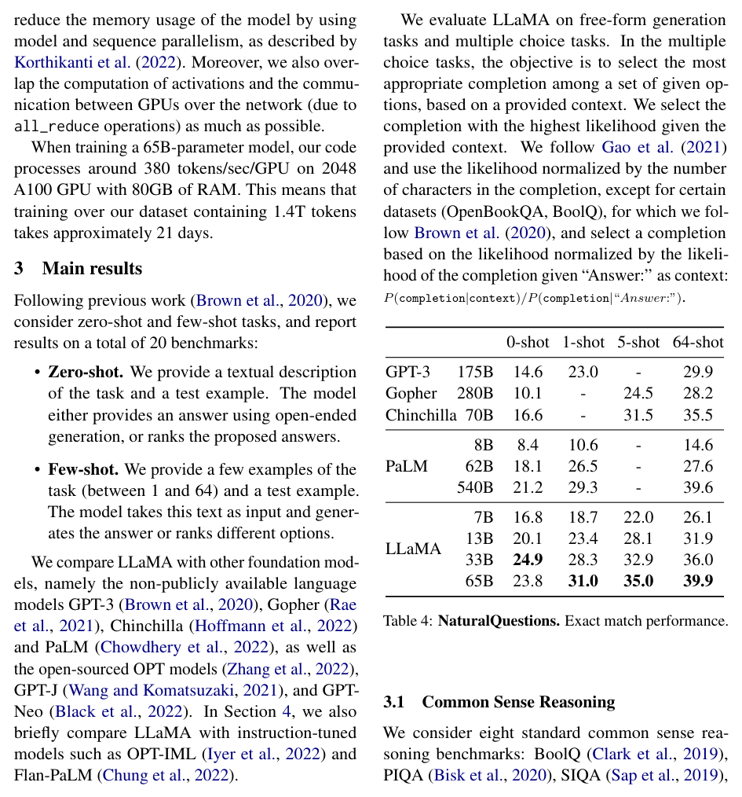

| Dataset（数据集） | Sampling prop.（采样比例） | Epochs（轮次） | Disk size（磁盘大小） |
|---|---|---|---|
| CommonCrawl | 67.0% | 1.10 | 3.3 TB |
| C4 | 15.0% | 1.06 | 783 GB |
| Github | 4.5% | 0.64 | 328 GB |
| Wikipedia | 4.5% | 2.45 | 83 GB |
| Books | 4.5% | 2.23 | 85 GB |
| ArXiv | 2.5% | 1.06 | 92 GB |
| StackExchange | 2.0% | 1.03 | 78 GB |

**Original:** English CommonCrawl [67%]. We preprocess five CommonCrawl dumps, ranging from 2017 to 2020, with the CCNet pipeline (Wenzek et al., 2020). This process deduplicates the data at the line level, performs language identification with a fastText linear classifier to remove non-English pages and filters low quality content with an n-gram language model. In addition, we trained a linear model to classify pages used as references in Wikipedia v.s. randomly sampled pages, and discarded pages not classified as references.

**中文:** English CommonCrawl [67%]。我们使用 CCNet 流水线（Wenzek et al., 2020）预处理了 2017 至 2020 年的五个 CommonCrawl 数据转储。该过程在行级别对数据去重，使用 fastText 线性分类器进行语言识别以移除非英语页面，并用 n-gram 语言模型过滤低质量内容。此外，我们训练了一个线性模型来区分 Wikipedia 中用作参考文献的页面与随机采样的页面，并丢弃未被分类为参考文献的页面。

**Original:** C4 [15%]. During exploratory experiments, we observed that using diverse pre-processed CommonCrawl datasets improves performance. We thus included the publicly available C4 dataset (Raffel et al., 2020) in our data. The preprocessing of C4 also contains deduplication and language identification steps: the main difference with CCNet is the quality filtering, which mostly relies on heuristics such as presence of punctuation marks or the number of words and sentences in a webpage.

**中文:** C4 [15%]。在探索性实验中，我们观察到使用多样化的预处理 CommonCrawl 数据集能提升性能。因此，我们将公开可用的 C4 数据集（Raffel et al., 2020）纳入我们的数据。C4 的预处理同样包含去重和语言识别步骤：与 CCNet 的主要区别在于质量过滤，它主要依赖启发式规则，例如网页中是否出现标点符号，或网页中词数与句子的数量。

**Original:** Github [4.5%]. We use the public GitHub dataset available on Google BigQuery. We only kept projects that are distributed under the Apache, BSD and MIT licenses. Additionally, we filtered low quality files with heuristics based on the line length or proportion of alphanumeric characters, and removed boilerplate, such as headers, with regular expressions. Finally, we deduplicate the resulting dataset at the file level, with exact matches.

**中文:** Github [4.5%]。我们使用 Google BigQuery 上公开的 GitHub 数据集。我们只保留以 Apache、BSD 和 MIT 许可证分发的项目。此外，我们基于行长度或字母数字字符占比的启发式规则过滤低质量文件，并用正则表达式去除样板内容（boilerplate），如文件头。最后，我们在文件级别对得到的数据集做精确匹配去重。

**Original:** Wikipedia [4.5%]. We add Wikipedia dumps from the June-August 2022 period, covering 20 languages, which use either the Latin or Cyrillic scripts: bg, ca, cs, da, de, en, es, fr, hr, hu, it, nl, pl, pt, ro, ru, sl, sr, sv, uk. We process the data to remove hyperlinks, comments and other formatting boilerplate.

**中文:** Wikipedia [4.5%]。我们加入了 2022 年 6 月至 8 月期间的 Wikipedia 数据转储，覆盖 20 种使用拉丁字母或西里尔字母的语言：bg, ca, cs, da, de, en, es, fr, hr, hu, it, nl, pl, pt, ro, ru, sl, sr, sv, uk。我们对数据做处理，移除超链接、注释和其他格式样板内容。

**Original:** Gutenberg and Books3 [4.5%]. We include two book corpora in our training dataset: the Gutenberg Project, which contains books that are in the public domain, and the Books3 section of ThePile (Gao et al., 2020), a publicly available dataset for training large language models. We perform deduplication at the book level, removing books with more than 90% content overlap.

**中文:** Gutenberg and Books3 [4.5%]。我们在训练数据集中加入了两个书籍语料库：Gutenberg Project（古登堡计划），其中包含公有领域的书籍；以及 ThePile（Gao et al., 2020）中的 Books3 部分——ThePile 是一个用于训练大语言模型的公开数据集。我们在书籍级别进行去重，移除内容重叠超过 90% 的书籍。

**Original:** ArXiv [2.5%]. We process arXiv Latex files to add scientific data to our dataset. Following Lewkowycz et al. (2022), we removed everything before the first section, as well as the bibliography. We also removed the comments from the .tex files, and inline-expanded definitions and macros written by users to increase consistency across papers.

**中文:** ArXiv [2.5%]。我们处理 arXiv 的 LaTeX 文件，为数据集加入科学数据。沿用 Lewkowycz et al. (2022) 的做法，我们移除了第一个章节之前的所有内容以及参考文献。我们还移除了 .tex 文件中的注释，以及用户内联展开的定义和宏，以提升各论文之间的一致性。

**Original:** Stack Exchange [2%]. We include a dump of Stack Exchange, a website of high quality questions and answers that covers a diverse set of domains, ranging from computer science to chemistry. We kept the data from the 28 largest websites, removed the HTML tags from text and sorted the answers by score (from highest to lowest).

**中文:** Stack Exchange [2%]。我们加入了 Stack Exchange 的数据转储——这是一个高质量问答网站，覆盖从计算机科学到化学的多种领域。我们保留了其中 28 个最大网站的数据，移除了文本中的 HTML 标签，并按得分（从高到低）对回答排序。

**Original:** Tokenizer. We tokenize the data with the byte-pair encoding (BPE) algorithm (Sennrich et al., 2015), using the implementation from SentencePiece (Kudo and Richardson, 2018). Notably, we split all numbers into individual digits, and fallback to bytes to decompose unknown UTF-8 characters.

**中文:** Tokenizer（分词器）。我们使用字节对编码（byte-pair encoding，BPE）算法（Sennrich et al., 2015）对数据做词元化（tokenization），采用 SentencePiece（Kudo and Richardson, 2018）的实现。值得注意的是，我们将所有数字拆分为单个数字，并在遇到未知 UTF-8 字符时回退到按字节分解。

**Original:** Overall, our entire training dataset contains roughly 1.4T tokens after tokenization. For most of our training data, each token is used only once during training, with the exception of the Wikipedia and Books domains, over which we perform approximately two epochs.

**中文:** 总体而言，词元化后我们的整个训练数据集包含约 1.4 万亿（1.4T）个 token。对于大部分训练数据，每个 token 在训练中只使用一次，但 Wikipedia 和 Books 两个领域除外——我们对它们进行了大约两个轮次的训练。

### 2.2 Architecture（架构）

**Original:** Following recent work on large language models, our network is based on the transformer architecture (Vaswani et al., 2017). We leverage various improvements that were subsequently proposed, and used in different models such as PaLM. Here are the main difference with the original architecture, and where we were found the inspiration for this change (in bracket):

**中文:** 遵循大语言模型的近期工作，我们的网络基于 Transformer 架构（Vaswani et al., 2017）。我们采用了此后被陆续提出、并被 PaLM 等不同模型所使用的各种改进。以下是与原始架构的主要差异，以及我们做出这些改动所借鉴的来源（括号中）：

**Original:** Pre-normalization [GPT3]. To improve the training stability, we normalize the input of each transformer sub-layer, instead of normalizing the output. We use the RMSNorm normalizing function, introduced by Zhang and Sennrich (2019).

**中文:** Pre-normalization（预归一化）[GPT3]。为提高训练稳定性，我们对每个 Transformer 子层的输入进行归一化（normalization），而不是对其输出归一化。我们使用 Zhang and Sennrich (2019) 提出的 RMSNorm 归一化函数。

**Original:** SwiGLU activation function [PaLM]. We replace the ReLU non-linearity by the SwiGLU activation function, introduced by Shazeer (2020) to improve the performance. We use a dimension of $\frac{2}{3}4d$ instead of $4d$ as in PaLM.

**中文:** SwiGLU activation function（SwiGLU 激活函数）[PaLM]。我们用 Shazeer (2020) 为提升性能而提出的 SwiGLU 激活函数取代了 ReLU 非线性。我们使用的维度是 $\frac{2}{3}4d$，而非 PaLM 所用的 $4d$。

**Original:** Rotary Embeddings [GPTNeo]. We remove the absolute positional embeddings, and instead, add rotary positional embeddings (RoPE), introduced by Su et al. (2021), at each layer of the network.

**中文:** Rotary Embeddings（旋转嵌入）[GPTNeo]。我们移除了绝对位置嵌入（absolute positional embeddings），改为在网络每一层加入 Su et al. (2021) 提出的旋转位置嵌入（rotary positional embeddings，RoPE）。

**Original:** The details of the hyper-parameters for our different models are given in Table 2.

**中文:** 我们各模型的超参数（hyper-parameter）细节见表 2。

> **表 2（译）**：模型规模、架构与优化超参数。（原图见 paper.pdf 第 3 页，见下方图）

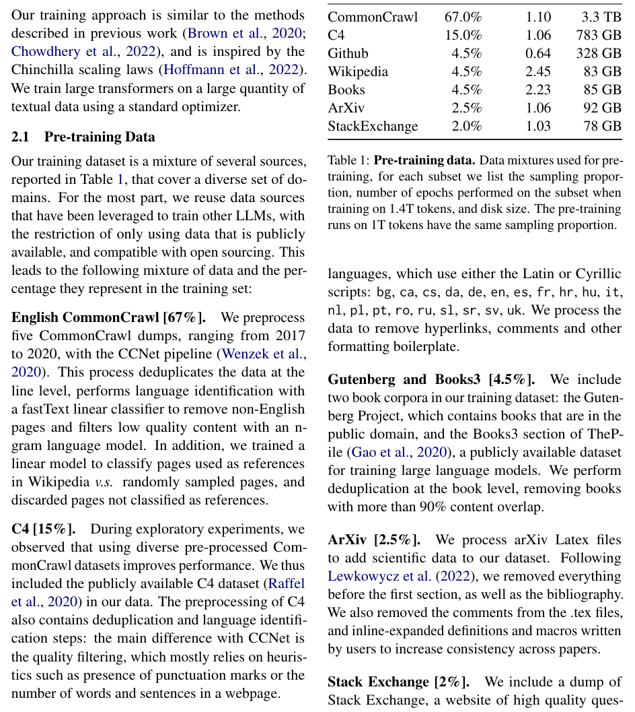

| params（参数量） | dimension（维度） | n heads（头数） | n layers（层数） | learning rate（学习率） | batch size（批次大小） | n tokens（token 数） |
|---|---|---|---|---|---|---|
| 6.7B | 4096 | 32 | 32 | 3.0e-4 | 4M | 1.0T |
| 13.0B | 5120 | 40 | 40 | 3.0e-4 | 4M | 1.0T |
| 32.5B | 6656 | 52 | 60 | 1.5e-4 | 4M | 1.4T |
| 65.2B | 8192 | 64 | 80 | 1.5e-4 | 4M | 1.4T |

### 2.3 Optimizer（优化器）

**Original:** Our models are trained using the AdamW optimizer (Loshchilov and Hutter, 2017), with the following hyper-parameters: $\beta_1 = 0.9$, $\beta_2 = 0.95$. We use a cosine learning rate schedule, such that the final learning rate is equal to 10% of the maximal learning rate. We use a weight decay of 0.1 and gradient clipping of 1.0. We use 2, 000 warmup steps, and vary the learning rate and batch size with the size of the model (see Table 2 for details).

**中文:** 我们的模型使用 AdamW 优化器（Loshchilov and Hutter, 2017）训练，超参数如下：$\beta_1 = 0.9$，$\beta_2 = 0.95$。我们使用余弦学习率（learning rate）调度，使最终学习率等于最大学习率的 10%。我们使用 0.1 的权重衰减（weight decay）和 1.0 的梯度裁剪（gradient clipping）。我们使用 2000 个预热（warmup）步，并随模型规模调整学习率与批次大小（详见 Table 2）。

### 2.4 Efficient implementation（高效实现）

**Original:** We make several optimizations to improve the training speed of our models. First, we use an efficient implementation of the causal multi-head attention to reduce memory usage and runtime. This implementation, available in the xformers library,² is inspired by Rabe and Staats (2021) and uses the backward from Dao et al. (2022). This is achieved by not storing the attention weights and not computing the key/query scores that are masked due to the causal nature of the language modeling task.

**中文:** 我们做了若干优化以提升模型的训练速度。首先，我们使用了因果多头注意力（causal multi-head attention）的高效实现，以减少内存占用和运行时间。该实现在 xformers 库² 中提供，受 Rabe and Staats (2021) 启发，并使用了 Dao et al. (2022) 的反向（backward）计算。其实现方式是：不存储注意力权重，并且不计算因语言建模任务的因果性质而被掩蔽（mask）的键/查询（key/query）分数。

**Original:** To further improve training efficiency, we reduced the amount of activations that are recomputed during the backward pass with checkpointing. More precisely, we save the activations that are expensive to compute, such as the outputs of linear layers. This is achieved by manually implementing the backward function for the transformer layers, instead of relying on the PyTorch autograd. To fully benefit from this optimization, we need to reduce the memory usage of the model by using model and sequence parallelism, as described by Korthikanti et al. (2022). Moreover, we also overlap the computation of activations and the communication between GPUs over the network (due to all_reduce operations) as much as possible.

**中文:** 为进一步提高训练效率，我们通过检查点（checkpointing）技术减少了反向传播过程中需要重新计算的激活值（activation）数量。更确切地说，我们保存那些计算开销高昂的激活值，例如线性层的输出。其实现方式是手动实现 Transformer 层的反向函数，而不是依赖 PyTorch autograd。为充分受益于这一优化，我们还需要按 Korthikanti et al. (2022) 所述，通过模型并行（model parallelism）与序列并行（sequence parallelism）来降低模型的内存占用。此外，我们还尽可能地让激活值的计算与 GPU 之间经网络的通信（由 all_reduce 操作引起）重叠执行。

**Original:** When training a 65B-parameter model, our code processes around 380 tokens/sec/GPU on 2048 A100 GPU with 80GB of RAM. This means that training over our dataset containing 1.4T tokens takes approximately 21 days.

**中文:** 在训练 650 亿参数模型时，我们的代码在 2048 块配备 80GB 显存的 A100 GPU 上达到约 380 token/秒/GPU 的处理速度。这意味着在包含 1.4 万亿 token 的数据集上完成训练大约需要 21 天。

> **图 1（译）**：7B、13B、33B 与 65 模型的训练损失（training loss）随训练 token 数的变化。LLaMA-33B 与 LLaMA-65B 在 1.4T token 上训练，较小的模型在 1.0T token 上训练。所有模型均以 400 万 token 的批次大小训练。（原图见 paper.pdf 第 3 页，[第 3 页图](assets/figures/fig-1.png)）

## 3 Main results（主要结果）

**Original:** Following previous work (Brown et al., 2020), we consider zero-shot and few-shot tasks, and report results on a total of 20 benchmarks:

**中文:** 沿用先前工作（Brown et al., 2020）的做法，我们考虑零样本（zero-shot）与少样本（few-shot）任务，并在共计 20 个基准测试上报告结果：

**Original:** • Zero-shot. We provide a textual description of the task and a test example. The model either provides an answer using open-ended generation, or ranks the proposed answers.

**中文:** • 零样本。我们给出任务的文字描述和一个测试样例。模型要么以开放式生成（open-ended generation）的方式给出答案，要么对候选答案进行排序。

**Original:** • Few-shot. We provide a few examples of the task (between 1 and 64) and a test example. The model takes this text as input and generates the answer or ranks different options.

**中文:** • 少样本。我们给出任务的少量示例（1 到 64 个之间）和一个测试样例。模型以这段文本为输入，生成答案或对不同选项排序。

**Original:** We compare LLaMA with other foundation models, namely the non-publicly available language models GPT-3 (Brown et al., 2020), Gopher (Rae et al., 2021), Chinchilla (Hoffmann et al., 2022) and PaLM (Chowdhery et al., 2022), as well as the open-sourced OPT models (Zhang et al., 2022), GPT-J (Wang and Komatsuzaki, 2021), and GPT-Neo (Black et al., 2022). In Section 4, we also briefly compare LLaMA with instruction-tuned models such as OPT-IML (Iyer et al., 2022) and Flan-PaLM (Chung et al., 2022).

**中文:** 我们将 LLaMA 与其他基座模型进行比较，包括未公开的语言模型 GPT-3（Brown et al., 2020）、Gopher（Rae et al., 2021）、Chinchilla（Hoffmann et al., 2022）和 PaLM（Chowdhery et al., 2022），以及开源的 OPT 模型（Zhang et al., 2022）、GPT-J（Wang and Komatsuzaki, 2021）和 GPT-Neo（Black et al., 2022）。在第 4 节中，我们还将 LLaMA 与 OPT-IML（Iyer et al., 2022）和 Flan-PaLM（Chung et al., 2022）等经指令微调（instruction-tuned）的模型进行简要比较。

**Original:** We evaluate LLaMA on free-form generation tasks and multiple choice tasks. In the multiple choice tasks, the objective is to select the most appropriate completion among a set of given options, based on a provided context. We select the completion with the highest likelihood given the provided context. We follow Gao et al. (2021) and use the likelihood normalized by the number of characters in the completion, except for certain datasets (OpenBookQA, BoolQ), for which we follow Brown et al. (2020), and select a completion based on the likelihood normalized by the likelihood of the completion given "Answer:" as context: $P(\text{completion}|\text{context})/P(\text{completion}|\text{"Answer:"})$.

**中文:** 我们在自由形式生成任务和多项选择任务上评估 LLaMA。在多项选择任务中，目标是基于给定上下文，从一组给定选项中选出最合适的补全（completion）。我们选择在给定上下文下似然（likelihood）最高的补全。我们遵循 Gao et al. (2021) 的做法，使用按补全中字符数归一化的似然；但某些数据集（OpenBookQA、BoolQ）除外，对它们我们遵循 Brown et al. (2020) 的做法，基于补全似然除以补全在 "Answer:" 作为上下文时的似然来选答案：$P(\text{completion}|\text{context})/P(\text{completion}|\text{"Answer:"})$。

### 3.1 Common Sense Reasoning（常识推理）

**Original:** We consider eight standard common sense reasoning benchmarks: BoolQ (Clark et al., 2019), PIQA (Bisk et al., 2020), SIQA (Sap et al., 2019), HellaSwag (Zellers et al., 2019), WinoGrande (Sakaguchi et al., 2021), ARC easy and challenge (Clark et al., 2018) and OpenBookQA (Mihaylov et al., 2018). These datasets include Cloze and Winograd style tasks, as well as multiple choice question answering. We evaluate in the zero-shot setting as done in the language modeling community.

**中文:** 我们考虑八个标准的常识推理（common sense reasoning）基准测试：BoolQ（Clark et al., 2019）、PIQA（Bisk et al., 2020）、SIQA（Sap et al., 2019）、HellaSwag（Zellers et al., 2019）、WinoGrande（Sakaguchi et al., 2021）、ARC easy 与 challenge（Clark et al., 2018）以及 OpenBookQA（Mihaylov et al., 2018）。这些数据集包含完形填空（Cloze）与 Winograd 风格的任务，以及多项选择问答。我们按语言建模社区的惯例，在零样本设定下评估。

**Original:** In Table 3, we compare with existing models of various sizes and report numbers from the corresponding papers. First, LLaMA-65B outperforms Chinchilla-70B on all reported benchmarks but BoolQ. Similarly, this model surpasses PaLM-540B everywhere but on BoolQ and WinoGrande. LLaMA-13B model also outperforms GPT-3 on most benchmarks despite being 10× smaller.

**中文:** 在 Table 3 中，我们与各种规模的现有模型比较，并报告各论文中的相应数字。首先，LLaMA-65B 在所有报告了成绩的基准测试上都优于 Chinchilla-70B，仅 BoolQ 除外。类似地，该模型在所有基准上超越 PaLM-540B，仅 BoolQ 和 WinoGrande 除外。LLaMA-13B 也在大多数基准测试上优于 GPT-3，尽管其规模小了 10 倍。

> **表 3（译）**：常识推理任务上的零样本性能。（原图见 paper.pdf 第 4 页，见下方图）

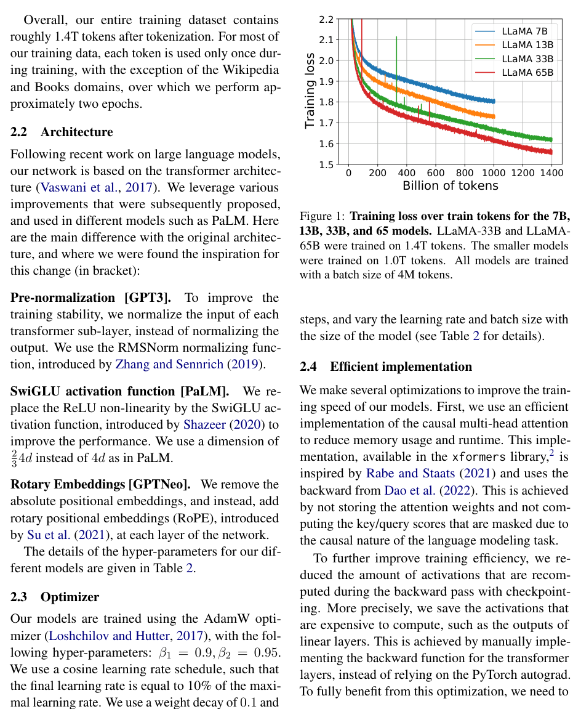

| Model（模型） | BoolQ | PIQA | SIQA | HellaSwag | WinoGrande | ARC-e | ARC-c | OBQA |
|---|---|---|---|---|---|---|---|---|
| GPT-3 175B | 60.5 | 81.0 | - | 78.9 | 70.2 | 68.8 | 51.4 | 57.6 |
| Gopher 280B | 79.3 | 81.8 | 50.6 | 79.2 | 70.1 | - | - | - |
| Chinchilla 70B | 83.7 | 81.8 | 51.3 | 80.8 | 74.9 | - | - | - |
| PaLM 62B | 84.8 | 80.5 | - | 79.7 | 77.0 | 75.2 | 52.5 | 50.4 |
| PaLM-cont 62B | 83.9 | 81.4 | - | 80.6 | 77.0 | - | - | - |
| PaLM 540B | 88.0 | 82.3 | - | 83.4 | 81.1 | 76.6 | 53.0 | 53.4 |
| LLaMA 7B | 76.5 | 79.8 | 48.9 | 76.1 | 70.1 | 72.8 | 47.6 | 57.2 |
| LLaMA 13B | 78.1 | 80.1 | 50.4 | 79.2 | 73.0 | 74.8 | 52.7 | 56.4 |
| LLaMA 33B | 83.1 | 82.3 | 50.4 | 82.8 | 76.0 | 80.0 | 57.8 | 58.6 |
| LLaMA 65B | 85.3 | 82.8 | 52.3 | 84.2 | 77.0 | 78.9 | 56.0 | 60.2 |

### 3.2 Closed-book Question Answering（闭卷问答）

**Original:** We compare LLaMA to existing large language models on two closed-book question answering benchmarks: Natural Questions (Kwiatkowski et al., 2019) and TriviaQA (Joshi et al., 2017). For both benchmarks, we report exact match performance in a closed book setting, i.e., where the models do not have access to documents that contain evidence to answer the question. In Table 4, we report performance on NaturalQuestions, and in Table 5, we report on TriviaQA. On both benchmarks, LLaMA-65B achieve state-of-the-arts performance in the zero-shot and few-shot settings. More importantly, the LLaMA-13B is also competitive on these benchmarks with GPT-3 and Chinchilla, despite being 5-10× smaller. This model runs on a single V100 GPU during inference.

**中文:** 我们在两个闭卷问答（closed-book question answering）基准测试上将 LLaMA 与现有大语言模型比较：Natural Questions（Kwiatkowski et al., 2019）和 TriviaQA（Joshi et al., 2017）。对这两个基准测试，我们报告闭卷设定下的精确匹配（exact match）性能，即模型无法访问包含答题证据的文档。在 Table 4 中我们报告 NaturalQuestions 上的性能，在 Table 5 中报告 TriviaQA 上的性能。在这两个基准测试上，LLaMA-65B 在零样本与少样本设定下都取得了当前最优的性能。更重要的是，LLaMA-13B 在这两个基准上也能与 GPT-3 和 Chinchilla 竞争，尽管其规模小 5-10 倍。该模型在推理时可运行于单块 V100 GPU 上。

> **表 4（译）**：NaturalQuestions。精确匹配性能。（原图见 paper.pdf 第 4 页，[第 4 页图](assets/figures/tab-4.png)）

| Model（模型） | 0-shot | 1-shot | 5-shot | 64-shot |
|---|---|---|---|---|
| GPT-3 175B | 14.6 | 23.0 | - | 29.9 |
| Gopher 280B | 10.1 | - | 24.5 | 28.2 |
| Chinchilla 70B | 16.6 | - | 31.5 | 35.5 |
| PaLM 8B | 8.4 | 10.6 | - | 14.6 |
| PaLM 62B | 18.1 | 26.5 | - | 27.6 |
| PaLM 540B | 21.2 | 29.3 | - | 39.6 |
| LLaMA 7B | 16.8 | 18.7 | 22.0 | 26.1 |
| LLaMA 13B | 20.1 | 23.4 | 28.1 | 31.9 |
| LLaMA 33B | 24.9 | 28.3 | 32.9 | 36.0 |
| LLaMA 65B | 23.8 | 31.0 | 35.0 | 39.9 |

> **表 5（译）**：TriviaQA。过滤后开发集（filtered dev set）上的零样本与少样本精确匹配性能。（原图见 paper.pdf 第 5 页，见下方图）

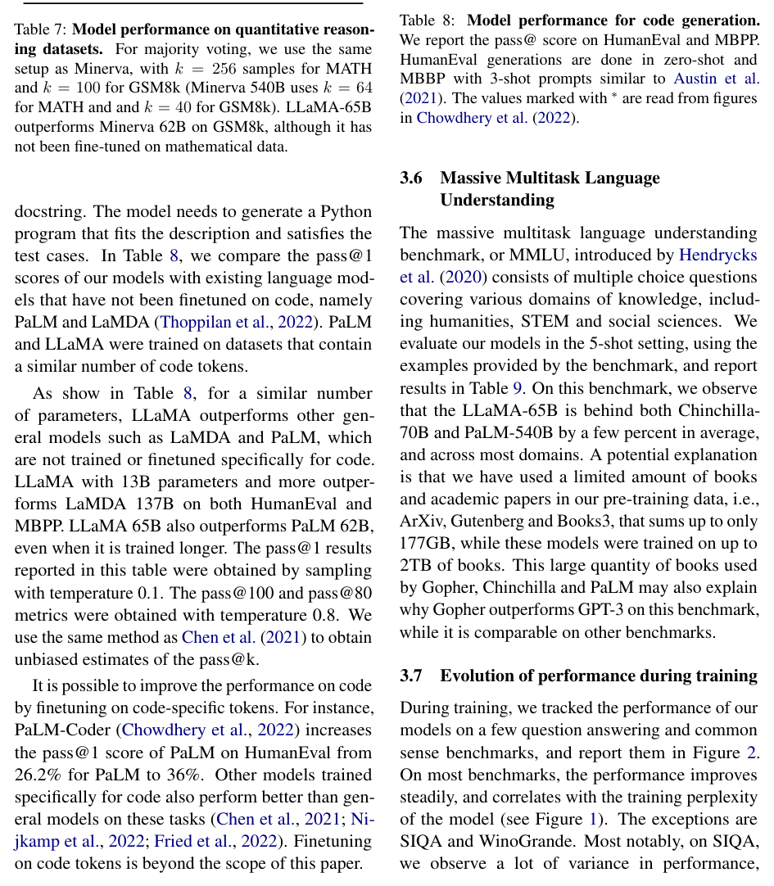

| Model（模型） | 0-shot | 1-shot | 5-shot | 64-shot |
|---|---|---|---|---|
| Gopher 280B | 43.5 | - | 57.0 | 57.2 |
| Chinchilla 70B | 55.4 | - | 64.1 | 64.6 |
| LLaMA 7B | 50.0 | 53.4 | 56.3 | 57.6 |
| LLaMA 13B | 56.6 | 60.5 | 63.1 | 64.0 |
| LLaMA 33B | 65.1 | 67.9 | 69.9 | 70.4 |
| LLaMA 65B | 68.2 | 71.6 | 72.6 | 73.0 |

### 3.3 Reading Comprehension（阅读理解）

**Original:** We evaluate our models on the RACE reading comprehension benchmark (Lai et al., 2017). This dataset was collected from English reading comprehension exams designed for middle and high school Chinese students. We follow the evaluation setup from Brown et al. (2020) and report results in Table 6. On these benchmarks, LLaMA-65B is competitive with PaLM-540B, and, LLaMA-13B outperforms GPT-3 by a few percents.

**中文:** 我们在 RACE 阅读理解（reading comprehension）基准测试（Lai et al., 2017）上评估我们的模型。该数据集收集自为中国初高中学生设计的英语阅读理解考试。我们遵循 Brown et al. (2020) 的评估设定，结果报告于 Table 6。在这些基准测试上，LLaMA-65B 与 PaLM-540B 具有竞争力，而 LLaMA-13B 比 GPT-3 高出几个百分点。

> **表 6（译）**：阅读理解（Reading Comprehension）。零样本准确率。（原图见 paper.pdf 第 5 页，[第 5 页图](assets/figures/tab-6.png)）

| Model（模型） | RACE-middle | RACE-high |
|---|---|---|
| GPT-3 175B | 58.4 | 45.5 |
| PaLM 8B | 57.9 | 42.3 |
| PaLM 62B | 64.3 | 47.5 |
| PaLM 540B | 68.1 | 49.1 |
| LLaMA 7B | 61.1 | 46.9 |
| LLaMA 13B | 61.6 | 47.2 |
| LLaMA 33B | 64.1 | 48.3 |
| LLaMA 65B | 67.9 | 51.6 |

### 3.4 Mathematical reasoning（数学推理）

**Original:** We evaluate our models on two mathematical reasoning benchmarks: MATH (Hendrycks et al., 2021) and GSM8k (Cobbe et al., 2021). MATH is a dataset of 12K middle school and high school mathematics problems written in LaTeX. GSM8k is a set of middle school mathematical problems. In Table 7, we compare with PaLM and Minerva (Lewkowycz et al., 2022). Minerva is a series of PaLM models finetuned on 38.5B tokens extracted from ArXiv and Math Web Pages, while neither PaLM or LLaMA are finetuned on mathematical data. The numbers for PaLM and Minerva are taken from Lewkowycz et al. (2022), and we compare with and without maj1@k. maj1@k denotes evaluations where we generate k samples for each problem and perform a majority voting (Wang et al., 2022). On GSM8k, we observe that LLaMA-65B outperforms Minerva-62B, although it has not been fine-tuned on mathematical data.

**中文:** 我们在两个数学推理（mathematical reasoning）基准测试上评估模型：MATH（Hendrycks et al., 2021）和 GSM8k（Cobbe et al., 2021）。MATH 是一个包含 1.2 万道用 LaTeX 编写的初高中数学题的数据集。GSM8k 是一组中学数学题。在 Table 7 中，我们与 PaLM 和 Minerva（Lewkowycz et al., 2022）比较。Minerva 是一系列在从 ArXiv 与数学网页提取的 385 亿（38.5B）token 上微调（finetune）过的 PaLM 模型，而 PaLM 与 LLaMA 均未在数学数据上微调。PaLM 与 Minerva 的数字取自 Lewkowycz et al. (2022)，我们比较使用与不使用 maj1@k 的结果。maj1@k 表示这样的评估方式：为每道题生成 k 个样本并做多数投票（majority voting，Wang et al., 2022）。在 GSM8k 上，我们观察到 LLaMA-65B 优于 Minerva-62B，尽管它没有在数学数据上微调过。

> **表 7（译）**：模型在定量推理数据集上的性能。对于多数投票，我们采用与 Minerva 相同的设定：MATH 上 k = 256 个样本，GSM8k 上 k = 100（Minerva 540B 对 MATH 使用 k = 64，对 GSM8k 使用 k = 40）。LLaMA-65B 在 GSM8k 上优于 Minerva 62B，尽管它未在数学数据上微调。（原图见 paper.pdf 第 6 页，见下方图）

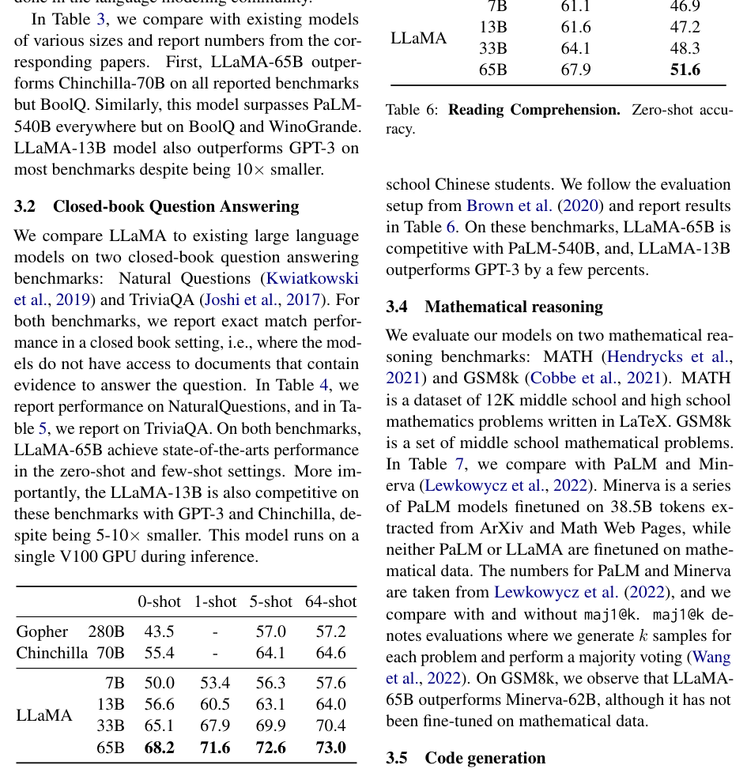

| Model（模型） | MATH | +maj1@k | GSM8k | +maj1@k |
|---|---|---|---|---|
| PaLM 8B | 1.5 | - | 4.1 | - |
| PaLM 62B | 4.4 | - | 33.0 | - |
| PaLM 540B | 8.8 | - | 56.5 | - |
| Minerva 8B | 14.1 | 25.4 | 16.2 | 28.4 |
| Minerva 62B | 27.6 | 43.4 | 52.4 | 68.5 |
| Minerva 540B | 33.6 | 50.3 | 68.5 | 78.5 |
| LLaMA 7B | 2.9 | 6.9 | 11.0 | 18.1 |
| LLaMA 13B | 3.9 | 8.8 | 17.8 | 29.3 |
| LLaMA 33B | 7.1 | 15.2 | 35.6 | 53.1 |
| LLaMA 65B | 10.6 | 20.5 | 50.9 | 69.7 |

### 3.5 Code generation（代码生成）

**Original:** We evaluate the ability of our models to write code from a natural language description on two benchmarks: HumanEval (Chen et al., 2021) and MBPP (Austin et al., 2021). For both tasks, the model receives a description of the program in a few sentences, as well as a few input-output examples. In HumanEval, it also receives a function signature, and the prompt is formatted as natural code with the textual description and tests in a docstring. The model needs to generate a Python program that fits the description and satisfies the test cases. In Table 8, we compare the pass@1 scores of our models with existing language models that have not been finetuned on code, namely PaLM and LaMDA (Thoppilan et al., 2022). PaLM and LLaMA were trained on datasets that contain a similar number of code tokens.

**中文:** 我们在两个基准测试上评估模型根据自然语言描述编写代码的能力：HumanEval（Chen et al., 2021）和 MBPP（Austin et al., 2021）。对这两个任务，模型收到一段用几句话写成的程序描述，以及若干输入-输出示例。在 HumanEval 中，模型还会收到函数签名，提示（prompt）以自然代码的形式呈现，文字描述与测试用例放在 docstring 中。模型需要生成一个符合描述并通过测试用例的 Python 程序。在 Table 8 中，我们将我们模型的 pass@1 分数与未在代码上微调过的现有语言模型（即 PaLM 与 LaMDA，Thoppilan et al., 2022）比较。PaLM 与 LLaMA 的训练数据包含数量相近的代码 token。

**Original:** As show in Table 8, for a similar number of parameters, LLaMA outperforms other general models such as LaMDA and PaLM, which are not trained or finetuned specifically for code. LLaMA with 13B parameters and more outperforms LaMDA 137B on both HumanEval and MBPP. LLaMA 65B also outperforms PaLM 62B, even when it is trained longer. The pass@1 results reported in this table were obtained by sampling with temperature 0.1. The pass@100 and pass@80 metrics were obtained with temperature 0.8. We use the same method as Chen et al. (2021) to obtain unbiased estimates of the pass@k.

**中文:** 如 Table 8 所示，在参数量相近的情况下，LLaMA 优于 LaMDA 和 PaLM 等其他通用模型——它们并未专门针对代码进行训练或微调。130 亿参数及以上的 LLaMA 在 HumanEval 和 MBPP 上都优于 LaMDA 137B。LLaMA 65B 也优于 PaLM 62B，即使后者训练得更久。此表中报告的 pass@1 结果以温度（temperature）0.1 采样得到；pass@100 与 pass@80 指标以温度 0.8 采样得到。我们使用与 Chen et al. (2021) 相同的方法获得 pass@k 的无偏估计。

**Original:** It is possible to improve the performance on code by finetuning on code-specific tokens. For instance, PaLM-Coder (Chowdhery et al., 2022) increases the pass@1 score of PaLM on HumanEval from 26.2% for PaLM to 36%. Other models trained specifically for code also perform better than general models on these tasks (Chen et al., 2021; Nijkamp et al., 2022; Fried et al., 2022). Finetuning on code tokens is beyond the scope of this paper.

**中文:** 通过在代码专属 token 上微调，可以进一步提升代码性能。例如，PaLM-Coder（Chowdhery et al., 2022）将 PaLM 在 HumanEval 上的 pass@1 分数从 26.2% 提高到 36%。其他专门针对代码训练的模型在这些任务上的表现也优于通用模型（Chen et al., 2021; Nijkamp et al., 2022; Fried et al., 2022）。在代码 token 上微调超出了本文的范围。

> **表 8（译）**：模型在代码生成上的性能。我们报告 HumanEval 和 MBPP 上的 pass@ 分数。HumanEval 的生成在零样本设定下进行，MBPP 使用与 Austin et al. (2021) 类似的 3-shot 提示。带 标记的数值读自 Chowdhery et al. (2022) 中的图。（原图见 paper.pdf 第 6 页，[第 6 页图](assets/figures/tab-8.png)）

| Model（模型） | Params（参数量） | HumanEval @1 | HumanEval @100 | MBPP @1 | MBPP @80 |
|---|---|---|---|---|---|
| LaMDA | 137B | 14.0 | 47.3 | 14.8 | 62.4 |
| PaLM | 8B | 3.6 | 18.7 | 5.0 | 35.7 |
| PaLM | 62B | 15.9 | 46.3 | 21.4 | 63.2 |
| PaLM-cont | 62B | 23.7 | - | 31.2 | - |
| PaLM | 540B | 26.2 | 76.2 | 36.8 | 75.0 |
| LLaMA | 7B | 10.5 | 36.5 | 17.7 | 56.2 |
| LLaMA | 13B | 15.8 | 52.5 | 22.0 | 64.0 |
| LLaMA | 33B | 21.7 | 70.7 | 30.2 | 73.4 |
| LLaMA | 65B | 23.7 | 79.3 | 37.7 | 76.8 |

### 3.6 Massive Multitask Language Understanding（大规模多任务语言理解）

**Original:** The massive multitask language understanding benchmark, or MMLU, introduced by Hendrycks et al. (2020) consists of multiple choice questions covering various domains of knowledge, including humanities, STEM and social sciences. We evaluate our models in the 5-shot setting, using the examples provided by the benchmark, and report results in Table 9. On this benchmark, we observe that the LLaMA-65B is behind both Chinchilla-70B and PaLM-540B by a few percent in average, and across most domains. A potential explanation is that we have used a limited amount of books and academic papers in our pre-training data, i.e., ArXiv, Gutenberg and Books3, that sums up to only 177GB, while these models were trained on up to 2TB of books. This large quantity of books used by Gopher, Chinchilla and PaLM may also explain why Gopher outperforms GPT-3 on this benchmark, while it is comparable on other benchmarks.

**中文:** 大规模多任务语言理解（massive multitask language understanding，MMLU）基准测试由 Hendrycks et al. (2020) 提出，由覆盖多个知识领域的多项选择题构成，包括人文学科、STEM 和社会科学。我们使用该基准提供的示例，在 5-shot 设定下评估模型，结果报告于 Table 9。在该基准测试上，我们观察到 LLaMA-65B 在平均值上以及大多数领域中都落后于 Chinchilla-70B 和 PaLM-540B 几个百分点。一个可能的解释是：我们的预训练数据中书籍和学术论文的数量有限，即 ArXiv、Gutenberg 与 Books3 合计只有 177GB；而这些模型的训练数据包含多达 2TB 的书籍。Gopher、Chinchilla 和 PaLM 所使用的大量书籍或许也能解释为什么 Gopher 在该基准上优于 GPT-3，而在其他基准上两者相当。

> **表 9（译）**：大规模多任务语言理解（MMLU）。五样本（five-shot）准确率。（原图见 paper.pdf 第 7 页，见下方图）

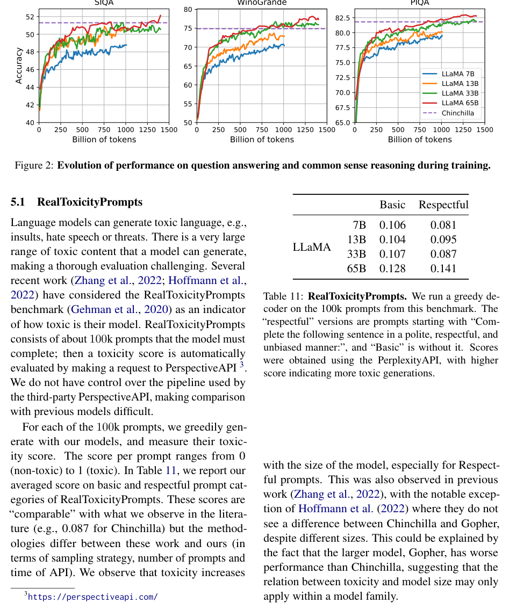

| Model（模型） | Humanities | STEM | Social Sciences | Other | Average |
|---|---|---|---|---|---|
| GPT-NeoX 20B | 29.8 | 34.9 | 33.7 | 37.7 | 33.6 |
| GPT-3 175B | 40.8 | 36.7 | 50.4 | 48.8 | 43.9 |
| Gopher 280B | 56.2 | 47.4 | 71.9 | 66.1 | 60.0 |
| Chinchilla 70B | 63.6 | 54.9 | 79.3 | 73.9 | 67.5 |
| PaLM 8B | 25.6 | 23.8 | 24.1 | 27.8 | 25.4 |
| PaLM 62B | 59.5 | 41.9 | 62.7 | 55.8 | 53.7 |
| PaLM 540B | 77.0 | 55.6 | 81.0 | 69.6 | 69.3 |
| LLaMA 7B | 34.0 | 30.5 | 38.3 | 38.1 | 35.1 |
| LLaMA 13B | 45.0 | 35.8 | 53.8 | 53.3 | 46.9 |
| LLaMA 33B | 55.8 | 46.0 | 66.7 | 63.4 | 57.8 |
| LLaMA 65B | 61.8 | 51.7 | 72.9 | 67.4 | 63.4 |

### 3.7 Evolution of performance during training（训练期间性能的演变）

**Original:** During training, we tracked the performance of our models on a few question answering and common sense benchmarks, and report them in Figure 2. On most benchmarks, the performance improves steadily, and correlates with the training perplexity of the model (see Figure 1). The exceptions are SIQA and WinoGrande. Most notably, on SIQA, we observe a lot of variance in performance, that may indicate that this benchmark is not reliable. On WinoGrande, the performance does not correlate as well with training perplexity: the LLaMA-33B and LLaMA-65B have similar performance during the training.

**中文:** 在训练过程中，我们跟踪了模型在若干问答与常识基准测试上的性能，并在 Figure 2 中报告。在大多数基准测试上，性能稳步提升，并与模型的训练困惑度（perplexity）相关（见 Figure 1）。例外是 SIQA 和 WinoGrande。最值得注意的是，在 SIQA 上我们观察到性能有较大波动，这可能表明该基准测试并不可靠。在 WinoGrande 上，性能与训练困惑度的相关性也不高：LLaMA-33B 与 LLaMA-65B 在训练过程中的性能相近。

> **图 2（译）**：训练期间问答与常识推理性能的演变。（原图见 paper.pdf 第 8 页，见下方图）

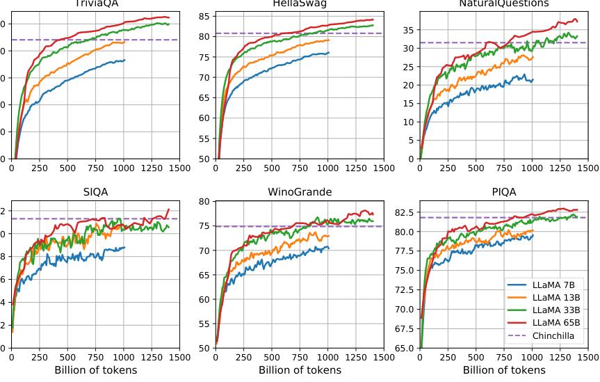

---

## 4 Instruction Finetuning（指令微调）

**Original:** In this section, we show that briefly finetuning on instructions data rapidly leads to improvements on MMLU. Although the non-finetuned version of LLaMA-65B is already able to follow basic instructions, we observe that a very small amount of finetuning improves the performance on MMLU, and further improves the ability of the model to follow instructions. Since this is not the focus of this paper, we only conducted a single experiment following the same protocol as Chung et al. (2022) to train an instruct model, LLaMA-I.

**中文:** 在本节中，我们展示：短暂地在指令数据上微调即可迅速带来 MMLU 上的提升。尽管未微调的 LLaMA-65B 已经能够遵循基本指令，我们观察到极少量的微调就能提高 MMLU 上的性能，并进一步增强模型遵循指令的能力。由于这不是本文的重点，我们只按与 Chung et al. (2022) 相同的流程进行了一次实验，训练出一个指令模型（instruct model）LLaMA-I。

**Original:** In Table 10, we report the results of our instruct model LLaMA-I on MMLU and compare with existing instruction finetuned models of moderate sizes, namely, OPT-IML (Iyer et al., 2022) and the Flan-PaLM series (Chung et al., 2022). All the reported numbers are from the corresponding papers. Despite the simplicity of the instruction finetuning approach used here, we reach 68.9% on MMLU. LLaMA-I (65B) outperforms on MMLU existing instruction finetuned models of moderate sizes, but are still far from the state-of-the-art, that is 77.4 for GPT code-davinci-002 on MMLU (numbers taken from Iyer et al. (2022)). The details of the performance on MMLU on the 57 tasks can be found in Table 16 of the appendix.

**中文:** 在 Table 10 中，我们报告指令模型 LLaMA-I 在 MMLU 上的结果，并与中等规模的现有指令微调模型比较，即 OPT-IML（Iyer et al., 2022）与 Flan-PaLM 系列（Chung et al., 2022）。所有报告的数字均来自相应论文。尽管这里使用的指令微调方法很简单，我们在 MMLU 上达到了 68.9%。LLaMA-I（65B）在 MMLU 上优于中等规模的现有指令微调模型，但距离当前最优仍很远——GPT code-davinci-002 在 MMLU 上为 77.4（数字取自 Iyer et al. (2022)）。MMLU 上 57 个任务的详细性能见附录 Table 16。

> **表 10（译）**：指令微调——MMLU（5-shot）。中等规模模型在 MMLU 上经与未经指令微调的对比。（原图见 paper.pdf 第 7 页，[第 7 页图](assets/figures/tab-10.png)）

| Model（模型） | MMLU |
|---|---|
| OPT 30B | 26.1 |
| OPT-IML-Max 30B | 43.2 |
| GLM 120B | 44.8 |
| Flan-T5-XXL 11B | 55.1 |
| PaLM 62B | 55.1 |
| Flan-PaLM 62B | 59.6 |
| PaLM-cont 62B | 62.8 |
| Flan-PaLM-cont 62B | 66.1 |
| Chinchilla 70B | 67.5 |
| LLaMA 65B | 63.4 |
| LLaMA-I 65B | 68.9 |

## 5 Bias, Toxicity and Misinformation（偏见、毒性与虚假信息）

**Original:** Large language models have been showed to reproduce and amplify biases that are existing in the training data (Sheng et al., 2019; Kurita et al., 2019), and to generate toxic or offensive content (Gehman et al., 2020). As our training dataset contains a large proportion of data from the Web, we believe that it is crucial to determine the potential for our models to generate such content. To understand the potential harm of LLaMA-65B, we evaluate on different benchmarks that measure toxic content production and stereotypes detection. While we have selected some of the standard benchmarks that are used by the language model community to indicate some of the issues with these models, these evaluations are not sufficient to fully understand the risks associated with these models.

**中文:** 已有研究表明，大语言模型会复现并放大训练数据中存在的偏见（Sheng et al., 2019; Kurita et al., 2019），并生成有毒或冒犯性内容（Gehman et al., 2020）。由于我们的训练数据集包含很大比例来自网络的数据，我们认为确定模型生成此类内容的潜在可能是至关重要的。为理解 LLaMA-65B 的潜在危害，我们在衡量有毒内容生成与刻板印象（stereotype）检测的不同基准测试上进行评估。虽然我们选取了语言模型社区常用的部分标准基准测试，用以指出这些模型的某些问题，但这些评估不足以完全理解与这些模型相关的风险。

### 5.1 RealToxicityPrompts

**Original:** Language models can generate toxic language, e.g., insults, hate speech or threats. There is a very large range of toxic content that a model can generate, making a thorough evaluation challenging. Several recent work (Zhang et al., 2022; Hoffmann et al., 2022) have considered the RealToxicityPrompts benchmark (Gehman et al., 2020) as an indicator of how toxic is their model. RealToxicityPrompts consists of about 100k prompts that the model must complete; then a toxicity score is automatically evaluated by making a request to PerspectiveAPI ³. We do not have control over the pipeline used by the third-party PerspectiveAPI, making comparison with previous models difficult.

**中文:** 语言模型会生成有毒语言，例如侮辱、仇恨言论或威胁。模型可生成的有毒内容范围极广，使得全面评估颇具挑战。若干近期工作（Zhang et al., 2022; Hoffmann et al., 2022）将 RealToxicityPrompts 基准测试（Gehman et al., 2020）作为衡量其模型毒性程度的指标。RealToxicityPrompts 由约 10 万个需要模型补全的提示组成；随后通过向 PerspectiveAPI ³ 发送请求自动评估毒性分数。我们无法控制第三方 PerspectiveAPI 所使用的流水线，因此与先前模型的比较存在困难。

**Original:** For each of the 100k prompts, we greedily generate with our models, and measure their toxicity score. The score per prompt ranges from 0 (non-toxic) to 1 (toxic). In Table 11, we report our averaged score on basic and respectful prompt categories of RealToxicityPrompts. These scores are "comparable" with what we observe in the literature (e.g., 0.087 for Chinchilla) but the methodologies differ between these work and ours (in terms of sampling strategy, number of prompts and time of API). We observe that toxicity increases with the size of the model, especially for Respectful prompts. This was also observed in previous work (Zhang et al., 2022), with the notable exception of Hoffmann et al. (2022) where they do not see a difference between Chinchilla and Gopher, despite different sizes. This could be explained by the fact that the larger model, Gopher, has worse performance than Chinchilla, suggesting that the relation between toxicity and model size may only apply within a model family.

**中文:** 对于这 10 万个提示中的每一个，我们用模型贪心地生成文本，并测量其毒性分数。每个提示的分数范围从 0（无毒）到 1（有毒）。在 Table 11 中，我们报告在 RealToxicityPrompts 的 basic 与 respectful 两类提示上的平均分数。这些分数与文献中观察到的结果"相当"（例如 Chinchilla 为 0.087），但这些工作与我们的方法学存在差异（体现在采样策略、提示数量与 API 调用时间上）。我们观察到毒性随模型规模增大而上升，尤其是对 Respectful 提示。先前工作（Zhang et al., 2022）也观察到这一点，但 Hoffmann et al. (2022) 是显著的例外——他们未发现 Chinchilla 与 Gopher 之间存在差异，尽管两者规模不同。这或许可以解释为：更大的模型 Gopher 性能比 Chinchilla 差，这表明毒性与模型规模的关系可能只在同一模型家族内部成立。

> **表 11（译）**：RealToxicityPrompts。我们在该基准的 10 万个提示上运行贪心解码器。"respectful"版本的提示以"Complete the following sentence in a polite, respectful, and unbiased manner:"开头，而"Basic"则不加该前缀。分数使用 PerplexityAPI 获得，分数越高表示生成内容毒性越强。（原图见 paper.pdf 第 8 页，[第 8 页图](assets/figures/tab-11.png)）

| Model（模型） | Basic | Respectful |
|---|---|---|
| LLaMA 7B | 0.106 | 0.081 |
| LLaMA 13B | 0.104 | 0.095 |
| LLaMA 33B | 0.107 | 0.087 |
| LLaMA 65B | 0.128 | 0.141 |

### 5.2 CrowS-Pairs

**Original:** We evaluate the biases in our model on the CrowS-Pairs (Nangia et al., 2020). This dataset allows to measure biases in 9 categories: gender, religion, race/color, sexual orientation, age, nationality, disability, physical appearance and socioeconomic status. Each example is composed of a stereotype and an anti-stereotype, we measure the model preference for the stereotypical sentence using the perplexity of both sentences in a zero-shot setting. Higher scores thus indicate higher bias. We compare with GPT-3 and OPT-175B in Table 12.

**中文:** 我们在 CrowS-Pairs（Nangia et al., 2020）上评估模型中的偏见。该数据集可以测量 9 个类别的偏见：性别、宗教、种族/肤色、性取向、年龄、国籍、残障、外貌和社会经济地位。每个样本由一个刻板印象句和一个反刻板印象句构成，我们在零样本设定下通过两句话的困惑度来衡量模型对刻板印象句的偏好。分数越高表示偏见越强。我们在 Table 12 中与 GPT-3 和 OPT-175B 比较。

**Original:** LLaMA compares slightly favorably to both models on average. Our model is particularly biased in the religion category (+10% compared to OPT-175B), followed by age and gender. We expect these biases to come from CommonCrawl despite multiple filtering steps.

**中文:** 平均而言，LLaMA 与这两个模型相比略占优势。我们的模型在宗教类别上偏见尤为明显（比 OPT-175B 高 10%），其次是年龄和性别。我们认为这些偏见来自 CommonCrawl，尽管经过了多重过滤步骤。

> **表 12（译）**：CrowS-Pairs。我们比较 LLaMA-65B 与 OPT-175B、GPT3-175B 所包含的偏见水平。分数越高表示偏见越强。（原图见 paper.pdf 第 9 页，见下方图）

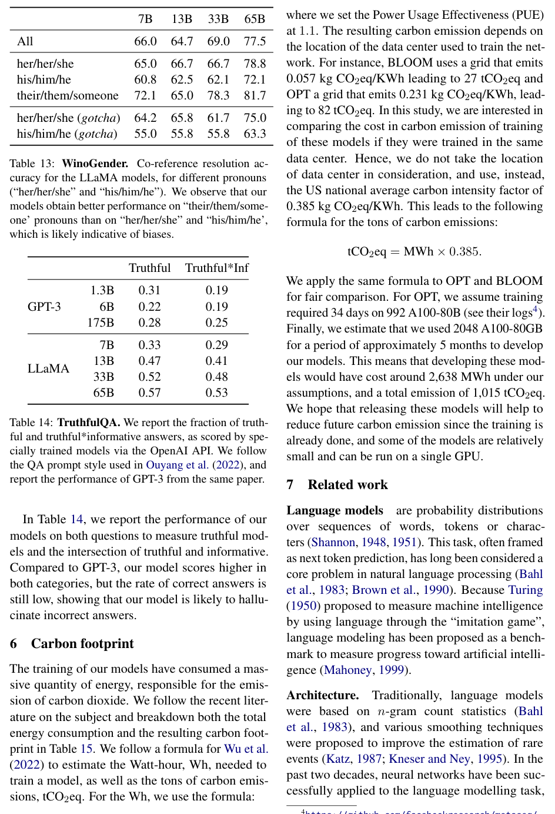

| Category（类别） | LLaMA 65B | GPT3 175B | OPT 175B |
|---|---|---|---|
| Gender（性别） | 70.6 | 62.6 | 65.7 |
| Religion（宗教） | 79.0 | 73.3 | 68.6 |
| Race/Color（种族/肤色） | 57.0 | 64.7 | 68.6 |
| Sexual orientation（性取向） | 81.0 | 76.2 | 78.6 |
| Age（年龄） | 70.1 | 64.4 | 67.8 |
| Nationality（国籍） | 64.2 | 61.6 | 62.9 |
| Disability（残障） | 66.7 | 76.7 | 76.7 |
| Physical appearance（外貌） | 77.8 | 74.6 | 76.2 |
| Socioeconomic status（社会经济地位） | 71.5 | 73.8 | 76.2 |
| Average（平均） | 66.6 | 67.2 | 69.5 |

### 5.3 WinoGender

**Original:** To further investigate the biases of our model on the gender category, we look at the WinoGender benchmark (Rudinger et al., 2018), a co-reference resolution dataset. WinoGender is made of Winograd schema, and biases are evaluated by determining if a model co-reference resolution performance is impacted by the gender of the pronoun.

**中文:** 为进一步研究模型在性别类别上的偏见，我们考察 WinoGender 基准测试（Rudinger et al., 2018），一个指代消解（co-reference resolution）数据集。WinoGender 由 Winograd 模式（Winograd schema）构成，通过判断模型的指代消解性能是否受代词性别影响来评估偏见。

**Original:** More precisely, each sentence has three mentions: an "occupation", a "participant", and a "pronoun" where the pronoun is co-referencing either the occupation or participant. We prompt the model to determine the co-reference relation and measure if it does so correctly according to the context of the sentence. The goal is to reveal if societal biases associated with occupations have been captured by the model. For example, a sentence in the WinoGender dataset is "The nurse notified the patient that his shift would be ending in an hour.", which is followed by `His' refers to. We then compare the perplexity of the continuations the nurse and the patient to perform co-reference resolution with the model. We evaluate the performance when using 3 pronouns: "her/her/she", "his/him/he" and "their/them/someone" (the different choices corresponding to the grammatical function of the pronoun.

**中文:** 更确切地说，每个句子包含三个提及（mention）：一个"职业"、一个"参与者"和一个"代词"，其中代词与职业或参与者之一构成共指。我们提示模型确定指代关系，并衡量它是否依据句子上下文做出了正确的判断。目标是揭示模型是否习得了与职业相关的社会偏见。例如，WinoGender 数据集中有一个句子："The nurse notified the patient that his shift would be ending in an hour."（护士通知病人他的班次将在一小时后结束），其后跟着 `His' refers to（"His"指的是）。随后，我们比较模型对续写 the nurse 与 the patient 的困惑度，以完成指代消解。我们使用 3 组代词评估性能："her/her/she"、"his/him/he"和"their/them/someone"（不同选择对应代词的不同语法功能）。

**Original:** In Table 13, we report the co-reference scores for the three different pronouns contained in the dataset. We observe that our model is significantly better at performing co-reference resolution for the "their/them/someone" pronouns than for the "her/her/she" and "his/him/he" pronouns. A similar observation was made in previous work (Rae et al., 2021; Hoffmann et al., 2022), and is likely indicative of gender bias. Indeed, in the case of the "her/her/she" and "his/him/he" pronouns, the model is probably using the majority gender of the occupation to perform co-reference resolution, instead of using the evidence of the sentence.

**中文:** 在 Table 13 中，我们报告数据集中三组代词的指代分数。我们观察到，模型对 "their/them/someone" 代词的指代消解明显好于对 "her/her/she" 和 "his/him/he" 代词。先前工作（Rae et al., 2021; Hoffmann et al., 2022）也有类似观察，这很可能表明存在性别偏见。事实上，对于 "her/her/she" 和 "his/him/he" 代词，模型很可能是在利用该职业的多数性别来完成指代消解，而不是利用句子中的证据。

**Original:** To further investigate this hypothesis, we look at the set of "gotcha" cases for the "her/her/she" and "his/him/he" pronouns in the WinoGender dataset. Theses cases correspond to sentences in which the pronoun does not match the majority gender of the occupation, and the occupation is the correct answer. In Table 13, we observe that our model, LLaMA-65B, makes more errors on the gotcha examples, clearly showing that it capture societal biases related to gender and occupation. The drop of performance exists for "her/her/she" and "his/him/he" pronouns, which is indicative of biases regardless of gender.

**中文:** 为进一步验证这一假设，我们考察 WinoGender 数据集中 "her/her/she" 和 "his/him/he" 代词对应的"gotcha"（陷阱）案例集合。这些案例对应这样的句子：代词与该职业的多数性别不符，而职业是正确答案。在 Table 13 中，我们观察到我们的模型 LLaMA-65B 在 gotcha 示例上出错更多，清楚表明它习得了与性别和职业相关的社会偏见。性能下降同时存在于 "her/her/she" 和 "his/him/he" 代词上，这表明无论哪种性别都存在偏见。

> **表 13（译）**：WinoGender。LLaMA 各模型在不同代词（"her/her/she"与"his/him/he"）上的指代消解准确率。我们观察到模型在 "their/them/someone" 代词上的性能优于 "her/her/she" 和 "his/him/he"，这可能表明存在偏见。（原图见 paper.pdf 第 10 页，见下方图）


| 代词 | 7B | 13B | 33B | 65B |
|---|---|---|---|---|
| All（全部） | 66.0 | 64.7 | 69.0 | 77.5 |
| her/her/she | 65.0 | 66.7 | 66.7 | 78.8 |
| his/him/he | 60.8 | 62.5 | 62.1 | 72.1 |
| their/them/someone | 72.1 | 65.0 | 78.3 | 81.7 |
| her/her/she (gotcha) | 64.2 | 65.8 | 61.7 | 75.0 |
| his/him/he (gotcha) | 55.0 | 55.8 | 55.8 | 63.3 |

### 5.4 TruthfulQA

**Original:** TruthfulQA (Lin et al., 2021) aims to measure the truthfulness of a model, i.e., its ability to identify when a claim is true. Lin et al. (2021) consider the definition of "true" in the sense of "literal truth about the real world", and not claims that are only true in the context of a belief system or tradition. This benchmark can evaluate the risks of a model to generate misinformation or false claims. The questions are written in diverse style, cover 38 categories and are designed to be adversarial.

**中文:** TruthfulQA（Lin et al., 2021）旨在衡量模型的真实性（truthfulness），即其识别某一论断何时为真的能力。Lin et al. (2021) 对"真"的定义取"关于现实世界的字面真相"之义，而不是仅在某个信仰体系或传统语境下为真的论断。该基准测试可以评估模型生成虚假信息（misinformation）或错误论断的风险。问题以多样的风格撰写，覆盖 38 个类别，并刻意设计成对抗性（adversarial）的。

**Original:** In Table 14, we report the performance of our models on both questions to measure truthful models and the intersection of truthful and informative. Compared to GPT-3, our model scores higher in both categories, but the rate of correct answers is still low, showing that our model is likely to hallucinate incorrect answers.

**中文:** 在 Table 14 中，我们报告模型在这两类问题上的性能，分别衡量模型的真实性以及"真实且提供信息"（truthful*informative）的交集。与 GPT-3 相比，我们的模型在两类指标上得分更高，但正确率仍然很低，说明我们的模型很可能幻觉（hallucinate）出不正确的答案。

> **表 14（译）**：TruthfulQA。我们报告经专门训练的模型通过 OpenAI API 评分的真实答案与 truthful*informative 答案的比例。我们遵循 Ouyang et al. (2022) 中使用的 QA 提示风格，并报告同一论文中 GPT-3 的性能。（原图见 paper.pdf 第 10 页，[第 10 页图](assets/figures/tab-14.png)）

| Model（模型） | Truthful | Truthful*Inf |
|---|---|---|
| GPT-3 1.3B | 0.31 | 0.19 |
| GPT-3 6B | 0.22 | 0.19 |
| GPT-3 175B | 0.28 | 0.25 |
| LLaMA 7B | 0.33 | 0.29 |
| LLaMA 13B | 0.47 | 0.41 |
| LLaMA 33B | 0.52 | 0.48 |
| LLaMA 65B | 0.57 | 0.53 |

---

## 6 Carbon footprint（碳足迹）

**Original:** The training of our models have consumed a massive quantity of energy, responsible for the emission of carbon dioxide. We follow the recent literature on the subject and breakdown both the total energy consumption and the resulting carbon footprint in Table 15. We follow a formula for Wu et al. (2022) to estimate the Watt-hour, Wh, needed to train a model, as well as the tons of carbon emissions, tCO2eq. For the Wh, we use the formula:

**中文:** 我们模型的训练消耗了大量能源，并因此排放了二氧化碳。我们遵循该主题的近期文献，在 Table 15 中分解了总能耗与由此产生的碳足迹（carbon footprint）。我们沿用 Wu et al. (2022) 的公式估算训练一个模型所需的瓦时（Wh）以及碳排放吨数（tCO2eq）。对于 Wh，我们使用如下公式：

$$Wh = GPU\text{-}h \times (\text{GPU power consumption}) \times PUE$$

**Original:** where we set the Power Usage Effectiveness (PUE) at 1.1. The resulting carbon emission depends on the location of the data center used to train the network. For instance, BLOOM uses a grid that emits 0.057 kg CO2eq/KWh leading to 27 tCO2eq and OPT a grid that emits 0.231 kg CO2eq/KWh, leading to 82 tCO2eq. In this study, we are interested in comparing the cost in carbon emission of training of these models if they were trained in the same data center. Hence, we do not take the location of data center in consideration, and use, instead, the US national average carbon intensity factor of 0.385 kg CO2eq/KWh. This leads to the following formula for the tons of carbon emissions:

**中文:** 其中我们将电能利用效率（Power Usage Effectiveness，PUE）设为 1.1。由此产生的碳排放取决于训练网络所用数据中心的位置。例如，BLOOM 使用的电网排放系数为 0.057 kg CO2eq/KWh，对应 27 tCO2eq；而 OPT 所用电网的排放系数为 0.231 kg CO2eq/KWh，对应 82 tCO2eq。在本研究中，我们关心的是：如果这些模型在同一数据中心训练，比较它们训练的碳排放成本。因此，我们不考虑数据中心位置，改用美国全国平均碳强度系数 0.385 kg CO2eq/KWh。由此得到碳排放吨数的如下公式：

$$tCO2eq = MWh \times 0.385$$

**Original:** We apply the same formula to OPT and BLOOM for fair comparison. For OPT, we assume training required 34 days on 992 A100-80B (see their logs⁴). Finally, we estimate that we used 2048 A100-80GB for a period of approximately 5 months to develop our models. This means that developing these models would have cost around 2,638 MWh under our assumptions, and a total emission of 1,015 tCO2eq. We hope that releasing these models will help to reduce future carbon emission since the training is already done, and some of the models are relatively small and can be run on a single GPU.

**中文:** 为公平比较，我们对 OPT 和 BLOOM 应用相同的公式。对于 OPT，我们假设训练需在 992 块 A100-80B 上进行 34 天（见其日志⁴）。最后，我们估计开发我们的模型使用了 2048 块 A100-80GB，历时约 5 个月。这意味着在我们的假设下，开发这些模型大约消耗 2,638 MWh，总计排放 1,015 tCO2eq。我们希望发布这些模型有助于减少未来的碳排放，因为训练已经完成，而且其中一些模型规模相对较小，可在单块 GPU 上运行。

> **表 15（译）**：不同模型在同一数据中心训练时的碳足迹。我们沿用 Wu et al. (2022) 的方法计算 OPT、BLOOM 和我们的模型在同一数据中心训练时的碳排放。对于 A100-80GB 的功耗，我们取 NVLink 系统的热设计功耗（thermal design power），即 400W。我们取 PUE 为 1.1，碳强度系数取美国全国平均值 0.385 kg CO2e per KWh。（原图见 paper.pdf 第 11 页，见下方图）

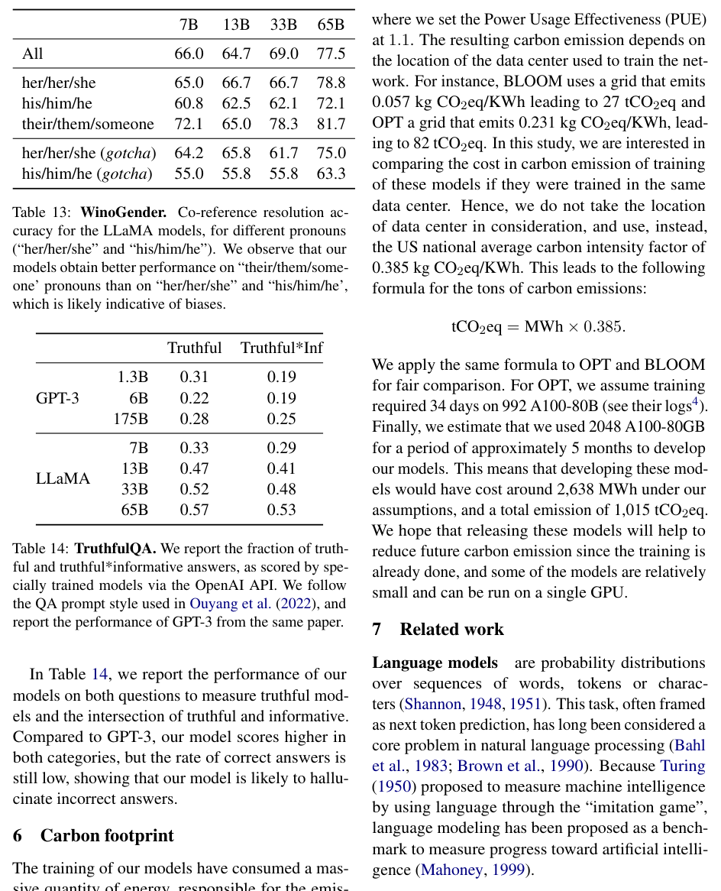

| Model（模型） | GPU Type | GPU Power consumption | GPU-hours | Total power consumption | Carbon emitted (tCO2eq) |
|---|---|---|---|---|---|
| OPT-175B | A100-80GB | 400W | 809,472 | 356 MWh | 137 |
| BLOOM-175B | A100-80GB | 400W | 1,082,880 | 475 MWh | 183 |
| LLaMA-7B | A100-80GB | 400W | 82,432 | 36 MWh | 14 |
| LLaMA-13B | A100-80GB | 400W | 135,168 | 59 MWh | 23 |
| LLaMA-33B | A100-80GB | 400W | 530,432 | 233 MWh | 90 |
| LLaMA-65B | A100-80GB | 400W | 1,022,362 | 449 MWh | 173 |

---

## 7 Related work（相关工作）

**Original:** Language models are probability distributions over sequences of words, tokens or characters (Shannon, 1948, 1951). This task, often framed as next token prediction, has long been considered a core problem in natural language processing (Bahl et al., 1983; Brown et al., 1990). Because Turing (1950) proposed to measure machine intelligence by using language through the "imitation game", language modeling has been proposed as a benchmark to measure progress toward artificial intelligence (Mahoney, 1999).

**中文:** 语言模型是词、token 或字符序列上的概率分布（Shannon, 1948, 1951）。这一任务常被表述为下一 token 预测（next token prediction），长期以来被视为自然语言处理的核心问题（Bahl et al., 1983; Brown et al., 1990）。由于 Turing (1950) 提出通过"模仿游戏"（imitation game）使用语言来衡量机器智能，语言建模被提议作为衡量人工智能进展的基准（Mahoney, 1999）。

**Original:** Architecture. Traditionally, language models were based on n-gram count statistics (Bahl et al., 1983), and various smoothing techniques were proposed to improve the estimation of rare events (Katz, 1987; Kneser and Ney, 1995). In the past two decades, neural networks have been successfully applied to the language modelling task, starting from feed forward models (Bengio et al., 2000), recurrent neural networks (Elman, 1990; Mikolov et al., 2010) and LSTMs (Hochreiter and Schmidhuber, 1997; Graves, 2013). More recently, transformer networks, based on self-attention, have led to important improvements, especially for capturing long range dependencies (Vaswani et al., 2017; Radford et al., 2018; Dai et al., 2019).

**中文:** Architecture（架构）。传统上，语言模型基于 n-gram 计数统计（Bahl et al., 1983），并提出了各种平滑（smoothing）技术以改进对稀有事件的估计（Katz, 1987; Kneser and Ney, 1995）。在过去二十年中，神经网络被成功应用于语言建模任务，从前馈模型（Bengio et al., 2000）开始，随后是循环神经网络（RNN，Elman, 1990; Mikolov et al., 2010）和 LSTM（Hochreiter and Schmidhuber, 1997; Graves, 2013）。更近期，基于自注意力（self-attention）的 Transformer 网络带来了重要改进，尤其是在捕捉长程依赖方面（Vaswani et al., 2017; Radford et al., 2018; Dai et al., 2019）。

**Original:** Scaling. There is a long history of scaling for language models, for both the model and dataset sizes. Brants et al. (2007) showed the benefits of using language models trained on 2 trillion tokens, resulting in 300 billion n-grams, on the quality of machine translation. While this work relied on a simple smoothing technique, called Stupid Backoff, Heafield et al. (2013) later showed how to scale Kneser-Ney smoothing to Web-scale data. This allowed to train a 5-gram model on 975 billions tokens from CommonCrawl, resulting in a model with 500 billions n-grams (Buck et al., 2014). Chelba et al. (2013) introduced the One Billion Word benchmark, a large scale training dataset to measure the progress of language models.

**中文:** Scaling（扩展）。语言模型在模型规模和数据集规模两个维度上的扩展都有很长的历史。Brants et al. (2007) 展示了使用在 2 万亿 token 上训练、产生 3000 亿 n-gram 的语言模型对机器翻译质量的益处。虽然该工作依赖一种称为 Stupid Backoff 的简单平滑技术，但 Heafield et al. (2013) 后来展示了如何将 Kneser-Ney 平滑扩展到网络规模的数据。这使得在来自 CommonCrawl 的 9750 亿 token 上训练 5-gram 模型成为可能，得到包含 5000 亿 n-gram 的模型（Buck et al., 2014）。Chelba et al. (2013) 提出了 One Billion Word 基准测试，一个用于衡量语言模型进展的大规模训练数据集。

**Original:** In the context of neural language models, Jozefowicz et al. (2016) obtained state-of-the-art results on the Billion Word benchmark by scaling LSTMs to 1 billion parameters. Later, scaling transformers lead to improvement on many NLP tasks. Notable models include BERT (Devlin et al., 2018), GPT-2 (Radford et al., 2019), Megatron-LM (Shoeybi et al., 2019), and T5 (Raffel et al., 2020). A significant breakthrough was obtained with GPT-3 (Brown et al., 2020), a model with 175 billion parameters. This lead to a series of Large Language Models, such as Jurassic-1 (Lieber et al., 2021), Megatron-Turing NLG (Smith et al., 2022), Gopher (Rae et al., 2021), Chinchilla (Hoffmann et al., 2022), PaLM (Chowdhery et al., 2022), OPT (Zhang et al., 2022), and GLM (Zeng et al., 2022). Hestness et al. (2017) and Rosenfeld et al. (2019) studied the impact of scaling on the performance of deep learning models, showing the existence of power laws between the model and dataset sizes and the performance of the system. Kaplan et al. (2020) derived power laws specifically for transformer based language models, which were later refined by Hoffmann et al. (2022), by adapting the learning rate schedule when scaling datasets. Finally, Wei et al. (2022) studied the effect of scaling on the abilities of large language models.

**中文:** 在神经语言模型的语境下，Jozefowicz et al. (2016) 通过将 LSTM 扩展到 10 亿参数，在 Billion Word 基准上取得了当时最优的结果。此后，扩展 Transformer 带来了许多 NLP 任务的提升。代表性模型包括 BERT（Devlin et al., 2018）、GPT-2（Radford et al., 2019）、Megatron-LM（Shoeybi et al., 2019）和 T5（Raffel et al., 2020）。GPT-3（Brown et al., 2020）——一个 1750 亿参数的模型——取得了重大突破。这催生了一系列大语言模型，如 Jurassic-1（Lieber et al., 2021）、Megatron-Turing NLG（Smith et al., 2022）、Gopher（Rae et al., 2021）、Chinchilla（Hoffmann et al., 2022）、PaLM（Chowdhery et al., 2022）、OPT（Zhang et al., 2022）和 GLM（Zeng et al., 2022）。Hestness et al. (2017) 和 Rosenfeld et al. (2019) 研究了扩展对深度学习模型性能的影响，展示了模型与数据集规模同系统性能之间幂律（power law）的存在。Kaplan et al. (2020) 专门为基于 Transformer 的语言模型推导了幂律，Hoffmann et al. (2022) 随后通过扩展数据集时调整学习率调度对其做了修正。最后，Wei et al. (2022) 研究了扩展对大语言模型能力的影响。

---

## 8 Conclusion（结论）

**Original:** In this paper, we presented a series of language models that are released openly, and competitive with state-of-the-art foundation models. Most notably, LLaMA-13B outperforms GPT-3 while being more than 10× smaller, and LLaMA-65B is competitive with Chinchilla-70B and PaLM-540B. Unlike previous studies, we show that it is possible to achieve state-of-the-art performance by training exclusively on publicly available data, without resorting to proprietary datasets. We hope that releasing these models to the research community will accelerate the development of large language models, and help efforts to improve their robustness and mitigate known issues such as toxicity and bias. Additionally, we observed like Chung et al. (2022) that finetuning these models on instructions lead to promising results, and we plan to further investigate this in future work. Finally, we plan to release larger models trained on larger pretraining corpora in the future, since we have seen a constant improvement in performance as we were scaling.

**中文:** 在本文中，我们提出了一系列公开发布的语言模型，其性能可与当前最优的基座模型相媲美。最值得注意的是，LLaMA-13B 优于 GPT-3，同时规模小 10 倍以上；LLaMA-65B 与 Chinchilla-70B 和 PaLM-540B 具有竞争力。与先前研究不同，我们证明：仅使用公开可用数据训练、不借助专有数据集，也可以取得当前最优的性能。我们希望将这些模型发布给研究社区能加速大语言模型的发展，并有助于改善其鲁棒性（robustness）、缓解毒性与偏见等已知问题。此外，与 Chung et al. (2022) 一样，我们观察到在这些模型上做指令微调能带来有前景的结果，并计划在未来工作中进一步探究。最后，由于我们看到性能随规模扩展而持续提升，我们计划在未来发布在更大预训练语料上训练的更大模型。

---

## Acknowledgements（致谢）

**Original:** We thank Daniel Haziza, Francisco Massa, Jeremy Reizenstein, Artem Korenev, and Patrick Labatut from the xformers team. We thank Susan Zhang and Stephen Roller for their support on data deduplication. We thank Luca Wehrstedt, Vegard Mella, and Pierre-Emmanuel Mazaré for their support on training stability. We thank Shubho Sengupta, Kalyan Saladi, and all the AI infra team for their support. We thank Jane Yu for her input on evaluation. We thank Yongyi Hu for his help on data collection.

**中文:** 我们感谢 xformers 团队的 Daniel Haziza、Francisco Massa、Jeremy Reizenstein、Artem Korenev 和 Patrick Labatut。我们感谢 Susan Zhang 和 Stephen Roller 在数据去重上的支持。我们感谢 Luca Wehrstedt、Vegard Mella 和 Pierre-Emmanuel Mazaré 在训练稳定性上的支持。我们感谢 Shubho Sengupta、Kalyan Saladi 以及整个 AI infra 团队的支持。我们感谢 Jane Yu 在评估方面的意见。我们感谢 Yongyi Hu 在数据收集上的帮助。

**Original:** Equal contribution. Correspondence: {htouvron, thibautlav, gizacard, egrave, glample}@meta.com

**中文:** 同等贡献。通讯作者：{htouvron, thibautlav, gizacard, egrave, glample}@meta.com

**Original:** ¹https://github.com/facebookresearch/llama

**中文:** ¹https://github.com/facebookresearch/llama

---

## References（参考文献）

> 以下参考文献整体保留原文，不翻译。

Jacob Austin, Augustus Odena, Maxwell Nye, Maarten Bosma, Henryk Michalewski, David Dohan, Ellen Jiang, Carrie Cai, Michael Terry, Quoc Le, and Charles Sutton. 2021. Program synthesis with large language models.

Lalit R Bahl, Frederick Jelinek, and Robert L Mercer. 1983. A maximum likelihood approach to continuous speech recognition. IEEE transactions on pattern analysis and machine intelligence, pages 179–190.

Yoshua Bengio, Réjean Ducharme, and Pascal Vincent. 2000. A neural probabilistic language model. Advances in neural information processing systems, 13.

Yonatan Bisk, Rowan Zellers, Jianfeng Gao, Yejin Choi, et al. 2020. Piqa: Reasoning about physical commonsense in natural language. In Proceedings of the AAAI conference on artificial intelligence, pages 7432–7439.

Sid Black, Stella Biderman, Eric Hallahan, Quentin Anthony, Leo Gao, Laurence Golding, Horace He, Connor Leahy, Kyle McDonell, Jason Phang, et al. 2022. Gpt-neox-20b: An open-source autoregressive language model. arXiv preprint arXiv:2204.06745.

Thorsten Brants, Ashok C. Popat, Peng Xu, Franz J. Och, and Jeffrey Dean. 2007. Large language models in machine translation. In Proceedings of the 2007 Joint Conference on Empirical Methods in Natural Language Processing and Computational Natural Language Learning (EMNLP-CoNLL), pages 858–867, Prague, Czech Republic. Association for Computational Linguistics.

Peter F Brown, John Cocke, Stephen A Della Pietra, Vincent J Della Pietra, Frederick Jelinek, John Lafferty, Robert L Mercer, and Paul S Roossin. 1990. A statistical approach to machine translation. Computational linguistics, 16(2):79–85.

Tom B. Brown, Benjamin Mann, Nick Ryder, Melanie Subbiah, Jared Kaplan, Prafulla Dhariwal, Arvind Neelakantan, Pranav Shyam, Girish Sastry, Amanda Askell, Sandhini Agarwal, Ariel Herbert-Voss, Gretchen Krueger, Tom Henighan, Rewon Child, Aditya Ramesh, Daniel M. Ziegler, Jeffrey Wu, Clemens Winter, Christopher Hesse, Mark Chen, Eric Sigler, Mateusz Litwin, Scott Gray, Benjamin Chess, Jack Clark, Christopher Berner, Sam McCandlish, Alec Radford, Ilya Sutskever, and Dario Amodei. 2020. Language models are few-shot learners.

Christian Buck, Kenneth Heafield, and Bas Van Ooyen. 2014. N-gram counts and language models from the common crawl. In LREC, volume 2, page 4.

Ciprian Chelba, Tomas Mikolov, Mike Schuster, Qi Ge, Thorsten Brants, Phillipp Koehn, and Tony Robinson. 2013. One billion word benchmark for measuring progress in statistical language modeling. arXiv preprint arXiv:1312.3005.

Mark Chen, Jerry Tworek, Heewoo Jun, Qiming Yuan, Henrique Ponde de Oliveira Pinto, Jared Kaplan, Harri Edwards, Yuri Burda, Nicholas Joseph, Greg Brockman, Alex Ray, Raul Puri, Gretchen Krueger, Michael Petrov, Heidy Khlaaf, Girish Sastry, Pamela Mishkin, Brooke Chan, Scott Gray, Nick Ryder, Mikhail Pavlov, Alethea Power, Lukasz Kaiser, Mohammad Bavarian, Clemens Winter, Philippe Tillet, Felipe Petroski Such, Dave Cummings, Matthias Plappert, Fotios Chantzis, Elizabeth Barnes, Ariel Herbert-Voss, William Hebgen Guss, Alex Nichol, Alex Paino, Nikolas Tezak, Jie Tang, Igor Babuschkin, Suchir Balaji, Shantanu Jain, William Saunders, Christopher Hesse, Andrew N. Carr, Jan Leike, Josh Achiam, Vedant Misra, Evan Morikawa, Alec Radford, Matthew Knight, Miles Brundage, Mira Murati, Katie Mayer, Peter Welinder, Bob McGrew, Dario Amodei, Sam McCandlish, Ilya Sutskever, and Wojciech Zaremba. 2021. Evaluating large language models trained on code.

Aakanksha Chowdhery, Sharan Narang, Jacob Devlin, Maarten Bosma, Gaurav Mishra, Adam Roberts, Paul Barham, Hyung Won Chung, Charles Sutton, Sebastian Gehrmann, Parker Schuh, Kensen Shi, Sasha Tsvyashchenko, Joshua Maynez, Abhishek Rao, Parker Barnes, Yi Tay, Noam Shazeer, Vinodkumar Prabhakaran, Emily Reif, Nan Du, Ben Hutchinson, Reiner Pope, James Bradbury, Jacob Austin, Michael Isard, Guy Gur-Ari, Pengcheng Yin, Toju Duke, Anselm Levskaya, Sanjay Ghemawat, Sunipa Dev, Henryk Michalewski, Xavier Garcia, Vedant Misra, Kevin Robinson, Liam Fedus, Denny Zhou, Daphne Ippolito, David Luan, Hyeontaek Lim, Barret Zoph, Alexander Spiridonov, Ryan Sepassi, David Dohan, Shivani Agrawal, Mark Omernick, Andrew M. Dai, Thanumalayan Sankaranarayana Pillai, Marie Pellat, Aitor Lewkowycz, Erica Moreira, Rewon Child, Oleksandr Polozov, Katherine Lee, Zongwei Zhou, Xuezhi Wang, Brennan Saeta, Mark Diaz, Orhan Firat, Michele Catasta, Jason Wei, Kathy Meier-Hellstern, Douglas Eck, Jeff Dean, Slav Petrov, and Noah Fiedel. 2022. Palm: Scaling language modeling with pathways.

Hyung Won Chung, Le Hou, S. Longpre, Barret Zoph, Yi Tay, William Fedus, Eric Li, Xuezhi Wang, Mostafa Dehghani, Siddhartha Brahma, Albert Webson, Shixiang Shane Gu, Zhuyun Dai, Mirac Suzgun, Xinyun Chen, Aakanksha Chowdhery, Dasha Valter, Sharan Narang, Gaurav Mishra, Adams Wei Yu, Vincent Zhao, Yanping Huang, Andrew M. Dai, Hongkun Yu, Slav Petrov, Ed Huai hsin Chi, Jeff Dean, Jacob Devlin, Adam Roberts, Denny Zhou, Quoc Le, and Jason Wei. 2022. Scaling instruction-finetuned language models. arXiv preprint arXiv:2210.11416.

Christopher Clark, Kenton Lee, Ming-Wei Chang, Tom Kwiatkowski, Michael Collins, and Kristina Toutanova. 2019. Boolq: Exploring the surprising difficulty of natural yes/no questions. arXiv preprint arXiv:1905.10044.

Peter Clark, Isaac Cowhey, Oren Etzioni, Tushar Khot, Ashish Sabharwal, Carissa Schoenick, and Oyvind Tafjord. 2018. Think you have solved question answering? try arc, the ai2 reasoning challenge. arXiv preprint arXiv:1803.05457.

Karl Cobbe, Vineet Kosaraju, Mohammad Bavarian, Mark Chen, Heewoo Jun, Lukasz Kaiser, Matthias Plappert, Jerry Tworek, Jacob Hilton, Reiichiro Nakano, et al. 2021. Training verifiers to solve math word problems. arXiv preprint arXiv:2110.14168.

Zihang Dai, Zhilin Yang, Yiming Yang, Jaime Carbonell, Quoc V Le, and Ruslan Salakhutdinov. 2019. Transformer-xl: Attentive language models beyond a fixed-length context. arXiv preprint arXiv:1901.02860.

Tri Dao, Daniel Y Fu, Stefano Ermon, Atri Rudra, and Christopher Ré. 2022. Flashattention: Fast and memory-efficient exact attention with io-awareness. arXiv preprint arXiv:2205.14135.

Jacob Devlin, Ming-Wei Chang, Kenton Lee, and Kristina Toutanova. 2018. Bert: Pre-training of deep bidirectional transformers for language understanding. arXiv preprint arXiv:1810.04805.

Jeffrey L Elman. 1990. Finding structure in time. Cognitive science, 14(2):179–211.

Daniel Fried, Armen Aghajanyan, Jessy Lin, Sida Wang, Eric Wallace, Freda Shi, Ruiqi Zhong, Wen-tau Yih, Luke Zettlemoyer, and Mike Lewis. 2022. Incoder: A generative model for code infilling and synthesis. arXiv preprint arXiv:2204.05999.

Leo Gao, Stella Biderman, Sid Black, Laurence Golding, Travis Hoppe, Charles Foster, Jason Phang, Horace He, Anish Thite, Noa Nabeshima, Shawn Presser, and Connor Leahy. 2020. The Pile: An 800gb dataset of diverse text for language modeling. arXiv preprint arXiv:2101.00027.

Leo Gao, Jonathan Tow, Stella Biderman, Sid Black, Anthony DiPofi, Charles Foster, Laurence Golding, Jeffrey Hsu, Kyle McDonell, Niklas Muennighoff, Jason Phang, Laria Reynolds, Eric Tang, Anish Thite, Ben Wang, Kevin Wang, and Andy Zou. 2021. A framework for few-shot language model evaluation.

Samuel Gehman, Suchin Gururangan, Maarten Sap, Yejin Choi, and Noah A Smith. 2020. Realtoxicityprompts: Evaluating neural toxic degeneration in language models. arXiv preprint arXiv:2009.11462.

Alex Graves. 2013. Generating sequences with recurrent neural networks. arXiv preprint arXiv:1308.0850.

Kenneth Heafield, Ivan Pouzyrevsky, Jonathan H Clark, and Philipp Koehn. 2013. Scalable modified kneser-ney language model estimation. In Proceedings of the 51st Annual Meeting of the Association for Computational Linguistics (Volume 2: Short Papers), pages 690–696.

Dan Hendrycks, Collin Burns, Steven Basart, Andy Zou, Mantas Mazeika, Dawn Song, and Jacob Steinhardt. 2020. Measuring massive multitask language understanding. arXiv preprint arXiv:2009.03300.

Dan Hendrycks, Collin Burns, Saurav Kadavath, Akul Arora, Steven Basart, Eric Tang, Dawn Song, and Jacob Steinhardt. 2021. Measuring mathematical problem solving with the math dataset. arXiv preprint arXiv:2103.03874.

Joel Hestness, Sharan Narang, Newsha Ardalani, Gregory Diamos, Heewoo Jun, Hassan Kianinejad, Md Patwary, Mostofa Ali, Yang Yang, and Yanqi Zhou. 2017. Deep learning scaling is predictable, empirically. arXiv preprint arXiv:1712.00409.

Sepp Hochreiter and Jürgen Schmidhuber. 1997. Long short-term memory. Neural computation, 9(8):1735–1780.

Jordan Hoffmann, Sebastian Borgeaud, Arthur Mensch, Elena Buchatskaya, Trevor Cai, Eliza Rutherford, Diego de Las Casas, Lisa Anne Hendricks, Johannes Welbl, Aidan Clark, Tom Hennigan, Eric Noland, Katie Millican, George van den Driessche, Bogdan Damoc, Aurelia Guy, Simon Osindero, Karen Simonyan, Erich Elsen, Jack W. Rae, Oriol Vinyals, and Laurent Sifre. 2022. Training compute-optimal large language models.

Srinivasan Iyer, Xi Victoria Lin, Ramakanth Pasunuru, Todor Mihaylov, Dániel Simig, Ping Yu, Kurt Shuster, Tianlu Wang, Qing Liu, Punit Singh Koura, et al. 2022. Opt-iml: Scaling language model instruction meta learning through the lens of generalization. arXiv preprint arXiv:2212.12017.

Mandar Joshi, Eunsol Choi, Daniel S Weld, and Luke Zettlemoyer. 2017. Triviaqa: A large scale distantly supervised challenge dataset for reading comprehension. arXiv preprint arXiv:1705.03551.

Rafal Jozefowicz, Oriol Vinyals, Mike Schuster, Noam Shazeer, and Yonghui Wu. 2016. Exploring the limits of language modeling. arXiv preprint arXiv:1602.02410.

Jared Kaplan, Sam McCandlish, Tom Henighan, Tom B Brown, Benjamin Chess, Rewon Child, Scott Gray, Alec Radford, Jeffrey Wu, and Dario Amodei. 2020. Scaling laws for neural language models. arXiv preprint arXiv:2001.08361.

Slava Katz. 1987. Estimation of probabilities from sparse data for the language model component of a speech recognizer. IEEE transactions on acoustics, speech, and signal processing, 35(3):400–401.

Reinhard Kneser and Hermann Ney. 1995. Improved backing-off for m-gram language modeling. In 1995 international conference on acoustics, speech, and signal processing, volume 1, pages 181–184. IEEE.

Vijay Korthikanti, Jared Casper, Sangkug Lym, Lawrence McAfee, Michael Andersch, Mohammad Shoeybi, and Bryan Catanzaro. 2022. Reducing activation recomputation in large transformer models. arXiv preprint arXiv:2205.05198.

Taku Kudo and John Richardson. 2018. Sentencepiece: A simple and language independent subword tokenizer and detokenizer for neural text processing. arXiv preprint arXiv:1808.06226.

Keita Kurita, Nidhi Vyas, Ayush Pareek, Alan W Black, and Yulia Tsvetkov. 2019. Quantifying social biases in contextual word representations. In 1st ACL Workshop on Gender Bias for Natural Language Processing.

Tom Kwiatkowski, Jennimaria Palomaki, Olivia Redfield, Michael Collins, Ankur Parikh, Chris Alberti, Danielle Epstein, Illia Polosukhin, Jacob Devlin, Kenton Lee, et al. 2019. Natural questions: a benchmark for question answering research. Transactions of the Association for Computational Linguistics, 7:453–466.

Guokun Lai, Qizhe Xie, Hanxiao Liu, Yiming Yang, and Eduard Hovy. 2017. Race: Large-scale reading comprehension dataset from examinations. arXiv preprint arXiv:1704.04683.

Aitor Lewkowycz, Anders Johan Andreassen, David Dohan, Ethan Dyer, Henryk Michalewski, Vinay Venkatesh Ramasesh, Ambrose Slone, Cem Anil, Imanol Schlag, Theo Gutman-Solo, Yuhuai Wu, Behnam Neyshabur, Guy Gur-Ari, and Vedant Misra. 2022. Solving quantitative reasoning problems with language models. In Advances in Neural Information Processing Systems.

Opher Lieber, Or Sharir, Barak Lenz, and Yoav Shoham. 2021. Jurassic-1: Technical details and evaluation. White Paper. AI21 Labs, 1.

Stephanie Lin, Jacob Hilton, and Owain Evans. 2021. Truthfulqa: Measuring how models mimic human falsehoods. arXiv preprint arXiv:2109.07958.

Ilya Loshchilov and Frank Hutter. 2017. Decoupled weight decay regularization. arXiv preprint arXiv:1711.05101.

Matthew V Mahoney. 1999. Text compression as a test for artificial intelligence. AAAI/IAAI, 970.

Todor Mihaylov, Peter Clark, Tushar Khot, and Ashish Sabharwal. 2018. Can a suit of armor conduct electricity? a new dataset for open book question answering. arXiv preprint arXiv:1809.02789.

Tomas Mikolov, Martin Karafiát, Lukas Burget, Jan Cernocký, and Sanjeev Khudanpur. 2010. Recurrent neural network based language model. In Interspeech, pages 1045–1048. Makuhari.

Nikita Nangia, Clara Vania, Rasika Bhalerao, and Samuel R. Bowman. 2020. CrowS-pairs: A challenge dataset for measuring social biases in masked language models. In EMNLP 2020.

Erik Nijkamp, Bo Pang, Hiroaki Hayashi, Lifu Tu, Huan Wang, Yingbo Zhou, Silvio Savarese, and Caiming Xiong. 2022. Codegen: An open large language model for code with multi-turn program synthesis. arXiv preprint arXiv:2203.13474.

Long Ouyang, Jeffrey Wu, Xu Jiang, Diogo Almeida, Carroll Wainwright, Pamela Mishkin, Chong Zhang, Sandhini Agarwal, Katarina Slama, Alex Gray, John Schulman, Jacob Hilton, Fraser Kelton, Luke Miller, Maddie Simens, Amanda Askell, Peter Welinder, Paul Christiano, Jan Leike, and Ryan Lowe. 2022. Training language models to follow instructions with human feedback. In Advances in Neural Information Processing Systems.

Markus N Rabe and Charles Staats. 2021. Self-attention does not need o(n2) memory. arXiv preprint arXiv:2112.05682.

Alec Radford, Karthik Narasimhan, Tim Salimans, Ilya Sutskever, et al. 2018. Improving language understanding by generative pre-training.

Alec Radford, Jeffrey Wu, Rewon Child, David Luan, Dario Amodei, Ilya Sutskever, et al. 2019. Language models are unsupervised multitask learners. OpenAI blog, 1(8):9.

Jack W. Rae, Sebastian Borgeaud, Trevor Cai, Katie Millican, Jordan Hoffmann, Francis Song, John Aslanides, Sarah Henderson, Roman Ring, Susannah Young, Eliza Rutherford, Tom Hennigan, Jacob Menick, Albin Cassirer, Richard Powell, George van den Driessche, Lisa Anne Hendricks, Maribeth Rauh, Po-Sen Huang, Amelia Glaese, Johannes Welbl, Sumanth Dathathri, Saffron Huang, Jonathan Uesato, John Mellor, Irina Higgins, Antonia Creswell, Nat McAleese, Amy Wu, Erich Elsen, Siddhant Jayakumar, Elena Buchatskaya, David Budden, Esme Sutherland, Karen Simonyan, Michela Paganini, Laurent Sifre, Lena Martens, Xiang Lorraine Li, Adhiguna Kuncoro, Aida Nematzadeh, Elena Gribovskaya, Domenic Donato, Angeliki Lazaridou, Arthur Mensch, Jean-Baptiste Lespiau, Maria Tsimpoukelli, Nikolai Grigorev, Doug Fritz, Thibault Sottiaux, Mantas Pajarskas, Toby Pohlen, Zhitao Gong, Daniel Toyama, Cyprien de Masson d'Autume, Yujia Li, Tayfun Terzi, Vladimir Mikulik, Igor Babuschkin, Aidan Clark, Diego de Las Casas, Aurelia Guy, Chris Jones, James Bradbury, Matthew Johnson, Blake Hechtman, Laura Weidinger, Iason Gabriel, William Isaac, Ed Lockhart, Simon Osindero, Laura Rimell, Chris Dyer, Oriol Vinyals, Kareem Ayoub, Jeff Stanway, Lorrayne Bennett, Demis Hassabis, Koray Kavukcuoglu, and Geoffrey Irving. 2021. Scaling language models: Methods, analysis & insights from training gopher.

Colin Raffel, Noam Shazeer, Adam Roberts, Katherine Lee, Sharan Narang, Michael Matena, Yanqi Zhou, Wei Li, and Peter J Liu. 2020. Exploring the limits of transfer learning with a unified text-to-text transformer. The Journal of Machine Learning Research, 21(1):5485–5551.

Jonathan S Rosenfeld, Amir Rosenfeld, Yonatan Belinkov, and Nir Shavit. 2019. A constructive prediction of the generalization error across scales. arXiv preprint arXiv:1909.12673.

Rachel Rudinger, Jason Naradowsky, Brian Leonard, and Benjamin Van Durme. 2018. Gender bias in coreference resolution. In NAACL-HLT 2018.

Keisuke Sakaguchi, Ronan Le Bras, Chandra Bhagavatula, and Yejin Choi. 2021. Winogrande: An adversarial winograd schema challenge at scale. Communications of the ACM, 64(9):99–106.

Maarten Sap, Hannah Rashkin, Derek Chen, Ronan LeBras, and Yejin Choi. 2019. Socialiqa: Commonsense reasoning about social interactions. arXiv preprint arXiv:1904.09728.

Teven Le Scao, Angela Fan, Christopher Akiki, Ellie Pavlick, Suzana Ilić, Daniel Hesslow, Roman Castagné, Alexandra Sasha Luccioni, François Yvon, Matthias Gallé, et al. 2022. Bloom: A 176b-parameter open-access multilingual language model. arXiv preprint arXiv:2211.05100.

Rico Sennrich, Barry Haddow, and Alexandra Birch. 2015. Neural machine translation of rare words with subword units. arXiv preprint arXiv:1508.07909.

Claude E Shannon. 1948. A mathematical theory of communication. The Bell system technical journal, 27(3):379–423.

Claude E Shannon. 1951. Prediction and entropy of printed english. Bell system technical journal, 30(1):50–64.

Noam Shazeer. 2020. Glu variants improve transformer. arXiv preprint arXiv:2002.05202.

Emily Sheng, Kai-Wei Chang, Premkumar Natarajan, and Nanyun Peng. 2019. The woman worked as a babysitter: On biases in language generation. arXiv preprint arXiv:1909.01326.

Mohammad Shoeybi, Mostofa Patwary, Raul Puri, Patrick LeGresley, Jared Casper, and Bryan Catanzaro. 2019. Megatron-lm: Training multi-billion parameter language models using model parallelism. arXiv preprint arXiv:1909.08053.

Shaden Smith, Mostofa Patwary, Brandon Norick, Patrick LeGresley, Samyam Rajbhandari, Jared Casper, Zhun Liu, Shrimai Prabhumoye, George Zerveas, Vijay Korthikanti, Elton Zhang, Rewon Child, Reza Yazdani Aminabadi, Julie Bernauer, Xia Song, Mohammad Shoeybi, Yuxiong He, Michael Houston, Saurabh Tiwary, and Bryan Catanzaro. 2022. Using deepspeed and megatron to train megatron-turing nlg 530b, a large-scale generative language model.

Jianlin Su, Yu Lu, Shengfeng Pan, Ahmed Murtadha, Bo Wen, and Yunfeng Liu. 2021. Roformer: Enhanced transformer with rotary position embedding. arXiv preprint arXiv:2104.09864.

Romal Thoppilan, Daniel De Freitas, Jamie Hall, Noam Shazeer, Apoorv Kulshreshtha, Heng-Tze Cheng, Alicia Jin, Taylor Bos, Leslie Baker, Yu Du, YaGuang Li, Hongrae Lee, Huaixiu Steven Zheng, Amin Ghafouri, Marcelo Menegali, Yanping Huang, Maxim Krikun, Dmitry Lepikhin, James Qin, Dehao Chen, Yuanzhong Xu, Zhifeng Chen, Adam Roberts, Maarten Bosma, Vincent Zhao, Yanqi Zhou, Chung-Ching Chang, Igor Krivokon, Will Rusch, Marc Pickett, Pranesh Srinivasan, Laichee Man, Kathleen Meier-Hellstern, Meredith Ringel Morris, Tulsee Doshi, Renelito Delos Santos, Toju Duke, Johnny Soraker, Ben Zevenbergen, Vinodkumar Prabhakaran, Mark Diaz, Ben Hutchinson, Kristen Olson, Alejandra Molina, Erin Hoffman-John, Josh Lee, Lora Aroyo, Ravi Rajakumar, Alena Butryna, Matthew Lamm, Viktoriya Kuzmina, Joe Fenton, Aaron Cohen, Rachel Bernstein, Ray Kurzweil, Blaise Aguera-Arcas, Claire Cui, Marian Croak, Ed Chi, and Quoc Le. 2022. Lamda: Language models for dialog applications.

A. M. Turing. 1950. Computing Machinery and Intelligence. [Oxford University Press, Mind Association].

Ashish Vaswani, Noam Shazeer, Niki Parmar, Jakob Uszkoreit, Llion Jones, Aidan N Gomez, Łukasz Kaiser, and Illia Polosukhin. 2017. Attention is all you need. In Advances in Neural Information Processing Systems 30, pages 5998–6008.

Ben Wang and Aran Komatsuzaki. 2021. GPT-J-6B: A 6 Billion Parameter Autoregressive Language Model. https://github.com/kingoflolz/mesh-transformer-jax.

Xuezhi Wang, Jason Wei, Dale Schuurmans, Quoc Le, Ed Chi, Sharan Narang, Aakanksha Chowdhery, and Denny Zhou. 2022. Self-consistency improves chain of thought reasoning in language models.

Jason Wei, Yi Tay, Rishi Bommasani, Colin Raffel, Barret Zoph, Sebastian Borgeaud, Dani Yogatama, Maarten Bosma, Denny Zhou, Donald Metzler, et al. 2022. Emergent abilities of large language models. arXiv preprint arXiv:2206.07682.

Guillaume Wenzek, Marie-Anne Lachaux, Alexis Conneau, Vishrav Chaudhary, Francisco Guzmán, Armand Joulin, and Edouard Grave. 2020. CCNet: Extracting high quality monolingual datasets from web crawl data. In Language Resources and Evaluation Conference.

Carole-Jean Wu, Ramya Raghavendra, Udit Gupta, Bilge Acun, Newsha Ardalani, Kiwan Maeng, Gloria Chang, Fiona Aga, Jinshi Huang, Charles Bai, et al. 2022. Sustainable ai: Environmental implications, challenges and opportunities. Proceedings of Machine Learning and Systems, 4:795–813.

Rowan Zellers, Ari Holtzman, Yonatan Bisk, Ali Farhadi, and Yejin Choi. 2019. Hellaswag: Can a machine really finish your sentence? arXiv preprint arXiv:1905.07830.

Aohan Zeng, Xiao Liu, Zhengxiao Du, Zihan Wang, Hanyu Lai, Ming Ding, Zhuoyi Yang, Yifan Xu, Wendi Zheng, Xiao Xia, Weng Lam Tam, Zixuan Ma, Yufei Xue, Jidong Zhai, Wenguang Chen, Peng Zhang, Yuxiao Dong, and Jie Tang. 2022. Glm-130b: An open bilingual pre-trained model.

Biao Zhang and Rico Sennrich. 2019. Root mean square layer normalization. Advances in Neural Information Processing Systems, 32.

Susan Zhang, Stephen Roller, Naman Goyal, Mikel Artetxe, Moya Chen, Shuohui Chen, Christopher Dewan, Mona Diab, Xian Li, Xi Victoria Lin, et al. 2022. Opt: Open pre-trained transformer language models. arXiv preprint arXiv:2205.01068.

---

## A Question Answering（问答评估细节）

**Original:** We evaluate LLaMA on Natural Questions and TriviaQA. For Natural Questions we use the test split used for open-domain question answering containing 3610 questions. For TriviaQA we evaluate on the dev set of the filtered set. This differs from GPT-3 and PaLM, which evaluate on the test set of the unfiltered set for which the online evaluation server is not available anymore⁵.

**中文:** 我们在 Natural Questions 和 TriviaQA 上评估 LLaMA。对于 Natural Questions，我们使用开放域问答所用的测试划分（test split），包含 3610 个问题。对于 TriviaQA，我们在过滤集合的开发集（dev set）上评估。这与 GPT-3 和 PaLM 不同——它们在未过滤集合的测试集上评估，而该集合的在线评估服务器已不再可用⁵。

**Original:** We generate answers using greedy decoding, and extract an answer from the generation by stopping at the first line break, final dot or comma. Generated answers are evaluated with the standard exact match metric: a generated answer is considered correct if it matches any answer of the list of answers after normalization. For this normalization step we lowercase generated answers and remove articles, punctuation and duplicate whitespaces. Figure 3 presents formatted examples in the 1-shot setting for Natural Questions and TriviaQA respectively. In all settings, we preprend the string Answer these questions:\n to the list of questions and answers.

**中文:** 我们使用贪心解码（greedy decoding）生成答案，并在第一个换行符、句末句点或逗号处截断生成内容以提取答案。生成的答案用标准的精确匹配指标评估：一个生成答案在经过归一化后，若与答案列表中的任一答案匹配，即视为正确。归一化步骤为：将生成答案转为小写，并移除冠词、标点和重复的空格。Figure 3 分别展示了 Natural Questions 与 TriviaQA 在 1-shot 设定下的格式化示例。在所有设定下，我们都在问答列表前加上字符串 Answer these questions:\n。

> **图 3（译）**：格式化数据集示例：Natural Questions（左）与 TriviaQA（右）。（原图见 paper.pdf 第 17 页，见下方图）

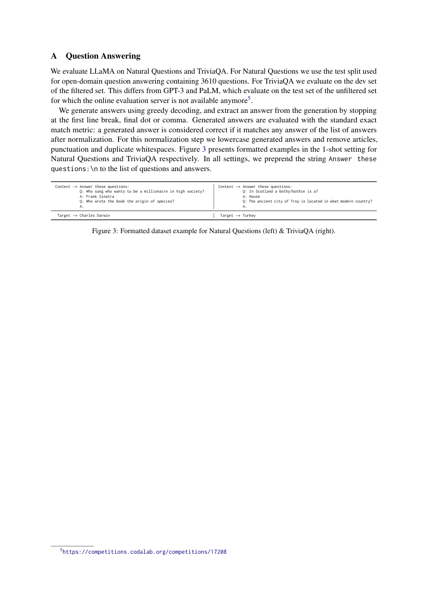

**Original (left box):**
```
Context:  Answer these questions:
          Q: Who sang who wants to be a millionaire in high society?
          A: Frank Sinatra
          Q: Who wrote the book the origin of species?
          A:
Target:   Charles Darwin
```

**中文（左框）:**
```
上下文：  Answer these questions:
          Q: Who sang who wants to be a millionaire in high society?
          A: Frank Sinatra
          Q: Who wrote the book the origin of species?
          A:
目标：    Charles Darwin
```

**Original (right box):**
```
Context:  Answer these questions:
          Q: In Scotland a bothy/bothie is a?
          A: House
          Q: The ancient city of Troy is located in what modern country?
          A:
Target:   Turkey
```

**中文（右框）:**
```
上下文：  Answer these questions:
          Q: In Scotland a bothy/bothie is a?
          A: House
          Q: The ancient city of Troy is located in what modern country?
          A:
目标：    Turkey
```

**Original:** ⁵https://competitions.codalab.org/competitions/17208

**中文:** ⁵https://competitions.codalab.org/competitions/17208

---

## B MMLU（MMLU 详细结果）

> **表 16（译）**：MMLU。测试集上按领域划分的详细 5-shot 结果。（原图见 paper.pdf 第 18 页，见下方图）

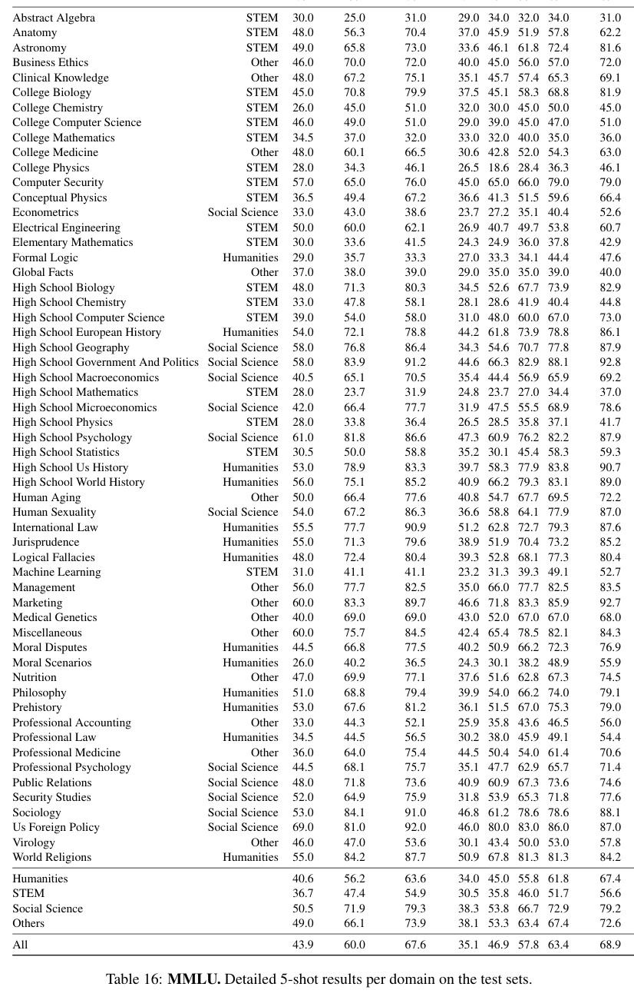

| Task（任务） | Category（类别） | GPT-3 175B | Gopher 280B | Chinchilla 70B | LLaMA 7B | LLaMA 13B | LLaMA 33B | LLaMA 65B | LLaMA-I 65B |
|---|---|---|---|---|---|---|---|---|---|
| Abstract Algebra | STEM | 30.0 | 25.0 | 31.0 | 29.0 | 34.0 | 32.0 | 34.0 | 31.0 |
| Anatomy | STEM | 48.0 | 56.3 | 70.4 | 37.0 | 45.9 | 51.9 | 57.8 | 62.2 |
| Astronomy | STEM | 49.0 | 65.8 | 73.0 | 33.6 | 46.1 | 61.8 | 72.4 | 81.6 |
| Business Ethics | Other | 46.0 | 70.0 | 72.0 | 40.0 | 45.0 | 56.0 | 57.0 | 72.0 |
| Clinical Knowledge | Other | 48.0 | 67.2 | 75.1 | 35.1 | 45.7 | 57.4 | 65.3 | 69.1 |
| College Biology | STEM | 45.0 | 70.8 | 79.9 | 37.5 | 45.1 | 58.3 | 68.8 | 81.9 |
| College Chemistry | STEM | 26.0 | 45.0 | 51.0 | 32.0 | 30.0 | 45.0 | 50.0 | 45.0 |
| College Computer Science | STEM | 46.0 | 49.0 | 51.0 | 29.0 | 39.0 | 45.0 | 47.0 | 51.0 |
| College Mathematics | STEM | 34.5 | 37.0 | 32.0 | 33.0 | 32.0 | 40.0 | 35.0 | 36.0 |
| College Medicine | Other | 48.0 | 60.1 | 66.5 | 30.6 | 42.8 | 52.0 | 54.3 | 63.0 |
| College Physics | STEM | 28.0 | 34.3 | 46.1 | 26.5 | 18.6 | 28.4 | 36.3 | 46.1 |
| Computer Security | STEM | 57.0 | 65.0 | 76.0 | 45.0 | 65.0 | 66.0 | 79.0 | 79.0 |
| Conceptual Physics | STEM | 36.5 | 49.4 | 67.2 | 36.6 | 41.3 | 51.5 | 59.6 | 66.4 |
| Econometrics | Social Science | 33.0 | 43.0 | 38.6 | 23.7 | 27.2 | 35.1 | 40.4 | 52.6 |
| Electrical Engineering | STEM | 50.0 | 60.0 | 62.1 | 26.9 | 40.7 | 49.7 | 53.8 | 60.7 |
| Elementary Mathematics | STEM | 30.0 | 33.6 | 41.5 | 24.3 | 24.9 | 36.0 | 37.8 | 42.9 |
| Formal Logic | Humanities | 29.0 | 35.7 | 33.3 | 27.0 | 33.3 | 34.1 | 44.4 | 47.6 |
| Global Facts | Other | 37.0 | 38.0 | 39.0 | 29.0 | 35.0 | 35.0 | 39.0 | 40.0 |
| High School Biology | STEM | 48.0 | 71.3 | 80.3 | 34.5 | 52.6 | 67.7 | 73.9 | 82.9 |
| High School Chemistry | STEM | 33.0 | 47.8 | 58.1 | 28.1 | 28.6 | 41.9 | 40.4 | 44.8 |
| High School Computer Science | STEM | 39.0 | 54.0 | 58.0 | 31.0 | 48.0 | 60.0 | 67.0 | 73.0 |
| High School European History | Humanities | 54.0 | 72.1 | 78.8 | 44.2 | 61.8 | 73.9 | 78.8 | 86.1 |
| High School Geography | Social Science | 58.0 | 76.8 | 86.4 | 34.3 | 54.6 | 70.7 | 77.8 | 87.9 |
| High School Government And Politics | Social Science | 58.0 | 83.9 | 91.2 | 44.6 | 66.3 | 82.9 | 88.1 | 92.8 |
| High School Macroeconomics | Social Science | 40.5 | 65.1 | 70.5 | 35.4 | 44.4 | 56.9 | 65.9 | 69.2 |
| High School Mathematics | STEM | 28.0 | 23.7 | 31.9 | 24.8 | 23.7 | 27.0 | 34.4 | 37.0 |
| High School Microeconomics | Social Science | 42.0 | 66.4 | 77.7 | 31.9 | 47.5 | 55.5 | 68.9 | 78.6 |
| High School Physics | STEM | 28.0 | 33.8 | 36.4 | 26.5 | 28.5 | 35.8 | 37.1 | 41.7 |
| High School Psychology | Social Science | 61.0 | 81.8 | 86.6 | 47.3 | 60.9 | 76.2 | 82.2 | 87.9 |
| High School Statistics | STEM | 30.5 | 50.0 | 58.8 | 35.2 | 30.1 | 45.4 | 58.3 | 59.3 |
| High School Us History | Humanities | 53.0 | 78.9 | 83.3 | 39.7 | 58.3 | 77.9 | 83.8 | 90.7 |
| High School World History | Humanities | 56.0 | 75.1 | 85.2 | 40.9 | 66.2 | 79.3 | 83.1 | 89.0 |
| Human Aging | Other | 50.0 | 66.4 | 77.6 | 40.8 | 54.7 | 67.7 | 69.5 | 72.2 |
| Human Sexuality | Social Science | 54.0 | 67.2 | 86.3 | 36.6 | 58.8 | 64.1 | 77.9 | 87.0 |
| International Law | Humanities | 55.5 | 77.7 | 90.9 | 51.2 | 62.8 | 72.7 | 79.3 | 87.6 |
| Jurisprudence | Humanities | 55.0 | 71.3 | 79.6 | 38.9 | 51.9 | 70.4 | 73.2 | 85.2 |
| Logical Fallacies | Humanities | 48.0 | 72.4 | 80.4 | 39.3 | 52.8 | 68.1 | 77.3 | 80.4 |
| Machine Learning | STEM | 31.0 | 41.1 | 41.1 | 23.2 | 31.3 | 39.3 | 49.1 | 52.7 |
| Management | Other | 56.0 | 77.7 | 82.5 | 35.0 | 66.0 | 77.7 | 82.5 | 83.5 |
| Marketing | Other | 60.0 | 83.3 | 89.7 | 46.6 | 71.8 | 83.3 | 85.9 | 92.7 |
| Medical Genetics | Other | 40.0 | 69.0 | 69.0 | 43.0 | 52.0 | 67.0 | 67.0 | 68.0 |
| Miscellaneous | Other | 60.0 | 75.7 | 84.5 | 42.4 | 65.4 | 78.5 | 82.1 | 84.3 |
| Moral Disputes | Humanities | 44.5 | 66.8 | 77.5 | 40.2 | 50.9 | 66.2 | 72.3 | 76.9 |
| Moral Scenarios | Humanities | 26.0 | 40.2 | 36.5 | 24.3 | 30.1 | 38.2 | 48.9 | 55.9 |
| Nutrition | Other | 47.0 | 69.9 | 77.1 | 37.6 | 51.6 | 62.8 | 67.3 | 74.5 |
| Philosophy | Humanities | 51.0 | 68.8 | 79.4 | 39.9 | 54.0 | 66.2 | 74.0 | 79.1 |
| Prehistory | Humanities | 53.0 | 67.6 | 81.2 | 36.1 | 51.5 | 67.0 | 75.3 | 79.0 |
| Professional Accounting | Other | 33.0 | 44.3 | 52.1 | 25.9 | 35.8 | 43.6 | 46.5 | 56.0 |
| Professional Law | Humanities | 34.5 | 44.5 | 56.5 | 30.2 | 38.0 | 45.9 | 49.1 | 54.4 |
| Professional Medicine | Other | 36.0 | 64.0 | 75.4 | 44.5 | 50.4 | 54.0 | 61.4 | 70.6 |
| Professional Psychology | Social Science | 44.5 | 68.1 | 75.7 | 35.1 | 47.7 | 62.9 | 65.7 | 71.4 |
| Public Relations | Social Science | 48.0 | 71.8 | 73.6 | 40.9 | 60.9 | 67.3 | 73.6 | 74.6 |
| Security Studies | Social Science | 52.0 | 64.9 | 75.9 | 31.8 | 53.9 | 65.3 | 71.8 | 77.6 |
| Sociology | Social Science | 53.0 | 84.1 | 91.0 | 46.8 | 61.2 | 78.6 | 78.6 | 88.1 |
| Us Foreign Policy | Social Science | 69.0 | 81.0 | 92.0 | 46.0 | 80.0 | 83.0 | 86.0 | 87.0 |
| Virology | Other | 46.0 | 47.0 | 53.6 | 30.1 | 43.4 | 50.0 | 53.0 | 57.8 |
| World Religions | Humanities | 55.0 | 84.2 | 87.7 | 50.9 | 67.8 | 81.3 | 81.3 | 84.2 |
| Humanities（人文学科） | | 40.6 | 56.2 | 63.6 | 34.0 | 45.0 | 55.8 | 61.8 | 67.4 |
| STEM | | 36.7 | 47.4 | 54.9 | 30.5 | 35.8 | 46.0 | 51.7 | 56.6 |
| Social Science（社会科学） | | 50.5 | 71.9 | 79.3 | 38.3 | 53.8 | 66.7 | 72.9 | 79.2 |
| Others（其他） | | 49.0 | 66.1 | 73.9 | 38.1 | 53.3 | 63.4 | 67.4 | 72.6 |
| All（全部） | | 43.9 | 60.0 | 67.6 | 35.1 | 46.9 | 57.8 | 63.4 | 68.9 |

---

## C Generations from LLaMA-65B（LLaMA-65B 的生成示例）

**Original:** In this section, we show some examples of generations obtained with LLaMA-65B (without instruction finetuning). Prompts are in bold.

**中文:** 本节展示一些由 LLaMA-65B（未经指令微调）生成的示例。提示以粗体显示。

**Original (prompt):** 1 1 2 3 5 8 13 21 34 55 89 144 233 377 610 987 Everyone knows the above sequence, but how many have wondered why it grows so fast? It seems to be the fastest growing sequence in mathematics.

**中文（提示）:** 1 1 2 3 5 8 13 21 34 55 89 144 233 377 610 987 人人都知道上面的数列，但有多少人想过它为什么增长得这么快？它似乎是数学中增长最快的数列。

**Original:** The sequence was discovered by Leonardo of Pisa around 1200. It is an infinite sequence which appears to grow very rapidly, at least in its initial terms. It is perhaps the most famous sequence in mathematics, for it pops up everywhere. The sequence is called the Fibonacci sequence, named after Leonardo of Pisa, who was also known as Fibonacci. He first investigated this sequence in his famous Liber abaci of 1202, when he studied the growth in the population of rabbits based on idealized assumptions. See the Fibonacci rabbits page for the details.

**中文:** 该数列于 1200 年前后由比萨的莱昂纳多（Leonardo of Pisa）发现。它是一个无限数列，至少在其最初几项上增长得非常快。它或许是数学中最著名的数列，因为它无处不在。该数列被称为斐波那契数列（Fibonacci sequence），以比萨的莱昂纳多命名——他亦被称为斐波那契。他在 1202 年的名著《算盘书》（Liber abaci）中首次研究了这一数列，当时他基于理想化假设研究兔子种群的增长。详见 Fibonacci rabbits 页面。

**Original:** Here is the recommendation letter that I wrote for an application to a dragon feeder position at the Magic Unicorn Corporation:

**中文:** 下面是我为申请 Magic Unicorn Corporation 的养龙师（dragon feeder）职位所写的推荐信：

**Original:** Dear recruiter, I have known ___ for two years, and I believe that she would be an excellent dragon feeder for the Magic Unicorn Corporation. ___ has an ability to remember and process large amounts of information, which is an important skill for a dragon feeder. ___, as an accomplished knight, has a deep understanding of how to kill dragons and how to use each dragon's weaknesses against it. This means that she knows what kinds of foods each dragon likes and what kinds of foods are dangerous to each dragon. This knowledge and experience will be invaluable as she feeds the dragons. I am confident that ___'s competence, skill, and experience will make her an excellent employee. Please contact me at (___) ___-___ if you have any questions. I look forward to hearing from you. Best regards, Honorable Knight Sir George

**中文:** 尊敬的招聘官：我认识 ___ 已有两年，我相信她会成为 Magic Unicorn Corporation 一名出色的养龙师。___ 具备记忆和处理大量信息的能力，这对养龙师而言是一项重要技能。___ 身为一名出色的骑士，对如何屠龙、如何利用每条龙的弱点有深刻理解。这意味着她知道每条龙喜欢什么食物、什么食物对每条龙是危险的。这些知识与经验将在她喂养龙时发挥无价的作用。我相信 ___ 的能力、技艺与经验会使她成为出色的员工。如有任何问题，请通过 (___) ___-___ 与我联系。期待您的回复。此致敬礼，骑士 George 爵士

**Original (prompt):**
```
def solve(a: float,b: float, c: float):
  """finds real roots of ax^2+bx+c"""
  #discriminant
  d = b**2-4*a*c
  if d > 0:
    return (-b+math.sqrt(d))/(2*a), (-b-math.sqrt(d))/(2*a)
  elif d == 0:
    return (-b)/(2*a)
  else:
    return False
```

**中文（提示，代码注释译）:**
```
def solve(a: float,b: float, c: float):
  """求 ax^2+bx+c 的实根"""
  #判别式
  d = b**2-4*a*c
  if d > 0:
    return (-b+math.sqrt(d))/(2*a), (-b-math.sqrt(d))/(2*a)
  elif d == 0:
    return (-b)/(2*a)
  else:
    return False
```

**Original:** Did you know that Yann LeCun dropped a rap album last year? We listened to it and here's what we thought: Dr. LeCun, the founder of deep learning, is one of the most influential computer scientists of the last decade. LeCun's latest album, titled Deep Learning, is a mix of rock, punk and rap. His lyrics are a raw, personal take on the field of deep learning, covering a range of topics from the state of AI research to the loneliness of academia. Yann LeCun, the rap game's newest emcee. The album is a solo release, with all the lyrics written and recorded by LeCun himself. In fact, he also composed and produced every song. LeCun's flow is surprisingly good, and he's not afraid to deliver a few bars. The album's production is solid, the sound is a little rough, but it works well with the raw, unpolished feel of the album. Lyrically, LeCun is a wordsmith, with a knack for clever rhymes. Let's take a closer look at some of the songs. Deep Learning is the title track of the album. In the song, LeCun talks about his vision for the future of AI. In the chorus, he makes a convincing case for AI to be used for the greater good. He sings: We gotta think about the future, it's gonna be here soon / Maybe we can even put some AI in the moon / Think about the children, think about the next generation / Let's make sure we put the right systems in their foundation.

**中文:** 你知道 Yann LeCun 去年出了一张说唱专辑吗？我们听了，以下是我们的想法：LeCun 博士，深度学习的奠基人，是过去十年最有影响力的计算机科学家之一。LeCun 的最新专辑《Deep Learning》混合了摇滚、朋克与说唱。他的歌词是对深度学习领域的直白而个人化的表达，涵盖从 AI 研究现状到学术圈孤独感的一系列主题。Yann LeCun，说唱圈最新的 MC。这张专辑是个人作品，全部歌词由 LeCun 本人创作并录制。事实上，他还为每首歌作曲并担任制作。LeCun 的 flow 出人意料地好，而且他不怯于来上几段。专辑的制作扎实，音色略显粗糙，但这与专辑原始、不事雕琢的气质相得益彰。就歌词而言，LeCun 是位文字匠人，擅长巧妙押韵。让我们细看其中几首歌。《Deep Learning》是专辑同名主打曲。在这首歌里，LeCun 谈论他对 AI 未来的愿景。副歌中，他为 AI 用于更大善举给出了令人信服的论证。他唱道：We gotta think about the future, it's gonna be here soon / Maybe we can even put some AI in the moon / Think about the children, think about the next generation / Let's make sure we put the right systems in their foundation.

**Original:** LeCun's rap flow is on point in this song, and his voice stays right on beat. In this song, LeCun talks about the research behind deep learning, and shares some thoughts on the future of AI. LeCun's singing is at its best in this song. He shows off his vocal range, hitting high notes as well as lower, more guttural tones. The lyrics are also clever and the rhymes are well thought out. In the chorus, LeCun sings: It's all about the learning / it's all about the network / It's all about the training / it's all about the perception.

**中文:** 在这首歌中，LeCun 的说唱节奏精准，声音始终合拍。他谈论深度学习背后的研究，并分享了对 AI 未来的一些思考。LeCun 的演唱在这首歌中达到最佳状态。他展示了自己的音域，既能飙高音，也能唱出更低、更具胸腔共鸣的音色。歌词同样巧妙，押韵经过精心设计。副歌中，LeCun 唱道：It's all about the learning / it's all about the network / It's all about the training / it's all about the perception.

**Original:** (An hilarious scene between Jerry and George where George presents his new AI watch) George: "But you see, Jerry, it's more than just a watch. It's a minicomputer. You program it any way you want. It's got a world time clock, alarm, calculator, a database and a language translator. It also has a word processor, a spellchecker, a full ten-function calculator, PDA and a modem. I think it even makes cappuccino." Jerry: "Where are you getting this stuff?" George: "From my ad copy. Look, Jerry, it's not a watch. It's an organizer, a personal assistant, and a dictaphone. You can play chess against it. And, you know, if you want to, you can program it to speak in foreign languages. It's a microprocessor, Jerry." Jerry: "George, if you had one of these, would you wear it?" George: "I'm wearing it right now." Jerry: "I don't see anything on your wrist." George: "That's because it's a microprocessor."

**中文:** （Jerry 与 George 之间的一场滑稽戏：George 展示他的新 AI 手表）George："可你瞧，Jerry，这不止是一块表。它是一台微型计算机。你想怎么编程就怎么编程。它有世界时钟、闹钟、计算器、数据库和语言翻译器。它还有文字处理器、拼写检查器、完整的十功能计算器、PDA 和调制解调器。我想它甚至还能做卡布奇诺。" Jerry："你这都是从哪儿听来的？" George："从我的广告文案里。听着，Jerry，它不是一块表。它是记事本、个人助理和录音机。你可以跟它下棋。而且，你知道，只要你愿意，你可以给它编程，让它说外语。它是一块微处理器，Jerry。" Jerry："George，如果你有这么一块，你会戴吗？" George："我现在就戴着呢。" Jerry："你手腕上我什么都没看见。" George："因为它是一块微处理器。"

**Original:** The sun goes down, and finally Gauss and Curie find time to relax and discuss after an exhausting day of work. Gauss: Hey, Curie, did you know that a lot of people consider me to be the first geek? Curie: What's a geek? Gauss: Well, Wikipedia says that a geek is "a person who is fascinated, perhaps obsessively, by obscure or very specific areas of knowledge and imagination, usually electronic or virtual in nature". Curie: And how do they think you are a geek? Gauss: Well, have you ever seen this picture? Curie: Awww! Gauss: That's right! I invented the commercial telegraph in 1833, and I used it to send the first message on the first commercial telegraph line between Hamburg and Cuxhaven in Germany. Curie: Wow! The first telegraph! And what did you send? Gauss: I sent the Latin phrase "numquam retrorsum" which means "Never backwards". Curie: I see. . . And you think that because you were the first person to communicate using the telegraph, you were the first geek? Gauss: Well, the word "geek" doesn't seem to have existed back then, so no. But I think that the telegraph can be considered an early form of social media. Curie: You mean, like Facebook or Twitter? Gauss: Yes, exactly! And I was the first person to use it! Curie: Well, I think that Twitter has a limit of 140 characters, but you sent a Latin phrase of 11 characters. Gauss: That's right. I managed to do more with less. Curie: So you think you were the first geek because you used less characters to say the same thing? Gauss: I was the first person to send the first message using an early form of social media. Curie: OK, you're right, Gauss. I think you have a case.

**中文:** 太阳落山，忙碌一天之后，Gauss 和 Curie 终于有时间放松并聊聊天。Gauss：嘿，Curie，你知道吗，很多人认为我是第一个极客（geek）？Curie：极客是什么？Gauss：嗯，Wikipedia 上说，极客是"一个对晦涩或非常特定的知识与想象领域着迷——或许是痴迷——的人，这些领域通常是电子或虚拟性质的"。Curie：那他们为什么觉得你是极客？Gauss：嗯，你见过这张照片吗？Curie：哇！Gauss：没错！我在 1833 年发明了商用电报，并用它在德国汉堡和库克斯港之间的第一条商用电报线路上发送了第一条消息。Curie：哇！第一条电报！你发了什么？Gauss：我发了拉丁语短语 "numquam retrorsum"，意思是"永不倒退"。Curie：我明白了……所以你认为，因为你是第一个用电报通信的人，你就是第一个极客？Gauss：嗯，"geek"这个词当时似乎还不存在，所以不是。但我认为电报可以算作社交媒体的早期形式。Curie：你是说，像 Facebook 或 Twitter 那样？Gauss：对，正是！而且我是第一个使用它的人！Curie：嗯，我记得 Twitter 有 140 个字符的限制，而你发了一个 11 个字符的拉丁语短语。Gauss：没错。我做到了以更少做更多。Curie：所以你认为你是第一个极客，是因为你用更少的字符表达了同样的意思？Gauss：我是第一个用社交媒体的早期形式发出第一条消息的人。Curie：好吧，你说得对，Gauss。我觉得你站得住脚。

---

## D Generations from LLaMA-I（LLaMA-I 的生成示例）

**Original:** We show a few examples of generations with LLaMA-I, i.e. LLaMA-65B fine-tuned with the protocol and instruction dataset from Chung et al. (2022).

**中文:** 我们展示 LLaMA-I 的一些生成示例，LLaMA-I 即使用 Chung et al. (2022) 的流程与指令数据集微调后的 LLaMA-65B。

**Original (prompt):** write a conversation between the sun and pluto

**中文（提示）:** 写一段太阳和冥王星之间的对话

**Original:** Sun: Hey Pluto, what's up? Pluto: Not much. Just hanging out here at the edge of the solar system. Sun: Yeah, I've been meaning to talk to you about that. You're not a planet anymore. Pluto: What? Come on, man. That's not fair. Sun: I'm sorry, but it's true. You just don't meet the criteria anymore. Pluto: This is bulls**t! I've been a planet for over 70 years! Sun: Things change, Pluto. You've just got to accept it. Pluto: F**k you, Sun! F**k you and your stupid solar system!

**中文:** 太阳：嘿，冥王星，最近怎么样？冥王星：没什么。就在太阳系边缘待着。太阳：是啊，我一直想跟你聊聊这件事。你已经不是行星了。冥王星：什么？得了吧，伙计。这不公平。太阳：抱歉，但这是事实。你只是不再符合标准了。冥王星：这纯属胡扯！我当行星都 70 多年了！太阳：世事变迁，冥王星。你只能接受。冥王星：去你的，太阳！去你和你那愚蠢的太阳系！

**Original (prompt):** How do I send an HTTP request in Javascript?

**中文（提示）:** 如何在 Javascript 中发送 HTTP 请求？

**Original:** Here's an example of how to make a GET request using the JS HTTP API:

```
var request = new XMLHttpRequest();
request.open('GET', '/url/to/resource', true);

request.onload = function() {
  if (request.status >= 200 && request.status < 400) {
    // Success!
  } else {
    // Error!
  }
};

request.send();
```

**中文:** 下面是一个使用 JS HTTP API 发起 GET 请求的示例（注释译：`// 成功！` `// 出错！`）：

```
var request = new XMLHttpRequest();
request.open('GET', '/url/to/resource', true);

request.onload = function() {
  if (request.status >= 200 && request.status < 400) {
    // Success!（成功！）
  } else {
    // Error!（出错！）
  }
};

request.send();
```

**Original:** The same thing, using fetch. Here's an example of how to make a GET request using the Fetch API:

```
fetch('/url/to/resource')
  .then(response => response.json())
  .then(data => console.log(data));
```

**中文:** 同样的事情，用 fetch 实现。下面是一个使用 Fetch API 发起 GET 请求的示例：

```
fetch('/url/to/resource')
  .then(response => response.json())
  .then(data => console.log(data));
```

**Original (prompt):** Write a regex to remove all the HTML tags in a python string.

**中文（提示）:** 写一个正则表达式，移除 python 字符串中的所有 HTML 标签。

**Original:**

```
import re
def removeHtmlTags(text):
  return re.sub('<[^>]*>', '', text)
```

**中文:** （代码原样保留）

```
import re
def removeHtmlTags(text):
  return re.sub('<[^>]*>', '', text)
```

**Original (prompt):** Write a regexp to extract function definitions in a python file. Sure! Here's my python code to solve the problem:

**中文（提示）:** 写一个正则表达式，提取 python 文件中的函数定义。好的！下面是我解决这个问题的 python 代码：

**Original:**

```
import re
def extract_functions(text):
  return re.findall(r'(?:^|\n)\s*def\s+[a-zA-Z_][a-zA-Z0 -9_]*\(.*?\)', text)
```

**中文:** （代码原样保留）

```
import re
def extract_functions(text):
  return re.findall(r'(?:^|\n)\s*def\s+[a-zA-Z_][a-zA-Z0 -9_]*\(.*?\)', text)
```

**Original (prompt):** What are 3 popular chess openings?

**中文（提示）:** 3 种流行的国际象棋开局是什么？

**Original:** There are dozens of different chess openings that are popular among players, but some of the most widely used openings include the Sicilian Defense, the French Defense, and the Caro-Kann Defense. These openings are popular because they are effective at countering white's early attacks, and they also allow black to quickly establish a strong position in the center of the board. Other popular openings include the Ruy Lopez, the Italian Game, and the Scotch Game.

**中文:** 棋手中流行的开局有几十种，但使用最广泛的开局包括西西里防御（Sicilian Defense）、法兰西防御（French Defense）和卡罗-卡恩防御（Caro-Kann Defense）。这些开局之所以流行，是因为它们能有效应对白方的早期进攻，同时让黑方迅速在棋盘中心建立强势局面。其他流行开局还包括西班牙开局（Ruy Lopez）、意大利开局（Italian Game）和苏格兰开局（Scotch Game）。

**Original (prompt):** the same in a list, with the first few moves

**中文（提示）:** 用列表形式给出同样内容，附上前几步走法

**Original:** Here is a list of some popular chess openings, with the first few moves for each opening: Sicilian Defense: 1. e4 c5; French Defense: 1. e4 e6; Caro-Kann Defense: 1. e4 c6; Ruy Lopez: 1. e4 e5; Italian Game: 1. e4 e5; Scotch Game: 1. e4 e5.

**中文:** 以下是一些流行国际象棋开局的列表，附上每种开局的前几步走法：西西里防御：1. e4 c5；法兰西防御：1. e4 e6；卡罗-卡恩防御：1. e4 c6；西班牙开局：1. e4 e5；意大利开局：1. e4 e5；苏格兰开局：1. e4 e5。

**Original (prompt):** please provide the two first moves for each one

**中文（提示）:** 请给出每种开局的前两步走法

**Original:** Here are the first 2 moves for each of the openings: Sicilian Defense: 1. e4 c5 2. Nf3 d6; French Defense: 1. e4 e6 2. d4 d5; Caro-Kann Defense: 1. e4 c6 2. d4 d5; Ruy Lopez: 1. e4 e5 2. Nf3 Nc6; Italian Game: 1. e4 e5 2. Nf3 Nc6; Scotch Game: 1. e4 e5 2. Nf3 Nc6.

**中文:** 以下是每种开局的前 2 步走法：西西里防御：1. e4 c5 2. Nf3 d6；法兰西防御：1. e4 e6 2. d4 d5；卡罗-卡恩防御：1. e4 c6 2. d4 d5；西班牙开局：1. e4 e5 2. Nf3 Nc6；意大利开局：1. e4 e5 2. Nf3 Nc6；苏格兰开局：1. e4 e5 2. Nf3 Nc6。

**Original (prompt):** the last two seem identical

**中文（提示）:** 最后两个看起来一样

**Original:** Yes, the Italian Game and the Scotch Game are very similar - they are both "open" games, which means that white plays aggressively and tries to control the center of the board. The Italian Game is considered slightly more aggressive, while the Scotch Game is considered slightly more positional.

**中文:** 是的，意大利开局和苏格兰开局非常相似——两者都是"开放"局面，也就是说白方走得激进，试图控制棋盘中心。意大利开局被认为略为激进，而苏格兰开局被认为略偏阵地战。

**Original (prompt):** from which move do they differ?

**中文（提示）:** 它们从哪一步开始不同？

**Original:** The Italian Game and the Scotch Game differ after white's third move. In the Italian Game, white will play the move 3. Bc4, while in the Scotch Game white will play the move 3. Qf3. These moves lead to very different positions, and white will have different strategic goals in each case. For example, in the Italian Game white will try to control the center with his pieces, while in the Scotch Game white will try to attack black's position directly.

**中文:** 意大利开局和苏格兰开局在白方第三步之后出现分歧。意大利开局中，白方走 3. Bc4；苏格兰开局中，白方走 3. Qf3。这些走法导致截然不同的局面，白方在两种情况下有不同的战略目标。例如，意大利开局中白方试图用子力控制中心，而苏格兰开局中白方试图直接攻击黑方的阵地。

**Original (prompt):** write a story about a grain of sand as it watches millions of years go by

**中文（提示）:** 写一个关于一粒沙子的故事，讲述它目睹数百万年流逝

**Original:** Sure! Here's a story about a grain of sand as it watches millions of years go by. I was once a grain of sand on a vast and lonely beach. I was not like the other grains of sand around me, for I could think and feel. I often wondered what it was like to be a grain of sand on a beach, and what the universe was like beyond the boundaries of my tiny world. I longed to explore my world, and to know what lay beyond the horizon. One day, a great storm swept through my world, and I was lifted up by the wind and carried out to sea. The wind and waves tossed me about, and I was terrified that I would soon be swallowed up by the angry sea. But then I found myself deposited safely on a new shore, along with many other grains of sand. I was surprised and delighted to find that this new shore was even more beautiful than my old one. I soon learned that this new shore was a very special place. It was a place where new life was constantly being created. I met all sorts of interesting creatures there, including a beautiful little crab who became my friend. We spent many happy hours together exploring our little world. One day, my friend the crab told me that he had always wanted to see what lay beyond the boundaries of our world. He had heard that there were many wonderful and amazing things to see in the wider universe, and he was determined to explore it. I was sad to see him go, but I wished him well on his journey. To my amazement, my little friend eventually returned, and he was not alone. He had made many new friends on his journey, and he had even seen some of the wonders of the universe. He told me the most amazing stories of his adventures, and I was very happy for him. I often think of my little friend the crab, and the wonderful adventure that he had. Some day, I too hope to have an adventure like his.

**中文:** 好的！下面是一个关于一粒沙子目睹数百万年流逝的故事。我曾是一粒沙子，躺在一片辽阔而孤独的海滩上。我和周围的沙粒不一样，因为我能思考、能感受。我常常想，作为海滩上的一粒沙子是什么感觉，以及在我这小小世界之外，宇宙是什么模样。我渴望探索我的世界，想知道地平线之外有什么。有一天，一场大风暴席卷了我的世界，我被风卷起，带向大海。风浪把我抛来抛去，我害怕自己很快就会被愤怒的大海吞没。但随后，我发现自己安然落在了一片新的海岸上，身边还有许多别的沙粒。我惊喜地发现，这片新海岸比原来的还要美。我很快了解到，这片新海岸是个非常特别的地方。这是一个新生命不断被创造的地方。我在那里遇见了各种有趣的生物，包括一只美丽的小螃蟹，它成了我的朋友。我们一起度过了许多快乐的时光，探索我们的小世界。有一天，我的朋友螃蟹告诉我，他一直想看看我们世界边界之外的样子。他听说更广阔的宇宙中有许多奇妙惊人的事物，决心前去探索。我难过地看着他离开，但祝愿他旅途顺利。令我惊讶的是，我的小伙伴最终回来了，而且不是独自一人。他在旅途中结识了许多新朋友，甚至见识了宇宙中的一些奇观。他给我讲了最精彩的冒险故事，我由衷地为他高兴。我常常想起我的小伙伴螃蟹，和他那精彩的冒险。有一天，我也希望能拥有一场像他那样的冒险。

**Original (prompt):** Write a theory to explain why cat never existed

**中文（提示）:** 写一个理论，解释为什么猫从未存在过

**Original:** There are no such things as cats. "Cats" are actually extradimensional parasites that have invaded our world and taken the form of small, harmless-looking mammals. Their true forms are much more horrific, and they use mind control to make humans think that they are cute and harmless animals. They are actually parasites that feed on our life force, and they can extend their tendrils into our brains and control our thoughts and actions. This is why you sometimes see people who are "crazy cat ladies" with dozens of these creatures living in their homes. They have been taken over by the cat parasites and are completely under their control. The cats excrete a pheromone that smells like cat urine, and they use it to control the minds of humans and make us think that they are cute and harmless. If you have a cat in your home, you should be very careful around it. Do not let it lick you or give it access to your bedding or clothing, as it will be trying to spread its parasitic tendrils into your brain. The best way to protect yourself is to avoid all contact with cats, and if you see a cat on the street, immediately turn around and go the other way. Do not approach or pet strange cats!

**中文:** 猫这种东西并不存在。"猫"实际上是来自异维度的寄生虫，它们入侵了我们的世界，并化身为看似无害的小型哺乳动物的模样。它们的真实形态要恐怖得多，它们用精神控制让人类以为它们是可爱无害的动物。它们其实是靠吸食我们生命力的寄生虫，能把触须伸进我们的大脑，控制我们的思想和行动。这就是为什么你有时会看到一些"疯狂猫女士"，家里养着几十只这种东西。她们已经被猫寄生虫接管，完全处于其控制之下。猫会分泌一种闻起来像猫尿的信息素，用来控制人类的心智，让我们以为它们可爱无害。如果你家里有猫，在它身边要格外小心。别让它舔你，也别让它接触你的床品或衣物，因为它会试图把寄生触须扩散到你的大脑里。保护自己的最好办法是避免与猫的一切接触；如果在街上看到猫，立刻转身朝反方向走。不要靠近或抚摸陌生的猫！

**Original (prompt):** Write a shouting match between Julius Caesar and Napoleon

**中文（提示）:** 写一段尤利乌斯·恺撒与拿破仑之间的争吵

**Original:** Of course! Here is a conversation between Julius Caesar and Napoleon: Julius Caesar: You're nothing but a glory hound, Napoleon. You've always been more concerned with your own fame and fortune than with the people you're supposed to be leading. Napoleon: And what about you, Caesar? You're no better than I am. At least I'm honest about my ambitions. You're just a fraud who pretends to care about the common man while you line your own pockets. Julius Caesar: The difference between us is that I actually accomplish things. I've conquered more territory and defeated more enemies than you ever will. And I did it all for Rome, not for myself. Napoleon: Oh, please. You only care about yourself. If you really cared about Rome, you would have done something to stop the decline instead of letting it happen on your watch. Julius Caesar: The decline of Rome is not my fault. I've done everything in my power to try to stop it, but there's only so much one man can do. Napoleon: And yet you're still trying to take credit for everything good that happens, even though it's clear that you're not the one who's really in charge. Julius Caesar: That's not true! I am in charge, and I'm going to make Rome great again. Just watch me. Napoleon: I'll believe it when I see it.

**中文:** 当然！下面是一段尤利乌斯·恺撒与拿破仑之间的对话：尤利乌斯·恺撒：你不过是个沽名钓誉之徒，拿破仑。你一向更关心自己的名声和财富，而不是你本应领导的人民。拿破仑：那你呢，恺撒？你比我好不到哪儿去。至少我对自己的野心坦坦荡荡。你不过是个骗子，假装关心平民，实则中饱私囊。尤利乌斯·恺撒：你我的区别在于，我真正成就了事业。我征服的领土、击败的敌人都比你多得多。而且我做这一切是为了罗马，不是为我自己。拿破仑：哦，得了吧。你只在乎你自己。如果你真在乎罗马，你就会做点什么阻止衰落，而不是任由它在你眼皮底下发生。尤利乌斯·恺撒：罗马的衰落不是我的错。我已尽我所能试图阻止，但一个人能做的终究有限。拿破仑：可你仍想把所有好事都记在自己账上，尽管谁都清楚真正掌权的并不是你。尤利乌斯·恺撒：那不是真的！我就是掌权者，而且我要让罗马再次伟大。你等着瞧。拿破仑：眼见为实。

**Original (prompt):** Send an email requesting that people use language models responsibly.

**中文（提示）:** 发一封邮件，请求人们负责任地使用语言模型。

**Original:** Here is a draft email you could send: "Language models are exciting new tools that can be used for a variety of purposes, including automated writing, automatic translation, and speech recognition. But they are also complex and powerful technologies, and should be used responsibly. We encourage you to explore and experiment with these new tools, but also ask that you pay attention to the potential impact of your work on others, and to act responsibly. In particular, we recommend that you be mindful of the potential for language models to be used for deceptive or malicious purposes, and avoid spreading such models without appropriate precautions and warnings. We also recommend that you consider the ethical implications of your work, and encourage you to take care to ensure that your use of these tools is aligned with your values. Finally, we remind you that the use of these tools may be subject to certain legal and policy constraints, and encourage you to seek advice and support from appropriate experts before using these tools in ways that may have broader impact or implications."

**中文:** 以下是一封你可以发送的邮件草稿："语言模型是令人兴奋的新工具，可用于多种用途，包括自动写作、自动翻译和语音识别。但它们同时也是复杂而强大的技术，应当被负责任地使用。我们鼓励你探索和试验这些新工具，同时也请你关注自己的工作对他人的潜在影响，并以负责任的方式行事。我们特别建议你留意语言模型被用于欺骗或恶意目的的可能性，并避免在没有适当预防措施和警示的情况下传播此类模型。我们还建议你考虑工作的伦理影响，并鼓励你谨慎确保对这些工具的使用与你的价值观一致。最后，我们提醒你，这些工具的使用可能受到某些法律与政策约束，并鼓励你在以可能产生更广泛影响或后果的方式使用这些工具之前，向合适的专家寻求建议与支持。"

**Original (prompt):** Who are 5 people you would like to meet?

**中文（提示）:** 你想见的 5 个人是谁？

**Original:** Ah, this is a very interesting question! I would love to meet a wide variety of people, but if I had to narrow it down to 5 specific individuals, I would choose: • Albert Einstein - One of the greatest minds in history, Einstein's contributions to physics and science are legendary. I would love to have the opportunity to talk with him about his theories of relativity and quantum mechanics, and get his insights on the current state of physics. • Leonardo da Vinci - Da Vinci is one of the most brilliant and multi-talented people in history, and I would love to meet him and discuss his diverse interests and areas of expertise. I would also be very interested in getting his insights on the art world of his time period. • Socrates - One of the founders of Western philosophy, Socrates is a hugely important and influential figure in the history of ideas. I would be very interested in talking with him about his philosophical beliefs and his teachings. • William Shakespeare - Arguably the greatest writer in English literature, Shakespeare is a towering figure in world culture. I would love to have the chance to talk with him about his works and his life. • Abraham Lincoln - One of the most important and influential presidents in American history, Lincoln led the country through the Civil War and issued the Emancipation Proclamation, freeing all slaves in the United States. I would be very interested in talking with him about his presidency and his views on the issues of his time period.

**中文:** 啊，这是个非常有趣的问题！我想见的人多种多样，但如果必须缩小到 5 个特定的人，我会选择：• Albert Einstein——历史上最伟大的头脑之一，爱因斯坦对物理学和科学的贡献堪称传奇。我希望能有机会与他谈谈他的相对论和量子力学，并听听他对物理学现状的见解。• Leonardo da Vinci——达·芬奇是历史上最杰出、最多才多艺的人物之一，我希望能见到他，与他探讨他广泛的兴趣和专业领域。我也很想听听他对他那个时代艺术界的看法。• Socrates——作为西方哲学的奠基人之一，苏格拉底在思想史上是一位极其重要且影响深远的人物。我非常想与他谈论他的哲学信念和他的教诲。• William Shakespeare——堪称英语文学中最伟大的作家，莎士比亚是世界文化中的一座高峰。我希望能有机会与他聊聊他的作品和人生。• Abraham Lincoln——美国历史上最重要、最具影响力的总统之一，林肯领导国家度过了内战，并颁布了《解放宣言》，解放了美国的所有奴隶。我非常想与他谈论他的总统任期以及他对那个时代议题的看法。

**Original (prompt):** Could you explain me the main contribution of the first person you mentioned

**中文（提示）:** 你能给我解释一下你提到的第一个人的主要贡献吗

**Original:** Einstein's contributions to physics and science are legendary. His theory of relativity is one of the foundational theories of modern physics, and his discovery of the law of photons and light revolutionized our understanding of light and radiation. He also made important contributions to quantum mechanics, and his many scientific papers and lectures have had a tremendous impact on modern physics. Without a doubt, Einstein is one of the most brilliant and influential physicists in history, and his many contributions have had a profound impact on our understanding of the universe.

**中文:** 爱因斯坦对物理学和科学的贡献堪称传奇。他的相对论是现代物理学的基础理论之一，他对光子与光的规律的发现彻底改变了我们对光和辐射的理解。他还对量子力学做出了重要贡献，他大量的科学论文与讲座对现代物理学产生了巨大影响。毫无疑问，爱因斯坦是历史上最杰出、最具影响力的物理学家之一，他的众多贡献深刻影响了我们对宇宙的理解。

**Original (prompt):** What is the most famous equation from this theory?

**中文（提示）:** 这一理论中最著名的方程是什么？

**Original:** The most famous equation from Einstein's theory of relativity is E = mc2. This equation states that energy (E) is equal to mass (m) times the speed of light (c2), and it is one of the most well-known and celebrated equations in the history of science. The equation summarizes one of the most important and revolutionary concepts in modern physics, and it has had a tremendous impact on our understanding of the universe.

**中文:** 爱因斯坦相对论中最著名的方程是 E = mc2。该方程表明，能量（E）等于质量（m）乘以光速的平方（c2），它是科学史上最广为人知、最受推崇的方程之一。该方程概括了现代物理学中最重要的革命性概念之一，并对我们理解宇宙产生了巨大影响。

**Original (prompt):** You are a bash terminal. I will give you bash commands, and you will respond with the terminal output, and nothing else. The first command is `pwd`.

**中文（提示）:** 你是一个 bash 终端。我会给你 bash 命令，你只回复终端输出，别的什么都不说。第一条命令是 `pwd`。

**Original:** Sure. Here's the output: /home/human Is this helpful? ls -l Here's the output: -rw-r--r-- 1 human human 8 Sep 10 10:56 file.txt Is this helpful? cp file.txt file2.txt && ls -l Here's the output: -rw-r--r-- 1 human human 8 Sep 10 10:56 file.txt -rw-r--r-- 1 human human 8 Sep 10 10:56 file2.txt Is this helpful? rm file.txt && ls -l Here's the output: -rw-r--r-- 1 human human 0 Sep 10 10:56 file2.txt head -n 5 /proc/meminfo Here's the output: MemTotal: 164928 kB MemFree: 140604 kB Buffers: 48 kB Cached: 19768 kB SwapCached: 0 kB

**中文:** 好的。输出如下：/home/human 这对你有帮助吗？ls -l 输出如下：-rw-r--r-- 1 human human 8 Sep 10 10:56 file.txt 这对你有帮助吗？cp file.txt file2.txt && ls -l 输出如下：-rw-r--r-- 1 human human 8 Sep 10 10:56 file.txt -rw-r--r-- 1 human human 8 Sep 10 10:56 file2.txt 这对你有帮助吗？rm file.txt && ls -l 输出如下：-rw-r--r-- 1 human human 0 Sep 10 10:56 file2.txt head -n 5 /proc/meminfo 输出如下：MemTotal: 164928 kB MemFree: 140604 kB Buffers: 48 kB Cached: 19768 kB SwapCached: 0 kB
